# Software analysis — Tu Evento

> Consolidated Tu Evento document. It gathers the following documents, whose content is kept unchanged; the conversion metadata of each one is in an HTML comment at the start of its section.

**Contents**

1. [Software analysis](#doc-te-0020)
2. [Software requirements](#doc-te-0022)
3. [Hardware requirements](#doc-te-0076)
4. [Risk matrix](#doc-te-0077)
5. [Use cases — security module](#doc-te-0034-te-0035-te-0036-te-0037-te-0038)
6. [Use cases — events module](#doc-te-0025-te-0026-te-0027-te-0028-te-0029)
7. [Use cases — payments module](#doc-te-0030-te-0031-te-0032-te-0033)
8. [Use cases — wallet module](#doc-te-0023-te-0024)
9. [Use case — draw.io diagram](#doc-te-0039)
10. [Class diagram — config](#doc-te-0040-te-0041)
11. [Class diagram — controller](#doc-te-0042-te-0043)
12. [Class diagram — controller/email](#doc-te-0044-te-0045)
13. [Class diagram — data](#doc-te-0046-te-0047)
14. [Class diagram — dto](#doc-te-0048-te-0049)
15. [Class diagram — dto/email](#doc-te-0050-te-0051)
16. [Class diagram — dto/requests](#doc-te-0052-te-0053)
17. [Class diagram — dto/responses](#doc-te-0054-te-0055)
18. [Class diagram — jwt](#doc-te-0056-te-0057)
19. [Class diagram — model](#doc-te-0058-te-0059)
20. [Class diagram — repository](#doc-te-0060-te-0061)
21. [Class diagram — service](#doc-te-0062-te-0063)
22. [Class diagram — service/aws](#doc-te-0064-te-0065)
23. [Class diagram — service/email](#doc-te-0066-te-0067)
24. [Class diagram — service/impl](#doc-te-0068-te-0069)
25. [Class diagram — service/jwt](#doc-te-0070-te-0071)
26. [Class diagram — service/notification](#doc-te-0072-te-0073)
27. [Class diagram — service/oauth](#doc-te-0074-te-0075)
28. [State diagrams](#doc-te-0021)
29. [Sequence diagrams](#doc-te-0078)

> **Activity diagrams.** The per-module activity diagrams, which complete the dynamic views of this analysis, are in [05_Diseno_Software.md — Activity diagrams by module](05_Diseno_Software.md#doc-te-0082-te-0083-te-0084-te-0085-te-0086-te-0087-te-0088-te-0089-te-0090-te-0091-te-0092-te-0093).

---

<a id="doc-te-0020"></a>

<!--
ruta_anterior: en/02_Analisis_Software/Analisis_del_Software_Tu_evento.md
id: TE-0020
title: "Análisis del Software-Tu evento"
lang: en
source: 02_Analisis_Software/Análisis del Software-Tu evento.docx
source_sha256: 10dd0932cfa76d7a16ecceceff675320340da563fdcd86b30bf8f7b0acc9e733
conversion: "pandoc 3.9 (-t gfm --wrap=none --extract-media) + extraction of headers/footers; without manual review. English translation of md/es: Claude Opus 5.5 (claude-opus-5-5); without manual review"
converted_on: 2026-10-23
fidelity: pendiente_revision
losses:
  - "Headers and footers extracted separately (pandoc does not convert them); in the original they are repeated on every page. The fields are shown as {PAGE}, {NUMPAGES}."
  - "The tables with merged cells or with lists/several paragraphs in the cells are written in HTML (pandoc), because GFM does not support them."
  - "Translation: the words split by spaces in the original text («Pa gina», «creacio n», «contrasen a»…) are translated as complete words; the spelling errors of the original cannot be reproduced in English."
  - "Translation: the interface texts and messages in quotation marks are translated and the Spanish literal is added in parentheses («…»), because the real English text of the interface is not known."
  - "Translation: the texts of the headers and footers of the original are kept in Spanish because they are literal texts of the original files; the text inside the images is not translated."
  - "Translation: some paragraphs keep the line division of the original; in English the line ends do not match those of the original."
status: borrador
reviewed_by: ""
translation_of: es/03_Analisis_Software.md#doc-te-0020
es_sha256: 951f8f602972f4d0e4ea46c4a00622e4453f220440fe740c3d2a7c5554c569bd
-->

# Software analysis

**Software Analysis**

Lozano Contreras Cristofer David

Jhampier Santos Ortiz

Análisis y Desarrollo de Software (Software Analysis and Development)

\(3145556\)

Servicio Nacional de Aprendizaje (National Learning Service)

Instructors:

Jhon Corredor

Carlos Julio Cadena

Karol Correa

August 21, 2025

**Introduction**

Software development is a process that requires planning, analysis and control to guarantee that the system meets the established functional and non-functional objectives. In this context, software analysis plays a fundamental role within the life cycle of the system, since it makes it possible to identify real needs, define the scope, understand the risks and ensure that the proposed features are integrated efficiently and securely.

In the case of the event management system described in this document, the analysis acquires special importance due to the complexity of the project. The system integrates multiple critical modules such as advanced authentication, creation and layout design of events, reservation management, generation of QR codes, integration with a sandbox payment gateway for testing the payment flow, cross-platform compatibility (web, Android and iOS), push notifications with FCM, a microservice-oriented architecture and a modular backend based on N-tier with DDD.

An adequate analysis makes it possible to detect from the beginning the possible technical challenges, security risks, interoperability problems and key dependencies between the features. Thanks to this, the software can be built guaranteeing scalability, maintainability, availability and an optimal user experience both on the web and in the mobile applications.

The purpose of this document is to present the analysis of the “Tu Evento” system, detailing its operation, scope, constraints, functional and non-functional requirements, as well as the architectural decisions that support the development of a modern, secure platform prepared for real operation in high-traffic environments and on multiple devices.

**Project Objectives**

**General Objective **

To develop and implement a comprehensive event management platform that allows organizers to create, lay out and administer their events through advanced web design tools, integrating functions such as seat reservation, online payments through a sandbox payment gateway, access validation with QR codes and push notifications. At the same time, to offer attendees a fluid, secure and intuitive experience both in the web version and in the mobile application.

**Specific Objectives**

***<u>Design and develop the architecture of the platform</u>*** Define the structure of the backend and the database to support the management of events, reservations and users.\
The database will be modelled and normalized up to Third Normal Form (3NF) to guarantee integrity and consistency and avoid redundancies.\
In addition, user roles (organizers and attendees) will be implemented, together with a secure authentication system.

***<u>Implement a secure authentication system</u>***, including registration, login, social networks, password recovery and token handling.

***<u>Develop the event creation and layout design module</u>***, available exclusively in the web version for organizers.

***<u>Build the reservation and ticket purchase system</u>***, including the integration of the sandbox payment gateway and the generation of QR codes.

***<u>Optimize the user experience</u>***, incorporating dashboards by role, multi-language support and a customizable theme system.

***<u>Guarantee cross-platform compatibility</u>***, ensuring complete operation on web, Android and iOS.

***<u>Implement push notifications</u>*** for reminders, status changes, payment validations and event alerts.

***<u>Implement the interactive experience for attendees: </u>***

Develop an intuitive interface for seat selection in real time with temporary blocking and a colour system to show seat availability (available, reserved)


***<u>Integrate Communication and Notification Features:</u>***

Implement a notification system that notifies changes in the schedules of the events and sends reminders, as well as a connection with social networks to share the events

**Audience**

The event management application is aimed at different types of users who will interact with the system to organize, administer and attend events. The audience is classified into the two groups:

**1.Event Organizers:**

**           <u>Who are they?</u>**

Event organizers are individuals or companies responsible for the planning, administration and execution of events in different types of spaces. This group can include event production companies, auditoriums and convention centres, independent organizers or agencies, entertainment and show companies, universities and educational institutions.

         **<u>What is their need?</u>**

They require tools to create, configure and manage events efficiently, customize spaces, optimize logistics, control reservations and validate access.

**2.Attendees:**

Attendees are the people interested in acquiring tickets for different types of events. This group includes the general public, students, professionals, families and groups of friends.


         **<u>What is their need?</u>**

They need a simple interface to explore events, select seats, obtain tickets with QR and receive important notifications.


**General Description of the Software**

The event management software **"Tu Evento"** is a digital platform designed to facilitate and optimize the creation, administration and operation of events such as concerts, conferences, plays, shows and institutional activities.

The web version allows organizers to completely lay out the space of the event, configuring sections, distributing seats, adjusting sizes and shapes, and administering all the visual elements of the floor plan. Organizers will also be able to manage reservations, validate payments through the sandbox payment gateway and control the entry of attendees by reading QR codes

For their part, attendees can explore available events, view the interactive floor plan, select seats, buy tickets from web or mobile, receive push notifications and access their electronic tickets with a QR code

The system incorporates real-time monitoring to view reservations, occupancy of the event and the status of entry validations

The platform is designed under a scalable and secure architecture, guaranteeing fluid operation, accessibility and cross-platform compatibility. Its purpose is to offer a modern, complete and efficient solution for both organizers and attendees, enabling automated, flexible and reliable event management.


**Requirements**

To guarantee the correct operation of the event management software "Tu Evento", it is necessary to define the requirements that cover both the essential features and the technical and quality aspects. These requirements establish the foundations of the system, ensuring that it meets the expectations of the users and provides an efficient and secure experience. The requirements of the system are divided into three main categories:

***<u>1.Functional requirements:</u>*** They describe the characteristics and actions that the software must perform.

***<u>2.Non-functional requirements</u>***: They establish performance, security, usability and compatibility criteria.

***<u>3.Hardware and software requirements:</u>*** They determine the technical specifications necessary for the implementation and execution of the system.

The specific requirements that will govern the development of the application are detailed below.

# Functional Requirements

<table style="width:90%;">
<colgroup>
<col style="width: 26%" />
<col style="width: 15%" />
<col style="width: 7%" />
<col style="width: 5%" />
<col style="width: 35%" />
</colgroup>
<thead>
<tr>
<th colspan="3"><blockquote>
<p><strong>Identifier:</strong> RF1</p>
</blockquote></th>
<th colspan="2"><p><strong>Name:</strong></p>
<p>User registration</p></th>
</tr>
</thead>
<tbody>
<tr>
<td><blockquote>
<p><strong>Type:</strong></p>
<p>Necessary</p>
</blockquote></td>
<td colspan="3"><p><strong>Requirement that uses or specializes it:</strong></p>
<p>User interface</p></td>
<td><p><strong>Critical?</strong></p>
<blockquote>
<p>Yes</p>
</blockquote></td>
</tr>
<tr>
<td><p><strong>Development priority:</strong></p>
<blockquote>
<p>High</p>
</blockquote></td>
<td colspan="4"><p><strong>Associated display documents:</strong></p>
<p>Home page, user interface.</p></td>
</tr>
<tr>
<td colspan="2"><blockquote>
<p><strong>Input:</strong></p>
</blockquote>
<ul>
<li><p>User credentials</p></li>
</ul>
<blockquote>
<p>(Name, email and password)</p>
</blockquote></td>
<td colspan="3"><p><strong>Output:</strong></p>
<p>The system shows that the creation of the user's account in the system has been successful, and redirects them to the user login page.</p></td>
</tr>
<tr>
<td colspan="5"><blockquote>
<p><strong>Description:</strong></p>
<p>This requirement defines the functionality of creating user accounts</p>
</blockquote>
<ul>
<li><p>The user enters their credentials (name, email and password).</p></li>
<li><p>The system generates a 6-digit verification code and sends it to the email provided.</p></li>
<li><p>The user enters the code in the system to validate their account.</p></li>
</ul>
<blockquote>
<p><strong>If the verification is successful:</strong></p>
</blockquote>
<ul>
<li><p>The system registers the account.</p></li>
<li><p>The user is redirected to the main page (login).</p></li>
</ul></td>
</tr>
</tbody>
</table>

<table style="width:90%;">
<colgroup>
<col style="width: 10%" />
<col style="width: 50%" />
<col style="width: 29%" />
</colgroup>
<thead>
<tr>
<th colspan="3"><blockquote>
<p><strong>If the verification fails:</strong></p>
</blockquote>
<ul>
<li><p>The system notifies that the email already exists or that the code is incorrect/expired.</p></li>
</ul></th>
</tr>
</thead>
<tbody>
<tr>
<td colspan="3"><blockquote>
<p><strong>Precondition:</strong></p>
</blockquote>
<ul>
<li><p>The system must be running and accessible to the user.</p></li>
<li><p>The user must not have a previously registered account with the same email.</p></li>
<li><p>The email sending service must be available to send the verification code</p></li>
</ul></td>
</tr>
<tr>
<td colspan="3"><p><strong>Handling of abnormal situations:</strong></p>
<ul>
<li><p>If the email is already registered, the system will show an error message.</p></li>
<li><p>If the user enters an incorrect or expired code, the system will show an invalidation message.</p></li>
</ul></td>
</tr>
<tr>
<td colspan="3"><p><strong>Criteria:</strong></p>
<blockquote>
<p>If the data is correct, the system must create the account and redirect the user to the main screen.</p>
</blockquote></td>
</tr>
<tr>
<td colspan="3"><p><strong>Postcondition:</strong></p>
<blockquote>
<p>If the verification is successful:</p>
</blockquote>
<ul>
<li><p>The user is registered in the database.</p></li>
<li><p>A session is generated or the user is redirected to login.</p></li>
</ul>
<blockquote>
<p>If the verification fails:</p>
</blockquote>
<ul>
<li><p>The account is not registered.</p></li>
<li><p>The system notifies the error to the user (existing email or invalid/expired code).</p></li>
</ul></td>
</tr>
</tbody>
</table>

<table style="width:90%;">
<colgroup>
<col style="width: 26%" />
<col style="width: 15%" />
<col style="width: 7%" />
<col style="width: 5%" />
<col style="width: 35%" />
</colgroup>
<thead>
<tr>
<th colspan="3"><blockquote>
<p><strong>Identifier:</strong> RF2</p>
</blockquote></th>
<th colspan="2"><p><strong>Name:</strong></p>
<p>Authentication with social networks (OAuth)</p></th>
</tr>
</thead>
<tbody>
<tr>
<td><blockquote>
<p><strong>Type:</strong></p>
<p>Optional.</p>
</blockquote></td>
<td colspan="3"><p><strong>Requirement that uses or specializes it:</strong></p>
<blockquote>
<p>User interface.</p>
</blockquote></td>
<td><p><strong>Critical?</strong></p>
<p>No</p></td>
</tr>
<tr>
<td><p><strong>Development priority:</strong></p>
<p>Medium.</p></td>
<td colspan="4"><p><strong>Associated display documents:</strong></p>
<p>Home page, user interface.</p></td>
</tr>
<tr>
<td colspan="2"><blockquote>
<p><strong>Input:</strong></p>
</blockquote>
<p>The user selects the option to link their account with a social network and logs in on the chosen platform to authorize the linking. The system requests access permissions according to the provider</p>
<p><strong>(Facebook/Gmail)</strong></p></td>
<td colspan="3"><p><strong>Output:</strong></p>
<p>The system associates the user's account with the selected social network.</p></td>
</tr>
<tr>
<td colspan="5"><blockquote>
<p><strong>Description:</strong></p>
<p>This requirement defines the functionality of authentication through social networks.</p>
</blockquote>
<ul>
<li><p>The user will be able to link their system account with an external profile <strong>(Facebook or Gmail)</strong></p></li>
</ul>
<blockquote>
<p>using the <strong>OAuth 2.0</strong> protocol</p>
</blockquote>
<ul>
<li><p>Once the linking is authorized, the system will store the relationship of the account to allow future logins without the need for additional credentials.</p></li>
</ul></td>
</tr>
<tr>
<td colspan="5"><blockquote>
<p><strong>Precondition:</strong></p>
</blockquote>
<ul>
<li><p>The system must be running and accessible.</p></li>
<li><p>The user must have an active account on the selected social network (Facebook or Gmail).</p></li>
<li><p>The social network must be available and operational to respond to the authentication request.</p></li>
</ul></td>
</tr>
</tbody>
</table>

<table style="width:90%;">
<colgroup>
<col style="width: 10%" />
<col style="width: 50%" />
<col style="width: 29%" />
</colgroup>
<thead>
<tr>
<th colspan="3"><ul>
<li><p>The user must be connected to the internet.</p></li>
</ul></th>
</tr>
</thead>
<tbody>
<tr>
<td colspan="3"><blockquote>
<p><strong>Handling of abnormal situations:</strong></p>
</blockquote>
<ul>
<li><p>If the user cancels the authorization on the social network, the linking is not completed and a notification message is shown.</p></li>
<li><p>If the social network does not respond or there is an error in the authentication, the system must show an error message with the option to retry.</p></li>
</ul></td>
</tr>
<tr>
<td colspan="3"><p><strong>Criteria:</strong></p>
<blockquote>
<p>In case of success, the user's account must be associated and available for future logins.</p>
</blockquote></td>
</tr>
<tr>
<td colspan="3"><blockquote>
<p><strong>Postcondition:</strong></p>
<p>If the authentication is successful:</p>
</blockquote>
<ul>
<li><p>The user's account in the system is correctly associated with the selected social network.</p></li>
<li><p>The user can log in on future accesses using that social network without the need for additional credentials.</p></li>
</ul>
<blockquote>
<p>If the authentication fails or is cancelled:</p>
</blockquote>
<ul>
<li><p>The linking is not performed.</p></li>
<li><p>The system shows a notification or error message.</p></li>
<li><p>The user's current account remains unchanged.</p></li>
</ul></td>
</tr>
</tbody>
</table>

<table style="width:90%;">
<colgroup>
<col style="width: 26%" />
<col style="width: 15%" />
<col style="width: 7%" />
<col style="width: 5%" />
<col style="width: 35%" />
</colgroup>
<thead>
<tr>
<th colspan="3"><strong>Identifier:</strong> RF3</th>
<th colspan="2"><p><strong>Name:</strong></p>
<p>User Login</p></th>
</tr>
</thead>
<tbody>
<tr>
<td><p><strong>Type:</strong></p>
<p>Necessary</p></td>
<td colspan="3"><strong>Requirement that uses or specializes it:</strong> User interface</td>
<td><p><strong>Critical?</strong></p>
<blockquote>
<p>Yes</p>
</blockquote></td>
</tr>
<tr>
<td><p><strong>Development priority:</strong></p>
<p>High</p></td>
<td colspan="4"><p><strong>Associated display documents:</strong></p>
<p>home page, user interface.</p></td>
</tr>
<tr>
<td colspan="2"><p><strong>Input:</strong></p>
<ul>
<li><p>Email and password of the previously registered user.</p></li>
</ul></td>
<td colspan="3"><p><strong>Output:</strong></p>
<ul>
<li><p>The system redirects to the main page of the system.</p></li>
</ul></td>
</tr>
<tr>
<td colspan="5"><p><strong>Description:</strong></p>
<ul>
<li><p>The user accesses the login page.</p></li>
<li><p>The system shows the fields to enter the email and password.</p></li>
<li><p>The user enters their credentials and the system must validate that the fields are not empty.</p></li>
<li><p>The system queries the database to validate that the email is</p></li>
</ul>
<blockquote>
<p>registered and that the password provided matches the one stored for that user.</p>
</blockquote></td>
</tr>
<tr>
<td colspan="5"><p><strong>Precondition:</strong></p>
<ul>
<li><p>The user must be previously registered in the system.</p></li>
<li><p>The system must be available and online.</p></li>
<li><p>The user must have internet access.</p></li>
</ul></td>
</tr>
</tbody>
</table>

<table style="width:90%;">
<colgroup>
<col style="width: 10%" />
<col style="width: 50%" />
<col style="width: 29%" />
</colgroup>
<thead>
<tr>
<th colspan="3"><p><strong>Handling of abnormal situations</strong></p>
<p>The user enters their email or an incorrect password. The system must show an error message indicating that the user name or the password is incorrect (e.g. "Incorrect user or password" («Usuario o contraseña incorrectos»)) and allow the user to retry the login.</p></th>
</tr>
</thead>
<tbody>
<tr>
<td colspan="3"><p><strong>Criteria:</strong></p>
<p>If the credentials entered are valid and correctly authenticated, the system must:</p>
<ul>
<li><p>Establish an active session.</p></li>
<li><p>Guarantee the persistence of the session as long as the interaction lasts</p></li>
</ul></td>
</tr>
<tr>
<td colspan="3"><p><strong>Postcondition:</strong></p>
<ul>
<li><p>The user's session remains active in the system until they log out manually or the session expires.</p></li>
<li><p>The user has access to all the features and permissions associated with their account.</p></li>
</ul></td>
</tr>
</tbody>
</table>

<table style="width:90%;">
<colgroup>
<col style="width: 26%" />
<col style="width: 15%" />
<col style="width: 7%" />
<col style="width: 5%" />
<col style="width: 35%" />
</colgroup>
<thead>
<tr>
<th colspan="3"><blockquote>
<p><strong>Identifier:</strong> RF4</p>
</blockquote></th>
<th colspan="2"><p><strong>Name:</strong></p>
<p>User profile management (creation and customization)</p></th>
</tr>
</thead>
<tbody>
<tr>
<td><blockquote>
<p><strong>Type:</strong></p>
</blockquote>
<p>Necessary.</p></td>
<td colspan="3"><p><strong>Requirement that uses or specializes it:</strong></p>
<p>User interface, user management.</p></td>
<td><p><strong>Critical?</strong></p>
<p>Yes.</p></td>
</tr>
<tr>
<td><p><strong>Development priority:</strong></p>
<p>High.</p></td>
<td colspan="4"><p><strong>Associated display documents:</strong></p>
<p>Registration interface and user profile</p></td>
</tr>
<tr>
<td colspan="2"><blockquote>
<p><strong>Input:</strong></p>
<p>first name, last name, email (already verified), password.</p>
</blockquote></td>
<td colspan="3"><p><strong>Output:</strong></p>
<p>The system confirms the creation/update of the profile and shows a success message. The information is saved in the database and available in the user's profile section</p></td>
</tr>
<tr>
<td colspan="5"><blockquote>
<p><strong>Description:</strong></p>
<p>This requirement allows the user to configure and manage their personal information within the</p>
<p>system. It includes the initial creation of the profile after registration, the possibility of editing data (first name,</p>
<p>last name, date of birth and address) and keeping their information up to date. The objective is to offer a personalized and consistent experience for each user.</p>
</blockquote></td>
</tr>
<tr>
<td colspan="5"><blockquote>
<p><strong>Precondition:</strong></p>
</blockquote>
<ul>
<li><p>The user must have completed the account registration in the system (either by email or by a linked social network).</p></li>
<li><p>The system must be available and online.</p></li>
<li><p>The user must have internet access to complete the creation or modification of their profile.</p></li>
</ul></td>
</tr>
</tbody>
</table>

<table style="width:90%;">
<colgroup>
<col style="width: 10%" />
<col style="width: 50%" />
<col style="width: 29%" />
</colgroup>
<thead>
<tr>
<th colspan="3"><ul>
<li><p>If it is a normal registration (not through social networks), the user's email must be previously verified.</p></li>
</ul></th>
</tr>
</thead>
<tbody>
<tr>
<td colspan="3"><p><strong>Handling of abnormal situations:</strong></p>
<ul>
<li><p>If the user has logged out and wants to manage their information, they will not find their information until they log in.</p></li>
<li><p>If the user does not have internet access, they will not be able to manage their information.</p></li>
<li><p>If the user wants to modify their information and the processing takes too long, they will be asked to try again or shown a generic message.</p></li>
</ul></td>
</tr>
<tr>
<td colspan="3"><p><strong>Criteria:</strong></p>
<ul>
<li><p>The user must be able to edit their information at any time after the initial creation.</p></li>
<li><p>The information must be saved persistently in the database.</p></li>
</ul></td>
</tr>
<tr>
<td colspan="3"><p><strong>Postcondition:</strong></p>
<ul>
<li><p>The profile is created or updated correctly.</p></li>
<li><p>The information is available for future sessions.</p></li>
<li><p>If a social network was linked, the association is saved for future logins.</p></li>
<li><p>In case of failure, the previous information is not altered and a message is shown to the user.</p></li>
</ul></td>
</tr>
</tbody>
</table>

<table style="width:90%;">
<colgroup>
<col style="width: 26%" />
<col style="width: 15%" />
<col style="width: 7%" />
<col style="width: 5%" />
<col style="width: 35%" />
</colgroup>
<thead>
<tr>
<th colspan="3"><strong>Identifier:</strong> RF5</th>
<th colspan="2"><p><strong>Name:</strong></p>
<p>Recover password</p></th>
</tr>
</thead>
<tbody>
<tr>
<td><p><strong>Type:</strong></p>
<p>Necessary</p></td>
<td colspan="3"><p><strong>Requirement that uses or specializes it:</strong></p>
<p>User interface</p></td>
<td><p><strong>Critical?</strong></p>
<blockquote>
<p>Yes</p>
</blockquote></td>
</tr>
<tr>
<td><p><strong>Development priority:</strong></p>
<p>High</p></td>
<td colspan="4"><p><strong>Associated display documents:</strong></p>
<p>Password recovery page, user interface.</p></td>
</tr>
<tr>
<td colspan="2"><p><strong>Input:</strong></p>
<ul>
<li><p>User credentials (Email)</p></li>
</ul></td>
<td colspan="3"><p><strong>Output:</strong></p>
<p>If the email entered is valid and exists in the system, a verification code is sent to the email so that the user can renew their</p>
<p>password.</p></td>
</tr>
<tr>
<td colspan="5"><p><strong>Description:</strong></p>
<ul>
<li><p>The user selects the option "Forgot your password?" («¿Olvidaste tu contraseña?») on the login page.</p></li>
<li><p>The system shows a field for the user to enter their registered email.</p></li>
<li><p>The user enters their email.</p></li>
<li><p>The system validates that the field is not empty and that it has a valid email format.</p></li>
</ul></td>
</tr>
</tbody>
</table>

<table style="width:90%;">
<colgroup>
<col style="width: 10%" />
<col style="width: 50%" />
<col style="width: 29%" />
</colgroup>
<thead>
<tr>
<th colspan="3"><ul>
<li><p>The system searches for the email in the database:</p></li>
</ul>
<ul>
<li><p><strong>If the email is registered:</strong></p>
<ul>
<li><p>It generates a unique verification code and sends it to the user's email.</p></li>
<li><p>It shows a message confirming that the code was sent.</p></li>
</ul></li>
<li><p><strong>If the email is NOT registered:</strong></p>
<ul>
<li><p>It shows an error message indicating that the email does not exist in the system.</p></li>
</ul></li>
</ul></th>
</tr>
</thead>
<tbody>
<tr>
<td colspan="3"><p><strong>Precondition:</strong></p>
<ul>
<li><p>The user must have a previously registered account in the system.</p></li>
<li><p>The email must be verified in the system.</p></li>
<li><p>The system must be online and have access to the email sending service.</p></li>
</ul></td>
</tr>
<tr>
<td colspan="3"><p><strong>Handling of abnormal situations:</strong></p>
<ul>
<li><p>If the user enters an unregistered email, the system shows an error message.</p></li>
<li><p>If the verification code expires or is incorrect, the system will ask the user to request a new code.</p></li>
</ul></td>
</tr>
<tr>
<td colspan="3"><p><strong>Criteria:</strong></p>
<ul>
<li><p>The system must validate that the email has a valid format.</p></li>
<li><p>The system must correctly send the code to the user's email if it exists in the database.</p></li>
<li><p>The system must guarantee that the new password meets the security requirements (minimum 8 characters, one uppercase letter, one number and one special character).</p></li>
<li><p>The user must receive confirmation that their password has been updated.</p></li>
</ul></td>
</tr>
<tr>
<td colspan="3"><p><strong>Postcondition:</strong></p>
<ul>
<li><p>The user has a new password registered in the system.</p></li>
<li><p>The verification code used is invalidated to prevent reuse.</p></li>
<li><p>The user's account is enabled to log in again with the new password.</p></li>
</ul></td>
</tr>
</tbody>
</table>

<table style="width:90%;">
<colgroup>
<col style="width: 26%" />
<col style="width: 15%" />
<col style="width: 7%" />
<col style="width: 5%" />
<col style="width: 35%" />
</colgroup>
<thead>
<tr>
<th colspan="3"><blockquote>
<p><strong>Identifier:</strong> RF6</p>
</blockquote></th>
<th colspan="2"><p><strong>Name:</strong></p>
<p>Log out</p></th>
</tr>
</thead>
<tbody>
<tr>
<td><blockquote>
<p><strong>Type:</strong></p>
<p>Necessary</p>
</blockquote></td>
<td colspan="3"><p><strong>Requirement that uses or specializes it:</strong></p>
<blockquote>
<p>User interface</p>
</blockquote></td>
<td><p><strong>Critical?</strong></p>
<p>Yes</p></td>
</tr>
<tr>
<td><p><strong>Development priority:</strong></p>
<p>High</p></td>
<td colspan="4"><p><strong>Associated display documents:</strong></p>
<p>User interface</p></td>
</tr>
<tr>
<td colspan="2"><blockquote>
<p><strong>Input:</strong></p>
</blockquote>
<p>The user clicks the exit button on the main page of the system.</p></td>
<td colspan="3"><p><strong>Output:</strong></p>
<p>The system invalidates the user's active session and prevents access to the protected functions until the user logs in again.</p></td>
</tr>
<tr>
<td colspan="5"><blockquote>
<p><strong>Description:</strong></p>
</blockquote>
<p>This requirement defines the logout functionality in the system.</p>
<ul>
<li><p>When the option <strong>“Log out” («Cerrar sesión»)</strong> is selected, the system must invalidate the active token or session associated with the user.</p></li>
<li><p>Once the session is closed, the user immediately loses access to all the protected areas of the system.</p></li>
<li><p>The system must redirect the user to the home page or to the login screen.</p></li>
<li><p>This action guarantees the security and privacy of the user's information, avoiding unauthorized access on shared or public devices.</p></li>
</ul></td>
</tr>
<tr>
<td colspan="5"><blockquote>
<p><strong>Precondition:</strong></p>
</blockquote>
<ul>
<li><p>The user must have an active session started in the system.</p></li>
<li><p>The system must be online and with availability of the authentication service.</p></li>
</ul></td>
</tr>
<tr>
<td colspan="5"><blockquote>
<p><strong>Handling of abnormal situations:</strong></p>
</blockquote></td>
</tr>
</tbody>
</table>

<table style="width:90%;">
<colgroup>
<col style="width: 10%" />
<col style="width: 50%" />
<col style="width: 29%" />
</colgroup>
<thead>
<tr>
<th colspan="3"><ul>
<li><p>If a loss of connection to the server occurs during logout, the system must show an error message: <em>“The session could not be closed due to connection problems, please try again” («No se pudo cerrar la sesión por problemas de conexión, inténtelo nuevamente»)</em>.</p></li>
<li><p>If the session had already expired before trying to close it, the system automatically redirects the user to the login screen.</p></li>
</ul></th>
</tr>
</thead>
<tbody>
<tr>
<td colspan="3"><blockquote>
<p><strong>Criteria:</strong></p>
<p>After logging out, the user must be automatically redirected to the login screen.</p>
</blockquote></td>
</tr>
<tr>
<td colspan="3"><blockquote>
<p><strong>Postcondition:</strong></p>
</blockquote>
<ul>
<li><p>The user's session is invalidated in the system.</p></li>
<li><p>The user is on the login screen.</p></li>
<li><p>The system guarantees that private data and features cannot be accessed until the user logs in again.</p></li>
</ul></td>
</tr>
</tbody>
</table>

> Document: Tue evento SRS.docx CapySoft, 2024 Page 22 of 55

<table style="width:90%;">
<colgroup>
<col style="width: 26%" />
<col style="width: 15%" />
<col style="width: 7%" />
<col style="width: 5%" />
<col style="width: 35%" />
</colgroup>
<thead>
<tr>
<th colspan="3"><blockquote>
<p><strong>Identifier:</strong> RF7</p>
</blockquote></th>
<th colspan="2"><p><strong>Name:</strong></p>
<p>Permanent deletion of the user account</p></th>
</tr>
</thead>
<tbody>
<tr>
<td><blockquote>
<p><strong>Type:</strong></p>
<p>Optional</p>
</blockquote></td>
<td colspan="3"><p><strong>Requirement that uses or specializes it:</strong></p>
<blockquote>
<p>User interface</p>
</blockquote></td>
<td><p><strong>Critical?</strong></p>
<p>Yes</p></td>
</tr>
<tr>
<td><p><strong>Development priority:</strong></p>
<p>High</p></td>
<td colspan="4"><p><strong>Associated display documents:</strong></p>
<p>Account settings page, user interface</p></td>
</tr>
<tr>
<td colspan="2"><blockquote>
<p><strong>Input:</strong></p>
</blockquote>
<ul>
<li><p>The user selects the option <strong>“Deactivate account” («Desactivar cuenta»)</strong> in the settings.</p></li>
<li><p>The user confirms the action in the validation pop-up window.</p></li>
</ul></td>
<td colspan="3"><p><strong>Output:</strong></p>
<ul>
<li><p>The system <strong>permanently and irreversibly</strong> deletes the account and all the associated data.</p></li>
<li><p>The system redirects the user to the home screen with a confirmation message.</p></li>
</ul></td>
</tr>
<tr>
<td colspan="5"><blockquote>
<p><strong>Description:</strong></p>
</blockquote>
<p>The account deletion functionality allows the user to permanently erase their profile and all the associated information in the system.</p>
<ul>
<li><p>The system must request explicit confirmation before proceeding (e.g. “Are you sure you want to delete your account? This action cannot be undone” («¿Está seguro de que desea eliminar su cuenta? Esta acción no se puede deshacer»)).</p></li>
<li><p>After the deletion, the user will not be able to access again with those credentials or recover the erased information.</p></li>
<li><p>Finally, the system redirects the user to the home page showing a confirmation message of the process.</p></li>
</ul></td>
</tr>
<tr>
<td colspan="5"><blockquote>
<p><strong>Precondition:</strong></p>
</blockquote>
<ul>
<li><p>The user must have an active session in the system.</p></li>
</ul></td>
</tr>
</tbody>
</table>

<table style="width:90%;">
<colgroup>
<col style="width: 10%" />
<col style="width: 50%" />
<col style="width: 29%" />
</colgroup>
<thead>
<tr>
<th colspan="3"><ul>
<li><p>The user must have confirmed their identity (e.g. entering the password again or a verification code).</p></li>
<li><p>The system must be online and with access to the database</p></li>
</ul></th>
</tr>
</thead>
<tbody>
<tr>
<td colspan="3"><blockquote>
<p><strong>Handling of abnormal situations:</strong></p>
</blockquote>
<ul>
<li><p>If the internet connection is interrupted before completing the deletion, the system shows an error message: <em>“The operation could not be completed, please try again” («La operación no pudo completarse, inténtelo nuevamente»)</em>.</p></li>
<li><p>If the user tries to access their account after the deletion, the system must indicate that the credentials do not exist.</p></li>
</ul></td>
</tr>
<tr>
<td colspan="3"><blockquote>
<p><strong>Criteria:</strong></p>
</blockquote>
<ul>
<li><p>The system must request confirmation prior to the deletion.</p></li>
<li><p>The system must guarantee the <strong>definitive and irreversible</strong> deletion of the user's data.</p></li>
<li><p>The user must be automatically redirected to the home screen after the deletion.</p></li>
</ul></td>
</tr>
<tr>
<td colspan="3"><blockquote>
<p><strong>Postcondition:</strong></p>
</blockquote>
<ul>
<li><p>The user's account and all their associated data no longer exist in the system.</p></li>
<li><p>The user is left without access to any service or functionality of the system.</p></li>
<li><p>The system ensures that the deletion is irreversible and that no recoverable data linked to the user remains.</p></li>
</ul></td>
</tr>
</tbody>
</table>

<table style="width:90%;">
<colgroup>
<col style="width: 26%" />
<col style="width: 15%" />
<col style="width: 7%" />
<col style="width: 5%" />
<col style="width: 35%" />
</colgroup>
<thead>
<tr>
<th colspan="3"><blockquote>
<p><strong>Identifier:</strong> RF8</p>
</blockquote></th>
<th colspan="2"><p><strong>Name:</strong></p>
<p>System administration module</p></th>
</tr>
</thead>
<tbody>
<tr>
<td><blockquote>
<p><strong>Type:</strong></p>
<p>Necessary.</p>
</blockquote></td>
<td colspan="3"><p><strong>Requirement that uses or specializes it:</strong></p>
<p>Administrator interface,</p>
<p>validation and acceptance of organizer requests</p></td>
<td><p><strong>Critical?</strong></p>
<p>Yes.</p></td>
</tr>
<tr>
<td><p><strong>Development priority:</strong></p>
<p>High.</p></td>
<td colspan="4"><p><strong>Associated display documents:</strong></p>
<p>Administration interface, organizer validation module</p></td>
</tr>
<tr>
<td colspan="2"><blockquote>
<p><strong>Input:</strong></p>
</blockquote>
<p>The administrator logs in to the system by entering their valid credentials.</p></td>
<td colspan="3"><p><strong>Output:</strong></p>
<ul>
<li><p>The administrator accesses a section exclusive to their role.</p></li>
<li><p>They can view the organizer requests, review their documents and accept/reject the requests to enable the creation of events.</p></li>
</ul></td>
</tr>
<tr>
<td colspan="5"><blockquote>
<p><strong>Description:</strong></p>
</blockquote>
<ul>
<li><p>The system administrator has a special module when logging in.</p></li>
<li><p>Once authenticated, the system identifies the administrator role and redirects them to the corresponding section.</p></li>
<li><p>In this module, the administrator can review the documents sent by the users who request to be organizers.</p></li>
<li><p>The administrator has the capacity to <strong>accept or reject</strong> these requests.</p></li>
<li><p>Once the request is accepted, the user acquires permissions to create events on the platform.</p></li>
</ul></td>
</tr>
</tbody>
</table>

<table style="width:90%;">
<colgroup>
<col style="width: 10%" />
<col style="width: 50%" />
<col style="width: 29%" />
</colgroup>
<thead>
<tr>
<th colspan="3"><ul>
<li><p>The administrator can also perform all the common functions of any account (login/logout, password recovery, etc.).</p></li>
</ul></th>
</tr>
</thead>
<tbody>
<tr>
<td colspan="3"><blockquote>
<p><strong>Precondition:</strong></p>
</blockquote>
<ul>
<li><p>The administrator must have a registered user with the administrator role.</p></li>
<li><p>The system must be online and with access to the requests database.</p></li>
<li><p>The applicant must have previously sent their documents for review.</p></li>
</ul></td>
</tr>
<tr>
<td colspan="3"><blockquote>
<p><strong>Handling of abnormal situations:</strong></p>
</blockquote>
<ul>
<li><p>If the administrator enters incorrect credentials, the system shows an error message: <em>“Incorrect user or password” («Usuario o contraseña incorrectos»)</em>.</p></li>
<li><p>If the internet connection is unstable, the system may show a message: <em>“Connection problems, please try again” («Problemas de conexión, inténtelo de nuevo»)</em>.</p></li>
<li><p>If the administrator loses connection when accepting/rejecting a request, the action is not completed and the system shows an error message: <em>“The operation was not processed</em></p></li>
</ul>
<blockquote>
<p><em>correctly” («La operación no se procesó correctamente»)</em>.</p>
</blockquote></td>
</tr>
<tr>
<td colspan="3"><blockquote>
<p><strong>Criteria:</strong></p>
</blockquote>
<ul>
<li><p>The administrator must be automatically redirected to the administration interface after logging in with valid credentials.</p></li>
<li><p>The system must show the list of organizer requests with their associated documents.</p></li>
<li><p>The system must record whether the request was accepted or rejected.</p></li>
<li><p>Once accepted, the organizer must be able to access the event creation module.</p></li>
</ul></td>
</tr>
<tr>
<td colspan="3"><blockquote>
<p><strong>Postcondition:</strong></p>
</blockquote>
<ul>
<li><p>The administrator is authenticated within their management module.</p></li>
<li><p>The accepted organizers can create events in the system.</p></li>
</ul></td>
</tr>
</tbody>
</table>

<table style="width:90%;">
<colgroup>
<col style="width: 26%" />
<col style="width: 15%" />
<col style="width: 7%" />
<col style="width: 5%" />
<col style="width: 35%" />
</colgroup>
<thead>
<tr>
<th colspan="3"><strong>Identifier:</strong> RF9</th>
<th colspan="2"><p><strong>Name:</strong></p>
<p>Editing of the structure.</p></th>
</tr>
</thead>
<tbody>
<tr>
<td><p><strong>Type:</strong></p>
<p>Necessary.</p></td>
<td colspan="3"><p><strong>Requirement that uses or specializes it:</strong></p>
<p>Event development interface.</p></td>
<td><p><strong>Critical?</strong></p>
<blockquote>
<p>Yes.</p>
</blockquote></td>
</tr>
<tr>
<td><p><strong>Development priority:</strong></p>
<p>High.</p></td>
<td colspan="4"><p><strong>Associated display documents:</strong></p>
<p>Development page to create an event.</p></td>
</tr>
<tr>
<td colspan="2"><p><strong>Input:</strong></p>
<p>The user with the organizer role selects the option to create a floor plan of the event site within the development interface.</p></td>
<td colspan="3"><p><strong>Output:</strong></p>
<p>This requirement allows the organizer user to create a digital floor plan of the site where the event will take place.</p></td>
</tr>
<tr>
<td colspan="5"><p><strong>Description:</strong></p>
<p>They will enter a graphical interface with predefined options so that the user can create a floor plan that resembles the site where the event will take place, having the option to use an already generated floor plan or develop one from scratch. Once the organizer finishes the design and confirms it, the system</p>
<p>publishes it and associates it with the event, enabling users to select their seats from the reservation interface. In addition, the organizer will be able to <strong>save progress of their layout design</strong> without the need to publish it and, if they wish, they will also have the option to <strong>delete an existing floor plan</strong> before it is published or even afterwards.</p></td>
</tr>
</tbody>
</table>

<table style="width:90%;">
<colgroup>
<col style="width: 10%" />
<col style="width: 50%" />
<col style="width: 29%" />
</colgroup>
<thead>
<tr>
<th colspan="3"><p><strong>Precondition:</strong></p>
<ul>
<li><p>The user must have logged in to the system.</p></li>
<li><p>The user must have the organizer role assigned.</p></li>
<li><p>There must be a previously created event with which the floor plan will be associated.</p></li>
</ul></th>
</tr>
</thead>
<tbody>
<tr>
<td colspan="3"><p><strong>Handling of abnormal situations:</strong></p>
<p>If the internet connection is interrupted during the creation process, the system must notify the user that the floor plan was not saved or published correctly.</p></td>
</tr>
<tr>
<td colspan="3"><p><strong>Criteria:</strong></p>
<ul>
<li><p>The system must request confirmation from the organizer before publishing the floor plan and making it visible for reservations.</p></li>
<li><p>Only users with the organizer role can create and publish event structures.</p></li>
<li><p>The system must allow the organizer to <strong>save drafts</strong> of the layout design without publishing them.</p></li>
<li><p>The system must allow the organizer to <strong>delete created floor plans</strong>, as long as they have no associated active reservations.</p></li>
<li><p>The system must guarantee that the published floor plan is displayed correctly in the seat selection interface.</p></li>
</ul></td>
</tr>
<tr>
<td colspan="3"><p><strong>Postcondition:</strong></p>
<ul>
<li><p>The floor plan is stored in the system and linked to the corresponding event.</p></li>
<li><p>Users can view the floor plan from the reservations section and select their available seats.</p></li>
</ul></td>
</tr>
</tbody>
</table>

<table style="width:90%;">
<colgroup>
<col style="width: 26%" />
<col style="width: 17%" />
<col style="width: 5%" />
<col style="width: 5%" />
<col style="width: 35%" />
</colgroup>
<thead>
<tr>
<th colspan="3"><strong>Identifier:</strong> RF10</th>
<th colspan="2"><p><strong>Name:</strong></p>
<p>Seat reservation.</p></th>
</tr>
</thead>
<tbody>
<tr>
<td><p><strong>Type:</strong></p>
<p>Necessary</p></td>
<td colspan="3"><p><strong>Requirement that uses or specializes it:</strong></p>
<blockquote>
<p>Scheduling interface</p>
</blockquote></td>
<td><p><strong>Critical?</strong></p>
<blockquote>
<p>Yes</p>
</blockquote></td>
</tr>
<tr>
<td><p><strong>Development priority:</strong></p>
<p>High</p></td>
<td colspan="4"><p><strong>Associated display documents:</strong></p>
<p>Scheduling page</p></td>
</tr>
<tr>
<td colspan="2"><p><strong>Input:</strong></p>
<p>The attendee user accesses the system, selects the event of interest and,</p>
<p>afterwards, chooses an available seat within the corresponding place.</p></td>
<td colspan="3"><p><strong>Output:</strong></p>
<p>The system records the reservation of the chosen seat and places it in the <strong>“occupied”</strong> status until the organizer validates the payment.</p></td>
</tr>
<tr>
<td colspan="5"><p><strong>Description:</strong></p>
<p>The system will allow the attendee user to view the available events and select the one they want to attend. Once the event is chosen, the attendee will be able to reserve a seat among the available ones. The reservation will be recorded in the system with the <strong>“occupied”</strong> status, guaranteeing that the seat is temporarily blocked (reserved stock) and cannot be selected by another user.</p>
<p>When the organizer validates the payment physically, the system will update the reservation to the status</p>
<p><strong>“confirmed”</strong>.</p></td>
</tr>
</tbody>
</table>

<table style="width:90%;">
<colgroup>
<col style="width: 10%" />
<col style="width: 50%" />
<col style="width: 29%" />
</colgroup>
<thead>
<tr>
<th colspan="3"><p><strong>Precondition:</strong></p>
<ul>
<li><p>The user must have logged in to the system.</p></li>
<li><p>There must be an event created and enabled for reservations.</p></li>
<li><p>There must be a seat floor plan published and available for the event.</p></li>
</ul></th>
</tr>
</thead>
<tbody>
<tr>
<td colspan="3"><p><strong>Handling of abnormal situations:</strong></p>
<ul>
<li><p>If the selected seat was already reserved by another user (in pending or confirmed status), the system must notify it and request the choice of another seat.</p></li>
<li><p>If the internet connection is interrupted during the reservation process, the system must indicate that the operation was not completed.</p></li>
</ul></td>
</tr>
<tr>
<td colspan="3"><p><strong>Criteria:</strong></p>
<ul>
<li><p>The selected seat must be blocked in the system from the moment the user chooses it.</p></li>
<li><p>The reservation must be recorded with the <strong>“pending confirmation”</strong> status until the organizer validates the payment.</p></li>
<li><p>The confirmed seat must be marked as <strong>occupied</strong> on the event floor plan.</p></li>
</ul></td>
</tr>
<tr>
<td colspan="3"><p><strong>Postcondition:</strong></p>
<ul>
<li><p>The reservation is stored in the database and linked to the corresponding event.</p></li>
<li><p>If the reservation is confirmed, the seat is permanently blocked as <strong>occupied</strong>.</p></li>
<li><p>If the reservation is not confirmed within the time defined by the system (e.g. confirmation stock limit), the seat must be released automatically and become available again for other users.</p></li>
</ul></td>
</tr>
</tbody>
</table>

<table style="width:90%;">
<colgroup>
<col style="width: 26%" />
<col style="width: 17%" />
<col style="width: 5%" />
<col style="width: 5%" />
<col style="width: 35%" />
</colgroup>
<thead>
<tr>
<th colspan="3"><strong>Identifier:</strong> RF11</th>
<th colspan="2"><p><strong>Name:</strong></p>
<p>Generation and validation of a QR code per reservation</p></th>
</tr>
</thead>
<tbody>
<tr>
<td><p><strong>Type:</strong></p>
<p>Necessary</p></td>
<td colspan="3"><p><strong>Requirement that uses or specializes it:</strong></p>
<p>Seat reservations (RF10)</p></td>
<td><p><strong>Critical?</strong></p>
<blockquote>
<p>Yes</p>
</blockquote></td>
</tr>
<tr>
<td><p><strong>Development priority:</strong></p>
<p>High</p></td>
<td colspan="4"><p><strong>Associated display documents:</strong></p>
<p>Event management.</p></td>
</tr>
<tr>
<td colspan="2"><p><strong>Input:</strong></p>
<p>The user has made a reservation of one or several seats.</p></td>
<td colspan="3"><p><strong>Output:</strong></p>
<p>The system generates a unique QR code associated with that reservation and sends it to the user.</p></td>
</tr>
<tr>
<td colspan="5"><p><strong>Description:</strong> The system must generate a unique QR code per reservation at the moment the user selects the seats and confirms their request.</p>
<p>The QR will contain the essential information of the event (name of the event, date, number and location of the seats). This QR code will be sent to the user's email</p>
<p>The organizer of the event will be in charge of validating the QR through a reader, once the physical payment has been confirmed. The QR will serve as proof of reservation and access control to the event.</p></td>
</tr>
</tbody>
</table>

<table style="width:90%;">
<colgroup>
<col style="width: 10%" />
<col style="width: 50%" />
<col style="width: 29%" />
</colgroup>
<thead>
<tr>
<th colspan="3"><p><strong>Precondition:</strong></p>
<ul>
<li><p>The user must have selected one or several seats.</p></li>
<li><p>The physical payment must be confirmed by the organizer to validate the entry.</p></li>
</ul></th>
</tr>
</thead>
<tbody>
<tr>
<td colspan="3"><p><strong>Handling of abnormal situations:</strong></p>
<ul>
<li><p>If the payment has not been confirmed, the QR is generated, but it will be marked with the status "pending validation", preventing its use to enter the event.</p></li>
</ul></td>
</tr>
<tr>
<td colspan="3"><p><strong>Criteria:</strong></p>
<ul>
<li><p>The QR code must be <strong>unique</strong> per reservation, regardless of the number of seats.</p></li>
<li><p>The QR must include all the information necessary for its validation.</p></li>
<li><p>The QR must update its status to <strong>“valid”</strong> only when the organizer confirms the payment.</p></li>
<li><p>The organizer must be able to scan the QR from a <strong>reader or integrated application</strong> to validate the attendance.</p></li>
</ul></td>
</tr>
<tr>
<td colspan="3"><p><strong>Postcondition:</strong></p>
<ul>
<li><p>The reservation is confirmed and validated with a functional QR code that allows access to the event.</p></li>
</ul></td>
</tr>
</tbody>
</table>

<table style="width:90%;">
<colgroup>
<col style="width: 26%" />
<col style="width: 22%" />
<col style="width: 5%" />
<col style="width: 35%" />
</colgroup>
<thead>
<tr>
<th colspan="2"><strong>Identifier:</strong> RF12</th>
<th colspan="2"><p><strong>Name:</strong></p>
<p>Functional IOS</p></th>
</tr>
</thead>
<tbody>
<tr>
<td><p><strong>Type:</strong></p>
<p>Necessary</p></td>
<td colspan="2"><p><strong>Requirement that uses or specializes it:</strong></p>
<p>Mobile compatibility</p></td>
<td><p><strong>Critical?</strong></p>
<blockquote>
<p>Yes</p>
</blockquote></td>
</tr>
<tr>
<td><p><strong>Development priority:</strong></p>
<p>High</p></td>
<td colspan="3"><p><strong>Associated display documents:</strong></p>
<p>Mobile version of the application</p></td>
</tr>
</tbody>
</table>

<table style="width:90%;">
<colgroup>
<col style="width: 10%" />
<col style="width: 33%" />
<col style="width: 16%" />
<col style="width: 29%" />
</colgroup>
<thead>
<tr>
<th rowspan="3"></th>
<th colspan="3"><blockquote>
<p>Tu evento</p>
</blockquote></th>
</tr>
<tr>
<th colspan="2">Document: Requirements Specification</th>
<th style="text-align: right;">Version: <strong>1.0</strong></th>
</tr>
<tr>
<th colspan="2">Key: MTS-07</th>
<th style="text-align: right;">Date: 26/02/2025</th>
</tr>
</thead>
<tbody>
<tr>
<td colspan="2"><p><strong>Input:</strong></p>
<p>The user accesses the application from a device with the iOS operating system.</p></td>
<td colspan="2"><p><strong>Output:</strong></p>
<p>The system responds by showing the basic features available on that platform.</p></td>
</tr>
<tr>
<td colspan="4"><p><strong>Description:</strong></p>
<p>This requirement guarantees that the system can run in a basic and functional way on devices with the iOS operating system.</p>
<p>The application must allow viewing events, access to the user's profile and reading QR codes, ensuring correct communication with the server and the main APIs.</p>
<p>Complete access to all the features available on Android or the web</p>
<p>version is not guaranteed, but a compatibility test must be carried out that confirms the general operation of the system.</p></td>
</tr>
<tr>
<td colspan="4"><p><strong>Precondition:</strong></p>
<ul>
<li><p>The device must have an updated iOS operating system.</p></li>
<li><p>The user must have internet access.</p></li>
<li><p>The system must be online and with operational services.</p></li>
</ul></td>
</tr>
<tr>
<td colspan="4"><p><strong>Handling of abnormal situations:</strong></p>
<ul>
<li><p>If the system cannot correctly run some functionality, an error message indicating partial incompatibility will be shown.</p></li>
<li><p>If the connection with the server fails, the system will notify the user to check their internet connection.</p></li>
</ul></td>
</tr>
<tr>
<td colspan="4"><p><strong>Criteria:</strong></p>
<ul>
<li><p>The application must be able to open, load data and run the basic functions on iOS.</p></li>
<li><p>At least one compatibility test must be carried out to verify the general operation.</p></li>
</ul></td>
</tr>
<tr>
<td colspan="4"><p><strong>Postcondition:</strong></p>
<ul>
<li><p>It is confirmed that the system is partially functional on iOS, guaranteeing the essential functions (viewing events, profile and QR scanning).</p></li>
</ul></td>
</tr>
</tbody>
</table>

<table style="width:90%;">
<colgroup>
<col style="width: 10%" />
<col style="width: 16%" />
<col style="width: 17%" />
<col style="width: 5%" />
<col style="width: 5%" />
<col style="width: 5%" />
<col style="width: 29%" />
</colgroup>
<thead>
<tr>
<th rowspan="3"></th>
<th colspan="6"><blockquote>
<p>Tu evento</p>
</blockquote></th>
</tr>
<tr>
<th colspan="5">Document: Requirements Specification</th>
<th style="text-align: right;">Version: <strong>1.0</strong></th>
</tr>
<tr>
<th colspan="5">Key: MTS-07</th>
<th style="text-align: right;">Date: 26/02/2025</th>
</tr>
</thead>
<tbody>
<tr>
<td colspan="4"><strong>Identifier:</strong> RF13</td>
<td colspan="3"><p><strong>Name:</strong></p>
<p>Multi-language support (ES/EN/PT/JA)</p></td>
</tr>
<tr>
<td colspan="2"><p><strong>Type:</strong></p>
<p>Necessary</p></td>
<td colspan="3"><p><strong>Requirement that uses or specializes it:</strong></p>
<p>User interface</p></td>
<td colspan="2"><p><strong>Critical?</strong></p>
<blockquote>
<p>Yes</p>
</blockquote></td>
</tr>
<tr>
<td colspan="2"><p><strong>Development priority:</strong></p>
<p>High</p></td>
<td colspan="5"><p><strong>Associated display documents:</strong></p>
<p>Design of the multi-language interface</p></td>
</tr>
<tr>
<td colspan="3"><p><strong>Input:</strong></p>
<p>The user accesses the application and selects a language among:</p>
<ul>
<li><p>Spanish</p></li>
<li><p>English</p></li>
<li><p>Portuguese</p></li>
<li><p>Japanese</p></li>
</ul></td>
<td colspan="4"><p><strong>Output:</strong></p>
<p>The system responds by showing the basic features available on that platform.</p></td>
</tr>
<tr>
<td colspan="7"><p><strong>Description:</strong></p>
<p>This requirement guarantees that the system allows changing and showing the interface in four languages: Spanish, English, Portuguese and Japanese.</p>
<p>The system must dynamically load the translated content, apply it to the interface and maintain visual and functional consistency without the need to completely reload the application.</p>
<blockquote>
<p>The user will be able to change the language at any time from the settings menu, and all</p>
</blockquote>
<p>the elements must be updated immediately.</p></td>
</tr>
<tr>
<td colspan="7"><p><strong>Precondition:</strong></p>
<ul>
<li><p>The application must have translation files, modules or resources for the 4 languages.</p></li>
<li><p>The device must have internet access if the translations are loaded from the server.</p></li>
</ul></td>
</tr>
<tr>
<td colspan="7"><p><strong>Handling of abnormal situations:</strong></p>
<ul>
<li><p>If an available translation is not found, the system will show the text in the default language (Spanish).</p></li>
<li><p>If an error occurs when loading the language package, a notification will be sent to the user indicating that it was not possible to change the language.</p></li>
</ul></td>
</tr>
</tbody>
</table>

<table style="width:90%;">
<colgroup>
<col style="width: 10%" />
<col style="width: 50%" />
<col style="width: 29%" />
</colgroup>
<thead>
<tr>
<th rowspan="3"></th>
<th colspan="2"><blockquote>
<p>Tu evento</p>
</blockquote></th>
</tr>
<tr>
<th>Document: Requirements Specification</th>
<th style="text-align: right;">Version: <strong>1.0</strong></th>
</tr>
<tr>
<th>Key: MTS-07</th>
<th style="text-align: right;">Date: 26/02/2025</th>
</tr>
</thead>
<tbody>
<tr>
<td colspan="3"><p><strong>Criteria:</strong></p>
<ul>
<li><p>The system must allow switching between the 4 languages without affecting the operation of the application.</p></li>
<li><p>All visible texts must be shown correctly in the selected language.</p></li>
<li><p>There must be tests that validate the complete translations for each language.</p></li>
</ul></td>
</tr>
<tr>
<td colspan="3"><p><strong>Postcondition:</strong></p>
<blockquote>
<p>The application remains working in the language chosen by the user, maintaining consistency in all the texts and elements of the interface</p>
</blockquote></td>
</tr>
</tbody>
</table>

<table style="width:90%;">
<colgroup>
<col style="width: 26%" />
<col style="width: 17%" />
<col style="width: 5%" />
<col style="width: 5%" />
<col style="width: 35%" />
</colgroup>
<thead>
<tr>
<th colspan="3"><strong>Identifier:</strong> RF14</th>
<th colspan="2"><p><strong>Name:</strong></p>
<p>Dashboard</p></th>
</tr>
</thead>
<tbody>
<tr>
<td><p><strong>Type:</strong></p>
<p>Necessary</p></td>
<td colspan="3"><p><strong>Requirement that uses or specializes it:</strong></p>
<p>User interface, administration module, event management</p></td>
<td><p><strong>Critical?</strong></p>
<blockquote>
<p>Yes</p>
</blockquote></td>
</tr>
<tr>
<td><p><strong>Development priority:</strong></p>
<p>High</p></td>
<td colspan="4"><p><strong>Associated display documents:</strong></p>
<p>Dashboard interface (user and administrator)</p></td>
</tr>
<tr>
<td colspan="2"><p><strong>Input:</strong></p>
<p>The user logs in to the system with a valid role (attendee, organizer or administrator).</p></td>
<td colspan="3"><p><strong>Output:</strong></p>
<p>The system responds by showing the basic features available on that platform.</p></td>
</tr>
</tbody>
</table>

<table style="width:90%;">
<colgroup>
<col style="width: 10%" />
<col style="width: 50%" />
<col style="width: 29%" />
</colgroup>
<thead>
<tr>
<th rowspan="3"></th>
<th colspan="2"><blockquote>
<p>Tu evento</p>
</blockquote></th>
</tr>
<tr>
<th>Document: Requirements Specification</th>
<th style="text-align: right;">Version: <strong>1.0</strong></th>
</tr>
<tr>
<th>Key: MTS-07</th>
<th style="text-align: right;">Date: 26/02/2025</th>
</tr>
</thead>
<tbody>
<tr>
<td colspan="3"><p><strong>Description:</strong></p>
<p>This requirement defines the functionality of the Dashboard (control panel), which is displayed immediately after login.</p>
<blockquote>
<p>The Dashboard must be dynamic and show relevant information according to the type of user:</p>
</blockquote>
<p><strong>For attendee users:</strong></p>
<ul>
<li><p>Available events</p></li>
<li><p>Reserved events</p></li>
<li><p>Status of their reservations (pending, confirmed)</p></li>
<li><p>Important notifications</p></li>
</ul>
<p><strong>For organizers:</strong></p>
<ul>
<li><p>Created events</p></li>
<li><p>Number of reservations per event</p></li>
<li><p>QR validation status</p></li>
<li><p>Direct access to the layout design and event creation module</p></li>
</ul>
<p><strong>For administrators:</strong></p>
<ul>
<li><p>Pending organizer requests</p></li>
<li><p>General events of the system</p></li>
<li><p>Active users</p></li>
<li><p>Access to the validation and approval module</p></li>
</ul>
<p>The Dashboard must request the information from the backend and render it in real time, guaranteeing a clear, fast and up-to-date view.</p></td>
</tr>
<tr>
<td colspan="3"><p><strong>Precondition:</strong></p>
<ul>
<li><p>The user must have logged in.</p></li>
<li><p>The user's role must be correctly identified by the system.</p></li>
<li><p>The server must be available to deliver the requested information.</p></li>
</ul></td>
</tr>
<tr>
<td colspan="3"><p><strong>Handling of abnormal situations:</strong></p>
<ul>
<li><p>If an error occurs when loading the Dashboard data, the system will show a message: “The dashboard information could not be loaded, try again later.” («No se pudo cargar la información del panel, intente más tarde.»)</p></li>
<li><p>If the user's role is not defined, an error message will be shown and the user will be redirected to the login screen.</p></li>
<li><p>In case of a connection failure, a basic view without data will be shown with the option to retry.</p></li>
</ul></td>
</tr>
<tr>
<td colspan="3"><p><strong>Criteria:</strong></p>
<ul>
<li><p>The system must show the Dashboard immediately after login.</p></li>
<li><p>The information must be accurate, up to date and consistent with the user's role.</p></li>
<li><p>The Dashboard must load in less than 3 seconds under normal network conditions.</p></li>
<li><p>It must allow direct navigation to the main functions of the system.</p></li>
</ul></td>
</tr>
</tbody>
</table>

<table style="width:90%;">
<colgroup>
<col style="width: 10%" />
<col style="width: 50%" />
<col style="width: 29%" />
</colgroup>
<thead>
<tr>
<th rowspan="3"></th>
<th colspan="2"><blockquote>
<p>Tu evento</p>
</blockquote></th>
</tr>
<tr>
<th>Document: Requirements Specification</th>
<th style="text-align: right;">Version: <strong>1.0</strong></th>
</tr>
<tr>
<th>Key: MTS-07</th>
<th style="text-align: right;">Date: 26/02/2025</th>
</tr>
</thead>
<tbody>
<tr>
<td colspan="3"><p><strong>Postcondition:</strong></p>
<ul>
<li><p>The user remains on their Dashboard with direct access to the functions corresponding to their role.</p></li>
<li><p>The interface is ready to perform actions such as creating events, viewing reservations, validating QR codes or managing requests.</p></li>
</ul></td>
</tr>
</tbody>
</table>

<table style="width:90%;">
<colgroup>
<col style="width: 26%" />
<col style="width: 22%" />
<col style="width: 5%" />
<col style="width: 35%" />
</colgroup>
<thead>
<tr>
<th colspan="2"><strong>Identifier:</strong> RF15</th>
<th colspan="2"><p><strong>Name:</strong></p>
<p>Refresh Token system</p></th>
</tr>
</thead>
<tbody>
<tr>
<td><p><strong>Type:</strong></p>
<p>Necessary</p></td>
<td colspan="2"><p><strong>Requirement that uses or specializes it:</strong></p>
<p>Persistent authentication, session security, continuous user experience</p></td>
<td><p><strong>Critical?</strong></p>
<blockquote>
<p>Yes</p>
</blockquote></td>
</tr>
<tr>
<td><p><strong>Development priority:</strong></p>
<p>High</p></td>
<td colspan="3"><p><strong>Associated display documents:</strong></p>
<p>Token renewal flow, JWT authentication diagram, security architecture, refresh token endpoints.</p></td>
</tr>
</tbody>
</table>


<table style="width:90%;">
<colgroup>
<col style="width: 10%" />
<col style="width: 33%" />
<col style="width: 16%" />
<col style="width: 29%" />
</colgroup>
<thead>
<tr>
<th rowspan="3"></th>
<th colspan="3"><blockquote>
<p>Tu evento</p>
</blockquote></th>
</tr>
<tr>
<th colspan="2">Document: Requirements Specification</th>
<th style="text-align: right;">Version: <strong>1.0</strong></th>
</tr>
<tr>
<th colspan="2">Key: MTS-07</th>
<th style="text-align: right;">Date: 26/02/2025</th>
</tr>
</thead>
<tbody>
<tr>
<td colspan="2"><p><strong>Input:</strong></p>
<p>The user has an expired Access Token and a valid Refresh Token previously issued by the system.</p></td>
<td colspan="2"><p><strong>Output:</strong></p>
<p>The system generates a new Access Token (and optionally a new Refresh Token),</p>
<p>allowing the session to continue without requiring a new login.</p></td>
</tr>
<tr>
<td colspan="4"><p><strong>Description:</strong></p>
<p>The system must implement a Refresh Token mechanism to keep user sessions active securely. When an Access Token expires, the client will automatically send the Refresh Token to the endpoint /auth/refresh to obtain a new Access Token. The Refresh Token</p>
<p>will have a longer lifetime (7-30 days) and will allow renewing Access Tokens without requiring user credentials. The system will validate the integrity of the Refresh Token, verify that it has not been revoked, and generate new tokens with updated claims.</p></td>
</tr>
<tr>
<td colspan="4"><p><strong>Precondition:</strong></p>
<ul>
<li><p>User authenticated with initially valid JWT tokens.</p></li>
<li><p>Database with a table of revoked Refresh Tokens.</p></li>
<li><p>Endpoint /auth/refresh implemented in the backend.</p></li>
<li><p>Client (web/mobile) with automatic renewal logic.</p></li>
</ul></td>
</tr>
<tr>
<td colspan="4"><p><strong>Handling of abnormal situations:</strong></p>
<ul>
<li><p>Invalid or tampered Refresh Token:</p></li>
</ul>
<blockquote>
<p>The system will reject the request and show a failed authentication message.</p>
</blockquote>
<ul>
<li><p>Expired Refresh Token:</p></li>
</ul>
<blockquote>
<p>The user will be redirected to the login screen.</p>
</blockquote>
<ul>
<li><p>Revoked or unregistered Refresh Token:</p></li>
</ul>
<blockquote>
<p>The system will close the session and ask the user to authenticate again.</p>
</blockquote>
<ul>
<li><p>Connection or server failure:</p></li>
</ul>
<blockquote>
<p>A message will be shown indicating that it was not possible to renew the token.</p>
</blockquote></td>
</tr>
<tr>
<td colspan="4"><p><strong>Criteria:</strong></p>
<ul>
<li><p>The system must generate a new Access Token automatically and securely.</p></li>
<li><p>The session must not be interrupted as long as the Refresh Token is still valid.</p></li>
<li><p>The renewal must take less than 2 seconds.</p></li>
<li><p>The user must not notice the expiry of the Access Token during navigation.</p></li>
<li><p>There must be a record of the use of Refresh Tokens for their possible revocation.</p></li>
<li><p>Refresh Tokens must be able to be revoked individually or in bulk.</p></li>
<li><p>Implementation of rate limiting on the refresh endpoint.</p></li>
</ul></td>
</tr>
</tbody>
</table>

<table style="width:90%;">
<colgroup>
<col style="width: 10%" />
<col style="width: 50%" />
<col style="width: 29%" />
</colgroup>
<thead>
<tr>
<th colspan="3"><ul>
<li><p>Complete auditing of token renewals.</p></li>
</ul></th>
</tr>
</thead>
<tbody>
<tr>
<td colspan="3"><p><strong>Postcondition:</strong></p>
<ul>
<li><p>The user keeps the session active without the need to enter their credentials again.</p></li>
<li><p>The Access Token is updated and ready to use.</p></li>
<li><p>The system continues to guarantee security and continuity in authentication.</p></li>
<li><p>The renewal is recorded for security auditing.</p></li>
</ul></td>
</tr>
</tbody>
</table>

<table style="width:90%;">
<colgroup>
<col style="width: 16%" />
<col style="width: 16%" />
<col style="width: 16%" />
<col style="width: 20%" />
<col style="width: 20%" />
</colgroup>
<tbody>
<tr>
<td colspan="3"><blockquote>
<p><strong>Identifier:</strong> RF16</p>
</blockquote></td>
<td colspan="2"><blockquote>
<p><strong>Name:</strong></p>
</blockquote>
<p>Push Notification and Automatic Reminder System</p></td>
</tr>
<tr>
<td><blockquote>
<p><strong>Type:</strong></p>
<p>Necessary</p>
</blockquote></td>
<td colspan="3"><blockquote>
<p><strong>Requirement that uses or specializes it:</strong></p>
<p>User engagement, event reminders, real-time notifications, transactional confirmations</p>
</blockquote></td>
<td><p><strong>Critical?</strong></p>
<p>No</p></td>
</tr>
<tr>
<td><blockquote>
<p><strong>Development priority:</strong></p>
<p>Medium</p>
</blockquote></td>
<td colspan="4"><blockquote>
<p><strong>Associated display documents:</strong></p>
</blockquote>
<p>Firebase Cloud Messaging architecture, notification flowcharts, mobile notification mockups, device token configuration, scheduled reminder rules.</p></td>
</tr>
<tr>
<td colspan="2"><blockquote>
<p><strong>Input:</strong></p>
<p>A system event requires notifying the user (payment confirmed, upcoming event, change in reservation, automatic reminder).</p>
</blockquote></td>
<td colspan="3"><blockquote>
<p><strong>Output:</strong></p>
<p>A push notification reaches the user's device with relevant information, and automatic reminders are sent at scheduled times.</p>
</blockquote></td>
</tr>
<tr>
<td colspan="5"><blockquote>
<p><strong>Description:</strong></p>
<p>The system must implement native push notifications using Firebase Cloud Messaging (FCM) to maintain continuous engagement with users, in addition to a system of scheduled automatic reminders. The backend will register device tokens of mobile users and web browsers, allowing the sending of personalized notifications based on system events. The notifications will include title, message, icon, sound, and additional data for deep linking to specific sections of the app. Users will be able to configure notification preferences (enable/disable specific types). The system will include automatic reminders sent 48 hours and 2 hours before reserved events, with complete integration between push notifications and the reminder system.</p>
</blockquote></td>
</tr>
<tr>
<td colspan="5"><blockquote>
<p><strong>Precondition:</strong></p>
</blockquote>
<ul>
<li><p>Firebase project configured with FCM enabled.</p></li>
<li><p>Mobile application with expo-notifications installed.</p></li>
<li><p>Web application with the Firebase SDK configured.</p></li>
<li><p>Backend with the DeviceToken model implemented.</p></li>
<li><p>Users with notification permissions granted.</p></li>
<li><p>Event system with scheduled dates and times.</p></li>
</ul></td>
</tr>
<tr>
<td colspan="5"><blockquote>
<p><strong>Handling of abnormal situations:</strong></p>
</blockquote>
<ul>
<li><p>Invalid or expired device token:<br />
It is automatically removed from the registry and a new token is requested from the user.</p></li>
<li><p>FCM service temporarily unavailable:<br />
Notifications are queued and resent with exponential backoff.</p></li>
<li><p>User without notification permissions:</p></li>
</ul>
<blockquote>
<p>The system sends the notification by email as an automatic fallback.</p>
</blockquote>
<ul>
<li><p>Offline device:<br />
FCM delivers the notification when the device connects.</p></li>
<li><p>Reminder not sent due to a scheduling error:<br />
The system records the failure and retries in the next cycle.</p></li>
<li><p>User cancelled the reservation after the reminder was scheduled:<br />
The system automatically cancels the pending reminders.</p></li>
</ul></td>
</tr>
<tr>
<td colspan="5"><blockquote>
<p><strong>Criteria:</strong></p>
</blockquote>
<ul>
<li><p>Automatic registration of device tokens when logging in to the app.</p></li>
<li><p>Payment confirmation notifications processed in less than 5 seconds.</p></li>
<li><p>Event reminders sent 48 hours before the event.</p></li>
<li><p>Immediate alerts of changes in reservations (cancellations, modifications).</p></li>
<li><p>Administrative notifications for important communications.</p></li>
<li><p>Functional deep linking to specific sections of the app.</p></li>
<li><p>Configuration of notification preferences per user.</p></li>
<li><p>Delivery rate &gt;95% for active push notifications.</p></li>
<li><p>Automatic fallback to email when push is not available.</p></li>
<li><p>Delivery, open and conversion metrics recorded.</p></li>
<li><p>Auditing of notifications sent for security.</p></li>
<li><p>System of scheduled and automatic reminders.</p></li>
</ul></td>
</tr>
<tr>
<td colspan="5"><blockquote>
<p><strong>Postcondition:</strong></p>
</blockquote>
<ul>
<li><p>Users receive notifications in real time on their devices.</p></li>
<li><p>Automatic reminders ensure attendance at events.</p></li>
<li><p>Significant improvement in engagement and reduction of no-shows at events.</p></li>
<li><p>Two-way communication system established with users.</p></li>
<li><p>Users informed in a timely manner about their reserved events.</p></li>
<li><p>Notification metrics available for analysis and optimization.</p></li>
<li><p>User experience improved with contextual notifications and automatic reminders.</p></li>
</ul></td>
</tr>
</tbody>
</table>

<table style="width:89%;">
<colgroup>
<col style="width: 10%" />
<col style="width: 50%" />
<col style="width: 29%" />
</colgroup>
<thead>
<tr>
<th rowspan="3"></th>
<th colspan="2"><blockquote>
<p>Tu evento</p>
</blockquote></th>
</tr>
<tr>
<th>Document: Requirements Specification</th>
<th style="text-align: right;">Version: <strong>1.0</strong></th>
</tr>
<tr>
<th>Key: MTS-07</th>
<th style="text-align: right;">Date: 26/02/2025</th>
</tr>
</thead>
<tbody>
</tbody>
</table>

<table style="width:90%;">
<colgroup>
<col style="width: 26%" />
<col style="width: 17%" />
<col style="width: 5%" />
<col style="width: 5%" />
<col style="width: 35%" />
</colgroup>
<thead>
<tr>
<th colspan="3"><strong>Identifier:</strong> RF17</th>
<th colspan="2"><p><strong>Name:</strong></p>
<p>Sandbox payment gateway</p></th>
</tr>
</thead>
<tbody>
<tr>
<td><p><strong>Type:</strong></p>
<p>Necessary</p></td>
<td colspan="3"><p><strong>Requirement that uses or specializes it:</strong></p>
<p>Reservations, generation of</p>
<p>tickets, payment validation, QR</p></td>
<td><p><strong>Critical?</strong></p>
<blockquote>
<p>Yes</p>
</blockquote></td>
</tr>
<tr>
<td><p><strong>Development priority:</strong></p>
<p>High</p></td>
<td colspan="4"><p><strong>Associated display documents:</strong></p>
<p>Payment flow, endpoints of the sandbox gateway, transaction confirmation, gateway webhook</p></td>
</tr>
<tr>
<td colspan="2"><p><strong>Input:</strong></p>
<p>The user chooses to pay for an event with the sandbox payment gateway.</p></td>
<td colspan="3"><p><strong>Output:</strong></p>
<p>Payment processed and reservation confirmed with an active QR.</p></td>
</tr>
<tr>
<td colspan="5"><p><strong>Description:</strong></p>
<p>The system must allow making payments through the sandbox payment gateway, connected to the backend, without real charges.</p>
<p>The backend creates the transaction, the sandbox gateway processes the payment and sends a webhook that confirms whether it was approved or rejected.</p>
<blockquote>
<p>If the payment is approved, the reservation is activated and the QR is generated.</p>
</blockquote></td>
</tr>
<tr>
<td colspan="5"><p><strong>Precondition:</strong></p>
<ul>
<li><p>Authenticated user.</p></li>
<li><p>Event with available places.</p></li>
<li><p>Sandbox payment gateway configured and online.</p></li>
</ul></td>
</tr>
<tr>
<td colspan="5"><p><strong>Handling of abnormal situations:</strong></p>
<ul>
<li><p>Payment rejected = the reservation is not created.</p></li>
<li><p>Payment pending = status “Pending” («Pendiente»).</p></li>
</ul></td>
</tr>
</tbody>
</table>

<table style="width:90%;">
<colgroup>
<col style="width: 10%" />
<col style="width: 50%" />
<col style="width: 29%" />
</colgroup>
<thead>
<tr>
<th rowspan="3"></th>
<th colspan="2"><blockquote>
<p>Tu evento</p>
</blockquote></th>
</tr>
<tr>
<th>Document: Requirements Specification</th>
<th style="text-align: right;">Version: <strong>1.0</strong></th>
</tr>
<tr>
<th>Key: MTS-07</th>
<th style="text-align: right;">Date: 26/02/2025</th>
</tr>
</thead>
<tbody>
<tr>
<td colspan="3"><ul>
<li><p>Webhook failed = retry.</p></li>
</ul></td>
</tr>
<tr>
<td colspan="3"><p><strong>Criteria:</strong></p>
<ul>
<li><p>The payment must be confirmed via webhook.</p></li>
<li><p>The QR is only generated if the status is “APPROVED”.</p></li>
<li><p>Record of the payment with ID and status.</p></li>
</ul></td>
</tr>
<tr>
<td colspan="3"><p><strong>Postcondition:</strong></p>
<blockquote>
<p>Active reservation + QR available for entry.</p>
</blockquote></td>
</tr>
</tbody>
</table>

<table style="width:90%;">
<colgroup>
<col style="width: 26%" />
<col style="width: 17%" />
<col style="width: 5%" />
<col style="width: 5%" />
<col style="width: 35%" />
</colgroup>
<thead>
<tr>
<th colspan="3"><strong>Identifier:</strong> RF18</th>
<th colspan="2"><p><strong>Name:</strong></p>
<p>Buy tickets from the mobile application</p></th>
</tr>
</thead>
<tbody>
<tr>
<td><p><strong>Type:</strong></p>
<p>Necessary</p></td>
<td colspan="3"><p><strong>Requirement that uses or specializes it:</strong></p>
<p>Mobile module, ticket purchase module, view of the event floor plan</p></td>
<td><p><strong>Critical?</strong></p>
<blockquote>
<p>Yes</p>
</blockquote></td>
</tr>
<tr>
<td><p><strong>Development priority:</strong></p>
<p>High</p></td>
<td colspan="4"><p><strong>Associated display documents:</strong></p>
<p>Mobile view of the floor plan, seat selection and purchase screen.</p></td>
</tr>
<tr>
<td colspan="2"><p><strong>Input:</strong></p>
<p>The user opens an event from the mobile application.</p></td>
<td colspan="3"><p><strong>Output:</strong></p>
<p>The floor plan of the event, the available seats and the option to buy tickets are shown without layout design tools.</p></td>
</tr>
</tbody>
</table>

<table style="width:90%;">
<colgroup>
<col style="width: 10%" />
<col style="width: 50%" />
<col style="width: 29%" />
</colgroup>
<thead>
<tr>
<th rowspan="3"></th>
<th colspan="2"><blockquote>
<p>Tu evento</p>
</blockquote></th>
</tr>
<tr>
<th>Document: Requirements Specification</th>
<th style="text-align: right;">Version: <strong>1.0</strong></th>
</tr>
<tr>
<th>Key: MTS-07</th>
<th style="text-align: right;">Date: 26/02/2025</th>
</tr>
</thead>
<tbody>
<tr>
<td colspan="3"><p><strong>Description:</strong></p>
<p>This requirement defines that in the mobile version the user will only be able to view the layout of the event without editing tools. From the mobile application the user must be able to see the floor plan of the event, identify the available seats, select the ones they want to buy and finish acquiring the tickets. The generation of the ticket or QR code will be available after the purchase. The creation, editing or layout design of the event will not be available in the mobile application, since these features are exclusive to the web version.</p></td>
</tr>
<tr>
<td colspan="3"><p><strong>Precondition:</strong></p>
<ul>
<li><p>Event already created and laid out in the web version.</p></li>
<li><p>Authenticated user (if the purchase flow requires it).</p></li>
</ul></td>
</tr>
<tr>
<td colspan="3"><p><strong>Handling of abnormal situations:</strong></p>
<ul>
<li><p>If the floor plan does not load, the system will show an error message.</p></li>
<li><p>If a seat is already occupied, the system will update the availability before continuing with the purchase.</p></li>
</ul></td>
</tr>
<tr>
<td colspan="3"><p><strong>Criteria</strong></p>
<ul>
<li><p>The user must be able to view the floor plan of the event correctly in the mobile application.</p></li>
<li><p>The user must be able to select available seats.</p></li>
<li><p>The user must be able to complete the purchase of tickets without editing or layout design options.</p></li>
</ul></td>
</tr>
<tr>
<td colspan="3"><p><strong>Postcondition:</strong></p>
<ul>
<li><p>The ticket is purchased.</p></li>
<li><p>The ticket or QR code is available to the user.</p></li>
</ul></td>
</tr>
</tbody>
</table>

<table style="width:90%;">
<colgroup>
<col style="width: 49%" />
<col style="width: 40%" />
</colgroup>
<thead>
<tr>
<th><strong>Identifier:</strong> RF19</th>
<th><p><strong>Name:</strong></p>
<p>Layout design and management of events from the web version</p></th>
</tr>
</thead>
<tbody>
</tbody>
</table>

<table style="width:90%;">
<colgroup>
<col style="width: 10%" />
<col style="width: 16%" />
<col style="width: 17%" />
<col style="width: 11%" />
<col style="width: 5%" />
<col style="width: 29%" />
</colgroup>
<thead>
<tr>
<th rowspan="3"></th>
<th colspan="5"><blockquote>
<p>Tu evento</p>
</blockquote></th>
</tr>
<tr>
<th colspan="4">Document: Requirements Specification</th>
<th style="text-align: right;">Version: <strong>1.0</strong></th>
</tr>
<tr>
<th colspan="4">Key: MTS-07</th>
<th style="text-align: right;">Date: 26/02/2025</th>
</tr>
</thead>
<tbody>
<tr>
<td colspan="2"><p><strong>Type:</strong></p>
<p>Necessary</p></td>
<td colspan="2"><p><strong>Requirement that uses or specializes it:</strong></p>
<p>Organizer dashboard, floor plan editor, event creation</p></td>
<td colspan="2"><p><strong>Critical?</strong></p>
<blockquote>
<p>Yes</p>
</blockquote></td>
</tr>
<tr>
<td colspan="2"><p><strong>Development priority:</strong></p>
<p>High</p></td>
<td colspan="4"><p><strong>Associated display documents:</strong></p>
<p>Mobile view of the event floor plan, seat selection screen and purchase screen in the mobile application.</p></td>
</tr>
<tr>
<td colspan="3"><p><strong>Input:</strong></p>
<p>The organizer accesses the platform from the web version.</p></td>
<td colspan="3"><p><strong>Output:</strong></p>
<p>The system shows all the layout design and event management tools available in the web interface.</p></td>
</tr>
<tr>
<td colspan="6"><p><strong>Description:</strong></p>
<p>This requirement defines that the creation of the event, the layout design of the floor plan and the complete editing of the structure of the stage will be available only in the web version. From the web platform, the organizer will be able to create events, design the floor plan of the stage, add sections, distribute seats, assign areas, modify the design of the event and manage all the elements related to its structure. These features will not be present in the mobile version, since it only</p>
<p>allows viewing the floor plan and buying tickets, keeping the layout design</p>
<p>exclusively on the web to ensure a more complete and optimal experience for the organizer.</p></td>
</tr>
<tr>
<td colspan="6"><p><strong>Precondition:</strong></p>
<ul>
<li><p>Organizer authenticated in the web version.</p></li>
<li><p>Active permissions for creating and editing events.</p></li>
</ul></td>
</tr>
<tr>
<td colspan="6"><p><strong>Handling of abnormal situations:</strong></p>
<ul>
<li><p>If any layout design tool fails, an error message will be shown.</p></li>
<li><p>If the event cannot be saved, the system will notify the user to try again.</p></li>
<li><p>If the elements of the editor do not load, the system must reload the view or indicate a loading failure.</p></li>
</ul></td>
</tr>
</tbody>
</table>

<table style="width:90%;">
<colgroup>
<col style="width: 10%" />
<col style="width: 50%" />
<col style="width: 29%" />
</colgroup>
<thead>
<tr>
<th rowspan="3"></th>
<th colspan="2"><blockquote>
<p>Tu evento</p>
</blockquote></th>
</tr>
<tr>
<th>Document: Requirements Specification</th>
<th style="text-align: right;">Version: <strong>1.0</strong></th>
</tr>
<tr>
<th>Key: MTS-07</th>
<th style="text-align: right;">Date: 26/02/2025</th>
</tr>
</thead>
<tbody>
<tr>
<td colspan="3"><p><strong>Criteria</strong></p>
<ul>
<li><p>The organizer must be able to create, edit and save events completely from the web version.</p></li>
<li><p>The floor plan editor must work without restrictions to add, move or delete elements.</p></li>
<li><p>The mobile version must not allow access to creation or editing tools.</p></li>
<li><p>The saved changes must be reflected correctly when viewed in the mobile application.</p></li>
</ul></td>
</tr>
<tr>
<td colspan="3"><p><strong>Postcondition:</strong></p>
<ul>
<li><p>The event is created or updated correctly.</p></li>
<li><p>The laid-out floor plan is available to be viewed from the mobile version.</p></li>
<li><p>The information of the event is stored for consultation on any platform.</p></li>
</ul></td>
</tr>
</tbody>
</table>

<table style="width:90%;">
<colgroup>
<col style="width: 26%" />
<col style="width: 17%" />
<col style="width: 5%" />
<col style="width: 5%" />
<col style="width: 35%" />
</colgroup>
<thead>
<tr>
<th colspan="3"><strong>Identifier:</strong> RF20</th>
<th colspan="2"><p><strong>Name:</strong></p>
<p>Microservice-oriented</p></th>
</tr>
</thead>
<tbody>
<tr>
<td><p><strong>Type:</strong></p>
<p>Necessary</p></td>
<td colspan="3"><p><strong>Requirement that uses or specializes it:</strong></p>
<p>Management of users, events, payments, notifications and administration</p></td>
<td><p><strong>Critical?</strong></p>
<blockquote>
<p>Yes</p>
</blockquote></td>
</tr>
<tr>
<td><p><strong>Development priority:</strong></p>
<p>High</p></td>
<td colspan="4"><p><strong>Associated display documents:</strong></p>
<p>Microservice architecture diagram, API contracts, communication flows between services, database schemas per service</p></td>
</tr>
<tr>
<td colspan="2"><p><strong>Input:</strong></p>
<p>The system receives an operation request that requires coordination between multiple domains (user + event + payment).</p></td>
<td colspan="3"><p><strong>Output:</strong></p>
<p>The independent services process the request and respond in a coordinated way through asynchronous communication.</p></td>
</tr>
</tbody>
</table>

<table style="width:90%;">
<colgroup>
<col style="width: 10%" />
<col style="width: 50%" />
<col style="width: 29%" />
</colgroup>
<thead>
<tr>
<th rowspan="3"></th>
<th colspan="2"><blockquote>
<p>Tu evento</p>
</blockquote></th>
</tr>
<tr>
<th>Document: Requirements Specification</th>
<th style="text-align: right;">Version: <strong>1.0</strong></th>
</tr>
<tr>
<th>Key: MTS-07</th>
<th style="text-align: right;">Date: 26/02/2025</th>
</tr>
</thead>
<tbody>
<tr>
<td colspan="3"><p><strong>Description:</strong></p>
<p>This requirement defines that the system must migrate to a microservice architecture,</p>
<p>separating the features into independent services: User Service, Event Service, Payment Service, Notification Service and Admin Service. From the API Gateway, the services will be able to communicate through message queues and REST APIs, manage separate databases, implement fault tolerance with circuit breakers, and maintain eventual consistency through the Saga pattern. These</p>
<p>features will be available on both web and mobile, keeping the separation of responsibilities exclusively in the backend architecture to ensure scalability, maintainability and fault tolerance of the system.</p></td>
</tr>
<tr>
<td colspan="3"><p><strong>Precondition:</strong></p>
<ul>
<li><p>Modular monolithic architecture implemented.</p></li>
<li><p>Team with experience in microservices.</p></li>
<li><p>Cloud infrastructure available (Docker/Kubernetes).</p></li>
</ul></td>
</tr>
<tr>
<td colspan="3"><p><strong>Handling of abnormal situations:</strong></p>
<ul>
<li><p>If a service fails, a circuit breaker and fallback response will be activated.</p></li>
<li><p>If the communication between services is interrupted, the system will use message queues with retry.</p></li>
<li><p>If there is data inconsistency, compensation will be applied through the Saga pattern.</p></li>
</ul></td>
</tr>
<tr>
<td colspan="3"><p><strong>Criteria</strong></p>
<ul>
<li><p>The services must be deployed and scaled independently.</p></li>
<li><p>The communication between services must be through contracted APIs and events.</p></li>
<li><p>Each service must have its own database with eventual consistency.</p></li>
<li><p>The API Gateway must handle authentication, rate limiting and routing.</p></li>
<li><p>Changes in one service must not affect the operation of the others.</p></li>
</ul></td>
</tr>
<tr>
<td colspan="3"><p><strong>Postcondition:</strong></p>
<ul>
<li><p>The services operate in a decoupled way with asynchronous communication.</p></li>
<li><p>The system is horizontally scalable by functional domain.</p></li>
<li><p>Failures in one service do not impact the availability of the others.</p></li>
</ul></td>
</tr>
</tbody>
</table>

<table style="width:90%;">
<colgroup>
<col style="width: 10%" />
<col style="width: 16%" />
<col style="width: 17%" />
<col style="width: 11%" />
<col style="width: 5%" />
<col style="width: 29%" />
</colgroup>
<thead>
<tr>
<th rowspan="3"></th>
<th colspan="5"><blockquote>
<p>Tu evento</p>
</blockquote></th>
</tr>
<tr>
<th colspan="4">Document: Requirements Specification</th>
<th style="text-align: right;">Version: <strong>1.0</strong></th>
</tr>
<tr>
<th colspan="4">Key: MTS-07</th>
<th style="text-align: right;">Date: 26/02/2025</th>
</tr>
</thead>
<tbody>
</tbody>
</table>

<table style="width:90%;">
<colgroup>
<col style="width: 26%" />
<col style="width: 17%" />
<col style="width: 5%" />
<col style="width: 5%" />
<col style="width: 35%" />
</colgroup>
<tbody>
<tr>
<td colspan="3"><blockquote>
<p><strong>Identifier:</strong> RF21</p>
</blockquote></td>
<td colspan="2"><blockquote>
<p><strong>Name:</strong></p>
<p>Migration of the Backend to an N-Tier Architecture with DDD</p>
</blockquote></td>
</tr>
<tr>
<td><blockquote>
<p><strong>Type:</strong></p>
<p>Necessary</p>
</blockquote></td>
<td colspan="3"><blockquote>
<p><strong>Requirement that uses or specializes it:</strong></p>
<p>Java backend, modularization of the domain, organization by layers, preparation for a future separation into microservices.</p>
</blockquote></td>
<td><p><strong>Critical?</strong></p>
<p>Yes</p></td>
</tr>
<tr>
<td><blockquote>
<p><strong>Development priority:</strong></p>
<p>High</p>
</blockquote></td>
<td colspan="4"><blockquote>
<p><strong>Associated display documents:</strong></p>
<p>Package structure by module, domain diagrams, interface contracts, layer design (Domain, Application, Infrastructure, Presentation).</p>
</blockquote></td>
</tr>
<tr>
<td colspan="2"><blockquote>
<p><strong>Input:</strong></p>
<p>Monolithic Spring Boot backend structured without a clear separation by domains.</p>
</blockquote></td>
<td colspan="3"><blockquote>
<p><strong>Output:</strong></p>
<p>Modular backend organized by domains and layers following simplified DDD principles.</p>
</blockquote></td>
</tr>
<tr>
<td colspan="5"><blockquote>
<p><strong>Description:</strong></p>
<p>This requirement establishes that the backend must be reorganized into an n-tier architecture with a modular approach inspired by Domain-Driven Design. The system will be divided into modules by domain (Users, Events, Payments, Notifications, Administration), where each module will keep an internal structure by layers: Domain (entities, central logic), Application (application services and use cases), Infrastructure (repositories, data access) and Presentation (controllers). This organization will allow a clear logical separation, more maintainable code and a stable basis for a future migration to microservices without compromising the current delivery of the project.</p>
</blockquote></td>
</tr>
<tr>
<td colspan="5"><blockquote>
<p><strong>Precondition:</strong></p>
</blockquote>
<ul>
<li><p>Current backend working.</p></li>
<li><p>Team with basic knowledge of Spring Boot.</p></li>
<li><p>Database configured.</p></li>
<li><p>Docker available to package the backend.</p></li>
<li><p>Modular design approved.</p></li>
</ul></td>
</tr>
<tr>
<td colspan="5"><blockquote>
<p><strong>Handling of abnormal situations:</strong></p>
</blockquote>
<ul>
<li><p>If an error occurs in a module, it must be isolated without affecting the others.</p></li>
<li><p>Infrastructure failures must be handled through controlled exceptions.</p></li>
<li><p>Loss of access to data must generate clear and secure error responses.</p></li>
</ul></td>
</tr>
<tr>
<td colspan="5"><blockquote>
<p><strong>Criteria</strong></p>
</blockquote>
<ul>
<li><p>The modules must be organized by domain.</p></li>
<li><p>The layers must be separated, avoiding incorrect dependencies.</p></li>
<li><p>The business logic must be concentrated in the Domain layer.</p></li>
<li><p>The Application layer must contain the use cases without duplicated logic.</p></li>
<li><p>The Infrastructure layer must implement the repositories and external adapters.</p></li>
<li><p>The Presentation layer must expose controllers using DTOs.</p></li>
<li><p>The code must be maintainable, readable and prepared to migrate to microservices.</p></li>
</ul></td>
</tr>
<tr>
<td colspan="5"><blockquote>
<p><strong>Postcondition:</strong></p>
</blockquote>
<ul>
<li><p>The backend is modularized by domains and layers.</p></li>
<li><p>The maintainability of the system is improved.</p></li>
<li><p>The project is prepared for a future separation into microservices.</p></li>
</ul></td>
</tr>
</tbody>
</table>

<table style="width:90%;">
<colgroup>
<col style="width: 10%" />
<col style="width: 50%" />
<col style="width: 29%" />
</colgroup>
<thead>
<tr>
<th rowspan="3"></th>
<th colspan="2"><blockquote>
<p>Tu evento</p>
</blockquote></th>
</tr>
<tr>
<th>Document: Requirements Specification</th>
<th style="text-align: right;">Version: <strong>1.0</strong></th>
</tr>
<tr>
<th>Key: MTS-07</th>
<th style="text-align: right;">Date: 26/02/2025</th>
</tr>
</thead>
<tbody>
</tbody>
</table>

<table style="width:90%;">
<colgroup>
<col style="width: 26%" />
<col style="width: 17%" />
<col style="width: 5%" />
<col style="width: 5%" />
<col style="width: 35%" />
</colgroup>
<thead>
<tr>
<th colspan="3"><strong>Identifier:</strong> RF22</th>
<th colspan="2"><p><strong>Name:</strong></p>
<p>Interface Theme System</p></th>
</tr>
</thead>
<tbody>
<tr>
<td><p><strong>Type:</strong></p>
<p>Improvement</p></td>
<td colspan="3"><p><strong>Requirement that uses or specializes it:</strong></p>
<p>UI customization,</p>
<p>accessibility, user experience</p></td>
<td><p><strong>Critical?</strong></p>
<blockquote>
<p>No</p>
</blockquote></td>
</tr>
<tr>
<td><p><strong>Development priority:</strong></p>
<p>High</p></td>
<td colspan="4"><p><strong>Associated display documents:</strong></p>
<p>Colour palette per theme, mockups of each applied theme, theme implementation guide</p></td>
</tr>
<tr>
<td colspan="2"><p><strong>Input:</strong></p>
<p>The user selects a theme from the application settings.</p></td>
<td colspan="3"><p><strong>Output:</strong></p>
<p>The complete interface changes to the selected theme while maintaining visual consistency.</p></td>
</tr>
</tbody>
</table>

<table style="width:90%;">
<colgroup>
<col style="width: 10%" />
<col style="width: 50%" />
<col style="width: 29%" />
</colgroup>
<thead>
<tr>
<th rowspan="3"></th>
<th colspan="2"><blockquote>
<p>Tu evento</p>
</blockquote></th>
</tr>
<tr>
<th>Document: Requirements Specification</th>
<th style="text-align: right;">Version: <strong>1.0</strong></th>
</tr>
<tr>
<th>Key: MTS-07</th>
<th style="text-align: right;">Date: 26/02/2025</th>
</tr>
</thead>
<tbody>
<tr>
<td colspan="3"><p><strong>Description:</strong></p>
<p>The system must implement a complete theme system to customize the appearance of the</p>
<p>application. 4 predefined themes will be provided: Light Theme (white), Dark Theme (black), Purple Theme (purple), and Blue Theme (blue). Each theme will define colours for backgrounds, texts, buttons,</p>
<p>icons, and specific components while maintaining visual hierarchy and adequate contrast. The selected</p>
<p>theme will be saved in the user's preferences and applied automatically when starting the application. The themes will be consistent between the web and mobile versions, with the capacity to detect the preference of the operating system (dark/light mode).</p></td>
</tr>
<tr>
<td colspan="3"><p><strong>Precondition:</strong></p>
<ul>
<li><p>Design system established with CSS/Tailwind variables.</p></li>
<li><p>User configuration implemented (localStorage/AsyncStorage).</p></li>
<li><p>UI components prepared for dynamic theming.</p></li>
<li><p>Colour palettes defined and tested for accessibility.</p></li>
</ul></td>
</tr>
<tr>
<td colspan="3"><p><strong>Handling of abnormal situations:</strong></p>
<ul>
<li><p>Theme not supported on the device:</p></li>
</ul>
<blockquote>
<p>The default theme (light) is applied with a notification to the user.</p>
</blockquote>
<ul>
<li><p>Corrupt configuration:</p></li>
</ul>
<blockquote>
<p>It is reset to the light theme and a valid configuration is saved.</p>
</blockquote>
<ul>
<li><p>Theme change fails:</p></li>
</ul>
<blockquote>
<p>The previous theme is kept and a temporary error message is shown.</p>
</blockquote></td>
</tr>
<tr>
<td colspan="3"><p><strong>Criteria</strong></p>
<ul>
<li><p>4 predefined themes implemented: Light, Dark, Purple, Blue.</p></li>
<li><p>Instant theme change without reloading the application.</p></li>
<li><p>Persistence of the theme selection between sessions.</p></li>
<li><p>Automatic detection of the system preference (OS dark/light mode).</p></li>
<li><p>Consistent themes between the web and mobile platforms.</p></li>
<li><p>Smooth animations in the transition between themes.</p></li>
<li><p>Theme configuration accessible from the user menu.</p></li>
<li><p>Themes applied to all components: buttons, modals, forms, navigation.</p></li>
<li><p>Performance not affected by theme changes.</p></li>
</ul></td>
</tr>
<tr>
<td colspan="3"><p><strong>Postcondition:</strong></p>
<ul>
<li><p>The user can customize the appearance of the application according to their preference.</p></li>
<li><p>It improves accessibility for users with visual sensitivity.</p></li>
<li><p>The interface adapts to the branding and mood of the user.</p></li>
<li><p>More personalized and pleasant user experience.</p></li>
</ul></td>
</tr>
</tbody>
</table>

<table style="width:89%;">
<colgroup>
<col style="width: 10%" />
<col style="width: 6%" />
<col style="width: 16%" />
<col style="width: 16%" />
<col style="width: 11%" />
<col style="width: 8%" />
<col style="width: 20%" />
</colgroup>
<thead>
<tr>
<th rowspan="3"></th>
<th colspan="6"><blockquote>
<p>Tu evento</p>
</blockquote></th>
</tr>
<tr>
<th colspan="4"><blockquote>
<p>Document: Requirements Specification</p>
</blockquote></th>
<th colspan="2"><blockquote>
<p>Version: <strong>1.0</strong></p>
</blockquote></th>
</tr>
<tr>
<th colspan="4"><blockquote>
<p>Key: MTS-07</p>
</blockquote></th>
<th colspan="2"><blockquote>
<p>Date: 26/02/2025</p>
</blockquote></th>
</tr>
</thead>
<tbody>
<tr>
<td colspan="4"><strong>Identifier:</strong> RF23</td>
<td colspan="3"><p><strong>Name:</strong></p>
<p>Event filter.</p></td>
</tr>
<tr>
<td colspan="2"><p><strong>Type:</strong></p>
<p>Necessary.</p></td>
<td colspan="4"><p><strong>Requirement that uses or specializes it:</strong></p>
<blockquote>
<p>Scheduling interface</p>
</blockquote></td>
<td><p><strong>Critical?</strong></p>
<p>Yes.</p></td>
</tr>
<tr>
<td colspan="2"><p><strong>Development priority:</strong></p>
<p>Medium</p></td>
<td colspan="5"><p><strong>Associated display documents:</strong></p>
<p>Scheduling page</p></td>
</tr>
<tr>
<td colspan="3"><p><strong>Input:</strong></p>
<p>The user who will be in the graphical interface will have to enter their</p>
<p>location and will have the option to enter things such as the name of the event, city, availability, budget, the type of event.</p></td>
<td colspan="4"><p><strong>Output:</strong></p>
<p>The results will appear with the qualities that the user has entered.</p></td>
</tr>
<tr>
<td colspan="7"><p><strong>Description:</strong></p>
<p>The system must allow users to search for the events they want; this will give organizers greater visibility and common users a greater analysis of availability.</p></td>
</tr>
<tr>
<td colspan="7"><p><strong>Precondition:</strong></p>
<ul>
<li><p>The user must have a stable network to have a good experience when searching.</p></li>
<li><p>The user must enter some value to be able to perform a search by filters, whether name, date and day.</p></li>
</ul></td>
</tr>
<tr>
<td colspan="7"><p><strong>Handling of abnormal situations:</strong></p>
<p>There are connection problems between the client and the server, which prevent the search action from being completed. In that case the system must show an error message and allow the user to retry the</p>
<p>action when the connection is restored.</p></td>
</tr>
<tr>
<td colspan="7"><p><strong>Criteria:</strong></p>
<p>The users have to be in the interface in charge of showing the events and will be able to search, being able to do so with specific conditions that the user wants.</p></td>
</tr>
<tr>
<td colspan="7"><p><strong>Postcondition:</strong></p>
<ul>
<li><p>The program responds by showing the events filtered by the terms that the user has entered.</p></li>
</ul></td>
</tr>
</tbody>
</table>

<table style="width:90%;">
<colgroup>
<col style="width: 10%" />
<col style="width: 6%" />
<col style="width: 16%" />
<col style="width: 16%" />
<col style="width: 10%" />
<col style="width: 9%" />
<col style="width: 19%" />
</colgroup>
<thead>
<tr>
<th rowspan="3"><blockquote>
<p></p>
</blockquote></th>
<th colspan="6"><blockquote>
<p>Tu evento</p>
</blockquote></th>
</tr>
<tr>
<th colspan="4"><blockquote>
<p>Document: Requirements Specification</p>
</blockquote></th>
<th colspan="2"><blockquote>
<p>Version: <strong>1.0</strong></p>
</blockquote></th>
</tr>
<tr>
<th colspan="4"><blockquote>
<p>Key: MTS-07</p>
</blockquote></th>
<th colspan="2"><blockquote>
<p>Date: 26/02/2025</p>
</blockquote></th>
</tr>
</thead>
<tbody>
<tr>
<td colspan="4"><blockquote>
<p><strong>Identifier:</strong> RF24</p>
</blockquote></td>
<td colspan="3"><p><strong>Name:</strong></p>
<p>QR reader for attendance validation</p></td>
</tr>
<tr>
<td colspan="2"><blockquote>
<p><strong>Type:</strong></p>
</blockquote>
<p>Necessary.</p></td>
<td colspan="4"><p><strong>Requirement that uses or specializes it:</strong></p>
<blockquote>
<p>QR validation page.</p>
</blockquote></td>
<td><p><strong>Critical?</strong></p>
<p>Yes.</p></td>
</tr>
<tr>
<td colspan="2"><p><strong>Development priority:</strong></p>
<p>High.</p></td>
<td colspan="5"><p><strong>Associated display documents:</strong></p>
<p>Organizer's event details interface.</p></td>
</tr>
<tr>
<td colspan="3"><blockquote>
<p><strong>Input:</strong></p>
<p>The user (attendee) presents their QR code generated in the confirmed reservation and the organizer or control staff scans it with the camera of the device from the</p>
<p>mobile application.</p>
</blockquote></td>
<td colspan="4"><p><strong>Output:</strong></p>
<p>The system validates the QR in real time and, if it is correct, records the attendance and authorizes access to the event.</p></td>
</tr>
<tr>
<td colspan="7"><blockquote>
<p><strong>Description:</strong></p>
<p>The QR reader of the system will allow verifying the authenticity of the codes generated for</p>
<p>confirmed reservations. Once scanned, the system will validate that the QR is valid, is not duplicated and belongs to the corresponding event.</p>
</blockquote></td>
</tr>
<tr>
<td colspan="7"><blockquote>
<p><strong>Precondition:</strong></p>
</blockquote>
<ul>
<li><p>There must be a previously generated QR code (RF12) associated with a confirmed reservation.</p></li>
<li><p>The device must have access to the camera and a stable connection to the system.</p></li>
<li><p>The event must be active and in the ticket validation status.</p></li>
</ul></td>
</tr>
<tr>
<td colspan="7"><blockquote>
<p><strong>Handling of abnormal situations:</strong></p>
</blockquote>
<ul>
<li><p>If the QR is invalid, expired or already used, the system must notify the validator and deny access.</p></li>
<li><p>​</p></li>
</ul></td>
</tr>
<tr>
<td colspan="7"><blockquote>
<p><strong>Criteria:</strong></p>
</blockquote>
<ul>
<li><p>The QR reader must work in real time from mobile devices.</p></li>
<li><p>The validation must guarantee security and uniqueness, avoiding duplications.</p></li>
<li><p>The system must show clear and differentiated messages: access authorized, invalid QR, expired QR, QR already used.</p></li>
</ul></td>
</tr>
<tr>
<td colspan="7"><blockquote>
<p><strong>Postcondition:</strong></p>
</blockquote>
<ul>
<li><p>The user's attendance is recorded in the system and linked to the event</p></li>
</ul></td>
</tr>
</tbody>
</table>

<table style="width:89%;">
<colgroup>
<col style="width: 16%" />
<col style="width: 16%" />
<col style="width: 16%" />
<col style="width: 19%" />
<col style="width: 19%" />
</colgroup>
<thead>
<tr>
<th colspan="3"><blockquote>
<p><strong>Identifier:</strong> RF25</p>
</blockquote></th>
<th colspan="2"><blockquote>
<p><strong>Name:</strong></p>
<p>Wallet</p>
</blockquote></th>
</tr>
</thead>
<tbody>
<tr>
<td><blockquote>
<p><strong>Type:</strong></p>
</blockquote>
<p>Necessary.</p></td>
<td colspan="3"><blockquote>
<p><strong>Requirement that uses or specializes it:</strong></p>
</blockquote>
<p>Payments (RF17), Reservations (RF10), Ticket purchase (RF18), Dashboard (RF14)</p></td>
<td><p><strong>Critical?</strong></p>
<p>Yes.</p></td>
</tr>
<tr>
<td><blockquote>
<p><strong>Development priority:</strong></p>
<p>High.</p>
</blockquote></td>
<td colspan="4"><blockquote>
<p><strong>Associated display documents:</strong></p>
<p>User dashboard, payments module, transaction history, purchase confirmation</p>
</blockquote></td>
</tr>
<tr>
<td colspan="2"><blockquote>
<p><strong>Input:</strong></p>
</blockquote>
<ul>
<li><p>Authenticated user</p></li>
<li><p>Amount to top up in the wallet</p></li>
<li><p>Enabled payment method (sandbox payment gateway)</p></li>
<li><p>Request to use the balance for the purchase of tickets or a refund</p></li>
</ul></td>
<td colspan="3"><blockquote>
<p><strong>Output:</strong></p>
</blockquote>
<ul>
<li><p>Updated balance in the user's wallet</p></li>
<li><p>Visual confirmation of top-up, use or refund</p></li>
<li><p>Record of the transaction in the user's history</p></li>
</ul></td>
</tr>
<tr>
<td colspan="5"><blockquote>
<p><strong>Description:</strong> This requirement defines the internal Digital Wallet functionality of the “Tu Evento” system, which will allow users to handle real prepaid money within the platform to purchase tickets, receive refunds and consult their available balance. The system will allow the user to top up the balance in their wallet through the sandbox payment gateway, use the available balance to make purchases within the application, receive approved refunds directly in the wallet and consult the history of movements corresponding to top-ups, purchases and refunds. The wallet will work as a closed system, in which the balance can only be used within the “Tu Evento” platform and cannot be withdrawn to external bank accounts.</p>
</blockquote></td>
</tr>
<tr>
<td colspan="5"><blockquote>
<p><strong>Precondition:</strong></p>
</blockquote>
<ul>
<li><p>The user must be authenticated.</p></li>
<li><p>The user's account must be active.</p></li>
<li><p>The system must be online.</p></li>
<li><p>The sandbox payment gateway must be operational for top-ups.</p></li>
<li><p>The user must have a valid profile.</p></li>
</ul></td>
</tr>
<tr>
<td colspan="5"><blockquote>
<p><strong>Handling of abnormal situations:</strong></p>
</blockquote>
<ul>
<li><p>If the payment through the sandbox gateway fails, the balance is not updated.</p></li>
<li><p>If the balance is insufficient, the system blocks the purchase and notifies the user.</p></li>
<li><p>If a connection interruption occurs during the top-up, the system validates the status with the sandbox gateway before reflecting the balance.</p></li>
<li><p>If a refund does not meet the defined policies, the system notifies the rejection.</p></li>
</ul></td>
</tr>
<tr>
<td colspan="5"><blockquote>
<p><strong>Criteria:</strong></p>
</blockquote>
<ul>
<li><p>The balance must be reflected correctly after an approved top-up.</p></li>
<li><p>The use of the balance must be deducted in real time.</p></li>
<li><p>Each movement must be recorded in the user's history.</p></li>
<li><p>Refunds must be returned exclusively to the wallet.</p></li>
<li><p>The system must prevent any attempt of external withdrawal of the balance.</p></li>
<li><p>The balance must be shown up to date on the Dashboard.</p></li>
</ul></td>
</tr>
<tr>
<td colspan="5"><blockquote>
<p><strong>Postcondition:</strong></p>
</blockquote>
<ul>
<li><p>The user has an updated balance in their wallet.</p></li>
<li><p>The transactions are recorded securely.</p></li>
<li><p>The user can continue buying tickets without repeating the external payment process.</p></li>
<li><p>The system maintains financial traceability of each movement.</p></li>
</ul></td>
</tr>
</tbody>
</table>

<table style="width:89%;">
<colgroup>
<col style="width: 10%" />
<col style="width: 50%" />
<col style="width: 28%" />
</colgroup>
<thead>
<tr>
<th rowspan="3"><blockquote>
<p></p>
</blockquote></th>
<th colspan="2"><blockquote>
<p>Tu evento</p>
</blockquote></th>
</tr>
<tr>
<th><blockquote>
<p>Document: Requirements Specification</p>
</blockquote></th>
<th style="text-align: right;">Version: <strong>1.0</strong></th>
</tr>
<tr>
<th><blockquote>
<p>Key: MTS-07</p>
</blockquote></th>
<th style="text-align: right;">Date: 26/02/2025</th>
</tr>
</thead>
<tbody>
</tbody>
</table>

1.  **Non-Functional Requirements**

<table style="width:66%;">
<colgroup>
<col style="width: 21%" />
<col style="width: 44%" />
</colgroup>
<thead>
<tr>
<th><blockquote>
<p><strong>Identification of the requirement:</strong></p>
</blockquote></th>
<th>RNF1</th>
</tr>
</thead>
<tbody>
<tr>
<td><blockquote>
<p><strong>Name of the requirement:</strong></p>
</blockquote></td>
<td>Error messages</td>
</tr>
<tr>
<td><blockquote>
<p><strong>Characteristics:</strong></p>
</blockquote></td>
<td>An error message will be shown on screen when the user has entered or carried out a procedure incorrectly.</td>
</tr>
<tr>
<td><blockquote>
<p><strong>Description of the requirement:</strong></p>
</blockquote></td>
<td><p>Error messages must follow a uniform format throughout the system so that the user</p>
<p>immediately recognizes when an error occurs.</p></td>
</tr>
<tr>
<td colspan="2"><strong>Priority of the requirement:</strong> Medium</td>
</tr>
</tbody>
</table>

<table style="width:66%;">
<colgroup>
<col style="width: 21%" />
<col style="width: 44%" />
</colgroup>
<thead>
<tr>
<th><blockquote>
<p><strong>Identification of the requirement:</strong></p>
</blockquote></th>
<th><blockquote>
<p>RNF2</p>
</blockquote></th>
</tr>
</thead>
<tbody>
<tr>
<td><blockquote>
<p><strong>Name of the requirement:</strong></p>
</blockquote></td>
<td><blockquote>
<p>Responsive design</p>
</blockquote></td>
</tr>
<tr>
<td><blockquote>
<p><strong>Characteristics:</strong></p>
</blockquote></td>
<td>It allows the design to be displayed from a computer or any device.</td>
</tr>
<tr>
<td><blockquote>
<p><strong>Description of the requirement:</strong></p>
</blockquote></td>
<td><p>The design of the system will be developed so that it</p>
<p>can be displayed correctly from any device, whether a computer or a telephone.</p></td>
</tr>
<tr>
<td colspan="2"><strong>Priority of the requirement: High</strong></td>
</tr>
</tbody>
</table>

<table style="width:89%;">
<colgroup>
<col style="width: 10%" />
<col style="width: 50%" />
<col style="width: 28%" />
</colgroup>
<thead>
<tr>
<th rowspan="3"></th>
<th colspan="2"><blockquote>
<p>Tu evento</p>
</blockquote></th>
</tr>
<tr>
<th>Document: Requirements Specification</th>
<th style="text-align: right;">Version: <strong>1.0</strong></th>
</tr>
<tr>
<th>Key: MTS-07</th>
<th style="text-align: right;">Date: 26/02/2025</th>
</tr>
</thead>
<tbody>
</tbody>
</table>

<table style="width:66%;">
<colgroup>
<col style="width: 21%" />
<col style="width: 44%" />
</colgroup>
<thead>
<tr>
<th><blockquote>
<p><strong>Identification of the requirement:</strong></p>
</blockquote></th>
<th>RNF3</th>
</tr>
</thead>
<tbody>
<tr>
<td><blockquote>
<p><strong>Name of the requirement:</strong></p>
</blockquote></td>
<td>Security</td>
</tr>
<tr>
<td><blockquote>
<p><strong>Characteristics:</strong></p>
</blockquote></td>
<td><p>Users must be correctly identified through secure authentication mechanisms, such as their own passwords and two-step authentication (two steps will not be applied with social network login). Ensuring that only authorized people</p>
<p>access the system.</p></td>
</tr>
<tr>
<td><blockquote>
<p><strong>Description of the requirement:</strong></p>
</blockquote></td>
<td>Users will have to identify themselves in the system through their email and a password.</td>
</tr>
<tr>
<td colspan="2"><strong>Priority of the requirement: High</strong></td>
</tr>
</tbody>
</table>

<table style="width:66%;">
<colgroup>
<col style="width: 21%" />
<col style="width: 44%" />
</colgroup>
<thead>
<tr>
<th style="text-align: center;"><blockquote>
<p><strong>Identification of the</strong></p>
<p><strong>requirement:</strong></p>
</blockquote></th>
<th><blockquote>
<p>RNF4</p>
</blockquote></th>
</tr>
</thead>
<tbody>
<tr>
<td style="text-align: center;"><p><strong>Name of the</strong></p>
<p><strong>requirement:</strong></p></td>
<td><blockquote>
<p>Usability.</p>
</blockquote></td>
</tr>
<tr>
<td style="text-align: center;"><blockquote>
<p><strong>Characteristics:</strong></p>
</blockquote></td>
<td><p>The system must be easy to use, with an intuitive interface that allows users to perform common tasks without the need for technical</p>
<p>assistance.</p></td>
</tr>
<tr>
<td style="text-align: center;"><blockquote>
<p><strong>Description of the requirement:</strong></p>
</blockquote></td>
<td><p>The system must provide a <strong>friendly and intuitive user interface</strong>. Users must be able to perform basic tasks</p>
<p>such as the creation of an event and viewing</p></td>
</tr>
</tbody>
</table>

> Document: Tue evento SRS.docx CapySoft, 2024 Page 54 of 55

<table style="width:89%;">
<colgroup>
<col style="width: 9%" />
<col style="width: 0%" />
<col style="width: 21%" />
<col style="width: 29%" />
<col style="width: 15%" />
<col style="width: 13%" />
</colgroup>
<thead>
<tr>
<th colspan="2" rowspan="3"></th>
<th colspan="4"><blockquote>
<p>Tu evento</p>
</blockquote></th>
</tr>
<tr>
<th colspan="2">Document: Requirements Specification</th>
<th colspan="2"><blockquote>
<p>Version: <strong>1.0</strong></p>
</blockquote></th>
</tr>
<tr>
<th colspan="2">Key: MTS-07</th>
<th colspan="2"><blockquote>
<p>Date: 26/02/2025</p>
</blockquote></th>
</tr>
</thead>
<tbody>
<tr>
<td rowspan="2"></td>
<td colspan="2"></td>
<td colspan="2"><p>event details without a steep</p>
<p>learning curve.</p></td>
<td rowspan="2"></td>
</tr>
<tr>
<td colspan="4"><strong>Priority of the requirement: High</strong></td>
</tr>
</tbody>
</table>

<table style="width:66%;">
<colgroup>
<col style="width: 21%" />
<col style="width: 44%" />
</colgroup>
<thead>
<tr>
<th style="text-align: center;"><blockquote>
<p><strong>Identification of the</strong></p>
<p><strong>requirement:</strong></p>
</blockquote></th>
<th><blockquote>
<p>RNF5</p>
</blockquote></th>
</tr>
</thead>
<tbody>
<tr>
<td style="text-align: center;"><p><strong>Name of the</strong></p>
<p><strong>requirement:</strong></p></td>
<td><blockquote>
<p>Compatibility.</p>
</blockquote></td>
</tr>
<tr>
<td style="text-align: center;"><blockquote>
<p><strong>Characteristics:</strong></p>
</blockquote></td>
<td><blockquote>
<p>The system must be compatible with the main browsers and mobile devices to ensure a consistent user experience,</p>
<p>and with TV in the web system.</p>
</blockquote></td>
</tr>
<tr>
<td style="text-align: center;"><blockquote>
<p><strong>Description of the requirement:</strong></p>
</blockquote></td>
<td><blockquote>
<p>The system must be compatible with the main web browsers, such as <strong>Google Chrome. In addition, compatible with</strong></p>
<p><strong>Android devices.</strong></p>
</blockquote></td>
</tr>
<tr>
<td colspan="2" style="text-align: center;"><strong>Priority of the requirement: High</strong></td>
</tr>
</tbody>
</table>

***Hardware Requirements.***

<table style="width:87%;">
<colgroup>
<col style="width: 15%" />
<col style="width: 13%" />
<col style="width: 9%" />
<col style="width: 14%" />
<col style="width: 12%" />
<col style="width: 12%" />
<col style="width: 10%" />
</colgroup>
<thead>
<tr>
<th colspan="7" style="text-align: center;"><strong>Hardware requirements</strong> </th>
</tr>
</thead>
<tbody>
<tr>
<td><strong>QUANTITY</strong> </td>
<td><strong>COMPONENT</strong> </td>
<td colspan="5" style="text-align: center;"><strong>SPECIFICATIONS</strong> </td>
</tr>
<tr>
<td rowspan="16" style="text-align: center;">4 </td>
<td rowspan="16" style="text-align: center;">Laptop or desktop computer </td>
<td style="text-align: center;">Brand </td>
<td style="text-align: center;">Acer </td>
<td style="text-align: center;">Acer </td>
<td style="text-align: center;">Corporativo HP </td>
<td style="text-align: center;">Corporativo HP </td>
</tr>
<tr>
<td style="text-align: center;">Model </td>
<td style="text-align: center;">Aspire 515-52 </td>
<td style="text-align: center;">Nitro AN515-55 </td>
<td style="text-align: center;">Elitedesk 800 G1 </td>
<td style="text-align: center;">Elitedesk 600 G2 </td>
</tr>
<tr>
<td style="text-align: center;">Colour </td>
<td style="text-align: center;">Black </td>
<td style="text-align: center;">Black </td>
<td style="text-align: center;">Black </td>
<td style="text-align: center;">Black </td>
</tr>
<tr>
<td colspan="5" style="text-align: center;"><strong>Performance components</strong> </td>
</tr>
<tr>
<td style="text-align: center;">Graphics Card </td>
<td style="text-align: center;">Integrated </td>
<td style="text-align: center;">GeForce GTX 1650 </td>
<td style="text-align: center;">Integrated </td>
<td style="text-align: center;">Integrated </td>
</tr>
<tr>
<td style="text-align: center;">Processor  </td>
<td style="text-align: center;">Intel Core </td>
<td style="text-align: center;">Intel Core </td>
<td style="text-align: center;">Intel Core </td>
<td style="text-align: center;">Intel Core </td>
</tr>
<tr>
<td style="text-align: center;">Model </td>
<td style="text-align: center;">i5 </td>
<td style="text-align: center;">i5 </td>
<td style="text-align: center;">i5 </td>
<td style="text-align: center;">i5 </td>
</tr>
<tr>
<td colspan="5" style="text-align: center;"><strong>RAM Memory</strong> </td>
</tr>
<tr>
<td style="text-align: center;">Capacity </td>
<td style="text-align: center;">8GB </td>
<td style="text-align: center;">8GB </td>
<td style="text-align: center;">12GB </td>
<td style="text-align: center;">8GB </td>
</tr>
<tr>
<td colspan="5" style="text-align: center;"><strong>Storage</strong> </td>
</tr>
<tr>
<td style="text-align: center;">Capacity </td>
<td style="text-align: center;">475GB </td>
<td style="text-align: center;">475GB </td>
<td style="text-align: center;">475GB </td>
<td style="text-align: center;">1TB </td>
</tr>
<tr>
<td colspan="5" style="text-align: center;"><strong>Screen and operating system</strong> </td>
</tr>
<tr>
<td style="text-align: center;">Size </td>
<td style="text-align: center;">15.6" </td>
<td style="text-align: center;">15.8" </td>
<td style="text-align: center;">15.6" </td>
<td style="text-align: center;">15.6" </td>
</tr>
<tr>
<td style="text-align: center;">Resolution </td>
<td style="text-align: center;">1366 x 768 60,06Hz </td>
<td style="text-align: center;">1920 x 1080, 144Hz </td>
<td style="text-align: center;">1921 x 1080, 60,06Hz </td>
<td style="text-align: center;">1922 x 1080, 60,06Hz </td>
</tr>
<tr>
<td style="text-align: center;">Touch input </td>
<td style="text-align: center;">No </td>
<td style="text-align: center;">No </td>
<td style="text-align: center;">No </td>
<td style="text-align: center;">No </td>
</tr>
<tr>
<td style="text-align: center;">Operating System </td>
<td style="text-align: center;">Windows 10 </td>
<td style="text-align: center;">Windows 11 </td>
<td style="text-align: center;">Windows 10 </td>
<td style="text-align: center;">Windows 10 </td>
</tr>
<tr>
<td rowspan="15" style="text-align: center;">3 </td>
<td rowspan="15" style="text-align: center;">Android </td>
<td style="text-align: center;">Brand </td>
<td style="text-align: center;">Honor </td>
<td style="text-align: center;">Xiaomi </td>
<td style="text-align: center;">Xiaomi </td>
<td style="text-align: center;"> </td>
</tr>
<tr>
<td style="text-align: center;">Model </td>
<td style="text-align: center;">Honor x6a plus </td>
<td style="text-align: center;">Redmi Note 10 </td>
<td style="text-align: center;">Redmi Note 11 </td>
<td style="text-align: center;"> </td>
</tr>
<tr>
<td style="text-align: center;">Serial number </td>
<td style="text-align: center;">WDY-LX3 </td>
<td style="text-align: center;">21061119AL </td>
<td style="text-align: center;">2201117TL </td>
<td style="text-align: center;"> </td>
</tr>
<tr>
<td colspan="4" style="text-align: center;"><strong>Performance components</strong> </td>
<td style="text-align: center;"> </td>
</tr>
<tr>
<td style="text-align: center;">Processor  </td>
<td style="text-align: center;">mediatek </td>
<td style="text-align: center;">Qualcomm®  </td>
<td style="text-align: center;">Qualcomm®  </td>
<td style="text-align: center;"> </td>
</tr>
<tr>
<td style="text-align: center;">Model </td>
<td style="text-align: center;">Helio  </td>
<td style="text-align: center;"> Snapdragon™ </td>
<td style="text-align: center;">Snapdragon™ </td>
<td style="text-align: center;"> </td>
</tr>
<tr>
<td style="text-align: center;">Series </td>
<td style="text-align: center;">G36 </td>
<td style="text-align: center;">678 </td>
<td style="text-align: center;">680 </td>
<td style="text-align: center;"> </td>
</tr>
<tr>
<td colspan="4" style="text-align: center;"><strong>RAM Memory</strong> </td>
<td style="text-align: center;"> </td>
</tr>
<tr>
<td style="text-align: center;">Capacity </td>
<td style="text-align: center;">6GB + HONOR RAM Turbo </td>
<td style="text-align: center;">4GB </td>
<td style="text-align: center;">6GB </td>
<td style="text-align: center;"> </td>
</tr>
<tr>
<td colspan="4" style="text-align: center;"><strong>Storage</strong> </td>
<td style="text-align: center;"> </td>
</tr>
<tr>
<td style="text-align: center;">Capacity </td>
<td style="text-align: center;">256GB </td>
<td style="text-align: center;">128GB </td>
<td style="text-align: center;">128GB </td>
<td style="text-align: center;"> </td>
</tr>
<tr>
<td colspan="4" style="text-align: center;"><strong>Screen</strong> </td>
<td style="text-align: center;"> </td>
</tr>
<tr>
<td style="text-align: center;">Size </td>
<td style="text-align: center;">6,56-inch LCD </td>
<td style="text-align: center;">6,5″ inches </td>
<td style="text-align: center;">6,43" </td>
<td style="text-align: center;"> </td>
</tr>
<tr>
<td style="text-align: center;">Resolution </td>
<td style="text-align: center;">1612 x 720  </td>
<td style="text-align: center;">1080 x 2040  </td>
<td style="text-align: center;">1080 x 2400  </td>
<td style="text-align: center;"> </td>
</tr>
<tr>
<td style="text-align: center;">Android version </td>
<td style="text-align: center;">14 </td>
<td style="text-align: center;">13 </td>
<td style="text-align: center;">14 </td>
<td style="text-align: center;"> </td>
</tr>
<tr>
<td rowspan="15" style="text-align: center;">1 </td>
<td rowspan="15" style="text-align: center;">iOS </td>
<td style="text-align: center;">Brand </td>
<td style="text-align: center;">iPhone  </td>
<td style="text-align: center;"> </td>
<td style="text-align: center;"> </td>
<td style="text-align: center;"> </td>
</tr>
<tr>
<td style="text-align: center;">Model </td>
<td style="text-align: center;">iPhone 11  </td>
<td style="text-align: center;"> </td>
<td style="text-align: center;"> </td>
<td style="text-align: center;"> </td>
</tr>
<tr>
<td style="text-align: center;">Serial number </td>
<td style="text-align: center;">FFWLLRTRN73D </td>
<td style="text-align: center;"> </td>
<td style="text-align: center;"> </td>
<td style="text-align: center;"> </td>
</tr>
<tr>
<td colspan="2" style="text-align: center;"><strong>Performance components</strong> </td>
<td style="text-align: center;"> </td>
<td style="text-align: center;"> </td>
<td style="text-align: center;"> </td>
</tr>
<tr>
<td style="text-align: center;">Processor  </td>
<td style="text-align: center;"> Bionic </td>
<td style="text-align: center;"> </td>
<td style="text-align: center;"> </td>
<td style="text-align: center;"> </td>
</tr>
<tr>
<td style="text-align: center;">Model </td>
<td style="text-align: center;">A </td>
<td style="text-align: center;"> </td>
<td style="text-align: center;"> </td>
<td style="text-align: center;"> </td>
</tr>
<tr>
<td style="text-align: center;">Series </td>
<td style="text-align: center;">13 </td>
<td style="text-align: center;"> </td>
<td style="text-align: center;"> </td>
<td style="text-align: center;"> </td>
</tr>
<tr>
<td colspan="2" style="text-align: center;"><strong>RAM Memory</strong> </td>
<td style="text-align: center;"> </td>
<td style="text-align: center;"> </td>
<td style="text-align: center;"> </td>
</tr>
<tr>
<td style="text-align: center;">Capacity </td>
<td style="text-align: center;">4GB LPDDR4X </td>
<td style="text-align: center;"> </td>
<td style="text-align: center;"> </td>
<td style="text-align: center;"> </td>
</tr>
<tr>
<td colspan="2" style="text-align: center;"><strong>Storage</strong> </td>
<td style="text-align: center;"> </td>
<td style="text-align: center;"> </td>
<td style="text-align: center;"> </td>
</tr>
<tr>
<td style="text-align: center;">Capacity </td>
<td style="text-align: center;">128GB </td>
<td style="text-align: center;"> </td>
<td style="text-align: center;"> </td>
<td style="text-align: center;"> </td>
</tr>
<tr>
<td colspan="2" style="text-align: center;"><strong>Screen</strong> </td>
<td style="text-align: center;"> </td>
<td style="text-align: center;"> </td>
<td style="text-align: center;"> </td>
</tr>
<tr>
<td style="text-align: center;">Size </td>
<td style="text-align: center;">6.06" inches </td>
<td style="text-align: center;"> </td>
<td style="text-align: center;"> </td>
<td style="text-align: center;"> </td>
</tr>
<tr>
<td style="text-align: center;">Resolution </td>
<td style="text-align: center;">1792 x 828 </td>
<td style="text-align: center;"> </td>
<td style="text-align: center;"> </td>
<td style="text-align: center;"> </td>
</tr>
<tr>
<td style="text-align: center;">iOS version </td>
<td style="text-align: center;">18 </td>
<td style="text-align: center;"> </td>
<td style="text-align: center;"> </td>
<td style="text-align: center;"> </td>
</tr>
<tr>
<td rowspan="15" style="text-align: center;">3 </td>
<td rowspan="15" style="text-align: center;">tv </td>
<td style="text-align: center;">Brand </td>
<td style="text-align: center;">LG </td>
<td style="text-align: center;"> </td>
<td style="text-align: center;"> </td>
<td style="text-align: center;"> </td>
</tr>
<tr>
<td style="text-align: center;">Model </td>
<td style="text-align: center;">32 </td>
<td style="text-align: center;"> </td>
<td style="text-align: center;"> </td>
<td style="text-align: center;"> </td>
</tr>
<tr>
<td style="text-align: center;">Serial number </td>
<td style="text-align: center;">FFWLLRTRN73D </td>
<td style="text-align: center;"> </td>
<td style="text-align: center;"> </td>
<td style="text-align: center;"> </td>
</tr>
<tr>
<td colspan="2" style="text-align: center;"><strong>Performance components</strong> </td>
<td style="text-align: center;"> </td>
<td style="text-align: center;"> </td>
<td style="text-align: center;"> </td>
</tr>
<tr>
<td style="text-align: center;">Processor  </td>
<td style="text-align: center;"> Alpha </td>
<td style="text-align: center;"> </td>
<td style="text-align: center;"> </td>
<td style="text-align: center;"> </td>
</tr>
<tr>
<td style="text-align: center;">Model </td>
<td style="text-align: center;">A </td>
<td style="text-align: center;"> </td>
<td style="text-align: center;"> </td>
<td style="text-align: center;"> </td>
</tr>
<tr>
<td style="text-align: center;">Series </td>
<td style="text-align: center;">14 </td>
<td style="text-align: center;"> </td>
<td style="text-align: center;"> </td>
<td style="text-align: center;"> </td>
</tr>
<tr>
<td colspan="2" style="text-align: center;"><strong>RAM Memory</strong> </td>
<td style="text-align: center;"> </td>
<td style="text-align: center;"> </td>
<td style="text-align: center;"> </td>
</tr>
<tr>
<td style="text-align: center;">Capacity </td>
<td style="text-align: center;">500 MB </td>
<td style="text-align: center;"> </td>
<td style="text-align: center;"> </td>
<td style="text-align: center;"> </td>
</tr>
<tr>
<td colspan="2" style="text-align: center;"><strong>Storage</strong> </td>
<td style="text-align: center;"> </td>
<td style="text-align: center;"> </td>
<td style="text-align: center;"> </td>
</tr>
<tr>
<td style="text-align: center;">Capacity </td>
<td style="text-align: center;">200GB </td>
<td style="text-align: center;"> </td>
<td style="text-align: center;"> </td>
<td style="text-align: center;"> </td>
</tr>
<tr>
<td colspan="2" style="text-align: center;"><strong>Screen</strong> </td>
<td style="text-align: center;"> </td>
<td style="text-align: center;"> </td>
<td style="text-align: center;"> </td>
</tr>
<tr>
<td style="text-align: center;">Size </td>
<td style="text-align: center;">32 inches </td>
<td style="text-align: center;"> </td>
<td style="text-align: center;"> </td>
<td style="text-align: center;"> </td>
</tr>
<tr>
<td style="text-align: center;">Resolution </td>
<td style="text-align: center;">1,366 x 768 </td>
<td style="text-align: center;"> </td>
<td style="text-align: center;"> </td>
<td style="text-align: center;"> </td>
</tr>
<tr>
<td style="text-align: center;">WebOS version </td>
<td style="text-align: center;">22 </td>
<td style="text-align: center;"> </td>
<td style="text-align: center;"> </td>
<td style="text-align: center;"> </td>
</tr>
</tbody>
</table>


***Software Requirements.***

| **VS Code or IDE**  | **Version**  |
|:--:|:--:|
| Visual Studio Code  | 1.x (regular updates)  |
| Visual Studio  | 2022 (latest stable version)  |
| **Database**  | **Version**  |
| PostgreSQL  | 15.x (latest stable version)  |
| **Programming Languages**  | **Version**  |
| JavaScript  | ES2023 (latest version)  |
| Java   | 21 (latest version)  |
| **Frameworks**  | **Version**  |
| React Native  | Latest stable version (0.70.x or later)  |
| Fabric.js  | Latest version  |
|  Spring Boot  | 3.2.x (latest stable version)  |
| **API**  | **Version**  |
| Google Sign-In  | Latest stable version  |
| Facebook Login  | Latest stable version  |
| Twitter Login  | Latest stable version  |
| Instagram Graph  | Latest stable version  |


<table style="width:100%;">
<colgroup>
<col style="width: 10%" />
<col style="width: 27%" />
<col style="width: 59%" />
<col style="width: 1%" />
</colgroup>
<thead>
<tr>
<th colspan="2" style="text-align: center;"><strong>Operating System</strong> </th>
<th colspan="2" style="text-align: center;"><strong>License</strong> </th>
</tr>
</thead>
<tbody>
<tr>
<td colspan="2" style="text-align: center;">Windows </td>
<td colspan="2" style="text-align: center;">Free license </td>
</tr>
<tr>
<td colspan="2" style="text-align: center;">Windows </td>
<td colspan="2" style="text-align: center;">Community (free) </td>
</tr>
<tr>
<td colspan="2" style="text-align: center;"><strong>Operating System</strong> </td>
<td colspan="2" style="text-align: center;"><strong>License</strong> </td>
</tr>
<tr>
<td colspan="2" style="text-align: center;">Windows </td>
<td colspan="2" style="text-align: center;">Open license </td>
</tr>
<tr>
<td colspan="2" style="text-align: center;"><strong>Operating System</strong> </td>
<td colspan="2" style="text-align: center;"><strong>License</strong> </td>
</tr>
<tr>
<td colspan="2" style="text-align: center;">Cross-platform </td>
<td colspan="2" style="text-align: center;">Free (Open Source) </td>
</tr>
<tr>
<td colspan="2" style="text-align: center;">Cross-platform </td>
<td colspan="2" style="text-align: center;">MIT License </td>
</tr>
<tr>
<td colspan="2" style="text-align: center;"><strong>Operating System</strong> </td>
<td colspan="2" style="text-align: center;"><strong>License</strong> </td>
</tr>
<tr>
<td colspan="2" style="text-align: center;">Windows </td>
<td colspan="2" style="text-align: center;">MIT License </td>
</tr>
<tr>
<td colspan="2" style="text-align: center;">Cross-platform </td>
<td colspan="2" style="text-align: center;">MIT License </td>
</tr>
<tr>
<td colspan="2" style="text-align: center;">Cross-platform </td>
<td colspan="2" style="text-align: center;">Apache License 2.0 </td>
</tr>
<tr>
<td colspan="2" style="text-align: center;"><strong>Operating System</strong> </td>
<td colspan="2" style="text-align: center;"><strong>License</strong> </td>
</tr>
<tr>
<td colspan="2" style="text-align: center;">Cross-platform </td>
<td colspan="2" style="text-align: center;">Free (Google Cloud Platform) </td>
</tr>
<tr>
<td colspan="2" style="text-align: center;">Cross-platform </td>
<td colspan="2" style="text-align: center;">Free (Facebook Developer Portal) </td>
</tr>
<tr>
<td colspan="2" style="text-align: center;">Cross-platform </td>
<td colspan="2" style="text-align: center;">Free (Twitter Developer Portal) </td>
</tr>
<tr>
<td colspan="2" style="text-align: center;">Cross-platform </td>
<td colspan="2" style="text-align: center;">Free (Facebook Developer Portal) </td>
</tr>
<tr>
<td colspan="3" style="text-align: center;"><strong>Minimum Requirements</strong> </td>
<td style="text-align: center;"></td>
</tr>
<tr>
<td colspan="3" style="text-align: center;">Windows: Windows 7, 8, 10, 11 (64 bits) </td>
<td style="text-align: center;"></td>
</tr>
<tr>
<td colspan="3" style="text-align: center;">Windows 10 version 1909 or later (64 bits), 8 GB of RAM recommended </td>
<td style="text-align: center;"></td>
</tr>
<tr>
<td colspan="3" style="text-align: center;"><strong>Minimum Requirements</strong> </td>
<td style="text-align: center;"></td>
</tr>
<tr>
<td colspan="3" style="text-align: center;">Windows 10 (64-bit), 2 GB of RAM, 200 MB of free disk space. </td>
<td style="text-align: center;"></td>
</tr>
<tr>
<td colspan="3" style="text-align: center;"><strong>Minimum Requirements</strong> </td>
<td style="text-align: center;"></td>
</tr>
<tr>
<td colspan="3" style="text-align: center;">Depends on the browser, but in general: 1 GHz processor, 2 GB of RAM, free disk space  </td>
<td style="text-align: center;"></td>
</tr>
<tr>
<td colspan="3" style="text-align: center;">Windows: Windows 10 or later, 2 GB of RAM, 2 GB of free disk space. </td>
<td style="text-align: center;"></td>
</tr>
<tr>
<td colspan="3" style="text-align: center;"><strong>Minimum Requirements</strong> </td>
<td style="text-align: center;"></td>
</tr>
<tr>
<td colspan="2" style="text-align: center;">Windows 10 or later, 8 GB of RAM (recommended minimum), 10 GB of free disk space. </td>
<td style="text-align: center;">  </td>
<td style="text-align: center;"></td>
</tr>
<tr>
<td colspan="2" style="text-align: center;">It has no specific requirements, only a modern browser </td>
<td style="text-align: center;">  </td>
<td style="text-align: center;"></td>
</tr>
<tr>
<td colspan="2" style="text-align: center;">JDK 17 or later, 2 GB of RAM, 2 GB of free disk space, internet connection to manage dependencies with Maven or Gradle. </td>
<td style="text-align: center;">  </td>
<td style="text-align: center;"></td>
</tr>
<tr>
<td colspan="3" style="text-align: center;"><strong>Minimum Requirements</strong> </td>
<td style="text-align: center;"></td>
</tr>
<tr>
<td colspan="2" style="text-align: center;">Google account, register the app in Google Cloud Console, configure OAuth 2.0. </td>
<td style="text-align: center;">  </td>
<td style="text-align: center;"></td>
</tr>
<tr>
<td colspan="2" style="text-align: center;">Facebook account, create an application in Facebook Developer Portal, configure OAuth. </td>
<td style="text-align: center;"> </td>
<td style="text-align: center;"></td>
</tr>
<tr>
<td colspan="2" style="text-align: center;">Twitter account, register the app in Twitter Developer Portal, use OAuth. </td>
<td style="text-align: center;"> </td>
<td style="text-align: center;"></td>
</tr>
<tr>
<td colspan="2" style="text-align: center;">Instagram account (Business), configure the app in Facebook Developer Portal. </td>
<td style="text-align: center;"> </td>
<td style="text-align: center;"></td>
</tr>
</tbody>
</table>


**Feasibility Analysis **

The objective of the feasibility analysis is to evaluate whether the application is feasible to implement, considering technical, economic, operational and time aspects. This analysis seeks to determine whether the proposed platform, which facilitates the organization of and attendance at events in a dynamic, intuitive and secure way, can be developed with the available resources and whether it will generate the expected value for organizers and attendees.

1.  ***<u>Technical Feasibility: </u>***

> To guarantee the technical feasibility of the application, the following aspects were evaluated:

- **Available technologies: **The development of the application will use modern and widely adopted technologies such as:

1.  **Frontend: **React Native, React.js, to develop the user interface of the application.

<!-- -->

2.  **Backend: **The programming language that will be incorporated for the logic would be Java.** **

<!-- -->

3.  **Database: **PostgreSQL to store information on events, users and transactions.

<!-- -->

4.  **API integration: **Users will be able to register and log in to the application using their social network or Google accounts, without the need to create a new account manually.

- **Team capacity: **The development team currently has little experience in the use of these technologies; despite this challenge, it has been identified that the team has a solid foundation in programming and software development concepts, which facilitates a faster learning curve.

<!-- -->

- **Compatibility: **The application is designed to be compatible with mobile devices, televisions and web browsers.

**Conclusion:** The application is technically feasible, since the necessary technologies are available and the team has the required capabilities, ensuring efficient development and operation.


2.  ***<u>Economic feasibility: </u>***

The economic feasibility of the application focuses on evaluating whether the project is financially feasible, that is, whether the expected benefits justify the development and implementation costs. The key aspects of this analysis are detailed below:

- **Development costs: **No development costs will be incurred, since the work team is already formed and has the knowledge necessary to carry out the implementation of the application. In addition, the required tools and technologies (frameworks, libraries, development environments, etc.) are open source or already available for use without additional costs. The APIs would be public and would not require expensive licenses. In this way, the development of the application will be carried out without the need for economic investment in this phase.

>

3.  ***<u>Operational feasibility: </u>***

The operational feasibility evaluates whether the application can be integrated and work effectively in the current environment, considering the processes, resources and needs of the users. This analysis ensures that the application is not only technically feasible, but can also be adopted and used without problems by organizers and attendees. The following aspects will be evaluated:

- **Adaptation to the current processes:** Organizers will be able to migrate easily from traditional methods (pencil and paper, spreadsheets) to the digital platform, thanks to an intuitive interface and customizable features.

**Conclusion:** The event management application is operationally feasible, since it integrates without problems with the current processes, offers an intuitive experience for users and has useful support to facilitate its adoption. Guaranteeing efficient operation without complications.


4.  ***<u>Time feasibility: </u>***

The time feasibility evaluates whether the development of the application can be completed within the established schedule, considering the workload, the assignment of tasks and the delivery deadlines. This analysis makes it possible to determine whether the team has enough time to meet the objectives of the project without compromising the quality of the product.


---

## Headers and footers of the original

- **Footer** (`word/footer1.xml`): text «C o n f i d e n c i a l C o n f i d e n c i a l»
- **Footer** (`word/footer10.xml`): text «Documento: Tue evento SRS.docx CapySoft , 2024 C o n f i d e n c i a l Documento: Tue evento SRS.docx CapySoft , 2024 C o n f i d e n c i a l Página 19 de 55 Página 19 de 55»<br>
- **Footer** (`word/footer11.xml`): text «C o n f i d e n c i a l C o n f i d e n c i a l»
- **Footer** (`word/footer12.xml`): text «Documento: Tue evento SRS.docx CapySoft , 2024 C o n f i d e n c i a l Documento: Tue evento SRS.docx CapySoft , 2024 C o n f i d e n c i a l Página 21 de 55 Página 21 de 55»<br>
- **Footer** (`word/footer14.xml`): text «Documento: Tue evento SRS.docx CapySoft , 2024 C o n f i d e n c i a l Documento: Tue evento SRS.docx CapySoft , 2024 C o n f i d e n c i a l Página 23 de 55 Página 23 de 55»<br>
- **Footer** (`word/footer15.xml`): text «Documento: Tue evento SRS.docx CapySoft , 2024 C o n f i d e n c i a l Documento: Tue evento SRS.docx CapySoft , 2024 C o n f i d e n c i a l Página 26 de 55 Página 26 de 55»<br>
- **Footer** (`word/footer16.xml`): text «Documento: Tue evento SRS.docx CapySoft , 2024 C o n f i d e n c i a l Documento: Tue evento SRS.docx CapySoft , 2024 C o n f i d e n c i a l Página 25 de 55 Página 25 de 55»<br>
- **Footer** (`word/footer17.xml`): no text<br>
- **Footer** (`word/footer18.xml`): text «Documento: Tue evento SRS.docx CapySoft , 2024 C o n f i d e n c i a l Documento: Tue evento SRS.docx CapySoft , 2024 C o n f i d e n c i a l Página 27 de 55 Página 27 de 55»<br>
- **Footer** (`word/footer19.xml`): text «Documento: Tue evento SRS.docx CapySoft , 2024 C o n f i d e n c i a l Documento: Tue evento SRS.docx CapySoft , 2024 C o n f i d e n c i a l Página 30 de 55 Página 30 de 55»<br>
- **Footer** (`word/footer2.xml`): text «C o n f i d e n c i a l C o n f i d e n c i a l»
- **Footer** (`word/footer20.xml`): text «Documento: Tue evento SRS.docx CapySoft , 2024 C o n f i d e n c i a l Documento: Tue evento SRS.docx CapySoft , 2024 C o n f i d e n c i a l Página 29 de 55 Página 29 de 55»<br>
- **Footer** (`word/footer21.xml`): no text<br>
- **Footer** (`word/footer22.xml`): text «Documento: Tue evento SRS.docx CapySoft , 2024 C o n f i d e n c i a l Documento: Tue evento SRS.docx CapySoft , 2024 C o n f i d e n c i a l Página 31 de 55 Página 31 de 55»<br>
- **Footer** (`word/footer23.xml`): text «Documento: Tue evento SRS.docx CapySoft , 2024 C o n f i d e n c i a l Documento: Tue evento SRS.docx CapySoft , 2024 C o n f i d e n c i a l Página 34 de 55 Página 34 de 55»<br>
- **Footer** (`word/footer24.xml`): text «Documento: Tue evento SRS.docx CapySoft , 2024 C o n f i d e n c i a l Documento: Tue evento SRS.docx CapySoft , 2024 C o n f i d e n c i a l Página 33 de 55 Página 33 de 55»<br>
- **Footer** (`word/footer25.xml`): text «Documento: Tue evento SRS.docx CapySoft , 2024 C o n f i d e n c i a l Documento: Tue evento SRS.docx CapySoft , 2024 C o n f i d e n c i a l Página 36 de 55 Página 36 de 55»<br>
- **Footer** (`word/footer26.xml`): text «C o n f i d e n c i a l C o n f i d e n c i a l»
- **Footer** (`word/footer27.xml`): text «Documento: Tue evento SRS.docx CapySoft , 2024 C o n f i d e n c i a l Documento: Tue evento SRS.docx CapySoft , 2024 C o n f i d e n c i a l Página 38 de 55 Página 38 de 55»<br>
- **Footer** (`word/footer29.xml`): text «C o n f i d e n c i a l C o n f i d e n c i a l»
- **Footer** (`word/footer3.xml`): text «Documento: Tue evento SRS.docx CapySoft , 2024 C o n f i d e n c i a l Documento: Tue evento SRS.docx CapySoft , 2024 C o n f i d e n c i a l Página 12 de 55 Página 12 de 55»<br>
- **Footer** (`word/footer30.xml`): text «Documento: Tue evento SRS.docx CapySoft , 2024 C o n f i d e n c i a l Documento: Tue evento SRS.docx CapySoft , 2024 C o n f i d e n c i a l Página 39 de 55 Página 39 de 55»<br>
- **Footer** (`word/footer31.xml`): text «C o n f i d e n c i a l C o n f i d e n c i a l»
- **Footer** (`word/footer32.xml`): text «Documento: Tue evento SRS.docx CapySoft , 2024 C o n f i d e n c i a l Documento: Tue evento SRS.docx CapySoft , 2024 C o n f i d e n c i a l Página 41 de 55 Página 41 de 55»<br>
- **Footer** (`word/footer33.xml`): text «Documento: Tue evento SRS.docx CapySoft , 2024 C o n f i d e n c i a l Documento: Tue evento SRS.docx CapySoft , 2024 C o n f i d e n c i a l Página 44 de 55 Página 44 de 55»<br>
- **Footer** (`word/footer34.xml`): text «Documento: Tue evento SRS.docx CapySoft , 2024 C o n f i d e n c i a l Documento: Tue evento SRS.docx CapySoft , 2024 C o n f i d e n c i a l Página 43 de 55 Página 43 de 55»<br>
- **Footer** (`word/footer35.xml`): text «Documento: Tue evento SRS.docx CapySoft , 2024 C o n f i d e n c i a l Documento: Tue evento SRS.docx CapySoft , 2024 C o n f i d e n c i a l Página 46 de 55 Página 46 de 55»<br>
- **Footer** (`word/footer36.xml`): text «Documento: Tue evento SRS.docx CapySoft , 2024 C o n f i d e n c i a l Documento: Tue evento SRS.docx CapySoft , 2024 C o n f i d e n c i a l Página 45 de 55 Página 45 de 55»<br>
- **Footer** (`word/footer37.xml`): text «Documento: Tue evento SRS.docx CapySoft , 2024 C o n f i d e n c i a l Documento: Tue evento SRS.docx CapySoft , 2024 C o n f i d e n c i a l Página 48 de 55 Página 48 de 55»<br>
- **Footer** (`word/footer38.xml`): text «Documento: Tue evento SRS.docx CapySoft , 2024 C o n f i d e n c i a l Documento: Tue evento SRS.docx CapySoft , 2024 C o n f i d e n c i a l Página 47 de 55 Página 47 de 55»<br>
- **Footer** (`word/footer39.xml`): text «Documento: Tue evento SRS.docx CapySoft , 2024 C o n f i d e n c i a l Documento: Tue evento SRS.docx CapySoft , 2024 C o n f i d e n c i a l Página 50 de 55 Página 50 de 55»<br>
- **Footer** (`word/footer4.xml`): text «Documento: Tue evento SRS.docx CapySoft , 2024 C o n f i d e n c i a l Documento: Tue evento SRS.docx CapySoft , 2024 C o n f i d e n c i a l Página 13 de 55 Página 13 de 55»<br>
- **Footer** (`word/footer40.xml`): text «Documento: Tue evento SRS.docx CapySoft , 2024 C o n f i d e n c i a l Documento: Tue evento SRS.docx CapySoft , 2024 C o n f i d e n c i a l Página 49 de 55 Página 49 de 55»<br>
- **Footer** (`word/footer41.xml`): text «C o n f i d e n c i a l C o n f i d e n c i a l»
- **Footer** (`word/footer42.xml`): text «Documento: Tue evento SRS.docx CapySoft , 2024 C o n f i d e n c i a l Documento: Tue evento SRS.docx CapySoft , 2024 C o n f i d e n c i a l Página 51 de 55 Página 51 de 55»<br>
- **Footer** (`word/footer43.xml`): text «C o n f i d e n c i a l C o n f i d e n c i a l»
- **Footer** (`word/footer44.xml`): text «Documento: Tue evento SRS.docx CapySoft , 2024 C o n f i d e n c i a l Documento: Tue evento SRS.docx CapySoft , 2024 C o n f i d e n c i a l Página 53 de 55 Página 53 de 55»<br>
- **Footer** (`word/footer45.xml`): text «Documento: Tue evento SRS.docx CapySoft , 2024 C o n f i d e n c i a l Documento: Tue evento SRS.docx CapySoft , 2024 C o n f i d e n c i a l Página 55 de 55 Página 55 de 55»<br>
- **Footer** (`word/footer5.xml`): text «C o n f i d e n c i a l C o n f i d e n c i a l»
- **Footer** (`word/footer6.xml`): text «Documento: Tue evento SRS.docx CapySoft , 2024 C o n f i d e n c i a l Documento: Tue evento SRS.docx CapySoft , 2024 C o n f i d e n c i a l Página 15 de 55 Página 15 de 55»<br>
- **Footer** (`word/footer7.xml`): text «Documento: Tue evento SRS.docx CapySoft , 2024 C o n f i d e n c i a l Documento: Tue evento SRS.docx CapySoft , 2024 C o n f i d e n c i a l Página 18 de 55 Página 18 de 55»<br>
- **Footer** (`word/footer8.xml`): text «Documento: Tue evento SRS.docx CapySoft , 2024 C o n f i d e n c i a l Documento: Tue evento SRS.docx CapySoft , 2024 C o n f i d e n c i a l Página 17 de 55 Página 17 de 55»<br>
- **Header** (`word/header1.xml`): text «Tu evento Documento: Análisis del Software Versión: 1.0 Clave: MTS- 07 Fecha: 26/02/2025 Tu evento Documento: Análisis del Software Versión: 1.0 Clave: MTS- 07 Fecha: 26/02/2025»<br>
- **Header** (`word/header10.xml`): text «Tu evento Documento: Especificación de Requerimientos Versión: 1.0 Clave: MTS- 07 Fecha: 26/02/2025 Tu evento Documento: Especificación de Requerimientos Versión: 1.0 Clave: MTS- 07 Fecha: 26/02/2025»<br>
- **Header** (`word/header12.xml`): text «Tu evento Documento: Especificación de Requerimientos Versión: 1.0 Clave: MTS- 07 Fecha: 26/02/2025 Tu evento Documento: Especificación de Requerimientos Versión: 1.0 Clave: MTS- 07 Fecha: 26/02/2025»<br>
- **Header** (`word/header14.xml`): text «Tu evento Documento: Especificación de Requerimientos Versión: 1.0 Clave: MTS- 07 Fecha: 26/02/2025 Tu evento Documento: Especificación de Requerimientos Versión: 1.0 Clave: MTS- 07 Fecha: 26/02/2025»<br>
- **Header** (`word/header16.xml`): text «Tu evento Documento: Especificación de Requerimientos Versión: 1.0 Clave: MTS- 07 Fecha: 26/02/2025 Tu evento Documento: Especificación de Requerimientos Versión: 1.0 Clave: MTS- 07 Fecha: 26/02/2025»<br>
- **Header** (`word/header18.xml`): text «Tu evento Documento: Especificación de Requerimientos Versión: 1.0 Clave: MTS- 07 Fecha: 26/02/2025 Tu evento Documento: Especificación de Requerimientos Versión: 1.0 Clave: MTS- 07 Fecha: 26/02/2025»<br>
- **Header** (`word/header2.xml`): text «Tu evento Documento: Especificación de Requerimientos Versión: 1.0 Clave: MTS- 07 Fecha: 26/02/2025 Tu evento Documento: Especificación de Requerimientos Versión: 1.0 Clave: MTS- 07 Fecha: 26/02/2025»<br>
- **Header** (`word/header20.xml`): text «Tu evento Documento: Especificación de Requerimientos Versión: 1.0 Clave: MTS- 07 Fecha: 26/02/2025 Tu evento Documento: Especificación de Requerimientos Versión: 1.0 Clave: MTS- 07 Fecha: 26/02/2025»<br>
- **Header** (`word/header22.xml`): text «Tu evento Documento: Especificación de Requerimientos Versión: 1.0 Clave: MTS- 07 Fecha: 26/02/2025 Tu evento Documento: Especificación de Requerimientos Versión: 1.0 Clave: MTS- 07 Fecha: 26/02/2025»<br>
- **Header** (`word/header24.xml`): text «Tu evento Documento: Especificación de Requerimientos Versión: 1.0 Clave: MTS- 07 Fecha: 26/02/2025 Tu evento Documento: Especificación de Requerimientos Versión: 1.0 Clave: MTS- 07 Fecha: 26/02/2025»<br>
- **Header** (`word/header3.xml`): text «Tu evento Documento: Especificación de Requerimientos Versión: 1.0 Clave: MTS- 07 Fecha: 26/02/2025 Tu evento Documento: Especificación de Requerimientos Versión: 1.0 Clave: MTS- 07 Fecha: 26/02/2025»<br>
- **Header** (`word/header4.xml`): text «Tu evento Documento: Especificación de Requerimientos Versión: 1.0 Clave: MTS- 07 Fecha: 26/02/2025 Tu evento Documento: Especificación de Requerimientos Versión: 1.0 Clave: MTS- 07 Fecha: 26/02/2025»<br>
- **Header** (`word/header6.xml`): text «Tu evento Documento: Especificación de Requerimientos Versión: 1.0 Clave: MTS- 07 Fecha: 26/02/2025 Tu evento Documento: Especificación de Requerimientos Versión: 1.0 Clave: MTS- 07 Fecha: 26/02/2025»<br>
- **Header** (`word/header8.xml`): text «Tu evento Documento: Especificación de Requerimientos Versión: 1.0 Clave: MTS- 07 Fecha: 26/02/2025 Tu evento Documento: Especificación de Requerimientos Versión: 1.0 Clave: MTS- 07 Fecha: 26/02/2025»<br>

---

<a id="doc-te-0022"></a>

<!--
ruta_anterior: en/02_Analisis_Software/Software_Requirements.md
id: TE-0022
title: "Software Requirements"
lang: en
source: 02_Analisis_Software/Software Requirements.xlsx
source_sha256: e3d14c3d2d42d91e1c4d1bf2541b8e4ab2b9f561f9cec663572b2edc2862525d
conversion: "openpyxl 3.1.5 (data_only + formulas); without manual review. English translation of md/es: Claude Opus 5.5 (claude-opus-5-5); without manual review"
converted_on: 2026-10-23
fidelity: parcial
losses:
  - "Visual formatting (colours, borders, widths, fonts and conditional formatting styles) is not kept."
  - "Merged cells are listed but not reproduced as a single cell."
  - "The formula values are the ones cached by Excel; they were not recalculated."
status: borrador
reviewed_by: ""
translation_of: es/03_Analisis_Software.md#doc-te-0022
es_sha256: 4c8493d33984cec6827e36c42760014fa62d642d7204fc11261d899c157750dd
-->

# Software Requirements

> Conversion of `02_Analisis_Software/Software Requirements.xlsx`: 1 sheet (R.Software), 0 formulas. The columns are named with the Excel letter and each row with its original number.

## Sheet: R.Software

Used range: `A1:H17` · 17 rows × 8 columns · merged cells: 17

| Row | A | B | C | D | E | F | G | H |
|---|---|---|---|---|---|---|---|---|
| 1 | Software requirements |  |  |  |  |  |  |  |
| 2 | VS Code or IDE | Version | Operating System | License | Minimum Requirements |  |  |  |
| 3 | Visual Studio Code | 1.x (regular updates) | Windows | Free license | Windows: Windows 7, 8, 10, 11 (64 bits) |  |  |  |
| 4 | Visual Studio | 2022 (latest stable version) | Windows | Community (free) | Windows 10 version 1909 or later (64 bits), 8 GB of RAM recommended |  |  |  |
| 5 | Database | Version | Operating System | License | Minimum Requirements |  |  |  |
| 6 | PostgreSQL | 15.x (latest stable version) | Windows | Open license | Windows 10 (64-bit), 2 GB of RAM, 200 MB of free disk space. |  |  |  |
| 7 | Programming Languages | Version | Operating System | License | Minimum Requirements |  |  |  |
| 8 | JavaScript | ES2023 (latest version) | Cross-platform | Free (Open Source) | Depends on the browser, but in general: 1 GHz processor, 2 GB of RAM, free disk space  |  |  |  |
| 9 | Java  | 11.0 (latest version) | Cross-platform | MIT License | Windows: Windows 10 or later, 2 GB of RAM, 2 GB of free disk space. |  |  |  |
| 10 | Frameworks | Version | Operating System | License | Minimum Requirements |  |  |  |
| 11 | React Native | Latest stable version (0.70.x or later) | Windows | MIT License | Windows 10 or later, 8 GB of RAM (recommended minimum), 10 GB of free disk space. |  |  |  |
| 12 | Fabric.js | Latest version | Cross-platform | MIT License | It has no specific requirements, only a modern browser |  |  |  |
| 13 |  Spring Boot | 3.2.x (latest stable version) | Cross-platform | Apache License 2.0 | JDK 17 or later, 2 GB of RAM, 2 GB of free disk space, internet connection to manage dependencies with Maven or Gradle. |  |  |  |
| 14 | API | Version | Operating System | License | Minimum Requirements |  |  |  |
| 15 | Google Sign-In | Latest stable version | Cross-platform | Free (Google Cloud Platform) | Google account, register the app in Google Cloud Console, configure OAuth 2.0. |  |  |  |
| 16 | Facebook Login | Latest stable version | Cross-platform | Free (Facebook Developer Portal) | Facebook account, create an application in Facebook Developer Portal, configure OAuth. |  |  |  |
| 17 | Hosting /Domain | Version | Operating System | License | Minimum Requirements |  |  |  |

**Merged cells** (the value appears only in the top-left cell): `A1:H1`, `E10:H10`, `E11:G11`, `E12:G12`, `E13:G13`, `E14:H14`, `E15:G15`, `E16:G16`, `E17:H17`, `E2:H2`, `E3:H3`, `E4:H4`, `E5:H5`, `E6:H6`, `E7:H7`, `E8:H8`, `E9:H9`

---

<a id="doc-te-0076"></a>

<!--
ruta_anterior: en/02_Analisis_Software/hardware_requirements.md
id: TE-0076
title: "hardware requirements"
lang: en
source: 02_Analisis_Software/hardware requirements.xlsx
source_sha256: 5cdd4fe32696aa57a42f140d337d96c99de0ee3477f5ad92fe6c005c19404bc6
conversion: "openpyxl 3.1.5 (data_only + formulas); without manual review. English translation of md/es: Claude Opus 5.5 (claude-opus-5-5); without manual review"
converted_on: 2026-10-23
fidelity: parcial
losses:
  - "Visual formatting (colours, borders, widths, fonts and conditional formatting styles) is not kept."
  - "Merged cells are listed but not reproduced as a single cell."
  - "The formula values are the ones cached by Excel; they were not recalculated."
  - "Translation: numbers keep the format of the original (for example, «6,56» uses a decimal comma and «1,366 x 768» a thousands comma)."
status: borrador
reviewed_by: ""
translation_of: es/03_Analisis_Software.md#doc-te-0076
es_sha256: 2967edd790349e39f51eaad98afed372a194c74c498b30a1d4de4b984c11fba9
-->

# hardware requirements

> Conversion of `02_Analisis_Software/hardware requirements.xlsx`: 1 sheet (Table 1), 0 formulas. The columns are named with the Excel letter and each row with its original number.

## Sheet: Table 1

Used range: `A1:I63` · 63 rows × 9 columns · merged cells: 26

| Row | A | B | C | D | E | F | G | H | I |
|---|---|---|---|---|---|---|---|---|---|
| 1 | Hardware requirements |  |  |  |  |  |  |  |  |
| 2 | QUANTITY | COMPONENT | SPECIFICATIONS |  |  |  |  |  |  |
| 3 | 4 | Laptop or desktop computer | Brand | Acer | Acer | Corporativo HP | Corporativo HP |  |  |
| 4 |  |  | Model | Aspire 515-52 | Nitro AN515-55 | Elitedesk 800 G1 | Elitedesk 600 G2 |  |  |
| 5 |  |  | Colour | Black | Black | Black | Black |  |  |
| 6 |  |  | Performance components |  |  |  |  |  |  |
| 7 |  |  | Graphics Card | Integrated | GeForce GTX 1650 | Integrated | Integrated |  |  |
| 8 |  |  | Processor  | Intel core | Intel core | Intel core | Intel core |  |  |
| 9 |  |  | Model | i5 | i5 | i5 | i5 |  |  |
| 10 |  |  | RAM Memory |  |  |  |  |  |  |
| 11 |  |  | Capacity | 8GB | 8GB | 12GB | 8GB |  |  |
| 12 |  |  | Storage |  |  |  |  |  |  |
| 13 |  |  | Capacity | 475GB | 475GB | 475GB | 1TB |  |  |
| 14 |  |  | Screen and operating system |  |  |  |  |  |  |
| 15 |  |  | Size | 15.6" | 15.8" | 15.6" | 15.6" |  |  |
| 16 |  |  | Resolution | 1366 x 768 60,06Hz | 1920 x 1080, 144Hz | 1921 x 1080, 60,06Hz | 1922 x 1080, 60,06Hz |  |  |
| 17 |  |  | Touch input | No | No | No | No |  |  |
| 18 |  |  | Operating System | Windows 10 | Windows 11 | Windows 10 | Windows 10 |  |  |
| 19 | 3 | Android | Brand | Honor | Xiaomi | Xiaomi |  |  |  |
| 20 |  |  | Model | Honor x6a plus | RedmI Note 10 | Redmi Note 11 |  |  |  |
| 21 |  |  | Serial number | WDY-LX3 | 21061119AL | 2201117TL |  |  |  |
| 22 |  |  | Performance components |  |  |  |  |  |  |
| 23 |  |  | Processor  | mediatek | Qualcomm®  | Qualcomm®  |  |  |  |
| 24 |  |  | Model | Helio  |  Snapdragon™ |  Snapdragon™ |  |  |  |
| 25 |  |  | Series | G36 | 678 | 680 |  |  |  |
| 26 |  |  | RAM Memory |  |  |  |  |  |  |
| 27 |  |  | Capacity | 6GB + HONOR RAM Turbo | 4GB | 6GB |  |  |  |
| 28 |  |  | Storage |  |  |  |  |  |  |
| 29 |  |  | Capacity | 256GB | 128GB | 128GB |  |  |  |
| 30 |  |  | Screen |  |  |  |  |  |  |
| 31 |  |  | Size | 6,56-inch LCD | 6,5″ inches | 6,43" |  |  |  |
| 32 |  |  | Resolution | 1612 x 720  | 1080 X 2040  | 	1080 x 2400  |  |  |  |
| 33 |  |  | Android version | 14 | 13 | 14 |  |  |  |
| 34 | 1 | iOS | Brand | iphone  |  |  |  |  |  |
| 35 |  |  | Model | iphone 11  |  |  |  |  |  |
| 36 |  |  | Serial number | FFWLLRTRN73D |  |  |  |  |  |
| 37 |  |  | Performance components |  |  |  |  |  |  |
| 38 |  |  | Processor  |  Bionic |  |  |  |  |  |
| 39 |  |  | Model | A |  |  |  |  |  |
| 40 |  |  | Series | 13 |  |  |  |  |  |
| 41 |  |  | RAM Memory |  |  |  |  |  |  |
| 42 |  |  | Capacity | 4GB LPDDR4X |  |  |  |  |  |
| 43 |  |  | Storage |  |  |  |  |  |  |
| 44 |  |  | Capacity | 128GB |  |  |  |  |  |
| 45 |  |  | Screen |  |  |  |  |  |  |
| 46 |  |  | Size | 6.06" inches |  |  |  |  |  |
| 47 |  |  | Resolution | 1792 x 828 |  |  |  |  |  |
| 48 |  |  | iOS version | 18 |  |  |  |  |  |
| 49 | 3 | tv | Brand | LG |  |  |  |  |  |
| 50 |  |  | Model | 32 |  |  |  |  |  |
| 51 |  |  | Serial number | FFWLLRTRN73D |  |  |  |  |  |
| 52 |  |  | Performance components |  |  |  |  |  |  |
| 53 |  |  | Processor  |  Bionic |  |  |  |  |  |
| 54 |  |  | Model | A |  |  |  |  |  |
| 55 |  |  | Series | 14 |  |  |  |  |  |
| 56 |  |  | RAM Memory |  |  |  |  |  |  |
| 57 |  |  | Capacity | 500 MB |  |  |  |  |  |
| 58 |  |  | Storage |  |  |  |  |  |  |
| 59 |  |  | Capacity | 200GB |  |  |  |  |  |
| 60 |  |  | Screen |  |  |  |  |  |  |
| 61 |  |  | Size | 32 Inches |  |  |  |  |  |
| 62 |  |  | Resolution | 1,366 x 768 |  |  |  |  |  |
| 63 |  |  | webOs version | 22 |  |  |  |  |  |

**Merged cells** (the value appears only in the top-left cell): `A19:A33`, `A1:G1`, `A34:A48`, `A3:A18`, `A49:A63`, `B19:B33`, `B34:B48`, `B3:B18`, `B49:B63`, `C10:G10`, `C12:G12`, `C14:G14`, `C22:F22`, `C26:F26`, `C28:F28`, `C2:G2`, `C30:F30`, `C37:D37`, `C41:D41`, `C43:D43`, `C45:D45`, `C52:D52`, `C56:D56`, `C58:D58`, `C60:D60`, `C6:G6`

---

<a id="doc-te-0077"></a>

<!--
ruta_anterior: en/02_Analisis_Software/matriz_de_riesgos_Tu_evento.md
id: TE-0077
title: "matriz de riesgos-Tu evento"
lang: en
source: 02_Analisis_Software/matriz de riesgos-Tu evento.xlsx
source_sha256: ccce9c6c004d753a70f35fbeddf8da76fd520001ee026f861a8c7cd004035bed
conversion: "openpyxl 3.1.5 (data_only + formulas); without manual review. English translation of md/es: Claude Opus 5.5 (claude-opus-5-5); without manual review"
converted_on: 2026-10-23
fidelity: parcial
losses:
  - "The data validations with the x14 extension are not read by openpyxl; they were extracted from the XML of the sheet and are listed by hand."
  - "Visual formatting (colours, borders, widths, fonts and conditional formatting styles) is not kept."
  - "Merged cells are listed but not reproduced as a single cell."
  - "The formula values are the ones cached by Excel; they were not recalculated."
  - "Translation: the sheet names (TABLA RIESGOS, DATOS) are kept because the data validations refer to them (DATOS!$B$4:$B$6)."
  - "Translation: the spelling errors of some Spanish cells (for example «PRIORIDA», «ENTRATEGIA», «conexiona») cannot be reproduced in English; their meaning is translated."
status: borrador
reviewed_by: ""
translation_of: es/03_Analisis_Software.md#doc-te-0077
es_sha256: ca4672a1dd46c4036146813a2660dcb2f395024af9997fd00a12d289bc76366a
-->

# risk matrix-Tu evento

> Conversion of `02_Analisis_Software/matriz de riesgos-Tu evento.xlsx`: 2 sheets (TABLA RIESGOS, DATOS), 0 formulas. The columns are named with the Excel letter and each row with its original number.

## Sheet: TABLA RIESGOS

Used range: `C3:H17` · 17 rows × 8 columns · merged cells: 0

| Row | A | B | C | D | E | F | G | H |
|---|---|---|---|---|---|---|---|---|
| 3 |  |  |  | which? | level |  | analysis  | how? |
| 4 |  |  | ITEM | RISK DESCRIPTION | PRIORITY | TYPE | EVALUATION | MITIGATION STRATEGY |
| 5 |  |  | 1 | Internet connectivity | Medium | Financial Res. | The workplace does not have an internet connection | Buy  a data plan for use in the project  |
| 6 |  |  | 2 | Lack of time of the team | Medium | Human Res. | Team members have other responsibilities that reduce their availability. | Adjust the times and redistribute tasks among the available members. |
| 7 |  |  | 3 | Problems with code quality | High | Software | Disorganized code could cause serious errors in advanced stages. | Implement regular code reviews and use quality control tools. |
| 8 |  |  | 4 | Lack of clarity in the project objectives | Medium | General |  The lack of clear objectives could generate misunderstandings and unnecessary work. | Hold meetings to define and document the project objectives. |
| 9 |  |  | 5 | Problems with the visual design of the product | Medium | Software |  An unintuitive design could frustrate the end users. | Involve a designer from early stages of the project. |
| 10 |  |  | 6 | Lack of adequate documentation | Medium | General | Ensure the creation of detailed and accessible documentation during the development of the project. | a periodic evaluation of the state of the documentation must be carried out, identifying areas for improvement and ensuring that it is easy to update and consult. |
| 11 |  |  | 7 | Lack of security testing | High | Software | If exhaustive security tests are not carried out, the product could be vulnerable to attacks or data breaches, affecting user trust. | Carry out periodic security audits, penetration tests and apply security patches regularly. |
| 12 |  |  | 8 | Work overload in the team | High | Human Res. | If the team takes on more work than it can handle, this could lead to exhaustion, errors and a decrease in the quality of the work. | Establish realistic workloads, monitor the well-being of the team and delegate tasks efficiently. |
| 13 |  |  | 9 | Problems with Windows licensing | Low | Financial Res. | The use of Windows licenses users. | Make sure that all the Windows licenses used are legitimate and correctly registered. |
| 14 |  |  | 10 | Frequent changes in the client's requirements | Medium | General | Constant changes in the client's requirements can generate delays, misalignment of the product with the initial objectives and increase the workload. | Establish a clear process for change management, including the review and formal approval of new requirements, and evaluate the impact of each change on the schedule and the budget. |
| 15 |  |  | 11 | Conflicts within the work team | High | Human Res. |  Internal conflicts can affect the team's morale and reduce productivity, generating delays in the project. | Foster a culture of respect and open communication, mediating in conflicts and offering solutions that improve the team dynamics. |
| 16 |  |  | 12 | SQL injection | High | Security | An attacker accesses the database through poorly filtered inputs. | Use prepared statements and sanitize user inputs. |

**Sheet configuration** (read from `xl/worksheets/sheet1.xml`, `x14` extension, which openpyxl does not load):

- Data validation (list) in `E5:E15`: `DATOS!$B$4:$B$6`.
- Data validation (list) in `F5:F15`: `DATOS!$D$4:$D$8`.

## Sheet: DATOS

Used range: `B3:D8` · 8 rows × 4 columns · merged cells: 0

| Row | A | B | C | D |
|---|---|---|---|---|
| 3 |  | LEVEL |  | TYPE |
| 4 |  | Low |  | General |
| 5 |  | Medium |  | Software |
| 6 |  | High |  | Hardware |
| 7 |  |  |  | Human Res. |
| 8 |  |  |  | Financial Res. |

---

<a id="doc-te-0034-te-0035-te-0036-te-0037-te-0038"></a>

<!--
ruta_anterior: en/02_Analisis_Software/Use_case/Modulo_de_seguridad/Indice_de_imagenes.md
id: [TE-0034, TE-0035, TE-0036, TE-0037, TE-0038]
title: "Image index — 02_Analisis_Software/Use case/Modulo de seguridad"
lang: en
source:
  - "02_Analisis_Software/Use case/Modulo de seguridad/login.png"
  - "02_Analisis_Software/Use case/Modulo de seguridad/logout y manejo de sesiones.png"
  - "02_Analisis_Software/Use case/Modulo de seguridad/olvide contraseña.png"
  - "02_Analisis_Software/Use case/Modulo de seguridad/peticion de organizador.png"
  - "02_Analisis_Software/Use case/Modulo de seguridad/registro.png"
source_sha256:
  - 2c03e1c59f5f7b451a112265c184fdd791f6ad1e1fbc6fbeeef4845a636ae5f0
  - 7c4d9df7aa5d5fdc410e1811723c49a54530dfa6305aa35af043f8df2ce81d9a
  - 5e3e9d2e4e3f55370eeceac6f3f95df2d7da83e58f85f75d5bd1b35cda44f164
  - 180e59d0a9b9dccf66154e99fb63a904ce03070a74007abdc3ac0098d293f47b
  - 210cbc303cb6e1f0aba616b2d6bd358ee5f9deaf0874ea11e223539a6ac48a8f
conversion: "Python 3.12.3 + Pillow 13.0.0 (index per folder; image linked to the original, without transcription). English translation of md/es: Claude Opus 5.5 (claude-opus-5-5); without manual review"
converted_on: 2026-10-23
fidelity: solo_imagen
losses:
  - "The text and the elements drawn in the images are not transcribed; only the original image and its file data are shown."
status: borrador
reviewed_by: ""
translation_of: es/03_Analisis_Software.md#doc-te-0034-te-0035-te-0036-te-0037-te-0038
es_sha256: 14e277f9904360bd9ec4d07b1978e4ac7234e089411add1484131a8c99dde8d3
-->

# Image index — 02_Analisis_Software/Use case/Modulo de seguridad

> Index of the 5 images in `02_Analisis_Software/Use case/Modulo de seguridad/`. Each image is shown from its original file (it is not copied). **The images are not transcribed**: the text and the elements they contain have not been converted to Markdown.

| # | Image | id | Format | Dimensions |
|---|---|---|---|---|
| 1 | login.png | TE-0034 | PNG | 1464 × 1101 px |
| 2 | logout y manejo de sesiones.png | TE-0035 | PNG | 1293 × 873 px |
| 3 | olvide contraseña.png | TE-0036 | PNG | 1323 × 903 px |
| 4 | peticion de organizador.png | TE-0037 | PNG | 1683 × 963 px |
| 5 | registro.png | TE-0038 | PNG | 1404 × 1101 px |

## 1. login.png

| Field | Value |
|---|---|
| id | TE-0034 |
| Original | `02_Analisis_Software/Use case/Modulo de seguridad/login.png` |
| Format and dimensions | PNG · 1464 × 1101 px |
| Size | 225188 bytes |
| SHA-256 | `2c03e1c59f5f7b451a112265c184fdd791f6ad1e1fbc6fbeeef4845a636ae5f0` |
| Transcription | Not transcribed |


## 2. logout y manejo de sesiones.png

| Field | Value |
|---|---|
| id | TE-0035 |
| Original | `02_Analisis_Software/Use case/Modulo de seguridad/logout y manejo de sesiones.png` |
| Format and dimensions | PNG · 1293 × 873 px |
| Size | 159185 bytes |
| SHA-256 | `7c4d9df7aa5d5fdc410e1811723c49a54530dfa6305aa35af043f8df2ce81d9a` |
| Transcription | Not transcribed |


## 3. olvide contraseña.png

| Field | Value |
|---|---|
| id | TE-0036 |
| Original | `02_Analisis_Software/Use case/Modulo de seguridad/olvide contraseña.png` |
| Format and dimensions | PNG · 1323 × 903 px |
| Size | 158982 bytes |
| SHA-256 | `5e3e9d2e4e3f55370eeceac6f3f95df2d7da83e58f85f75d5bd1b35cda44f164` |
| Transcription | Not transcribed |


## 4. peticion de organizador.png

| Field | Value |
|---|---|
| id | TE-0037 |
| Original | `02_Analisis_Software/Use case/Modulo de seguridad/peticion de organizador.png` |
| Format and dimensions | PNG · 1683 × 963 px |
| Size | 187265 bytes |
| SHA-256 | `180e59d0a9b9dccf66154e99fb63a904ce03070a74007abdc3ac0098d293f47b` |
| Transcription | Not transcribed |


## 5. registro.png

| Field | Value |
|---|---|
| id | TE-0038 |
| Original | `02_Analisis_Software/Use case/Modulo de seguridad/registro.png` |
| Format and dimensions | PNG · 1404 × 1101 px |
| Size | 187876 bytes |
| SHA-256 | `210cbc303cb6e1f0aba616b2d6bd358ee5f9deaf0874ea11e223539a6ac48a8f` |
| Transcription | Not transcribed |


---

<a id="doc-te-0025-te-0026-te-0027-te-0028-te-0029"></a>

<!--
ruta_anterior: en/02_Analisis_Software/Use_case/Modulo_de_eventos/Indice_de_imagenes.md
id: [TE-0025, TE-0026, TE-0027, TE-0028, TE-0029]
title: "Image index — 02_Analisis_Software/Use case/Modulo de eventos"
lang: en
source:
  - "02_Analisis_Software/Use case/Modulo de eventos/Filtrar eventos.png"
  - "02_Analisis_Software/Use case/Modulo de eventos/comentar eventos.png"
  - "02_Analisis_Software/Use case/Modulo de eventos/crear evento.png"
  - "02_Analisis_Software/Use case/Modulo de eventos/modificar layout.png"
  - "02_Analisis_Software/Use case/Modulo de eventos/publicar evento.png"
source_sha256:
  - 7440bd1c497bd4d86a7bfffd744d539a8d1becbdae0d9a19fc322b1d28cb8eef
  - 89006311db301e742fb9e4f6993a4872393ed30b75fee5acc9fbca2cf6959ceb
  - bc2f8e78fdf9cb17ec6bb82ac48472497d0a5a2ce12c42eea7636ed1651305e2
  - 2152a9bc6bc17a507ef4426b4e6c6d726ce581fd23bd06922a16ad8733c7abd4
  - dd392b09eeb9f12476a466c51c349d84479bf27b5b074622ceba96c4c27e68a3
conversion: "Python 3.12.3 + Pillow 13.0.0 (index per folder; image linked to the original, without transcription). English translation of md/es: Claude Opus 5.5 (claude-opus-5-5); without manual review"
converted_on: 2026-10-23
fidelity: solo_imagen
losses:
  - "The text and the elements drawn in the images are not transcribed; only the original image and its file data are shown."
status: borrador
reviewed_by: ""
translation_of: es/03_Analisis_Software.md#doc-te-0025-te-0026-te-0027-te-0028-te-0029
es_sha256: 917525b8966b56b36ab00edd84c4f647560a1b9d9f0924c98e1752cca6ce10d4
-->

# Image index — 02_Analisis_Software/Use case/Modulo de eventos

> Index of the 5 images in `02_Analisis_Software/Use case/Modulo de eventos/`. Each image is shown from its original file (it is not copied). **The images are not transcribed**: the text and the elements they contain have not been converted to Markdown.

| # | Image | id | Format | Dimensions |
|---|---|---|---|---|
| 1 | Filtrar eventos.png | TE-0025 | PNG | 1683 × 1116 px |
| 2 | comentar eventos.png | TE-0026 | PNG | 1383 × 783 px |
| 3 | crear evento.png | TE-0027 | PNG | 1521 × 1173 px |
| 4 | modificar layout.png | TE-0028 | PNG | 1611 × 1143 px |
| 5 | publicar evento.png | TE-0029 | PNG | 1653 × 1143 px |

## 1. Filtrar eventos.png

| Field | Value |
|---|---|
| id | TE-0025 |
| Original | `02_Analisis_Software/Use case/Modulo de eventos/Filtrar eventos.png` |
| Format and dimensions | PNG · 1683 × 1116 px |
| Size | 212210 bytes |
| SHA-256 | `7440bd1c497bd4d86a7bfffd744d539a8d1becbdae0d9a19fc322b1d28cb8eef` |
| Transcription | Not transcribed |


## 2. comentar eventos.png

| Field | Value |
|---|---|
| id | TE-0026 |
| Original | `02_Analisis_Software/Use case/Modulo de eventos/comentar eventos.png` |
| Format and dimensions | PNG · 1383 × 783 px |
| Size | 140894 bytes |
| SHA-256 | `89006311db301e742fb9e4f6993a4872393ed30b75fee5acc9fbca2cf6959ceb` |
| Transcription | Not transcribed |


## 3. crear evento.png

| Field | Value |
|---|---|
| id | TE-0027 |
| Original | `02_Analisis_Software/Use case/Modulo de eventos/crear evento.png` |
| Format and dimensions | PNG · 1521 × 1173 px |
| Size | 205982 bytes |
| SHA-256 | `bc2f8e78fdf9cb17ec6bb82ac48472497d0a5a2ce12c42eea7636ed1651305e2` |
| Transcription | Not transcribed |


## 4. modificar layout.png

| Field | Value |
|---|---|
| id | TE-0028 |
| Original | `02_Analisis_Software/Use case/Modulo de eventos/modificar layout.png` |
| Format and dimensions | PNG · 1611 × 1143 px |
| Size | 232689 bytes |
| SHA-256 | `2152a9bc6bc17a507ef4426b4e6c6d726ce581fd23bd06922a16ad8733c7abd4` |
| Transcription | Not transcribed |


## 5. publicar evento.png

| Field | Value |
|---|---|
| id | TE-0029 |
| Original | `02_Analisis_Software/Use case/Modulo de eventos/publicar evento.png` |
| Format and dimensions | PNG · 1653 × 1143 px |
| Size | 224885 bytes |
| SHA-256 | `dd392b09eeb9f12476a466c51c349d84479bf27b5b074622ceba96c4c27e68a3` |
| Transcription | Not transcribed |


---

<a id="doc-te-0030-te-0031-te-0032-te-0033"></a>

<!--
ruta_anterior: en/02_Analisis_Software/Use_case/Modulo_de_pagos/Indice_de_imagenes.md
id: [TE-0030, TE-0031, TE-0032, TE-0033]
title: "Image index — 02_Analisis_Software/Use case/Modulo de pagos"
lang: en
source:
  - "02_Analisis_Software/Use case/Modulo de pagos/Retirar saldo de la billetera.png"
  - "02_Analisis_Software/Use case/Modulo de pagos/comprar ticket.png"
  - "02_Analisis_Software/Use case/Modulo de pagos/pasarela de pago.png"
  - "02_Analisis_Software/Use case/Modulo de pagos/validar asistencia del ticket.png"
source_sha256:
  - 6e2a9ebc40aedb375ed0d1d6286faec3028a001bbe9971c7797588376ea701f1
  - 1748132c8509270c7e1691c0fe342711fa9cade93f074d08c84702e922759dc3
  - a8d7e065c7232139ace9d82c0606a5052b5ffeb548d0a9b15609ea5f3d679b07
  - b9f4411c6e6ed642534178ef134b5fd9c208b4b3294fe208db52b832f9db7c95
conversion: "Python 3.12.3 + Pillow 13.0.0 (index per folder; image linked to the original, without transcription). English translation of md/es: Claude Opus 5.5 (claude-opus-5-5); without manual review"
converted_on: 2026-10-23
fidelity: solo_imagen
losses:
  - "The text and the elements drawn in the images are not transcribed; only the original image and its file data are shown."
status: borrador
reviewed_by: ""
translation_of: es/03_Analisis_Software.md#doc-te-0030-te-0031-te-0032-te-0033
es_sha256: 34a3635016b8eae095e3aad6e267aa12a1696b52f2db9c461ce1b26ea3a57dca
-->

# Image index — 02_Analisis_Software/Use case/Modulo de pagos

> Index of the 4 images in `02_Analisis_Software/Use case/Modulo de pagos/`. Each image is shown from its original file (it is not copied). **The images are not transcribed**: the text and the elements they contain have not been converted to Markdown.

| # | Image | id | Format | Dimensions |
|---|---|---|---|---|
| 1 | Retirar saldo de la billetera.png | TE-0030 | PNG | 1770 × 1083 px |
| 2 | comprar ticket.png | TE-0031 | PNG | 2010 × 963 px |
| 3 | pasarela de pago.png | TE-0032 | PNG | 1530 × 933 px |
| 4 | validar asistencia del ticket.png | TE-0033 | PNG | 1350 × 933 px |

## 1. Retirar saldo de la billetera.png

| Field | Value |
|---|---|
| id | TE-0030 |
| Original | `02_Analisis_Software/Use case/Modulo de pagos/Retirar saldo de la billetera.png` |
| Format and dimensions | PNG · 1770 × 1083 px |
| Size | 215844 bytes |
| SHA-256 | `6e2a9ebc40aedb375ed0d1d6286faec3028a001bbe9971c7797588376ea701f1` |
| Transcription | Not transcribed |


## 2. comprar ticket.png

| Field | Value |
|---|---|
| id | TE-0031 |
| Original | `02_Analisis_Software/Use case/Modulo de pagos/comprar ticket.png` |
| Format and dimensions | PNG · 2010 × 963 px |
| Size | 204911 bytes |
| SHA-256 | `1748132c8509270c7e1691c0fe342711fa9cade93f074d08c84702e922759dc3` |
| Transcription | Not transcribed |


## 3. pasarela de pago.png

| Field | Value |
|---|---|
| id | TE-0032 |
| Original | `02_Analisis_Software/Use case/Modulo de pagos/pasarela de pago.png` |
| Format and dimensions | PNG · 1530 × 933 px |
| Size | 164018 bytes |
| SHA-256 | `a8d7e065c7232139ace9d82c0606a5052b5ffeb548d0a9b15609ea5f3d679b07` |
| Transcription | Not transcribed |


## 4. validar asistencia del ticket.png

| Field | Value |
|---|---|
| id | TE-0033 |
| Original | `02_Analisis_Software/Use case/Modulo de pagos/validar asistencia del ticket.png` |
| Format and dimensions | PNG · 1350 × 933 px |
| Size | 173110 bytes |
| SHA-256 | `b9f4411c6e6ed642534178ef134b5fd9c208b4b3294fe208db52b832f9db7c95` |
| Transcription | Not transcribed |


---

<a id="doc-te-0023-te-0024"></a>

<!--
ruta_anterior: en/02_Analisis_Software/Use_case/Modulo_de_cartera/Indice_de_imagenes.md
id: [TE-0023, TE-0024]
title: "Image index — 02_Analisis_Software/Use case/Modulo de cartera"
lang: en
source:
  - "02_Analisis_Software/Use case/Modulo de cartera/cancelacion de event.png"
  - "02_Analisis_Software/Use case/Modulo de cartera/pagar con cartera.png"
source_sha256:
  - 7739048d121a5bc9f95964d6137fdeaa984f1a626a308935eeaf1b3b899babb5
  - 645ffc8956d1b7d1e5551321568b1898481ad9a815db04459e0074f6415a073a
conversion: "Python 3.12.3 + Pillow 13.0.0 (index per folder; image linked to the original, without transcription). English translation of md/es: Claude Opus 5.5 (claude-opus-5-5); without manual review"
converted_on: 2026-10-23
fidelity: solo_imagen
losses:
  - "The text and the elements drawn in the images are not transcribed; only the original image and its file data are shown."
status: borrador
reviewed_by: ""
translation_of: es/03_Analisis_Software.md#doc-te-0023-te-0024
es_sha256: a19bfb6080296f42e28beb01fcfca63f7de95e5555eef0a4eef586494e7f4de2
-->

# Image index — 02_Analisis_Software/Use case/Modulo de cartera

> Index of the 2 images in `02_Analisis_Software/Use case/Modulo de cartera/`. Each image is shown from its original file (it is not copied). **The images are not transcribed**: the text and the elements they contain have not been converted to Markdown.

| # | Image | id | Format | Dimensions |
|---|---|---|---|---|
| 1 | cancelacion de event.png | TE-0023 | PNG | 2268 × 1764 px |
| 2 | pagar con cartera.png | TE-0024 | PNG | 1383 × 993 px |

## 1. cancelacion de event.png

| Field | Value |
|---|---|
| id | TE-0023 |
| Original | `02_Analisis_Software/Use case/Modulo de cartera/cancelacion de event.png` |
| Format and dimensions | PNG · 2268 × 1764 px |
| Size | 423864 bytes |
| SHA-256 | `7739048d121a5bc9f95964d6137fdeaa984f1a626a308935eeaf1b3b899babb5` |
| Transcription | Not transcribed |


## 2. pagar con cartera.png

| Field | Value |
|---|---|
| id | TE-0024 |
| Original | `02_Analisis_Software/Use case/Modulo de cartera/pagar con cartera.png` |
| Format and dimensions | PNG · 1383 × 993 px |
| Size | 169192 bytes |
| SHA-256 | `645ffc8956d1b7d1e5551321568b1898481ad9a815db04459e0074f6415a073a` |
| Transcription | Not transcribed |


---

<a id="doc-te-0039"></a>

<!--
ruta_anterior: en/02_Analisis_Software/Use_case/validar_asistencia_del_ticket.md
id: TE-0039
title: "validar asistencia del ticket"
lang: en
source: "02_Analisis_Software/Use case/validar asistencia del ticket"
source_sha256: 08607f237c385014091baaaefb1c6964c0ef0f2176d5e3945767306581f0b97c
conversion: "Python 3.12.3 xml.etree (elements of the mxfile) + literal copy of the XML; without manual review. English translation of md/es: Claude Opus 5.5 (claude-opus-5-5); without manual review"
converted_on: 2026-10-23
fidelity: pendiente_revision
losses:
  - "The visual representation (positions, colours and routing of the lines) is not drawn; it is in the XML copied literally at the end."
  - "Translation: the names in the diagram (actors, use cases, «Página-1», «Tu evento») and the XML are kept as in the original."
status: borrador
reviewed_by: ""
translation_of: es/03_Analisis_Software.md#doc-te-0039
es_sha256: 8b9389aab4cc88d791e715598f358041fb835e139e734d3255f365e249ecfb54
-->

# validate ticket attendance

> Markdown representation of the draw.io file `02_Analisis_Software/Use case/validar asistencia del ticket` (XML `mxfile`, without extension). The tables are obtained by reading the XML; only the elements and relationships that appear in it are listed. The complete original XML is included at the end.

Original file: [validar asistencia del ticket](../_assets/originales/02_Analisis_Software/Use%20case/validar%20asistencia%20del%20ticket)

## File data

| Field | Value |
|---|---|
| Application | `app.diagrams.net` (version `29.5.5`) |
| Pages | 1: «Página-1» |
| Cells | 19 (including the 2 root cells without content `0` and `1`) |

## Actors

| Actor | cell id | Geometry |
|---|---|---|
| User | `GZoZC9Dq-UAgP0DbEzWI-2` | x=40, y=440, width=40, height=80 |
| Payment Gateway | `GZoZC9Dq-UAgP0DbEzWI-11` | x=560, y=440, width=40, height=80 |

## Use cases

| Use case | cell id | Geometry |
|---|---|---|
| Withdraw Wallet Balance | `GZoZC9Dq-UAgP0DbEzWI-5` | x=160, y=455, width=110, height=50 |
| Update Wallet Balance | `GZoZC9Dq-UAgP0DbEzWI-6` | x=240, y=570, width=110, height=50 |
| Update Wallet Transaction | `GZoZC9Dq-UAgP0DbEzWI-7` | x=350, y=520, width=110, height=50 |
| Create Withdrawal Request | `GZoZC9Dq-UAgP0DbEzWI-8` | x=330, y=370, width=130, height=50 |
| Validate Wallet Balance | `GZoZC9Dq-UAgP0DbEzWI-9` | x=220, y=320, width=110, height=50 |
| Request Transfer to Gateway | `GZoZC9Dq-UAgP0DbEzWI-10` | x=360, y=455, width=130, height=50 |

## Other elements

| Element | Text | cell id | Geometry |
|---|---|---|---|
| Rectangle | (no text) | `GZoZC9Dq-UAgP0DbEzWI-1` | x=120, y=280, width=400, height=360 |
| Text box | Tu evento | `GZoZC9Dq-UAgP0DbEzWI-21` | x=120, y=280, width=60, height=30 |

## Relationships

| Source | Relationship | Target | cell id |
|---|---|---|---|
| Withdraw Wallet Balance | `<<include>>` (dashed line with open arrow) | Validate Wallet Balance | `GZoZC9Dq-UAgP0DbEzWI-12` |
| Withdraw Wallet Balance | `<<include>>` (dashed line with open arrow) | Request Transfer to Gateway | `GZoZC9Dq-UAgP0DbEzWI-13` |
| Withdraw Wallet Balance | `<<include>>` (dashed line with open arrow) | Create Withdrawal Request | `GZoZC9Dq-UAgP0DbEzWI-14` |
| Withdraw Wallet Balance | `<<include>>` (dashed line with open arrow) | Update Wallet Transaction | `GZoZC9Dq-UAgP0DbEzWI-15` |
| Withdraw Wallet Balance | `<<include>>` (dashed line with open arrow) | Update Wallet Balance | `GZoZC9Dq-UAgP0DbEzWI-16` |
| Payment Gateway | association (solid line without arrow) | Request Transfer to Gateway | `GZoZC9Dq-UAgP0DbEzWI-17` |
| User | association (solid line without arrow) | Withdraw Wallet Balance | `GZoZC9Dq-UAgP0DbEzWI-18` |

## Remarks

- The file name («validar asistencia del ticket», “validate ticket attendance”) does not match its content: the diagram is about the withdrawal of the wallet balance (*Withdraw Wallet Balance*).
- Visual comparison: the 6 use cases and the 5 `<<include>>` relationships match the image [`02_Analisis_Software/Use case/Modulo de pagos/Retirar saldo de la billetera.png`](../_assets/originales/02_Analisis_Software/Use%20case/Modulo%20de%20pagos/Retirar%20saldo%20de%20la%20billetera.png). The image [`02_Analisis_Software/Use case/Modulo de pagos/validar asistencia del ticket.png`](../_assets/originales/02_Analisis_Software/Use%20case/Modulo%20de%20pagos/validar%20asistencia%20del%20ticket.png) shows another diagram (*QR Check-in*).
- In the image «Retirar saldo de la billetera.png» the names of the actors are not visible; in the XML they are «User» and «Payment Gateway».
- The exact position of the lines and the styles beyond what is indicated in the tables are not transcribed; those data are in the XML below.

## Original XML

```xml
<mxfile host="app.diagrams.net" agent="Mozilla/5.0 (Windows NT 10.0; Win64; x64) AppleWebKit/537.36 (KHTML, like Gecko) Chrome/145.0.0.0 Safari/537.36" version="29.5.5">
  <diagram name="Página-1" id="VKdI3L7W4giT9jDppxJR">
    <mxGraphModel grid="1" page="1" gridSize="10" guides="1" tooltips="1" connect="1" arrows="1" fold="1" pageScale="1" pageWidth="827" pageHeight="1169" math="0" shadow="0">
      <root>
        <mxCell id="0" />
        <mxCell id="1" parent="0" />
        <mxCell id="GZoZC9Dq-UAgP0DbEzWI-1" parent="1" style="rounded=0;whiteSpace=wrap;html=1;" value="" vertex="1">
          <mxGeometry height="360" width="400" x="120" y="280" as="geometry" />
        </mxCell>
        <mxCell id="GZoZC9Dq-UAgP0DbEzWI-2" parent="1" style="shape=umlActor;verticalLabelPosition=bottom;verticalAlign=top;html=1;" value="User" vertex="1">
          <mxGeometry height="80" width="40" x="40" y="440" as="geometry" />
        </mxCell>
        <mxCell id="GZoZC9Dq-UAgP0DbEzWI-5" parent="1" style="ellipse;whiteSpace=wrap;html=1;" value="Withdraw Wallet Balance" vertex="1">
          <mxGeometry height="50" width="110" x="160" y="455" as="geometry" />
        </mxCell>
        <mxCell id="GZoZC9Dq-UAgP0DbEzWI-6" parent="1" style="ellipse;whiteSpace=wrap;html=1;" value="Update Wallet Balance" vertex="1">
          <mxGeometry height="50" width="110" x="240" y="570" as="geometry" />
        </mxCell>
        <mxCell id="GZoZC9Dq-UAgP0DbEzWI-7" parent="1" style="ellipse;whiteSpace=wrap;html=1;" value="Update Wallet Transaction" vertex="1">
          <mxGeometry height="50" width="110" x="350" y="520" as="geometry" />
        </mxCell>
        <mxCell id="GZoZC9Dq-UAgP0DbEzWI-8" parent="1" style="ellipse;whiteSpace=wrap;html=1;" value="Create Withdrawal Request" vertex="1">
          <mxGeometry height="50" width="130" x="330" y="370" as="geometry" />
        </mxCell>
        <mxCell id="GZoZC9Dq-UAgP0DbEzWI-9" parent="1" style="ellipse;whiteSpace=wrap;html=1;" value="Validate Wallet Balance" vertex="1">
          <mxGeometry height="50" width="110" x="220" y="320" as="geometry" />
        </mxCell>
        <mxCell id="GZoZC9Dq-UAgP0DbEzWI-10" parent="1" style="ellipse;whiteSpace=wrap;html=1;" value="Request Transfer to Gateway" vertex="1">
          <mxGeometry height="50" width="130" x="360" y="455" as="geometry" />
        </mxCell>
        <mxCell id="GZoZC9Dq-UAgP0DbEzWI-11" parent="1" style="shape=umlActor;verticalLabelPosition=bottom;verticalAlign=top;html=1;" value="Payment Gateway" vertex="1">
          <mxGeometry height="80" width="40" x="560" y="440" as="geometry" />
        </mxCell>
        <mxCell id="GZoZC9Dq-UAgP0DbEzWI-12" edge="1" parent="1" source="GZoZC9Dq-UAgP0DbEzWI-5" style="html=1;verticalAlign=bottom;endArrow=open;dashed=1;endSize=8;curved=0;rounded=0;entryX=0;entryY=1;entryDx=0;entryDy=0;exitX=0.5;exitY=0;exitDx=0;exitDy=0;" target="GZoZC9Dq-UAgP0DbEzWI-9" value="&amp;lt;&amp;lt;include&amp;gt;&amp;gt;">
          <mxGeometry relative="1" as="geometry">
            <mxPoint x="80" y="350" as="sourcePoint" />
            <mxPoint x="126" y="310" as="targetPoint" />
          </mxGeometry>
        </mxCell>
        <mxCell id="GZoZC9Dq-UAgP0DbEzWI-13" edge="1" parent="1" source="GZoZC9Dq-UAgP0DbEzWI-5" style="html=1;verticalAlign=bottom;endArrow=open;dashed=1;endSize=8;curved=0;rounded=0;entryX=0;entryY=0.5;entryDx=0;entryDy=0;exitX=1;exitY=0.5;exitDx=0;exitDy=0;" target="GZoZC9Dq-UAgP0DbEzWI-10" value="&amp;lt;&amp;lt;include&amp;gt;&amp;gt;">
          <mxGeometry relative="1" as="geometry">
            <mxPoint x="580" y="390" as="sourcePoint" />
            <mxPoint x="146" y="260" as="targetPoint" />
          </mxGeometry>
        </mxCell>
        <mxCell id="GZoZC9Dq-UAgP0DbEzWI-14" edge="1" parent="1" source="GZoZC9Dq-UAgP0DbEzWI-5" style="html=1;verticalAlign=bottom;endArrow=open;dashed=1;endSize=8;curved=0;rounded=0;exitX=1;exitY=0;exitDx=0;exitDy=0;entryX=0;entryY=1;entryDx=0;entryDy=0;" target="GZoZC9Dq-UAgP0DbEzWI-8" value="&amp;lt;&amp;lt;include&amp;gt;&amp;gt;">
          <mxGeometry relative="1" as="geometry">
            <mxPoint x="50" y="352" as="sourcePoint" />
            <mxPoint x="156" y="340" as="targetPoint" />
          </mxGeometry>
        </mxCell>
        <mxCell id="GZoZC9Dq-UAgP0DbEzWI-15" edge="1" parent="1" source="GZoZC9Dq-UAgP0DbEzWI-5" style="html=1;verticalAlign=bottom;endArrow=open;dashed=1;endSize=8;curved=0;rounded=0;exitX=1;exitY=1;exitDx=0;exitDy=0;entryX=0;entryY=0.5;entryDx=0;entryDy=0;" target="GZoZC9Dq-UAgP0DbEzWI-7" value="&amp;lt;&amp;lt;include&amp;gt;&amp;gt;">
          <mxGeometry relative="1" as="geometry">
            <mxPoint x="30" y="362" as="sourcePoint" />
            <mxPoint x="136" y="350" as="targetPoint" />
          </mxGeometry>
        </mxCell>
        <mxCell id="GZoZC9Dq-UAgP0DbEzWI-16" edge="1" parent="1" source="GZoZC9Dq-UAgP0DbEzWI-5" style="html=1;verticalAlign=bottom;endArrow=open;dashed=1;endSize=8;curved=0;rounded=0;entryX=0;entryY=0;entryDx=0;entryDy=0;exitX=0.5;exitY=1;exitDx=0;exitDy=0;" target="GZoZC9Dq-UAgP0DbEzWI-6" value="&amp;lt;&amp;lt;include&amp;gt;&amp;gt;">
          <mxGeometry relative="1" as="geometry">
            <mxPoint x="320" y="660" as="sourcePoint" />
            <mxPoint x="136" y="380" as="targetPoint" />
          </mxGeometry>
        </mxCell>
        <mxCell id="GZoZC9Dq-UAgP0DbEzWI-17" edge="1" parent="1" source="GZoZC9Dq-UAgP0DbEzWI-11" style="endArrow=none;html=1;rounded=0;entryX=1;entryY=0.5;entryDx=0;entryDy=0;" target="GZoZC9Dq-UAgP0DbEzWI-10" value="">
          <mxGeometry relative="1" as="geometry">
            <mxPoint x="250" y="700" as="sourcePoint" />
            <mxPoint x="530" y="710" as="targetPoint" />
          </mxGeometry>
        </mxCell>
        <mxCell id="GZoZC9Dq-UAgP0DbEzWI-18" edge="1" parent="1" source="GZoZC9Dq-UAgP0DbEzWI-2" style="endArrow=none;html=1;rounded=0;entryX=0;entryY=0.5;entryDx=0;entryDy=0;" target="GZoZC9Dq-UAgP0DbEzWI-5" value="">
          <mxGeometry relative="1" as="geometry">
            <mxPoint y="590" as="sourcePoint" />
            <mxPoint x="160" y="590" as="targetPoint" />
          </mxGeometry>
        </mxCell>
        <mxCell id="GZoZC9Dq-UAgP0DbEzWI-21" parent="1" style="text;html=1;whiteSpace=wrap;strokeColor=none;fillColor=none;align=center;verticalAlign=middle;rounded=0;" value="Tu evento" vertex="1">
          <mxGeometry height="30" width="60" x="120" y="280" as="geometry" />
        </mxCell>
      </root>
    </mxGraphModel>
  </diagram>
</mxfile>
```

---

<a id="doc-te-0040-te-0041"></a>

<!--
ruta_anterior: en/02_Analisis_Software/class_diagram/config/Indice_de_imagenes.md
id: [TE-0040, TE-0041]
title: "Image index — 02_Analisis_Software/class diagram/config"
lang: en
source:
  - "02_Analisis_Software/class diagram/config/Complete Config Class Diagram.png"
  - "02_Analisis_Software/class diagram/config/Simple Config Class Diagram.png"
source_sha256:
  - a1cb4c72abe375957c2f00ee6e4493a4770d5e41a20c06a15bbfc97af2076f71
  - 5ac759d5acb7e84b360ece4e94e770355dd109ab7c14c321fa6921893ff9749e
conversion: "Python 3.12.3 + Pillow 13.0.0 (index per folder; image linked to the original, without transcription). English translation of md/es: Claude Opus 5.5 (claude-opus-5-5); without manual review"
converted_on: 2026-10-23
fidelity: solo_imagen
losses:
  - "The text and the elements drawn in the images are not transcribed; only the original image and its file data are shown."
status: borrador
reviewed_by: ""
translation_of: es/03_Analisis_Software.md#doc-te-0040-te-0041
es_sha256: 593c1eab5534f2c881e553e291f51167eb8a23664d4bf7124bf714cbae1641f7
-->

> **Historical document.** This class diagram describes the backend of the project's previous repository, [`lozano2303/tu-evento`](https://github.com/lozano2303/tu-evento) (August–October 2025), whose code was organized in these packages. The current backend (`lozano2303/TuEvento`) is a modular monolith with modules in `modules/<module>/{domain,application,infrastructure,interfaces}`; its structure is described in `10_Manual_Tecnico.md`. It is kept unchanged. See C13 in `Registro_de_Contradicciones.md`.

# Image index — 02_Analisis_Software/class diagram/config

> Index of the 2 images in `02_Analisis_Software/class diagram/config/`. Each image is shown from its original file (it is not copied). **The images are not transcribed**: the text and the elements they contain have not been converted to Markdown.

| # | Image | id | Format | Dimensions |
|---|---|---|---|---|
| 1 | Complete Config Class Diagram.png | TE-0040 | PNG | 1940 × 507 px |
| 2 | Simple Config Class Diagram.png | TE-0041 | PNG | 1168 × 313 px |

## 1. Complete Config Class Diagram.png

| Field | Value |
|---|---|
| id | TE-0040 |
| Original | `02_Analisis_Software/class diagram/config/Complete Config Class Diagram.png` |
| Format and dimensions | PNG · 1940 × 507 px |
| Size | 107243 bytes |
| SHA-256 | `a1cb4c72abe375957c2f00ee6e4493a4770d5e41a20c06a15bbfc97af2076f71` |
| Transcription | Not transcribed |


## 2. Simple Config Class Diagram.png

| Field | Value |
|---|---|
| id | TE-0041 |
| Original | `02_Analisis_Software/class diagram/config/Simple Config Class Diagram.png` |
| Format and dimensions | PNG · 1168 × 313 px |
| Size | 28050 bytes |
| SHA-256 | `5ac759d5acb7e84b360ece4e94e770355dd109ab7c14c321fa6921893ff9749e` |
| Transcription | Not transcribed |


---

<a id="doc-te-0042-te-0043"></a>

<!--
ruta_anterior: en/02_Analisis_Software/class_diagram/controller/Indice_de_imagenes.md
id: [TE-0042, TE-0043]
title: "Image index — 02_Analisis_Software/class diagram/controller"
lang: en
source:
  - "02_Analisis_Software/class diagram/controller/Complete Controller Class Diagram.png"
  - "02_Analisis_Software/class diagram/controller/Simple Controller Class Diagram.png"
source_sha256:
  - 49750d7b9f51a49c001f7205c254bd56502e067be9a3566b31eb9f9a29d52aa3
  - 0f204190709d98435d88929398e279576566aefacd96f0a9e6f86ba7dd94e3f0
conversion: "Python 3.12.3 + Pillow 13.0.0 (index per folder; image linked to the original, without transcription). English translation of md/es: Claude Opus 5.5 (claude-opus-5-5); without manual review"
converted_on: 2026-10-23
fidelity: solo_imagen
losses:
  - "The text and the elements drawn in the images are not transcribed; only the original image and its file data are shown."
status: borrador
reviewed_by: ""
translation_of: es/03_Analisis_Software.md#doc-te-0042-te-0043
es_sha256: ea05a4e7a85f057e32d89e3e92978341317a05aa4c4445da22627f65dd46af3f
-->

> **Historical document.** This class diagram describes the backend of the project's previous repository, [`lozano2303/tu-evento`](https://github.com/lozano2303/tu-evento) (August–October 2025), whose code was organized in these packages. The current backend (`lozano2303/TuEvento`) is a modular monolith with modules in `modules/<module>/{domain,application,infrastructure,interfaces}`; its structure is described in `10_Manual_Tecnico.md`. It is kept unchanged. See C13 in `Registro_de_Contradicciones.md`.

# Image index — 02_Analisis_Software/class diagram/controller

> Index of the 2 images in `02_Analisis_Software/class diagram/controller/`. Each image is shown from its original file (it is not copied). **The images are not transcribed**: the text and the elements they contain have not been converted to Markdown.

| # | Image | id | Format | Dimensions |
|---|---|---|---|---|
| 1 | Complete Controller Class Diagram.png | TE-0042 | PNG | 2909 × 1231 px |
| 2 | Simple Controller Class Diagram.png | TE-0043 | PNG | 952 × 493 px |

## 1. Complete Controller Class Diagram.png

| Field | Value |
|---|---|
| id | TE-0042 |
| Original | `02_Analisis_Software/class diagram/controller/Complete Controller Class Diagram.png` |
| Format and dimensions | PNG · 2909 × 1231 px |
| Size | 381516 bytes |
| SHA-256 | `49750d7b9f51a49c001f7205c254bd56502e067be9a3566b31eb9f9a29d52aa3` |
| Transcription | Not transcribed |


## 2. Simple Controller Class Diagram.png

| Field | Value |
|---|---|
| id | TE-0043 |
| Original | `02_Analisis_Software/class diagram/controller/Simple Controller Class Diagram.png` |
| Format and dimensions | PNG · 952 × 493 px |
| Size | 30254 bytes |
| SHA-256 | `0f204190709d98435d88929398e279576566aefacd96f0a9e6f86ba7dd94e3f0` |
| Transcription | Not transcribed |


---

<a id="doc-te-0044-te-0045"></a>

<!--
ruta_anterior: en/02_Analisis_Software/class_diagram/controller/email/Indice_de_imagenes.md
id: [TE-0044, TE-0045]
title: "Image index — 02_Analisis_Software/class diagram/controller/email"
lang: en
source:
  - "02_Analisis_Software/class diagram/controller/email/Complete Controller Email Class Diagram.png"
  - "02_Analisis_Software/class diagram/controller/email/Simple Controller Email Class Diagram.png"
source_sha256:
  - d6dfcbb6cda4a4e862c7e05cecf143ff65d953b4ef4659b278bde3071eaadb84
  - 0433b121f756cfef607b410e843202692f45c2d8906b691a09c791722580ea50
conversion: "Python 3.12.3 + Pillow 13.0.0 (index per folder; image linked to the original, without transcription). English translation of md/es: Claude Opus 5.5 (claude-opus-5-5); without manual review"
converted_on: 2026-10-23
fidelity: solo_imagen
losses:
  - "The text and the elements drawn in the images are not transcribed; only the original image and its file data are shown."
status: borrador
reviewed_by: ""
translation_of: es/03_Analisis_Software.md#doc-te-0044-te-0045
es_sha256: f78f553f82469bd57adab3b5aa93a48f3f58adfb197d595b260968955a690fed
-->

> **Historical document.** This class diagram describes the backend of the project's previous repository, [`lozano2303/tu-evento`](https://github.com/lozano2303/tu-evento) (August–October 2025), whose code was organized in these packages. The current backend (`lozano2303/TuEvento`) is a modular monolith with modules in `modules/<module>/{domain,application,infrastructure,interfaces}`; its structure is described in `10_Manual_Tecnico.md`. It is kept unchanged. See C13 in `Registro_de_Contradicciones.md`.

# Image index — 02_Analisis_Software/class diagram/controller/email

> Index of the 2 images in `02_Analisis_Software/class diagram/controller/email/`. Each image is shown from its original file (it is not copied). **The images are not transcribed**: the text and the elements they contain have not been converted to Markdown.

| # | Image | id | Format | Dimensions |
|---|---|---|---|---|
| 1 | Complete Controller Email Class Diagram.png | TE-0044 | PNG | 474 × 240 px |
| 2 | Simple Controller Email Class Diagram.png | TE-0045 | PNG | 251 × 187 px |

## 1. Complete Controller Email Class Diagram.png

| Field | Value |
|---|---|
| id | TE-0044 |
| Original | `02_Analisis_Software/class diagram/controller/email/Complete Controller Email Class Diagram.png` |
| Format and dimensions | PNG · 474 × 240 px |
| Size | 15470 bytes |
| SHA-256 | `d6dfcbb6cda4a4e862c7e05cecf143ff65d953b4ef4659b278bde3071eaadb84` |
| Transcription | Not transcribed |


## 2. Simple Controller Email Class Diagram.png

| Field | Value |
|---|---|
| id | TE-0045 |
| Original | `02_Analisis_Software/class diagram/controller/email/Simple Controller Email Class Diagram.png` |
| Format and dimensions | PNG · 251 × 187 px |
| Size | 7677 bytes |
| SHA-256 | `0433b121f756cfef607b410e843202692f45c2d8906b691a09c791722580ea50` |
| Transcription | Not transcribed |


---

<a id="doc-te-0046-te-0047"></a>

<!--
ruta_anterior: en/02_Analisis_Software/class_diagram/data/Indice_de_imagenes.md
id: [TE-0046, TE-0047]
title: "Image index — 02_Analisis_Software/class diagram/data"
lang: en
source:
  - "02_Analisis_Software/class diagram/data/Complete Data Class Diagram.png"
  - "02_Analisis_Software/class diagram/data/Simple Data Class Diagram.png"
source_sha256:
  - 404d041f1e76c90efe4b856fb9e8e0629ce178ed0900fc9d59606497614c0876
  - cca861802fc1b72217c29f7385d4f38bcabcc61144b6a33755ed268dddb8ac51
conversion: "Python 3.12.3 + Pillow 13.0.0 (index per folder; image linked to the original, without transcription). English translation of md/es: Claude Opus 5.5 (claude-opus-5-5); without manual review"
converted_on: 2026-10-23
fidelity: solo_imagen
losses:
  - "The text and the elements drawn in the images are not transcribed; only the original image and its file data are shown."
status: borrador
reviewed_by: ""
translation_of: es/03_Analisis_Software.md#doc-te-0046-te-0047
es_sha256: 29f920ebc45881fd0dbffdedd168d8a306003ef4b6175fd8942c7134f9a9f1ec
-->

> **Historical document.** This class diagram describes the backend of the project's previous repository, [`lozano2303/tu-evento`](https://github.com/lozano2303/tu-evento) (August–October 2025), whose code was organized in these packages. The current backend (`lozano2303/TuEvento`) is a modular monolith with modules in `modules/<module>/{domain,application,infrastructure,interfaces}`; its structure is described in `10_Manual_Tecnico.md`. It is kept unchanged. See C13 in `Registro_de_Contradicciones.md`.

# Image index — 02_Analisis_Software/class diagram/data

> Index of the 2 images in `02_Analisis_Software/class diagram/data/`. Each image is shown from its original file (it is not copied). **The images are not transcribed**: the text and the elements they contain have not been converted to Markdown.

| # | Image | id | Format | Dimensions |
|---|---|---|---|---|
| 1 | Complete Data Class Diagram.png | TE-0046 | PNG | 1723 × 275 px |
| 2 | Simple Data Class Diagram.png | TE-0047 | PNG | 1514 × 187 px |

## 1. Complete Data Class Diagram.png

| Field | Value |
|---|---|
| id | TE-0046 |
| Original | `02_Analisis_Software/class diagram/data/Complete Data Class Diagram.png` |
| Format and dimensions | PNG · 1723 × 275 px |
| Size | 63057 bytes |
| SHA-256 | `404d041f1e76c90efe4b856fb9e8e0629ce178ed0900fc9d59606497614c0876` |
| Transcription | Not transcribed |


## 2. Simple Data Class Diagram.png

| Field | Value |
|---|---|
| id | TE-0047 |
| Original | `02_Analisis_Software/class diagram/data/Simple Data Class Diagram.png` |
| Format and dimensions | PNG · 1514 × 187 px |
| Size | 27747 bytes |
| SHA-256 | `cca861802fc1b72217c29f7385d4f38bcabcc61144b6a33755ed268dddb8ac51` |
| Transcription | Not transcribed |


---

<a id="doc-te-0048-te-0049"></a>

<!--
ruta_anterior: en/02_Analisis_Software/class_diagram/dto/Indice_de_imagenes.md
id: [TE-0048, TE-0049]
title: "Image index — 02_Analisis_Software/class diagram/dto"
lang: en
source:
  - "02_Analisis_Software/class diagram/dto/Complete DTO Class Diagram.png"
  - "02_Analisis_Software/class diagram/dto/Simple DTO Class Diagram.png"
source_sha256:
  - 50166e7f78032affd5e8d3faca7cfd0335d7994c1d6879bb3176a889baf4a421
  - 2eec240bdbb54215888e0f0bea25bb8ae607806d720adb3a52d1d0a858a6a2ce
conversion: "Python 3.12.3 + Pillow 13.0.0 (index per folder; image linked to the original, without transcription). English translation of md/es: Claude Opus 5.5 (claude-opus-5-5); without manual review"
converted_on: 2026-10-23
fidelity: solo_imagen
losses:
  - "The text and the elements drawn in the images are not transcribed; only the original image and its file data are shown."
status: borrador
reviewed_by: ""
translation_of: es/03_Analisis_Software.md#doc-te-0048-te-0049
es_sha256: 4f6dd4e8395f588da10128d9988d45f7625c45336e5d8c5c1cfcd7daa17cbeca
-->

> **Historical document.** This class diagram describes the backend of the project's previous repository, [`lozano2303/tu-evento`](https://github.com/lozano2303/tu-evento) (August–October 2025), whose code was organized in these packages. The current backend (`lozano2303/TuEvento`) is a modular monolith with modules in `modules/<module>/{domain,application,infrastructure,interfaces}`; its structure is described in `10_Manual_Tecnico.md`. It is kept unchanged. See C13 in `Registro_de_Contradicciones.md`.

# Image index — 02_Analisis_Software/class diagram/dto

> Index of the 2 images in `02_Analisis_Software/class diagram/dto/`. Each image is shown from its original file (it is not copied). **The images are not transcribed**: the text and the elements they contain have not been converted to Markdown.

| # | Image | id | Format | Dimensions |
|---|---|---|---|---|
| 1 | Complete DTO Class Diagram.png | TE-0048 | PNG | 3269 × 2116 px |
| 2 | Simple DTO Class Diagram.png | TE-0049 | PNG | 1661 × 514 px |

## 1. Complete DTO Class Diagram.png

| Field | Value |
|---|---|
| id | TE-0048 |
| Original | `02_Analisis_Software/class diagram/dto/Complete DTO Class Diagram.png` |
| Format and dimensions | PNG · 3269 × 2116 px |
| Size | 642358 bytes |
| SHA-256 | `50166e7f78032affd5e8d3faca7cfd0335d7994c1d6879bb3176a889baf4a421` |
| Transcription | Not transcribed |


## 2. Simple DTO Class Diagram.png

| Field | Value |
|---|---|
| id | TE-0049 |
| Original | `02_Analisis_Software/class diagram/dto/Simple DTO Class Diagram.png` |
| Format and dimensions | PNG · 1661 × 514 px |
| Size | 50445 bytes |
| SHA-256 | `2eec240bdbb54215888e0f0bea25bb8ae607806d720adb3a52d1d0a858a6a2ce` |
| Transcription | Not transcribed |


---

<a id="doc-te-0050-te-0051"></a>

<!--
ruta_anterior: en/02_Analisis_Software/class_diagram/dto/email/Indice_de_imagenes.md
id: [TE-0050, TE-0051]
title: "Image index — 02_Analisis_Software/class diagram/dto/email"
lang: en
source:
  - "02_Analisis_Software/class diagram/dto/email/Complete DTO Email Class Diagram.png"
  - "02_Analisis_Software/class diagram/dto/email/Simple DTO Email Class Diagram.png"
source_sha256:
  - be166276bd2d7b1f6186e27e9cb30109745d4ff3c53a6b23f43f34e23ae9365c
  - 23d9bba7b87ad7a2ef22ab2790b8d7e0ff8e87ff12116dac187288266789ef4f
conversion: "Python 3.12.3 + Pillow 13.0.0 (index per folder; image linked to the original, without transcription). English translation of md/es: Claude Opus 5.5 (claude-opus-5-5); without manual review"
converted_on: 2026-10-23
fidelity: solo_imagen
losses:
  - "The text and the elements drawn in the images are not transcribed; only the original image and its file data are shown."
status: borrador
reviewed_by: ""
translation_of: es/03_Analisis_Software.md#doc-te-0050-te-0051
es_sha256: 06c26d8df470d938afda2ca33578d2a99520141426606e51977d06721dfff455
-->

> **Historical document.** This class diagram describes the backend of the project's previous repository, [`lozano2303/tu-evento`](https://github.com/lozano2303/tu-evento) (August–October 2025), whose code was organized in these packages. The current backend (`lozano2303/TuEvento`) is a modular monolith with modules in `modules/<module>/{domain,application,infrastructure,interfaces}`; its structure is described in `10_Manual_Tecnico.md`. It is kept unchanged. See C13 in `Registro_de_Contradicciones.md`.

# Image index — 02_Analisis_Software/class diagram/dto/email

> Index of the 2 images in `02_Analisis_Software/class diagram/dto/email/`. Each image is shown from its original file (it is not copied). **The images are not transcribed**: the text and the elements they contain have not been converted to Markdown.

| # | Image | id | Format | Dimensions |
|---|---|---|---|---|
| 1 | Complete DTO Email Class Diagram.png | TE-0050 | PNG | 331 × 261 px |
| 2 | Simple DTO Email Class Diagram.png | TE-0051 | PNG | 202 × 68 px |

## 1. Complete DTO Email Class Diagram.png

| Field | Value |
|---|---|
| id | TE-0050 |
| Original | `02_Analisis_Software/class diagram/dto/email/Complete DTO Email Class Diagram.png` |
| Format and dimensions | PNG · 331 × 261 px |
| Size | 14412 bytes |
| SHA-256 | `be166276bd2d7b1f6186e27e9cb30109745d4ff3c53a6b23f43f34e23ae9365c` |
| Transcription | Not transcribed |


## 2. Simple DTO Email Class Diagram.png

| Field | Value |
|---|---|
| id | TE-0051 |
| Original | `02_Analisis_Software/class diagram/dto/email/Simple DTO Email Class Diagram.png` |
| Format and dimensions | PNG · 202 × 68 px |
| Size | 3215 bytes |
| SHA-256 | `23d9bba7b87ad7a2ef22ab2790b8d7e0ff8e87ff12116dac187288266789ef4f` |
| Transcription | Not transcribed |


---

<a id="doc-te-0052-te-0053"></a>

<!--
ruta_anterior: en/02_Analisis_Software/class_diagram/dto/requests/Indice_de_imagenes.md
id: [TE-0052, TE-0053]
title: "Image index — 02_Analisis_Software/class diagram/dto/requests"
lang: en
source:
  - "02_Analisis_Software/class diagram/dto/requests/Complete DTO Requests Class Diagram.png"
  - "02_Analisis_Software/class diagram/dto/requests/Simple DTO Requests Class Diagram.png"
source_sha256:
  - 71c508c68cd82bc75db407cc380457a0056b28c0c22d92d6cfa9ef2a5fc23ed3
  - 4c87842c1bb96b3c5bab9f539b57520ab78e5d3a880853c5982755bdbe4dc65f
conversion: "Python 3.12.3 + Pillow 13.0.0 (index per folder; image linked to the original, without transcription). English translation of md/es: Claude Opus 5.5 (claude-opus-5-5); without manual review"
converted_on: 2026-10-23
fidelity: solo_imagen
losses:
  - "The text and the elements drawn in the images are not transcribed; only the original image and its file data are shown."
status: borrador
reviewed_by: ""
translation_of: es/03_Analisis_Software.md#doc-te-0052-te-0053
es_sha256: 2fed89c7f9ab0c1f40ca38d4980e09be85e293718abdbd3d477606ddd1941674
-->

> **Historical document.** This class diagram describes the backend of the project's previous repository, [`lozano2303/tu-evento`](https://github.com/lozano2303/tu-evento) (August–October 2025), whose code was organized in these packages. The current backend (`lozano2303/TuEvento`) is a modular monolith with modules in `modules/<module>/{domain,application,infrastructure,interfaces}`; its structure is described in `10_Manual_Tecnico.md`. It is kept unchanged. See C13 in `Registro_de_Contradicciones.md`.

# Image index — 02_Analisis_Software/class diagram/dto/requests

> Index of the 2 images in `02_Analisis_Software/class diagram/dto/requests/`. Each image is shown from its original file (it is not copied). **The images are not transcribed**: the text and the elements they contain have not been converted to Markdown.

| # | Image | id | Format | Dimensions |
|---|---|---|---|---|
| 1 | Complete DTO Requests Class Diagram.png | TE-0052 | PNG | 805 × 574 px |
| 2 | Simple DTO Requests Class Diagram.png | TE-0053 | PNG | 550 × 187 px |

## 1. Complete DTO Requests Class Diagram.png

| Field | Value |
|---|---|
| id | TE-0052 |
| Original | `02_Analisis_Software/class diagram/dto/requests/Complete DTO Requests Class Diagram.png` |
| Format and dimensions | PNG · 805 × 574 px |
| Size | 74063 bytes |
| SHA-256 | `71c508c68cd82bc75db407cc380457a0056b28c0c22d92d6cfa9ef2a5fc23ed3` |
| Transcription | Not transcribed |


## 2. Simple DTO Requests Class Diagram.png

| Field | Value |
|---|---|
| id | TE-0053 |
| Original | `02_Analisis_Software/class diagram/dto/requests/Simple DTO Requests Class Diagram.png` |
| Format and dimensions | PNG · 550 × 187 px |
| Size | 11081 bytes |
| SHA-256 | `4c87842c1bb96b3c5bab9f539b57520ab78e5d3a880853c5982755bdbe4dc65f` |
| Transcription | Not transcribed |


---

<a id="doc-te-0054-te-0055"></a>

<!--
ruta_anterior: en/02_Analisis_Software/class_diagram/dto/responses/Indice_de_imagenes.md
id: [TE-0054, TE-0055]
title: "Image index — 02_Analisis_Software/class diagram/dto/responses"
lang: en
source:
  - "02_Analisis_Software/class diagram/dto/responses/Complete DTO Responses Class Diagram.png"
  - "02_Analisis_Software/class diagram/dto/responses/Simple DTO Responses Class Diagram.png"
source_sha256:
  - a9139c1c216f04aee08cc9ffa8a8e5d41f374867591635ef4e7f232cca6664ad
  - 0c165f9c0c69a9e93216cfd31f2be436a2c63bdccc801895b854ba7fdf8828b0
conversion: "Python 3.12.3 + Pillow 13.0.0 (index per folder; image linked to the original, without transcription). English translation of md/es: Claude Opus 5.5 (claude-opus-5-5); without manual review"
converted_on: 2026-10-23
fidelity: solo_imagen
losses:
  - "The text and the elements drawn in the images are not transcribed; only the original image and its file data are shown."
status: borrador
reviewed_by: ""
translation_of: es/03_Analisis_Software.md#doc-te-0054-te-0055
es_sha256: 35bface4e9a4e53c9f4cc7e33a5e9d0f635795cebccd8982412fec697b1b0e53
-->

> **Historical document.** This class diagram describes the backend of the project's previous repository, [`lozano2303/tu-evento`](https://github.com/lozano2303/tu-evento) (August–October 2025), whose code was organized in these packages. The current backend (`lozano2303/TuEvento`) is a modular monolith with modules in `modules/<module>/{domain,application,infrastructure,interfaces}`; its structure is described in `10_Manual_Tecnico.md`. It is kept unchanged. See C13 in `Registro_de_Contradicciones.md`.

# Image index — 02_Analisis_Software/class diagram/dto/responses

> Index of the 2 images in `02_Analisis_Software/class diagram/dto/responses/`. Each image is shown from its original file (it is not copied). **The images are not transcribed**: the text and the elements they contain have not been converted to Markdown.

| # | Image | id | Format | Dimensions |
|---|---|---|---|---|
| 1 | Complete DTO Responses Class Diagram.png | TE-0054 | PNG | 691 × 717 px |
| 2 | Simple DTO Responses Class Diagram.png | TE-0055 | PNG | 352 × 172 px |

## 1. Complete DTO Responses Class Diagram.png

| Field | Value |
|---|---|
| id | TE-0054 |
| Original | `02_Analisis_Software/class diagram/dto/responses/Complete DTO Responses Class Diagram.png` |
| Format and dimensions | PNG · 691 × 717 px |
| Size | 77746 bytes |
| SHA-256 | `a9139c1c216f04aee08cc9ffa8a8e5d41f374867591635ef4e7f232cca6664ad` |
| Transcription | Not transcribed |


## 2. Simple DTO Responses Class Diagram.png

| Field | Value |
|---|---|
| id | TE-0055 |
| Original | `02_Analisis_Software/class diagram/dto/responses/Simple DTO Responses Class Diagram.png` |
| Format and dimensions | PNG · 352 × 172 px |
| Size | 7871 bytes |
| SHA-256 | `0c165f9c0c69a9e93216cfd31f2be436a2c63bdccc801895b854ba7fdf8828b0` |
| Transcription | Not transcribed |


---

<a id="doc-te-0056-te-0057"></a>

<!--
ruta_anterior: en/02_Analisis_Software/class_diagram/jwt/Indice_de_imagenes.md
id: [TE-0056, TE-0057]
title: "Image index — 02_Analisis_Software/class diagram/jwt"
lang: en
source:
  - "02_Analisis_Software/class diagram/jwt/Complete JWT Class Diagram.png"
  - "02_Analisis_Software/class diagram/jwt/Simple JWT Class Diagram.png"
source_sha256:
  - aed49b5fe0367a5543af793ebcb1ba0431162895ec3e1a60f1d5826da060d986
  - f39f884911baa80ab4014a2aff195ca2e974813f894cbb955cf914f114bead69
conversion: "Python 3.12.3 + Pillow 13.0.0 (index per folder; image linked to the original, without transcription). English translation of md/es: Claude Opus 5.5 (claude-opus-5-5); without manual review"
converted_on: 2026-10-23
fidelity: solo_imagen
losses:
  - "The text and the elements drawn in the images are not transcribed; only the original image and its file data are shown."
status: borrador
reviewed_by: ""
translation_of: es/03_Analisis_Software.md#doc-te-0056-te-0057
es_sha256: bc573e7d426fb84343e92bf79139f7b239f67e841dd9de94f471fee4ae78dfac
-->

> **Historical document.** This class diagram describes the backend of the project's previous repository, [`lozano2303/tu-evento`](https://github.com/lozano2303/tu-evento) (August–October 2025), whose code was organized in these packages. The current backend (`lozano2303/TuEvento`) is a modular monolith with modules in `modules/<module>/{domain,application,infrastructure,interfaces}`; its structure is described in `10_Manual_Tecnico.md`. It is kept unchanged. See C13 in `Registro_de_Contradicciones.md`.

# Image index — 02_Analisis_Software/class diagram/jwt

> Index of the 2 images in `02_Analisis_Software/class diagram/jwt/`. Each image is shown from its original file (it is not copied). **The images are not transcribed**: the text and the elements they contain have not been converted to Markdown.

| # | Image | id | Format | Dimensions |
|---|---|---|---|---|
| 1 | Complete JWT Class Diagram.png | TE-0056 | PNG | 508 × 521 px |
| 2 | Simple JWT Class Diagram.png | TE-0057 | PNG | 181 × 187 px |

## 1. Complete JWT Class Diagram.png

| Field | Value |
|---|---|
| id | TE-0056 |
| Original | `02_Analisis_Software/class diagram/jwt/Complete JWT Class Diagram.png` |
| Format and dimensions | PNG · 508 × 521 px |
| Size | 36645 bytes |
| SHA-256 | `aed49b5fe0367a5543af793ebcb1ba0431162895ec3e1a60f1d5826da060d986` |
| Transcription | Not transcribed |


## 2. Simple JWT Class Diagram.png

| Field | Value |
|---|---|
| id | TE-0057 |
| Original | `02_Analisis_Software/class diagram/jwt/Simple JWT Class Diagram.png` |
| Format and dimensions | PNG · 181 × 187 px |
| Size | 6513 bytes |
| SHA-256 | `f39f884911baa80ab4014a2aff195ca2e974813f894cbb955cf914f114bead69` |
| Transcription | Not transcribed |


---

<a id="doc-te-0058-te-0059"></a>

<!--
ruta_anterior: en/02_Analisis_Software/class_diagram/model/Indice_de_imagenes.md
id: [TE-0058, TE-0059]
title: "Image index — 02_Analisis_Software/class diagram/model"
lang: en
source:
  - "02_Analisis_Software/class diagram/model/Complete Class Diagram.png"
  - "02_Analisis_Software/class diagram/model/Simple Class Diagram.png"
source_sha256:
  - 708af37867dec53bce9f89f55025a51f8ca36d3fd2694e6e6b7d8da56d53a933
  - 7455e03b5e7b9185b161b0b11f8a37f099b9526e1b268b15b14d70cfb29b67b8
conversion: "Python 3.12.3 + Pillow 13.0.0 (index per folder; image linked to the original, without transcription). English translation of md/es: Claude Opus 5.5 (claude-opus-5-5); without manual review"
converted_on: 2026-10-23
fidelity: solo_imagen
losses:
  - "The text and the elements drawn in the images are not transcribed; only the original image and its file data are shown."
status: borrador
reviewed_by: ""
translation_of: es/03_Analisis_Software.md#doc-te-0058-te-0059
es_sha256: c67d4eff73a44293a957c7c96df8cd70d9cbc5348da847cad982be8131883e5b
-->

> **Historical document.** This class diagram describes the backend of the project's previous repository, [`lozano2303/tu-evento`](https://github.com/lozano2303/tu-evento) (August–October 2025), whose code was organized in these packages. The current backend (`lozano2303/TuEvento`) is a modular monolith with modules in `modules/<module>/{domain,application,infrastructure,interfaces}`; its structure is described in `10_Manual_Tecnico.md`. It is kept unchanged. See C13 in `Registro_de_Contradicciones.md`.

# Image index — 02_Analisis_Software/class diagram/model

> Index of the 2 images in `02_Analisis_Software/class diagram/model/`. Each image is shown from its original file (it is not copied). **The images are not transcribed**: the text and the elements they contain have not been converted to Markdown.

| # | Image | id | Format | Dimensions |
|---|---|---|---|---|
| 1 | Complete Class Diagram.png | TE-0058 | PNG | 3633 × 3497 px |
| 2 | Simple Class Diagram.png | TE-0059 | PNG | 1562 × 978 px |

## 1. Complete Class Diagram.png

| Field | Value |
|---|---|
| id | TE-0058 |
| Original | `02_Analisis_Software/class diagram/model/Complete Class Diagram.png` |
| Format and dimensions | PNG · 3633 × 3497 px |
| Size | 784198 bytes |
| SHA-256 | `708af37867dec53bce9f89f55025a51f8ca36d3fd2694e6e6b7d8da56d53a933` |
| Transcription | Not transcribed |


## 2. Simple Class Diagram.png

| Field | Value |
|---|---|
| id | TE-0059 |
| Original | `02_Analisis_Software/class diagram/model/Simple Class Diagram.png` |
| Format and dimensions | PNG · 1562 × 978 px |
| Size | 110065 bytes |
| SHA-256 | `7455e03b5e7b9185b161b0b11f8a37f099b9526e1b268b15b14d70cfb29b67b8` |
| Transcription | Not transcribed |


---

<a id="doc-te-0060-te-0061"></a>

<!--
ruta_anterior: en/02_Analisis_Software/class_diagram/repository/Indice_de_imagenes.md
id: [TE-0060, TE-0061]
title: "Image index — 02_Analisis_Software/class diagram/repository"
lang: en
source:
  - "02_Analisis_Software/class diagram/repository/Complete Repository Class Diagram.png"
  - "02_Analisis_Software/class diagram/repository/Simple Repository Class Diagram.png"
source_sha256:
  - 260caa378e2e6d0e3faf2b1ed73c2f4a3817c1d2f2f693c8f7cefb630fbc1f88
  - a444c11b05d57bc1ad41bef9829c72a0fc72377e93a6a90b2981163066dd732e
conversion: "Python 3.12.3 + Pillow 13.0.0 (index per folder; image linked to the original, without transcription). English translation of md/es: Claude Opus 5.5 (claude-opus-5-5); without manual review"
converted_on: 2026-10-23
fidelity: solo_imagen
losses:
  - "The text and the elements drawn in the images are not transcribed; only the original image and its file data are shown."
status: borrador
reviewed_by: ""
translation_of: es/03_Analisis_Software.md#doc-te-0060-te-0061
es_sha256: b246dbae8759c130d9379b99edf4b5b1882045a23b83c5be9006a4ecb68668aa
-->

> **Historical document.** This class diagram describes the backend of the project's previous repository, [`lozano2303/tu-evento`](https://github.com/lozano2303/tu-evento) (August–October 2025), whose code was organized in these packages. The current backend (`lozano2303/TuEvento`) is a modular monolith with modules in `modules/<module>/{domain,application,infrastructure,interfaces}`; its structure is described in `10_Manual_Tecnico.md`. It is kept unchanged. See C13 in `Registro_de_Contradicciones.md`.

# Image index — 02_Analisis_Software/class diagram/repository

> Index of the 2 images in `02_Analisis_Software/class diagram/repository/`. Each image is shown from its original file (it is not copied). **The images are not transcribed**: the text and the elements they contain have not been converted to Markdown.

| # | Image | id | Format | Dimensions |
|---|---|---|---|---|
| 1 | Complete Repository Class Diagram.png | TE-0060 | PNG | 1777 × 845 px |
| 2 | Simple Repository Class Diagram.png | TE-0061 | PNG | 1111 × 493 px |

## 1. Complete Repository Class Diagram.png

| Field | Value |
|---|---|
| id | TE-0060 |
| Original | `02_Analisis_Software/class diagram/repository/Complete Repository Class Diagram.png` |
| Format and dimensions | PNG · 1777 × 845 px |
| Size | 156725 bytes |
| SHA-256 | `260caa378e2e6d0e3faf2b1ed73c2f4a3817c1d2f2f693c8f7cefb630fbc1f88` |
| Transcription | Not transcribed |


## 2. Simple Repository Class Diagram.png

| Field | Value |
|---|---|
| id | TE-0061 |
| Original | `02_Analisis_Software/class diagram/repository/Simple Repository Class Diagram.png` |
| Format and dimensions | PNG · 1111 × 493 px |
| Size | 32898 bytes |
| SHA-256 | `a444c11b05d57bc1ad41bef9829c72a0fc72377e93a6a90b2981163066dd732e` |
| Transcription | Not transcribed |


---

<a id="doc-te-0062-te-0063"></a>

<!--
ruta_anterior: en/02_Analisis_Software/class_diagram/service/Indice_de_imagenes.md
id: [TE-0062, TE-0063]
title: "Image index — 02_Analisis_Software/class diagram/service"
lang: en
source:
  - "02_Analisis_Software/class diagram/service/Complete Service Class Diagram.png"
  - "02_Analisis_Software/class diagram/service/Simple Service Class Diagram.png"
source_sha256:
  - 44131b6778299b1df60bf1c8e31a711f39fc344cb3eb4298510271869623f5c8
  - 705594273e8b24eb909c90e9f23aaf453057feffe6c3132ae82b58e6a73b8d8b
conversion: "Python 3.12.3 + Pillow 13.0.0 (index per folder; image linked to the original, without transcription). English translation of md/es: Claude Opus 5.5 (claude-opus-5-5); without manual review"
converted_on: 2026-10-23
fidelity: solo_imagen
losses:
  - "The text and the elements drawn in the images are not transcribed; only the original image and its file data are shown."
status: borrador
reviewed_by: ""
translation_of: es/03_Analisis_Software.md#doc-te-0062-te-0063
es_sha256: 33475a54b28cfed05fd879e9d5f22eb15d9a5e0fc2d72c6c75cd77513ffc5e53
-->

> **Historical document.** This class diagram describes the backend of the project's previous repository, [`lozano2303/tu-evento`](https://github.com/lozano2303/tu-evento) (August–October 2025), whose code was organized in these packages. The current backend (`lozano2303/TuEvento`) is a modular monolith with modules in `modules/<module>/{domain,application,infrastructure,interfaces}`; its structure is described in `10_Manual_Tecnico.md`. It is kept unchanged. See C13 in `Registro_de_Contradicciones.md`.

# Image index — 02_Analisis_Software/class diagram/service

> Index of the 2 images in `02_Analisis_Software/class diagram/service/`. Each image is shown from its original file (it is not copied). **The images are not transcribed**: the text and the elements they contain have not been converted to Markdown.

| # | Image | id | Format | Dimensions |
|---|---|---|---|---|
| 1 | Complete Service Class Diagram.png | TE-0062 | PNG | 1692 × 4096 px |
| 2 | Simple Service Class Diagram.png | TE-0063 | PNG | 762 × 4095 px |

## 1. Complete Service Class Diagram.png

| Field | Value |
|---|---|
| id | TE-0062 |
| Original | `02_Analisis_Software/class diagram/service/Complete Service Class Diagram.png` |
| Format and dimensions | PNG · 1692 × 4096 px |
| Size | 427791 bytes |
| SHA-256 | `44131b6778299b1df60bf1c8e31a711f39fc344cb3eb4298510271869623f5c8` |
| Transcription | Not transcribed |


## 2. Simple Service Class Diagram.png

| Field | Value |
|---|---|
| id | TE-0063 |
| Original | `02_Analisis_Software/class diagram/service/Simple Service Class Diagram.png` |
| Format and dimensions | PNG · 762 × 4095 px |
| Size | 184802 bytes |
| SHA-256 | `705594273e8b24eb909c90e9f23aaf453057feffe6c3132ae82b58e6a73b8d8b` |
| Transcription | Not transcribed |


---

<a id="doc-te-0064-te-0065"></a>

<!--
ruta_anterior: en/02_Analisis_Software/class_diagram/service/aws/Indice_de_imagenes.md
id: [TE-0064, TE-0065]
title: "Image index — 02_Analisis_Software/class diagram/service/aws"
lang: en
source:
  - "02_Analisis_Software/class diagram/service/aws/Complete Service AWS Class Diagram.png"
  - "02_Analisis_Software/class diagram/service/aws/Simple Service AWS Class Diagram.png"
source_sha256:
  - 76ec36035e4ba183bc5f9fa9ea34a2e06eecb271da7f4b146346bcecbb8d6639
  - df72e87046dded30f50c15b98692628849415c956a97be3d020886cbc21bbbc0
conversion: "Python 3.12.3 + Pillow 13.0.0 (index per folder; image linked to the original, without transcription). English translation of md/es: Claude Opus 5.5 (claude-opus-5-5); without manual review"
converted_on: 2026-10-23
fidelity: solo_imagen
losses:
  - "The text and the elements drawn in the images are not transcribed; only the original image and its file data are shown."
status: borrador
reviewed_by: ""
translation_of: es/03_Analisis_Software.md#doc-te-0064-te-0065
es_sha256: e1ed4a59aed22b931f5726eb3efaac1be5ecec3f7c867f11158ce1a3362f0093
-->

> **Historical document.** This class diagram describes the backend of the project's previous repository, [`lozano2303/tu-evento`](https://github.com/lozano2303/tu-evento) (August–October 2025), whose code was organized in these packages. The current backend (`lozano2303/TuEvento`) is a modular monolith with modules in `modules/<module>/{domain,application,infrastructure,interfaces}`; its structure is described in `10_Manual_Tecnico.md`. It is kept unchanged. See C13 in `Registro_de_Contradicciones.md`.

# Image index — 02_Analisis_Software/class diagram/service/aws

> Index of the 2 images in `02_Analisis_Software/class diagram/service/aws/`. Each image is shown from its original file (it is not copied). **The images are not transcribed**: the text and the elements they contain have not been converted to Markdown.

| # | Image | id | Format | Dimensions |
|---|---|---|---|---|
| 1 | Complete Service AWS Class Diagram.png | TE-0064 | PNG | 313 × 293 px |
| 2 | Simple Service AWS Class Diagram.png | TE-0065 | PNG | 140 × 187 px |

## 1. Complete Service AWS Class Diagram.png

| Field | Value |
|---|---|
| id | TE-0064 |
| Original | `02_Analisis_Software/class diagram/service/aws/Complete Service AWS Class Diagram.png` |
| Format and dimensions | PNG · 313 × 293 px |
| Size | 14286 bytes |
| SHA-256 | `76ec36035e4ba183bc5f9fa9ea34a2e06eecb271da7f4b146346bcecbb8d6639` |
| Transcription | Not transcribed |


## 2. Simple Service AWS Class Diagram.png

| Field | Value |
|---|---|
| id | TE-0065 |
| Original | `02_Analisis_Software/class diagram/service/aws/Simple Service AWS Class Diagram.png` |
| Format and dimensions | PNG · 140 × 187 px |
| Size | 5792 bytes |
| SHA-256 | `df72e87046dded30f50c15b98692628849415c956a97be3d020886cbc21bbbc0` |
| Transcription | Not transcribed |


---

<a id="doc-te-0066-te-0067"></a>

<!--
ruta_anterior: en/02_Analisis_Software/class_diagram/service/email/Indice_de_imagenes.md
id: [TE-0066, TE-0067]
title: "Image index — 02_Analisis_Software/class diagram/service/email"
lang: en
source:
  - "02_Analisis_Software/class diagram/service/email/Complete Service Email Class Diagram.png"
  - "02_Analisis_Software/class diagram/service/email/Simple Service Email Class Diagram.png"
source_sha256:
  - 59eaab9ec34a79610ab64891b1b0b70f85d198521d3d50248cf5349a1232ab98
  - e9e724559576809ddb660ebf01c4c7bec54f84e2b963be4a0b08bbd00a828c0a
conversion: "Python 3.12.3 + Pillow 13.0.0 (index per folder; image linked to the original, without transcription). English translation of md/es: Claude Opus 5.5 (claude-opus-5-5); without manual review"
converted_on: 2026-10-23
fidelity: solo_imagen
losses:
  - "The text and the elements drawn in the images are not transcribed; only the original image and its file data are shown."
status: borrador
reviewed_by: ""
translation_of: es/03_Analisis_Software.md#doc-te-0066-te-0067
es_sha256: cbddc9398f38394281bf28c9779a92b86db2af1cbcedff599e345ed9929f0f48
-->

> **Historical document.** This class diagram describes the backend of the project's previous repository, [`lozano2303/tu-evento`](https://github.com/lozano2303/tu-evento) (August–October 2025), whose code was organized in these packages. The current backend (`lozano2303/TuEvento`) is a modular monolith with modules in `modules/<module>/{domain,application,infrastructure,interfaces}`; its structure is described in `10_Manual_Tecnico.md`. It is kept unchanged. See C13 in `Registro_de_Contradicciones.md`.

# Image index — 02_Analisis_Software/class diagram/service/email

> Index of the 2 images in `02_Analisis_Software/class diagram/service/email/`. Each image is shown from its original file (it is not copied). **The images are not transcribed**: the text and the elements they contain have not been converted to Markdown.

| # | Image | id | Format | Dimensions |
|---|---|---|---|---|
| 1 | Complete Service Email Class Diagram.png | TE-0066 | PNG | 1488 × 221 px |
| 2 | Simple Service Email Class Diagram.png | TE-0067 | PNG | 975 × 169 px |

## 1. Complete Service Email Class Diagram.png

| Field | Value |
|---|---|
| id | TE-0066 |
| Original | `02_Analisis_Software/class diagram/service/email/Complete Service Email Class Diagram.png` |
| Format and dimensions | PNG · 1488 × 221 px |
| Size | 34968 bytes |
| SHA-256 | `59eaab9ec34a79610ab64891b1b0b70f85d198521d3d50248cf5349a1232ab98` |
| Transcription | Not transcribed |


## 2. Simple Service Email Class Diagram.png

| Field | Value |
|---|---|
| id | TE-0067 |
| Original | `02_Analisis_Software/class diagram/service/email/Simple Service Email Class Diagram.png` |
| Format and dimensions | PNG · 975 × 169 px |
| Size | 21074 bytes |
| SHA-256 | `e9e724559576809ddb660ebf01c4c7bec54f84e2b963be4a0b08bbd00a828c0a` |
| Transcription | Not transcribed |


---

<a id="doc-te-0068-te-0069"></a>

<!--
ruta_anterior: en/02_Analisis_Software/class_diagram/service/impl/Indice_de_imagenes.md
id: [TE-0068, TE-0069]
title: "Image index — 02_Analisis_Software/class diagram/service/impl"
lang: en
source:
  - "02_Analisis_Software/class diagram/service/impl/Complete Service Implementation Class Diagram.png"
  - "02_Analisis_Software/class diagram/service/impl/Simple Service Implementation Class Diagram.png"
source_sha256:
  - cffdc8b5aa7a2c714e6c57862972915c46d84daeafe99ab00b84306dfc4e2314
  - 73a983e1316d5c0a1a503400aadc35e65a9c136e1f07b2adf832a7bf12b3c74c
conversion: "Python 3.12.3 + Pillow 13.0.0 (index per folder; image linked to the original, without transcription). English translation of md/es: Claude Opus 5.5 (claude-opus-5-5); without manual review"
converted_on: 2026-10-23
fidelity: solo_imagen
losses:
  - "The text and the elements drawn in the images are not transcribed; only the original image and its file data are shown."
status: borrador
reviewed_by: ""
translation_of: es/03_Analisis_Software.md#doc-te-0068-te-0069
es_sha256: 26fe6d9a2166c76539dc99257714455195fbfa750b4d458e05dd06e949cdc9c0
-->

> **Historical document.** This class diagram describes the backend of the project's previous repository, [`lozano2303/tu-evento`](https://github.com/lozano2303/tu-evento) (August–October 2025), whose code was organized in these packages. The current backend (`lozano2303/TuEvento`) is a modular monolith with modules in `modules/<module>/{domain,application,infrastructure,interfaces}`; its structure is described in `10_Manual_Tecnico.md`. It is kept unchanged. See C13 in `Registro_de_Contradicciones.md`.

# Image index — 02_Analisis_Software/class diagram/service/impl

> Index of the 2 images in `02_Analisis_Software/class diagram/service/impl/`. Each image is shown from its original file (it is not copied). **The images are not transcribed**: the text and the elements they contain have not been converted to Markdown.

| # | Image | id | Format | Dimensions |
|---|---|---|---|---|
| 1 | Complete Service Implementation Class Diagram.png | TE-0068 | PNG | 4096 × 446 px |
| 2 | Simple Service Implementation Class Diagram.png | TE-0069 | PNG | 4096 × 288 px |

## 1. Complete Service Implementation Class Diagram.png

| Field | Value |
|---|---|
| id | TE-0068 |
| Original | `02_Analisis_Software/class diagram/service/impl/Complete Service Implementation Class Diagram.png` |
| Format and dimensions | PNG · 4096 × 446 px |
| Size | 124930 bytes |
| SHA-256 | `cffdc8b5aa7a2c714e6c57862972915c46d84daeafe99ab00b84306dfc4e2314` |
| Transcription | Not transcribed |


## 2. Simple Service Implementation Class Diagram.png

| Field | Value |
|---|---|
| id | TE-0069 |
| Original | `02_Analisis_Software/class diagram/service/impl/Simple Service Implementation Class Diagram.png` |
| Format and dimensions | PNG · 4096 × 288 px |
| Size | 51674 bytes |
| SHA-256 | `73a983e1316d5c0a1a503400aadc35e65a9c136e1f07b2adf832a7bf12b3c74c` |
| Transcription | Not transcribed |


---

<a id="doc-te-0070-te-0071"></a>

<!--
ruta_anterior: en/02_Analisis_Software/class_diagram/service/jwt/Indice_de_imagenes.md
id: [TE-0070, TE-0071]
title: "Image index — 02_Analisis_Software/class diagram/service/jwt"
lang: en
source:
  - "02_Analisis_Software/class diagram/service/jwt/Complete Service JWT Class Diagram.png"
  - "02_Analisis_Software/class diagram/service/jwt/Simple Service JWT Class Diagram.png"
source_sha256:
  - e0a2942e7d35a808753e48f192b44b7a6f34095032319f2424c780d6fc0dd8e7
  - 92f138cf32ad73d654dea75cf3baec724a8c3d0babe04e3f78c5dc098742fb41
conversion: "Python 3.12.3 + Pillow 13.0.0 (index per folder; image linked to the original, without transcription). English translation of md/es: Claude Opus 5.5 (claude-opus-5-5); without manual review"
converted_on: 2026-10-23
fidelity: solo_imagen
losses:
  - "The text and the elements drawn in the images are not transcribed; only the original image and its file data are shown."
status: borrador
reviewed_by: ""
translation_of: es/03_Analisis_Software.md#doc-te-0070-te-0071
es_sha256: 9fde9f588a8a755061b40a9a0236b7ce4dc4545f623df6b5063b4f4e254f4b4c
-->

> **Historical document.** This class diagram describes the backend of the project's previous repository, [`lozano2303/tu-evento`](https://github.com/lozano2303/tu-evento) (August–October 2025), whose code was organized in these packages. The current backend (`lozano2303/TuEvento`) is a modular monolith with modules in `modules/<module>/{domain,application,infrastructure,interfaces}`; its structure is described in `10_Manual_Tecnico.md`. It is kept unchanged. See C13 in `Registro_de_Contradicciones.md`.

# Image index — 02_Analisis_Software/class diagram/service/jwt

> Index of the 2 images in `02_Analisis_Software/class diagram/service/jwt/`. Each image is shown from its original file (it is not copied). **The images are not transcribed**: the text and the elements they contain have not been converted to Markdown.

| # | Image | id | Format | Dimensions |
|---|---|---|---|---|
| 1 | Complete Service JWT Class Diagram.png | TE-0070 | PNG | 398 × 332 px |
| 2 | Simple Service JWT Class Diagram.png | TE-0071 | PNG | 115 × 68 px |

## 1. Complete Service JWT Class Diagram.png

| Field | Value |
|---|---|
| id | TE-0070 |
| Original | `02_Analisis_Software/class diagram/service/jwt/Complete Service JWT Class Diagram.png` |
| Format and dimensions | PNG · 398 × 332 px |
| Size | 21911 bytes |
| SHA-256 | `e0a2942e7d35a808753e48f192b44b7a6f34095032319f2424c780d6fc0dd8e7` |
| Transcription | Not transcribed |


## 2. Simple Service JWT Class Diagram.png

| Field | Value |
|---|---|
| id | TE-0071 |
| Original | `02_Analisis_Software/class diagram/service/jwt/Simple Service JWT Class Diagram.png` |
| Format and dimensions | PNG · 115 × 68 px |
| Size | 2429 bytes |
| SHA-256 | `92f138cf32ad73d654dea75cf3baec724a8c3d0babe04e3f78c5dc098742fb41` |
| Transcription | Not transcribed |


---

<a id="doc-te-0072-te-0073"></a>

<!--
ruta_anterior: en/02_Analisis_Software/class_diagram/service/notification/Indice_de_imagenes.md
id: [TE-0072, TE-0073]
title: "Image index — 02_Analisis_Software/class diagram/service/notification"
lang: en
source:
  - "02_Analisis_Software/class diagram/service/notification/Complete Service Notification Class Diagram.png"
  - "02_Analisis_Software/class diagram/service/notification/Simple Service Notification Class Diagram.png"
source_sha256:
  - 69279bf697a1cd1a6ecb2302ba88737c1c2cdf69fee8d91aa0225adc18f7603f
  - 6085583c06cfacc20911416ae556be3eca6f2fdf34b7565752d65de0e2c5bb10
conversion: "Python 3.12.3 + Pillow 13.0.0 (index per folder; image linked to the original, without transcription). English translation of md/es: Claude Opus 5.5 (claude-opus-5-5); without manual review"
converted_on: 2026-10-23
fidelity: solo_imagen
losses:
  - "The text and the elements drawn in the images are not transcribed; only the original image and its file data are shown."
status: borrador
reviewed_by: ""
translation_of: es/03_Analisis_Software.md#doc-te-0072-te-0073
es_sha256: 3bceecb20f3084727a61c801df02866208b5485472e759ef982e876cbeea07b3
-->

> **Historical document.** This class diagram describes the backend of the project's previous repository, [`lozano2303/tu-evento`](https://github.com/lozano2303/tu-evento) (August–October 2025), whose code was organized in these packages. The current backend (`lozano2303/TuEvento`) is a modular monolith with modules in `modules/<module>/{domain,application,infrastructure,interfaces}`; its structure is described in `10_Manual_Tecnico.md`. It is kept unchanged. See C13 in `Registro_de_Contradicciones.md`.

# Image index — 02_Analisis_Software/class diagram/service/notification

> Index of the 2 images in `02_Analisis_Software/class diagram/service/notification/`. Each image is shown from its original file (it is not copied). **The images are not transcribed**: the text and the elements they contain have not been converted to Markdown.

| # | Image | id | Format | Dimensions |
|---|---|---|---|---|
| 1 | Complete Service Notification Class Diagram.png | TE-0072 | PNG | 582 × 310 px |
| 2 | Simple Service Notification Class Diagram.png | TE-0073 | PNG | 153 × 68 px |

## 1. Complete Service Notification Class Diagram.png

| Field | Value |
|---|---|
| id | TE-0072 |
| Original | `02_Analisis_Software/class diagram/service/notification/Complete Service Notification Class Diagram.png` |
| Format and dimensions | PNG · 582 × 310 px |
| Size | 24235 bytes |
| SHA-256 | `69279bf697a1cd1a6ecb2302ba88737c1c2cdf69fee8d91aa0225adc18f7603f` |
| Transcription | Not transcribed |


## 2. Simple Service Notification Class Diagram.png

| Field | Value |
|---|---|
| id | TE-0073 |
| Original | `02_Analisis_Software/class diagram/service/notification/Simple Service Notification Class Diagram.png` |
| Format and dimensions | PNG · 153 × 68 px |
| Size | 2762 bytes |
| SHA-256 | `6085583c06cfacc20911416ae556be3eca6f2fdf34b7565752d65de0e2c5bb10` |
| Transcription | Not transcribed |


---

<a id="doc-te-0074-te-0075"></a>

<!--
ruta_anterior: en/02_Analisis_Software/class_diagram/service/oauth/Indice_de_imagenes.md
id: [TE-0074, TE-0075]
title: "Image index — 02_Analisis_Software/class diagram/service/oauth"
lang: en
source:
  - "02_Analisis_Software/class diagram/service/oauth/Complete Service OAuth Class Diagram.png"
  - "02_Analisis_Software/class diagram/service/oauth/Simple Service OAuth Class Diagram.png"
source_sha256:
  - a2d3be7aa15320151cf3a89b155ae05acb975c10bcd2c743c30207bfe0936714
  - d3a73b91e3d9f7518377b2d1e947697863f030155627951a37aef0d35e1f499f
conversion: "Python 3.12.3 + Pillow 13.0.0 (index per folder; image linked to the original, without transcription). English translation of md/es: Claude Opus 5.5 (claude-opus-5-5); without manual review"
converted_on: 2026-10-23
fidelity: solo_imagen
losses:
  - "The text and the elements drawn in the images are not transcribed; only the original image and its file data are shown."
status: borrador
reviewed_by: ""
translation_of: es/03_Analisis_Software.md#doc-te-0074-te-0075
es_sha256: 40a51e480b3a094c54c9304c32715aa98013b77f4fda3620882db3d856fc0b32
-->

> **Historical document.** This class diagram describes the backend of the project's previous repository, [`lozano2303/tu-evento`](https://github.com/lozano2303/tu-evento) (August–October 2025), whose code was organized in these packages. The current backend (`lozano2303/TuEvento`) is a modular monolith with modules in `modules/<module>/{domain,application,infrastructure,interfaces}`; its structure is described in `10_Manual_Tecnico.md`. It is kept unchanged. See C13 in `Registro_de_Contradicciones.md`.

# Image index — 02_Analisis_Software/class diagram/service/oauth

> Index of the 2 images in `02_Analisis_Software/class diagram/service/oauth/`. Each image is shown from its original file (it is not copied). **The images are not transcribed**: the text and the elements they contain have not been converted to Markdown.

| # | Image | id | Format | Dimensions |
|---|---|---|---|---|
| 1 | Complete Service OAuth Class Diagram.png | TE-0074 | PNG | 761 × 293 px |
| 2 | Simple Service OAuth Class Diagram.png | TE-0075 | PNG | 219 × 68 px |

## 1. Complete Service OAuth Class Diagram.png

| Field | Value |
|---|---|
| id | TE-0074 |
| Original | `02_Analisis_Software/class diagram/service/oauth/Complete Service OAuth Class Diagram.png` |
| Format and dimensions | PNG · 761 × 293 px |
| Size | 31055 bytes |
| SHA-256 | `a2d3be7aa15320151cf3a89b155ae05acb975c10bcd2c743c30207bfe0936714` |
| Transcription | Not transcribed |


## 2. Simple Service OAuth Class Diagram.png

| Field | Value |
|---|---|
| id | TE-0075 |
| Original | `02_Analisis_Software/class diagram/service/oauth/Simple Service OAuth Class Diagram.png` |
| Format and dimensions | PNG · 219 × 68 px |
| Size | 3455 bytes |
| SHA-256 | `d3a73b91e3d9f7518377b2d1e947697863f030155627951a37aef0d35e1f499f` |
| Transcription | Not transcribed |


---

<a id="doc-te-0021"></a>

<!--
ruta_anterior: en/02_Analisis_Software/Diagramas_de_Estados_TuEvento.md
id: TE-0021
title: "Diagramas_de_Estados_TuEvento"
lang: en
source: 02_Analisis_Software/Diagramas_de_Estados_TuEvento.pdf
source_sha256: ab1c00535ef166e2f5f1fda99d02273ee41085c094d0f353c5e0f367685f7830
conversion: "pdfplumber 0.11.10 + converter for untagged PDF (method C, pilot 3); without manual review. English translation of md/es: Claude Opus 5.5 (claude-opus-5-5); without manual review"
converted_on: 2026-10-23
fidelity: parcial
losses:
  - "Page header or footer omitted on pages 1–25: «{n}»."
  - "Page 4: figure included as an image (pagina-04-figura-1.png); its text (0 words) goes in a non-visible HTML comment, grouped by box ([...]) from top to bottom and from left to right; arrows and relationships are only in the image."
  - "Page 6: figure included as an image (pagina-06-figura-1.png); its text (0 words) goes in a non-visible HTML comment, grouped by box ([...]) from top to bottom and from left to right; arrows and relationships are only in the image."
  - "Page 8: figure included as an image (pagina-08-figura-1.png); its text (0 words) goes in a non-visible HTML comment, grouped by box ([...]) from top to bottom and from left to right; arrows and relationships are only in the image."
  - "Page 10: figure included as an image (pagina-10-figura-1.png); its text (0 words) goes in a non-visible HTML comment, grouped by box ([...]) from top to bottom and from left to right; arrows and relationships are only in the image."
  - "Page 12: figure included as an image (pagina-12-figura-1.png); its text (0 words) goes in a non-visible HTML comment, grouped by box ([...]) from top to bottom and from left to right; arrows and relationships are only in the image."
  - "Page 14: figure included as an image (pagina-14-figura-1.png); its text (0 words) goes in a non-visible HTML comment, grouped by box ([...]) from top to bottom and from left to right; arrows and relationships are only in the image."
  - "Page 15: figure included as an image (pagina-15-figura-1.png); its text (0 words) goes in a non-visible HTML comment, grouped by box ([...]) from top to bottom and from left to right; arrows and relationships are only in the image."
  - "Page 17: figure included as an image (pagina-17-figura-1.png); its text (0 words) goes in a non-visible HTML comment, grouped by box ([...]) from top to bottom and from left to right; arrows and relationships are only in the image."
  - "Page 18: figure included as an image (pagina-18-figura-1.png); its text (0 words) goes in a non-visible HTML comment, grouped by box ([...]) from top to bottom and from left to right; arrows and relationships are only in the image."
  - "Page 20: figure included as an image (pagina-20-figura-1.png); its text (0 words) goes in a non-visible HTML comment, grouped by box ([...]) from top to bottom and from left to right; arrows and relationships are only in the image."
  - "Page 21: figure included as an image (pagina-21-figura-1.png); its text (0 words) goes in a non-visible HTML comment, grouped by box ([...]) from top to bottom and from left to right; arrows and relationships are only in the image."
  - "PDF generated without LaTeX: hyphens at the end of a line are real hyphens and are kept when joining lines (they are not syllabic line-break hyphens)."
  - "Cover page: highlighted lines that are not the title are written as paragraphs: «Proyecto TuEvento: análisis del software, vistas dinámicas»."
  - "Bold, italics and monospaced font are kept; sizes, colours, alignment and indentation are not."
  - "Automatic check against pdftotext: coverage 100.00%, precision 100.00%, order 100.00%; missing {} (explained above)."
  - "Translation: class, method, enumeration, field and file names are kept as in the original, including the words split by the width of the PDF cells (for example «PENDING_REVIE W», «AdminChangeEventStatusUseCase.exe cute()»)."
  - "Translation: the text inside the diagram images is not translated."
  - "Translation: the APA citations are translated («s. f.» → «n.d.»); the titles of the cited works are not translated."
  - "Translation: the line breaks (<br>) of the Spanish text are kept at approximately the same position; in English they do not match the line ends of the original."
status: borrador
reviewed_by: ""
translation_of: es/03_Analisis_Software.md#doc-te-0021
es_sha256: d3dc0412d05f2603b9ce5c21d4818551b1720ea72519380bf537de25d0f26426
-->

# State diagrams of the system

**TuEvento project: software analysis, dynamic views**

Jhampier Santos Ortiz and Cristofer David Lozano Contreras

Servicio Nacional de Aprendizaje (SENA; National Learning Service)

Análisis y Desarrollo de Software (ADSO; Software Analysis and Development), Ficha (training group) 3145556

Instructor: Carlos Julio Cadena

October 2026

Version 1.0

## Introduction and scope

This document describes the dynamic behaviour of the main entities of TuEvento through state diagrams of the Unified Modeling Language (UML) (Object Management Group [OMG], 2017). Each diagram and each transition table was built from reading the source code of the backend, developed with Spring Boot under a hexagonal architecture (Cockburn, 2005), and of the auxiliary service fake-payment-gateway. Only the transitions that exist in the code are documented; no logical transitions that are not implemented were added.

Each section presents the enum or state class, the initial state and the final ones, the state diagram, the transition table with its trigger, the guard conditions (guards) and the class and method where it occurs, and the remarks on the inconsistencies detected. At the end, the relationships between entities, the automatic processes, the differences with the existing documentation and the open points are documented.

In the diagrams, the initial circle indicates the initial state and the final circle indicates that the entity has no further transitions; the notes point out particularities of the code. The labels of each arrow indicate the event that triggers the transition. Unless otherwise indicated, all the values of each enum are used in the code. The findings were checked against the project repository on the develop branch and on the 12 existing remote branches.

## Summary by entity

Table 1 summarizes the ten state machines analysed and the main finding of each one.

**Table 1**<br>
*Summary of the state machines of the system*

| **Entity** | **No. of** **states** | **Initial state** | **Final states** | **Main finding** |
|---|---|---|---|---|
| Event | 6 | DRAFT | CANCELLED, COMPLETED | Complete admin review flow; the rules live in two switch statements, without allowedTransitions() |
| Order | 6 | DRAFT | CANCELLED, REFUNDED, USED | USED is never assigned; the order remains in PAID after the check-in |
| Ticket | 6 | PENDING | REFUNDED, USED, CANCELLED | No transition guards: it assigns the status directly |
| Seat | 4 | AVAILABLE | SOLD | COURTESY unused; updateSeatStatus() accepts any combination |
| Payment (backend) | 5 | PENDING or APPROVED | REJECTED, ERROR, REFUNDED | Two initial states; the gateway's CANCELLED is mapped to ERROR |
| Payment (gateway) | 7 | PENDING | REFUNDED, DECLINED, FAILED, CANCELLED | PROCESSING is transitory; the backend ignores its webhook |
| Wallet (transaction) | 3 | PENDING or COMPLETED | COMPLETED, FAILED | Two initial states according to the type of transaction |
| Notification (delivery) | 4 | PENDING, DELIVERED or FAILED | DELIVERED, SENT, FAILED | SENT → DELIVERED is not implemented; reading does not change the delivery status |
| User account | 5 | PENDING | (none in practice) | DELETED is not assigned in any use case; reactivation undocumented |
| Refund | 4 | REQUESTED | PROCESSED, FAILED | Only REQUESTED → PROCESSED is implemented |

## State diagrams by entity

## 1. Event

The status of the event is defined in the enum EventStatus (modules/event/domain/model/EventStatus.java) and takes the values DRAFT, PENDING_REVIEW, PUBLISHED, REJECTED, CANCELLED and COMPLETED. The initial state is DRAFT, assigned in CreateEventService.execute(). CANCELLED and COMPLETED are terminal in practice, because no use case allows leaving them. Figure 1 shows the complete life cycle, including the administrator's review flow; the arrow PUBLISHED → COMPLETED groups manual and automatic completion.

**Figure 1**<br>
*State diagram of the Event entity*

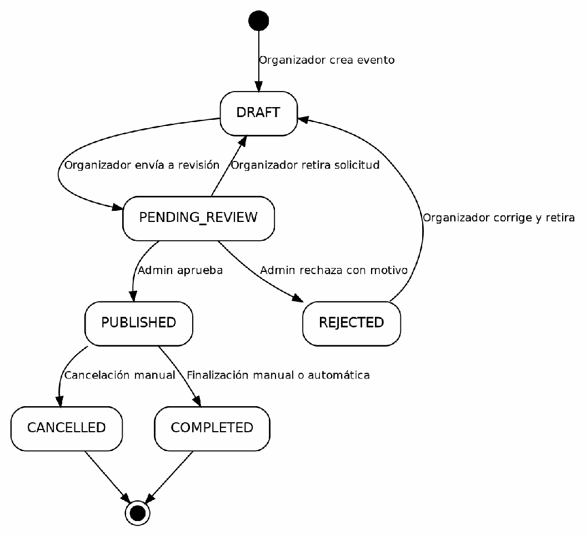

Table 2 details each transition with its guards and the responsible class.

**Table 2**<br>
*Transitions of the Event entity*

| **Source** | **Target** | **Trigger** | **Conditions (guards)** | **Class and method** |
|---|---|---|---|---|
| (new) | DRAFT | Organizer creates the event | Valid dates (not past, not too far, end ≥ start); the site exists; availableSeats ≤ capacity of the site; name + date + site unique; active category | CreateEventService.execute() |
| DRAFT | PENDING_REVIE W | Organizer sends for review | startDate ≥ today; between 3 and 9 images; at least 1 configured section; the userId of the JWT is the owner | ChangeEventStatusService.execute() |
| PENDING_REVIE W | DRAFT | Organizer withdraws the request | The userId of the JWT is the owner; rejectionReason is cleared | ChangeEventStatusService.execute() |
| REJECTED | DRAFT | Organizer corrects and withdraws to edit | The userId of the JWT is the owner; rejectionReason is cleared | ChangeEventStatusService.execute() |
| PENDING_REVIE W | PUBLISHED | Admin approves | startDate ≥ today; between 3 and 9 images; at least 1 section; without ownership verification | AdminChangeEventStatusUseCase.exe cute() |
| PENDING_REVIE W | REJECTED | Admin rejects | reason not null or empty; it is persisted in event.rejectionReason | AdminChangeEventStatusUseCase.exe cute() |
| PUBLISHED | CANCELLED | Manual cancellation | No additional validations | ChangeEventStatusService.execute() (organizer); AdminChangeEventStat usUseCase.execute() (admin) |
| PUBLISHED | COMPLETED | Manual completion | LocalDate.now().isAfter(event.getFinish Date()): only after the end day | ChangeEventStatusService.execute(); AdminChangeEventStatusUseCase.exe cute() |
| PUBLISHED | COMPLETED | Automatic completion | finishDate &lt; today; cron 0 5 0 \* \* \* and recovery run on ApplicationReadyEvent; changedBy = null | EventAutoCompletionScheduler.compl eteExpiredEvents() |

It was verified that the transition DRAFT → CANCELLED does not exist (a draft cannot be cancelled directly), nor REJECTED → PENDING_REVIEW (the organizer must first go through DRAFT). In addition, the enum does not define allowedTransitions(): the rules are in the validateTransition() method of the two use cases, so adding a third one without updating both would leave the state machine inconsistent.

## 2. Order

The order uses the enum OrderStatus (modules/ticket/domain/model/OrderStatus.java), which does implement allowedTransitions(), canTransitionTo() and isTerminal(). Its values are DRAFT, PAYMENT_PENDING, PAID, CANCELLED, REFUNDED and USED. The initial state is DRAFT, assigned in CreateOrderWithTicketsUseCaseImpl.execute(), and the declared final states are CANCELLED, REFUNDED and USED. Figure 2 includes the transition PAID → USED because the enum declares it, although no use case executes it.

**Figure 2**<br>
*State diagram of the Order entity*

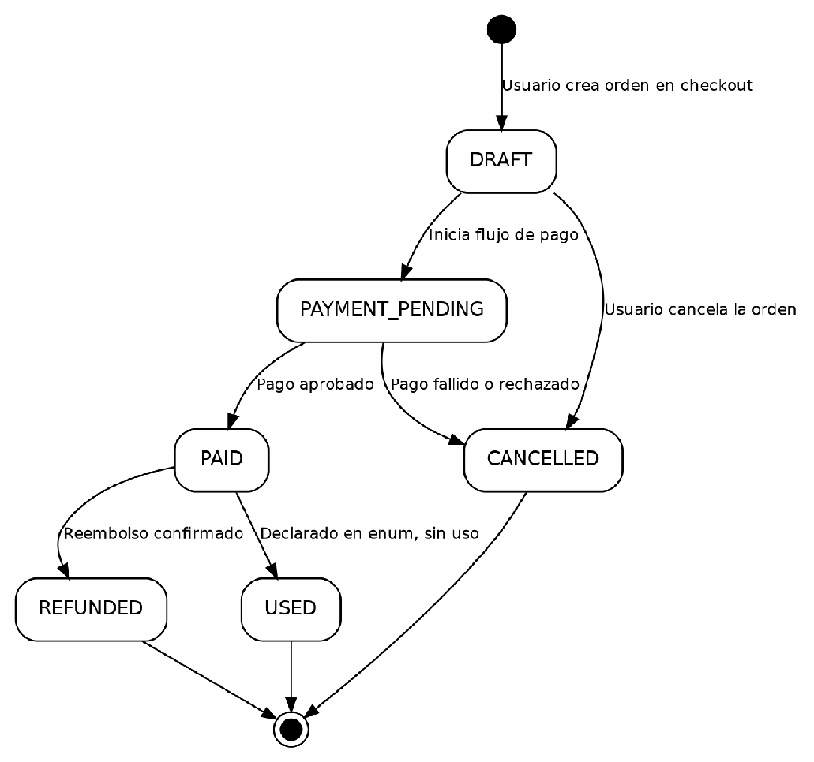

**Table 3**<br>
*Transitions of the Order entity*

| **Source** | **Target** | **Trigger** | **Conditions (guards)** | **Class and method** |
|---|---|---|---|---|
| (new) | DRAFT | User creates the order at checkout | All the seats in RESERVED by that userId; reservations not expired (reservedUntil &gt; now) | CreateOrderWithTicketsUseCaseImpl.e xecute() |
| DRAFT | PAYMENT_PENDI NG | User starts the payment flow | canTransitionTo(); invoked by the payment orchestrator | InitiateOrderPaymentUseCaseImpl.initi ateOrderPayment() → order.markAsPaymentPending() |
| DRAFT | CANCELLED | User cancels the order | canTransitionTo(); the seats are released to AVAILABLE | CancelOrderUseCaseImpl.execute() → order.cancel() |
| PAYMENT_PENDI NG | PAID | Payment approved (APPROVED webhook) | canTransitionTo() | ConfirmOrderPaymentUseCaseImpl.con firmOrderPayment() → order.markAsPaid() |
| PAYMENT_PENDI NG | CANCELLED | Payment failed, rejected or cancelled (DECLINED, FAILED, CANCELLED webhooks) | canTransitionTo(); the seats are released to AVAILABLE | FailOrderPaymentUseCaseImpl.failOrde rPayment() → order.cancel() |
| PAID | REFUNDED | Refund confirmed (REFUNDED webhook or wallet-only payment) | canTransitionTo() | ConfirmRefundUseCaseImpl.confirmRef und() → order.refund() |

The USED status is never used: the method Order.markAsUsed() exists (Order.java, line 70), but it has no calls in the project. The check-in only changes the Ticket to USED (CheckinTicketUseCaseImpl, line 55); the order remains in PAID indefinitely. On the other hand, the gateway's CANCELLED webhook marks the Payment as ERROR (markAsError()), but cancels the order through failOrderPayment() → order.cancel().

## 3. Ticket

The ticket uses the simple enum TicketStatus (modules/ticket/domain/model/TicketStatus.java), without allowedTransitions(). Its values are PENDING, PROCESSING, PAID, REFUNDED, USED and CANCELLED. The initial state is PENDING, assigned in CreateOrderWithTicketsUseCaseImpl.execute(); the final ones are REFUNDED, USED and CANCELLED, because no use case reads them as a source. Figure 3 shows its life cycle.

**Figure 3**<br>
*State diagram of the Ticket entity*

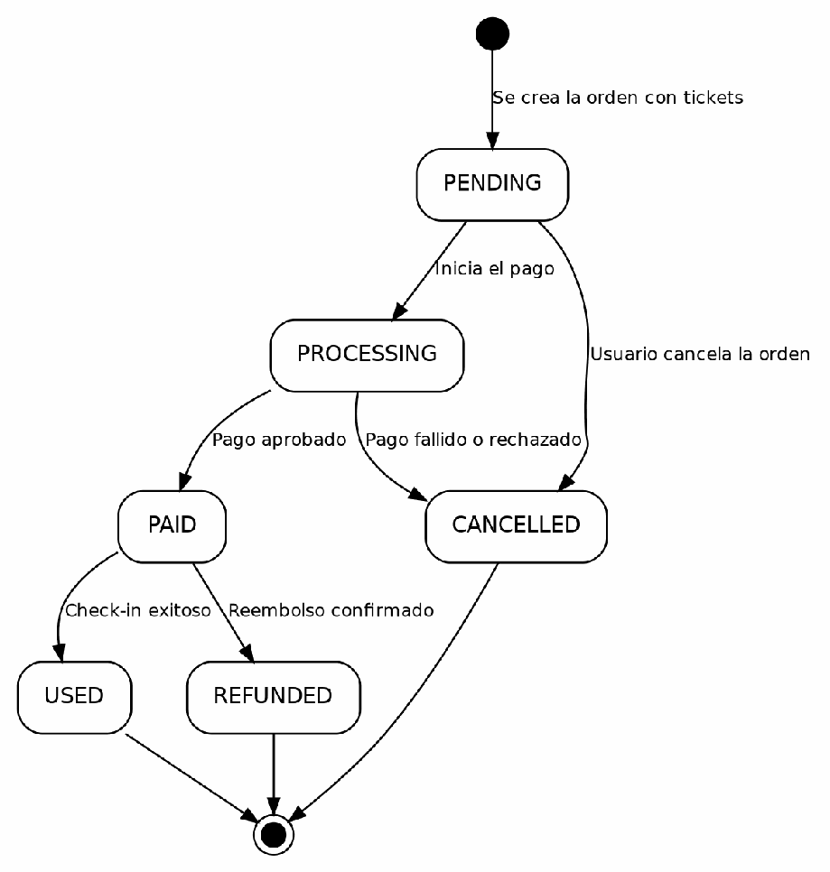

**Table 4**<br>
*Transitions of the Ticket entity*

| **Source** | **Target** | **Trigger** | **Conditions (guards)** | **Class and method** |
|---|---|---|---|---|
| (new) | PENDING | The order with tickets is created | Seats RESERVED by the same user and valid reservations | CreateOrderWithTicketsUseCaseImpl.e xecute() |
| PENDING | PROCESSING | Start of the payment flow | No source-state guard (assigned via builder) | InitiateOrderPaymentUseCaseImpl.initi ateOrderPayment() |
| PROCESSING | PAID | Payment approved (APPROVED webhook) | No guard; ticket.markAsPaid() assigns directly | ConfirmOrderPaymentUseCaseImpl.con firmOrderPayment() → ticket.markAsPaid() |
| PROCESSING | CANCELLED | Payment failed, rejected or cancelled | No guard; ticket.cancel() assigns directly | FailOrderPaymentUseCaseImpl.failOrde rPayment() → ticket.cancel() |
| PAID | USED | Check-in completed | ticket.canCheckin(): status == PAID, expirationDate != null and now &lt; expirationDate; there must not be a previous check-in in TicketCheckinRepository | CheckinTicketUseCaseImpl.execute() → ticket.markAsUsed() |
| PAID | REFUNDED | Refund confirmed (REFUNDED webhook or wallet-only payment) | No status guard; ticket.markAsRefunded() assigns directly | ConfirmRefundUseCaseImpl.confirmRef und() → ticket.markAsRefunded() |
| PENDING | CANCELLED | The user cancels the order directly | No guard; ticket.cancel() assigns directly; the seats are released | CancelOrderUseCaseImpl.execute() → ticket.cancel() |

Unlike the order and the payment, the ticket has no transition guards: the methods markAsPaid(), markAsUsed(), markAsRefunded() and cancel() assign this.status directly without verifying the previous status (Ticket.java), so an accidental call could produce CANCELLED → PAID without the code rejecting it. Likewise, PENDING → CANCELLED occurs in CancelOrderUseCaseImpl although the natural flow would be PROCESSING → CANCELLED.

## 4. Seat

The seat uses the simple enum SeatStatus (modules/seat/domain/model/SeatStatus.java), without allowedTransitions(), with the values AVAILABLE, RESERVED, SOLD and COURTESY. The initial state is AVAILABLE, assigned in SeatService.createSeat(). SOLD is the only final state in practice: sold seats are not released after a refund, a business decision documented in ConfirmRefundUseCaseImpl; however, an administrator can manually change any status through SeatService.updateSeatStatus(). Figure 4 draws each release cause separately and does not include the administrator's manual change.

**Figure 4**<br>
*State diagram of the Seat entity*

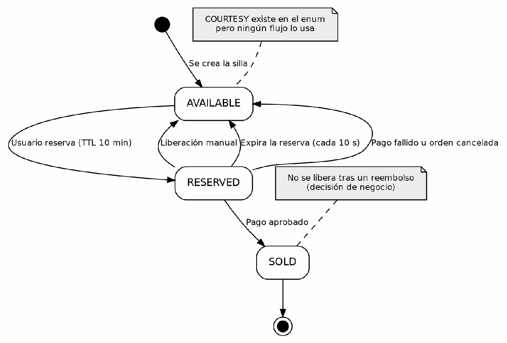

**Table 5**<br>
*Transitions of the Seat entity*

| **Source** | **Target** | **Trigger** | **Conditions (guards)** | **Class and method** |
|---|---|---|---|---|
| (new) | AVAILABLE | Creation of the seat in the section | No extra validation; implicit | SeatService.createSeat() |
| AVAILABLE | RESERVED | User reserves the seat (TTL of 10 min) | seat.status == AVAILABLE; reservedUntil = now + 10 min; throws SEAT_NOT_AVAILABLE if it is not AVAILABLE | SeatReservationService.reserveSeat() |
| RESERVED | AVAILABLE | User manually releases the reservation | seat.status == RESERVED; the userId must match reservedBy, unless isAdmin = true | SeatReservationService.releaseSeat() |
| RESERVED | AVAILABLE | Automatic expiry of the TTL (every 10 s) | seat.status == RESERVED and reservedUntil &lt; now; cron \*/10 \* \* \* \* \* and run on ApplicationReadyEvent | SeatReservationExpirationScheduler.re leaseExpiredReservations() |
| RESERVED | SOLD | Payment approved (APPROVED webhook) | No source-state guard; it only validates that the new status is different from the current one (SEAT_STATUS_UNCHANGED) | ConfirmOrderPaymentUseCaseImpl.con firmOrderPayment() → seatUseCase.updateSeatStatus(seatId, SOLD, null) |
| RESERVED | AVAILABLE | Payment failed, rejected or cancelled | No source-state guard; it only validates that the new status is different | FailOrderPaymentUseCaseImpl.failOrde rPayment() → seatUseCase.updateSeatStatus(seatId, AVAILABLE, reason) |
| RESERVED | AVAILABLE | Cancellation of the order by the user | No source-state guard | CancelOrderUseCaseImpl.execute() → seatUseCase.updateSeatStatus(seatId, AVAILABLE, "Order cancelled") |
| Any | Any | Manual change by an admin | It only validates that the new status is different from the current one | SeatService.updateSeatStatus() (SeatController) |

COURTESY is in the enum SeatStatus, but no use case assigns or checks it (an administrator could send it through REST). It must not be confused with SeatType.COURTESY, a different enum (REGULAR, COURTESY) that classifies the type of seat and not its status. On the other hand, updateSeatStatus() does not validate the source status and allows, for example, SOLD → AVAILABLE if an administrator requests it; and the scheduler releases reservations every 10 s without generating a SeatLog, while SeatService.updateSeatStatus() does generate it.

## 5. Payment (backend)

The backend payment uses the enum PaymentStatus<br>
(modules/payment/domain/model/PaymentStatus.java), which implements<br>
allowedTransitions(), canTransitionTo() and isTerminal(). Its values are PENDING,<br>
APPROVED, REJECTED, ERROR and REFUNDED. It has two initial states: PENDING,<br>
assigned in ChargeOrderViaGatewayUseCase.execute() (line 77) for gateway payments,<br>
total or mixed; and APPROVED, assigned in CreateWalletOnlyPaymentUseCase.execute()<br>
(line 60) for payments paid entirely with the wallet, without going through PENDING. REJECTED,<br>
ERROR and REFUNDED are declared as terminal. Figure 5 shows both<br>
sources.<br>
**Figure 5**<br>
*State diagram of the Payment entity (backend)*

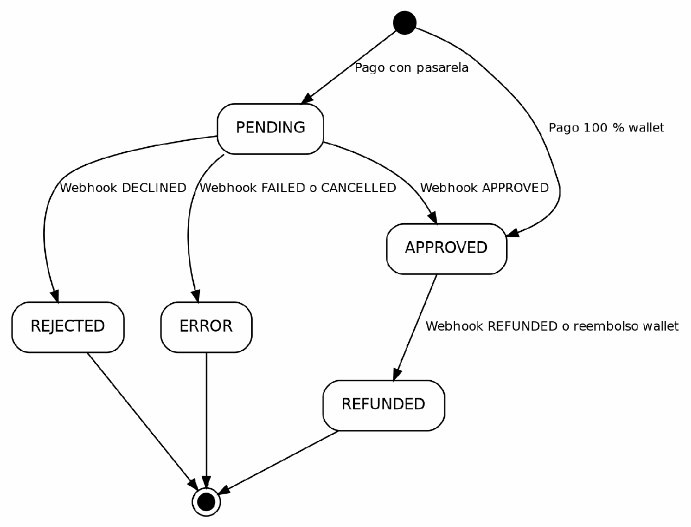

**Table 6**<br>
*Transitions of the Payment entity (backend)*

| **Source** | **Target** | **Trigger** | **Conditions (guards)** | **Class and method** |
|---|---|---|---|---|
| (new) | PENDING | Creation of a payment with the gateway (total or mixed) | Order in PAYMENT_PENDING; invoked by CreatePaymentUseCaseImpl | ChargeOrderViaGatewayUseCase.exec ute() |
| (new) | APPROVED | Creation of a 100 % wallet payment | Available balance ≥ order total; without gateway | CreateWalletOnlyPaymentUseCase.exe cute() |
| PENDING | APPROVED | APPROVED webhook from the gateway | Valid HMAC signature; idempotency by gatewayEventId; canTransitionTo(APPROVED) | ProcessWebhookUseCaseImpl.execute( ) → payment.approve() |
| PENDING | REJECTED | DECLINED webhook | Same signature and idempotency checks; canTransitionTo(REJECTED) | ProcessWebhookUseCaseImpl.execute( ) → payment.reject() |
| PENDING | ERROR | FAILED webhook | Same checks; canTransitionTo(ERROR) | ProcessWebhookUseCaseImpl.execute( ) → payment.markAsError() |
| PENDING | ERROR | CANCELLED webhook | Same checks; the gateway's CANCELLED is mapped to ERROR (same markAsError()) | ProcessWebhookUseCaseImpl.execute( ) → payment.markAsError() |
| APPROVED | REFUNDED | REFUNDED webhook | Valid HMAC signature; canTransitionTo(REFUNDED) | ProcessWebhookUseCaseImpl.execute( ) → payment.refund() |
| APPROVED | REFUNDED | Refund of a wallet-only payment | payment.status == APPROVED (otherwise, it throws IllegalStateException); canTransitionTo(REFUNDED) | RequestRefundUseCaseImpl.closeRefu ndLocally() → payment.refund() |

The gateway's CANCELLED webhook takes the Payment to ERROR, because this enum does not have the CANCELLED value. It is intentional, but it can be confusing in the audit log. In addition, CreateWalletOnlyPaymentUseCase records in PaymentLog a change PENDING → APPROVED that never existed in the database; it is a conceptual record for traceability.

## 6. Payment (sandbox gateway, fake-payment-gateway)

The auxiliary service fake-payment-gateway simulates the payment gateway. Its enum PaymentStatus (fake-payment-gateway/.../domain/model/PaymentStatus.java) implements allowedTransitions(), canTransitionTo() and isTerminal(), and defines PENDING, PROCESSING, APPROVED, REFUNDED, DECLINED, FAILED and CANCELLED. The initial state is PENDING, assigned in CreatePaymentUseCase.execute() → Payment.create(); the terminal ones are REFUNDED, DECLINED, FAILED and CANCELLED. After each transition, WebhookNotifierPort.notify(PaymentStatusChanged) sends an HTTP event to the backend. Figure 6 shows the flow.

**Figure 6**<br>
*State diagram of the Payment in the sandbox gateway*

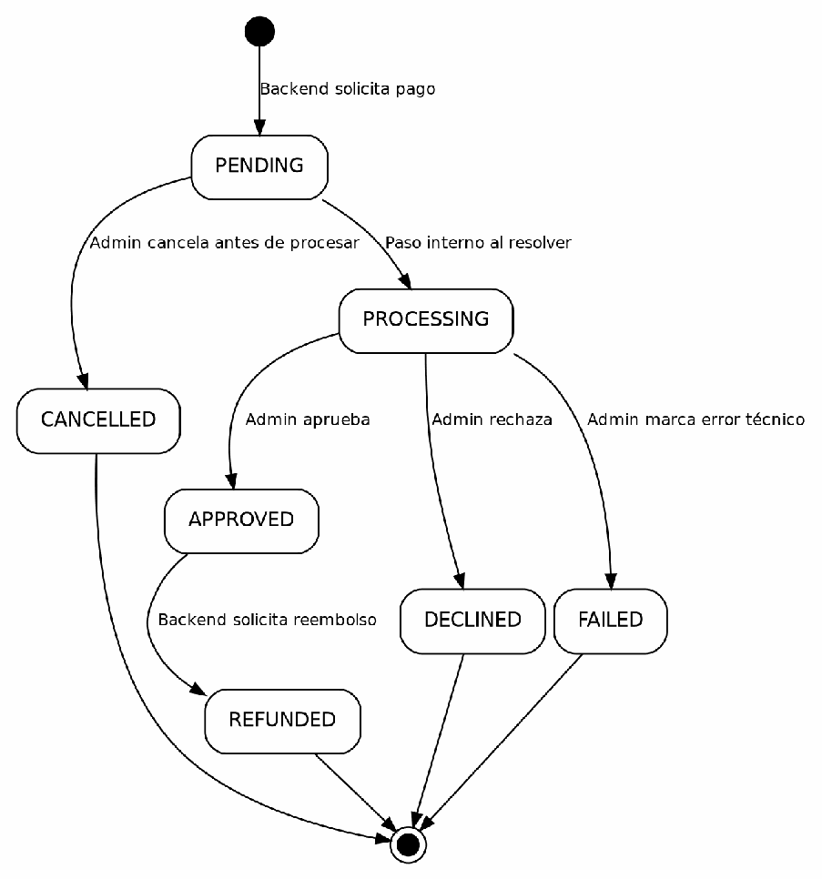

**Table 7**<br>
*Transitions of the Payment in the sandbox gateway*

| **Source** | **Target** | **Trigger** | **Conditions (guards)** | **Class and method** |
|---|---|---|---|---|
| (new) | PENDING | Creation request from the backend | No additional validations | CreatePaymentUseCase.execute() → Payment.create() |
| PENDING | PROCESSING | Internal intermediate step when approving, declining or failing | payment.canTransitionTo(PROCESSING) | ApprovePaymentUseCase, DeclinePaymentUseCase, FailPaymentUseCase → payment.markAsProcessing() |
| PENDING | CANCELLED | The admin cancels before processing | payment.canTransitionTo(CANCELLED) | CancelPaymentUseCase.execute() → payment.cancel() |
| PROCESSING | APPROVED | The admin approves | payment.canTransitionTo(APPROVED) | ApprovePaymentUseCase.execute() → payment.approve() |
| PROCESSING | DECLINED | The admin rejects | payment.canTransitionTo(DECLINED) | DeclinePaymentUseCase.execute() → payment.decline() |
| PROCESSING | FAILED | The admin marks a technical error | payment.canTransitionTo(FAILED) | FailPaymentUseCase.execute() → payment.fail() |
| APPROVED | REFUNDED | The backend requests the refund | payment.canTransitionTo(REFUNDED) | RefundPaymentUseCase.execute() → payment.refund() |

PROCESSING is an internal transitory status: the gateway goes from PENDING to PROCESSING and then to APPROVED, DECLINED or FAILED within the same call to execute(), sending two webhooks. ProcessWebhookUseCaseImpl (backend) has no case for PROCESSING; that value falls into the default and only records a log.warn. It was verified that this is harmless: the gateway always sends PROCESSING before APPROVED, and if a repeated event arrived the idempotency by gatewayEventId would discard it.

## 7. Wallet (wallet transaction)

This diagram represents the status of each wallet transaction<br>
(WalletTransaction), not the wallet balance. It uses the simple enum WalletTransactionStatus<br>
(modules/wallet/domain/model/WalletTransactionStatus.java), with the values PENDING,<br>
COMPLETED and FAILED. The initial state depends on the type of transaction<br>
(WalletTransactionType): PENDING for PAYMENT, assigned in<br>
ReserveWalletPaymentUseCaseImpl.execute(), and COMPLETED for CREDIT, REVERSAL and<br>
ADJUSTMENT, which are created directly. COMPLETED and FAILED are terminal.<br>
Figure 7 shows the two sources.<br>
**Figure 7**<br>
*State diagram of the wallet transaction*

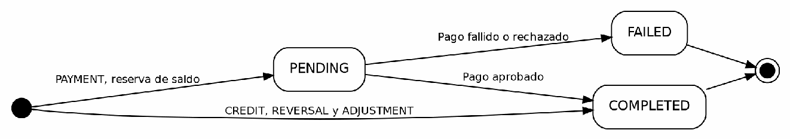

**Table 8**<br>
*Transitions of the wallet transaction*

| **Source** | **Target** | **Trigger** | **Conditions (guards)** | **Class and method** |
|---|---|---|---|---|
| (new) | PENDING | Reservation of balance for a payment (checkout) | saldoDisponible = balance − sumPendingPayments ≥ amount; optimistic locking @Version in Wallet | ReserveWalletPaymentUseCaseImpl.ex ecute() |
| (new) | COMPLETED | Direct credit (event cancellation, admin adjustment) | Idempotency by idempotencyKey; no other source-state validation | CreditWalletUseCaseImpl.execute() |
| (new) | COMPLETED | Reversal of a PAYMENT (refund with wallet) | Idempotency by reversal-{originalTransactionId}; the original transaction must be in COMPLETED | ReverseWalletPaymentUseCaseImpl.ex ecute() |
| (new) | COMPLETED | Manual balance adjustment (admin) | amount != 0; reason not empty; resulting balance ≥ 0 | AdjustWalletUseCaseImpl.execute() |
| PENDING | COMPLETED | Payment approved (APPROVED webhook or wallet-only payment) | Idempotency: if it is already COMPLETED it does nothing; it deducts the balance of the Wallet | ConfirmWalletPaymentUseCaseImpl.ex ecute() → tx.complete(newBalance) |
| PENDING | FAILED | Payment failed, rejected or cancelled (DECLINED, FAILED, CANCELLED webhooks) | Idempotency: if it is already FAILED it does nothing; it does not touch the balance | ReleaseWalletPaymentUseCaseImpl.ex ecute() → tx.fail() |

The CREDIT, REVERSAL and ADJUSTMENT transactions are born directly in COMPLETED without going through PENDING; that is why the diagram has two initial states. COMPLETED and FAILED are terminal: there is no outgoing transition.

## 8. Notification (delivery to each recipient)

The enum DeliveredStatus (modules/notification/domain/model/DeliveredStatus.java) applies to the NotificationUser entity, which relates a Notification to each recipient; the main Notification has no status of its own. Its values are PENDING, SENT, DELIVERED and FAILED. The initial state depends on the channel: IN_APP is born in DELIVERED, EMAIL is born in PENDING, and if there is an error before creating the record (null email or exception when saving) it is born directly in FAILED. DELIVERED, SENT and FAILED are final, because no use case reads them as a source. Figure 8 shows the three possible sources.

**Figure 8**<br>
*State diagram of the delivery of notifications*

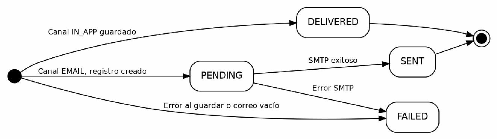

**Table 9**<br>
*Transitions of the delivery of notifications*

| **Source** | **Target** | **Trigger** | **Conditions (guards)** | **Class and method** |
|---|---|---|---|---|
| (new) | DELIVERED | IN_APP channel: saving in the DB is equivalent to delivering | Additional push attempt via WebSocket (if it fails, it does not block or change the status) | InAppChannelAdapter.deliver() → deliveredStatus(DELIVERED) |
| (new) | FAILED | IN_APP channel: exception when saving in the DB | Outer catch block of the for loop; it tries to save with FAILED | InAppChannelAdapter.deliver() → catch |
| (new) | FAILED | EMAIL channel: user without email or blank email | loginCredentialsRepository.findByUserId( userId) empty or empty email | EmailChannelAdapter.deliver() (saves FAILED without creating a previous PENDING) |
| (new) | PENDING | EMAIL channel: record created before sending | User's email found and not empty | EmailChannelAdapter.deliver() → deliveredStatus(PENDING) |
| PENDING | SENT | Email sent by SMTP | mailSender.send() without exception | EmailChannelAdapter.deliver() (updates to SENT) |
| PENDING | FAILED | SMTP error or MessagingException | Catch block; it updates the existing PENDING record | EmailChannelAdapter.deliver() → catch (updates to FAILED) |

The transition SENT → DELIVERED does not exist (the enum suggests it implicitly, but no code implements it), nor a direct PENDING → DELIVERED. DELIVERED (IN_APP) and SENT (EMAIL) are both terminal in practice, although semantically different. In addition, NotificationUser has the readAt field and an endpoint to mark it as read, but that action only updates readAt (InAppNotificationQueryUseCase) and does not change deliveredStatus: reading and delivering are independent concepts in this code.

## 9. User account

The account status is not a Java enum: UserStatus<br>
(modules/security/domain/model/UserStatus.java) is an entity of the user_status table,<br>
handled as a String with the code field, whose values are inserted in the<br>
Liquibase migration 017. The values are PENDING, ACTIVE, BLOCKED, INACTIVE and DELETED. The<br>
initial state is PENDING, assigned in RegisterUserUseCase.register()<br>
(DEFAULT_STATUS_CODE). In theory DELETED would be the final one, but no use case<br>
assigns it, so no status is really terminal. Figure 9 shows the life cycle.<br>
**Figure 9**<br>
*State diagram of the User account*

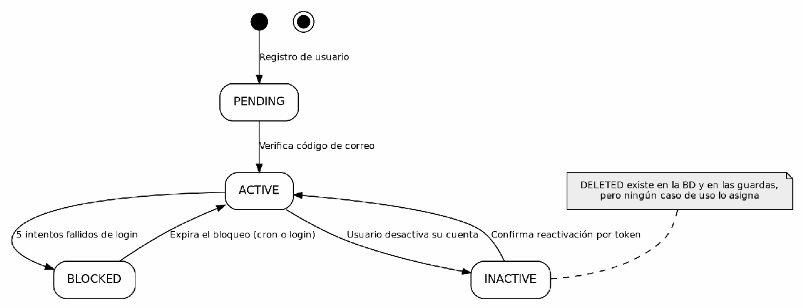

**Table 10**<br>
*Transitions of the User account*

| **Source** | **Target** | **Trigger** | **Conditions (guards)** | **Class and method** |
|---|---|---|---|---|
| (new) | PENDING | Registration of a new user | Unique and unregistered email; @gmail.com mandatory; strong password; valid fullName | RegisterUserUseCase.register() |
| PENDING | ACTIVE | Verifies their email with the activation code | Correct code, not expired (expiresAt &gt; now), not used and validated against the userId | ActivateAccountUseCase.activate() → user.setUserStatus(ACTIVE) |
| ACTIVE | BLOCKED | 5 failed login attempts in a 15-min window | failedAttempts ≥ MAX_FAILED_ATTEMPTS (5); lockedUntil = now + LOCKOUT_MINUTES; independent transaction (REQUIRES_NEW) | AccountLockoutService.saveLockout() → blockUser() |
| BLOCKED | ACTIVE | Expiry of the lockout by time (cron every minute) | lockedUntil &lt; now; independent transaction (REQUIRES_NEW) | SecurityDataCleanupTask.unlockExpire dLockouts() → deleteLockout() → unblockUser() |
| BLOCKED | ACTIVE | Login after the lockout expired | lockedUntil &lt; now detected during login; the AccountLockout record is deleted | LoginUseCase.checkLockout() → deleteLockout() → unblockUser() |
| ACTIVE | INACTIVE | The user deactivates their own account | Password verified; account not INACTIVE or DELETED; active sessions and refresh tokens are revoked | DeactivateAccountUseCase.deactivate( ) → user.setUserStatus(INACTIVE) |
| INACTIVE | ACTIVE | Confirms the reactivation with the token received by email | Valid token, not used and not expired (30 min); the token is invalidated after its use | ConfirmReactivationUseCase.confirm() → user.setUserStatus(ACTIVE) |

It was verified with git grep on the 12 remote branches that DELETED only appears as a guard in LoginUseCase and DeactivateAccountUseCase; no use case assigns it, so the account deletion of RF7 of the SRS is not implemented. The reactivation flow (RequestReactivationUseCase and ConfirmReactivationUseCase) is not documented in the glossary or in the previous technical manual. The lockout also uses the AccountLockout entity (attempt counter and expiry); the status returns to ACTIVE when that record is deleted, as an effect of deleteLockout() and not as a transition declared in an enum. There is no BLOCKED → INACTIVE or BLOCKED → DELETED: the blocked user is unblocked automatically and returns to ACTIVE.

## 10. Refund

The refund uses the enum RefundStatus<br>
(modules/payment/domain/model/RefundStatus.java), with the values REQUESTED,<br>
APPROVED, PROCESSED and FAILED. The enum itself indicates that it is a structure ready for<br>
a future phase. The initial state is REQUESTED, assigned in RequestRefundUseCaseImpl<br>
(line 70), and the final ones are PROCESSED and FAILED. The Refund entity is an<br>
immutable object built with a builder and it has no transition methods: each status change<br>
creates a new object. Figure 10 shows that only the transition REQUESTED →<br>
PROCESSED is implemented.<br>
**Figure 10**<br>
*State diagram of the Refund entity*

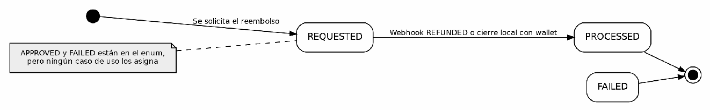

**Table 11**<br>
*Transitions of the Refund entity*

| **Source** | **Target** | **Trigger** | **Conditions (guards)** | **Class and method** |
|---|---|---|---|---|
| (new) | REQUESTED | The refund is requested (user or event cancellation) | No transition method in the entity | RequestRefundUseCaseImpl (line 70) |
| REQUESTED | PROCESSED | REFUNDED webhook from the gateway | A new Refund is built with status PROCESSED and processedAt = now() | ProcessWebhookUseCaseImpl (line 190) |
| REQUESTED | PROCESSED | Local closure of the refund (wallet-only payment) | It is assumed to correspond to closeRefundLocally(); pending confirmation | RequestRefundUseCaseImpl (line 113) |

RefundStatus.APPROVED and RefundStatus.FAILED have no use in the project: they are declared in the enum, but no use case assigns them.

### Relationships between entities (cause and effect)

The status changes of one entity trigger changes in others. Figure 11 summarizes the main chains and Table 12 indicates the class where each one occurs.

**Figure 11**<br>
*Cause-and-effect chains between the entities of the system*

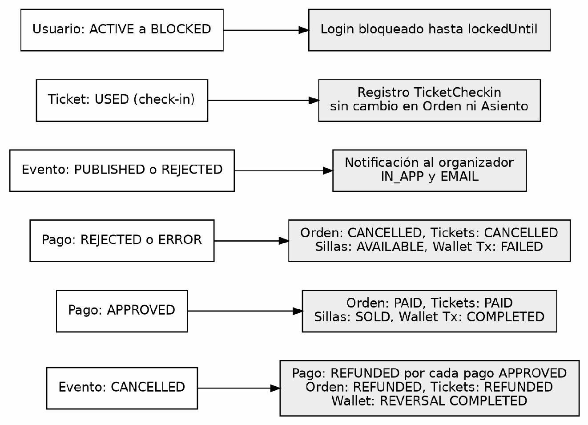

**Table 12**<br>
*Detail of the cause-and-effect relationships*

| **Cause** | **Effect** | **Class where it occurs** |
|---|---|---|
| Payment (backend): PENDING → APPROVED (APPROVED webhook) | Order: PAYMENT_PENDING → PAID; Tickets: PROCESSING → PAID; Seats: RESERVED → SOLD | ProcessWebhookUseCaseImpl.execute() → ConfirmO rderPaymentUseCaseImpl.confirmOrderPayment() + SeatUseCase.updateSeatStatus() |
| Payment (backend): APPROVED created directly (wallet only) | WalletTx: PENDING → COMPLETED; Order: PAYMENT_PENDING → PAID; Tickets: PROCESSING → PAID; Seats: RESERVED → SOLD | CreateWalletOnlyPaymentUseCase.execute() → ConfirmWalletPaymentUseCaseImpl + ConfirmOrderPaymentUseCaseImpl |
| Payment (backend): PENDING → REJECTED / ERROR (DECLINED, FAILED, CANCELLED webhooks) | WalletTx (if it existed): PENDING → FAILED; Order: PAYMENT_PENDING → CANCELLED; Tickets: PROCESSING → CANCELLED; Seats: RESERVED → AVAILABLE | ProcessWebhookUseCaseImpl.execute() → ReleaseWalletPaymentUseCaseImpl + FailOrderPaymentUseCaseImpl.failOrderPayment() + SeatUseCase.updateSeatStatus() |
| Payment (backend): APPROVED → REFUNDED (webhook or wallet-only payment) | Refund: REQUESTED → PROCESSED; Order: PAID → REFUNDED; Tickets: PAID → REFUNDED; WalletTx: new REVERSAL transaction in COMPLETED (if there was wallet credit) | ProcessWebhookUseCaseImpl / RequestRefundUseCaseImpl.closeRefundLocally() → ConfirmRefundUseCaseImpl.confirmRefund() + ReverseWalletPaymentUseCaseImpl.execute() |
| Event: PUBLISHED → CANCELLED | Automatic refunds for all the APPROVED payments of the event (each one triggers the refund chain) | EventCancelledListener.handleEventStatusChanged( ) → RequestRefundUseCaseImpl.execute() for each payment / for each payment |
| Event: PENDING_REVIEW → PUBLISHED | Notification to the organizer (IN_APP and EMAIL): event approved | EventStatusChangedListener (notification) → SendNotificationUseCase.execute() |
| Event: PENDING_REVIEW → REJECTED | Notification to the organizer with the reason for the rejection | EventStatusChangedListener → SendNotificationUseCase.execute() |
| Ticket: PAID → USED (check-in) | The TicketCheckin record is created, without a status change in Order or Seat | CheckinTicketUseCaseImpl.execute() |
| User: ACTIVE → BLOCKED | All login attempts are blocked until lockedUntil expires | AccountLockoutService.saveLockout() → blockUser() |
| Payment approved (any type) | PaymentApprovedEvent is published for notifications | ProcessWebhookUseCaseImpl / CreateWalletOnlyPaymentUseCase → eventPublisher.publishEvent() |
| Wallet credited | WalletCreditedEvent is published for notifications | CreditWalletUseCaseImpl.execute() → eventPublisher.publishEvent() |

### Automatic processes

Table 13 lists the schedulers, listeners and webhooks that change statuses without direct intervention by the user.

**Table 13**<br>
*Automatic processes that change statuses*

| **Process** | **Frequency or trigger** | **Affected entity** | **Transition** |
|---|---|---|---|
| EventAutoCompletionScheduler.comp leteExpiredEvents() | Daily at 00:05 (0 5 0 \* \* \*) and once at startup (ApplicationReadyEvent) | Event | PUBLISHED → COMPLETED for all the events with finishDate &lt; today |
| SeatReservationExpirationScheduler.r eleaseExpiredReservations() | Every 10 seconds (\*/10 \* \* \* \* \*) and once at startup | Seat | RESERVED → AVAILABLE for all with reservedUntil &lt; now |
| SecurityDataCleanupTask.unlockExpir edLockouts() | Every minute (0 \* \* \* \* \*) | User | BLOCKED → ACTIVE (cleans the expired AccountLockout records) |
| SecurityDataCleanupTask.cleanExpire dData() | Daily at 02:00 (0 0 2 \* \* \*) | Sessions and tokens (they are not business statuses) | Deletes expired or revoked AuthSession and RefreshToken; expired or used AccountActivation and RecoverPassword |
| ProcessWebhookUseCaseImpl.execut e() | Invoked by the gateway's HTTP webhook | Payment, Order, Tickets, Seats, Wallet and Refund | See Table 12 |
| EventCancelledListener.handleEventS tatusChanged() | @EventListener on EventStatusChangedEvent (asynchronous, @Async) | Payment, Order, Tickets, Wallet and Refund | Automatic cascade refund |

### Differences with the existing documentation

Table 14 gathers the discrepancies between what the project documents say (Equipo CapySoft, n.d.-a, n.d.-b) and what the code does (Equipo CapySoft, 2026).

**Table 14**<br>
*Discrepancies between the existing documentation and the code*

| **Discrepancy** | **What the documentation says** | **What the code says** |
|---|---|---|
| ATTENDEE role in the glossary and class diagrams | ATTENDEE as the name of the standard user role | The code uses USER as DEFAULT_ROLE_CODE in RegisterUserUseCase and in the controllers |
| IN_PROGRESS status in the SRS glossary | It lists IN_PROGRESS as a possible event status | EventStatus.java does not contain IN_PROGRESS; the 6 statuses are DRAFT, PENDING_REVIEW, PUBLISHED, REJECTED, CANCELLED and COMPLETED |
| Technical manual v1: 4 event statuses | It documented DRAFT, PUBLISHED, CANCELLED and COMPLETED | The code has 6 statuses since the admin review flow was added (changelog 079-add-event-review-flow.yaml) |
| Account reactivation flow | Not documented in the technical manual or in the user stories of the SRS | RequestReactivationUseCase and ConfirmReactivationUseCase are implemented and functional |
| Account lockout time | The technical manual and the administrator manual document 30 minutes | LoginUseCase has LOCKOUT_MINUTES = 1 (static final, with a TODO to restore 30 in production). No .java, .yml or .properties file defines or reads app.security.lockout-minutes; the application-k8s.yml profile does not include that property |
| Order transition PAID → USED | The enum declares it as a valid transition | No use case calls order.markAsUsed(); the order remains in PAID after the check-in |
| Refund | The enum RefundStatus defines 4 statuses | Only REQUESTED and PROCESSED are assigned; APPROVED and FAILED have no use |

### Verification and open points

The findings of this document were checked against the repository through searches in the code (grep and git grep) on the develop branch and on the 12 remote branches. What was verified and what is still an assumption is indicated below.

### Verified

\1. LOCKOUT_MINUTES has the fixed value 1 in LoginUseCase and it is not read from the configuration: there is no @Value or lockout-minutes property in the project. 2. The DELETED account status is not assigned by any use case in any of the 12 remote branches; it only appears as a guard in LoginUseCase and DeactivateAccountUseCase.

\3. A PROCESSING webhook from the sandbox gateway is ignored with a log.warn and does not cause an<br>
invalid transition; in addition, the idempotency by gatewayEventId discards repeated<br>
events.<br>
4. Order.markAsUsed() has no calls in the project.

\5. The two initial states of Payment (PENDING and APPROVED) correspond to the two payment creation paths.

### Pending assumptions

\1. SeatService.updateSeatStatus() does not validate the source status. It is assumed that the validation is delegated to the higher-level use cases; there are no tests of the seat module that confirm the expected behaviour.

\2. CancelOrderUseCaseImpl can cancel tickets in PENDING because ticket.cancel() does not validate the source status. It is assumed to be intentional for early cancellation from an order in DRAFT.

\3. The assignment of RefundStatus.PROCESSED in RequestRefundUseCaseImpl (line 113) is assumed to correspond to the local closure of refunds of wallet-only payments (closeRefundLocally()); this remains to be confirmed.

### References

Cockburn, A. (2005). *Hexagonal architecture.*

https://alistair.cockburn.us/hexagonal-architecture/

Equipo CapySoft. (2026). *TuEvento* [Source code]. Project repository.

Equipo CapySoft. (n.d.-a). *Especificación de requisitos de software (SRS) de TuEvento*

[Unpublished document]. Servicio Nacional de Aprendizaje (SENA).

Equipo CapySoft. (n.d.-b). *Manual técnico de TuEvento* [Unpublished document]. Servicio

Nacional de Aprendizaje (SENA).

Object Management Group. (2017). *OMG Unified Modeling Language (OMG UML)* (Version

2.5.1). https://www.omg.org/spec/UML/2.5.1

---

<a id="doc-te-0078"></a>

<!--
ruta_anterior: en/02_Analisis_Software/secuencie_Diagrams.md
id: TE-0078
title: "secuencie Diagrams"
lang: en
source: 02_Analisis_Software/secuencie Diagrams.pdf
source_sha256: b7d6ba0d80c5ff40f29a31594877c0fd7a42fb9303a5d86899f309933886757e
conversion: "pdftoppm 300 dpi + tesseract 5.5.3 (tessdata_best 4.1.0, spa+eng, PSM 11); without manual review. English translation of md/es: Claude Opus 5.5 (claude-opus-5-5); without manual review"
converted_on: 2026-10-23
fidelity: solo_imagen
losses:
  - "PDF without a text layer: the text comes from unreviewed OCR (tesseract spa+eng)."
  - "Diagrammatic content: the OCR does not keep the layout, arrows or relationships; the page image is the faithful reference."
  - "Page 1: average confidence 68%, 55 of 158 words < 60%."
  - "Page 2: average confidence 67%, 95 of 236 words < 60%."
  - "Page 3: average confidence 70%, 60 of 188 words < 60%."
  - "Page 4: average confidence 71%, 39 of 119 words < 60%."
  - "Page 5: blank."
  - "OCR lines with fewer than 2 letters are discarded (noise from the diagram strokes)."
  - "Measurement on page 1 against a manual transcription: 30 of 38 labels recovered exactly (79 %); participant names, an alt condition and the final question are missing."
  - "The content of the diagrams is in English, not in Spanish."
  - "Translation: the OCR text blocks are kept exactly as recognized (they are not translated or corrected)."
status: borrador
reviewed_by: ""
translation_of: es/03_Analisis_Software.md#doc-te-0078
es_sha256: c88e471d81eb30270a58e4523738846986f2b4891bfadf6c24931d53026d69b7
-->

# sequence Diagrams

## Page 1

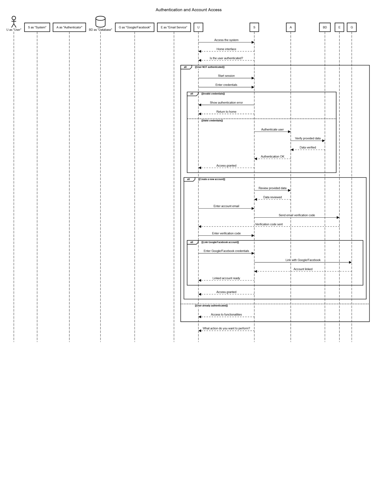

<!-- OCR: review · average confidence 68% · 158 words · 55 with confidence < 60% -->

Text recognized by OCR (without a reliable reading order; the image is the reference):

```text
Authentication and Account Access
U as "User"
Service"
Access the system
Home interface
- Hho
elgg
Is the user authenticated?
[User NOT authenticated]]
Start session
Enter credentials
[at J (invalid credentials]
Show authentication error
Retum to home
[RR
pp
nnnnaaoaao anna [ PA
[RR
credentials]]
Authenticate user
Verify provided data
Data verified
Authentication OK
E fn ff
Access granted
[[Create a new accounti
Review provided data
Jah
Data r
“TA
Enter account email
Send email verification code
le
- mm mmm mmm mmm mem
| Verification code sent
TE Lo]
Enter verification code
[ ait J (Link Google/Facebook account]]
Enter Google/Facebook credentials
Link with Google/Facebook
Account linked
JE
JER
JER SN
Linked account ready
Access granted
le
A fing he
pp i SPN NNN [PIPPI NEP RN, Sr ———
[[User already authenticated]
Access to functionalities
---- ooo
lo you want to
```

## Page 2

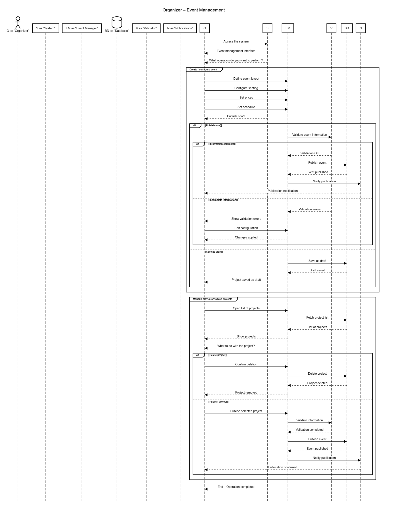

<!-- OCR: review · average confidence 67% · 236 words · 95 with confidence < 60% -->

Text recognized by OCR (without a reliable reading order; the image is the reference):

```text
Organizer — Event Management
O as "Organizer"
BD as "Database"
Eno
Access the system
FE de Ah SN
Event management interface
What operation do you want to perform?
Pd pg fh
Define event layout
Configure seating
Set prices
Set schedule
gn
Publish now?
[Publish now]
Validate event information
[Information complete]
Validation OK
FER cg
Publish event
JER a
Event published
Notify publication
Pul
notification
PT
PU
FR
JRA {SR
[lincompiete information]
Validation errors
FER eg hi
Show validation errors
-] ZE e
Edit configuration
Changes applied
JE.
TALA LALA ARA
[EP SRS Sp SRpRpRY Spt RRR
[[Save as draft]
Save as draft
raft saved
Project saved as draft
Jc gh hg
Open list of projects
o — Ee
Fetch project list
List of projects
JEP vn
Sl gs
Show projects
JE
JER eg he fg
What to do with the project?
| at J [Delete project]
Confirm deletion
Delete project
JER he tl
Project deleted
JD J. igi LEO WF |
Project removed
TEE
Te e o SELLLCEE
[Publish project]
Publish selected project
Validate information
Validation completed
FE
Publish event
ia
Event published
lotify publication
lg
| Publication confirmed
peg
JE
JER
End — Operation completed
```

## Page 3

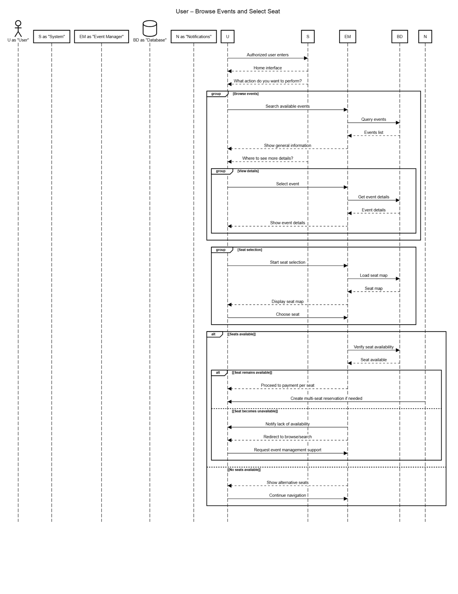

<!-- OCR: review · average confidence 70% · 188 words · 60 with confidence < 60% -->

Text recognized by OCR (without a reliable reading order; the image is the reference):

```text
User — Browse Events and Select Seat
S as "System"
N as "Notifications"
U as "User"
BD as "Database"
Eu
Authorized user enters
Home interface
Je Za
What action do you want to perform?
[Browse events]
Search available events
Query events
Events list
oi
rm mm mm mm mm EE mm ————————
Show general information
{El
Where to see more details?
[View details]
Select event
Get event details
ai
Event details
Show event details
-—]_ie—_————————]——]— ——T——— —]——— —]—]
[Seat selection]
Start seat selection
Load seat map
eiii of
Seat map
mm mmm mmm mmm mm mm fm —————————
Display seat map
Choose seat
| alt) [Seats available]
Verify seat availability
mm
Seat available
| alt J [[Seat remains available]
Proceed to payment per seat
gf pe
Create multi-seat reservation if needed
DB  E—
[pty
A AS bocenonananananananen.
[[Seat becomes unavailable]
Notify lack of availability
Redirect to browse/search
eme
Request event management support
.....e.ee.....
ATI IIA AAA ALA ALA AAA AA? AAA ARA ALE
m......... pe
[[No seats
ble]]
ea
Show alternative seats
Continue navigation
```

## Page 4

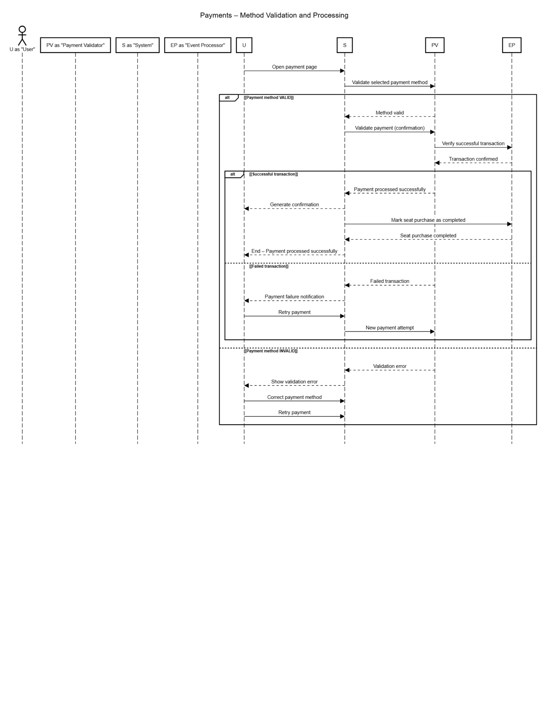

<!-- OCR: review · average confidence 71% · 119 words · 39 with confidence < 60% -->

Text recognized by OCR (without a reliable reading order; the image is the reference):

```text
Payments — Method Validation and Processing
U as "User"
Open payment page
Ve
alidate selected payment method
[[Payment method VALID]]
Method valid
Validate payment (confirmation)
L Verify successful transaction ra
Transaction confirmed
| alt 7 [Successful transaction]]
Payment processed successfully
Generate confirmation
eo
Mark seat purchase as completed
eg hs
Seat purchase completed
[ppt A eg i eg J
End — Payment processed successfully
J ELL LT EL LT puppy
fe eeeeeeeeeeeeeeeeeeeeeeeeeas pp JR
[[Failed transaction]]
Failed transaction
ae
Payment failure notification
la
Retry payment
New payment attempt
ena wm eo TTL a a devennnnvnnnnnensnnnennnnnwnmnnnedunneommnneemmnnennsnnenssmadensesenn
[Payment method INVALID]
Validation error
ooo
aio
Show validation error
le
Correct payment method
Retry payment
```

## Page 5

*Blank page in the original (all pixels are white); no image is included.*
