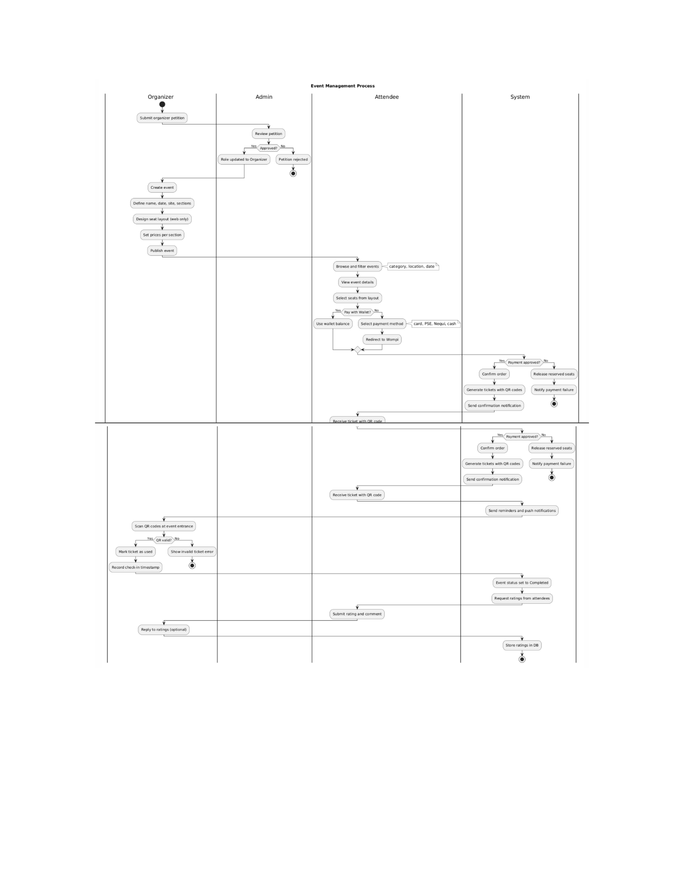
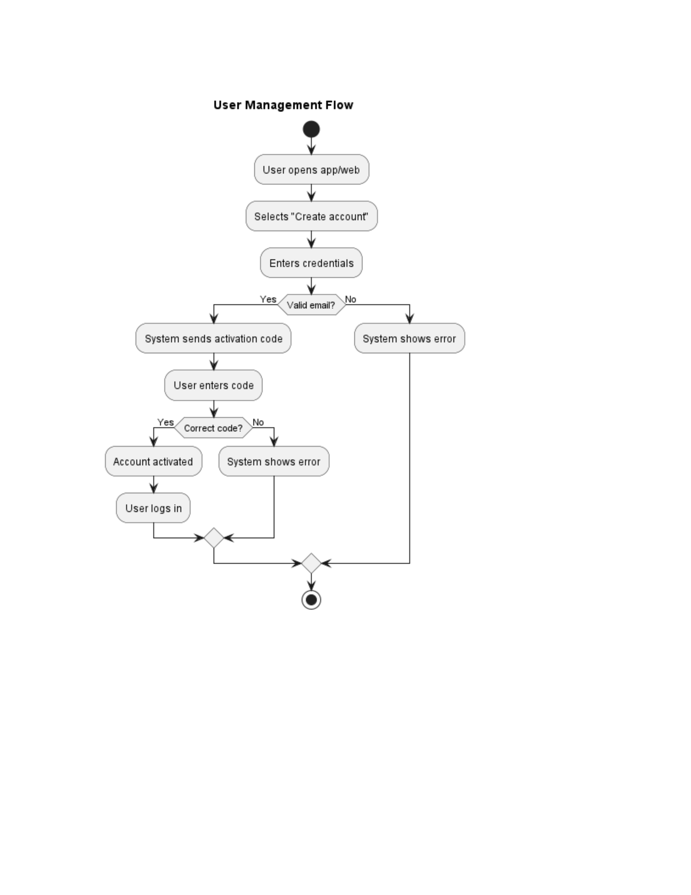
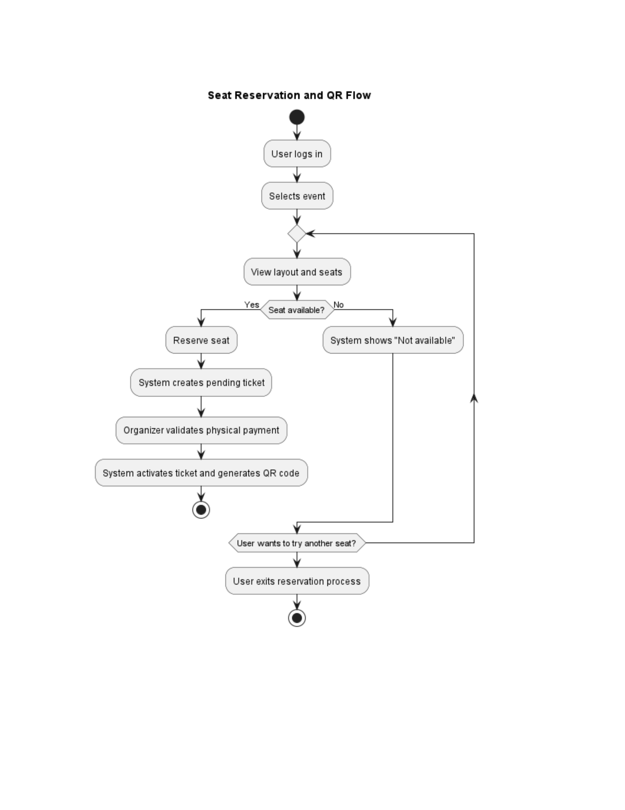

# Software design — Tu Evento

> Consolidated Tu Evento document. It gathers the following documents, whose content is kept unchanged; the conversion metadata of each one is in an HTML comment at the start of its section.

**Contents**

1. [Design patterns](#doc-te-0098)
2. [Architecture, package and ER diagrams](#doc-te-0081-te-0094-te-0095)
3. [Process diagram](#doc-te-0096)
4. [Flow diagrams](#doc-te-0128)
5. [Activity diagrams by module](#doc-te-0082-te-0083-te-0084-te-0085-te-0086-te-0087-te-0088-te-0089-te-0090-te-0091-te-0092-te-0093)
6. [Checklist](#doc-te-0099)
7. [Graphical interfaces](#interfaces-graficas)

---

<a id="doc-te-0098"></a>

<!--
ruta_anterior: en/04_Diseno_Software/Documento_Patrones_Diseno_TuEvento.md
id: TE-0098
title: "Documento_Patrones_Diseno_TuEvento"
lang: en
source: 04_Diseno_Software/Documento_Patrones_Diseno_TuEvento.pdf
source_sha256: 3fcd015ada492ddec9b5bbd8a737bf2150f52b5a5ba3f3ff2efe840367acb48a
conversion: "pdfplumber 0.11.10 + converter for untagged PDF (method C, pilot 3); without manual review. English translation of md/es: Claude Opus 5.5 (claude-opus-5-5); without manual review"
converted_on: 2026-10-23
fidelity: pendiente_revision
losses:
  - "Page header or footer omitted on pages 2–24: «TuEvento | Documento de Patrones de Diseño Página {n}»."
  - "Words split without a hyphen by the width of the cell joined without a space: modules/security/application/port/in/LoginPort.java, payment-gateway, fake-payment-gateway/.../domain/model/Payment.java, fake-payment-gateway, fake-payment-gateway/.../domain/model/PaymentStatus.java, modules/event/application/usecase/ChangeEventStatusService.java, modules/security/application/usecase/LoginUseCase.java, shared/infrastructure/config/OauthConfig.java, modules/notification/application/port/out/NotificationChannelPort.java, modules/notification/application/service/NotificationMessageFactory.java, modules/storage/application/service/ImageModerationService.java, modules/payment/application/port/out/PaymentGatewayPort.java, modules/storage/application/port/out/ModerationPort.java, modules/event/domain/repository/EventRepository.java, modules/event/application/mapper/EventEntityMapper.java, modules/security/domain/event/UserLockedEvent.java, fake-payment-gateway, fake-payment-gateway, fake-payment-gateway/.../application/port/out/WebhookNotifierPort.java, TuEventoFrontend/web/src/hooks/useTokenRefresh.js, TuEventoFrontend/web/src/services/httpClient.js, TuEventoFrontend/movil/src/context/AuthContext.jsx, TuEventoFrontend/movil/src/hooks/useSeatStore.js."
  - "PDF generated without LaTeX: hyphens at the end of a line are real hyphens and are kept when joining lines (they are not syllabic line-break hyphens)."
  - "Words split with a line-break hyphen inside cells were joined (without hyphen if a lowercase letter follows; with hyphen and without space if a digit or an uppercase letter follows): fake-payment-gatewa."
  - "63 ReportLab bullets without a Unicode mapping (Helvetica code 127, «(cid:127)» in the extraction) written as «•», which is how they look in the original."
  - "Bold, italics and monospaced font are kept; sizes, colours, alignment and indentation are not."
  - "Automatic check against pdftotext: coverage 98.85%, precision 98.73%, order 98.71%; missing {'String': 4, 'Provider': 4, 'PaymentStatus': 3, 'ga': 3, 'teway': 3, 'Function': 2, 'OauthProfile': 2, 'ThemeContext': 2, 'value': 2, 'Payme': 2, 'nt': 2, 'y': 1, 'o': 1, 'No': 1, 'login': 1} (explained above)."
  - "Differences in the check explained: the words that are «missing» (String, Provider, PaymentStatus, Function, OauthProfile, value) are in code blocks with generics <...> that the checker removes as HTML tags; «ga»/«teway» and similar are words split by the width of the cell that the Markdown joins; «text» is the marker of the code blocks."
  - "Tables without vertical rules (dark header band and alternate rows with grey background) rebuilt from the horizontal rules; the grey labels «P-NN | …» of each pattern are written as headings and their line «Categoría: … Capa: …» as a paragraph."
  - "Translation: file paths, class and method names, code fragments (including the Spanish words inside the code spans of the summary table) and the identifiers P-NN are kept as in the original."
status: borrador
reviewed_by: ""
translation_of: es/05_Diseno_Software.md#doc-te-0098
es_sha256: 9c8b18c2c613c1a3b5c406f2a3201f9331131f9f900a9ca6ae638c9e4d783e1c
-->

# Design patterns

| **Servicio Nacional de Aprendizaje (SENA; National Learning Service)** *Análisis y Desarrollo de Software (ADSO; Software Analysis and Development) · Ficha (training group) 3145556* **TU EVENTO PROJECT** **Design Patterns Document** *Catalogue of architectural, behavioural, structural, integration and* *deployment patterns verified in the source code* |
|---|
| <sup>Authors</sup> Jhampier Santos Ortiz |
| Cristofer David Lozano Contreras |

<sup>Programme</sup> <sup>of</sup> <sup>training</sup> Análisis y Desarrollo de Software (ADSO)

Ficha 3145556

| **Instructor** | Karol Daniela Correa |
|---|---|
| **Date** | October 2026 |

<sup>Version</sup> 1.0

# 1. Introduction

This document catalogues the design patterns used in TuEvento, a platform for the management and sale of event tickets made up of a Spring Boot backend, a React web frontend, a React Native mobile application and two auxiliary services. It complements the architecture, package and class diagrams of the software design deliverable.

Each pattern is presented with a uniform structure: category and layer, specific problem it solves in TuEvento, exact location in the code, explanation of its implementation, real code fragment and benefit provided.

## 1.1 Inclusion criterion

Only patterns whose implementation was verified in the source code of the repository are documented. The fragments shown are real excerpts, abbreviated when necessary. The patterns that appear in other sources but do not have a deliberate implementation in the code (for example CQRS, Template Method or messaging with an external broker) are not included as applied patterns.

## 1.2 Identifier convention

The patterns are identified as P-01 to P-27 and are grouped by affinity into six sections. The cross-references between patterns use that identifier.

# 2. Architectural summary

TuEvento is a **modular monolith** with 14 domain modules (security, profile, event, section, seat, ticket, payment, wallet, notification, storage, geolocation, category, language and theme) organized under **Domain-Driven Design (DDD)** and **Hexagonal Architecture (ports and adapters).** Each module has four internal layers:

- **domain:** models, repository interfaces and domain events.
- **application:** use cases, input and output ports, DTOs, mappers and application services.
- **infrastructure:** JPA persistence, external adapters, notification channels and WebSocket.
- **interfaces/rest:** controllers.
The three clients (web frontend, mobile application and backend) communicate exclusively through HTTP REST; real-time updates use STOMP over SockJS/WebSocket. The auxiliary services **fake-payment-gateway** and **nsfw-service** are independent applications that the backend consumes through its own adapters.

# 3. Main technologies

| **Project** | **Technology** | **Version** |
|---|---|---|
| Backend | Java | 17 |
| Backend | Spring Boot | 3.5.12 |
| Backend | PostgreSQL | 17 |
| Backend | Liquibase | Managed by Spring Boot |
| Backend | MapStruct | 1.6.3 |
| Backend | Lombok | Managed by Spring Boot |
| Backend | jjwt | 0.12.6 |

Backend AWS SDK (S3/MinIO) 2.25.60

| **Project** | **Technology** | **Version** |
|---|---|---|
| Web frontend | React | 18.2.0 |
| Web frontend | Vite | 5.0.0 |
| Web frontend | @stomp/stompjs | 7.3.0 |
| Mobile app | React Native | 0.81.5 |
| Mobile app | Expo | ~54.0.33 |
| Mobile app | @stomp/stompjs | 7.3.0 |
| fake-payment-gateway | Spring Boot | Same stack as the backend |
| nsfw-service | Python / FastAPI + opennsfw2 | Not specified |
| CI/CD | GitHub Actions + SonarQube Cloud; deployment with Docker + Kubernetes | Not specified |

# 4. Reference diagrams

The following diagrams of the documentation repository complement this catalogue:

| **Diagram** | **Path** |
|---|---|
| System architecture | `05_Diseno_Software/Diagrama de arquitectura.png` |
| Packages (module structure) | `05_Diseno_Software/Diagrama de paquetes.png` |
| Entity-relationship (complete ERD) | `05_Diseno_Software/DER_TuEvento.png` |
| Processes | `05_Diseno_Software/Diagrama de procesos.pdf` |
| Flow | `05_Diseno_Software/diagramas de flujo .pdf` |
| Activities by module (12 PNG) | `05_Diseno_Software/Diagrama de actividades (en modulos)/` |
| Sequence | `03_Analisis_Software/secuencie Diagrams.pdf` |
| Classes: models, repositories, services, DTOs, controllers, config and JWT | `03_Analisis_Software/class diagram/` |
| Use cases by module (16 PNG) | `03_Analisis_Software/Use case/` |
| MER by module (14 files) | `05_Diseno_Software/MER (en modulos)/` |
| SQL scripts by module (13 files) | `05_Diseno_Software/SQL/` |

# 5. Pattern catalogue

## 5.1 Architectural patterns

They define the global structure of the system: how responsibilities are separated, how the domain is isolated and how the modules are organized.

### P-01 | Hexagonal Architecture (Ports and Adapters)

Category: Architectural Layer: Backend

### Problem it solves

The business logic (management of events, payments, tickets) must not depend on Spring, JPA or any external provider. This way the use cases can be tested with mocks without bringing up a database or a REST layer.

### Where it is implemented

- Input port: modules/security/application/port/in/LoginPort.java
- Output port: modules/security/application/port/out/TokenGeneratorPort.java
- Use case: modules/security/application/usecase/LoginUseCase.java
### How it is implemented

Each module exposes interfaces in application/port/in (what the outside can ask of it) and application/port/out (what the module needs from the outside). The controllers of interfaces/rest inject only the input port; the infrastructure adapters implement the output ports.

### Code fragment

*application/port/in/LoginPort.java and application/usecase/LoginUseCase.java*

```text
public interface LoginPort {
    LoginResponse login(LoginRequest request);
```

`}`

```text
@Service
@RequiredArgsConstructor
public class LoginUseCase implements LoginPort {
    private final PasswordEncoderPort passwordEncoder;  // puerto de salida
    private final TokenGeneratorPort  tokenGenerator;   // puerto de salida
    @Override
    @Transactional
    public LoginResponse login(LoginRequest request) { ... }
```

`}`

### Benefit

The use cases are tested by injecting mocks of PasswordEncoderPort and TokenGeneratorPort without starting Spring. Changing the token library (jjwt for another one) does not modify the use case.

### P-02 | Domain-Driven Design: Aggregate Root, Value Object and Domain Event

Category: Architectural Layer: Backend and fake-payment-gateway

### Problem it solves

The payment and event domains are complex. Without clear boundaries, any service could modify the status of a payment or an event directly, breaking the business rules.

### Where it is implemented

- Aggregate root with a static factory: fake-payment-gateway/.../domain/model/Payment.java
- Immutable Value Object: fake-payment-gateway/.../domain/model/Money.java
- Domain model of the event: modules/event/domain/model/Event.java (with @Builder)
- Domain event: modules/event/domain/event/EventStatusChangedEvent.java
- Domain repository (interface): modules/event/domain/repository/EventRepository.java
### How it is implemented

Payment is the only entry point to change the status of a payment: its constructor is private, it forces the use of Payment.create(...) and each method (approve(), refund(), etc.) validates the transition before mutating the status. Money is final, without setters and with validations in the constructor. EventRepository is a domain interface; its JPA implementation lives in infrastructure.

### Code fragment

*fake-payment-gateway/.../domain/model/Payment.java*

```text
public static Payment create(String externalReference,
        Money money, PaymentMethod paymentMethod) {
    Payment p = new Payment();
    p.paymentId = "fake_" + UUID.randomUUID();
    p.status    = PaymentStatus.PENDING;
    p.money     = money;
    p.createdAt = Instant.now();
    return p;
```

`}`

```text
public PaymentStatusChanged approve() {
    transitionTo(PaymentStatus.APPROVED);
    return createStatusChangedEvent();
```

`}`

```text
private void transitionTo(PaymentStatus newStatus) {
    if (!status.canTransitionTo(newStatus))
        throw new InvalidStatusTransitionException(...);
    this.status = newStatus;
```

`}`

### Benefit

No service can leave a payment in APPROVED without going through the state machine. All the business logic stays in the domain and not in the services.

### P-03 | Modular Monolith

Category: Architectural Layer: Backend

### Problem it solves

The project has a broad scope (14 modules) and a small team. Clear boundaries between domains are needed to avoid coupling, but without the operational cost of a microservice architecture.

### Where it is implemented

- Package structure: modules/ with security, event, payment, wallet, notification, ticket, section, seat, storage, profile, geolocation, category, language and theme
- Communication between modules: EventStatusChangedListener.java consumes the EventStatusChangedEvent published by ChangeEventStatusService
### How it is implemented

Each module has its own domain, application and infrastructure layers. The communication between modules is done with Spring domain events (ApplicationEventPublisher) instead of direct calls between services, which keeps coupling low.

### Code fragment

*modules/event/application/usecase/ChangeEventStatusService.java*

```text
eventPublisher.publishEvent(EventStatusChangedEvent.builder()
    .eventId(eventId)
    .newStatus(request.getNewStatus().name())
    .organizerId(event.getUserId())
    .eventName(event.getEventName())
    .reason(null)
    .build());
```

### Benefit

The notification module does not import anything from the event module; it only reacts to the published event. If in the future notification is extracted as a microservice, the contract is still the event and not a direct dependency.

## 5.2 Behavioural and creational patterns of business logic

They solve how the objects collaborate and how responsibilities are assigned in the business logic: status control, reaction to events, selection of algorithms and validation chains.

### P-04 | State: life cycle of the event

Category: Behavioural Layer: Backend

### Problem it solves

An event goes through several statuses (DRAFT, PENDING_REVIEW, PUBLISHED, REJECTED, CANCELLED and COMPLETED). Without an explicit control of transitions, an organizer could, for example, take an event from CANCELLED to PUBLISHED directly.

### Where it is implemented

- Status enum: modules/event/domain/model/EventStatus.java
- Service that applies the transition table: modules/event/application/usecase/ChangeEventStatusService.java (validateTransition method)
### How it is implemented

The switch of validateTransition acts as an explicit transition table: each allowed combination (current status, target status) is declared and any other one throws BusinessException with the code EVENT_INVALID_STATUS_TRANSITION.

### Code fragment

*modules/event/application/usecase/ChangeEventStatusService.java*

```text
private void validateTransition(EventStatus current, EventStatus next) {
    boolean allowed = switch (current) {
        case DRAFT          -> next == EventStatus.PENDING_REVIEW;
        case PENDING_REVIEW -> next == EventStatus.DRAFT;
        case REJECTED       -> next == EventStatus.DRAFT;
        case PUBLISHED      -> next == EventStatus.CANCELLED
                            || next == EventStatus.COMPLETED;
        default             -> false;
```

`};`

```text
if (!allowed) throw new BusinessException(
    "EVENT_INVALID_STATUS_TRANSITION",
    "Transition from " + current + " to " + next + " is not allowed");
```

`}`

### Benefit

Adding a status or modifying a transition is a localized change in a single method.

### P-05 | State: state machine of the payment

Category: Behavioural Layer: fake-payment-gateway

### Problem it solves

The payment gateway simulates real transitions (PENDING, PROCESSING, APPROVED, REFUNDED). Without this control, the system could try to refund a payment that was never approved.

### Where it is implemented

- fake-payment-gateway/.../domain/model/PaymentStatus.java
### How it is implemented

PaymentStatus is an enum with the abstract method allowedTransitions(). Each constant implements it by declaring the valid target statuses, and canTransitionTo(newStatus) queries that set. If the transition is not allowed, Payment.transitionTo() throws InvalidStatusTransitionException.

### Code fragment

*domain/model/PaymentStatus.java*

```text
public enum PaymentStatus {
    PENDING {
        public Set<PaymentStatus> allowedTransitions() {
            return Set.of(PROCESSING, CANCELLED);
```

`}`

`},`

```text
APPROVED {
    public Set<PaymentStatus> allowedTransitions() {
        return Set.of(REFUNDED);
```

`}`

`},`

```text
REFUNDED {
    public Set<PaymentStatus> allowedTransitions() {
        return Set.of(); // terminal
```

`}`

`};`

```text
public abstract Set<PaymentStatus> allowedTransitions();
public boolean canTransitionTo(PaymentStatus next) {
    return allowedTransitions().contains(next);
```

`}`

`}`

### Benefit

The behaviour of each status is encapsulated in the status itself. Adding a new status (for example DISPUTED) requires only a constant with its transitions.

### P-06 | Observer / Event-Driven: change of status of the event

Category: Behavioural Layer: Backend

### Problem it solves

When an administrator approves or rejects an event, the notifications module must notify the organizer. But ChangeEventStatusService must not know about or depend on the notifications module.

### Where it is implemented

- Publisher: modules/event/application/usecase/ChangeEventStatusService.java (eventPublisher.publishEvent)
- Event: modules/event/domain/event/EventStatusChangedEvent.java
- Subscriber: modules/notification/infrastructure/messaging/EventStatusChangedListener.java
### How it is implemented

Spring's ApplicationEventPublisher acts as the event bus. The listener uses @TransactionalEventListener(AFTER_COMMIT) to trigger the notification only if the transaction of the status change was committed, and @Async so as not to block the original transaction.

### Code fragment

*notification/infrastructure/messaging/EventStatusChangedListener.java*

```text
@Async
@TransactionalEventListener(phase = TransactionPhase.AFTER_COMMIT)
@Transactional(propagation = Propagation.REQUIRES_NEW)
public void onEventStatusChanged(EventStatusChangedEvent event) {
    if (!PENDING_REVIEW.equals(event.getOldStatus())) return;
    String typeName = PUBLISHED.equals(event.getNewStatus())
            ? NotificationTypeNames.EVENT_PUBLISHED
            : NotificationTypeNames.EVENT_REJECTED;
    sendNotificationUseCase.execute(
        SendNotificationCommand.builder()
            .typeName(typeName)
            .userIds(List.of(event.getOrganizerId().intValue()))
            .eventName(event.getEventName())
            .build());
```

`}`

### Benefit

The event module never imports the notification module. New subscribers (for example, an external webhook) can be added without modifying ChangeEventStatusService.

### P-07 | Observer / Event-Driven: user lockout (UserLockedEvent)

Category: Behavioural Layer: Backend

### Problem it solves

When an account is locked because of failed login attempts, other modules (notifications, auditing) must find out without coupling the security module to them.

### Where it is implemented

- Publisher: modules/security/application/usecase/LoginUseCase.java (eventPublisher.publishEvent)
- Event: modules/security/domain/event/UserLockedEvent.java
### How it is implemented

LoginUseCase publishes a UserLockedEvent with the user's identifier, their alias and the date until which they remain locked. The interested modules consume it with the same mechanism described in P-06.

### Code fragment

*security/application/usecase/LoginUseCase.java*

```text
eventPublisher.publishEvent(UserLockedEvent.builder()
    .userId(user.getUserId())
    .alias(user.getAlias())
    .lockedUntil(lockedUntil)
    .occurredAt(now)
    .build());
```

### Benefit

Clean separation between the security module and the modules that react to the lockout.

### P-08 | Strategy: OAuth resolvers by provider

Category: Behavioural Layer: Backend

### Problem it solves

The system allows logging in with Google and Facebook. The exchange of the code and obtaining the profile are different for each provider, but the use case must not contain if (google) ... else if (facebook) chains.

### Where it is implemented

- Strategy registry: shared/infrastructure/config/OauthConfig.java (oauthProviderResolvers bean)
- Consumer: modules/security/application/usecase/OauthLoginUseCase.java (providerResolvers field)
### How it is implemented

Each provider is a Function&lt;String, OauthProfile&gt; registered in a Map with the key "google" or "facebook". When a request arrives, OauthLoginUseCase looks up the function by key and invokes it. To add another provider it is enough to register a new entry in the map.

### Code fragment

*shared/infrastructure/config/OauthConfig.java*

```text
@Bean
public Map<String, Function<String, OauthProfile>> oauthProviderResolvers() {
    return Map.of(
        "google",   googleProfileResolver(),
        "facebook", facebookProfileResolver()
```

`);`

`}`

*modules/security/application/usecase/OauthLoginUseCase.java*

```text
private final Map<String, Function<String, OauthProfile>> providerResolvers;
// Uso:
OauthProfile profile = providerResolvers
    .get(provider)
    .apply(authorizationCode);
```

### Benefit

Adding a new provider (GitHub, Apple) requires only an entry in the map and a function in OauthConfig. The use case does not change.

### P-09 | Strategy: notification channels

Category: Behavioural Layer: Backend

### Problem it solves

Notifications must be delivered through different channels (IN_APP by WebSocket and EMAIL by SMTP). The logic of each channel must not be mixed, and adding a new channel (for example SMS) must not touch the use case.

### Where it is implemented

- Strategy interface: modules/notification/application/port/out/NotificationChannelPort.java
- IN_APP strategy: modules/notification/infrastructure/channel/InAppChannelAdapter.java
- EMAIL strategy: modules/notification/infrastructure/channel/EmailChannelAdapter.java
- Strategy selector: modules/notification/application/usecase/SendNotificationUseCase.java
### How it is implemented

The constructor of SendNotificationUseCase injects the list of NotificationChannelPort and converts it into a map using channelName() as the key. For each notification it selects the corresponding adapter from the map.

### Code fragment

*application/port/out/NotificationChannelPort.java and SendNotificationUseCase.java*

```text
public interface NotificationChannelPort {
    String channelName();
    void deliver(Notification notification, List<Integer> userIds);
```

`}`

```text
// SendNotificationUseCase (constructor)
this.channelsByName = channelPorts.stream()
    .collect(Collectors.toMap(
        NotificationChannelPort::channelName,
        Function.identity()));
```

### Benefit

InAppChannelAdapter and EmailChannelAdapter are independent. Adding an SmsChannelAdapter requires implementing the interface and registering the bean, without modifying the use case.

### P-10 | Factory Method: NotificationMessageFactory

Category: Creational Layer: Backend

### Problem it solves

The text of the notification varies according to the type (PAYMENT_APPROVED, EVENT_PUBLISHED, EVENT_REJECTED, etc.) and according to the channel (HTML for email, plain text for IN_APP). Without a central factory, that logic would be scattered in listeners and services.

### Where it is implemented

- modules/notification/application/service/NotificationMessageFactory.java
### How it is implemented

Final class with a private constructor and the static method build(typeName, channelName, command). A switch on typeName selects the corresponding private construction method, and each one branches according to the channel to produce HTML or plain text.

### Code fragment

*notification/application/service/NotificationMessageFactory.java*

```text
public static MessageContent build(String typeName,
        String channelName, SendNotificationCommand command) {
    boolean email = NotificationChannelNames.EMAIL.equals(channelName);
    return switch (typeName) {
        case NotificationTypeNames.PAYMENT_APPROVED -> paymentApproved(email, command);
        case NotificationTypeNames.EVENT_PUBLISHED  -> eventPublished(email, command);
        case NotificationTypeNames.EVENT_REJECTED   -> eventRejected(email, command);
        default -> new MessageContent("Notificación",
            email ? html("Tienes una nueva notificación.")
                  : "Tienes una nueva notificación.");
```

`};`

`}`

### Benefit

Adding a notification type is a new case and a private method. In addition, the XSS mitigation on the rejection reason is centralized in escapeHtml() within the same class.

### P-11 | Chain of Responsibility: cascade image moderation

Category: Behavioural Layer: Backend

### Problem it solves

The event images are filtered first for sexual content (local OpenNSFW2 service) and then, only if they pass the first filter, for violent content (Sightengine API). This way the paid service is only called when necessary, reducing costs.

### Where it is implemented

- Chain orchestrator: modules/storage/application/service/ImageModerationService.java
- Link 1: modules/storage/infrastructure/external/NsfwClientAdapter.java
- Link 2: modules/storage/infrastructure/external/SightengineAdapter.java
- Invoker: modules/storage/application/usecase/UploadFileUseCase.java (moderationService.moderate)
### How it is implemented

ImageModerationService.moderate() first calls nsfwClient.isSafe(). If it returns false, it throws ImagePolicyViolationException("NSFW_CONTENT") without continuing. Only if it returns true does it query sightengineAdapter.isSafe(). Both adapters apply a fail-open policy: if the external service fails, they return true so as not to block the upload.

### Code fragment

*storage/application/service/ImageModerationService.java*

```text
public void moderate(byte[] imageBytes) {
    if (!isNsfwSafe(imageBytes)) {
        log.warn("Image rejected by NSFW filter");
        throw new ImagePolicyViolationException("NSFW_CONTENT");
```

`}`

```text
if (!isGoreSafe(imageBytes)) {
    log.warn("Image rejected by gore filter");
    throw new ImagePolicyViolationException("VIOLENT_CONTENT");
```

`}`

`}`

### Benefit

Adding a third filter (for example, logo detection) requires implementing ModerationPort and adding a step in moderate(), without touching the other links.

## 5.3 Structural and object creation patterns

They organize the composition of classes and the separation between layers: adaptation of external services, data access, conversion between models and construction of objects.

### P-12 | Adapter: payment gateway

Category: Structural Layer: Backend

### Problem it solves

The payment system must be able to work with the sandbox payment gateway, used for testing the payment flow, and, in the future, with a real provider. The payment use case cannot be coupled to the specific HTTP API of either of them.

### Where it is implemented

- Output port: modules/payment/application/port/out/PaymentGatewayPort.java
- Concrete adapter: modules/payment/infrastructure/external/FakePaymentGatewayAdapter.java
- Conditional activation: @ConditionalOnProperty(name = "payment.gateway", havingValue = "fake")
### How it is implemented

PaymentGatewayPort defines createPayment, getPayment, cancelPayment, refundPayment and processWebhook. FakePaymentGatewayAdapter implements them by translating each call to the REST API of the sandbox gateway with RestTemplate. The bean is activated only if payment.gateway=fake, which makes it possible to register a production adapter without changing the use case.

### Code fragment

*payment/application/port/out/PaymentGatewayPort.java and FakePaymentGatewayAdapter.java*

```text
public interface PaymentGatewayPort {
    GatewayPayment createPayment(CreatePaymentCommand command);
    GatewayPayment getPayment(String gatewayPaymentId);
    void cancelPayment(String gatewayPaymentId);
    void refundPayment(String gatewayPaymentId);
    GatewayPaymentEvent processWebhook(String payload, String signature);
```

`}`

```text
@Component
@ConditionalOnProperty(name = "payment.gateway", havingValue = "fake")
public class FakePaymentGatewayAdapter implements PaymentGatewayPort {
    @Override
    public GatewayPayment createPayment(CreatePaymentCommand command) {
        ResponseEntity<JsonNode> response = restTemplate.exchange(
            gatewayUrl + "/public/payments", HttpMethod.POST, entity, JsonNode.class);
        return GatewayPayment.builder()
            .paymentId(body.get("paymentId").asText())
            .status(body.get("status").asText())
            .build();
```

`}`

`}`

### Benefit

Changing to another provider in production consists of registering a new adapter and changing a configuration property. The payment use case does not know which gateway it points to.

### P-13 | Adapter: image moderation (NSFW and Sightengine)

Category: Structural Layer: Backend

### Problem it solves

The Java backend must consume two heterogeneous external services: the Python microservice nsfw-service (multipart REST) and the commercial Sightengine API. The moderation logic must not know the HTTP details of either of them.

### Where it is implemented

- Interface: modules/storage/application/port/out/ModerationPort.java
- NSFW adapter: modules/storage/infrastructure/external/NsfwClientAdapter.java
- Sightengine adapter: modules/storage/infrastructure/external/SightengineAdapter.java
### How it is implemented

NsfwClientAdapter.isSafe() calls POST {nsfw_url}/classify sending the image as multipart/form-data, interprets the nsfw_score field of the JSON response and compares it with the configured threshold. Any exception (timeout, service down) returns true (fail-open).

### Code fragment

*storage/infrastructure/external/NsfwClientAdapter.java*

```text
public boolean isSafe(byte[] imageBytes) {
    try {
        String url = moderationConfig.getNsfw().getUrl() + "/classify";
        // construye multipart form...
        ResponseEntity<Map> response = rt.postForEntity(url, entity, Map.class);
        double score = ((Number) response.getBody().get("nsfw_score")).doubleValue();
        return score < moderationConfig.getNsfw().getThreshold();
    } catch (Exception e) {
        log.error("NSFW service unreachable - failing open");
        return true;  // fail-open
```

`}`

`}`

### Benefit

If the local NSFW service is replaced by another one (for example AWS Rekognition), only the adapter changes and not the moderation chain.

### P-14 | Repository: persistence abstraction with a JPA implementation

Category: Structural Layer: Backend

### Problem it solves

The event domain must not depend on JPA, EntityManager or persistence details. The domain queries must be expressed in business terms and not in SQL.

### Where it is implemented

- Domain interface: modules/event/domain/repository/EventRepository.java
- JPA implementation: modules/event/infrastructure/persistence/repository/EventRepositoryImpl.java
- Entity-domain mapper: modules/event/application/mapper/EventEntityMapper.java (MapStruct)
### How it is implemented

EventRepository defines methods in business language, such as findAllPublishedExpiredBefore(LocalDate) or findByCityId(Long). EventRepositoryImpl implements them by injecting EventJpaRepository (Spring Data JPA) and EventEntityMapper to convert between EventEntity (JPA) and Event (domain).

### Code fragment

*infrastructure/persistence/repository/EventRepositoryImpl.java*

```text
@Repository
@RequiredArgsConstructor
public class EventRepositoryImpl implements EventRepository {
    private final EventJpaRepository jpaRepository;
    private final EventEntityMapper  mapper;
```

```text
@Override
public Optional<Event> findById(Long eventId) {
    return jpaRepository.findById(eventId)
        .map(mapper::toDomain);  // entidad JPA -> objeto de dominio
```

`}`

```text
@Override
public Event save(Event event) {
    return mapper.toDomain(jpaRepository.save(mapper.toEntity(event)));
```

`}`

`}`

### Benefit

Migrating from PostgreSQL to another engine requires only replacing the implementation; the use cases do not change.

### P-15 | Mapper / DTO: MapStruct for layer separation

Category: Structural Layer: Backend

### Problem it solves

The domain model Event and the JPA entity EventEntity have differentiated fields (auditing, lazy relationships, etc.) that must not be exposed or mixed. Copying properties by hand is error-prone.

### Where it is implemented

- modules/event/application/mapper/EventEntityMapper.java
### How it is implemented

MapStruct generates the mapper implementation at compile time from an interface annotated with @Mapper(componentModel = "spring"). The annotations @Mapping(target = "X", ignore = true) exclude the auditing fields when building the domain from the entity.

### Code fragment

*event/application/mapper/EventEntityMapper.java*

```text
@Mapper(componentModel = "spring")
public interface EventEntityMapper {
    @Mapping(target = "createdAt", ignore = true)
    @Mapping(target = "updatedAt", ignore = true)
    @Mapping(target = "createdBy",  ignore = true)
    @Mapping(target = "updatedBy",  ignore = true)
    Event toDomain(EventEntity entity);
```

```text
EventEntity toEntity(Event domain);
```

`}`

### Benefit

It eliminates the repetitive conversion code. If a field is added to Event, MapStruct detects at compile time that the mapping is missing, avoiding silent errors.

### P-16 | Builder: Lombok @Builder in models, events and DTOs

Category: Creational Layer: Backend

### Problem it solves

Objects such as AuthSession, RefreshToken, LoginResponse and EventStatusChangedEvent have many fields, several of them optional. Constructors with eight or more parameters are unreadable and prone to ordering errors.

### Where it is implemented

- modules/security/domain/event/UserLockedEvent.java (@Builder)
- modules/event/domain/event/EventStatusChangedEvent.java (@Builder)
- modules/event/domain/model/Event.java (@Builder)
- Use in LoginUseCase.java to build AuthSession, RefreshToken and LoginResponse
### How it is implemented

Lombok generates the builder at compile time; the use cases build the objects by chaining methods named after the fields.

### Code fragment

*security/application/usecase/LoginUseCase.java*

```text
AuthSession session = authSessionRepository.save(
    AuthSession.builder()
        .user(user)
        .accessToken(accessToken)
        .issuedAt(now)
        .expiresAt(now.plusMinutes(ACCESS_TOKEN_MINUTES))
        .revoked(false)
        .build());
return LoginResponse.builder()
    .accessToken(accessToken)
    .refreshToken(refreshToken)
    .userId(user.getUserId())
    .role(user.getRole().getCode())
    .build();
```

### Benefit

Greater readability and compile-time safety. Adding an optional field does not break the existing code.

### P-17 | Value Object: Money

Category: DDD / Structural Layer: fake-payment-gateway

### Problem it solves

The amount of a payment and its currency must always be consistent. A loose BigDecimal can be negative or lack an associated currency.

### Where it is implemented

- fake-payment-gateway/.../domain/model/Money.java
### How it is implemented

Money is a final and immutable class: it validates in the constructor that the amount is not null or negative and that the currency is not empty, normalizes the currency to uppercase and does not expose setters.

### Code fragment

*domain/model/Money.java*

```text
public final class Money {
    private final BigDecimal amount;
    private final String currency;
    public Money(BigDecimal amount, String currency) {
        if (amount == null || amount.compareTo(BigDecimal.ZERO) < 0)
            throw new IllegalArgumentException("Amount must be non-negative");
        if (currency == null || currency.isBlank())
            throw new IllegalArgumentException("Currency cannot be null");
        this.amount   = amount;
        this.currency = currency.toUpperCase();
```

`}`

```text
// sin setters: inmutable
```

`}`

### Benefit

It is impossible to create a Money with a negative amount or an empty currency. Being immutable, it is safe in concurrent contexts and within domain events.

## 5.4 Integration and deployment patterns

They cover the communication with external services, fault tolerance and the automation of the deployment on containers and Kubernetes.

### P-18 | Adapter with retries and HMAC signature: WebhookNotifierAdapter

Category: Integration Layer: fake-payment-gateway

### Problem it solves

The sandbox gateway must notify the main backend each time a payment changes status. The network can fail transiently and the receiver must verify that the webhook is authentic and was not tampered with.

### Where it is implemented

- Interface: fake-payment-gateway/.../application/port/out/WebhookNotifierPort.java
- Adapter: fake-payment-gateway/.../infrastructure/webhook/WebhookNotifierAdapter.java
### How it is implemented

The first attempt is synchronous and takes part in the transaction. If it fails, retryAsync() retries up to 3 times with increasing waits (2 s, 10 s and 30 s). Each attempt signs the payload with HMAC-SHA256 using a shared key; the backend (FakePaymentGatewayAdapter) verifies the same signature before processing the event.

### Code fragment

*infrastructure/webhook/WebhookNotifierAdapter.java*

```text
private static final int    MAX_ATTEMPTS       = 3;
private static final long[] BACKOFF_DELAYS_MS = {2000, 10000, 30000};
```

```text
@Override
public void notify(PaymentStatusChanged event) {
    boolean success = attemptDelivery(event, 1);
    if (!success) retryAsync(event, 2); // reintentos asíncronos
```

`}`

```text
@Async
private void retryAsync(PaymentStatusChanged event, int startAttempt) {
    for (int attempt = startAttempt; attempt <= MAX_ATTEMPTS; attempt++) {
        Thread.sleep(BACKOFF_DELAYS_MS[attempt - 2]);
        if (attemptDelivery(event, attempt)) return;
```

`}`

`}`

### Benefit

Transient network outages do not lose payment notifications, and the HMAC signature prevents an attacker from injecting fake webhooks.

### P-19 | Independent microservice: nsfw-service (Python / FastAPI)

Category: Architectural / Integration Layer: nsfw-service

### Problem it solves

Running machine learning model inference inside the JVM of the Spring Boot backend is inefficient and adds heavy dependencies. NSFW classification is isolated in its own Python process.

### Where it is implemented

- nsfw-service/main.py
### How it is implemented

FastAPI exposes POST /classify, which receives a multipart image, passes it to opennsfw2.predict_image() and returns nsfw_score and flagged. The Java backend consumes it through NsfwClientAdapter (see P-13).

### Code fragment

*nsfw-service/main.py*

```text
@app.post("/classify")
async def classify(file: UploadFile = File(...)):
    raw = await file.read()
    nsfw_score = opennsfw2.predict_image(io.BytesIO(raw))
    return {
        "nsfw_score": round(float(nsfw_score), 4),
        "flagged":    nsfw_score >= 0.6,
```

`}`

### Benefit

The model can be updated without recompiling or redeploying the Java backend, and the service can scale independently. The threshold used by the backend is configurable through ModerationConfig.

### P-20 | Continuous integration pipeline with parallel jobs (GitHub Actions)

Category: Deployment / Integration Layer: Infrastructure

### Problem it solves

Validating the code manually allows a defective commit to be integrated into the main branches without going through tests, compilation or quality analysis.

### Where it is implemented

- .github/workflows/ci.yml (root of the code repository)
- sonar-project.properties (root of the code repository)
### How it is implemented

The workflow is triggered on every push or pull request to the main and develop branches and declares three independent jobs that run in parallel: backend (tests with ./mvnw -B verify, coverage with JaCoCo and analysis in SonarQube Cloud), web (npm ci and npm run build) and mobile (npm ci and npx expo export). If a job fails, the run is marked as failed, and a new push to the same branch cancels the previous run.

### Code fragment

*.github/workflows/ci.yml (fragment)*

```text
on:
  push:
    branches: [main, develop]
  pull_request:
    branches: [main, develop]

jobs:
  backend:
    name: Backend (tests + SonarQube)
    steps:
      - name: Tests y cobertura (JaCoCo)
        run: ./mvnw -B verify

      - name: Análisis SonarQube Cloud
        uses: SonarSource/sonarqube-scan-action@2f77a1ec69fb1d595b06f35ab27e97605bdef703 # v5.3.2
```

### Benefit

Every push or pull request runs the backend tests and builds the web and the mobile application, and SonarQube Cloud reports bugs, vulnerabilities and duplicated code before the changes are integrated, without consuming resources of the local machine.

### P-21 | Horizontal Pod Autoscaler (HPA): automatic scaling in Kubernetes

Category: Deployment / Availability Layer: Infrastructure

### Problem it solves

During the ticket sale of a popular event, the traffic towards the backend can multiply in seconds. With a fixed number of replicas the system would become saturated.

### Where it is implemented

- k8s/hpa.yaml
### How it is implemented

The HPA monitors the CPU and memory of the tu-evento-backend Deployment: if CPU usage exceeds 70 % or memory usage 80 %, it scales up to 10 replicas. The scaleDown policy has a stabilization window of 5 minutes to avoid continuous oscillations.

### Code fragment

*k8s/hpa.yaml (fragment)*

```text
spec:
  scaleTargetRef:
    name: tu-evento-backend
  minReplicas: 2
  maxReplicas: 10
  metrics:
  - type: Resource
    resource:
      name: cpu
      target:
        type: Utilization
        averageUtilization: 70
  behavior:
    scaleDown:
      stabilizationWindowSeconds: 300
```

### Benefit

The system scales automatically in response to demand peaks, such as the opening of ticket sales, without manual intervention.

## 5.5 Patterns in the web frontend (React)

Global state management, reuse of stateful logic and concurrency control in the HTTP requests of the web application.

### P-22 | Context / Provider: ThemeContext and NotificationContext

Category: Behavioural / Structural Layer: Web frontend

### Problem it solves

The colour palette of the active theme and the real-time notifications must be available in any component without passing props manually through the whole hierarchy.

### Where it is implemented

- TuEventoFrontend/web/src/context/ThemeContext.jsx (ThemeProvider and useTheme)
- TuEventoFrontend/web/src/context/NotificationContext.jsx (NotificationProvider and useNotifications)
### How it is implemented

ThemeProvider keeps the active palette in the React state, applies it to the DOM as custom CSS properties (--color-primary, etc.) and exposes applyTheme, resetTheme and syncTheme. NotificationProvider keeps a single centralized STOMP WebSocket client and a map of active subscriptions, and exposes subscribe(destination, callback, key) so that any component can subscribe dynamically.

### Code fragment

*web/src/context/ThemeContext.jsx*

```text
export const ThemeContext = createContext(null);
```

```text
export function ThemeProvider({ children }) {
  const [palette, setPalette] = useState(DEFAULT_PALETTE);
```

```text
// Aplica la paleta como CSS custom properties en :root
const applyPaletteToDOM = (palette) => {
  Object.entries(palette).forEach(([key, value]) => {
    document.documentElement.style
      .setProperty(`--color-${key}`, value);
```

`});`

`};`

```text
return (
  <ThemeContext.Provider value={{ palette, applyTheme, resetTheme }}>
    {children}
  </ThemeContext.Provider>
```

`);`

`}`

```text
export const useTheme = () => useContext(ThemeContext);
```

### Benefit

Any component accesses the theme with useTheme() without knowing how it is loaded or synchronized. The NotificationProvider WebSocket is initialized only once for the whole application, avoiding duplicate connections.

### P-23 | Custom Hook: useTokenRefresh and useToast

Category: Behavioural / Reuse Layer: Web frontend

### Problem it solves

The automatic refresh of the JWT and the handling of toast alerts are stateful logic needed in several components. Without hooks there would be duplicated useEffect and useRef in each page.

### Where it is implemented

- TuEventoFrontend/web/src/hooks/useTokenRefresh.js
- TuEventoFrontend/web/src/hooks/useToast.js
### How it is implemented

useTokenRefresh(onTokenRefreshed) encapsulates the refresh interval (every 12 minutes), avoids simultaneous refreshes with isRefreshing.current and performs a clean logout if the refresh fails with 401. It receives a callback that NotificationContext uses to reconnect the WebSocket with the new token. useToast encapsulates the state of the toast, the automatic hiding timer (5 seconds) and its restart if the same alert is triggered before it expires.

### Code fragment

*web/src/hooks/useTokenRefresh.js*

```text
export const useTokenRefresh = (onTokenRefreshed) => {
  const isRefreshing = useRef(false);
```

```text
const refreshToken = useCallback(async () => {
  if (isRefreshing.current) return; // evita condición de carrera
  isRefreshing.current = true;
  try {
    const data = await httpRequest(`${API_URL}/auth/refresh`, {
      method: 'POST',
      body: JSON.stringify({ refreshToken: localStorage.getItem('refreshToken') }),
```

`});`

```text
  localStorage.setItem('token', data.accessToken);
  onTokenRefreshed?.(data.accessToken); // notifica al WebSocket
} finally {
  isRefreshing.current = false;
```

`}`

```text
}, [onTokenRefreshed]);
```

```text
useEffect(() => {
  const id = setInterval(refreshToken, REFRESH_INTERVAL_MS); // 12 min
  return () => clearInterval(id);
}, [refreshToken]);
```

`};`

### Benefit

The refresh logic stays in a single place. If the endpoint URL or the interval changes, the hook is modified and the whole application is updated.

### P-24 | Interceptor with a shared promise (refresh singleton) in httpClient

Category: Behavioural / Integration Layer: Web frontend

### Problem it solves

If ten simultaneous requests receive a 401 (expired token), without control they would make ten parallel calls to /auth/refresh, exhausting the refresh tokens or causing concurrency errors.

### Where it is implemented

- TuEventoFrontend/web/src/services/httpClient.js
### How it is implemented

refreshPromise is a module variable (singleton). The first request with 401 creates the refresh promise and assigns it to refreshPromise; the following ones detect that it is not null and wait for the same promise. When it finishes, all of them retry with the new token.

### Code fragment

*web/src/services/httpClient.js*

```text
let refreshPromise = null; // singleton de módulo
```

```text
async function refreshAccessToken() {
  if (refreshPromise) return refreshPromise; // se encola en la misma promesa
  refreshPromise = (async () => {
    const res = await fetch(`${API_URL}/auth/refresh`, { method: 'POST', ... });
    const { data } = await res.json();
    localStorage.setItem('token', data.accessToken);
    return data.accessToken;
```

`})();`

```text
try {
  return await refreshPromise;
} finally {
  refreshPromise = null; // libera para el siguiente ciclo
```

`}`

`}`

### Benefit

Only one call to /auth/refresh is made even if there are dozens of simultaneous failed requests, avoiding exhausting the refresh tokens.

## 5.6 Patterns in the mobile application (React Native / Expo) and cross-cutting patterns

Session and theme management on the device, memory optimization for seat maps of venues with a large maximum attendance and a service layer shared by web and mobile.

### P-25 | Context / Provider: AuthContext and ThemeContext (mobile)

Category: Behavioural / Structural Layer: Mobile app

### Problem it solves

The user's session state and the colour palette must be available throughout the application without passing props through each screen.

### Where it is implemented

- TuEventoFrontend/movil/src/context/AuthContext.jsx (AuthProvider and useAuth)
- TuEventoFrontend/movil/src/context/ThemeContext.jsx (ThemeProvider and useTheme)
### How it is implemented

AuthProvider persists the token in AsyncStorage, restores the session at startup by reading and decoding the JWT with jwtDecode, and exposes login(), logout() and setSession(). ThemeProvider synchronizes with the backend through getActivePalette() and reacts when the user changes (on logout it restores the PRINCIPAL theme).

### Code fragment

*movil/src/context/AuthContext.jsx*

```text
export function AuthProvider({ children }) {
  const [user, setUser] = useState(null);
```

```text
useEffect(() => {
  const restoreSession = async () => {
    const accessToken = await AsyncStorage.getItem("accessToken");
    if (accessToken) {
      const decoded = jwtDecode(accessToken);
      if (decoded.exp * 1000 < Date.now()) {
        await AsyncStorage.multiRemove(["accessToken", "refreshToken"]);
      } else {
        const profile = await profileService.getByUserId(decoded.userId, accessToken);
        setUser({ userId: decoded.userId, role: decoded.role, ...profile });
```

`}`

`}`

`};`

```text
restoreSession();
```

`}, []);`

```text
return (
  <AuthContext.Provider value={{ user, login, logout, setSession }}>
    {children}
  </AuthContext.Provider>
```

`);`

`}`

### Benefit

Restoring the session at startup and logging out are centralized. Any screen accesses the user with useAuth() without knowing AsyncStorage.

### P-26 | Custom Hook with data-oriented design: useSeatStore

Category: Behavioural / Performance Layer: Mobile app

### Problem it solves

The seat selector can handle up to tens of thousands of seats at a time (venues with a large maximum attendance). A map of normal React objects would cause massive re-renders and exhaust the memory of the device.

### Where it is implemented

- TuEventoFrontend/movil/src/hooks/useSeatStore.js
### How it is implemented

useSeatStore encapsulates SeatDataStore, which uses typed arrays (TypedArrays) instead of JavaScript objects to reduce memory consumption. The hook exposes loadSeats, updateSeat, getSeat and cart. The re-render is triggered only by incrementing a version counter when something changes, instead of mutating the state directly.

### Code fragment

*movil/src/hooks/useSeatStore.js*

```text
export function useSeatStore(currentUserId) {
  const storeRef = useRef(null);
  const [version, setVersion] = useState(0);
  if (!storeRef.current) {
    storeRef.current = new SeatDataStore(150000); // hasta 150 000 sillas
```

`}`

```text
const updateSeat = useCallback((seatId, updates) => {
  const changed = storeRef.current.updateSeat(seatId, updates, currentUserId);
  if (changed) setVersion(v => v + 1); // re-render solo si cambió
  return changed;
}, [currentUserId]);
const seats = useMemo(() =>
  storeRef.current.getAllSeatsAsObject(), [version]);
return { seats, cart, loadSeats, updateSeat, getSeat };
```

`}`

### Benefit

It supports venues with a large maximum attendance on mobile devices with limited memory without a perceptible degradation of performance.

### P-27 | Service Layer: API service layer (web and mobile)

Category: Structural Layer: Web frontend and mobile app

### Problem it solves

Components must not make fetch calls directly. Without a service layer, the backend URL, the authorization headers and error handling would be duplicated in dozens of components.

### Where it is implemented

- Web: TuEventoFrontend/web/src/services/ (EventService.js, NotificationService.js, themeService.js, etc.)
- Mobile: TuEventoFrontend/movil/src/services/ (authService.js, eventService.js, paymentService.js, seatService.js, websocketService.js, etc.)
### How it is implemented

Each service file exports functions that encapsulate the endpoint, the HTTP method, the headers and the parsing of the response. On the web, the authenticated services use httpClient.httpRequest() (which manages the automatic refresh, P-24). On mobile, the services read the token from AsyncStorage before each call.

### Code fragment

*movil/src/services/websocketService.js*

```text
export async function connectSeatSocket(eventId, onSeatUpdate) {
  const token = await AsyncStorage.getItem('accessToken');
  const client = new Client({
    webSocketFactory: () =>
      new SockJS(`${getBaseURL()}/ws?token=${token}`),
    onConnect: () => {
      client.subscribe(`/topic/events/${eventId}/seats`, (msg) => {
        onSeatUpdate(JSON.parse(msg.body));
```

`});`

`},`

```text
reconnectDelay: 5000,
```

`});`

```text
client.activate();
return client; // el componente lo desactiva en el cleanup
```

`}`

### Benefit

The components are agnostic to the backend URL. Changing the baseURL or the authentication strategy requires modifying only the service layer.

# 6. Summary table

| **Pattern** | **Category** | **Layer** | **Main file** |
|---|---|---|---|
| P-01 Hexagonal Architecture (Ports and Adapters) | Architectural | Backend | `modules/security/application/port/in/LoginPort.java` |
| P-02 Domain-Driven Design: Aggregate Root, Value Object and Domain Event | Architectural | Backend and fake-payment-gateway | `fake-payment-gateway/.../domain/model/Payment.java` |
| P-03 Modular Monolith | Architectural | Backend | `modules/ con security, event, payment,` `wallet, notification, ticket, section,` `seat, storage, profile, geolocation,` `category, language y theme` |
| P-04 State: life cycle of the event | Behavioural | Backend | `modules/event/domain/model/EventStatus.java` |
| P-05 State: state machine of the payment | Behavioural | fake-payment-gateway | `fake-payment-gateway/.../domain/model/PaymentStatus.java` |
| P-06 Observer / Event-Driven: change of status of the event | Behavioural | Backend | `modules/event/application/usecase/ChangeEventStatusService.java` |
| P-07 Observer / Event-Driven: user lockout (UserLockedEvent) | Behavioural | Backend | `modules/security/application/usecase/LoginUseCase.java` |
| P-08 Strategy: OAuth resolvers by provider | Behavioural | Backend | `shared/infrastructure/config/OauthConfig.java` |
| P-09 Strategy: notification channels | Behavioural | Backend | `modules/notification/application/port/out/NotificationChannelPort.java` |
| P-10 Factory Method: NotificationMessageFactory | Creational | Backend | `modules/notification/application/service/NotificationMessageFactory.java` |
| P-11 Chain of Responsibility: cascade image moderation | Behavioural | Backend | `modules/storage/application/service/ImageModerationService.java` |
| P-12 Adapter: payment gateway | Structural | Backend | `modules/payment/application/port/out/PaymentGatewayPort.java` |
| P-13 Adapter: image moderation (NSFW and Sightengine) | Structural | Backend | `modules/storage/application/port/out/ModerationPort.java` |
| P-14 Repository: persistence abstraction with a JPA implementation | Structural | Backend | `modules/event/domain/repository/EventRepository.java` |
| P-15 Mapper / DTO: MapStruct for layer separation | Structural | Backend | `modules/event/application/mapper/EventEntityMapper.java` |
| P-16 Builder: Lombok @Builder in models, events and DTOs | Creational | Backend | `modules/security/domain/event/UserLockedEvent.java` |
| P-17 Value Object: Money | DDD / Structural | fake-payment-gateway | `fake-payment-gateway/.../domain/model/Money` `.java` |
| P-18 Adapter with retries and HMAC signature: WebhookNotifierAdapter | Integration | fake-payment-gateway | `fake-payment-gateway/.../application/port/out/WebhookNotifierPort.java` |
| P-19 Independent microservice: nsfw-service (Python / FastAPI) | Architectural / Integration | nsfw-service | `nsfw-service/main.py` |
| P-20 Continuous integration pipeline with parallel jobs (GitHub Actions) | Deployment / Integration | Infrastructure | `.github/workflows/ci.yml` |
| P-21 Horizontal Pod Autoscaler (HPA): automatic scaling in Kubernetes | Deployment / Availability | Infrastructure | `k8s/hpa.yaml` |

P-22 Context / Provider: ThemeContext Behavioural / Web frontend `TuEventoFrontend/web/src/context/ThemeConte` and NotificationContext Structural `xt.jsx`

| **Pattern** | **Category** | **Layer** | **Main file** |
|---|---|---|---|
| P-23 Custom Hook: useTokenRefresh and useToast | Behavioural / Reuse | Web frontend | `TuEventoFrontend/web/src/hooks/useTokenRefresh.js` |
| P-24 Interceptor with a shared promise (refresh singleton) in httpClient | Behavioural / Integration | Web frontend | `TuEventoFrontend/web/src/services/httpClient.js` |
| P-25 Context / Provider: AuthContext and ThemeContext (mobile) | Behavioural / Structural | Mobile app | `TuEventoFrontend/movil/src/context/AuthContext.jsx` |
| P-26 Custom Hook with data-oriented design: useSeatStore | Behavioural / Performance | Mobile app | `TuEventoFrontend/movil/src/hooks/useSeatStore.js` |
| P-27 Service Layer: API service layer (web and mobile) | Structural | Web frontend and mobile app | `TuEventoFrontend/web/src/services/` |

# 7. Conclusions

The TuEvento code consistently applies a hexagonal architecture with DDD on a modular monolith, which keeps the domain isolated from the infrastructure and makes it possible to test the use cases with mocks. The behavioural patterns (State, Observer, Strategy and Chain of Responsibility) concentrate the most sensitive business rules: status transitions of events and payments, decoupled notifications and content moderation.

The adapters towards external services (payment gateway, image moderation and signed webhooks with retries) protect the domain from changes of provider, and the GitHub Actions workflow with SonarQube Cloud together with the Kubernetes HPA cover continuous integration and elasticity in the face of ticket sale peaks. In the clients, the use of Context/Provider, custom hooks, a service layer and an HTTP client with shared token refresh keeps the presentation logic separate from data access.

The identified lines of evolution are the incorporation of a real payment provider through a new adapter of PaymentGatewayPort and the use of a message broker if the notifications module is extracted as an independent service.

---

<a id="doc-te-0081-te-0094-te-0095"></a>

<!--
ruta_anterior: en/04_Diseno_Software/Indice_de_imagenes.md
id: [TE-0081, TE-0094, TE-0095]
title: "Image index — 04_Diseno_Software"
lang: en
source:
  - "04_Diseno_Software/DER_TuEvento.png"
  - "04_Diseno_Software/Diagrama de arquitectura.png"
  - "04_Diseno_Software/Diagrama de paquetes.png"
source_sha256:
  - 29d92cc5ff9b97b422ad08793a356f1ff19848b4acd8c858c268452790c677e9
  - f14ad096fbdbaf229ce9871537a04a8f51f069b20dc890b3e53bfb0027a1fffd
  - 07a6f9b2370c243701d5da7c4abcdb19171430960e6442652d76293d3326a5fc
conversion: "Python 3.12.3 + Pillow 13.0.0 (index per folder; image linked to the original, without transcription). English translation of md/es: Claude Opus 5.5 (claude-opus-5-5); without manual review"
converted_on: 2026-10-23
fidelity: solo_imagen
losses:
  - "The text and the elements drawn in the images are not transcribed; only the original image and its file data are shown."
status: borrador
reviewed_by: ""
translation_of: es/05_Diseno_Software.md#doc-te-0081-te-0094-te-0095
es_sha256: 7de4ff5396c3879580ffa21a3528d601520fd20875d85c9f3acc8770afce61a9
-->

# Image index — 04_Diseno_Software

> Index of the 3 images in `04_Diseno_Software/`. Each image is shown from its original file (it is not copied). **The images are not transcribed**: the text and the elements they contain have not been converted to Markdown.

| # | Image | id | Format | Dimensions |
|---|---|---|---|---|
| 1 | DER_TuEvento.png | TE-0081 | PNG | 11968 × 2752 px |
| 2 | Diagrama de arquitectura.png | TE-0094 | PNG | 759 × 671 px |
| 3 | Diagrama de paquetes.png | TE-0095 | PNG | 994 × 369 px |

## 1. DER_TuEvento.png

| Field | Value |
|---|---|
| id | TE-0081 |
| Original | `04_Diseno_Software/DER_TuEvento.png` |
| Format and dimensions | PNG · 11968 × 2752 px |
| Size | 1822178 bytes |
| SHA-256 | `29d92cc5ff9b97b422ad08793a356f1ff19848b4acd8c858c268452790c677e9` |
| Transcription | Not transcribed |


## 2. Diagrama de arquitectura.png

> **Initial design proposal.** This diagram does not reflect the current implementation. The verified code (`lozano2303/TuEvento`, `origin/develop` / `2d259e7`, 2026-10-24) uses Java 17, has no API Gateway, integrates only a simulated payment gateway (`FakePaymentGatewayAdapter`; Wompi is not integrated) and has the modules `category`, `event`, `geolocation`, `language`, `notification`, `payment`, `profile`, `seat`, `section`, `sectiontype`, `security`, `storage`, `theme`, `ticket` and `wallet` (there are no `auth` or `review` modules). The implemented architecture is described in the "Design patterns" section of this document and in `10_Manual_Tecnico.md`. See C14 in `Registro_de_Contradicciones.md`.

| Field | Value |
|---|---|
| id | TE-0094 |
| Original | `04_Diseno_Software/Diagrama de arquitectura.png` |
| Format and dimensions | PNG · 759 × 671 px |
| Size | 81778 bytes |
| SHA-256 | `f14ad096fbdbaf229ce9871537a04a8f51f069b20dc890b3e53bfb0027a1fffd` |
| Transcription | Not transcribed |


## 3. Diagrama de paquetes.png

> **Initial design proposal.** This diagram does not reflect the current implementation. The verified code (`lozano2303/TuEvento`, `origin/develop` / `2d259e7`, 2026-10-24) uses Java 17, has no API Gateway, integrates only a simulated payment gateway (`FakePaymentGatewayAdapter`; Wompi is not integrated) and has the modules `category`, `event`, `geolocation`, `language`, `notification`, `payment`, `profile`, `seat`, `section`, `sectiontype`, `security`, `storage`, `theme`, `ticket` and `wallet` (there are no `auth` or `review` modules). The implemented architecture is described in the "Design patterns" section of this document and in `10_Manual_Tecnico.md`. See C14 in `Registro_de_Contradicciones.md`.

| Field | Value |
|---|---|
| id | TE-0095 |
| Original | `04_Diseno_Software/Diagrama de paquetes.png` |
| Format and dimensions | PNG · 994 × 369 px |
| Size | 65546 bytes |
| SHA-256 | `07a6f9b2370c243701d5da7c4abcdb19171430960e6442652d76293d3326a5fc` |
| Transcription | Not transcribed |


---

<a id="doc-te-0096"></a>

<!--
ruta_anterior: en/04_Diseno_Software/Diagrama_de_procesos.md
id: TE-0096
title: "Diagrama de procesos"
lang: en
source: 04_Diseno_Software/Diagrama de procesos.pdf
source_sha256: 0c83b484e20f434985a06099f2eb3b0d5646d346604e7473ed7e9654a9f316bc
conversion: "pdftoppm 300 dpi + tesseract 5.5.3 (tessdata_best 4.1.0, spa+eng, PSM 11); without manual review. English translation of md/es: Claude Opus 5.5 (claude-opus-5-5); without manual review"
converted_on: 2026-10-23
fidelity: solo_imagen
losses:
  - "PDF without a text layer: the text comes from unreviewed OCR (tesseract spa+eng)."
  - "Diagrammatic content: the OCR does not keep the layout, arrows or relationships; the page image is the faithful reference."
  - "Page 1: average confidence 73%, 68 of 250 words < 60%."
  - "OCR lines with fewer than 2 letters are discarded (noise from the diagram strokes)."
  - "The OCR accuracy rate was not measured against a manual transcription in this document."
  - "Translation: the OCR text block is kept exactly as recognized (it is not translated or corrected)."
status: borrador
reviewed_by: ""
translation_of: es/05_Diseno_Software.md#doc-te-0096
es_sha256: ea305f158dc0b9278f37bb1ac99ee915c8e54a7e72e1a7c4bb63d1445d67612e
-->

# Process diagram

## Page 1



<!-- OCR: review · average confidence 73% · 250 words · 68 with confidence < 60% -->

Text recognized by OCR (without a reliable reading order; the image is the reference):

```text
Event Management Process
Organizer
Admin
Attendee
System
( Submit organizer petition )
(review petition
(mote updated to Orgarizer | (‘petition rejected )
[ Create event |
(Define name, date, site, sections |
(oesion seat layout (web ont)
(se prices per section |
| Publish event |
Browse and filter events
atego!
, location, date
(‘View event details
(‘select seats from layout
Yes,
Pay with Wallet? HN.
[ use watt balance ) ( Select payment method )-— card, PSE. Negui, cash *)
( erect to Wompi)
No
Yes payment approved?
( Confirm order |
[Release reserved seats
(Generate tickets with QR codes ) Ic payment failure )
(sen confirmation notification |
Yes payment approved? Ne
(comm order )
(Release reserved seats )
Generate tickets with QR codes ) (Nott payment four |
ere)
Send confirmation notification )
oY
((Recewe ticket wit OR code |
( Send reminders and push notifications
pe
SE A
Scan QR codes at event entrance
Yes QR vali? M0
Mork ticket as used )
Show invalid ticket error |
EE 2
| Record checkin timestamp |
( Event status set to Competes |
| Request ratings from attendees |
(sume rating and comment )
(repy to ratings (optionad |
( store ratings inoe |
```

---

<a id="doc-te-0128"></a>

<!--
ruta_anterior: en/04_Diseno_Software/diagramas_de_flujo.md
id: TE-0128
title: "diagramas de flujo "
lang: en
source: 04_Diseno_Software/diagramas de flujo .pdf
source_sha256: 99ba7797254caf6a6960418163cf78ec3de98206350d4052c32c1d606ffce50e
conversion: "pdftoppm 300 dpi + tesseract 5.5.3 (tessdata_best 4.1.0, spa+eng, PSM 11); without manual review. English translation of md/es: Claude Opus 5.5 (claude-opus-5-5); without manual review"
converted_on: 2026-10-23
fidelity: solo_imagen
losses:
  - "PDF without a text layer: the text comes from unreviewed OCR (tesseract spa+eng)."
  - "Diagrammatic content: the OCR does not keep the layout, arrows or relationships; the page image is the faithful reference."
  - "Page 1: average confidence 81%, 7 of 55 words < 60%."
  - "Page 2: average confidence 76%, 19 of 81 words < 60%."
  - "OCR lines with fewer than 2 letters are discarded (noise from the diagram strokes)."
  - "The OCR accuracy rate was not measured against a manual transcription in this document."
  - "Translation: the OCR text blocks are kept exactly as recognized (they are not translated or corrected)."
status: borrador
reviewed_by: ""
translation_of: es/05_Diseno_Software.md#doc-te-0128
es_sha256: b6023bd1a349a35350b7521ba93961289bb262219f38a29d6064e53e5ce4e810
-->

# flowcharts 

## Page 1



<!-- OCR: review · average confidence 81% · 55 words · 7 with confidence < 60% -->

Text recognized by OCR (without a reliable reading order; the image is the reference):

```text
User Management Flow
| User opens appiweb |
| Selects "Create account"
| Enters credentials |
Yes
(rena
| System sends activation code )
(“system shows error
EE 2
| User enters code
Yes
No
( Account activated | [ system shows error
| User logs in |
```

## Page 2



<!-- OCR: review · average confidence 76% · 81 words · 19 with confidence < 60% -->

Text recognized by OCR (without a reliable reading order; the image is the reference):

```text
Seat Reservation and QR Flow
L User logs in
ov
| setects event |
(View layout and seats )
Yes
No
( Reserve seat
[ system shows "Not available"
ya
System creates pending ticket
pS
| Organizer validates physical payment |
| System activates ticket and generates OR code |
User wants to try another seat?
User exits reservation process )
```

---

<a id="doc-te-0082-te-0083-te-0084-te-0085-te-0086-te-0087-te-0088-te-0089-te-0090-te-0091-te-0092-te-0093"></a>

<!--
ruta_anterior: en/04_Diseno_Software/Diagrama_de_actividades_en_modulos/Indice_de_imagenes.md
id: [TE-0082, TE-0083, TE-0084, TE-0085, TE-0086, TE-0087, TE-0088, TE-0089, TE-0090, TE-0091, TE-0092, TE-0093]
title: "Image index — 04_Diseno_Software/Diagrama de actividades (en modulos"
lang: en
source:
  - "04_Diseno_Software/Diagrama de actividades (en modulos/Cartera digital  Wallet.png"
  - "04_Diseno_Software/Diagrama de actividades (en modulos/Compra de boletas + Wompi.png"
  - "04_Diseno_Software/Diagrama de actividades (en modulos/Descubrimiento y filtros de eventos.png"
  - "04_Diseno_Software/Diagrama de actividades (en modulos/Diseño de layout de asientos.png"
  - "04_Diseno_Software/Diagrama de actividades (en modulos/Event Ratings.png"
  - "04_Diseno_Software/Diagrama de actividades (en modulos/Gestión de cuenta.png"
  - "04_Diseno_Software/Diagrama de actividades (en modulos/Gestión de eventos (organizador).png"
  - "04_Diseno_Software/Diagrama de actividades (en modulos/Login and Security.png"
  - "04_Diseno_Software/Diagrama de actividades (en modulos/Notifications y Reminders.png"
  - "04_Diseno_Software/Diagrama de actividades (en modulos/Petición de organizador.png"
  - "04_Diseno_Software/Diagrama de actividades (en modulos/Registration and Email Verification.png"
  - "04_Diseno_Software/Diagrama de actividades (en modulos/Validación QR  Check-in.png"
source_sha256:
  - 58d06749ff18446c903a7c044e1b5c1c8cf1d2f758a640b52140cade334772f8
  - 4c1411b214215be8fcd1e83c370fceed11f6116be52fcbf9e3b00ea86f3808da
  - 7f747a2c898c1f37089bdf925e588547b71e5063f7d9253bf2dd590fbb57d66f
  - 241129f74ed421cb49e94748a60f96baeed5fe49c22b661b5a1c9e03a185516a
  - 58dfd3719fbe72c6bf3adfda12f243ce07bcaa173d65fd81cf55345db4f585f9
  - d782f0087734672157247ff18a3abbf80a14f6a4304af9daaea41691b20750d3
  - 8b04747ad8deaecf41c805539f824a07180f13bb10dc474664eacef50e5ea015
  - 5ae10f026bc3caed8e8686fa0b059a1995fe688f4be7b05af810d540383d1424
  - 4dd7233e57160d24e3b446cac9f4b4f38d3c5bf4eeb4abba3dafe29b6095280d
  - 46bfe991dfb59f205460e1d85dd2a69dba9e1a31e15a40b7fe523b992ecf379a
  - 340c1c9792f4c92501b28a969f05705fb0286aeed326f6190b52314c1ff1f2c0
  - b32d3d6ea4a07822ffa72a53a2d69b0c0bd607b82821f1d41c5bc7590ed45efd
conversion: "Python 3.12.3 + Pillow 13.0.0 (index per folder; image linked to the original, without transcription). English translation of md/es: Claude Opus 5.5 (claude-opus-5-5); without manual review"
converted_on: 2026-10-23
fidelity: solo_imagen
losses:
  - "The text and the elements drawn in the images are not transcribed; only the original image and its file data are shown."
status: borrador
reviewed_by: ""
translation_of: es/05_Diseno_Software.md#doc-te-0082-te-0083-te-0084-te-0085-te-0086-te-0087-te-0088-te-0089-te-0090-te-0091-te-0092-te-0093
es_sha256: 8069536739293f29b654a1bf49f79759c371f76a4fe0c5b3346cfcc873705549
-->

# Image index — 04_Diseno_Software/Diagrama de actividades (en modulos

> Index of the 12 images in `04_Diseno_Software/Diagrama de actividades (en modulos/`. Each image is shown from its original file (it is not copied). **The images are not transcribed**: the text and the elements they contain have not been converted to Markdown.

| # | Image | id | Format | Dimensions |
|---|---|---|---|---|
| 1 | Cartera digital  Wallet.png | TE-0082 | PNG | 491 × 778 px |
| 2 | Compra de boletas + Wompi.png | TE-0083 | PNG | 575 × 807 px |
| 3 | Descubrimiento y filtros de eventos.png | TE-0084 | PNG | 638 × 692 px |
| 4 | Diseño de layout de asientos.png | TE-0085 | PNG | 454 × 720 px |
| 5 | Event Ratings.png | TE-0086 | PNG | 451 × 675 px |
| 6 | Gestión de cuenta.png | TE-0087 | PNG | 573 × 703 px |
| 7 | Gestión de eventos (organizador).png | TE-0088 | PNG | 464 × 851 px |
| 8 | Login and Security.png | TE-0089 | PNG | 429 × 538 px |
| 9 | Notifications y Reminders.png | TE-0090 | PNG | 410 × 531 px |
| 10 | Petición de organizador.png | TE-0091 | PNG | 297 × 712 px |
| 11 | Registration and Email Verification.png | TE-0092 | PNG | 624 × 700 px |
| 12 | Validación QR  Check-in.png | TE-0093 | PNG | 392 × 680 px |

## 1. Cartera digital  Wallet.png

| Field | Value |
|---|---|
| id | TE-0082 |
| Original | `04_Diseno_Software/Diagrama de actividades (en modulos/Cartera digital  Wallet.png` |
| Format and dimensions | PNG · 491 × 778 px |
| Size | 61689 bytes |
| SHA-256 | `58d06749ff18446c903a7c044e1b5c1c8cf1d2f758a640b52140cade334772f8` |
| Transcription | Not transcribed |


## 2. Compra de boletas + Wompi.png

| Field | Value |
|---|---|
| id | TE-0083 |
| Original | `04_Diseno_Software/Diagrama de actividades (en modulos/Compra de boletas + Wompi.png` |
| Format and dimensions | PNG · 575 × 807 px |
| Size | 77681 bytes |
| SHA-256 | `4c1411b214215be8fcd1e83c370fceed11f6116be52fcbf9e3b00ea86f3808da` |
| Transcription | Not transcribed |


## 3. Descubrimiento y filtros de eventos.png

| Field | Value |
|---|---|
| id | TE-0084 |
| Original | `04_Diseno_Software/Diagrama de actividades (en modulos/Descubrimiento y filtros de eventos.png` |
| Format and dimensions | PNG · 638 × 692 px |
| Size | 62831 bytes |
| SHA-256 | `7f747a2c898c1f37089bdf925e588547b71e5063f7d9253bf2dd590fbb57d66f` |
| Transcription | Not transcribed |


## 4. Diseño de layout de asientos.png

| Field | Value |
|---|---|
| id | TE-0085 |
| Original | `04_Diseno_Software/Diagrama de actividades (en modulos/Diseño de layout de asientos.png` |
| Format and dimensions | PNG · 454 × 720 px |
| Size | 56080 bytes |
| SHA-256 | `241129f74ed421cb49e94748a60f96baeed5fe49c22b661b5a1c9e03a185516a` |
| Transcription | Not transcribed |


## 5. Event Ratings.png

| Field | Value |
|---|---|
| id | TE-0086 |
| Original | `04_Diseno_Software/Diagrama de actividades (en modulos/Event Ratings.png` |
| Format and dimensions | PNG · 451 × 675 px |
| Size | 53497 bytes |
| SHA-256 | `58dfd3719fbe72c6bf3adfda12f243ce07bcaa173d65fd81cf55345db4f585f9` |
| Transcription | Not transcribed |


## 6. Gestión de cuenta.png

| Field | Value |
|---|---|
| id | TE-0087 |
| Original | `04_Diseno_Software/Diagrama de actividades (en modulos/Gestión de cuenta.png` |
| Format and dimensions | PNG · 573 × 703 px |
| Size | 71960 bytes |
| SHA-256 | `d782f0087734672157247ff18a3abbf80a14f6a4304af9daaea41691b20750d3` |
| Transcription | Not transcribed |


## 7. Gestión de eventos (organizador).png

| Field | Value |
|---|---|
| id | TE-0088 |
| Original | `04_Diseno_Software/Diagrama de actividades (en modulos/Gestión de eventos (organizador).png` |
| Format and dimensions | PNG · 464 × 851 px |
| Size | 71773 bytes |
| SHA-256 | `8b04747ad8deaecf41c805539f824a07180f13bb10dc474664eacef50e5ea015` |
| Transcription | Not transcribed |


## 8. Login and Security.png

| Field | Value |
|---|---|
| id | TE-0089 |
| Original | `04_Diseno_Software/Diagrama de actividades (en modulos/Login and Security.png` |
| Format and dimensions | PNG · 429 × 538 px |
| Size | 48094 bytes |
| SHA-256 | `5ae10f026bc3caed8e8686fa0b059a1995fe688f4be7b05af810d540383d1424` |
| Transcription | Not transcribed |


## 9. Notifications y Reminders.png

| Field | Value |
|---|---|
| id | TE-0090 |
| Original | `04_Diseno_Software/Diagrama de actividades (en modulos/Notifications y Reminders.png` |
| Format and dimensions | PNG · 410 × 531 px |
| Size | 42689 bytes |
| SHA-256 | `4dd7233e57160d24e3b446cac9f4b4f38d3c5bf4eeb4abba3dafe29b6095280d` |
| Transcription | Not transcribed |


## 10. Petición de organizador.png

| Field | Value |
|---|---|
| id | TE-0091 |
| Original | `04_Diseno_Software/Diagrama de actividades (en modulos/Petición de organizador.png` |
| Format and dimensions | PNG · 297 × 712 px |
| Size | 51260 bytes |
| SHA-256 | `46bfe991dfb59f205460e1d85dd2a69dba9e1a31e15a40b7fe523b992ecf379a` |
| Transcription | Not transcribed |


## 11. Registration and Email Verification.png

| Field | Value |
|---|---|
| id | TE-0092 |
| Original | `04_Diseno_Software/Diagrama de actividades (en modulos/Registration and Email Verification.png` |
| Format and dimensions | PNG · 624 × 700 px |
| Size | 66467 bytes |
| SHA-256 | `340c1c9792f4c92501b28a969f05705fb0286aeed326f6190b52314c1ff1f2c0` |
| Transcription | Not transcribed |


## 12. Validación QR  Check-in.png

| Field | Value |
|---|---|
| id | TE-0093 |
| Original | `04_Diseno_Software/Diagrama de actividades (en modulos/Validación QR  Check-in.png` |
| Format and dimensions | PNG · 392 × 680 px |
| Size | 54117 bytes |
| SHA-256 | `b32d3d6ea4a07822ffa72a53a2d69b0c0bd607b82821f1d41c5bc7590ed45efd` |
| Transcription | Not transcribed |


---

<a id="doc-te-0099"></a>

<!--
ruta_anterior: en/04_Diseno_Software/Lista_de_chequeo.md
id: TE-0099
title: "Lista de chequeo"
lang: en
source: 04_Diseno_Software/Lista de chequeo.xlsx
source_sha256: 7847925ebb04c933d44cbffe7fbc8fea18863d3540b79e5c8868b0ef12695116
conversion: "openpyxl 3.1.5 (data_only + formulas); without manual review. English translation of md/es: Claude Opus 5.5 (claude-opus-5-5); without manual review"
converted_on: 2026-10-23
fidelity: parcial
losses:
  - "Visual formatting (colours, borders, widths, fonts and conditional formatting styles) is not kept."
  - "Merged cells are listed but not reproduced as a single cell."
  - "The formula values are the ones cached by Excel; they were not recalculated."
  - "Translation: the sheet name (Hoja1) is kept because it is an identifier of the original workbook."
status: borrador
reviewed_by: ""
translation_of: es/05_Diseno_Software.md#doc-te-0099
es_sha256: 2cc0ef49550731151670bb152dd999c9cfd5da7c4350ca9c8a910031e4c48126
-->

# Checklist

> Conversion of `04_Diseno_Software/Lista de chequeo.xlsx`: 1 sheet (Hoja1), 0 formulas. The columns are named with the Excel letter and each row with its original number.

## Sheet: Hoja1

Used range: `C2:L23` · 23 rows × 12 columns · merged cells: 55

| Row | A | B | C | D | E | F | G | H | I | J | K | L |
|---|---|---|---|---|---|---|---|---|---|---|---|---|
| 2 |  |  | N° |  | Validation Criterion |  | Associated Artifact |  | Meets                        (YES/NO) |  | Remarks |  |
| 4 |  |  | 1 |  | The use case diagram includes all the identified actors. |  | Use Case |  |  |  |  |  |
| 6 |  |  | 2 |  | Each use case is correctly described with a name and a clear objective. |  | Use Case |  |  |  |  |  |
| 8 |  |  | 3 |  | The use cases are connected to the corresponding actors. |  | Use Case |  |  |  |  |  |
| 10 |  |  | 4 |  | The class diagram contains all the classes identified in the requirements. |  | Class Diagram |  |  |  |  |  |
| 12 |  |  | 5 |  | The relationships between classes (inheritance, association, aggregation) are correctly defined. |  | Class Diagram |  |  |  |  |  |
| 14 |  |  | 6 |  | The attributes and methods of each class are defined according to the requirements. |  | Class Diagram |  |  |  |  |  |
| 16 |  |  | 7 |  | The requirements report includes a clear and complete description of all the use cases. |  | Requirements Report |  |  |  |  |  |
| 18 |  |  | 8 |  | The use case diagram avoids redundancies and is correctly structured hierarchically (include, extend). |  | Use Case |  |  |  |  |  |
| 20 |  |  | 9 |  | The classes have adequate visibility in attributes and methods (public, private, protected). |  | Class Diagram |  |  |  |  |  |
| 22 |  |  | 10 |  | The consistency of the names used in the requirements and in the diagrams is verified. |  | All |  |  |  |  |  |

**Merged cells** (the value appears only in the top-left cell): `C10:D11`, `C12:D13`, `C14:D15`, `C16:D17`, `C18:D19`, `C20:D21`, `C22:D23`, `C2:D3`, `C4:D5`, `C6:D7`, `C8:D9`, `E10:F11`, `E12:F13`, `E14:F15`, `E16:F17`, `E18:F19`, `E20:F21`, `E22:F23`, `E2:F3`, `E4:F5`, `E6:F7`, `E8:F9`, `G10:H11`, `G12:H13`, `G14:H15`, `G16:H17`, `G18:H19`, `G20:H21`, `G22:H23`, `G2:H3`, `G4:H5`, `G6:H7`, `G8:H9`, `I10:J11`, `I12:J13`, `I14:J15`, `I16:J17`, `I18:J19`, `I20:J21`, `I22:J23`, `I2:J3`, `I4:J5`, `I6:J7`, `I8:J9`, `K10:L11`, `K12:L13`, `K14:L15`, `K16:L17`, `K18:L19`, `K20:L21`, `K22:L23`, `K2:L3`, `K4:L5`, `K6:L7`, `K8:L9`

---

<a id="interfaces-graficas"></a>

# Graphical interfaces

> Section added on 2026-10-24 to gather in the design the references to the graphical interfaces of Tu Evento. It adds no new content: it links materials that are already part of the documentation.

| Material | Content | Location |
|---|---|---|
| Figma prototype | Screen design (mockup) | [Figma mockup](14_Anexos/Prototipo/Mockup/www_figma_com.md) · [tuEventoMockup](14_Anexos/Prototipo/tuEventoMockup.md) |
| Site map | Navigation between screens | [Site map](14_Anexos/Prototipo/Site_Map/Indice_de_imagenes.md) |
| Flow diagrams | User flow between screens | [Flow diagrams](#doc-te-0128) (section 4 of this document) |
| Web application | 22 images from the web user manual | [User manual — web](12_Manual_Usuario.md#doc-te-0158) |
| Mobile application | 30 images from the mobile app manual | [User manual — mobile app](12_Manual_Usuario.md#doc-te-0159) |

> The images in the manuals have not been checked one by one against the current version of the application. The web manual does not show purchase and payment, seat selection, the wallet or language switching.
