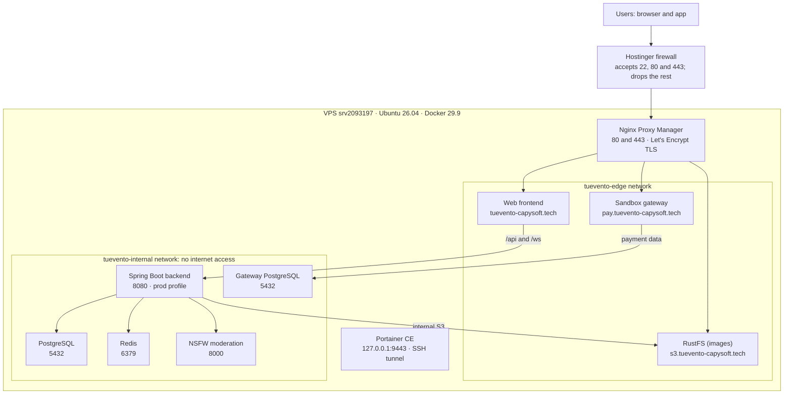

# Implementation — Tu Evento

> Consolidated Tu Evento document. It gathers the following documents, whose content is kept unchanged; the conversion metadata of each one is in an HTML comment at the start of its section.

**Contents**

1. [Implementation manual](#doc-te-0155)
2. [Deployment procedure](#doc-te-0175)

---

<a id="doc-te-0155"></a>

<!--
ruta_anterior: en/07_Implementacion/Manual_de_Implementacion_TuEvento.md
id: TE-0155
title: "Manual_de_Implementacion_TuEvento"
lang: en
source: 07_Implementacion/Manual_de_Implementacion_TuEvento.pdf
source_sha256: 09483490d39a2e4b8e0d40b4e5cde562be9d5e3c01d0e7bf07d3a7cc3c512f62
conversion: "pdfplumber 0.11.10 + converter for untagged PDF (method C, pilot 3); without manual review. English translation of md/es: Claude Opus 5.5 (claude-opus-5-5); without manual review"
converted_on: 2026-10-23
fidelity: parcial
losses:
  - "Page header or footer omitted on pages 1–20: «{n}»."
  - "Page 4: figure included as an image (pagina-04-figura-1.png); its text (42 words) goes in a non-visible HTML comment, grouped by box ([...]) from top to bottom and from left to right; arrows and relationships are only in the image."
  - "Page 11: figure included as an image (pagina-11-figura-1.png); its text (7 words) goes in a non-visible HTML comment, grouped by box ([...]) from top to bottom and from left to right; arrows and relationships are only in the image."
  - "Pages 11: diagram boxes with text (which pdfplumber detects as one-row tables) included in the crop of the figure."
  - "PDF generated without LaTeX: hyphens at the end of a line are real hyphens and are kept when joining lines (they are not syllabic line-break hyphens)."
  - "11 ReportLab bullets without a Unicode mapping (Helvetica code 127, «(cid:127)» in the extraction) written as «•», which is how they look in the original."
  - "Manual table of contents (pages 2): the page numbers of the original are kept and the leader lines are removed."
  - "Tables with merged cells in HTML (colspan/rowspan calculated from the geometry of the borders); column widths, backgrounds and border thickness are not kept."
  - "Bold, italics and monospaced font are kept; sizes, colours, alignment and indentation are not."
  - "Automatic check against pdftotext: coverage 99.92%, precision 99.25%, order 99.04%; missing {'URL': 1, 'DEL': 1, 'REPOSITORIO': 1} (explained above)."
  - "Differences in the check explained: «URL DEL REPOSITORIO» is in the Markdown as `<URL_DEL_REPOSITORIO>` inside code, which the checker removes as an HTML tag; the «extra» words are the text of the figures, which goes in HTML comments. Text with double line spacing (APA): paragraphs are rebuilt from the first-line indentation."
  - "The 11 «•» bullets of the original are in the Markdown as list elements; the checker also counts a small shape of the diagram on page 4 as a bullet (12)."
  - "Translation: the code (commands, comments inside the commands, variable names, file names and URLs) is kept as in the original."
  - "Translation: the HTML comments with the text of the figures keep the original text and add the English translation after «EN:»."
  - "Translation: the APA citations are translated («s. f.» → «n.d.», «Recuperado el … de» → «Retrieved … from»); the titles of the cited works are not translated."
  - "Translation: the line breaks (<br>) of the Spanish text are kept at approximately the same position; in English they do not match the line ends of the original."
status: borrador
reviewed_by: ""
translation_of: es/09_Implementacion.md#doc-te-0155
es_sha256: 2e17860262cf60d46692d314c6695eae501d7a67e0e293713489b4a5d0392f49
-->

# Implementation manual of the Tu Evento system

Jhampier Santos Ortiz and Cristofer David Lozano Contreras

Servicio Nacional de Aprendizaje (SENA; National Learning Service)

Sede de la Industria y los Servicios, Neiva, Huila

Tecnólogo en Análisis y Desarrollo de Software (Technologist in Software Analysis and Development)

Instructor: Carlos Julio Cadena

9 October 2026

# Contents

Introduction 3

System architecture 3

Overview 3

Requirements 5

Hardware 5

Software 6

Ports 6

Obtaining the code and environment variables 7

Deployment with Docker Compose 9

Services and startup order 9

Migrations and initial administrator 11

Stopping and restarting 11

Deployment on Kubernetes 12

Continuous integration with GitHub Actions and SonarQube Cloud 13

Local development 15

Backend 15

Web frontend 15

Mobile application 15

Building the mobile application 16

System verification 16

Security 17

Troubleshooting 18

Known limitations 18

References 20

# Implementation manual of the Tu Evento system

# Introduction

This manual describes the procedure to install, configure, deploy and verify the Tu Evento system, an event management platform aimed at end users, organizers and administrators. It is intended for those who must put the system into operation, either on a development machine using Docker Compose or on a Kubernetes cluster.

The information was checked against the configuration files of the project repository (Santos Ortiz and Lozano Contreras, 2026), in particular the `docker-compose.yml,` file, the manifests in the `k8s/,` folder, the `.github/workflows/ci.yml` workflow and the Spring Boot configuration files. For security reasons, the document does not contain secret values: each credential is identified only by the name of its environment variable.

# System architecture

## Overview

Tu Evento follows a client-server architecture. The backend, developed with Spring Boot (Spring, n.d.), is a monolithic application that exposes a REST API and relies on auxiliary services: PostgreSQL for data persistence (PostgreSQL Global Development Group, n.d.), Redis as a cache (Redis Ltd., n.d.) and MinIO for object storage (MinIO, Inc., n.d.). Figure 1 presents the relationship between the components and the ports published in the development environment, and Table 1 summarizes the function of each one.

**Figure 1**<br>
*General architecture of the Tu Evento system*


<!-- Texto dentro de la figura (página 4): [Navegador web] [App móvil React Native, Expo] [Frontend web React + Nginx :3000] [Backend Spring Boot :8080 API REST, JWT, OAuth2, WebSockets, Liquibase] [Servicios externos SMTP, OAuth2 SightEngine] [PostgreSQL :5434] [Redis :6379] [MinIO :9000] [Pasarela simulada :4001] [PostgreSQL :5435] [fuera de cajas] Clasificador NSFW :8001 EN: Text inside the figure (page 4): [Web browser] [Mobile app React Native, Expo] [Web frontend React + Nginx :3000] [Backend Spring Boot :8080 REST API, JWT, OAuth2, WebSockets, Liquibase] [External services SMTP, OAuth2 SightEngine] [PostgreSQL :5434] [Redis :6379] [MinIO :9000] [Simulated gateway :4001] [PostgreSQL :5435] [outside boxes] NSFW classifier :8001 -->

<table>
<tr>
<td></td>
</tr>
<tr>
<td colspan="2"><strong>NSFW classifier</strong> :8001</td>
</tr>
</table>

*Note.* Diagram of our own elaboration based on the project's docker-compose.yml file. The arrows indicate the direction of the requests; the numbers preceded by a colon correspond to the ports published on the host machine. The external services (SMTP email, OAuth2 providers and SightEngine) are represented with a dashed border.

**Table 1**<br>
*System components*

| **Component** | **Technology** | **Function** |
|---|---|---|
| Backend | Spring Boot 3.5, Java 21 | REST API, business logic, security (JWT and OAuth2), WebSockets and migrations with Liquibase. |
| Web frontend | React 18, Vite 5 | Web interface; in a container it is served with Nginx. |
| Mobile frontend | React Native 0.81, Expo SDK 54 | Application for Android and iOS. |
| Database | PostgreSQL 17 | Data persistence of the backend. |
| Cache | Redis 7 | Cache and session data. |
| Object storage | MinIO | Profile pictures, event media and organizer documents. |
| Image moderation | NSFW service (Python 3.11) and SightEngine | Classification of the content before storing it. |
| Payment gateway | fake-payment-gateway (Java 21) | Sandbox gateway for testing the payment flow, with its own PostgreSQL database. |
| Continuous integration | GitHub Actions and SonarQube Cloud | Testing, building and code quality analysis. |

*Note.* Our own elaboration based on the project's pom.xml, package.json and docker-compose.yml files.

# Requirements

## Hardware

The complete stack runs nine containers, among them an image classification<br>
model. Table 2 indicates the recommended resources for the host<br>
machine.<br>
**Table 2**<br>
*Recommended resources of the host machine*

| **Resource** | **Minimum** | **Recommended** |
|---|---|---|
| RAM memory | 8 GB | 16 GB (complete stack) |
| Processor | 4 cores | 6 cores or more |
| Free storage | 20 GB | 40 GB |
| Operating system | Windows 10/11 with WSL2, Ubuntu 20.04 or later, macOS | Ubuntu 22.04 LTS |
| Network | Internet access to download images and dependencies | Same |

*Note.* The values are operating recommendations of the development team and must be adjusted to the real load.

## Software

The necessary tools depend on the work scenario, as detailed in<br>
Table 3.<br>
**Table 3**<br>
*Software tools according to the scenario*

| **Scenario** | **Necessary tools** |
|---|---|
| Deployment with Docker Compose | Docker Engine, Docker Compose v2 and Git. |
| Backend development | JDK 21 and Maven (the project includes the Maven Wrapper, `mvnw).` |
| Web frontend development | Node.js 20 and npm. |
| Mobile frontend development | Node.js 20, npm and EAS CLI 22.2.0 or later; Android Studio or Xcode for emulators (optional). |
| Deployment on Kubernetes | kubectl and a cluster with the Ingress NGINX controller, cert-manager and metrics-server. |

## Ports

The ports published on the host machine by each service are listed in Table 4.<br>
They must be free before starting the system.<br>
**Table 4**<br>
*Ports published by the services*

| **Port** | **Service** |
|---|---|
| 3000 | Web frontend (Nginx in Docker) |
| 5173 | Web frontend in development mode (Vite) |
| 8080 | Backend (API) |
| 5434 | PostgreSQL of the backend (port 5432 inside the container) |
| 5435 | PostgreSQL of the sandbox gateway (port 5432 inside the container) |
| 6379 | Redis |
| 9000 and 9001 | MinIO (API and web console) |
| 8001 | NSFW classification service |
| 4001 | Sandbox payment gateway |

*Note.* Source: the project's docker-compose.yml.

# Obtaining the code and environment variables

All the services are orchestrated from the `docker-compose.yml,` file, located at the root of the repository, and the variables are read from a `.env` file in that same folder, as indicated by the Docker Compose documentation (Docker Inc., n.d.). Code 1 shows how to obtain the code and create the variables file.

## Code 1

*Obtaining the code and creating the variables file*

| `git clone <URL_DEL_REPOSITORIO> TuEvento` `cd TuEvento` `cp .env.example .env` |
|---|

After creating the file, the variables of Table 5 must be completed with your own values; credentials from examples or from previous documents must not be reused.

**Table 5**<br>
*Environment variables defined in the .env.example file*

| **Variable** | **Description** |
|---|---|
| POSTGRES_DB, POSTGRES_USER, POSTGRES_PASSWORD | PostgreSQL database, user and password (shared with the sandbox gateway). |
| MAIL_USERNAME, MAIL_PASSWORD | Gmail SMTP account and its application password. |
| JWT_SECRET | Key to sign JWT tokens (at least 256 bits). |
| GOOGLE_CLIENT_ID, GOOGLE_CLIENT_SECRET | Google OAuth2 credentials. |
| VITE_GOOGLE_CLIENT_ID | Google Client ID used by the web frontend. |
| FACEBOOK_CLIENT_ID, FACEBOOK_CLIENT_SECRET | Facebook OAuth2 credentials. |
| ADMIN_EMAIL, ADMIN_PASSWORD, ADMIN_ALIAS | Data of the initial administrator created on the first startup. |
| MINIO_ROOT_USER, MINIO_ROOT_PASSWORD | MinIO root user and password (they also act as the access key). |
| REDIS_HOST, REDIS_PORT | Location of Redis. |
| SPRING_PROFILES_ACTIVE | Spring profile: dev, k8s or prod. |
| NSFW_SERVICE_URL, NSFW_THRESHOLD | Internal URL and threshold of the NSFW classifier. |
| SIGHTENGINE_API_USER, SIGHTENGINE_API_SECRET, SIGHTENGINE_MODELS, SIGHTENGINE_THRESHOLD | Additional moderation with SightEngine. |
| NOTIFICATION_EMAIL_ENABLED, NOTIFICATION_MAIL_HOST, NOTIFICATION_MAIL_PORT, NOTIFICATION_MAIL_USERNAME, NOTIFICATION_MAIL_PASSWORD | Email notifications. |

*Note.* Source: the project's .env.example file. No values are included.

In addition, the `docker-compose.yml` file and the Spring profiles use the variables of Table 6, which are not in `.env.example` and must be added to the `.env` file when applicable. The absence of `WEBHOOK_SECRET` prevents the sandbox gateway from starting correctly.

**Table 6**<br>
*Variables used that are not in .env.example*

| **Variable** | **Description** |
|---|---|
| WEBHOOK_SECRET | Secret to validate webhooks of the sandbox gateway; mandatory for the fake-payment-gateway service. |
| MINIO_PUBLIC_URL | MinIO URL accessible from the browser, used in presigned URLs. |
| PAYMENT_GATEWAY | Gateway selector; the value `fake` activates the sandbox gateway. |
| FAKE_GATEWAY_URL | URL of the sandbox gateway as seen from the backend. |
| SIGHTENGINE_NUDITY_THRESH OLD | Specific nudity detection threshold. |
| APP_CORS_ALLOWED_ORIGINS | Origins allowed by CORS (include http://localhost:3000 and http://localhost:5173). |
| APP_STORAGE_ENDPOINT | Internal MinIO endpoint to upload and delete files. |

*Note.* Source: the project's docker-compose.yml and application-dev.yml.

# Deployment with Docker Compose

This is the recommended method for development and test environments. All the commands of Code 2 are run from the root of the repository, which is where the `docker-compose.yml;` file is located, not from the backend folder.

## Code 2

*Starting the complete system with Docker Compose*

| `docker compose up --build -d` `docker compose ps` `docker compose logs -f backend` |
|---|

## Services and startup order

Docker Compose makes it possible to declare dependencies between services to control the startup order (Docker Inc., n.d.). Table 7 describes the nine services of the project and Figure 2 summarizes the dependencies that condition the startup of the backend and the frontend.

**Table 7**<br>
*Services defined in docker-compose.yml*

| **Service** | **Image or build** | **Ports** | **Depends on** |
|---|---|---|---|
| postgres | postgres:17-alpine | 5434:5432 | - |
| postgres-fake-gateway | postgres:17-alpine | 5435:5432 | - |
| redis | redis:7-alpine | 6379 | - |
| minio | quay.io/minio/minio | 9000, 9001 | - |
| minio-init | quay.io/minio/minio | - | minio (healthy) |
| nsfw-classifier | Local build (Python 3.11) | 8001:8000 | - |
| fake-payment-gateway | Local build (Java 21) | 4001 | postgres-fake-gateway |
| backend | Local build (Java 21) | 8080 | postgres, minio, redis, nsfw-classifier |
| frontend | Local build (Node 20 and Nginx) | 3000:80 | backend |

*Note.* Source: the project's docker-compose.yml.

**Figure 2**<br>
*Startup dependencies between services*


<!-- Texto dentro de la figura (página 11): [postgres] [postgres-fake-gateway] [fake-payment-gateway] [redis] [minio] [minio-init] [nsfw-classifier] EN: Text inside the figure (page 11): [postgres] [postgres-fake-gateway] [fake-payment-gateway] [redis] [minio] [minio-init] [nsfw-classifier] -->

<table>
<tr>
<td rowspan="2"><strong>backend</strong></td>
</tr>
<tr>
<td></td>
<td></td>
</tr>
</table>

### frontend

*Note.* Diagram of our own elaboration based on the depends_on clauses of the docker-compose.yml file. Each arrow goes from the service that must start first to the one that depends on it.

The `minio-init` container creates the `tuevento.` bucket. The prefixes `profile_picture/` and `event_media/` are public, while `organizer_document/` is private.

## Migrations and initial administrator

No manual step on the database is required. On startup, the backend automatically runs the Liquibase migrations (Liquibase, n.d.), more than ninety files located in `db/changelog/changes/,` which include the data of departments and cities. Afterwards, the `DataInitializer` component creates the administrator user from `ADMIN_EMAIL, ADMIN_PASSWORD` and `ADMIN_ALIAS,` only if it does not already exist.

## Stopping and restarting

Code 3 shows the commands to stop, restart or completely remove the environment. The `-v` option deletes the volumes and, therefore, the stored data.

## Code 3

*Stopping and restarting the environment*

| `docker compose down # detiene y elimina contenedores` `docker compose down -v # ademas elimina volumenes (borra datos)` `docker compose up -d # inicia nuevamente sin reconstruir` |
|---|

# Deployment on Kubernetes

The manifests are in the `k8s/.` folder. An active cluster is required with<br>
kubectl configured, an Ingress NGINX controller with cert-manager (issuer<br>
`letsencrypt-prod)` and metrics-server for autoscaling. The Ingress exposes the services<br>
through domains and TLS (The Kubernetes Authors, n.d.-b) and the HorizontalPodAutoscaler adjusts<br>
the number of replicas according to resource consumption (The Kubernetes Authors, n.d.-a). Table 8<br>
summarizes the defined resources.<br>
**Table 8**<br>
*Kubernetes manifests of the project*

| **Manifest** | **Resource** | **Detail** |
|---|---|---|
| secrets.yaml | Secret tu-evento-secrets | Credentials of the database, MinIO, JWT, OAuth, administrator and email. |
| configmap.yaml | ConfigMap tu-evento-config | prod profile, redis-service:6379 and postgres-service:5432. |
| deployment.yaml and service.yaml | Backend | Port 8080; service 80 to 8080, NodePort 30080. |
| frontend-deployment.yaml and frontend-service.yaml | Frontend | Port 80; NodePort 30081. |
| ingress.yaml | Ingress | api.tuevento.com and app.tuevento.com with TLS. |
| hpa.yaml | Autoscaling | Between 2 and 10 replicas of the backend; CPU 70 % and memory 80 %. |

*Note.* Source: the project's k8s/ folder.

The manifests must be applied in the order of Code 4.

## Code 4

*Ordered application of the manifests*

| `kubectl apply -f k8s/secrets.yaml` `kubectl apply -f k8s/configmap.yaml` `kubectl apply -f k8s/deployment.yaml` `kubectl apply -f k8s/service.yaml` `kubectl apply -f k8s/frontend-deployment.yaml` `kubectl apply -f k8s/frontend-service.yaml` `kubectl apply -f k8s/ingress.yaml` `kubectl apply -f k8s/hpa.yaml` `kubectl get pods` |
|---|

Three considerations must be taken into account. First, the manifests do not include PostgreSQL, Redis or MinIO, so these services must exist in the cluster with the names postgres-service, redis-service and minio-service. Second, the k8s profile has storage disabled (`app.storage.enabled=false),` so file upload will not be available until it is configured. Third, before applying `secrets.yaml` the example values must be replaced with your own values encoded in base64, and that file must not be versioned with real data.

# Continuous integration with GitHub Actions and SonarQube Cloud

Continuous integration runs on GitHub Actions, so it does not consume resources of the local machine. The `.github/workflows/ci.yml` workflow defines the process as code (GitHub, Inc., n.d.) and runs on every push or pull request to the `main` and `develop` branches, or manually. Its three jobs are described in Table 9.

**Table 9**<br>
*Jobs of the continuous integration workflow*

| **Job** | **Action** |
|---|---|
| Backend (tests + SonarQube) | With Java 17, runs ./mvnw -B verify in TuEventoBackend/tu-evento, which runs the tests and generates the coverage report with JaCoCo; it then sends the analysis to SonarQube Cloud. |
| Web (build) | With Node.js 22, runs npm ci and npm run build in TuEventoFrontend/web. |
| Móvil (bundle Expo) | With Node.js 22, runs npm ci and npx expo export --platform android in TuEventoFrontend/movil. |

*Note.* Source: the project's .github/workflows/ci.yml.

SonarQube Cloud analyzes the code of the backend, the web and the mobile application to detect bugs, vulnerabilities and duplicated code, and measures the test coverage of the backend (SonarSource, n.d.). The configuration is in the `sonar-project.properties` file at the root and the access token is stored in the repository secret `SONAR_TOKEN`; if the token is not available, the analysis is skipped. The results can be viewed at https://sonarcloud.io/project/overview?id=lozano2303_TuEvento.

The workflow does not build or publish Docker images and does not deploy to Kubernetes; therefore, the deployment must be carried out manually as indicated in the section Deployment on Kubernetes.

# Local development

## Backend

First the infrastructure is started with Docker Compose and then the backend is run with the `dev` profile and the exported environment variables, as shown in Code 5. The file generated by the packaging is `tu-evento-0.0.1-SNAPSHOT.jar.`

## Code 5

*Running the backend in development mode*

| `docker compose up -d postgres redis minio minio-init nsfw-classifier` `cd TuEventoBackend/tu-evento` `./mvnw clean package -DskipTests` `./mvnw spring-boot:run` `# o bien:` `java -jar target/tu-evento-0.0.1-SNAPSHOT.jar` |
|---|

## Web frontend

The frontend uses Vite (Vite, n.d.). In development mode it is normally served on port 5173, while port 3000 corresponds to the container with Nginx. The `VITE_API_URL` variable defines the API address and, in development, its value is `http://localhost:8080/api.` Code 6 summarizes the commands.

## Code 6

*Running and building the web frontend*

| `cd TuEventoFrontend/web` `npm install` `npm run dev # Vite, normalmente en http://localhost:5173` `npm run build # genera la carpeta dist` |
|---|

## Mobile application

The variable that points to the backend is `EXPO_PUBLIC_API_URL.` Expo only includes in the application bundle the variables whose name starts with `EXPO_PUBLIC_` (Expo, n.d.-a). On a physical device or emulator, `localhost,` must not be used, but rather the IP address of the machine that runs the backend (in the Android emulator, 10.0.2.2). The commands are shown in Code 7.

## Code 7

*Running the mobile application in development*

| `cd TuEventoFrontend/movil` `npm install` `npx expo start` `npx expo run:android` `npx expo run:ios # solo en macOS` |
|---|

## Building the mobile application

The build is done with EAS Build (Expo, n.d.-b), configured in `eas.json;` it requires EAS CLI 22.2.0 or later and an Expo account. The `preview` profile generates an APK for internal distribution and the `production` profile generates an AAB bundle for the store. The `expo build:android` and `expo build:ios` commands are obsolete and do not work with Expo SDK 54.

## Code 8

*Building the mobile application with EAS*

| `npm install -g eas-cli` `eas login` `eas build --platform android --profile preview # APK interno` `eas build --platform android --profile production # AAB para tienda` |
|---|

# System verification

Once the services have started, their status is confirmed with the addresses of Table 10. The backend exposes the health and metrics endpoints through Spring Boot Actuator (Spring, n.d.), which are also used by the Kubernetes probes.

**Table 10**<br>
*Verification addresses*

| **Address** | **Description** |
|---|---|
| http://localhost:8080/actuator/health | Status of the backend. |
| http://localhost:8080/actuator/metrics | Application metrics. |
| http://localhost:8080/swagger-ui | Interactive API documentation. |
| http://localhost:8080/api-docs | OpenAPI specification in JSON. |
| http://localhost:3000 | Web frontend. |
| http://localhost:9000/minio/health/live | Status of MinIO. |
| http://localhost:9001 | MinIO web console. |
| http://localhost:8001/health | Status of the NSFW classifier. |
| http://localhost:4001 | Sandbox payment gateway. |

*Note.* Source: the project's docker-compose.yml and application-dev.yml.

As a final functional test, open the web frontend and log in with the credentials defined in `ADMIN_EMAIL` and `ADMIN_PASSWORD.`

# Security

- Credentials, keys and tokens must not be recorded in this manual, in the repository or in screenshots; only the `.env,` file is used, which must not be versioned, or the Kubernetes Secrets.
- The `JWT_SECRET` must be random, of at least 256 bits, and each service must have different passwords.
- Any credential that has appeared in previous versions of the documentation (SMTP password, OAuth secrets, database password) must be considered compromised and rotated.
- The `APP_CORS_ALLOWED_ORIGINS` variable must contain only the necessary origins.
- In production, the ports of PostgreSQL, Redis and MinIO must not be exposed to the Internet; only the frontend and the API, through the Ingress with TLS.
- Specific versions of the images must be pinned, for example that of MinIO, which uses the `latest,` tag, to achieve reproducible deployments.
# Troubleshooting

Table 11 gathers the most frequent symptoms and the recommended action.

**Table 11**<br>
*Frequent problems and recommended actions*

| **Symptom** | **Probable cause and action** |
|---|---|
| The backend does not start | Verify that PostgreSQL, Redis, MinIO and the NSFW classifier are healthy (docker compose ps), review docker compose logs backend and confirm that port 8080 is free. |
| Database connection error | Review POSTGRES_DB, POSTGRES_USER and POSTGRES_PASSWORD in .env. From the host machine, PostgreSQL is exposed on port 5434, not on 5432. |
| The payment gateway fails | Verify that WEBHOOK_SECRET is defined in .env. |
| Images do not load | Review MINIO_PUBLIC_URL and that minio-init has created the tuevento bucket. |
| CORS error in the browser | Include the frontend origin in APP_CORS_ALLOWED_ORIGINS (3000 in Docker, 5173 with Vite). |
| Login with Google or Facebook fails | Check the OAuth2 credentials and that the redirect URIs match those registered with each provider. |
| The mobile app does not connect to the backend | Verify that EXPO_PUBLIC_API_URL uses the IP of the machine and not localhost; restart with npx expo start -c. |
| The web frontend does not build | Use Node.js 20; delete node_modules and run npm install. |

# Known limitations

- The payment gateway is a sandbox for testing the payment flow: the fake-payment-gateway service simulates the charges and notifies the result to the backend through a signed webhook, without processing real payments.
- Storage uses MinIO; the `s3_key` column of the files table keeps that name for historical reasons and there is no dependency on AWS S3.
- In Kubernetes, storage is disabled and the data services are not included in the manifests.
- Continuous integration does not build Docker images or deploy; deployment is manual.
- The indicated hardware resources are recommendations and must be adjusted to the real load.
# References

Docker Inc. (n.d.). *Docker Compose overview.* Retrieved 9 October 2026, from

https://docs.docker.com/compose/

Expo. (n.d.-a). *Environment variables in Expo.* Retrieved 9 October 2026, from

https://docs.expo.dev/guides/environment-variables/

Expo. (n.d.-b). *Introduction to EAS Build.* Retrieved 9 October 2026, from

https://docs.expo.dev/build/introduction/

GitHub, Inc. (n.d.). *Understanding GitHub Actions.* Retrieved 23 October 2026, from

https://docs.github.com/en/actions/about-github-actions/understanding-github-actions

Liquibase. (n.d.). *Liquibase documentation.* Retrieved 9 October 2026, from

https://docs.liquibase.com/

MinIO, Inc. (n.d.). *MinIO object storage documentation.* Retrieved 9 October 2026, from

https://min.io/docs/minio/linux/index.html

PostgreSQL Global Development Group. (n.d.). *PostgreSQL 17 documentation.* Retrieved 9

October 2026, from https://www.postgresql.org/docs/17/

Redis Ltd. (n.d.). *Redis documentation.* Retrieved 9 October 2026, from

https://redis.io/docs/

Santos Ortiz, J. and Lozano Contreras, C. D. (2026). *Tu Evento: Plataforma de gestión de eventos*

[Software]. Repository of the training project.

SonarSource. (n.d.). *SonarQube Cloud documentation.* Retrieved 23 October 2026, from

https://docs.sonarsource.com/sonarqube-cloud/

Spring. (n.d.). *Spring Boot reference documentation.* Retrieved 9 October 2026, from

https://docs.spring.io/spring-boot/index.html

The Kubernetes Authors. (n.d.-a). *Horizontal Pod Autoscaling.* Retrieved 9 October

2026, from https://kubernetes.io/docs/tasks/run-application/horizontal-pod-autoscale/ The Kubernetes Authors. (n.d.-b). *Ingress.* Retrieved 9 October 2026, from

https://kubernetes.io/docs/concepts/services-networking/ingress/

Vite. (n.d.). *Getting started.* Retrieved 9 October 2026, from https://vite.dev/guide/

---

<a id="doc-te-0175"></a>

<!--
id: TE-0175
title: "Deployment_Procedure_EN"
lang: en
source: Deployment_Procedure_EN.md
source_sha256: f735a5871909ce07e9358266ddc4532b38b8d10ef4b67e7a33c315b2c99c8900
conversion: "no_aplica (Original Markdown by the team; merged without content changes except the image paths)"
converted_on: 2026-10-27
fidelity: no_aplica
status: borrador
reviewed_by: ""
-->

# Deployment Procedure — TuEvento v1.0.2

**National Learning Service — SENA**

Software Analysis and Development Technology Program · Group 3145556

**Implementation Procedure: Deploying TuEvento to production**

CapySoft Team

Jhampier Santos Ortiz · Cristofer David Lozano Contreras

Instructor: Carlos Julio Cadena

October 2026

---

This document describes how TuEvento was deployed to a Hostinger VPS with Docker, Portainer CE and Nginx Proxy Manager, and leaves the procedure ready to repeat for every release. The version in production when this document was closed is **v1.0.2**, published at `https://tuevento-capysoft.tech`.

## 1. General Information and Version Control

TuEvento v1.0.2 has been running in production on a Hostinger VPS since October 25, 2026; the three versions covered here were released between October 24 and 25.

### 1.1 Deployment Fact Sheet

#### 1.1.1 System and version identification (Release Tag)

| Field | Value |
| --- | --- |
| System | TuEvento — event management platform (web, API and mobile app) |
| Repository | `github.com/lozano2303/TuEvento` |
| Release tag (git) | `v1.0.2`, annotated on the merge of `develop` into `main` |
| Docker images | `jhampier23/tu-evento:v1.0.2` (backend), `frontend-v1.0.2`, `gateway-v1.0.2`, `nsfw-v1.0.2` |
| Versioning | SemVer, per `docs/versioning.md`: releases are published from `main` and every deployed change gets a new version |

#### 1.1.2 Scheduled date, time and maintenance window

All times are Colombia time (UTC−5). Every window was run on a weekend, with low traffic.

| Version | Date | Window | Type |
| --- | --- | --- | --- |
| v1.0.2 | Oct 25, 2026 | 14:10 – 14:30 | Image update (no compose changes) |
| v1.0.1 | Oct 25, 2026 | 10:20 – 10:45 | Image, compose and variable update; migration 102 |
| v1.0.0 | Oct 24, 2026 | 19:50 – 22:40 | Initial deployment: VPS, DNS, stack and certificates |

#### 1.1.3 Target environment (VPS / Staging / Production)

**Production** on a Hostinger VPS. There is no separate staging environment; pre-release tests ran locally with disposable containers.

| Field | Value |
| --- | --- |
| Provider and plan | Hostinger KVM 2 |
| Hostname | `srv2093197.hstgr.cloud` |
| Public IP | `179.197.80.148` |
| Location | United States, Boston |
| Operating system | Ubuntu 26.04.1 LTS (kernel 7.0.0-38) |
| Domain | `tuevento-capysoft.tech`, with the subdomains `s3.` (images) and `pay.` (sandbox payment gateway) |

#### 1.1.4 Roles and responsibilities matrix (DevOps, Tech Lead, QA, DBA)

Both team members are full stack developers, as defined by the instructors; the matrix shows who performed each role in this deployment.

| Role | Owner | Deployment tasks |
| --- | --- | --- |
| DevOps | Jhampier Santos Ortiz | VPS setup, firewall, Docker, Portainer, NPM, building and publishing images |
| Tech Lead | Jhampier Santos Ortiz and Cristofer David Lozano Contreras | PR review and merge, release from `develop` to `main`, version tags |
| QA | Jhampier Santos Ortiz and Cristofer David Lozano Contreras | Smoke and functional tests in production |
| DBA | Jhampier Santos Ortiz | Pre-deployment backup, verification of Liquibase migrations and constraints |

### 1.2 Document Version History

| Version | Date | Author | Change |
| --- | --- | --- | --- |
| 1.0 | Oct 26, 2026 | Jhampier Santos Ortiz | Initial version: deployment of v1.0.0 to v1.0.2 |

### 1.3 Release Notes

Full details are in the repository's `CHANGELOG.md`.

#### 1.3.1 New features

| Version | PR | Change |
| --- | --- | --- |
| v1.0.2 | #117 | Bulk seat regeneration |
| v1.0.2 | #116 | Better seat map performance in the mobile app |
| v1.0.1 | #105 | Event cancellation and refunds (unused tickets only) |
| v1.0.1 | #100 | Sandbox payment gateway with an API key on its admin endpoints |
| v1.0.1 | #109 | Per-IP rate limit on login, sign-up, activation and recovery (10 per minute) |
| v1.0.1 | #112 | ESLint, Prettier and Vitest on web and mobile, with a CI step |
| v1.0.0 | — | Production stack: compose, variable template and runbook |

#### 1.3.2 Bug fixes

| Version | PR | Fix |
| --- | --- | --- |
| v1.0.2 | #121 | Landing page images did not load in production (`/src/assets` paths that only exist in development) |
| v1.0.2 | #119 | The Google button stopped responding after logging out without reloading the page |
| v1.0.1 | #107 | Duplicate sessions after social login, which kicked the user back to `/login` |
| v1.0.1 | #107 | OAuth errors (user cancels, blocked account) return to `/login` with a message instead of a 500 error |
| v1.0.1 | #108 | First login after an expired lockout; the lockout lasts 30 minutes again |

#### 1.3.3 Infrastructure and dependency changes

| Version | Change |
| --- | --- |
| v1.0.2 | The frontend Nginx returns 404 for missing static files; `@react-oauth/google` removed |
| v1.0.1 | New variables `ADMIN_API_KEY` and `FAKE_GATEWAY_API_KEY`; `AUTH_COOKIE_SAME_SITE` and `AUTH_COOKIE_SECURE` exposed in the compose; `RATE_LIMIT_TRUSTED_PROXIES` set to 2 |
| v1.0.1 | Liquibase migration 102: unique constraint on `auth_session.access_token` and `refresh_token.token` |
| v1.0.0 | RustFS 1.0.3 replaces MinIO (its public image is no longer available); Nginx Proxy Manager 2.16.0 as the single entry point |

#### 1.3.4 Breaking changes

- **Cookie-based session (v1.0.1, #111):** the web refresh token moves to an `httpOnly` cookie and the access token to memory; users with an open session must log in again.
- **Storage requires a session (v1.0.0, #104):** all of `/api/v1/storage/**` requires authentication; only profile pictures can be uploaded through REST.
- **OAuth callbacks (v1.0.1, #107):** `APP_OAUTH_GOOGLE_REDIRECT_URI` and `APP_OAUTH_FACEBOOK_REDIRECT_URI` are the full callback URL, not just the domain.
- **Gateway (v1.0.1, #100):** without `ADMIN_API_KEY` the gateway does not start, and without `FAKE_GATEWAY_API_KEY` the backend does not start.
- **Swagger (v1.0.0):** disabled in the `prod` profile unless `SWAGGER_ENABLED=true`.

## 2. Scope, Topology and Architecture

The stack is 9 containers on a single VPS; only Nginx Proxy Manager receives internet traffic and everything else lives on internal Docker networks.

### 2.1 Components and Artifacts in Scope

| Component | Image | Role | Memory limit |
| --- | --- | --- | --- |
| Portainer CE | `portainer/portainer-ce:2.45.3` | Stack administration (outside the compose) | — |
| Nginx Proxy Manager | `jc21/nginx-proxy-manager:2.16.0` | Reverse proxy and TLS certificates | 256 MB |
| Frontend | `tu-evento:frontend-v1.0.2` | React SPA (Vite) served by Nginx 1.29.3; proxies `/api` and `/ws` to the backend | 64 MB |
| Backend | `tu-evento:v1.0.2` | Spring Boot 3.5 API on Java 21, `prod` profile | 1280 MB |
| PostgreSQL | `postgres:17.11-alpine` | Main database | 768 MB |
| Redis | `redis:7.4.11-alpine` | QR nonces, sessions and rate limiting (no persistence) | 192 MB |
| RustFS | `rustfs/rustfs:1.0.3` | S3-compatible object storage (images and documents) | 512 MB |
| NSFW classifier | `tu-evento:nsfw-v1.0.2` | Image moderation (FastAPI + OpenNSFW2) | 1536 MB |
| Sandbox gateway | `tu-evento:gateway-v1.0.2` | Simulated payments for testing and demos | 512 MB |
| Gateway PostgreSQL | `postgres:17.11-alpine` | Gateway database | 256 MB |
| LibreTranslate (optional) | `libretranslate/libretranslate:v1.9.6` | Machine translation; off to save RAM (`translate` profile) | 2048 MB |

#### 2.1.1 Administration panel (Portainer CE)

Portainer was installed outside the stack and listens only on `127.0.0.1:9443`. It is reached through an SSH tunnel from the administrator's machine; it does not answer from the internet.

#### 2.1.2 Web Frontend layer (React SPA / Nginx web server)

The SPA is built with Vite and served by Nginx inside its container. That Nginx also acts as a proxy: `/api` and `/ws` (WebSocket) go to the backend over the internal network, so the web app and the API share a domain and there is no CORS between them. The `VITE_*` variables (`VITE_API_URL=/api/v1`, the Google Client ID and the gateway URL) are baked in when the image is built.

#### 2.1.3 Backend API layer (Java Spring Boot)

REST API with hexagonal architecture, Spring Boot 3.5 on Java 21, `prod` profile. In production it only exposes `/actuator/health` (without details) and never returns stack traces to the client. Swagger is off. On startup, Liquibase applies any pending migrations.

#### 2.1.4 Persistence layer (PostgreSQL)

PostgreSQL 17.11 with its named volume `postgres_data`. Images and documents go to RustFS (volume `rustfs_data`), and the database only keeps their metadata.

### 2.2 Network and Infrastructure Architecture Diagram



*Architecture figure.* Traffic only enters through NPM's ports 80 and 443; the frontend, RustFS and the gateway sit on both networks, while the backend and the databases sit only on the internal one. The gateway also calls the backend over the internal network to confirm payments (webhook).

#### 2.2.1 VPS server topology

A single VPS runs everything with Docker Engine 29.9 and Docker Compose v5.6. The Hostinger firewall, which sits in front of the server, only lets ports 22, 80 and 443 through.

#### 2.2.2 Internal container network (Docker Bridge Network)

| Network | Containers | Purpose |
| --- | --- | --- |
| `tuevento-edge` | NPM, frontend, RustFS, gateway | What NPM can reach in order to publish it |
| `tuevento-internal` | Backend, PostgreSQL, Redis, NSFW, gateway PostgreSQL, frontend, RustFS, gateway | Service-to-service traffic; never published |

NPM cannot resolve `backend`, `postgres`, `redis` or `nsfw-classifier`, so a misconfigured proxy host cannot expose the database or the API directly.

#### 2.2.3 Routing and Reverse Proxy with TLS/HTTPS certificates

| Domain | Internal target | Certificate | Options |
| --- | --- | --- | --- |
| `tuevento-capysoft.tech` | `http://frontend:80` | Let's Encrypt | Force SSL, HTTP/2, HSTS, Websockets, Block Common Exploits |
| `s3.tuevento-capysoft.tech` | `http://rustfs:9000` | Let's Encrypt | Force SSL, HTTP/2, HSTS; no Block Common Exploits because of signed URLs |
| `pay.tuevento-capysoft.tech` | `http://fake-payment-gateway:4001` | Let's Encrypt | Force SSL, HTTP/2, HSTS, Block Common Exploits |

On `s3.` the `Host` header is not rewritten, because the S3 V4 signature on image URLs includes it.

### 2.3 Environments, IP Addressing and Ports Matrix

| Service | Port | Exposed on | Access |
| --- | --- | --- | --- |
| SSH | 22 | `179.197.80.148` | Administrator's ed25519 key |
| HTTP / HTTPS (NPM) | 80 / 443 | `0.0.0.0` | Public; HTTP redirects to HTTPS |
| NPM panel | 81 | `127.0.0.1` | SSH tunnel |
| Portainer | 9443 | `127.0.0.1` | SSH tunnel |
| Frontend | 80 | Internal network | NPM |
| Backend | 8080 | Internal network | Frontend (`/api`, `/ws`) and gateway (webhook) |
| PostgreSQL | 5432 | Internal network | Backend |
| Redis | 6379 | Internal network | Backend |
| RustFS | 9000 | Internal network | Backend and NPM (`s3.`) |
| NSFW classifier | 8000 | Internal network | Backend |
| Sandbox gateway | 4001 | Internal network | Backend and NPM (`pay.`) |

The `172.16.x.x` addresses Portainer shows are internal to Docker and change when a container is recreated; no client should use them.

## 3. Prerequisites and Preparation (Pre-deployment)

Before every deployment the VPS is checked, the database is backed up and the stack variables are confirmed complete; no backup, no update.

### 3.1 Operating System and VPS Prerequisites Checklist

- [ ] SSH access with an ed25519 key (`ssh root@179.197.80.148` logs in without a password)
- [ ] Ubuntu up to date (`apt update && apt upgrade -y`) and rebooted if the kernel asks for it
- [ ] Hostinger firewall active with 4 rules: accept TCP 22, 80 and 443; drop everything else
- [ ] 4 GB swap active (`free -h` shows `Swap: 4.0Gi`)
- [ ] DNS: A records for `@`, `s3` and `pay` pointing to `179.197.80.148` (`dig +short` returns the IP)
- [ ] Portainer published only on `127.0.0.1:9443`

#### 3.1.1 Available hardware resources (CPU, RAM, NVMe disk)

| Resource | Available | Stack usage |
| --- | --- | --- |
| CPU | 2 vCPU | — |
| RAM | 8 GB + 4 GB swap | Limits add up to about 5.4 GB without LibreTranslate and 7.4 GB with it |
| Disk | 100 GB | About 2 GB for the system at the start; images and volumes grow with use |
| Bandwidth | 8 TB per month | — |

#### 3.1.2 Docker engine status and local socket

The VPS ships with Docker Engine 29.9.2 and Docker Compose v5.6.1. Check them with:

```bash
docker --version && docker compose version
docker ps --format "table {{.Names}}\t{{.Image}}\t{{.Status}}"
```

Portainer uses the local socket `/var/run/docker.sock`, mounted into its container.

> UFW does not filter ports published by Docker, because Docker writes its own iptables rules. That is why the panels are published on `127.0.0.1` and the real filtering is done by the Hostinger firewall.

### 3.2 Backup Strategy and Execution

The backup is taken right before updating the stack, and a copy is kept outside the VPS.

#### 3.2.1 Logical database backup (Dump / Snapshot)

On the VPS:

```bash
docker exec tuevento-postgres sh -c 'pg_dump -U "$POSTGRES_USER" "$POSTGRES_DB"' > ~/backup-antes-v1.0.1.sql
ls -lh ~/backup-antes-v1.0.1.sql
```

From the administrator's machine, to keep a copy off the server:

```bash
scp root@179.197.80.148:~/backup-antes-v1.0.1.sql ~/
```

The backup taken before v1.0.1 was 289 KB. The file contains user data: it is never committed to git or shared.

#### 3.2.2 Backup of persistent Docker volumes

The volumes `postgres_data`, `postgres_gateway_data`, `rustfs_data`, `npm_data` and `npm_letsencrypt` survive container recreation. To back up a whole volume, for example the RustFS images (on the VPS):

```bash
docker run --rm -v tuevento_rustfs_data:/data -v ~/backups:/backup alpine tar czf /backup/rustfs_data.tgz -C /data .
```

`docker compose down -v` is never used, because it deletes the volumes.

#### 3.2.3 Backup of Stack configuration and previous variables

- `docker-compose.prod.yml` is versioned in git; each version can be recovered from its tag (`git show v1.0.1:docker-compose.prod.yml`).
- The real values live in `.env.prod` on the administrator's machine, with 600 permissions and ignored by git. It is the backup copy of what is loaded in Portainer.
- Before changing `TUEVENTO_VERSION`, the previous value is written down; it is what allows a rollback.

### 3.3 Environment Variables and Secrets Management

Variables are loaded in Portainer (Stacks → tuevento → Environment variables). Internal secrets were generated fresh for production with `openssl rand`; none is reused from development. The documented template, with no real values, is `.env.prod.example`.

| Group | Variables | Note |
| --- | --- | --- |
| Version | `TUEVENTO_VERSION` | Tag of the 4 images, currently `v1.0.2` |
| Database | `POSTGRES_DB`, `POSTGRES_USER`, `POSTGRES_PASSWORD` | Required |
| Gateway | `GATEWAY_POSTGRES_USER`, `GATEWAY_POSTGRES_PASSWORD`, `WEBHOOK_SECRET`, `ADMIN_API_KEY`, `FAKE_GATEWAY_API_KEY` | Both API keys must match and be at least 16 characters |
| Cache | `REDIS_PASSWORD` | Required |
| Storage | `RUSTFS_ACCESS_KEY`, `RUSTFS_SECRET_KEY`, `RUSTFS_PUBLIC_URL` | `RUSTFS_PUBLIC_URL=https://s3.tuevento-capysoft.tech` |
| Domain and OAuth | `APP_CORS_ALLOWED_ORIGINS`, `APP_OAUTH_ALLOWED_FRONTEND_REDIRECT_URIS`, `APP_OAUTH_GOOGLE_REDIRECT_URI`, `GOOGLE_CLIENT_ID`, `GOOGLE_CLIENT_SECRET` | Redirect URIs are the full callback URL |
| Initial account | `ADMIN_EMAIL`, `ADMIN_PASSWORD` | The email must be `@gmail.com` |
| Mail | `MAIL_USERNAME`, `MAIL_PASSWORD` | Gmail account with an app password |
| Optional | `SIGHTENGINE_API_USER`, `SIGHTENGINE_API_SECRET`, `SWAGGER_ENABLED`, `AUTH_COOKIE_SAME_SITE`, `AUTH_COOKIE_SECURE`, `COMPOSE_PROFILES` | Safe defaults |

#### 3.3.1 Database connection parameters

The backend connects over the internal network to `jdbc:postgresql://postgres:5432/${POSTGRES_DB}`, with a Hikari pool of 10 connections. The database does not publish its port outside Docker.

#### 3.3.2 Token signing keys (JWT Secret Keys)

`JWT_SECRET` and `QR_SECRET` are 64-character hex strings generated with `openssl rand`. Every token carries a unique identifier (`jti`). On the web, the refresh token travels in an `httpOnly`, `Secure`, `SameSite=Strict` cookie with path `/api/v1/auth`, valid for 7 days.

#### 3.3.3 Memory and runtime limits (JVM)

| Service | Variable | Value |
| --- | --- | --- |
| Backend | `BACKEND_JAVA_OPTS` | `-Xms256m -Xmx768m -XX:MaxMetaspaceSize=256m` |
| Gateway | `GATEWAY_JAVA_OPTS` | `-Xms64m -Xmx256m -XX:MaxMetaspaceSize=128m` |
| Backend | `SPRING_PROFILES_ACTIVE` | `prod` |

The backend image applies `JAVA_OPTS` in its `ENTRYPOINT` with `sh -c "exec java …"`, so Java stays process 1 and receives the shutdown signal.

### 3.4 Communication Protocol and Maintenance Window

1. Notify the team and **freeze `develop`**: nothing is merged until the release is done.
2. Cut the release: PR from `develop` to `main` with a *merge commit* and an annotated version tag.
3. Run the window on a weekend; the site is down for 1 to 3 minutes while containers are recreated.
4. Once the smoke tests pass, tell the team `develop` is open again.

## 4. Step-by-Step Deployment Procedure (Runbook)

A normal update takes about 15 minutes: publish the images with the new tag, change `TUEVENTO_VERSION` in Portainer and recreate the stack. Commands shown with `root@srv2093197` run on the VPS; the rest run on the administrator's machine.

### 4.1 Base Platform Verification and Access (Portainer CE)

Portainer was installed once, outside the stack (on the VPS):

```bash
docker volume create portainer_data
docker run -d --name portainer --restart=always \
  -p 127.0.0.1:9443:9443 \
  -v /var/run/docker.sock:/var/run/docker.sock \
  -v portainer_data:/data \
  portainer/portainer-ce:2.45.3
```

To log in, open an SSH tunnel from the administrator's machine and leave the terminal open:

```bash
ssh -o ServerAliveInterval=30 -L 19443:127.0.0.1:9443 root@179.197.80.148
```

Then, in the browser, `https://localhost:19443` → **local** environment → **Stacks → tuevento**. To confirm it is the VPS Portainer, the containers must show the version currently in production.

### 4.2 Database Deployment and Migration

#### 4.2.1 Running DDL/DML scripts or migration tools (Liquibase)

Migrations are never run by hand: Liquibase applies them when the backend starts, in order and once each. Every new migration is tested beforehand against a disposable PostgreSQL with realistic test data, including running it a second time (idempotency). v1.0.1 applied migration 102, which cleans up duplicate sessions and creates unique constraints.

#### 4.2.2 Schema, index and user integrity check

```bash
echo "SELECT id, exectype, dateexecuted FROM databasechangelog WHERE id LIKE '102%';" | \
  docker exec -i tuevento-postgres sh -c 'psql -U "$POSTGRES_USER" -d "$POSTGRES_DB"'
```

Expected result: two rows (`102-unique-auth-session-access-token` and `102-unique-refresh-token-token`) with status `EXECUTED`. On first startup the backend also creates the `tuevento` bucket in RustFS, the administrator account and the default avatar.

### 4.3 Application Stack Deployment and Orchestration

#### 4.3.1 Loading the docker-compose.yml file in Portainer

1. Check whether the compose changed between versions:

   ```bash
   git -C ~/TuEvento diff --stat v1.0.1 v1.0.2 -- docker-compose.prod.yml .env.prod.example
   ```

2. If it did not change, skip this step. If it did, copy the one from `main` without going through the terminal:

   ```bash
   git -C ~/TuEvento show origin/main:docker-compose.prod.yml | xclip -selection clipboard
   ```

3. In Portainer: **Editor** → select all → paste → use Ctrl+F to confirm the new variables are there.

#### 4.3.2 Injecting Stack environment variables

1. **Environment variables**: change `TUEVENTO_VERSION` to the new tag.
2. Add any variables the release requires, per its CHANGELOG.
3. To load many at once: **Advanced mode** and paste the contents of `.env.prod` without comments (`grep -Ev '^\s*(#|$)' .env.prod`).

#### 4.3.3 Service deployment and container image update

Images are built from the tag, one at a time, and only the ones that changed. Run the commands **inside the repository folder** (`cd ~/TuEvento`):

```bash
cd ~/TuEvento
git status --short          # must be empty: Docker builds whatever is in the folder
git checkout v1.0.2
export $(grep -E '^VITE_' .env.prod | xargs)
docker build -t jhampier23/tu-evento:frontend-v1.0.2 \
  --build-arg VITE_API_URL="$VITE_API_URL" \
  --build-arg VITE_GOOGLE_CLIENT_ID="$VITE_GOOGLE_CLIENT_ID" \
  --build-arg VITE_GATEWAY_URL="$VITE_GATEWAY_URL" \
  TuEventoFrontend/web
docker run --rm --entrypoint sh jhampier23/tu-evento:frontend-v1.0.2 \
  -c "grep -rl 'localhost:8080' /usr/share/nginx/html || echo CLEAN"
docker push jhampier23/tu-evento:frontend-v1.0.2
git checkout develop
```

Images whose code did not change are retagged without rebuilding:

```bash
docker buildx imagetools create -t jhampier23/tu-evento:nsfw-v1.0.1 jhampier23/tu-evento:nsfw-v1.0.0
```

With all 4 tags published, in Portainer: enable **Re-pull image** → **Update the stack**. Then, on the VPS, wait until everything is `healthy`:

```bash
docker ps --format "table {{.Names}}\t{{.Image}}\t{{.Status}}"
```

The compose sets the startup order: databases, Redis and RustFS first; then the backend and the gateway; the frontend last, waiting for the backend to be `healthy`.

**Rollback:** restore the previous `TUEVENTO_VERSION` value and update the stack. Liquibase migrations are not reverted automatically; if a release includes a migration, the database rollback uses the backup from section 3.2.1.

### 4.4 Routing, Domain and SSL/TLS Certificate Configuration

Done only on the initial deployment.

1. **Domain:** `tuevento-capysoft.tech`, free for one year with the Hostinger plan.
2. **DNS** (Hostinger → DNS manager): delete the default `@` and `www` records and create three A records, `@`, `s3` and `pay`, pointing to `179.197.80.148`.
3. **NPM panel** through an SSH tunnel:

   ```bash
   ssh -o ServerAliveInterval=30 -L 8181:127.0.0.1:81 root@179.197.80.148
   ```

   At `http://localhost:8181`, create the administrator user.
4. **Proxy hosts:** Hosts → Proxy Hosts → Add Proxy Host, one per domain, with the targets and options from table 2.2.3.
5. **Certificates:** on each proxy host's SSL tab, *Request a new Certificate* with Force SSL, HTTP/2 and HSTS. NPM renews them automatically.
6. **Login providers:** in Google Cloud Console, add `https://tuevento-capysoft.tech` to the authorized origins and `https://tuevento-capysoft.tech/api/v1/auth/oauth/google/callback` to the redirect URIs, keeping the `localhost` ones.

## 5. Verification, Testing and Evidence Plan (Smoke Tests)

The v1.0.2 tests passed: all 9 containers ended up `healthy`, the API responded and email and Google login worked in production.

### 5.1 Service Verification Links and Endpoints Matrix

| Check | Command or URL | Expected result |
| --- | --- | --- |
| 5.1.1 Admin panel | `https://localhost:19443` through the SSH tunnel | Portainer login; from the internet `IP:9443` does not answer |
| 5.1.2 Public web interface | `curl -sI https://tuevento-capysoft.tech` | `200`, Let's Encrypt certificate |
| 5.1.3 Backend health | `docker exec tuevento-backend wget -qO- http://localhost:8080/actuator/health` | `{"status":"UP"}` |
| Public API | `curl -s https://tuevento-capysoft.tech/api/v1/events/public` | JSON with `"success":true` |
| WebSocket | `curl -s https://tuevento-capysoft.tech/ws/info` | `"websocket":true` |
| Sandbox gateway | `curl -sI https://pay.tuevento-capysoft.tech/pay.html` | `200` |
| NPM panel closed | `curl -m 5 http://179.197.80.148:81` | Timeout |
| 5.1.4 Swagger UI | Temporary, through a tunnel (see note) | Off by default; `/api-docs` returns 404 |
| 5.1.5 Database | `docker exec tuevento-postgres pg_isready` | `accepting connections`; 5432 is not published outside Docker |

`/actuator` and Swagger have no proxy host, on purpose. To capture Swagger, set `SWAGGER_ENABLED=true`, open a temporary forward to `127.0.0.1:8088` with `alpine/socat` plus an SSH tunnel, and set it back to `false` when done (full procedure in `docs/deployment-vps.md`).

### 5.2 Functional Smoke Tests

#### 5.2.1 Authentication flow and token issuance

| Test | Result |
| --- | --- |
| Login with the administrator's email and password | Logs in; after reloading with F5 the session stays open (`tuevento_refresh` cookie) |
| `POST /api/v1/auth/refresh` after login | `200` with a new access token |
| Google login in an incognito window | Logs in and links the account by email |
| Cancel at the provider | Returns to `/login` with a message, no 500 error |
| 11 login attempts in one minute from the same IP | The 11th is rejected by the rate limit |

#### 5.2.2 Data read and query tests

- Landing page with its images loaded from `/assets/` (v1.0.2).
- Public event listing and interface themes.
- Default avatar served from `https://s3.tuevento-capysoft.tech` with a signed URL.

#### 5.2.3 Write and transactional persistence tests

- Create a draft event and upload images: they are stored in RustFS and go through the NSFW classifier.
- Buy a ticket with the sandbox gateway (`pay.` popup) and its confirmation webhook.
- Log out: `POST /auth/logout` returns `200` and there is exactly one session per login in `auth_session`.

### 5.3 Log Inspection and Resource Monitoring

#### 5.3.1 Startup trace review without critical exceptions

```bash
docker logs tuevento-backend 2>&1 | grep -E "Started TuEventoApplication|profile is active"
```

v1.0.2 result: `prod` profile active and `Started TuEventoApplication in 17.943 seconds`. The `Failed to translate … libretranslate` errors are expected while LibreTranslate is off and do not affect the rest of the application.

#### 5.3.2 Container CPU and RAM usage monitoring

```bash
docker stats --no-stream --format "table {{.Name}}\t{{.CPUPerc}}\t{{.MemUsage}}"
free -h
```

Every container has its own memory cap (table 2.1). In the October 27 measurement, the stack used 2.2 GB of 7.7 GB of RAM with no swap in use; the backend used 582 MB of 1.25 GB and the NSFW classifier 402 MB of 1.5 GB.

### 5.4 Visual Evidence Log (Screenshots)

#### 5.4.1 Portainer panel with containers in Running state


*Figure 1.* `tuevento` stack in the VPS Portainer: all 9 containers `healthy`, all on v1.0.2 images, and only NPM with published ports.

#### 5.4.2 Backend service log viewer


*Figure 2.* Backend startup logs on the VPS: `prod` profile active and `Started TuEventoApplication in 17.943 seconds`.

#### 5.4.3 HTTP 200 response from the Health Checks


*Figure 3.* `/actuator/health` returns `{"status":"UP"}` from inside the container; the endpoint is not published to the internet.

#### 5.4.4 React web interface with a clean DevTools console


*Figure 4.* DevTools console at `https://tuevento-capysoft.tech/login` (v1.0.2): no API or resource errors. Two minor warnings remain for v1.0.3: the missing `favicon.ico` (404) and an accessibility warning (`aria-hidden`) from the Google button.

#### 5.4.5 Successful database migration record


*Figure 5.* Production `databasechangelog` table: both changeSets of migration 102 with status `EXECUTED` on October 25, 2026.

#### Additional evidence


*Figure 6.* The three Nginx Proxy Manager proxy hosts Online, with Let's Encrypt certificates.


*Figure 7.* VPS firewall on Hostinger: accepts SSH (22), HTTP (80) and HTTPS (443) and drops the rest.


*Figure 8.* Copy of the `backup-antes-v1.0.1.sql` backup (289 KB) from the VPS to the administrator's machine with `scp`.


*Figure 9.* `docker stats` and `free -h` on the VPS: the stack uses 2.2 GB of 7.7 GB of RAM, no swap in use, and every container stays under its limit.


*Figure 10.* VPS `srv2093197.hstgr.cloud` (KVM 2, IP 179.197.80.148) in Running state, expiring on November 24, 2026.

## Appendix A. Incidents during deployment and their resolution

No incident caused data loss; all were resolved within their window and each added a new control to the procedure.

| Date | Incident | Cause | Resolution and control |
| --- | --- | --- | --- |
| Oct 25 | Google button unresponsive and API down in v1.0.2 | The frontend image was built without build args: it called `localhost:8080` | Rebuilt with `VITE_*` and checked with `grep localhost:8080` before pushing (4.3.3) |
| Oct 25 | The rebuilt image included uncommitted local changes | Docker builds whatever is in the folder, not the tag | Empty `git status --short` before building; `git stash` if needed |
| Oct 25 | v1.0.2 was deployed on the administrator's machine instead of the VPS | Two Portainers open (local on 9443, VPS on 19443 through the tunnel) | Confirm in Stacks that containers show the production version (4.1) |
| Oct 25 | Backend and gateway restarting in a loop when moving to v1.0.1 | The compose pasted in Portainer was the old one, without `FAKE_GATEWAY_API_KEY` or `ADMIN_API_KEY` | Copy the compose straight from `origin/main` and check the variables with Ctrl+F (4.3.1) |
| Oct 25 | `main` and `develop` diverged | PR #100 was merged straight into `main` | Sync branch with a *merge commit*; every PR targets `develop` |
| Oct 24 | Facebook login kicked the user back to `/login` | Tokens without `jti` duplicated within the same second, plus a refresh on every page load | Fixed in v1.0.1 (#107) with migration 102 |
| Oct 24 | 502 Bad Gateway after updating the stack | NPM kept the frontend's previous internal IP | `docker restart tuevento-npm` |
| Oct 24 | Portainer did not load the `.env` variables | Comments and blank lines in the file | Load the file without comments or paste it in Advanced mode (4.3.2) |
| Oct 24 | NPM's port 81 panel was public despite UFW | Docker publishes ports above UFW | Panels on `127.0.0.1` and the Hostinger firewall |
| Oct 24 | The MinIO image could not be pulled | Removed from Docker Hub and moved to an authenticated registry | Replaced with RustFS 1.0.3, already supported by the backend |

## Appendix B. References

- TuEvento repository: `docker-compose.prod.yml`, `.env.prod.example`, `docs/deployment-vps.md`, `docs/versioning.md` and `CHANGELOG.md`.
- Version tags in git: `v1.0.1` and `v1.0.2`.
- Images on Docker Hub: repository `jhampier23/tu-evento`.
