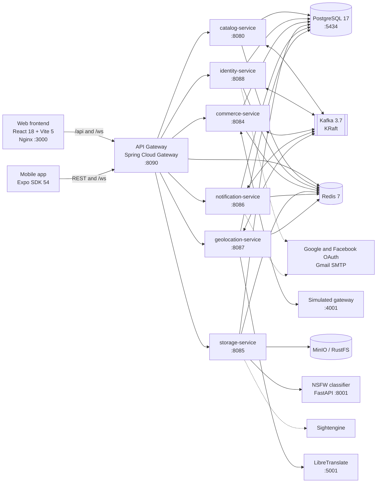
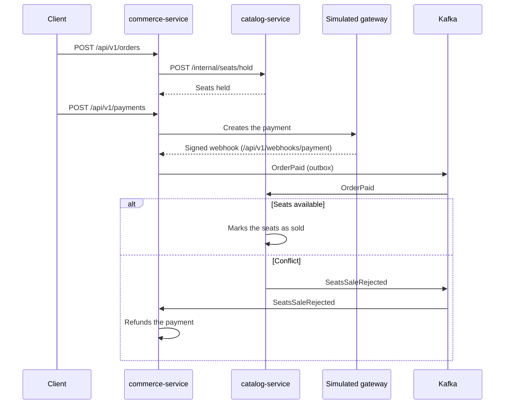
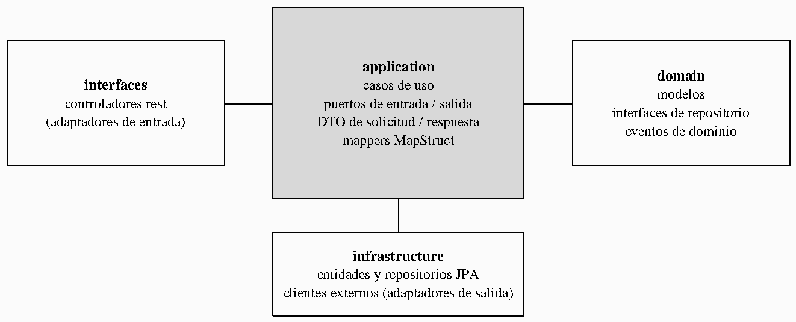
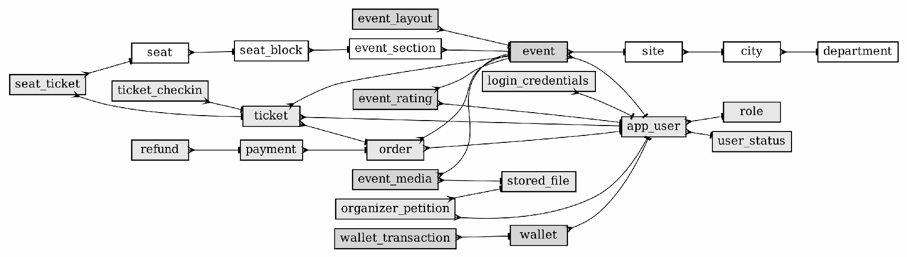
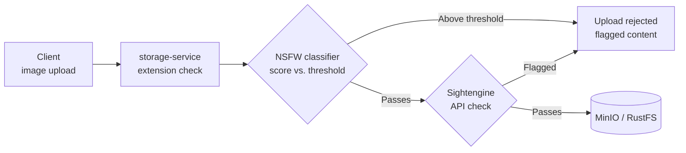

# Technical manual — Tu Evento

> Consolidated Tu Evento document. It gathers the following documents, whose content is kept unchanged; the conversion metadata of each one is in an HTML comment at the start of its section.

**Contents**

1. [Technical manual](#doc-te-0160)

---

<a id="doc-te-0160"></a>

<!--
ruta_anterior: en/09_Manuales/Manual_Tecnico_TuEvento.md
id: TE-0160
title: "Manual_Tecnico_TuEvento"
lang: en
source: 09_Manuales/Manual_Tecnico_TuEvento.pdf
source_sha256: 144ed09c7b2e23ab28904fb3718ab499922e9e124e50a0eb741ec7f6a29124c5
conversion: "pdfplumber 0.11.10 + converter for untagged PDF (method C, pilot 3); without manual review. English translation of md/es: Claude Opus 5.5 (claude-opus-5-5); without manual review"
converted_on: 2026-10-23
fidelity: parcial
losses:
  - "Page header or footer omitted on pages 1–44: «{n}»."
  - "Page 6: figure included as an image (pagina-06-figura-1.png); its text (69 words) goes in a non-visible HTML comment, grouped by box ([...]) from top to bottom and from left to right; arrows and relationships are only in the image."
  - "Page 8: figure included as an image (pagina-08-figura-1.png); its text (40 words) goes in a non-visible HTML comment, grouped by box ([...]) from top to bottom and from left to right; arrows and relationships are only in the image."
  - "Page 30: figure included as an image (pagina-30-figura-1.png); its text (0 words) goes in a non-visible HTML comment, grouped by box ([...]) from top to bottom and from left to right; arrows and relationships are only in the image."
  - "Page 36: figure included as an image (pagina-36-figura-1.png); its text (23 words) goes in a non-visible HTML comment, grouped by box ([...]) from top to bottom and from left to right; arrows and relationships are only in the image."
  - "Words split without a hyphen by the width of the cell joined without a space: @react-native-async-storage/async-storage, jdbc:postgresql://postgres-service:5432/tuevento, postgres-fake-gateway, postgres_fake_gateway_data, postgres-fake-gateway, /api/v1/admin/organizer-requests/{id}/approve, /api/v1/admin/organizer-requests/{id}/reject, /api/v1/admin/organizer-requests/{id}/document, HMAC-SHA256, login_credentials, account_activation, account_lockout, organizer_petition, event_status_log, ticket_checkin, wallet_transaction, wallet_reference."
  - "Manual table of contents (pages 2–4): the page numbers of the original are kept and the leader lines are removed."
  - "Bold, italics and monospaced font are kept; sizes, colours, alignment and indentation are not."
  - "Automatic check against pdftotext: coverage 99.65%, precision 99.24%, order 98.94%; missing {'n': 1, 'stora': 1, 'ge': 1, 'gatew': 1, 'ay': 1, 'gate': 1, 'way': 1, 'ga': 1, 'teway': 1, 'ap': 1, 'prove': 1, 're': 1, 'ject': 1, 'do': 1, 'cument': 1} (explained above)."
  - "Page 36: the diagram of the moderation cascade was split into two crops in an intermediate run; the final version is a single crop with the 6 boxes and their connectors (checked visually)."
  - "Tables 1-37: each «Tabla N» is followed by its table with the same title as the original; rows checked visually in Tables 7 and 24 (PyMuPDF counts physical lines and is not useful as a row reference)."
  - "Order differences: the text of the diagrams is in the comment at the position of the figure (pp. 6, 8 and 36); the rest of the sections keep the order of the original."
  - "Translation: code (paths, commands, variable names, endpoints and the directory trees in code blocks), table and column names and the identifiers split by the width of the PDF cells are kept as in the original."
  - "Translation: the HTML comments with the text of the figures keep the original text and add the English translation after «EN:»."
  - "Translation: the APA citations are translated («s. f.» → «n.d.», «y» → «and»); the titles of the cited works are not translated."
  - "Translation: the paragraphs keep the line division of the original; in English the line ends do not match those of the original."
status: borrador
reviewed_by: ""
translation_of: es/10_Manual_Tecnico.md#doc-te-0160
es_sha256: 7af4f5cb5f62e819dcc4b8ae91e7b1c947f398ea2be1617440325ff77ccb1329
-->

# TuEvento: Technical Manual

Jhampier Santos Ortiz and Cristofer David Lozano Contreras

Servicio Nacional de Aprendizaje (SENA; National Learning Service)

Análisis y Desarrollo de Software (ADSO; Software Analysis and Development), Ficha (training group) 3145556

Instructor: Karol Daniela Correa

5 November 2026

Version 1.1

**Document control**

| Field | Value |
|---|---|
| Verified repository | `lozano2303/TuEvento` |
| Code version | `v1.2.0` (`main` branch, commit `ef9b329`, November 3, 2026) |
| Verification date | November 5, 2026 |
| Method | Reading the code and configuration of that version: `docker-compose.yml`, `pom.xml`, `package.json`, `application*.yml`, controllers, Liquibase changelogs and the CI workflow |

# Table of contents

**Introduction**

Purpose · Scope · Audience · Related documents

**System architecture**

Overview · Backend services · Communication flows · Layered structure

**Technology stack**

Backend dependencies · Web frontend, mobile app and auxiliary service dependencies

**Repository and code organization**

General structure · Modules per service · Frontend organization · Directory tree

**Backend**

Configuration profiles · Docker Compose services · Environment variables · Authentication and authorization · API Gateway · Service-to-service communication · WebSocket authentication · Error handling

**REST API and services**

identity-service · catalog-service · commerce-service · Other controllers · Internal API

**Database**

Engine and access · Schema migrations · Data model summary · Tables by domain

**Web frontend**

**Mobile app**

**Integrations**

Google and Facebook sign-in · Email notifications · Object storage · Redis · Kafka · Automatic translation · Image moderation cascade · Payment gateway

**Design patterns and technical decisions**

**Security**

Implemented controls · Pending hardening

**Testing and quality**

Existing tests · Continuous integration · Deployment and Kubernetes manifests

**Maintenance and extension**

Conventions · How to add a module · Troubleshooting

**Known limitations**

**Pending verification**

**Glossary**

**References**

# Introduction

## Purpose

This manual documents the architecture, implementation and internal workings of TuEvento, an event management platform developed by the CapySoft team. It is written for developers, software architects and technical staff who maintain, extend or operate the system. It describes the system as it exists in version 1.2.0 of the project repository (Santos Ortiz & Lozano Contreras, 2026b).

## Scope

The document covers the system architecture, the technology stack and its versions, the code organization, the configuration, the data layer, the integrations, the design decisions, security, testing and quality practices, and maintenance and extension guidelines. The installation steps are not repeated here; they are described in the installation manual (Santos Ortiz & Lozano Contreras, 2026a). The server deployment procedure is described in the implementation document.

## Audience

Backend and frontend developers use this manual to understand the code structure. DevOps staff use it to understand the configuration and the services. Architects use it to evaluate the technical decisions and evaluators use it to know the functionality to be verified.

## Related documents

This manual complements the installation manual, the implementation document, the Software Requirements Specification (SRS), the analysis and design documents, the data dictionary and the project's technical proposal.

# System architecture

## Overview

Up to version 1.1.x, the TuEvento backend was a modular monolith. In version 1.2.0 the monolith was split: the identity, commerce, storage, notification and geolocation modules were extracted into five microservices, and what remains of the monolith is `catalog-service` (events, categories, sections and seats). All client traffic enters through an **API Gateway** based on Spring Cloud Gateway, which routes each `/api/v1` prefix to the services.

The services share a single PostgreSQL database, but each one owns its tables: the foreign keys that crossed service boundaries were removed (changelogs 109 and 110) and each service stores the identifiers of the others as plain values. They communicate over internal HTTP, protected with a shared key, and through Apache Kafka messages. All services are orchestrated with Docker Compose through the `docker-compose.yml` file at the repository root (Docker, Inc., n.d.). Figure 1 shows the components and how they connect, and Table 1 lists each component with its technology and its port published on the host.

**Figure 1**<br>
*TuEvento system architecture (v1.2.0)*



*Note.* Own elaboration based on `docker-compose.yml` and the API Gateway routes (v1.2.0). Dotted lines are external services.

**Table 1**<br>
*Platform components and host ports*

| **Component** | **Technology** | **Host port** |
|---|---|---|
| Web frontend | React 18 + Vite 5, served by Nginx 1.29 in the container | 3000 |
| Mobile frontend | React Native 0.81 / Expo SDK 54 | Not applicable |
| API Gateway | Spring Boot 3.5.12 + Spring Cloud Gateway (Spring Cloud 2025.0.0) | 8090 |
| catalog-service | Spring Boot 3.5.12, Java 17; the Docker image runs a JRE 21 | 8080 |
| identity-service | Spring Boot 3.5.12, Java 17 | 8088 |
| commerce-service | Spring Boot 3.5.12, Java 17 | 8084 |
| storage-service | Spring Boot 3.5.12, Java 17 | 8085 |
| notification-service | Spring Boot 3.5.12, Java 17 | 8086 |
| geolocation-service | Spring Boot 3.5.12, Java 17 | 8087 |
| Database | PostgreSQL 17, shared by all services | 5434 (container 5432) |
| Messaging | Apache Kafka 3.7 in KRaft mode (no Zookeeper) | 9094, on 127.0.0.1 only |
| Cache and revocation list | Redis 7 (no password by default) | 6379 |
| Object storage | MinIO (default) or RustFS, both S3-compatible | 9000/9001 and 9100/9101 |
| Automatic translation | LibreTranslate 1.9.6 (es, en, fr, pt) | 5001, on 127.0.0.1 only |
| Image moderation | NSFW classifier (Python, FastAPI, opennsfw2) | 8001 (container 8000) |
| Sandbox payment gateway | fake-payment-gateway, development and payment-flow testing only | 4001 |
| Gateway database | Dedicated PostgreSQL instance | 5435 |
| Continuous integration | GitHub Actions (cloud service) | Not applicable |
| Code quality | SonarQube Cloud (cloud service) | Not applicable |

*Note.* Source: `docker-compose.yml`, `pom.xml` and `package.json` of v1.2.0. GitHub Actions and SonarQube Cloud are not needed to run the application. Local Jenkins and SonarQube remain in the compose file inside the `ci` profile, inactive.

## Backend services

**Table 2**<br>
*Responsibility of each backend service*

| **Service** | **Responsibility** | **Routes assigned by the gateway** |
|---|---|---|
| catalog-service (`TuEventoBackend/tu-evento`) | Events, ratings and comments, layouts, media, categories, sections, seats and reservations; `/ws` WebSocket broker; runs all Liquibase migrations | `/api/v1/events/**`, `/categories/**`, `/category-events/**`, `/section-types/**`, `/event-sections/**`, `/seat-blocks/**`, `/seats/**`, `/admin/events/**` and the catalog translations; `/ws/**` |
| identity-service | Sign-up, sign-in, tokens, OAuth, users, roles, organizer requests, themes, profiles and admin panel; signs the JWTs and publishes the JWKS; creates the initial administrator | `/api/v1/auth/**`, `/users/...`, `/admin/stats`, `/admin/users`, `/admin/organizer-requests/**`, `/themes/**`, `/profiles/**`; `/.well-known/jwks.json` |
| commerce-service | Orders, tickets and QR codes, check-in, payments, gateway webhook, refunds, wallet and organizer earnings | `/api/v1/orders/**`, `/tickets/**`, `/payments/**`, `/webhooks/**`, `/wallet/**`, `/admin/wallet/**`, `/admin/refunds/**`, `/organizer/earnings/**` |
| storage-service | File upload and lookup, public and presigned URLs, image moderation; the only service that writes to the bucket | `/api/v1/storage/**` |
| notification-service | Stores notifications, sends emails and returns live notices to the catalog-service WebSocket | `/api/v1/notifications/**` |
| geolocation-service | Departments, cities, venues, languages and automatic translations with LibreTranslate | `/api/v1/geolocation/**`, `/api/v1/languages/**`, `/api/v1/admin/languages/**` |

*Note.* Source: `TuEventoBackend/gateway/src/main/resources/application.yml` (v1.2.0). The gateway has no default route: a path not on the list returns 404.

## Communication flows

Clients authenticate with a sign-in request to identity-service (through the gateway) and receive JSON Web Tokens (Jones et al., 2015) signed with RS256. Subsequent API calls carry the access token as a bearer token; each service validates the signature with the JWK Set published by identity-service and checks the token revocation list in Redis.

There are two channels between services. Synchronous queries use the internal API `/internal/**`, protected with the `X-Internal-Api-Key` header (`INTERNAL_API_KEY` variable). State changes are published as Kafka events using the *transactional outbox* pattern: the service writes the event to the `outbox_event` table in the same transaction as the change, a process sends it to Kafka and consumers record the processed events to be idempotent.

Ticket purchase is a choreographed saga (Figure 2): commerce-service holds the seats through the catalog-service internal API, the gateway simulator confirms the payment with a signed webhook (`WEBHOOK_SECRET`), the `OrderPaid` event sells the seats, `SeatsSaleRejected` refunds the payment and `OrderReleased` frees the seats of cancelled or expired orders. Real-time notifications use a WebSocket connection to the catalog-service `/ws` endpoint, authenticated with the token. Images uploaded by users go through the storage-service moderation cascade before being stored.

**Figure 2**<br>
*Ticket purchase saga*



*Note.* Own elaboration based on the version 1.2.0 release notes (`CHANGELOG.md`) and the `InternalCatalogController`, `OrderController`, `PaymentController` and `WebhookController` controllers.

## Layered structure

Each service follows a hexagonal architecture (ports and adapters) (Cockburn, 2005) with domain-oriented modules (Evans, 2003). Each module separates its domain model, its application use cases, its infrastructure adapters and its input interfaces, as shown in Figure 3. Single-domain services (storage, notification and geolocation) apply the same layers directly under their root package.

**Figure 3**<br>
*Hexagonal structure of a backend module*



<!-- Text inside the figure (page 8): [application use cases input / output ports request / response DTOs MapStruct mappers] [interfaces rest controllers (input adapters)] [domain models repository interfaces domain events] [infrastructure JPA entities and repositories external clients (output adapters)] -->

*Note.* Own elaboration based on the package structure of com.capysoft.tuevento.modules; the microservices follow the same organization.

# Technology stack

The following tables summarize the main technologies used in each part of the system. The versions were taken from the v1.2.0 dependency files (Spring, n.d.-a; React, n.d.; Expo, n.d.).

**Table 3**<br>
*Backend technologies*

| **Area** | **Technology** | **Version / detail** |
|---|---|---|
| Framework | Spring Boot | 3.5.12 in every service |
| Gateway | Spring Cloud Gateway (WebFlux), Resilience4j | Spring Cloud 2025.0.0 |
| Language | Java | 17; the images run JRE 17 (microservices and gateway) or JRE 21 (catalog-service) |
| Build | Maven | Maven wrapper in catalog-service and the gateway; shared `tuevento-common` library |
| Persistence | Spring Data JPA, PostgreSQL, HikariCP | PostgreSQL 17 |
| Migrations | Liquibase | Numbered YAML changelogs, run by catalog-service |
| Security | Spring Security, OAuth2 Resource Server (Nimbus), jjwt, BCrypt | RS256 JWT with JWKS; BCrypt cost 12 |
| Social sign-in | OAuth 2.0 (Google, Facebook) | In identity-service |
| Messaging | Spring Kafka | Kafka 3.7 (KRaft); transactional outbox |
| Real time | Spring WebSocket | STOMP over SockJS, in catalog-service |
| Email | Spring Mail | Gmail SMTP, in identity-service and notification-service |
| Storage | AWS S3 SDK for MinIO and RustFS | 2.25.60, in storage-service |
| Mapping | MapStruct | 1.6.3 |
| API documentation | SpringDoc OpenAPI | 2.8.8, in each service |
| Operations | Spring Boot Actuator | Health and metrics |
| Productivity | Lombok, Bean Validation | Not applicable |

*Note.* Source: `pom.xml` of catalog-service, the gateway and the services in `TuEventoBackend/services/`.

**Table 4**<br>
*Web frontend technologies*

| **Area** | **Technology** | **Version** |
|---|---|---|
| Framework | React | 18.2.0 |
| Build tool | Vite | 5.0.0 |
| Routing | React Router DOM | 6.20.0 |
| Internationalization | i18next, react-i18next | 26.4.4 and 17.0.16 |
| Styling | Tailwind CSS | 4.2.2 |
| Icons | Lucide React | 1.7.0 |
| Layout editor | Konva and react-konva | 9.3.22 and 18.2.10 |
| Maps | Leaflet and react-leaflet | 1.9.4 and 4.2.1 |
| QR codes | qrcode.react | 3.1.0 |
| Real time | @stomp/stompjs and sockjs-client | 7.3.0 and 1.6.1 |
| Dates | date-fns | 3.0.0 |
| Testing and quality | Vitest, Testing Library, ESLint, Prettier | 3.2.7, 16.3.3, 9.39.5, 3.9.10 |

*Note.* The layout editor uses Konva (Konva, n.d.) and the maps use Leaflet (Leaflet, n.d.).

**Table 5**<br>
*Mobile app technologies*

| **Area** | **Technology** | **Version** |
|---|---|---|
| Framework | React Native and Expo | 0.81.5 and 54.0.37 |
| Library | React | 19.1.0 |
| Navigation | React Navigation | 7.x |
| Internationalization | i18next, react-i18next | 26.5.6 and 17.1.3 |
| Styling | NativeWind | 2.0.11 |
| Graphics | @shopify/react-native-skia | 2.11.0 |
| Authentication | Expo Auth Session, Google Sign-In, jwt-decode | 7.0.11, 16.1.5 and 4.0.0 |
| Camera and QR | expo-camera, react-native-qrcode-svg | 17.0.10 and 6.3.27 |
| HTTP and forms | Axios, React Hook Form | 1.15.0 and 7.72.1 |
| Testing and quality | Jest (jest-expo), Testing Library, ESLint, Prettier | 29.7.0, 14.1.0, 9.39.5, 3.9.10 |

*Note.* The mobile app is not part of the Docker deployment (React Native, n.d.).

The auxiliary services include the NSFW classifier, built with FastAPI (FastAPI, n.d.) and the opennsfw2 model (bhky, n.d.), LibreTranslate for automatic translations (LibreTranslate, n.d.) and the sandbox payment gateway (fake-payment-gateway), which has its own PostgreSQL database. Orchestration uses Docker Compose, continuous integration uses GitHub Actions (GitHub, Inc., n.d.), code analysis uses SonarQube Cloud (SonarSource, n.d.) and Kubernetes manifests from the monolith stage are kept (The Kubernetes Authors, n.d.).

## Backend dependencies

Table 6 lists the dependencies declared in the backend `pom.xml` files, grouped by function.

**Table 6**<br>
*Backend dependencies (pom.xml)*

| **Group** | **Artifact** | **Version** | **Services** |
|---|---|---|---|
| Web and framework | spring-boot-starter-parent | 3.5.12 | All |
|  | spring-boot-starter-web | 3.5.12 | catalog and microservices |
|  | spring-cloud-starter-gateway-server-webflux | 2025.0.0 (BOM) | gateway |
|  | spring-cloud-starter-circuitbreaker-reactor-resilience4j | 2025.0.0 (BOM) | gateway |
|  | spring-boot-starter-actuator | 3.5.12 | All |
|  | spring-boot-starter-websocket | 3.5.12 | catalog |
| Security | spring-boot-starter-security | 3.5.12 | catalog and microservices |
|  | spring-boot-starter-oauth2-resource-server | 3.5.12 | catalog and microservices |
|  | spring-boot-starter-oauth2-client | 3.5.12 | catalog |
|  | jjwt-api, jjwt-impl, jjwt-jackson | 0.12.6 | catalog, identity and commerce |
| Persistence | spring-boot-starter-data-jpa | 3.5.12 | catalog and microservices |
|  | spring-boot-starter-data-redis / -reactive | 3.5.12 | All |
|  | spring-session-data-redis | — | catalog |
|  | postgresql | runtime | catalog and microservices |
|  | liquibase-core | — | catalog |
| Messaging | spring-kafka | — | catalog, identity, commerce, notification and geolocation |
|  | spring-boot-starter-mail | 3.5.12 | identity and notification |
| Utilities | lombok | — | All |
|  | mapstruct, mapstruct-processor | 1.6.3 | catalog and microservices |
|  | spring-dotenv | 4.0.0 | catalog |
|  | software.amazon.awssdk:s3 | 2.25.60 | storage |
|  | spring-boot-starter-validation | 3.5.12 | catalog and microservices |
| Documentation | springdoc-openapi-starter-webmvc-ui | 2.8.8 | catalog and microservices |
| Monitoring | micrometer-tracing-bridge-brave | — | catalog |
| Testing | spring-boot-starter-test, spring-security-test, spring-kafka-test | test | catalog and microservices |
|  | h2 | test | catalog |
|  | jacoco-maven-plugin | 0.8.12 | catalog and microservices |

*Note.* Source: `pom.xml` of each service. A dash means the `pom.xml` does not declare an explicit version; in those cases Spring Boot manages the version.

## Web frontend, mobile app and auxiliary service dependencies

**Table 7**<br>
*Web frontend dependencies (package.json)*

| **Type** | **Package** | **Version** | **Purpose** |
|---|---|---|---|
| dependencies | react, react-dom | ^18.2.0 | UI library |
|  | react-router-dom | ^6.20.0 | Routing |
|  | i18next, react-i18next, i18next-browser-languagedetector | ^26.4.4, ^17.0.16, ^8.2.1 | Internationalization |
|  | @stomp/stompjs, sockjs-client | ^7.3.0, ^1.6.1 | WebSocket client |
|  | konva, react-konva | ^9.3.22, ^18.2.10 | Layout editor |
|  | leaflet, react-leaflet | ^1.9.4, ^4.2.1 | Maps |
|  | qrcode.react | ^3.1.0 | Ticket QR codes |
|  | date-fns | ^3.0.0 | Date handling |
|  | lucide-react | ^1.7.0 | Icons |
| devDependencies | vite, @vitejs/plugin-react | ^5.0.0, ^4.2.0 | Server and build |
|  | tailwindcss, @tailwindcss/postcss | ^4.2.2 | Styling |
|  | autoprefixer, postcss | ^10.4.27, ^8.5.8 | CSS processing |
|  | vitest, jsdom, @testing-library/react, @testing-library/jest-dom | ^3.2.7, ^30.1.3, ^16.3.3, ^7.0.1 | Testing |
|  | eslint (and React plugins), prettier | ^9.39.5, ^3.9.10 | Quality and formatting |

*Note.* Source: package.json of TuEventoFrontend/web (v1.2.0).

**Table 8**<br>
*Mobile app dependencies (package.json)*

| **Type** | **Package** | **Version** | **Purpose** |
|---|---|---|---|
| dependencies | expo | ~54.0.37 | Development platform |
|  | react, react-native | 19.1.0, 0.81.5 | Native UI |
|  | @react-navigation/native, native-stack, bottom-tabs | ^7.2.2, ^7.14.10, ^7.15.9 | Navigation |
|  | expo-auth-session, @react-native-google-signin/google-signin | ~7.0.11, ^16.1.5 | Mobile OAuth |
|  | @react-native-async-storage/async-storage | 2.2.0 | Local storage |
|  | @stomp/stompjs, sockjs-client | ^7.3.0, ^1.6.1 | WebSocket client |
|  | axios | ^1.15.0 | HTTP client |
|  | expo-camera, react-native-qrcode-svg | ~17.0.10, ^6.3.27 | QR scanner and codes |
|  | expo-image-picker, expo-document-picker | ~17.0.11, ~14.0.8 | Image and document picking |
|  | i18next, react-i18next | 26.5.6, 17.1.3 | Internationalization |
|  | react-native-webview | 13.15.0 | Web view (payment gateway) |
|  | react-hook-form, jwt-decode | ^7.72.1, ^4.0.0 | Forms and JWT decoding |
|  | nativewind, @shopify/react-native-skia | ^2.0.11, ^2.11.0 | Styling and 2D graphics |
| devDependencies | jest, jest-expo, @testing-library/react-native | ~29.7.0, ~54.0.18, ^14.1.0 | Testing |
|  | typescript, @types/react, babel-preset-expo, tailwindcss | ~5.9.2, ~19.1.10, ~54.0.10, ^3.3.2 | Development tools |
|  | eslint, eslint-config-expo, prettier | ^9.39.5, ~10.0.0, ^3.9.10 | Quality and formatting |

*Note.* Source: package.json of TuEventoFrontend/movil (v1.2.0).

**Table 9**<br>
*Auxiliary service dependencies*

| **Service** | **Dependency** | **Version** | **Purpose** |
|---|---|---|---|
| NSFW (Python 3.11) | fastapi | 0.111.0 | Web API |
|  | uvicorn | 0.30.1 | ASGI server |
|  | pillow | 10.3.0 | Image processing |
|  | opennsfw2 | 0.13.3 | NSFW classifier |
|  | tensorflow | 2.16.2 | Machine learning engine |
| LibreTranslate | libretranslate/libretranslate image | v1.9.6 | Automatic translation (es, en, fr, pt) |
| fake-payment-gateway | spring-boot-starter-parent, -web, -data-jpa, -validation | 3.5.0 | REST service with persistence |
|  | postgresql, lombok | runtime, — | Driver and boilerplate reduction |

*Note.* Source: requirements.txt of nsfw-service, pom.xml of fake-payment-gateway and docker-compose.yml.

# Repository and code organization

## General structure

The project source code is hosted in a public GitHub repository (Santos Ortiz & Lozano Contreras, 2026b). Table 10 describes its top-level organization.

**Table 10**<br>
*Top-level repository structure*

| **Path** | **Content** |
|---|---|
| `TuEventoBackend/tu-evento/` | catalog-service (former monolith) |
| `TuEventoBackend/gateway/` | API Gateway |
| `TuEventoBackend/services/` | Microservices (identity, commerce, storage, notification and geolocation) and the shared `tuevento-common` library |
| `TuEventoFrontend/web/` | React web frontend |
| `TuEventoFrontend/movil/` | React Native (Expo) mobile app |
| `nsfw-service/` | Python image classifier |
| `fake-payment-gateway/` | Sandbox payment gateway |
| `loadtest/` | Load tests (seat race) |
| `k8s/` | Kubernetes manifests (8 YAML files) |
| `.github/workflows/ci.yml` and `sonar-project.properties` | Continuous integration and quality analysis |
| `docker-compose.yml` and `docker-compose.prod.yml` | Local and production orchestration |
| `.env.example` and `.env.prod.example` | Environment variable templates |
| `CHANGELOG.md` and `docs/` | Version history and the team's technical documentation |

## Modules per service

The `shared` package of each service contains cross-cutting code (configuration, security, outbox and the global exception handler). The `tuevento-common` library gathers the domain exceptions, the standard `ApiResponse`, the internal key filter (`InternalApiKeyFilter`) and the JWT decoder that checks the revocation list in Redis (`RevocationCheckingJwtDecoder`). Table 11 lists the domain modules of each service.

**Table 11**<br>
*Domain modules per service*

| **Service** | **Module** | **Responsibility** |
|---|---|---|
| catalog-service | event | Event lifecycle, ratings and comments with replies, media, layouts and translations |
|  | category | Event categories |
|  | section | Section types and event sections |
|  | seat | Seat blocks, seats and reservations |
|  | catalogbridge | Catalog side of the purchase saga: seat holds, event replication to commerce and live commerce notices |
|  | identitybridge | Integration with identity: user events, organizer documents and admin panel data |
| identity-service | security | Authentication, users, roles, activation, password recovery, organizer requests and admin panel |
|  | profile | User profiles |
|  | theme | UI themes |
| commerce-service | ticket | Orders, tickets, QR codes and check-in |
|  | payment | Payments, webhook, refunds, reconciliation and organizer earnings |
|  | wallet | Digital wallet |
| storage-service | (single domain) | Files and image moderation |
| notification-service | (single domain) | Notifications, email and live notices |
| geolocation-service | (root) and language | Departments, cities and venues; languages and translations |

*Note.* Source: directories under `src/main/java` of each service in v1.2.0.

## Frontend organization

The web frontend keeps its code in `src/` with the directories `assets`, `components`, `constants`, `context`, `data`, `hooks`, `layouts`, `locales`, `pages`, `services`, `styles`, `theme` and `utils`, and the `i18n.js` file for internationalization. Global state is provided by React context providers for authentication, theme, language and notifications. The `services` directory contains the API clients, with `httpClient.js` as the shared HTTP client. The mobile app follows a similar organization, with `navigation/` for navigation, `screens/` for the screens, `locales/` and `i18n.js` for languages and `services/httpClient.js` as the base API client.

## Directory tree

The following trees show the actual structure of the backend, the web frontend, the mobile app and the auxiliary services.

Backend (TuEventoBackend):

```text
tu-evento/                       catalog-service
  src/main/java/com/capysoft/tuevento/
    modules/  catalogbridge/  category/  event/  identitybridge/  seat/  section/
    shared/   application/  domain/  infrastructure/  interfaces/
  src/main/resources/  db/changelog/  keys/  application*.yml
gateway/                         API Gateway
services/
  tuevento-common/               shared library
  identity-service/  commerce-service/  storage-service/
  notification-service/  geolocation-service/
```

Web frontend (TuEventoFrontend/web/src):

```text
App.jsx  main.jsx  i18n.js
assets/  components/  constants/  context/  data/  hooks/
layouts/  locales/  pages/  services/  styles/  theme/  utils/
```

Mobile app (TuEventoFrontend/movil/src):

```text
i18n.js
assets/  components/  context/  hooks/  locales/
navigation/  screens/  services/  theme/  utils/
```

Auxiliary services:

```text
nsfw-service/
  main.py  requirements.txt  Dockerfile
fake-payment-gateway/
  src/main/java/com/capysoft/fakepaymentgateway/
  pom.xml  Dockerfile
```

# Backend

## Configuration profiles

catalog-service uses Spring profiles: `application.yaml` (common), `application-dev.yml` (local development and Docker Compose), `application-prod.yml` (production) and `application-k8s.yml` (Kubernetes); the active profile is selected with `SPRING_PROFILES_ACTIVE`. The microservices and the gateway have a single `application.yml` whose defaults point to the ports published on the host (`localhost:5434`, `localhost:9094`, `localhost:6379`), so they can run outside Docker unchanged; inside Docker, the compose file overrides those addresses. Table 12 summarizes the main parameters.

**Table 12**<br>
*Main configuration parameters*

| **Parameter** | **Value (development)** | **Source** |
|---|---|---|
| Ports | gateway 8090, catalog 8080, commerce 8084, storage 8085, notification 8086, geolocation 8087, identity 8088 | `application*.yml` |
| Access token lifetime | 900000 ms (15 minutes) | identity-service |
| Refresh token lifetime | 604800000 ms (7 days) | identity-service |
| CORS origins | Gateway: http://localhost:3000, http://localhost:5173, http://localhost:19000 | gateway |
| Maximum file / request size | 10 MB / 12 MB | catalog-service and Nginx |
| Database | `jdbc:postgresql://postgres:5432/tuevento_db` in Docker | `docker-compose.yml` |
| Kafka | `kafka:9092` in Docker; `localhost:9094` from the host | `application*.yml` |
| Storage | MinIO at `http://minio:9000` (`tuevento` bucket); RustFS optional | storage-service |
| Email | smtp.gmail.com, port 587 | identity-service and notification-service |
| Redis | `redis:6379` in Docker | `docker-compose.yml` |
| Hibernate ddl-auto | validate | catalog-service |
| Actuator | catalog: `/actuator/**` public; microservices: health, info and metrics exposed, only health and info public | Each service's `SecurityConfig` |

*Note.* Source: v1.2.0 configuration files.

## Docker Compose services

Table 13 lists the services defined in the `docker-compose.yml` file, with their images, ports and dependencies.

**Table 13**<br>
*Services defined in docker-compose.yml*

| **Service** | **Image or build** | **Ports** | **Volume** | **Depends on** |
|---|---|---|---|---|
| postgres | postgres:17-alpine | 5434:5432 | postgres_data | — |
| postgres-fake-gateway | postgres:17-alpine | 5435:5432 | postgres_fake_gateway_data | — |
| redis | redis:7-alpine | 6379:6379 | redis_data | — |
| kafka | bitnamilegacy/kafka:3.7.0 | 127.0.0.1:9094:9094 | kafka_data | — |
| minio | quay.io/minio/minio:latest | 9000:9000, 9001:9001 | minio_data | — |
| minio-init | quay.io/minio/minio:latest | — | — | minio (healthy) |
| rustfs | rustfs/rustfs:1.0.0-alpha.59 | 9100:9000, 9101:9001 | rustfs_data | — |
| nsfw-classifier | build: ./nsfw-service | 8001:8000 | — | — |
| libretranslate | libretranslate/libretranslate:v1.9.6 | 127.0.0.1:5001:5000 | libretranslate-models | — |
| fake-payment-gateway | build: ./fake-payment-gateway | 4001:4001 | — | postgres-fake-gateway |
| backend (catalog-service) | build: ./TuEventoBackend/tu-evento | 8080:8080 | — | postgres, redis, kafka (healthy) |
| identity-service | build: ./TuEventoBackend/services | 8088:8088 | `keys/` folder (read-only) | postgres, redis, kafka, backend |
| commerce-service | build: ./TuEventoBackend/services | 8084:8084 | — | postgres, redis, kafka (healthy), backend |
| storage-service | build: ./TuEventoBackend/services | 8085:8085 | — | postgres, redis, minio (healthy), nsfw-classifier, backend |
| notification-service | build: ./TuEventoBackend/services | 8086:8086 | — | postgres, redis, kafka (healthy), backend |
| geolocation-service | build: ./TuEventoBackend/services | 8087:8087 | — | postgres, redis, kafka (healthy), libretranslate (healthy), backend |
| gateway | build: ./TuEventoBackend/gateway | 8090:8090 | — | backend, the five microservices and redis |
| frontend | build: ./TuEventoFrontend/web | 3000:80 | — | gateway |
| jenkins, sonarqube | `ci` profile (inactive) | 8082, 50000, 9002 | jenkins_data, sonarqube_* | — |

*Note.* Source: docker-compose.yml (v1.2.0).

## Environment variables

The services read their configuration from environment variables. In Docker Compose they are defined in the root `.env` file, created from `.env.example`, and the compose file passes each container only the ones it needs. Table 14 lists the main variables. Real values must never be included in the repository.

**Table 14**<br>
*Main environment variables*

| **Variable** | **Purpose** |
|---|---|
| `POSTGRES_DB / USER / PASSWORD` | Database name (must be `tuevento_db`), user and password |
| `JWT_SECRET` | Legacy HS256 secret: validates tokens issued before the switch to RS256 and is the fallback value of `QR_SECRET` |
| `APP_JWT_PRIVATE_KEY_PATH` | Path to the RSA private key (PKCS#8) that identity-service signs JWTs with |
| `INTERNAL_API_KEY` | Shared key for the internal API `/internal/**`; empty leaves those routes closed |
| `WEBHOOK_SECRET` | HMAC secret the gateway simulator signs webhooks with and commerce-service verifies them with |
| `FAKE_GATEWAY_API_KEY` | Admin key of the simulated gateway |
| `QR_SECRET` | Signing secret for ticket QR codes (defaults to `JWT_SECRET`) |
| `KAFKA_BOOTSTRAP_SERVERS` | Kafka address outside Docker |
| `MAIL_USERNAME / MAIL_PASSWORD` | Gmail account and App Password used to send email |
| `GOOGLE_CLIENT_ID / SECRET` | Google OAuth 2.0 credentials |
| `VITE_GOOGLE_CLIENT_ID` | Google Client ID used by the web frontend |
| `FACEBOOK_CLIENT_ID / SECRET` | Facebook OAuth credentials |
| `ADMIN_EMAIL / PASSWORD / ALIAS` | Initial administrator account |
| `MINIO_ROOT_USER / PASSWORD` | MinIO administrator credentials |
| `STORAGE_PROVIDER` and `RUSTFS_*` | Storage provider (`minio` or `rustfs`) and RustFS credentials |
| `REDIS_HOST / REDIS_PORT` | Redis connection outside Docker |
| `NSFW_SERVICE_URL / NSFW_THRESHOLD` | NSFW classifier address and decision threshold |
| `SIGHTENGINE_API_USER / API_SECRET / MODELS / THRESHOLD` | Sightengine credentials, models and threshold |
| `NOTIFICATION_EMAIL_ENABLED` | Enables or disables sending emails |
| `PAYMENT_GATEWAY / FAKE_GATEWAY_URL` | Payment gateway used and its address outside Docker |

*Note.* Source: `.env.example` and `docker-compose.yml` (v1.2.0). The installation manual states which are required and their default values.

In addition, the services read variables with a default value that can be overridden (Table 15).

**Table 15**<br>
*Additional variables read by the code*

| **Variable** | **Default value** | **Service** |
|---|---|---|
| `SPRING_DATASOURCE_URL` | `jdbc:postgresql://localhost:5434/tuevento_db` (microservices) | All |
| `<SERVICE>_SERVICE_PORT` / `GATEWAY_PORT` | Ports in Table 12 | Microservices and gateway |
| `*_SERVICE_URI` | Addresses of the target services | gateway |
| `JWK_SET_URI` | `http://localhost:8088/.well-known/jwks.json` | Microservices |
| `AUTH_COOKIE_SECURE` / `AUTH_COOKIE_SAME_SITE` | `true` / `Strict` | identity-service |
| `SECURITY_LOCKOUT_MINUTES` | 30 | identity-service |
| `RATE_LIMIT_ENABLED` / `RATE_LIMIT_REQUESTS_PER_MINUTE` | `true` / 10 | identity-service |
| `APP_OAUTH_ALLOWED_FRONTEND_REDIRECT_URIS` | `http://localhost:5173/login,http://localhost:3000/login` | identity-service |
| `APP_PROFILE_DEFAULT_AVATAR_ID` | 1 | identity-service |
| `MINIO_PUBLIC_URL` | `http://localhost:9000` | storage-service |
| `SIGHTENGINE_NUDITY_THRESHOLD` | 0.15 | storage-service |
| `PAYMENT_RECONCILIATION_ENABLED` / `_THRESHOLD_MINUTES` / `_EXPIRE_MINUTES` | `true` / 15 / 30 | commerce-service |
| `TRANSLATION_LIBRETRANSLATE_BASE_URL` | `http://localhost:5001` | geolocation-service |
| `TRANSLATION_PROTECTED_TERMS` | `Tu Evento` | geolocation-service |
| `OUTBOX_RELAY_ENABLED` / `MESSAGING_CONSUMERS_ENABLED` | `true` / `true` | catalog-service |
| `GATEWAY_CORS_ALLOWED_ORIGINS` | http://localhost:3000, http://localhost:5173, http://localhost:19000 | gateway |

*Note.* Source: `application*.yml` of each service (v1.2.0).

## Authentication and authorization

identity-service authenticates users with JSON Web Tokens (Jones et al., 2015) signed with **RS256**: it signs with an RSA private key and publishes the public key at `/.well-known/jwks.json`. The other services only verify the signature with that JWK Set (`NimbusJwtDecoder`) and also check the revocation list in Redis (`RevocationCheckingJwtDecoder`, from `tuevento-common`); if Redis does not respond, the token is rejected (*fail-closed*). identity-service does not start without the private key (`ephemeral-keys-allowed: false`). The previous HS256 secret (`JWT_SECRET`) only validates tokens issued before the switch.

Passwords are stored as BCrypt hashes with cost 12. The security module keeps a password history, so a new password can be compared with previous ones when the user changes it. Social sign-in with Google and Facebook follows the OAuth 2.0 authorization framework (Hardt, 2012).

Authorization is role-based. Liquibase (changelog 017) inserts the three system roles and the user statuses listed in Table 16; the migrations do not create any user. The initial administrator is created by identity-service at start-up, through the `AdminAccountSeeder` class, from the `ADMIN_*` variables (Spring, n.d.-b).

**Table 16**<br>
*System roles and user statuses*

| **Element** | **Values** | **Description** |
|---|---|---|
| Roles | ADMIN | Full system access |
|  | ORGANIZER | Creates and manages events |
|  | USER | Regular platform user |
| User statuses | PENDING, ACTIVE, BLOCKED, INACTIVE, DELETED | Account lifecycle |

*Note.* Source: Liquibase changelog 017-insert-initial-roles-and-user-status.yaml.

The access token lasts 15 minutes (900000 ms) and the refresh token lasts 7 days (604800000 ms). The refresh token travels in a cookie (`Secure` and `SameSite=Strict` by default) and rotates on each use: renewing the session issues a new pair and the previous one stops being valid (`RefreshTokenUseCase`). For sign-in, the system counts failed attempts in the `account_lockout` table: after 5 failed attempts within a 15-minute window, the account is temporarily locked for 30 minutes by default (`LoginUseCase`). In addition, `AuthRateLimitFilter` limits sign-in, sign-up, activation and recovery attempts to 10 requests per minute; the counters live in Redis.

## API Gateway

The gateway (Spring Cloud Gateway on WebFlux) is the clients' single entry point. It routes by path prefix (Table 2), applies CORS centrally, forwards the `/ws` WebSocket to catalog-service and exposes `/.well-known/jwks.json` from identity-service. It defines connection and response timeouts per route and uses Redis and Resilience4j. It has no default route, so an unassigned path returns 404.

## Service-to-service communication

**Table 17**<br>
*Service-to-service communication channels*

| **Channel** | **Use** | **Examples** |
|---|---|---|
| Internal HTTP (`/internal/**`, `X-Internal-Api-Key` header) | Synchronous queries between services | Hold seats (`POST /internal/seats/hold`), seats with pending payment, tickets sold, files (`/internal/files`), admin panel figures |
| Kafka with transactional outbox | Domain events and asynchronous commands | Purchase saga (`tuevento.order`, `tuevento.seat`), event replication (`tuevento.event`), users (`tuevento.user`), notifications (`tuevento.notificaciones.*`), translations (`tuevento.localizacion.translation.*`), live notices (`*.push`) |
| JWK Set | Local JWT verification | identity-service `/.well-known/jwks.json` |

*Note.* Source: `Internal*Controller` controllers, `*Outbox*` classes and Kafka topics in the v1.2.0 code. Topics are created automatically on the first message (`KAFKA_CFG_AUTO_CREATE_TOPICS_ENABLE`).

## WebSocket authentication

Real-time connections end at catalog-service (the gateway forwards them) and are authenticated during the handshake by the `JwtHandshakeInterceptor` class. The client sends the access token as the `token` query parameter of the `/ws` URL, because the browser WebSocket API does not allow custom headers. The interceptor validates the token, stores the user identifier in the session attributes and rejects the connection with an unauthorized response when the token is invalid. The configuration is in `WebSocketConfig.java`: the endpoint is `/ws` (STOMP over SockJS) with a simple in-memory broker for `/topic` and `/queue`; seat updates are published to `/topic/events/{eventId}/...` and personal notifications arrive through `/user/queue/notifications`. The notices generated by the microservices (notifications, identity, commerce) reach catalog-service through Kafka (`*.push`) and it forwards them to the clients. The web and mobile clients use `@stomp/stompjs` and `sockjs-client`.

## Error handling

Business rule violations are thrown as exceptions carrying an error code (`BusinessException` and its subclasses, in `tuevento-common`), and a global exception handler in each service turns them into consistent HTTP responses in the `ApiResponse` format. For example, posting two comments on the same event within the allowed interval produces the `COMMENT_RATE_LIMITED` code (ten seconds between comments).

# REST API and services

The API is published under the `/api/v1` prefix through the gateway (`http://localhost:8090/api/v1` locally). This section documents the endpoints of identity-service, catalog-service (events) and commerce-service, giving the HTTP method, the path, a short description and the required role. The remaining controllers are listed in Table 24; the interactive documentation is available in the Swagger UI that SpringDoc OpenAPI generates in each service (`/swagger-ui/index.html` on each service's port).

## identity-service

**Table 18**<br>
*AuthController endpoints*

| **Method** | **Path** | **Description** | **Required role** |
|---|---|---|---|
| POST | `/api/v1/auth/register` | Register a new account | Public |
| POST | `/api/v1/auth/activate` | Activate the account with the code | Public |
| POST | `/api/v1/auth/login` | Sign in with email and password | Public |
| POST | `/api/v1/auth/logout` | Sign out and revoke the token | Public |
| POST | `/api/v1/auth/refresh` | Renew the access token | Public |
| POST | `/api/v1/auth/recover-password` | Request the recovery code | Public |
| POST | `/api/v1/auth/reset-password` | Reset the password with the code | Public |
| GET | `/api/v1/auth/oauth/{provider}` | Redirect to the OAuth provider | Public |
| GET | `/api/v1/auth/oauth/{provider}/callback` | OAuth provider callback | Public |
| POST | `/api/v1/auth/google` | Authenticate with a Google ID Token | Public |
| POST | `/api/v1/auth/resend-activation` | Resend the activation code | Public |
| POST | `/api/v1/auth/reactivate-request` | Request account reactivation | Public |
| POST | `/api/v1/auth/reactivate-confirm` | Confirm reactivation | Public |

*Note.* Source: AuthController.java, identity-service.

**Table 19**<br>
*UserController endpoints*

| **Method** | **Path** | **Description** | **Required role** |
|---|---|---|---|
| POST | `/api/v1/users/change-password` | Change the password | USER |
| POST | `/api/v1/users/oauth/link` | Link an OAuth account | USER |
| POST | `/api/v1/users/organizer-request` | Request to become an organizer | USER |
| GET | `/api/v1/users/organizer-petition` | Check the request status | USER |
| DELETE | `/api/v1/users/me` | Deactivate your own account | USER |

*Note.* Source: UserController.java, identity-service.

**Table 20**<br>
*AdminController endpoints*

| **Method** | **Path** | **Description** | **Required role** |
|---|---|---|---|
| GET | `/api/v1/admin/stats` | Admin panel figures | ADMIN |
| GET | `/api/v1/admin/pending-counts` | Counts of pending items | ADMIN |
| GET | `/api/v1/admin/organizer-requests` | List organizer requests | ADMIN |
| PUT | `/api/v1/admin/organizer-requests/{id}/approve` | Approve a request | ADMIN |
| PUT | `/api/v1/admin/organizer-requests/{id}/reject` | Reject a request | ADMIN |
| GET | `/api/v1/admin/organizer-requests/{id}/document` | Get the attached document URL | ADMIN |
| DELETE | `/api/v1/admin/organizer-users/{userId}/revoke` | Revoke the organizer role | ADMIN |
| GET | `/api/v1/admin/activity` | Recent activity | ADMIN |
| GET | `/api/v1/admin/users` | List users | ADMIN |

*Note.* Source: AdminController.java, identity-service. The administrator's event management (`/api/v1/admin/events`) is in catalog-service (Table 21).

## catalog-service

**Table 21**<br>
*EventController and AdminEventController endpoints*

| **Method** | **Path** | **Description** | **Required role** |
|---|---|---|---|
| POST | `/api/v1/events` | Create an event | ORGANIZER |
| GET | `/api/v1/events/{eventId}` | Get an event by identifier | Public |
| GET | `/api/v1/events/user/{userId}` | List a user's events | Public |
| GET | `/api/v1/events/status/{status}` | List events by status | Public |
| PUT | `/api/v1/events/{eventId}` | Update an event | ORGANIZER |
| DELETE | `/api/v1/events/{eventId}` | Delete an event | ORGANIZER |
| PATCH | `/api/v1/events/{eventId}/status` | Change an event's status | ORGANIZER |
| GET | `/api/v1/events/public` | List public events | Public |
| GET | `/api/v1/events/public/search` | Search public events | Public |
| GET | `/api/v1/events/public/city/{cityId}` | Public events by city | Public |
| GET | `/api/v1/events/public/category/{categoryId}` | Public events by category | Public |
| GET | `/api/v1/events/public/date-range` | Public events by date range | Public |
| GET | `/api/v1/admin/events` | List all events | ADMIN |
| PATCH | `/api/v1/admin/events/{eventId}/status` | Change an event's status | ADMIN |

*Note.* Source: EventController.java and AdminEventController.java, catalog-service.

**Table 22**<br>
*Rating, layout and media endpoints*

| **Method** | **Path** | **Description** | **Required role** |
|---|---|---|---|
| POST | `/api/v1/events/{eventId}/ratings` | Add a rating, comment or reply (`parentRatingId`) | USER |
| GET | `/api/v1/events/{eventId}/ratings` | List comments and replies (flat list) | Public |
| DELETE | `/api/v1/events/{eventId}/ratings/{ratingId}` | Delete your own comment | USER |
| PATCH | `/api/v1/events/{eventId}/ratings/{ratingId}` | Edit your own comment | USER |
| GET | `/api/v1/events/{eventId}/layout` | Get the event layout | Public |
| PUT | `/api/v1/events/{eventId}/layout` | Create or update the layout | ORGANIZER |
| POST | `/api/v1/events/{eventId}/media` | Upload event media | ORGANIZER or ADMIN |
| GET | `/api/v1/events/{eventId}/media` | Get the event media | Public |

*Note.* Source: EventRatingController, EventLayoutController and EventMediaController. Replies to comments no longer have their own controller: they are created with the same POST, giving `parentRatingId`.

## commerce-service

**Table 23**<br>
*Order, payment, ticket and wallet endpoints*

| **Method** | **Path** | **Description** | **Required role** |
|---|---|---|---|
| POST | `/api/v1/orders` | Create an order (holds the seats) | USER |
| GET | `/api/v1/orders/my` | List your own orders | USER |
| GET | `/api/v1/orders/{orderId}` | Get an order | USER |
| GET | `/api/v1/orders/{orderId}/tickets` | Tickets of an order | USER |
| POST | `/api/v1/orders/{orderId}/qr` | Generate the order QR code | USER |
| POST | `/api/v1/orders/{orderId}/cancel` | Cancel an order | USER |
| POST | `/api/v1/payments` | Create a payment | USER |
| GET | `/api/v1/payments/{id}` | Get a payment by identifier | USER |
| POST | `/api/v1/payments/{id}/refund` | Request a refund | ADMIN or ORGANIZER |
| POST | `/api/v1/webhooks/payment` | Payment gateway webhook | Public, HMAC-SHA256 signature |
| GET | `/api/v1/tickets/{ticketId}` | Get a ticket | USER |
| GET | `/api/v1/tickets/my` | List your own tickets | USER |
| GET | `/api/v1/tickets/user/{userId}` | List a user's tickets | USER |
| POST | `/api/v1/tickets/{ticketId}/qr` | Generate a ticket QR code | USER |
| POST | `/api/v1/tickets/scan` | Validate a QR code at the entrance | ORGANIZER |
| POST | `/api/v1/tickets/{ticketId}/checkin` | Record a ticket check-in | ORGANIZER |
| GET | `/api/v1/wallet/me` | Check your own balance | USER |
| GET | `/api/v1/wallet/me/transactions` | Check the transaction history | USER |
| POST | `/api/v1/wallet/credit` | Credit balance | ADMIN |
| POST | `/api/v1/wallet/adjust` | Administrative balance adjustment | ADMIN |
| POST | `/api/v1/admin/wallet/credit-all` | Credit balance to all users | ADMIN |
| GET | `/api/v1/admin/refunds` | List refunds | ADMIN |
| GET | `/api/v1/organizer/earnings` | Organizer earnings | ORGANIZER or ADMIN |

*Note.* Source: OrderController, PaymentController, WebhookController, TicketController, WalletController, AdminWalletController, AdminRefundController and OrganizerEarningsController. The roles of routes without `@PreAuthorize` are derived from the service's security configuration.

## Other controllers

**Table 24**<br>
*Additional controllers*

| **Service** | **Controllers** |
|---|---|
| catalog-service | CategoryController, CategoryEventController, CategoryTranslationController, EventTranslationController, EventRatingTranslationController, EventSectionController, SectionTypeController, SectionTypeTranslationController, SeatController, SeatReservationController, SeatBlockController |
| identity-service | ThemeController, ProfileController, ProfileTranslationController, JwksController |
| storage-service | StorageController |
| notification-service | NotificationController |
| geolocation-service | GeolocationController, LanguageController |

*Note.* Source: `interfaces/rest` directories of each service. Their endpoints can be checked in Swagger UI.

## Internal API

The `/internal/**` routes do not go through the gateway: only the services use them among themselves and they require the `X-Internal-Api-Key` header. They are exposed by `InternalCatalogController`, `InternalAdminPanelController`, `InternalOrganizerDocumentController` and `InternalProfileTranslationController` (catalog-service); `InternalUserController`, `InternalAdminController` and `InternalProfileController` (identity-service); `InternalCommerceController` (commerce-service) and `InternalStorageController` (storage-service).

# Database

## Engine and access

The system uses PostgreSQL 17 (PostgreSQL Global Development Group, n.d.). The main database is named `tuevento_db`, is shared by catalog-service and the five microservices, and is published on host port 5434 (container port 5432). Each service accesses only the tables of its domain. The payment gateway uses a separate PostgreSQL instance on port 5435.

## Schema migrations

The schema is created and evolved with Liquibase (Liquibase, n.d.), which only catalog-service runs at start-up; the microservices do not include Liquibase and wait for the backend to finish the migrations. The master changelog is `db/changelog/db.changelog-master.yaml` and each change is a numbered YAML file in `db/changelog/changes/`. In v1.2.0 there are 131 files, numbered 001 to 113 (some numbers have two files and there is an `084b`). Recent changes include the `outbox_event` table (106 and 108), `processed_event` for consumer idempotency (109), the removal of the foreign keys between services (109 and 110) and `event_ref`, the event replica maintained by commerce-service (112 and 113). The changelogs are the authoritative definition of every table, column, constraint and index.

## Data model summary

Table 25 groups the main entities by domain and by owning service. The full definitions are in the Liquibase changelogs and the data dictionary.

**Table 25**<br>
*Main entities by domain*

| **Domain (owning service)** | **Main entities** |
|---|---|
| Security (identity) | User, user status, role, credentials, refresh token, password history, account activation, account lockout, organizer request, profile, theme |
| Events (catalog) | Event, layout, media, rating, status history, translations |
| Seats (catalog) | Event section, section type, seat block, seat, seat history |
| Geolocation (geolocation) | Department, city, site, language |
| Commerce (commerce) | Order, ticket, ticket seat, check-in, payment, refund, wallet, transaction, event replica (`event_ref`) |
| Files (storage) | Stored file, operation log |
| Notifications (notification) | Notification, notification per user |
| Messaging (each service) | `outbox_event`, `processed_event` |

*Note.* The exact names of the main tables are detailed in the tables by domain in this section.

Figure 4 shows the relationships between the main tables as defined in the original changelogs. Since changelogs 109 and 110, the relationships that cross from one service to another (for example, `event.user_id` to `app_user`) are kept as columns with the identifier, but without a foreign key constraint.

**Figure 4**<br>
*Entity-relationship diagram of the main tables*



*Note.* Own elaboration based on the Liquibase changelogs. Each line joins a table holding the foreign key (crow's-foot end, many side) with the table it references (bar end, one side). The main tables are shown; the rest are described in the tables by domain.

## Tables by domain

In Tables 26 to 32, "logical ref." marks a column that stores another service's identifier without a foreign key constraint (changelogs 109 and 110).

**Table 26**<br>
*Security domain: main tables*

| **Table** | **Main columns** | **Foreign keys** | **Constraints** |
|---|---|---|---|
| `app_user` | user_id (PK), user_status_id, role_id, alias, activated | user_status_id to user_status; role_id to role | alias unique, not null |
| `login_credentials` | credential_id (PK), user_id, email, password_hash | user_id to app_user | email unique, not null |
| `account_activation` | activation_id (PK), user_id, activation_code, expires_at | user_id to app_user | activation_code unique |
| `account_lockout` | account_lockout_id (PK), user_id, failed_attempts, window_started_at, locked_until | user_id to app_user | failed_attempts greater than or equal to 0 |
| `organizer_petition` | petition_id (PK), user_id, stored_file_id, status | user_id to app_user; stored_file_id: logical ref. | user_id unique |

*Note.* Source: Liquibase changelogs.

**Table 27**<br>
*Event domain: main tables*

| **Table** | **Main columns** | **Foreign keys** | **Constraints** |
|---|---|---|---|
| `event` | event_id (PK), user_id, site_id, event_name, start_date, finish_date, status | user_id and site_id: logical ref. | finish_date greater than start_date; status in DRAFT, PUBLISHED, CANCELLED, COMPLETED |
| `event_layout` | layout_id (PK), event_id, layout_data | event_id to event | event_id unique |
| `event_media` | media_id (PK), event_id, stored_file_id, img_url | event_id to event; stored_file_id to stored_file | Not null |
| `event_rating` | rating_id (PK), event_id, user_id, rating, comment, parent_rating_id | event_id to event; user_id: logical ref. | rating between 1 and 5 |
| `event_status_log` | log_id (PK), event_id, status, reason, changed_by | event_id to event; changed_by: logical ref. | Cascade delete |

*Note.* Source: Liquibase changelogs.

**Table 28**<br>
*Geolocation domain: main tables*

| **Table** | **Main columns** | **Foreign keys** | **Constraints** |
|---|---|---|---|
| `department` | department_id (PK), name, country_code | — | name not null |
| `city` | city_id (PK), department_id, name, postal_code | department_id to department | name not null |
| `site` | site_id (PK), city_id, name, address, latitude, longitude | city_id to city | name not null |

*Note.* Source: Liquibase changelogs.

**Table 29**<br>
*Seat and Section domain: main tables*

| **Table** | **Main columns** | **Foreign keys** | **Constraints** |
|---|---|---|---|
| `event_section` | section_id (PK), event_id, section_type_id, name, price | event_id to event; section_type_id to section_type | price greater than or equal to 0 |
| `seat_block` | block_id (PK), section_id, name, rows, columns | section_id to event_section | rows and columns greater than 0 |
| `seat` | seat_id (PK), block_id, row_number, seat_number, status, reserved_until, reserved_by | block_id to seat_block; reserved_by: logical ref. | status in AVAILABLE, RESERVED, OCCUPIED, BLOCKED |
| `seat_log` | log_id (PK), seat_id, previous_status, new_status, changed_by | seat_id to seat; changed_by: logical ref. | Not null |

*Note.* Source: Liquibase changelogs.

**Table 30**<br>
*Ticket domain: main tables*

| **Table** | **Main columns** | **Foreign keys** | **Constraints** |
|---|---|---|---|
| `order` | order_id (PK), user_id, event_id, total_amount, currency, status | user_id: logical ref.; event_id to event | status in DRAFT, PAYMENT_PENDING, PAID, CANCELLED, REFUNDED, USED |
| `ticket` | ticket_id (PK), order_id, user_id, event_id, ticket_code, price, status | order_id to order; user_id: logical ref.; event_id to event | ticket_code unique |
| `seat_ticket` | seat_ticket_id (PK), ticket_id, seat_id | ticket_id to ticket; seat_id to seat | Unique (ticket_id, seat_id) |
| `ticket_checkin` | checkin_id (PK), ticket_id, checkin_time, validated_by | ticket_id to ticket; validated_by: logical ref. | ticket_id unique |
| `event_ref` | Commerce replica of each event's owner, name, status and date | — | Maintained by commerce-service |

*Note.* Source: Liquibase changelogs.

**Table 31**<br>
*Payment domain: main tables*

| **Table** | **Main columns** | **Foreign keys** | **Constraints** |
|---|---|---|---|
| `payment` | payment_id (PK), order_id, amount, currency, status, wallet_amount | order_id to order | amount and wallet_amount greater than or equal to 0 |
| `payment_log` | log_id (PK), payment_id, previous_status, new_status | payment_id to payment | Not null |
| `refund` | refund_id (PK), payment_id, amount, reason, status | payment_id to payment | amount greater than 0 |

*Note.* Source: Liquibase changelogs.

**Table 32**<br>
*Wallet and messaging domain: main tables*

| **Table** | **Main columns** | **Foreign keys** | **Constraints** |
|---|---|---|---|
| `wallet` | wallet_id (PK), user_id, balance, currency, version | user_id to app_user | user_id unique; balance greater than or equal to 0; currency in COP |
| `wallet_transaction` | transaction_id (PK), wallet_id, amount, transaction_type, reference_id | wallet_id to wallet; reference_id to wallet_reference | amount other than 0 |
| `wallet_reference` | reference_id (PK), entity_type, entity_id, description | — | entity_type not null |
| `outbox_event` | Event pending publication to Kafka (topic, key, payload and delivery status) | — | Written in the same transaction as the change |
| `processed_event` | Identifiers of messages already consumed | — | Prevents processing the same message twice |

*Note.* Source: Liquibase changelogs (074, 106, 108, 109 and later).

# Web frontend

The web frontend is a single-page application built with React and Vite. Global state is handled with React context providers for authentication, theme, language and notifications, and local state with React hooks. Routing uses React Router, with protected routes for authenticated users, organizers and administrators. The interface is translated with i18next (files in `locales/`) and starts in the user's preferred language when a session exists.

All API calls go through the shared HTTP client, `httpClient.js`, which points to the gateway (`VITE_API_URL`, by default `http://localhost:8090/api/v1`), attaches the access token and renews it when the backend reports that it expired. The notification context opens the WebSocket connection with the token as a query parameter and delivers real-time messages to the interface. In the container, Nginx serves the application and forwards `/api` and `/ws` to the gateway (`api-gateway:8090`).

Two specialized components are worth highlighting. The event layout editor lets organizers design the seating arrangement of a venue on a Konva canvas (with decorative elements and courtesy seats), and the layout is stored as JSON together with the event. The map components use Leaflet to show event locations. Google sign-in uses the Client ID defined in `VITE_GOOGLE_CLIENT_ID`, and the payment page redirects to the simulated gateway (`VITE_GATEWAY_URL`). Because Vite embeds the `VITE_*` variables at build time, the Docker image must be rebuilt when they change.

# Mobile app

The mobile app uses Expo SDK 54 and React Native 0.81, with React Navigation for stack and tab navigation and i18next for languages. Its backend address is read from `EXPO_PUBLIC_API_URL` (the gateway, port 8090) in the mobile `.env` file, together with `EXPO_PUBLIC_GATEWAY_URL` (simulated gateway), `EXPO_PUBLIC_GOOGLE_CLIENT_ID`, `EXPO_PUBLIC_FACEBOOK_APP_ID` and `EXPO_PUBLIC_MINIO_HOST`. The API address must use the local IP address of the development machine, never `localhost`. EAS builds read these variables from the EAS environment.

The base API client is `services/httpClient.js`, and each domain has its own service (`authService.js`, `eventService.js`, `orderService.js`, `ticketService.js`, among others). The WebSocket service (`websocketService.js`) derives its URL from the same variable by removing the `/api/v1` suffix. The app includes a QR scanner screen (with `expo-camera`) used for ticket check-in.

# Integrations

## Google and Facebook sign-in

identity-service supports OAuth 2.0 sign-in with Google and Facebook (Hardt, 2012), as well as direct authentication with a Google ID Token, which is validated against Google's public JWKS (`NimbusGoogleIdTokenVerifier`). Once the provider confirms the user's identity, the service creates or links a local account and returns its own tokens. The credentials are supplied through the `GOOGLE_*` and `FACEBOOK_*` variables.

## Email notifications

Emails are sent through Gmail SMTP (host `smtp.gmail.com`, port 587) using an App Password instead of the account's personal password. identity-service sends the account emails (activation and recovery) and notification-service sends the notification emails, which it receives as commands through Kafka; user-supplied data is escaped before being inserted into the HTML templates. Sending can be disabled with `NOTIFICATION_EMAIL_ENABLED=false` during tests.

## Object storage

storage-service is the only service that writes to object storage. It uses MinIO by default (MinIO, Inc., n.d.) or RustFS with `STORAGE_PROVIDER=rustfs`, both through the AWS S3 SDK (Strategy pattern). The public URL used to serve the files is defined in `MINIO_PUBLIC_URL` and the service accesses storage through `APP_STORAGE_ENDPOINT`. The `profile_picture/` and `event_media/` prefixes are publicly readable; `organizer_document/` is private and is served with presigned URLs. The other services upload and look up files through the internal API `/internal/files`.

## Redis

Redis 7 (Redis, n.d.) runs without a password in development. Every service uses it for the JWT revocation list; it also stores the identity-service rate-limit counters, the commerce-service QR nonces, the catalog-service sessions and the state the gateway needs. The services connect through `REDIS_HOST` and `REDIS_PORT`.

## Kafka

Apache Kafka 3.7 (Apache Software Foundation, n.d.) runs in KRaft mode with a single node in development, 72-hour retention and automatic topic creation. The services publish through the transactional outbox pattern and consume idempotently (`processed_event` table). Topics use the `tuevento.` prefix (Table 17).

## Automatic translation

geolocation-service translates content (events, categories, comments, profiles and notifications) with LibreTranslate (LibreTranslate, n.d.), loaded with Spanish, English, French and Portuguese. The other services request translations through Kafka (`tuevento.localizacion.translation.command`) and receive the result the same way. The terms in `TRANSLATION_PROTECTED_TERMS` (by default, "Tu Evento") are not translated.

## Image moderation cascade

storage-service checks images in two stages before storing them (Figure 5). First it checks the file extension, not only the content type declared by the client. Then the local NSFW classifier returns a score that is compared with `NSFW_THRESHOLD`. Images that pass are checked with the Sightengine API (Sightengine, n.d.) using the models configured in `SIGHTENGINE_MODELS` and the `SIGHTENGINE_THRESHOLD` threshold. Only images that pass both checks are stored.

**Figure 5**<br>
*Image moderation cascade*



*Note.* Own elaboration based on `ImageModerationService`, `NsfwClientAdapter` and `SightengineAdapter` (storage-service, v1.2.0).

## Payment gateway

In development, payments are processed by the sandbox payment gateway (fake-payment-gateway service), an independent service with its own database for payment-flow testing. commerce-service creates the payment in the gateway (`FAKE_GATEWAY_URL`, protected with `FAKE_GATEWAY_API_KEY`) and the gateway confirms the result with a webhook signed with HMAC-SHA256 (`WEBHOOK_SECRET`) to `/api/v1/webhooks/payment`. A reconciliation process checks every 5 minutes the payments pending for more than 15 minutes and expires those older than 30 minutes. The gateway is selected with `PAYMENT_GATEWAY` (default `fake`). The sandbox gateway does not process real payments and must not be used with real money.

# Design patterns and technical decisions

## Architectural patterns

Each service applies hexagonal architecture: input ports define the use cases, output ports define what the application needs from the outside and adapters implement them (Cockburn, 2005). Domain-driven design guides the split into services and modules, each one owning its domain model and its tables (Evans, 2003). The system evolved from a modular monolith to microservices using the *strangler fig* pattern: the gateway diverted traffic prefix by prefix to each extracted service until the monolith remained as catalog-service. Consistency between services is achieved with events and choreographed sagas instead of distributed transactions.

## Design patterns

The code uses the Repository pattern (domain interfaces implemented by JPA adapters), the Adapter pattern for external services such as MinIO, the NSFW classifier, Sightengine and LibreTranslate, the Builder pattern through Lombok, and mapper components generated by MapStruct to convert between entities, domain models and DTOs. Selecting the payment gateway and the storage provider through configuration follows the Strategy pattern. Messaging applies Transactional Outbox and idempotent consumers, and the gateway applies the API Gateway pattern.

## Technical decisions

RS256 signing with JWKS lets only identity-service hold the private key and each service verify tokens without calling it. The revocation list in Redis makes it possible to end sessions before the token expires, and it is *fail-closed*. Refresh tokens allow short-lived access tokens. Sharing a single database with owner-based tables made gradual extraction easier; removing the foreign keys between services prepares the split into separate schemas or databases. WebSocket authentication uses a query parameter because browsers cannot send custom headers during the handshake. Image moderation is split into a local classifier and a remote API so that obviously inappropriate content is filtered locally before calling the remote service.

# Security

## Implemented controls

Table 33 summarizes the security controls present in the system.

**Table 33**<br>
*Implemented security controls*

| **Control** | **Description** |
|---|---|
| Token authentication | JWTs signed with RS256 by identity-service and verified with JWKS; refresh tokens in a cookie |
| Token revocation | Revocation list in Redis checked by every service (*fail-closed*) |
| Password protection | BCrypt hash (cost 12) and history check on change |
| Role-based authorization | ADMIN, ORGANIZER and USER roles |
| Account lockout | 30-minute lock after 5 failed attempts in a 15-minute window |
| Rate limiting | 10 per minute on sign-in, sign-up, activation and recovery |
| Token lifetime | 15-minute access token; 7-day refresh token rotated on each use |
| Account statuses | PENDING, ACTIVE, BLOCKED, INACTIVE and DELETED |
| Internal API | `/internal/**` routes protected with `X-Internal-Api-Key`; closed if the key is empty |
| Payment webhook | HMAC-SHA256 signature with `WEBHOOK_SECRET` |
| WebSocket handshake validation | Token validated before accepting the connection |
| CORS | Centralized in the gateway (`GATEWAY_CORS_ALLOWED_ORIGINS`) |
| Comment limit | Ten seconds between comments by the same user |
| Image moderation | Extension check and two-stage cascade before storage |
| Email escaping | User data is escaped before being inserted into HTML templates |
| Containers | catalog-service, the gateway and the five microservices run as unprivileged users inside their images |
| Secret management | Secrets in the `.env` file and the private key in `keys/`, excluded from version control |

## Pending hardening

The default configuration is intended for development. Table 34 lists the items that must be addressed before exposing the system to the Internet.

**Table 34**<br>
*Hardening required before production*

| **Item** | **Current state** | **Action** |
|---|---|---|
| catalog-service Actuator | `/actuator/**` public | Expose only health and info, or restrict by network |
| Swagger / OpenAPI | Public in catalog-service and in each microservice | Disable or restrict |
| Internal service ports | 8080 and 8084 to 8088 published in the local compose file | Publish only the frontend and the gateway |
| Redis | No password | Require a password (`REDIS_PASSWORD`) |
| `FAKE_GATEWAY_API_KEY` and RustFS keys | Well-known default values | Set private values |
| Sandbox payment gateway | Development and testing only | Configure a real gateway |
| Transport security | HTTP in local setups | Use HTTPS through a reverse proxy |

*Note.* Source: v1.2.0 configuration and the security notes of the installation manual (Santos Ortiz & Lozano Contreras, 2026a).

At the time of writing, the code contains no Content Security Policy configuration and no global request rate limit; the limit exists only on the authentication endpoints and on comments.

# Testing and quality

## Existing tests

There are automated tests in every layer. Table 35 summarizes the test classes or files of each component in v1.2.0. The backend uses JUnit with Spring Boot Test, H2 as the in-memory database (catalog-service) and JaCoCo 0.8.12 to measure coverage; the web frontend uses Vitest with Testing Library and the mobile app uses Jest (jest-expo). The `loadtest/seat-race/` directory contains a load test of the seat race.

**Table 35**<br>
*Automated tests per component*

| **Component** | **Test files** | **Tool** |
|---|---|---|
| catalog-service | 101 | JUnit, Spring Boot Test, H2 |
| identity-service | 43 | JUnit, Spring Boot Test |
| commerce-service | 42 | JUnit, Spring Boot Test |
| storage-service | 15 | JUnit, Spring Boot Test |
| geolocation-service | 11 | JUnit, Spring Boot Test |
| notification-service | 7 | JUnit, Spring Boot Test |
| tuevento-common | 1 | JUnit |
| fake-payment-gateway | 9 | JUnit |
| Web frontend | 14 | Vitest, Testing Library |
| Mobile app | 9 | Jest, Testing Library |
| API Gateway | 0 | — |

*Note.* Count of files ending in `Test.java` or `Tests.java` (backend) and `.test.*` or `.spec.*` (frontend) in v1.2.0.

## Continuous integration

Continuous integration runs on GitHub Actions with the `.github/workflows/ci.yml` workflow, which is triggered on every push or pull request to the `main` and `develop` branches and runs the jobs in Table 36. Quality analysis is performed by SonarQube Cloud, configured in `sonar-project.properties`; its results are available at https://sonarcloud.io/project/overview?id=lozano2303_TuEvento.

**Table 36**<br>
*GitHub Actions workflow jobs*

| **Job** | **Action** |
|---|---|
| Backend (tests + SonarQube) | `./mvnw -B verify` in catalog-service (tests and coverage with JaCoCo) and analysis in SonarQube Cloud |
| Microservices | Installs `tuevento-common`, runs `verify` in the five microservices, builds the gateway and builds their Docker images |
| Web (build) | `npm ci`, `npm run lint`, `npm test` and `npm run build` |
| Mobile (Expo bundle) | `npm ci`, `npm run lint`, `npm test` and `npx expo export --platform android` |

## Deployment and Kubernetes manifests

The production deployment uses `docker-compose.prod.yml` with images published on Docker Hub (`jhampier23/tu-evento`, one tag per component and version, for example `identity-v1.2.0`) and Nginx Proxy Manager as the TLS reverse proxy; the procedure is described in the implementation document. The continuous integration workflow builds the images to verify them, but does not publish them.

The `k8s/` directory keeps 8 manifests from the monolith stage (Table 37): they deploy only the backend and the frontend and do not include the gateway, the microservices or Kafka.

**Table 37**<br>
*Kubernetes manifests*

| **File** | **Purpose** |
|---|---|
| `deployment.yaml` | Backend Deployment (`jhampier23/tu-evento:latest` image) |
| `frontend-deployment.yaml` | React frontend Deployment |
| `service.yaml` | Backend Service (ClusterIP) |
| `frontend-service.yaml` | Frontend Service (ClusterIP) |
| `ingress.yaml` | Nginx Ingress (api.tuevento.com and app.tuevento.com) |
| `configmap.yaml` | ConfigMap with configuration variables |
| `secrets.example.yaml` | Template of the Secrets with sensitive variables |
| `hpa.yaml` | Horizontal Pod Autoscaler |

*Note.* Source: the repository's k8s/ directory (v1.2.0).

# Maintenance and extension

## Conventions

Java classes use PascalCase, methods and variables use camelCase and constants use UPPER_SNAKE_CASE. API endpoints use the `/api/v1` prefix and plural nouns for collections; routes between services use `/internal`. Kafka topics use the `tuevento.` prefix. React components use PascalCase and utilities use camelCase. Commit messages follow the Conventional Commits format, versions follow SemVer with one annotated tag per release and changes are recorded in `CHANGELOG.md`.

## How to add a module

To add a module to an existing service, create a package with the four layers (`domain`, `application`, `infrastructure` and `interfaces`), following the structure in Figure 3. First define the domain model and the repository interface, then the use cases and the ports, then the JPA entity and the repository adapter, and finally the REST controller. If the module exposes new routes, add them to the corresponding service route in the gateway's `application.yml`; without that step they will return 404. If it needs data from another service, use that service's internal API or Kafka events, never its tables. Every table change must be a new numbered Liquibase changelog in catalog-service, added to the master changelog; existing changelogs must not be edited once applied.

## Troubleshooting

Common installation and runtime problems, such as port conflicts, the missing signing key, empty `INTERNAL_API_KEY` or `WEBHOOK_SECRET`, Liquibase or Kafka connection errors, CORS errors, email authentication failures and mobile connection problems, are documented with their solutions in the troubleshooting section of the installation manual (Santos Ortiz & Lozano Contreras, 2026a).

# Known limitations

**Table 38**<br>
*Known limitations of the current version*

| **Area** | **Limitation** |
|---|---|
| Data | All services share one database; the owner-based separation is logical, not physical |
| Migrations | Only catalog-service runs Liquibase, so the microservices depend on the backend starting first |
| Payments | The payment gateway is a sandbox for payment-flow testing and does not process real payments |
| Testing | The API Gateway has no automated tests |
| Deployment | The Kubernetes manifests do not include the gateway, the microservices or Kafka; CI does not publish images |
| Real time | The WebSocket broker is in memory, in a single catalog-service instance |
| Security | No Content Security Policy or global rate limit |

# Pending verification

| **#** | **Item** | **How to resolve it** |
|---|---|---|
| 1 | Roles of routes without `@PreAuthorize` (Tables 18 to 23): they are derived from each service's security configuration | Review each service's `SecurityConfig` or test each route with tokens for each role |
| 2 | Exact use of Redis in the gateway | Review the gateway filter configuration |
| 3 | Columns in Tables 26 to 32 and Figure 4: they are kept from the previous version; it was checked that the tables exist and which foreign keys were removed, not every column | Regenerate the schema from the v1.2.0 changelogs and compare it with the data dictionary (generated against `2d259e7`) |
| 4 | Use of the `FACEBOOK_*` variables: they are in `.env.example`, but the v1.2.0 compose file does not pass them to any service | Ask the backend team whether Facebook sign-in is still active |

# Glossary

**Table 39**<br>
*Glossary of terms*

| **Term** | **Definition** |
|---|---|
| API Gateway | Single entry point that routes client requests to the services |
| DTO | Data Transfer Object; structure used to move data between layers |
| Hexagonal architecture | Architecture that isolates the domain from technical details through ports and adapters |
| JWKS | JSON Web Key Set; set of public keys used to verify JWTs |
| JWT | JSON Web Token; compact token used for authentication |
| Kafka | Messaging platform based on distributed logs |
| Liquibase | Tool that applies versioned database migrations |
| Microservice | Independently deployable service that owns a domain |
| NSFW | Not safe for work; content not suitable for general audiences |
| OAuth 2.0 | Authorization framework for delegated access without sharing passwords |
| Transactional outbox | Pattern that stores events in a table in the same transaction as the change and publishes them afterwards |
| RBAC | Role-based access control |
| RS256 | RSA signature with SHA-256 used in JWTs |
| Saga | Sequence of local transactions coordinated by events, with compensating actions |
| STOMP | Simple Text Oriented Messaging Protocol; used over WebSocket |
| Webhook | HTTP call one system sends to another to notify an event |

# References

Apache Software Foundation. (n.d.). *Apache Kafka documentation.* https://kafka.apache.org/documentation/

bhky. (n.d.). *opennsfw2* [Computer software]. GitHub. https://github.com/bhky/opennsfw2

Cockburn, A. (2005). *Hexagonal architecture.* https://alistair.cockburn.us/hexagonal-architecture/

Docker, Inc. (n.d.). *Docker Compose documentation.* https://docs.docker.com/compose/

Evans, E. (2003). *Domain-driven design: Tackling complexity in the heart of software.* Addison-Wesley.

Expo. (n.d.). *Expo documentation.* https://docs.expo.dev/

FastAPI. (n.d.). *FastAPI documentation.* https://fastapi.tiangolo.com/

GitHub, Inc. (n.d.). *GitHub Actions documentation.* https://docs.github.com/en/actions

Hardt, D. (Ed.). (2012). *The OAuth 2.0 authorization framework* (RFC 6749). Internet Engineering Task Force. https://doi.org/10.17487/RFC6749

Jones, M., Bradley, J., & Sakimura, N. (2015). *JSON Web Token (JWT)* (RFC 7519). Internet Engineering Task Force. https://doi.org/10.17487/RFC7519

Konva. (n.d.). *Konva.js documentation.* https://konvajs.org/docs/

Leaflet. (n.d.). *Leaflet documentation.* https://leafletjs.com/reference.html

LibreTranslate. (n.d.). *LibreTranslate documentation.* https://docs.libretranslate.com

Liquibase. (n.d.). *Liquibase documentation.* https://docs.liquibase.com/

MinIO, Inc. (n.d.). *MinIO documentation.* https://min.io/docs/minio/linux/index.html

PostgreSQL Global Development Group. (n.d.). *PostgreSQL 17 documentation.* https://www.postgresql.org/docs/17/

React. (n.d.). *React documentation.* https://react.dev/

React Native. (n.d.). *React Native documentation.* https://reactnative.dev/docs/getting-started

Redis. (n.d.). *Redis documentation.* https://redis.io/docs/

Santos Ortiz, J., & Lozano Contreras, C. D. (2026a). *TuEvento: Installation manual* (Version 1.1). CapySoft.

Santos Ortiz, J., & Lozano Contreras, C. D. (2026b). *TuEvento* (Version 1.2.0) [Source code]. GitHub. https://github.com/lozano2303/TuEvento

Sightengine. (n.d.). *Sightengine documentation.* https://sightengine.com/docs

SonarSource. (n.d.). *SonarQube Cloud documentation.* https://docs.sonarsource.com/sonarqube-cloud/

Spring. (n.d.-a). *Spring Boot reference documentation.* https://docs.spring.io/spring-boot/

Spring. (n.d.-b). *Spring Security reference.* https://docs.spring.io/spring-security/reference/

The Kubernetes Authors. (n.d.). *Kubernetes documentation.* https://kubernetes.io/docs/home/
