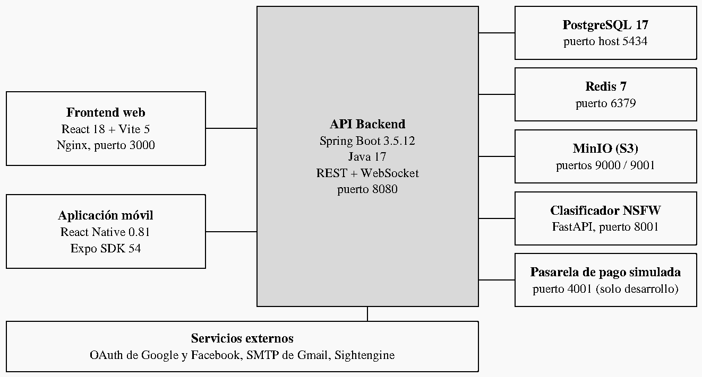
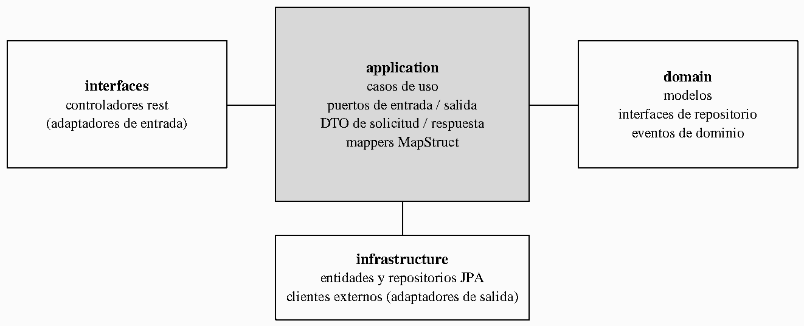
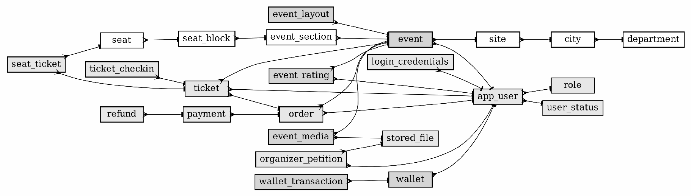
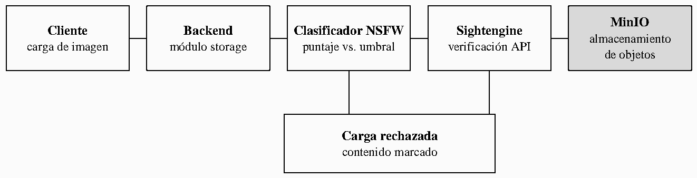

# Technical manual — Tu Evento

> Consolidated Tu Evento document. It gathers the following documents, whose content is kept unchanged; the conversion metadata of each one is in an HTML comment at the start of its section.

**Contents**

1. [Technical manual](#doc-te-0160)

---

<a id="doc-te-0160"></a>

<!--
ruta_anterior: en/09_Manuales/Manual_Tecnico_TuEvento.md
id: TE-0160
title: "Manual_Tecnico_TuEvento"
lang: en
source: 09_Manuales/Manual_Tecnico_TuEvento.pdf
source_sha256: 144ed09c7b2e23ab28904fb3718ab499922e9e124e50a0eb741ec7f6a29124c5
conversion: "pdfplumber 0.11.10 + converter for untagged PDF (method C, pilot 3); without manual review. English translation of md/es: Claude Opus 5.5 (claude-opus-5-5); without manual review"
converted_on: 2026-10-23
fidelity: parcial
losses:
  - "Page header or footer omitted on pages 1–44: «{n}»."
  - "Page 6: figure included as an image (pagina-06-figura-1.png); its text (69 words) goes in a non-visible HTML comment, grouped by box ([...]) from top to bottom and from left to right; arrows and relationships are only in the image."
  - "Page 8: figure included as an image (pagina-08-figura-1.png); its text (40 words) goes in a non-visible HTML comment, grouped by box ([...]) from top to bottom and from left to right; arrows and relationships are only in the image."
  - "Page 30: figure included as an image (pagina-30-figura-1.png); its text (0 words) goes in a non-visible HTML comment, grouped by box ([...]) from top to bottom and from left to right; arrows and relationships are only in the image."
  - "Page 36: figure included as an image (pagina-36-figura-1.png); its text (23 words) goes in a non-visible HTML comment, grouped by box ([...]) from top to bottom and from left to right; arrows and relationships are only in the image."
  - "Words split without a hyphen by the width of the cell joined without a space: @react-native-async-storage/async-storage, jdbc:postgresql://postgres-service:5432/tuevento, postgres-fake-gateway, postgres_fake_gateway_data, postgres-fake-gateway, /api/v1/admin/organizer-requests/{id}/approve, /api/v1/admin/organizer-requests/{id}/reject, /api/v1/admin/organizer-requests/{id}/document, HMAC-SHA256, login_credentials, account_activation, account_lockout, organizer_petition, event_status_log, ticket_checkin, wallet_transaction, wallet_reference."
  - "Manual table of contents (pages 2–4): the page numbers of the original are kept and the leader lines are removed."
  - "Bold, italics and monospaced font are kept; sizes, colours, alignment and indentation are not."
  - "Automatic check against pdftotext: coverage 99.65%, precision 99.24%, order 98.94%; missing {'n': 1, 'stora': 1, 'ge': 1, 'gatew': 1, 'ay': 1, 'gate': 1, 'way': 1, 'ga': 1, 'teway': 1, 'ap': 1, 'prove': 1, 're': 1, 'ject': 1, 'do': 1, 'cument': 1} (explained above)."
  - "Page 36: the diagram of the moderation cascade was split into two crops in an intermediate run; the final version is a single crop with the 6 boxes and their connectors (checked visually)."
  - "Tables 1-37: each «Tabla N» is followed by its table with the same title as the original; rows checked visually in Tables 7 and 24 (PyMuPDF counts physical lines and is not useful as a row reference)."
  - "Order differences: the text of the diagrams is in the comment at the position of the figure (pp. 6, 8 and 36); the rest of the sections keep the order of the original."
  - "Translation: code (paths, commands, variable names, endpoints and the directory trees in code blocks), table and column names and the identifiers split by the width of the PDF cells are kept as in the original."
  - "Translation: the HTML comments with the text of the figures keep the original text and add the English translation after «EN:»."
  - "Translation: the APA citations are translated («s. f.» → «n.d.», «y» → «and»); the titles of the cited works are not translated."
  - "Translation: the paragraphs keep the line division of the original; in English the line ends do not match those of the original."
status: borrador
reviewed_by: ""
translation_of: es/10_Manual_Tecnico.md#doc-te-0160
es_sha256: 7af4f5cb5f62e819dcc4b8ae91e7b1c947f398ea2be1617440325ff77ccb1329
-->

# TuEvento: Technical Manual

Jhampier Santos Ortiz and Cristofer David Lozano Contreras

Servicio Nacional de Aprendizaje (SENA; National Learning Service)

Análisis y Desarrollo de Software (ADSO; Software Analysis and Development), Ficha (training group) 3145556

Instructor: Karol Daniela Correa

9 October 2026

# Table of contents

**Introduction 5**

Purpose 5

Scope 5

Audience 5

Related documents 5

**System architecture 6**

Overview 6

Communication flows 7

Layered structure of the backend 8

**Technology stack 8**

Backend dependencies 10

Dependencies of the web frontend, the mobile application and the auxiliary services 12

**Repository and code organization 14**

General structure 14

Backend modules 15

Frontend organization 16

Directory tree 16

**Backend 17**

Configuration profiles 17

Docker Compose services 17

Environment variables 18

Authentication and authorization 21

WebSocket authentication 22

Error handling 22

**REST API and services 22**

security module 23

event module 25

payment, ticket and wallet modules 27

Other controllers 28

**Database 28**

Engine and access 28

Schema migrations 29

Data model summary 29

Tables by domain 31

**Web frontend 34**

**Mobile application 35**

**Integrations 35**

Login with Google and Facebook 35

Email notifications 35

Object storage 35

Redis 35

Image moderation cascade 36

Payment gateway 36

**Design patterns and technical decisions 37**

Architectural patterns 37

Design patterns 37

Technical decisions 37

**Security 37**

Implemented controls 37

Pending hardening 38

**Testing and quality 39**

Existing tests 39

Continuous integration 39

Kubernetes manifests 40

**Maintenance and extension 41**

Conventions 41

How to add a module to the backend 41

Troubleshooting 41

**Known limitations 42**

**Glossary 42**

**References 43**

# Introduction

## Purpose

This manual documents the architecture, the implementation and the internal operation

of TuEvento, an event management platform developed by the CapySoft team. It is

written for developers, software architects and technical staff who maintain,

extend or operate the system. It describes the system as it exists in the repository of the

project (Santos Ortiz and Lozano Contreras, 2026b).

## Scope

The document covers the architecture of the system, the technology stack and its versions, the

organization of the code, the configuration, the data layer, the integrations, the design

decisions, security, testing and quality practices, and the maintenance and

extension guidelines. The installation and deployment steps are not repeated here; they are described in the

installation manual (Santos Ortiz and Lozano Contreras, 2026a).

## Audience

Backend and frontend developers use this manual to understand the structure

of the code. DevOps staff use it to understand the configuration and the services.

Architects use it to evaluate the technical decisions and testers use it to learn

the functionality that must be verified.

## Related documents

This manual complements the installation manual, the Software Requirements

Specification (SRS), the analysis and design documents and the technical proposal of the project.

# System architecture

## Overview

TuEvento is made up of three decoupled layers (a web frontend, a mobile frontend

and a backend REST API) plus the supporting infrastructure. The services of the platform are

orchestrated with Docker Compose through the `docker-compose.yml` file at the root of the

repository (Docker, Inc., n.d.). Figure 1 shows the components and how they connect, and

Table 1 lists each component with its technology and its port published on the host.

**Figure 1**<br>
*System architecture of TuEvento*



<!-- Texto dentro de la figura (página 6): [API Backend Spring Boot 3.5.12 Java 17 REST + WebSocket puerto 8080] [PostgreSQL 17 puerto host 5434] [Redis 7 puerto 6379] [Frontend web React 18 + Vite 5 Nginx, puerto 3000] [MinIO (S3) puertos 9000 / 9001] [Aplicación móvil React Native 0.81 Expo SDK 54] [Clasificador NSFW FastAPI, puerto 8001] [Pasarela de pago simulada puerto 4001 (solo desarrollo)] [Servicios externos OAuth de Google y Facebook, SMTP de Gmail, Sightengine] EN: Text inside the figure (page 6): [Backend API Spring Boot 3.5.12 Java 17 REST + WebSocket port 8080] [PostgreSQL 17 host port 5434] [Redis 7 port 6379] [Web frontend React 18 + Vite 5 Nginx, port 3000] [MinIO (S3) ports 9000 / 9001] [Mobile application React Native 0.81 Expo SDK 54] [NSFW classifier FastAPI, port 8001] [Simulated payment gateway port 4001 (development only)] [External services Google and Facebook OAuth, Gmail SMTP, Sightengine] -->

*Note.* Our own elaboration based on the docker-compose.yml and the source code of the project. Real-time notifications use WebSocket (STOMP) between the clients and the backend.

**Table 1**<br>
*Platform components and host ports*

| **Component** | **Technology** | **Host port** |
|---|---|---|
| Web frontend | React 18 + Vite 5, served by Nginx in the container | 3000 |
| Mobile frontend | React Native 0.81 / Expo SDK 54 | Not applicable |
| Backend REST API | Spring Boot 3.5.12, source code in Java 17; the Docker image runs a JRE 21 | 8080 |
| Database | PostgreSQL 17 | 5434 (container 5432) |
| Cache | Redis 7 (without a password by default) | 6379 |
| Object storage | MinIO (S3-compatible) | 9000 (API), 9001 (console) |
| Image moderation | NSFW classifier (Python, FastAPI, opennsfw2) | 8001 (container 8000) |
| Sandbox payment gateway | fake-payment-gateway, development and payment flow testing only | 4001 |
| Gateway database | Dedicated PostgreSQL instance | 5435 |
| Continuous integration | GitHub Actions (cloud service) | Not applicable |
| Code quality | SonarQube Cloud (cloud service) | Not applicable |

*Note.* The values were verified against the repository and the installation manual. GitHub Actions and SonarQube Cloud are not needed to run the application.

## Communication flows

The clients authenticate with a login request to the backend and receive

JSON Web Tokens (Jones et al., 2015). The subsequent API calls carry the access

token as a bearer token. Real-time notifications use a WebSocket

connection to the `/ws,` endpoint, authenticated with the token. The images that users upload

go through the moderation cascade described in the Integrations section before being stored

in MinIO. Payments are processed through the payment gateway, which notifies the backend

through a webhook protected by a shared secret (`WEBHOOK_SECRET).`

## Layered structure of the backend

The backend follows a hexagonal architecture (ports and adapters) (Cockburn, 2005)

with domain-oriented modules (Evans, 2003). Each module separates its domain model,

its application use cases, its infrastructure adapters and its input interfaces,

as shown in Figure 2.

**Figure 2**<br>
*Hexagonal structure of a backend module*



<!-- Texto dentro de la figura (página 8): [application casos de uso puertos de entrada / salida DTO de solicitud / respuesta mappers MapStruct] [interfaces controladores rest (adaptadores de entrada)] [domain modelos interfaces de repositorio eventos de dominio] [infrastructure entidades y repositorios JPA clientes externos (adaptadores de salida)] EN: Text inside the figure (page 8): [application use cases input / output ports request / response DTOs MapStruct mappers] [interfaces rest controllers (input adapters)] [domain models repository interfaces domain events] [infrastructure JPA entities and repositories external clients (output adapters)] -->

*Note.* Our own elaboration based on the package structure of com.capysoft.tuevento.modules.

# Technology stack

The following tables summarize the main technologies used in each part of the

system. The versions were taken from the dependency files of the project (Spring, n.

d.-a; React, n.d.; Expo, n.d.).

**Table 2**<br>
*Backend technologies*

| **Area** | **Technology** | **Version / detail** |
|---|---|---|
| Framework | Spring Boot | 3.5.12 |
| Language | Java | 17 (source code); JRE 21 in the Docker image |
| Build | Maven | Maven wrapper (mvnw) |
| Persistence | Spring Data JPA, PostgreSQL, HikariCP | PostgreSQL 17 |
| Migrations | Liquibase | Numbered YAML changelogs |
| Security | Spring Security, jjwt, BCrypt | jjwt 0.12.6; BCrypt cost 12 |
| Social login | OAuth 2.0 (Google, Facebook) | Spring OAuth2 client |
| Real time | Spring WebSocket | STOMP |
| Email | Spring Mail | Gmail SMTP |
| Storage | AWS S3 SDK for MinIO | 2.25.60 |
| Mapping | MapStruct | 1.6.3 |
| API documentation | SpringDoc OpenAPI | 2.8.8 |
| Operation | Spring Boot Actuator | Health and metrics |
| Productivity | Lombok, Bean Validation | Not applicable |

*Note.* Spring Kafka is declared as a dependency, but no producer or consumer was implemented (see Known limitations).

**Table 3**<br>
*Web frontend technologies*

| **Area** | **Technology** | **Version** |
|---|---|---|
| Framework | React | 18.2.0 |
| Build tool | Vite | 5.0.0 |
| Routing | React Router DOM | 6.20.0 |
| Styles | Tailwind CSS | 4.2.2 |
| Icons | Lucide React | 1.7.0 |
| Layout editor | Konva and react-konva | 9.3.22 and 18.2.10 |
| Maps | Leaflet and react-leaflet | 1.9.4 and 4.2.1 |
| Social login | @react-oauth/google | 0.13.5 |
| Real time | @stomp/stompjs and sockjs-client | 7.3.0 and 1.6.1 |
| Dates | date-fns | 3.0.0 |

*Note.* The layout editor uses Konva (Konva, n.d.) and the maps use Leaflet (Leaflet, n.d.).

**Table 4**<br>
*Mobile application technologies*

| **Area** | **Technology** | **Version** |
|---|---|---|
| Framework | React Native and Expo | 0.81.5 and 54.0.33 |
| Library | React | 19.1.0 |
| Navigation | React Navigation | 7.x |
| Styles | NativeWind | 2.0.11 |
| Graphics | @shopify/react-native-skia | 2.11.0 |
| Authentication | Expo Auth Session, jwt-decode | 7.0.10 and 4.0.0 |
| HTTP and forms | Axios, React Hook Form | 1.15.0 and 7.72.1 |

*Note.* The mobile application is not part of the Docker deployment (React Native, n.d.).

The auxiliary services include the NSFW classifier, built with FastAPI

(FastAPI, n.d.) and the opennsfw2 model (bhky, n.d.), and the sandbox payment gateway (fake-payment-gateway), which has its

own PostgreSQL database. The orchestration uses Docker Compose, continuous

integration uses GitHub Actions (GitHub, Inc., n.d.), code analysis uses SonarQube Cloud (SonarSource, n.d.) and

Kubernetes manifests are provided for deployment on a cluster (The Kubernetes

Authors, n.d.).

## Backend dependencies

Table 5 lists the dependencies declared in the backend `pom.xml`, grouped by

function.

**Table 5**<br>
*Backend dependencies (pom.xml)*

| **Group** | **Artifact** | **Version** | **Purpose** |
|---|---|---|---|
| Web and framework | spring-boot-starter-parent | 3.5.12 | Base framework |
|  | spring-boot-starter-web | 3.5.12 | REST API and controllers |
|  | spring-boot-starter-actuator | 3.5.12 | Monitoring and metrics |
|  | spring-boot-starter-websocket | 3.5.12 | WebSocket and STOMP |
| Security | spring-boot-starter-security | 3.5.12 | Authentication and authorization |
|  | spring-boot-starter-oauth2-client | 3.5.12 | OAuth 2.0 (Google, Facebook) |
|  | spring-boot-starter-oauth2-resource-server | 3.5.12 | JWT validation |
|  | jjwt-api, jjwt-impl, jjwt-jackson | 0.12.6 | JWT generation and validation |
| Persistence | spring-boot-starter-data-jpa | 3.5.12 | ORM and JPA repositories |
|  | spring-boot-starter-data-redis | 3.5.12 | Cache and Redis |
|  | postgresql | runtime | PostgreSQL driver |
|  | liquibase-core | — | Database migrations |
|  | spring-session-data-redis | — | Distributed sessions in Redis |
| Messaging | spring-kafka | — | Apache Kafka (unused in the code) |
|  | spring-boot-starter-mail | 3.5.12 | Sending SMTP email |
| Utilities | lombok | — | Reduction of boilerplate code |
|  | mapstruct, mapstruct-processor | 1.6.3 | Mapping between DTOs and entities |
|  | spring-dotenv | 4.0.0 | Loading variables from .env |
|  | software.amazon.awssdk:s3 | 2.25.60 | S3 client for MinIO |
|  | spring-boot-starter-validation | 3.5.12 | Input validations |
| Documentatio n | springdoc-openapi-starter-webmvc-ui | 2.8.8 | OpenAPI and Swagger UI |
| Monitoring | micrometer-tracing-bridge-brave | — | Tracing |
| Testing | spring-boot-starter-test, spring-security-test, spring-kafka-test | test | Testing frameworks |
|  | h2 | test | In-memory database for testing |
|  | jacoco-maven-plugin | 0.8.12 | Code coverage |

*Note.* Source: backend pom.xml. A dash indicates that the pom.xml does not declare an explicit version; in those cases the version is managed by Spring Boot. The groupId of each artifact can be consulted in the pom.xml.

## Dependencies of the web frontend, the mobile application and the auxiliary services

**Table 6**<br>
*Web frontend dependencies (package.json)*

| **Type** | **Package** | **Version** | **Purpose** |
|---|---|---|---|
| dependencies | react, react-dom | ^18.2.0 | Interface library |
|  | react-router-dom | ^6.20.0 | Routing |
|  | @react-oauth/google | 0.13.5 | Login with Google |
|  | @stomp/stompjs, sockjs-client | ^7.3.0, ^1.6.1 | WebSocket client |
|  | konva, react-konva | ^9.3.22, ^18.2.10 | Layout editor |
|  | leaflet, react-leaflet | ^1.9.4, ^4.2.1 | Maps |
|  | date-fns | ^3.0.0 | Date handling |
|  | lucide-react | ^1.7.0 | Icons |
| devDependencies | vite, @vitejs/plugin-react | ^5.0.0, ^4.2.0 | Server and build |
|  | tailwindcss, @tailwindcss/postcss | ^4.2.2 | Styles |
|  | autoprefixer, postcss | ^10.4.27, ^8.5.8 | CSS processing |

*Note.* Source: package.json of TuEventoFrontend/web.

**Table 7**<br>
*Mobile application dependencies (package.json)*

| **Type** | **Package** | **Version** | **Purpose** |
|---|---|---|---|
| dependencies | expo | ~54.0.33 | Development platform |
|  | react, react-native | 19.1.0, 0.81.5 | Native interface |
|  | @react-navigation/native, native-stack, bottom-tabs | ^7.2.2, ^7.14.10, ^7.15.9 | Navigation |
|  | expo-auth-session | ~7.0.10 | Mobile OAuth |
|  | @react-native-async-storage/async-storage | 2.2.0 | Local storage |
|  | @stomp/stompjs, sockjs-client | ^7.3.0, ^1.6.1 | WebSocket client |
|  | axios | ^1.15.0 | HTTP client |
|  | expo-image-picker, expo-document-picker | ~17.0.11, ~14.0.8 | Selection of images and documents |
|  | expo-linear-gradient | ~15.0.8 | Gradients |
|  | react-hook-form, jwt-decode | ^7.72.1, ^4.0.0 | Forms and JWT decoding |
|  | nativewind, @shopify/react-native-skia | ^2.0.11, ^2.11.0 | Styles and 2D graphics |
| devDependencies | typescript, @types/react, babel-preset-expo, tailwindcss | ~5.9.2, ~19.1.10, ~54.0.10, ^3.3.2 | Development tools |

*Note.* Source: package.json of TuEventoFrontend/movil.

**Table 8**<br>
*Dependencies of the auxiliary services*

| **Service** | **Dependency** | **Version** | **Purpose** |
|---|---|---|---|
| NSFW (Python) | fastapi | 0.111.0 | Web API |
|  | uvicorn | 0.30.1 | ASGI server |
|  | pillow | 10.3.0 | Image processing |
|  | opennsfw2 | 0.13.3 | NSFW classifier |
|  | tensorflow | 2.16.2 | Machine learning engine |
| fake-payment-gateway | spring-boot-starter-parent, -web, -data-jpa, -validation | 3.5.0 | REST service with persistence |
|  | postgresql, lombok | runtime, — | Driver and code reduction |

*Note.* Source: requirements.txt of nsfw-service and pom.xml of fake-payment-gateway.

# Repository and code organization

## General structure

The source code of the project is hosted in a public GitHub repository (Santos

Ortiz and Lozano Contreras, 2026b). Table 9 describes its top-level organization.

**Table 9**<br>
*Top-level structure of the repository*

| **Path** | **Content** |
|---|---|
| `TuEventoBackend/tu-evento/` | Spring Boot backend |
| `TuEventoFrontend/web/` | React web frontend |
| `TuEventoFrontend/movil/` | React Native mobile application (Expo) |
| `nsfw-service/` | Image classifier in Python |
| `fake-payment-gateway/` | Sandbox payment gateway |
| `k8s/` | Kubernetes manifests (8 YAML files) |
| `.github/workflows/ci.yml` and `sonar-project.properties` | Continuous integration and quality analysis configuration |
| `docker-compose.yml` | Service orchestration |
| `.env.example` | Environment variables template |

## Backend modules

The base package of the backend is `com.capysoft.tuevento.` The `shared` package contains

the cross-cutting code (global configuration, security, WebSocket configuration and the

global exception handler), and the `modules` package contains the domain modules

listed in Table 10. Within each module, the packages `domain, application,`

`infrastructure` and `interfaces` keep the layers separate.

**Table 10**<br>
*Backend domain modules*

| **Module** | **Responsibility** |
|---|---|
| security | Authentication, users, roles, account activation and password recovery |
| profile | User profiles |
| event | Event life cycle, ratings and comments, media and layouts |
| category | Event categories |
| geolocation | Departments, cities and sites |
| section | Event sections |
| seat | Seats and reservations |
| ticket | Tickets, orders and check-in |
| payment | Payment processing and integration with the gateway |
| wallet | Digital wallet |
| notification | Email and real-time notifications |
| storage | File storage and image handling |
| theme | Interface themes |
| language | Internationalization |

*Note.* The names of the modules correspond to the directories under<br>
src/main/java/com/capysoft/tuevento/modules.

## Frontend organization

The web frontend keeps its code in `src/` with the directories `assets, components,`

`constants, context, data, hooks, layouts, pages, services, styles, theme` and `utils.` The

global state is provided by React context providers for authentication, theme and

notifications. The `services` directory contains the API clients, with `httpClient.js`

as the shared HTTP client. The mobile application follows a similar organization, with

`navigation/AppNavigator.jsx` for navigation, `screens` for the screens and

`services/api.js` as the base API client.

## Directory tree

The following trees show the real structure of the backend, the web frontend, the

mobile application and the auxiliary services.

Backend (src/main/java/com/capysoft/tuevento):

```text
TuEventoApplication.java
modules/
  category/  event/  geolocation/  language/  notification/
  payment/   profile/  seat/  section/  security/
  storage/   theme/  ticket/  wallet/
shared/
  domain/  infrastructure/  interfaces/
```

Web frontend (TuEventoFrontend/web/src):

```text
App.jsx  main.jsx
assets/  components/  constants/  context/  data/
hooks/  layouts/  pages/  services/  styles/  theme/  utils/
```

Mobile application (TuEventoFrontend/movil/src):

```text
assets/  components/  context/  hooks/  navigation/
screens/  services/  theme/  utils/
```

Auxiliary services:

```text
nsfw-service/
  app.py  requirements.txt  Dockerfile  models/ (se descargan en ejecución)
fake-payment-gateway/
  src/main/java/com/capysoft/fakepaymentgateway/
  pom.xml  Dockerfile  README.md
```

# Backend

## Configuration profiles

The backend uses Spring profiles. The files

`application-dev.yml` (local development) and `application-k8s.yml` (Kubernetes) are provided, and the active

profile is selected with `SPRING_PROFILES_ACTIVE.` Table 11 summarizes the main

parameters of each profile.

**Table 11**<br>
*Main parameters of the configuration profiles*

| **Parameter** | **dev profile** | **k8s profile** |
|---|---|---|
| Server port | 8080 (configurable with SERVER_PORT) | 8080 |
| Access token lifetime | 900000 ms (15 minutes) | — |
| Refresh token lifetime | 604800000 ms (7 days) | — |
| CORS origins | http://localhost:3000, http://localhost:5173 | Variable CORS_ALLOWED_ORIGINS |
| Maximum file / request size | 10 MB / 12 MB | — |
| Database | According to SPRING_DATASOURCE_URL | jdbc:postgresql://postgres-service:5432/tuevento |
| MinIO (internal endpoint) | http://minio:9000 | http://minio-service:9000 |
| MinIO (public URL) | http://localhost:9000 (configurable) | — |
| Default bucket | tuevento | — |
| Email | smtp.gmail.com, port 587 | — |
| Redis | Host redis or localhost, port 6379 | — |
| Hibernate ddl-auto | — | none |
| Health endpoint | — | Health only, without details |

*Note.* Source: application-dev.yml and application-k8s.yml. A dash indicates that the parameter is not defined in that profile or was not verified.

## Docker Compose services

Table 12 lists the services defined by the `docker-compose.yml,` file, with their

images, ports and volumes.

**Table 12**<br>
*Services defined in docker-compose.yml*

| **Service** | **Image or build** | **Ports** | **Volume** | **Depends on** |
|---|---|---|---|---|
| postgres | postgres:17-alpine | 5434:5432 | postgres_data | — |
| postgres-fake-gateway | postgres:17-alpine | 5435:5432 | postgres_fake_gateway_data | — |
| redis | redis:7-alpine | 6379:6379 | redis_data | — |
| minio | quay.io/minio/minio:latest | 9000:9000, 9001:9001 | minio_data | — |
| minio-init | quay.io/minio/minio:latest | — | — | minio |
| nsfw-classifier | build: ./nsfw-service | 8001:8000 | — | — |
| fake-payment-gate way | build: ./fake-payment-gateway | 4001:4001 | — | postgres-fake-gateway |
| backend | build: ./TuEventoBackend/t u-evento | 8080:8080 | — | postgres, redis, minio, nsfw-classifier |

*Note.* Source: docker-compose.yml.

## Environment variables

The backend reads its configuration from environment variables defined in the `.env,` file,

which is created from `.env.example.` Table 13 lists the variables of the template with their

description. The real values must never be included in the repository.

**Table 13**<br>
*Environment variables of the template*

| **Variable** | **Purpose** |
|---|---|
| `POSTGRES_DB / USER / PASSWORD` | Name of the database (tuevento_db), user and password |
| `MAIL_USERNAME / MAIL_PASSWORD` | Gmail account and application password used to send email |
| `JWT_SECRET` | HMAC-SHA256 signing key, of at least 256 bits |
| `GOOGLE_CLIENT_ID / SECRET` | Google OAuth 2.0 credentials |
| `VITE_GOOGLE_CLIENT_ID` | Google Client ID used by the web frontend |
| `FACEBOOK_CLIENT_ID / SECRET` | Facebook OAuth credentials |
| `ADMIN_EMAIL / PASSWORD / ALIAS` | Initial administrator account |
| `MINIO_ROOT_USER / PASSWORD` | MinIO administrator credentials |
| `REDIS_HOST / REDIS_PORT` | Connection to Redis |
| `SPRING_PROFILES_ACTIVE` | Active Spring profile (dev) |
| `NSFW_SERVICE_URL / NSFW_THRESHOLD` | Address of the NSFW classifier and decision threshold |
| `SIGHTENGINE_API_USER / API_SECRET` | Sightengine API credentials |
| `SIGHTENGINE_MODELS / THRESHOLD` | Sightengine models verified and decision threshold |
| `NOTIFICATION_EMAIL_ENABLED` | Enables or disables email notifications |
| `NOTIFICATION_MAIL_HOST / PORT /` `USERNAME / PASSWORD` | SMTP configuration for notifications (smtp.gmail.com, 587) |

*Note.* In the template, NSFW_SERVICE_URL points to the address of the Docker network; when the backend runs outside Docker it must point to the published port (http://localhost:8001). The variables that are not in the template are listed in the installation manual.

In addition to the variables of the template, the code reads other variables that have a

default value and can be overridden (Table 14). The default values of the code may

differ from those of the template; for example, the template uses `NSFW_THRESHOLD=0.6` and

`SIGHTENGINE_MODELS=gore,` while the code uses 0.4 and `gore,nudity,weapon` if the

variable is not defined.

**Table 14**<br>
*Additional variables read by the code*

| **Variable** | **Default value** | **Description** |
|---|---|---|
| `SPRING_DATASOURCE_URL` | jdbc:postgresql://localhost:5432/${ POSTGRES_DB} | Database connection URL |
| `SERVER_PORT` | 8080 | Backend port |
| `APP_OAUTH_GOOGLE_REDIREC` `T_URI` | http://localhost:8080 | Google callback URI |
| `APP_OAUTH_FACEBOOK_REDIR` `ECT_URI` | http://localhost:8080 | Facebook callback URI |
| `OAUTH_FRONTEND_REDIRECT_` `URIS` | http://localhost:3000/login | Frontend URI after the OAuth flow |
| `APP_STORAGE_ENDPOINT` | http://localhost:9000 | MinIO endpoint used by the backend |
| `MINIO_PUBLIC_URL` | http://localhost:9000 | Public MinIO URL |
| `NSFW_SERVICE_URL` | http://localhost:8001 | URL of the NSFW classifier |
| `NSFW_THRESHOLD` | 0.4 | Threshold of the NSFW classifier |
| `SIGHTENGINE_MODELS` | gore,nudity,weapon | Sightengine models |
| `SIGHTENGINE_THRESHOLD` | 0.4 | General Sightengine threshold |
| `SIGHTENGINE_NUDITY_THRES` `HOLD` | 0.15 | Sightengine nudity threshold |
| `PAYMENT_GATEWAY` | fake | Payment gateway used |
| `FAKE_GATEWAY_URL` | http://localhost:4001 | URL of the sandbox gateway |
| `WEBHOOK_SECRET` | Development default value | Secret of the payment webhook |
| `APP_CORS_ALLOWED_ORIGINS` | http://localhost:3000, http://localhost:5173 | Allowed CORS origins |
| `CORS_ALLOWED_ORIGINS` | http://localhost:3000 | CORS origins in the k8s profile |
| `APP_PROFILE_DEFAULT_AVAT` `AR_ID` | 1 | Identifier of the default avatar |

*Note.* Source: backend configuration files.

## Authentication and authorization

The backend authenticates users with JSON Web Tokens (Jones et al., 2015)

signed with HMAC-SHA256 using the `JWT_SECRET,` key, and issues refresh tokens so that

the clients can renew their sessions. Passwords are stored as BCrypt hashes

with cost 12. The security module also keeps a password history, so

that a new password can be compared with the previous ones when the user changes it.

Social login with Google and Facebook follows the OAuth 2.0 authorization framework

(Hardt, 2012).

Authorization is role-based. Liquibase (changelog 017) inserts the three roles of the

system and the user statuses listed in Table 15; the migrations do not create any

user. The initial administrator is created at startup through the `DataInitializer` class from

the `ADMIN_*` variables (Spring, n.d.-b).

**Table 15**<br>
*System roles and user statuses*

| **Element** | **Values** | **Description** |
|---|---|---|
| Roles | ADMIN | Full access to the system |
|  | ORGANIZER | Creates and manages events |
|  | USER | Regular user of the platform |
| User statuses | PENDING, ACTIVE, BLOCKED, INACTIVE, DELETED | Account life cycle |

*Note.* Source: Liquibase changelog 017-insert-initial-roles-and-user-status.yaml.

The access token lasts 15 minutes (900000 ms) and the refresh token lasts 7 days

(604800000 ms), according to `application-dev.yml.` The refresh token rotates on each use: when renewing

the session a new pair is issued and the previous one is no longer valid (`RefreshTokenUseCase).` For

login, the system counts the failed attempts in its own table

(`account_lockout):` after 5 failed attempts within a 15-minute window the account is

temporarily locked (`LoginUseCase).`

## WebSocket authentication

Real-time connections are authenticated during the handshake through the

`JwtHandshakeInterceptor.` class. The client sends the access token as the query parameter

`token` of the `/ws,` URL, because the browser's WebSocket API does not allow custom

headers. The interceptor validates the token, stores the user's identifier in the

session attributes and rejects the connection with an unauthorized response when the

token is not valid. The configuration is in `WebSocketConfig.java:` the endpoint is `/ws`

(STOMP over SockJS), the seat reservation notifications are published on

`/topic/events/{eventId}/seats` and personal notifications arrive through

`/user/queue/notifications.` The web and mobile clients use `@stomp/stompjs` and

`sockjs-client.`

## Error handling

Business rule violations are thrown as exceptions that carry an error

code, and a global exception handler in the `shared` package converts them into

consistent HTTP responses. For example, publishing two comments on the same event

within the allowed interval produces the code `COMMENT_RATE_LIMITED.` This comment

limit (ten seconds between comments) is the only rate limit implemented

in the system.

# REST API and services

The backend API is published under the prefix `/api/v1.` This section documents the

endpoints of the controllers of the security, event, payment, ticket and wallet modules,

indicating the HTTP method, the route, a brief description and the required role. The remaining

controllers are listed in Table 22; the interactive documentation of all the endpoints is

available in the Swagger UI interface generated by SpringDoc OpenAPI.

## security module

**Table 16**<br>
*AuthController endpoints*

| **Method** | **Route** | **Description** | **Required** **role** |
|---|---|---|---|
| POST | `/api/v1/auth/register` | Register a new account | Public |
| POST | `/api/v1/auth/activate` | Activate the account with the code | Public |
| POST | `/api/v1/auth/login` | Log in with email and password | Public |
| POST | `/api/v1/auth/logout` | Log out and revoke the token | Public |
| POST | `/api/v1/auth/refresh` | Renew the access token | Public |
| POST | `/api/v1/auth/recover-password` | Request the recovery code | Public |
| POST | `/api/v1/auth/reset-password` | Reset the password with the code | Public |
| GET | `/api/v1/auth/oauth/{provider}` | Redirect to the OAuth provider | Public |
| GET | `/api/v1/auth/oauth/{provider}/callback` | OAuth provider callback | Public |
| POST | `/api/v1/auth/google` | Authenticate with a Google ID Token | Public |
| POST | `/api/v1/auth/resend-activation` | Resend the activation code | Public |
| POST | `/api/v1/auth/reactivate-request` | Request the reactivation of the account | Public |
| POST | `/api/v1/auth/reactivate-confirm` | Confirm the reactivation | Public |
| GET | `/api/v1/auth/dev/activate-code/{email}` | Get the activation code (development only) | Public |

*Note.* Source: AuthController.java, security module.

**Table 17**<br>
*UserController endpoints*

| **Method** | **Route** | **Description** | **Required** **role** |
|---|---|---|---|
| POST | `/api/v1/users/change-password` | Change the password | USER |
| POST | `/api/v1/users/oauth/link` | Link an OAuth account | USER |
| POST | `/api/v1/users/organizer-request` | Request to be an organizer | USER |
| GET | `/api/v1/users/organizer-petition` | Query the status of the request | USER |
| DELETE | `/api/v1/users/me` | Deactivate your own account | USER |

*Note.* Source: UserController.java, security module.

**Table 18**<br>
*AdminController endpoints*

| **Method** | **Route** | **Description** | **Required** **role** |
|---|---|---|---|
| GET | `/api/v1/admin/organizer-requests` | List the organizer requests | ADMIN |
| PUT | `/api/v1/admin/organizer-requests/{id}/approve` | Approve a request | ADMIN |
| PUT | `/api/v1/admin/organizer-requests/{id}/reject` | Reject a request | ADMIN |
| GET | `/api/v1/admin/organizer-requests/{id}/document` | Get the URL of the attached document | ADMIN |
| GET | `/api/v1/admin/events` | List all the events | ADMIN |
| PATCH | `/api/v1/admin/events/{eventId}/status` | Change the status of an event | ADMIN |

*Note.* Source: AdminController.java, security module.

## event module

**Table 19**<br>
*EventController endpoints*

| **Method** | **Route** | **Description** | **Required** **role** |
|---|---|---|---|
| POST | `/api/v1/events` | Create an event | ORGANIZER |
| GET | `/api/v1/events/{eventId}` | Get an event by identifier | Public |
| GET | `/api/v1/events/user/{userId}` | List the events of a user | Public |
| GET | `/api/v1/events/status/{status}` | List events by status | Public |
| PUT | `/api/v1/events/{eventId}` | Update an event | ORGANIZER |
| DELETE | `/api/v1/events/{eventId}` | Delete an event | ORGANIZER |
| PATCH | `/api/v1/events/{eventId}/status` | Change the status of an event | ORGANIZER |
| GET | `/api/v1/events/public` | List public events | Public |
| GET | `/api/v1/events/public/city/{cityId}` | Public events by city | Public |
| GET | `/api/v1/events/public/category/{category` `Id}` | Public events by category | Public |
| GET | `/api/v1/events/public/date-range` | Public events by date range | Public |

*Note.* Source: EventController.java, event module.

**Table 20**<br>
*Endpoints for ratings, replies, layout and media*

| **Method** | **Route** | **Description** | **Required** **role** |
|---|---|---|---|
| POST | `/api/v1/events/{eventId}/ratings` | Add a rating or comment | USER |
| GET | `/api/v1/events/{eventId}/ratings` | List the comments of an event | Public |
| DELETE | `/api/v1/events/{eventId}/ratings/{rating` `Id}` | Delete your own comment | USER |
| PATCH | `/api/v1/events/{eventId}/ratings/{rating` `Id}` | Edit your own comment | USER |
| POST | `/api/v1/ratings/{ratingId}/replies` | Add a reply | USER |
| GET | `/api/v1/ratings/{ratingId}/replies` | List the replies | Public |
| GET | `/api/v1/events/{eventId}/layout` | Get the layout of the event | Public |
| PUT | `/api/v1/events/{eventId}/layout` | Create or update the layout | ORGANIZER |
| POST | `/api/v1/events/{eventId}/media` | Upload media of the event | ORGANIZER or ADMIN |
| GET | `/api/v1/events/{eventId}/media` | Get the media of the event | Public |

*Note.* Source: EventRatingController, EventCommentController, EventLayoutController and

EventMediaController.

## payment, ticket and wallet modules

**Table 21**<br>
*Payment, ticket and wallet endpoints*

| **Method** | **Route** | **Description** | **Required** **role** |
|---|---|---|---|
| POST | `/api/v1/payments` | Create a payment | USER |
| GET | `/api/v1/payments/{id}` | Get a payment by identifier | USER |
| POST | `/api/v1/payments/{id}/refund` | Request a refund | ADMIN or ORGANIZER |
| POST | `/api/v1/webhooks/payment` | Payment gateway webhook | Public,HMAC-SHA256 signature |
| GET | `/api/v1/tickets/{ticketId}` | Get a ticket by identifier | USER |
| GET | `/api/v1/tickets/user/{userId}` | List the tickets of a user | USER |
| POST | `/api/v1/tickets/{ticketId}/checkin` | Record the check-in of a ticket | ORGANIZER or ADMIN |
| GET | `/api/v1/wallet/me` | Query your own balance | USER |
| GET | `/api/v1/wallet/me/transactions` | Query the transaction history | USER |
| POST | `/api/v1/wallet/credit` | Credit balance | ADMIN |
| POST | `/api/v1/wallet/adjust` | Administrative balance adjustment | ADMIN |

*Note.* Source: PaymentController, WebhookController, TicketController and WalletController.

## Other controllers

**Table 22**<br>
*Additional backend controllers*

| **Module** | **Controllers** |
|---|---|
| ticket | OrderController |
| category | CategoryController, CategoryEventController |
| theme | ThemeController |
| language | LanguageController |
| notification | NotificationController |
| profile | ProfileController |
| seat | SeatController, SeatReservationController, SeatBlockController |
| section | SectionTypeController, EventSectionController |
| storage | StorageController |
| geolocation | GeolocationController |

*Note.* Source: interfaces/rest directories of each module. Their endpoints can be consulted in Swagger UI.

# Database

## Engine and access

The system uses PostgreSQL 17 (PostgreSQL Global Development Group, n.d.). The main

database is called `tuevento_db` and is published on port 5434 of the host (port 5432

of the container). The payment gateway uses a separate PostgreSQL instance on port

5435.

## Schema migrations

The schema is created and evolves with Liquibase (Liquibase, n.d.). The master changelog

is `db/changelog/db.changelog-master.yaml` and each change is a numbered YAML

file in `db/changelog/changes/,` for example

`001-create-user-status-table.yaml, 004-create-user-table.yaml,`

`010-create-refresh-token-table.yaml,` 012 (password history), 017 (initial roles and

statuses), `039-create-event.yaml, 064-create-order-table.yaml` and

`074-create-wallet-table.yaml.` The changelogs are the authoritative definition of each table,

column, constraint and index.

## Data model summary

Table 23 groups the main entities by domain. The definitions of

columns, constraints and indexes are in the Liquibase changelogs.

**Table 23**<br>
*Main entities by domain*

| **Domain** | **Main entities** |
|---|---|
| Security | User, user status, role, refresh token, password history, account activation, organizer request |
| Events | Event, event media, event rating |
| Geolocation and categories | Department, city, site, category |
| Seats | Event section, seat block, seat |
| Tickets | Order, ticket, ticket check-in |
| Payments and wallet | Payment, refund, wallet, wallet transaction |

*Note.* The names of the entities follow the domain modules. The exact names of the tables are detailed in the tables by domain of this section.

The schema is defined in 90 changelogs numbered from 001 to 090 in

`db/changelog/changes/.` Figure 3 shows the relationships between the main tables and

Tables 24 to 30 detail, by domain, the main columns, the foreign keys and the

constraints.

**Figure 3**<br>
*Entity-relationship diagram of the main tables*



*Note.* Our own elaboration based on the Liquibase changelogs. Each line joins a table with the foreign key (crow's foot end, many side) with the table it references (bar end, one side). The main tables are shown; the rest are described in the tables by domain.

## Tables by domain

**Table 24**<br>
*Security domain: main tables*

| **Table** | **Main columns** | **Foreign keys** | **Constraints** |
|---|---|---|---|
| `app_user` | user_id (PK), user_status_id, role_id, alias, activated | user_status_id to user_status; role_id to role | alias unique, not null |
| `login_credentials` | credential_id (PK), user_id, email, password_hash | user_id to app_user | email unique, not null |
| `account_activation` | activation_id (PK), user_id, activation_code, expires_at | user_id to app_user | activation_code unique |
| `account_lockout` | account_lockout_id (PK), user_id, failed_attempts, window_started_at, locked_until | user_id to app_user | failed_attempts greater than or equal to 0 |
| `organizer_petition` | petition_id (PK), user_id, stored_file_id, status | user_id to app_user; stored_file_id to stored_file | user_id unique |

*Note.* Source: Liquibase changelogs.

**Table 25**<br>
*Event domain: main tables*

| **Table** | **Main columns** | **Foreign keys** | **Constraints** |
|---|---|---|---|
| `event` | event_id (PK), user_id, site_id, event_name, start_date, finish_date, status | user_id to app_user; site_id to site | finish_date greater than start_date; status in DRAFT, PUBLISHED, CANCELLED, COMPLETED |
| `event_layout` | layout_id (PK), event_id, layout_data | event_id to event | event_id unique |
| `event_media` | media_id (PK), event_id, stored_file_id, img_url | event_id to event; stored_file_id to stored_file | Not null |
| `event_rating` | rating_id (PK), event_id, user_id, rating, comment, parent_rating_id | event_id to event; user_id to app_user | rating between 1 and 5 |
| `event_status_log` | log_id (PK), event_id, status, reason, changed_by | event_id to event | Cascade deletion |

*Note.* Source: Liquibase changelogs.

**Table 26**<br>
*Geolocation domain: main tables*

| **Table** | **Main columns** | **Foreign keys** | **Constraints** |
|---|---|---|---|
| `department` | department_id (PK), name, country_code | — | name not null |
| `city` | city_id (PK), department_id, name, postal_code | department_id to department | name not null |
| `site` | site_id (PK), city_id, name, address, latitude, longitude | city_id to city | name not null |

*Note.* Source: Liquibase changelogs.

**Table 27**<br>
*Seat and Section domain: main tables*

| **Table** | **Main columns** | **Foreign keys** | **Constraints** |
|---|---|---|---|
| `event_section` | section_id (PK), event_id, section_type_id, name, price | event_id to event; section_type_id to section_type | price greater than or equal to 0 |
| `seat_block` | block_id (PK), section_id, name, rows, columns | section_id to event_section | rows and columns greater than 0 |
| `seat` | seat_id (PK), block_id, row_number, seat_number, status, reserved_until | block_id to seat_block | status in AVAILABLE, RESERVED, OCCUPIED, BLOCKED |
| `seat_log` | log_id (PK), seat_id, previous_status, new_status, user_id | seat_id to seat; user_id to app_user | Not null |

*Note.* Source: Liquibase changelogs.

**Table 28**<br>
*Ticket domain: main tables*

| **Table** | **Main columns** | **Foreign keys** | **Constraints** |
|---|---|---|---|
| `order` | order_id (PK), user_id, event_id, total_amount, currency, status | user_id to app_user; event_id to event | status in DRAFT, P AYMENT_PENDI NG, PAID, CANCELLED, REFUNDED, USED |
| `ticket` | ticket_id (PK), order_id, user_id, event_id, ticket_code, price, status | order_id to order; user_id to app_user; event_id to event | ticket_code unique |
| `seat_ticket` | seat_ticket_id (PK), ticket_id, seat_id | ticket_id to ticket; seat_id to seat | Unique (ticket_id, seat_id) |
| `ticket_checkin` | checkin_id (PK), ticket_id, checkin_time, validated_by | ticket_id to ticket | ticket_id unique |

*Note.* Source: Liquibase changelogs.

**Table 29**<br>
*Payment domain: main tables*

| **Table** | **Main columns** | **Foreign keys** | **Constraints** |
|---|---|---|---|
| `payment` | payment_id (PK), order_id, amount, currency, status, wallet_amount | order_id to order | amount and wallet_amount greater than or equal to 0 |
| `payment_log` | log_id (PK), payment_id, previous_status, new_status | payment_id to payment | Not null |
| `refund` | refund_id (PK), payment_id, amount, reason, status | payment_id to payment | amount greater than 0 |

*Note.* Source: Liquibase changelogs.

**Table 30**<br>
*Wallet domain: main tables*

| **Table** | **Main columns** | **Foreign keys** | **Constraints** |
|---|---|---|---|
| `wallet` | wallet_id (PK), user_id, balance, currency, version | user_id to app_user | user_id unique; balance greater than or equal to 0; currency in COP |
| `wallet_transaction` | transaction_id (PK), wallet_id, amount, transaction_type, reference_id | wallet_id to wallet; reference_id to wallet_reference | amount different from 0 |
| `wallet_reference` | reference_id (PK), entity_type, entity_id, description | — | entity_type not null |

*Note.* Source: Liquibase changelogs.

# Web frontend

The web frontend is a single-page application built with React and Vite. The

global state is handled with React context providers for authentication, theme and

notifications, and the local state with React hooks. Routing uses React Router, with

protected routes for authenticated users, organizers and administrators.

All the API calls go through the shared HTTP client, `httpClient.js,`

which attaches the access token and renews it when the backend reports that it has expired. The notification

context opens the WebSocket connection with the token as a query parameter and

delivers the real-time messages to the interface.

Two specialized components are worth highlighting. The event layout editor

(`EventLayoutEditor.jsx)` allows organizers to design the seat distribution of

a venue on a Konva canvas, and the layout is stored as JSON together with the event.

The map components use Leaflet to show the locations of the events. Login

with Google uses the @react-oauth/google library with the Client ID defined in

`VITE_GOOGLE_CLIENT_ID.` As Vite embeds the `VITE_*` variables at build

time, the Docker image must be rebuilt when they change.

# Mobile application

The mobile application uses Expo SDK 54 and React Native 0.81, with React Navigation for

stack and tab navigation. Its backend address is read from `EXPO_PUBLIC_API_URL`

in the mobile `.env` file, together with `EXPO_PUBLIC_GOOGLE_CLIENT_ID,`

`EXPO_PUBLIC_FACEBOOK_APP_ID` and `EXPO_PUBLIC_MINIO_HOST.` The API address must

use the local IP address of the development machine, never `localhost.`

The base API client is `services/api.js.` The WebSocket service

(`websocketService.js)` derives its URL from the same variable by removing the `/api/v1.` suffix.

The application includes a QR scanner screen used for the check-in of tickets.

# Integrations

## Login with Google and Facebook

The backend supports OAuth 2.0 login with Google and Facebook (Hardt, 2012).

Once the provider confirms the identity of the user, the backend creates or links a

local account and returns its own tokens. The credentials are supplied through the

`GOOGLE_*` and `FACEBOOK_*.` variables.

## Email notifications

Emails are sent through Gmail SMTP (host `smtp.gmail.com,` port 587)

using an application password instead of the personal password of the account. Sending

can be disabled with `NOTIFICATION_EMAIL_ENABLED=false` during testing.

## Object storage

The uploaded files and images are stored in MinIO (MinIO, Inc., n.d.) through

the AWS S3 SDK. The public URL used to serve the files is defined in

`MINIO_PUBLIC_URL` and the backend accesses the service through `APP_STORAGE_ENDPOINT.`

## Redis

Redis 7 (Redis, n.d.) runs without a password in the development profile. The backend

connects through `REDIS_HOST` and `REDIS_PORT.`

## Image moderation cascade

Images are checked in two stages before being stored (Figure 4). First, the

local NSFW classifier returns a score that is compared with `NSFW_THRESHOLD.` The

images that pass are then checked with the Sightengine API (Sightengine, n.d.) using

the models configured in `SIGHTENGINE_MODELS` and the threshold `SIGHTENGINE_THRESHOLD.`

Only the images that pass both checks are stored in MinIO.

**Figure 4**<br>
*Image moderation cascade*



<!-- Texto dentro de la figura (página 36): [Cliente carga de imagen] [Backend módulo storage] [Clasificador NSFW puntaje vs. umbral] [Sightengine verificación API] [MinIO almacenamiento de objetos] [Carga rechazada contenido marcado] EN: Text inside the figure (page 36): [Client image upload] [Backend storage module] [NSFW classifier score vs. threshold] [Sightengine API check] [MinIO object storage] [Upload rejected flagged content] -->

*Note.* Our own elaboration based on the moderation configuration and the SightengineAdapter class.

## Payment gateway

In development, payments are processed by the sandbox payment gateway (fake-payment-gateway service), an

independent service with its own database for testing the payment flow, which calls the

backend back through a webhook. The gateway is selected with `PAYMENT_GATEWAY` (default

`fake)` and its address with `FAKE_GATEWAY_URL.` The sandbox gateway does not process real payments and must not be used in production.

# Design patterns and technical decisions

## Architectural patterns

The backend applies a hexagonal architecture: the input ports define the use

cases, the output ports define what the application needs from the outside and the adapters

implement them (Cockburn, 2005). Domain-driven design guides the division into

modules, where each module owns its domain model and its persistence (Evans, 2003). The

result is a modular monolith whose modules have clear boundaries.

## Design patterns

The code uses the Repository pattern (domain interfaces implemented by

JPA adapters), the Adapter pattern for external services such as MinIO, the NSFW

classifier and Sightengine, the Builder pattern through Lombok, and mapper components generated

by MapStruct to convert between entities, domain models and DTOs. The selection of the

payment gateway through configuration follows the Strategy pattern.

## Technical decisions

Stateless authentication with JWT keeps the backend free of session state on

the server. Refresh tokens make it possible to use short-lived access tokens.

WebSocket authentication uses a query parameter because browsers cannot

send custom headers during the handshake. Image moderation is

divided into a local classifier and a remote API so that obviously inappropriate content

is filtered locally before calling the remote service.

# Security

## Implemented controls

Table 31 summarizes the security controls present in the system.

**Table 31**<br>
*Implemented security controls*

| **Control** | **Description** |
|---|---|
| Token authentication | JWT signed with HMAC-SHA256 and refresh tokens |
| Password protection | BCrypt hash (cost 12) and history check when changing it |
| Role-based authorization | ADMIN, ORGANIZER and USER roles |
| Account lockout | Temporary lockout after 5 failed attempts in a 15-minute window |
| Token lifetime | Access token of 15 minutes; refresh token of 7 days with rotation on each use |
| Account statuses | PENDING, ACTIVE, BLOCKED, INACTIVE and DELETED |
| WebSocket handshake validation | Token validated before accepting the connection |
| CORS | Allowed origins configured with APP_CORS_ALLOWED_ORIGINS |
| Comment limit | Ten seconds between comments of the same user |
| Image moderation | Two-stage cascade before storage |
| Secret management | Secrets in .env files excluded from version control |

## Pending hardening

The default configuration is intended for development. Table 32 lists the points

that must be addressed before exposing the system to the Internet.

**Table 32**<br>
*Hardening required before production*

| **Element** | **Current status** | **Action** |
|---|---|---|
| Actuator | All endpoints public | Expose only health and info, or restrict by network |
| Swagger / OpenAPI | Public | Disable or restrict |
| Redis | Without a password | Require a password |
| WEBHOOK_SECRET | Known default value | Define a private secret |
| Sandbox payment gateway | Development and testing only | Configure a real gateway |
| Endpoint /api/v1/auth/dev/a ctivate-code/{email} | Public; described as development only | Confirm that it only exists with the dev profile or remove it before production |
| Transport security | HTTP in local configurations | Use HTTPS through a reverse proxy |

*Note.* Source: security notes of the installation manual (Santos Ortiz and Lozano Contreras, 2026a).

At the time of writing this document, the code does not contain an HTML

sanitization component, a Content Security Policy configuration or a global request

rate limit.

# Testing and quality

## Existing tests

There are automated tests only for the backend. They are unit tests located in

`src/test/java/com/capysoft/tuevento/modules/` for the event, security and

notification modules (Table 33).There are no test files in the web frontend. In total there are 15

Java files in `src/test,` of which 14 are test classes (names ending in Test

or Tests). The backend includes H2 as an in-memory database for testing and the

JaCoCo 0.8.12 plugin to measure coverage.

**Table 33**<br>
*Backend unit tests*

| **Module** | **Test classes** |
|---|---|
| event | AddEventRatingServiceTest, AdminChangeEventStatusUseCaseTest, ChangeEventStatusServiceTest, DeleteEventRatingServiceTest, EditEventRatingServiceTest |
| security | Authentication tests |
| notification | Notification tests |

*Note.* The rating tests verify, among other rules, the ten-second limit between comments.

## Continuous integration

Continuous integration runs on GitHub Actions with the `.github/workflows/ci.yml` workflow,

which is triggered on every push or pull request to the `main` and `develop` branches and runs the jobs

of Table 34. The quality analysis is performed by SonarQube Cloud, configured in

`sonar-project.properties`; its results can be viewed at https://sonarcloud.io/project/overview?id=lozano2303_TuEvento.

**Table 34**<br>
*GitHub Actions workflow jobs*

| **Job** | **Action** |
|---|---|
| Backend (tests + SonarQube) | `./mvnw -B verify` (tests and coverage with JaCoCo) and analysis in SonarQube Cloud |
| Web (build) | `npm ci` and `npm run build` |
| Móvil (bundle Expo) | `npm ci` and `npx expo export --platform android` |

## Kubernetes manifests

The `k8s/` directory contains 8 manifests to deploy the system on a cluster (Table

35).The images are taken from Docker Hub (`jhampier23/tu-evento)`; the continuous integration workflow does not build or publish them.

**Table 35**<br>
*Kubernetes manifests*

| **File** | **Purpose** |
|---|---|
| `deployment.yaml` | Deployment of the Spring Boot backend |
| `frontend-deployment.yaml` | Deployment of the React frontend |
| `service.yaml` | Service of the backend (ClusterIP) |
| `frontend-service.yaml` | Service of the frontend (ClusterIP) |
| `ingress.yaml` | Nginx Ingress (api.tuevento.com and app.tuevento.com) |
| `configmap.yaml` | ConfigMap with configuration variables |
| `secrets.yaml` | Secrets with sensitive variables |
| `hpa.yaml` | Horizontal Pod Autoscaler |

*Note.* Source: k8s/ directory of the repository.

# Maintenance and extension

## Conventions

Java classes use PascalCase, methods and variables use camelCase and

constants use UPPER_SNAKE_CASE. The API endpoints use the prefix `/api/v1` and

plural nouns for collections. React components use PascalCase and

utilities use camelCase. Commit messages must follow the Conventional

Commits format.

## How to add a module to the backend

To add a module, create a package under `modules` with the four layers (`domain,`

`application, infrastructure` and `interfaces),` following the structure of Figure 2. Define

first the domain model and the repository interface, then the use cases and the

ports, then the JPA entity and the repository adapter, and finally the REST

controller. Each change in the tables must be a new numbered Liquibase changelog

added to the master changelog; existing changelogs must not be edited once applied.

## Troubleshooting

Common installation and execution problems, such as port conflicts, Liquibase

connection errors, CORS errors, email authentication failures and mobile

connection problems, are documented with their solutions in the troubleshooting section of the

installation manual (Santos Ortiz and Lozano Contreras, 2026a).

# Known limitations

**Table 36**<br>
*Known limitations of the current version*

| **Area** | **Limitation** |
|---|---|
| Messaging | Spring Kafka is declared as a dependency, but no producer or consumer was implemented |
| Payments | The payment gateway is a sandbox for testing the payment flow and does not process real payments |
| Testing | The backend tests cover three modules; the web frontend has no tests |
| Deployment | The continuous integration workflow does not build images or deploy to Kubernetes |
| Security | No HTML sanitization, Content Security Policy or global rate limit |

# Glossary

**Table 37**<br>
*Glossary of terms*

| **Term** | **Definition** |
|---|---|
| DTO | Data Transfer Object; structure used to move data between layers |
| Hexagonal architecture | Architecture that isolates the domain from the technical details through ports and adapters |
| JWT | JSON Web Token; compact token used for authentication |
| Liquibase | Tool that applies versioned database migrations |
| NSFW | Not safe for work; content not suitable for general audiences |
| OAuth 2.0 | Authorization framework for delegated access without sharing passwords |
| RBAC | Role-based access control |
| STOMP | Simple Text Oriented Messaging Protocol; it is used over WebSocket |
| Webhook | HTTP call that one system sends to another to notify an event |

# References

bhky. (n.d.). *opennsfw2* [Computer software]. GitHub.

https://github.com/bhky/opennsfw2

Cockburn, A. (2005). *Hexagonal architecture.*

https://alistair.cockburn.us/hexagonal-architecture/

Docker, Inc. (n.d.). *Docker Compose documentation.* https://docs.docker.com/compose/

Evans, E. (2003). *Domain-driven design: Tackling complexity in the heart of software.*

Addison-Wesley.

Expo. (n.d.). *Expo documentation.* https://docs.expo.dev/

FastAPI. (n.d.). *FastAPI documentation.* https://fastapi.tiangolo.com/

GitHub, Inc. (n.d.). *GitHub Actions documentation.* https://docs.github.com/en/actions

Hardt, D. (Ed.). (2012). *The OAuth 2.0 authorization framework* (RFC 6749). Internet

Engineering Task Force. https://doi.org/10.17487/RFC6749

Jones, M., Bradley, J., and Sakimura, N. (2015). *JSON Web Token (JWT)* (RFC 7519). Internet

Engineering Task Force. https://doi.org/10.17487/RFC7519

Konva. (n.d.). *Konva.js documentation.* https://konvajs.org/docs/

Leaflet. (n.d.). *Leaflet documentation.* https://leafletjs.com/reference.html

Liquibase. (n.d.). *Liquibase documentation.* https://docs.liquibase.com/

MinIO, Inc. (n.d.). *MinIO documentation.* https://min.io/docs/minio/linux/index.html

PostgreSQL Global Development Group. (n.d.). *PostgreSQL 17 documentation.*

https://www.postgresql.org/docs/17/

React. (n.d.). *React documentation.* https://react.dev/

React Native. (n.d.). *React Native documentation.* https://reactnative.dev/docs/getting-started

Redis. (n.d.). *Redis documentation.* https://redis.io/docs/

Santos Ortiz, J., and Lozano Contreras, C. D. (2026a). *TuEvento: Manual de instalación* (Version

1.0). CapySoft.

Santos Ortiz, J., and Lozano Contreras, C. D. (2026b). *TuEvento* [Source code]. GitHub.

https://github.com/lozano2303/TuEvento

Sightengine. (n.d.). *Sightengine documentation.* https://sightengine.com/docs

SonarSource. (n.d.). *SonarQube Cloud documentation.* https://docs.sonarsource.com/sonarqube-cloud/

Spring. (n.d.-a). *Spring Boot reference documentation.* https://docs.spring.io/spring-boot/

Spring. (n.d.-b). *Spring Security reference.* https://docs.spring.io/spring-security/reference/

The Kubernetes Authors. (n.d.). *Kubernetes documentation.* https://kubernetes.io/docs/home/
