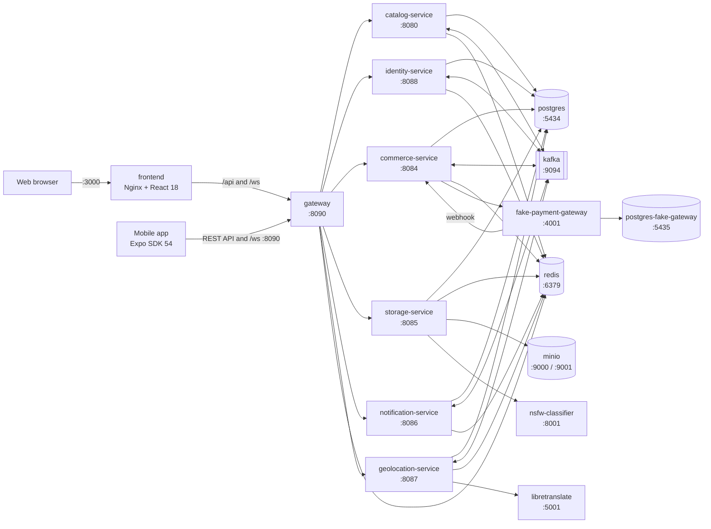
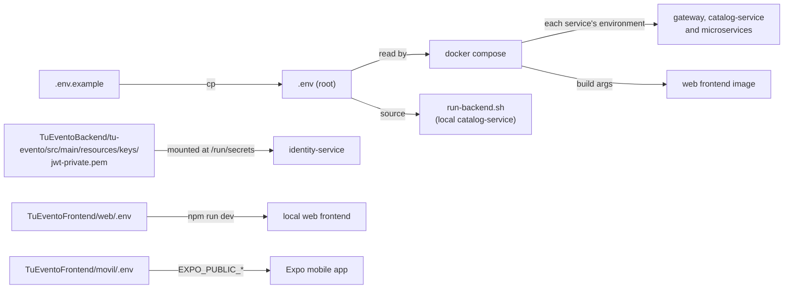
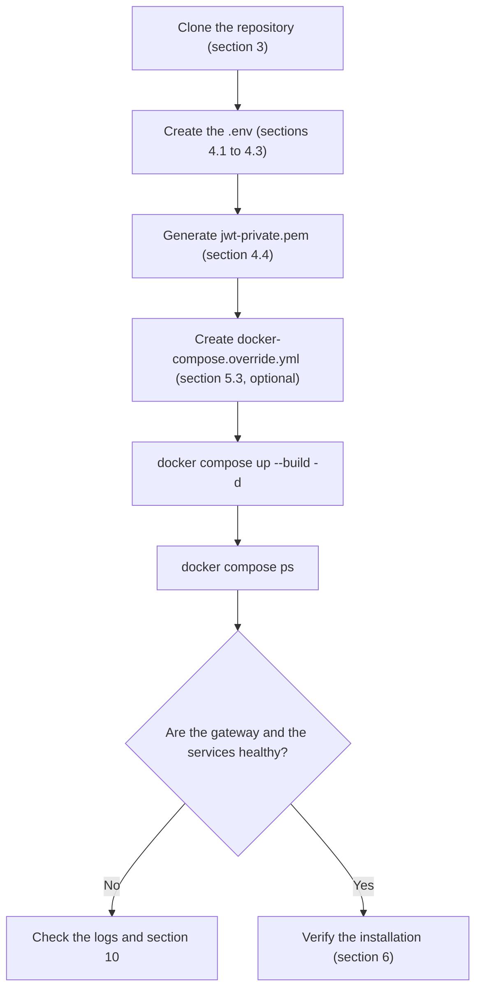
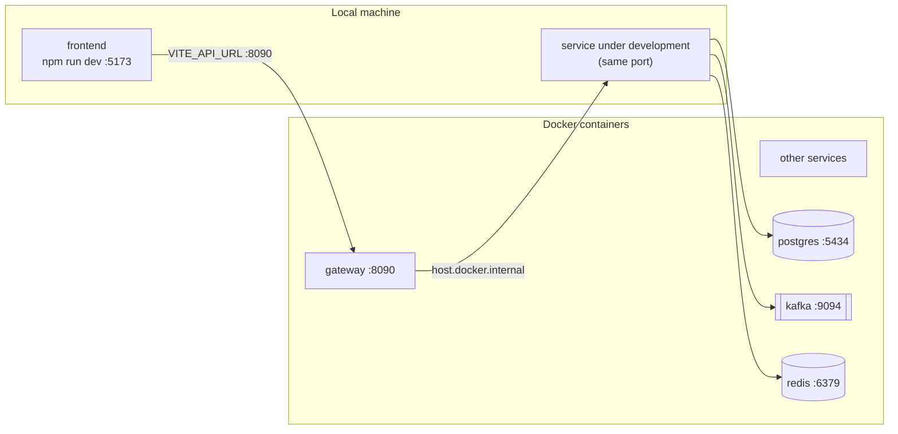
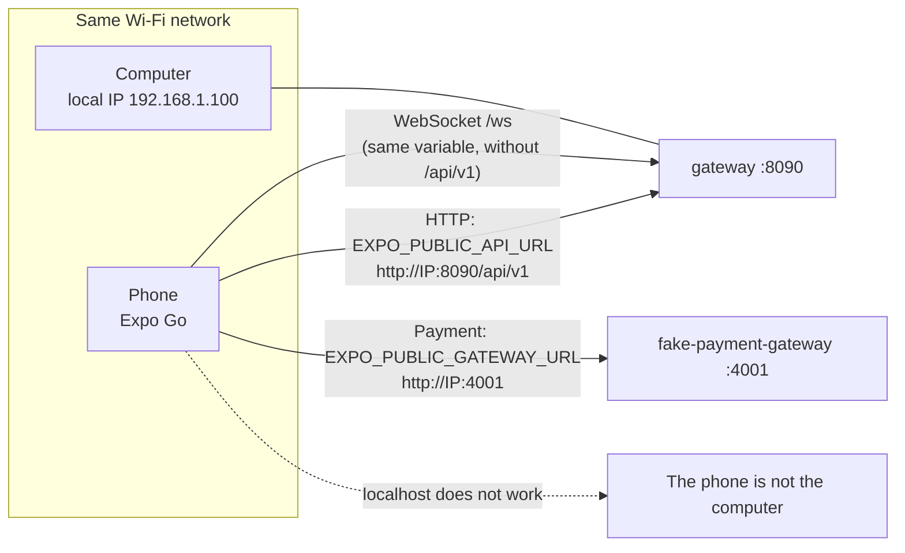
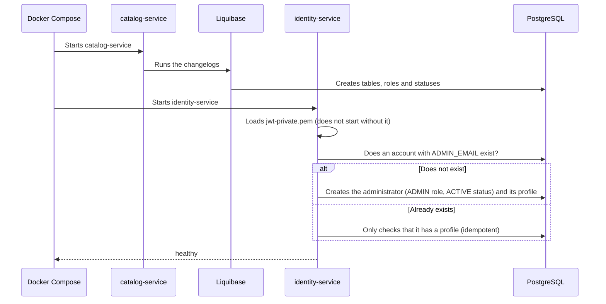

<div align="center">

<br><br><br>

**TuEvento: Installation Manual**

Technical guide to deployment, architecture and system start-up

<br><br>

Jhampier Santos Ortiz and Cristofer David Lozano Contreras

Team CapySoft

Servicio Nacional de Aprendizaje (SENA)

Training program: Software Analysis and Development (ADSO)

Ficha 3145556

Instructor: Carlos Julio Cadena

November 2026

Version 1.1

</div>

<div style="page-break-after: always;"></div>

## Contents

1. [Architecture and technology stack](#1-architecture-and-technology-stack)
2. [Prerequisites](#2-prerequisites)
3. [Getting the code](#3-getting-the-code)
4. [Environment variables and signing key](#4-environment-variables-and-signing-key)
5. [Installation with Docker (recommended)](#5-installation-with-docker-recommended)
6. [Verifying the installation](#6-verifying-the-installation)
7. [Local development (optional, mixed mode)](#7-local-development-optional-mixed-mode)
8. [Daily operation](#8-daily-operation)
9. [Mobile app (Expo)](#9-mobile-app-expo)
10. [Troubleshooting](#10-troubleshooting)
11. [Security notes](#11-security-notes)
12. [System access](#12-system-access)
13. [Pending verification](#13-pending-verification)
14. [References](#references)

### List of figures

- Figure 1. TuEvento architecture and ports
- Figure 2. Location and use of the `.env` files and the signing key
- Figure 3. Docker installation flow
- Figure 4. Local development mode (mixed)
- Figure 5. Mobile app connection to the backend
- Figure 6. Start-up sequence and creation of the initial administrator

### Document control

| Field | Value |
|---|---|
| Verified repository | `lozano2303/TuEvento` |
| Code version | `v1.2.0` (`main` branch, commit `ef9b329`, November 3, 2026) |
| Verification date | November 5, 2026 |
| Method | Steps derived from `docker-compose.yml`, `.env.example`, the `Dockerfile`s and each service's `application*.yml`. The configuration was validated with `docker compose config`; the full stack was not run during this review (see section 13). |

> **Scope.** This manual covers the local installation of the web frontend, the backend (API Gateway, `catalog-service` and the five microservices) and the supporting infrastructure. The mobile app (Expo) is covered in section 9. Server deployment (VPS, Render or Kubernetes) is documented in `09_Implementacion.md`. Citations and references follow APA style, 7th edition (American Psychological Association, 2020).

---

## 1. Architecture and technology stack

Since version 1.2.0, the TuEvento backend is no longer a single monolith. All client traffic enters through an **API Gateway** (Spring Cloud Gateway), which routes each `/api/v1` prefix to `catalog-service` (the former monolith) or to one of five microservices. The services share the same PostgreSQL database and talk to each other over internal HTTP and **Kafka** messages. All services are defined in a single `docker-compose.yml` at the repository root (Docker, Inc., n.d.-a).

| Component | Technology | Port (host) |
|---|---|---|
| Web frontend | React 18 + Vite 5, served by Nginx 1.29 in the container | 3000 |
| Mobile frontend | React Native 0.81 / Expo SDK 54 | — |
| API Gateway (`gateway`) | Spring Boot 3.5.12 + Spring Cloud 2025.0.0, Java 17 | 8090 |
| `catalog-service` (`backend` service) | Spring Boot 3.5.12, Java 17 (the image runs JRE 21). Events, categories, sections, seats and the `/ws` WebSocket. Runs the Liquibase migrations | 8080 |
| `identity-service` | Spring Boot, Java 17. Authentication, users, themes, profiles and the admin panel. Signs the JWTs (RS256) | 8088 |
| `commerce-service` | Spring Boot, Java 17. Orders, tickets and QR codes, payments, refunds, wallet and earnings | 8084 |
| `storage-service` | Spring Boot, Java 17. Files, public URLs and image moderation | 8085 |
| `notification-service` | Spring Boot, Java 17. Notifications and emails | 8086 |
| `geolocation-service` | Spring Boot, Java 17. Departments, cities, venues, languages and automatic translations | 8087 |
| Database | PostgreSQL 17 (shared by all services) | 5434 (host) to 5432 (container) |
| Messaging | Apache Kafka 3.7 in KRaft mode (no Zookeeper) | 9094, on `127.0.0.1` only |
| Cache and JWT revocation list | Redis 7 (no password by default) | 6379 |
| S3 storage | MinIO | 9000 (API) / 9001 (console) |
| Alternative S3 storage | RustFS (only if `STORAGE_PROVIDER=rustfs`) | 9100 (API) / 9101 (console) |
| Automatic translation | LibreTranslate 1.9.6 (es, en, fr, pt) | 5001, on `127.0.0.1` only |
| NSFW image moderation | NSFW Classifier (Python 3.11 / FastAPI) | 8001 to 8000 (container) |
| Simulated payment gateway | Fake Payment Gateway (development only) | 4001 |
| Payment gateway database | Dedicated PostgreSQL (`postgres-fake-gateway`) | 5435 |
| Continuous integration (optional) | Jenkins and SonarQube, in the Compose `ci` profile | 8082 and 50000 / 9002 |

> **Note.** The actual continuous integration runs on GitHub Actions with SonarQube Cloud (`.github/workflows/ci.yml`). Jenkins and SonarQube are still in `docker-compose.yml`, but inside the `ci` profile: they do not start with `docker compose up` and are not needed to run the application.

Each technology has official documentation: React (Meta Platforms, n.d.), Vite (Vite, n.d.), Expo (Expo, n.d.), Spring Boot (Spring, n.d.-a), Spring Cloud Gateway (Spring, n.d.-b), PostgreSQL (PostgreSQL Global Development Group, n.d.), Apache Kafka (Apache Software Foundation, n.d.), Redis (Redis, n.d.), MinIO (MinIO, n.d.) and LibreTranslate (LibreTranslate, n.d.).

Figure 1 summarizes how the components communicate and which host port each one is published on.

**Figure 1**

*TuEvento architecture and ports*



*Note.* Own elaboration based on `docker-compose.yml` and the routes in `TuEventoBackend/gateway/src/main/resources/application.yml` (v1.2.0). RustFS and the `ci` profile are omitted.

---

## 2. Prerequisites

### 2.1 Running with containers (recommended)

| Tool | Minimum version | Check with |
|---|---|---|
| Docker Engine | 24.x | `docker --version` |
| Docker Compose | 2.20.x | `docker compose version` |
| Git | Recent | `git --version` |
| OpenSSL | 1.1.1 or later | `openssl version` |

- **Windows:** Docker Desktop with the WSL2 backend enabled. Run the commands in this manual from WSL2 or Git Bash.
- **macOS:** Docker Desktop.
- **Linux:** Docker Engine + the Compose plugin (Docker, Inc., n.d.-b).

OpenSSL is used to generate the JWT signing key and the random keys (section 4).

### 2.2 Hardware requirements

The version 1.2.0 stack runs eight Java processes (gateway, `catalog-service`, five microservices and the simulated gateway) plus Kafka, LibreTranslate and the NSFW classifier, so it needs more memory than earlier versions.

| Scenario | Recommended RAM | Free disk |
|---|---|---|
| Default stack (`docker compose up`) | 16 GB | Approx. 20 GB |
| Default stack without RustFS | 12 to 16 GB | Approx. 18 GB |

| Service | Estimated RAM | Image on disk |
|---|---|---|
| nsfw-classifier (TensorFlow) | 1 to 2 GB | Approx. 3 to 4 GB |
| libretranslate (4 languages) | 1 to 2 GB | Approx. 2 GB + models |
| kafka | 512 MB to 1 GB | Approx. 500 MB |
| gateway, `catalog-service` and each microservice (7 in total) | 300 to 700 MB each | Approx. 300 MB each |
| fake-payment-gateway | 256 to 512 MB | Approx. 300 MB |
| minio / rustfs | 256 to 512 MB each | Approx. 250 MB + files |
| postgres (x2 instances) | 128 to 256 MB each | Approx. 250 MB + data |
| redis / frontend (Nginx) | Less than 100 MB | Approx. 90 MB |

These are estimates; actual usage varies with the machine and the load. With Docker Desktop, assign at least 12 GB of memory in *Settings > Resources*.

### 2.3 Local development without containers (optional)

| Tool | Version |
|---|---|
| Java JDK | OpenJDK / Eclipse Temurin 17 (the whole backend targets Java 17) |
| Maven | 3.9.x (the microservices in `TuEventoBackend/services/` do not include `mvnw`) |
| Node.js | 20.19 or later with npm 10.x (the frontend image uses Node 20.19 and CI uses Node 22) |

Even in this mode, PostgreSQL, Kafka, Redis, MinIO and the other services must be running; they are started with Docker (see section 7). It is therefore a **mixed mode**: the stack in containers and, on your machine, only the service or frontend you are working on.

### 2.4 Ports that must be free

`3000`, `4001`, `5434`, `5435`, `6379`, `8001`, `8080`, `8084`, `8085`, `8086`, `8087`, `8088`, `8090`, `9000`, `9001`, `9100` and `9101` (Web, Payments, PostgreSQL, payments PostgreSQL, Redis, NSFW, `catalog-service`, the five microservices, Gateway, MinIO and RustFS). Also, on `127.0.0.1`: `5001` (LibreTranslate) and `9094` (Kafka). If you start the `ci` profile, also `8082`, `9002` and `50000` (Jenkins and SonarQube).

---

## 3. Getting the code

The project source code is in the CapySoft team repository (CapySoft, 2026). To install the released version, clone the `main` branch or the `v1.2.0` tag:

```bash
git clone https://github.com/lozano2303/TuEvento.git tuevento
cd tuevento
git checkout v1.2.0   # optional: pins exactly the version in this manual
```

The `develop` branch holds work in progress and may differ from what is described here.

---

## 4. Environment variables and signing key

### 4.1 Creating the .env file

Docker Compose reads a single `.env` file at the repository root and passes each container only the variables declared for it in `docker-compose.yml`:

```bash
cp .env.example .env
```

To run `catalog-service` outside Docker, use the `run-backend.sh` script at the root, which loads that same `.env` (section 7). Copying the file to `TuEventoBackend/tu-evento/` is no longer needed.

For the web frontend run with `npm run dev`, create `TuEventoFrontend/web/.env`:

```env
VITE_API_URL=http://localhost:8090/api/v1
VITE_GOOGLE_CLIENT_ID=<your_google_client_id>
VITE_GATEWAY_URL=http://localhost:4001
```

`VITE_GATEWAY_URL` is the URL of the simulated payment gateway the buyer is redirected to. The frontend Docker image does **not** use this file (its `.dockerignore` excludes `.env` files); it receives the values as build arguments (section 5.3).

Figure 2 shows which file each component reads.

**Figure 2**

*Location and use of the `.env` files and the signing key*



*Note.* Own elaboration. `VITE_*` variables are embedded at build time, so a change requires rebuilding the frontend image.

### 4.2 Required variables

| Variable | Description | Example / how to get it |
|---|---|---|
| `POSTGRES_DB` | Database name. **It must be `tuevento_db`**: every service in the compose file connects to `jdbc:postgresql://postgres:5432/tuevento_db` | `tuevento_db` |
| `POSTGRES_USER` | PostgreSQL user (also used by the payment gateway database) | `tuevento_user` |
| `POSTGRES_PASSWORD` | PostgreSQL password | A strong password of your own |
| `JWT_SECRET` | Legacy HS256 secret: validates tokens issued before the switch to RS256 and is the fallback value of `QR_SECRET` (min. 32 characters) | `openssl rand -base64 48` |
| `INTERNAL_API_KEY` | Key shared between services for the `/internal/**` routes (`X-Internal-Api-Key` header). If empty, those routes are closed and file uploads, ticket purchases and the admin panel fail | `openssl rand -hex 32` |
| `WEBHOOK_SECRET` | Secret the simulated gateway uses to sign webhooks and `commerce-service` uses to verify them. If missing, payments are not confirmed | `openssl rand -hex 32` |
| `MAIL_USERNAME` | Gmail account that sends notifications | `myaccount@gmail.com` |
| `MAIL_PASSWORD` | 16-character App Password (not the personal password) | See 4.5 |
| `GOOGLE_CLIENT_ID` | OAuth 2.0 Client ID | See 4.6 |
| `GOOGLE_CLIENT_SECRET` | OAuth 2.0 Client Secret | See 4.6 |
| `MINIO_ROOT_USER` | MinIO administrator user | One of your own (avoid the MinIO default) |
| `MINIO_ROOT_PASSWORD` | MinIO administrator password (min. 8 characters) | A strong password of your own |
| `ADMIN_EMAIL` | Initial administrator email | `admin@yourdomain.com` |
| `ADMIN_PASSWORD` | Initial administrator password | A strong password of your own |
| `ADMIN_ALIAS` | Initial administrator alias | `admin` |

### 4.3 Optional variables

They have a default value in `docker-compose.yml` or in the `application.yml` of the service that uses them:

| Variable | Default value | When to define it |
|---|---|---|
| `APP_CORS_ALLOWED_ORIGINS` | `http://localhost:3000` | Origins accepted by the gateway (`GATEWAY_CORS_ALLOWED_ORIGINS`) if you serve the web app from another origin |
| `FAKE_GATEWAY_API_KEY` | A well-known development value | Always outside local; shared by the gateway simulator and `commerce-service` |
| `QR_SECRET` | The value of `JWT_SECRET` | To sign ticket QR codes with a separate secret |
| `STORAGE_PROVIDER` | `minio` | `rustfs` to use RustFS instead of MinIO |
| `RUSTFS_ACCESS_KEY` / `RUSTFS_SECRET_KEY` | A well-known default value | If you use RustFS |
| `RUSTFS_PUBLIC_URL` | `http://localhost:9100` | If you use RustFS from another host |
| `MINIO_PUBLIC_URL` | `http://localhost:9000` | Public URL of the files; for the mobile app, use the machine's local IP |
| `SIGHTENGINE_API_USER` / `SIGHTENGINE_API_SECRET` | Empty | Image moderation with Sightengine, in addition to the local classifier |
| `SIGHTENGINE_MODELS` / `SIGHTENGINE_THRESHOLD` / `SIGHTENGINE_NUDITY_THRESHOLD` | `gore,nudity,weapon` / `0.4` / `0.15` | Moderation tuning |
| `NOTIFICATION_EMAIL_ENABLED` | `true` | `false` to stop sending emails during tests |
| `TRANSLATION_PROTECTED_TERMS` | `Tu Evento` | Terms that automatic translation must not translate |
| `GATEWAY_LOG_LEVEL` | `INFO` | `DEBUG` to debug routing |
| `FACEBOOK_CLIENT_ID` / `FACEBOOK_CLIENT_SECRET` | Empty | They are in `.env.example`, but the v1.2.0 compose file does not pass them to any service |

> **Note.** `.env.example` also lists variables such as `REDIS_HOST`, `NSFW_SERVICE_URL`, `KAFKA_BOOTSTRAP_SERVERS`, `PAYMENT_GATEWAY` or `FAKE_GATEWAY_URL`. Inside Docker you do not need to define them: `docker-compose.yml` sets the internal addresses (`redis`, `kafka:9092`, `http://fake-payment-gateway:4001`, etc.). They are only used when running a service outside Docker (section 7).

### 4.4 JWT signing key (RS256)

`identity-service` signs tokens with an RSA private key and publishes the public key at `/.well-known/jwks.json`; the other services only verify. **`identity-service` does not start without this key** (`ephemeral-keys-allowed: false`). The compose file mounts the `TuEventoBackend/tu-evento/src/main/resources/keys/` folder at `/run/secrets` inside the container.

```bash
cd TuEventoBackend/tu-evento/src/main/resources/keys
openssl genpkey -algorithm RSA -pkeyopt rsa_keygen_bits:2048 -out jwt-private.pem
chmod 644 jwt-private.pem   # the container reads the file as an unprivileged user
cd -
```

- `jwt-private.pem` is in `.gitignore`; do not push it to the repository.
- `openssl genpkey` generates the key in PKCS#8 format, which is what the service expects.
- Use a different key in each environment. Permission `644` is acceptable on a development machine; on a server, restrict access to the directory.

### 4.5 Getting the Gmail App Password

1. Enable 2-Step Verification on your Google account.
2. Go to Google Account, Security, App passwords (Google, n.d.-a).
3. Generate a password for "Mail" and copy it (16 characters, no spaces) into `MAIL_PASSWORD`.

### 4.6 Configuring Google OAuth 2.0

1. In Google Cloud Console, create or select a project (Google, n.d.-b).
2. Go to APIs & Services, Credentials, Create credentials, OAuth client ID.
3. Application type: Web application.
4. Under Authorized JavaScript origins add `http://localhost:3000` (and `http://localhost:5173` if you run the frontend with `npm run dev`, plus the production domain if applicable).
5. Copy the Client ID and Client Secret into the corresponding variables. The same Client ID must go in the frontend's `VITE_GOOGLE_CLIENT_ID` (section 5.3).

> **Tip.** If you get the error `origin not allowed` or `origin_mismatch`, the origin is not authorized for that Client ID.

### 4.7 Security of the .env file

- Do not commit `.env` or `jwt-private.pem`. Both are in `.gitignore`; check it with:

  ```bash
  git check-ignore -v .env TuEventoBackend/tu-evento/src/main/resources/keys/jwt-private.pem
  ```

- Rotate the credentials (keys, passwords and secrets) if they were exposed.

---

## 5. Installation with Docker (recommended)

Figure 3 presents the complete flow of this section.

**Figure 3**

*Docker installation flow*



*Note.* Own elaboration based on `docker-compose.yml` (v1.2.0).

### 5.1 Starting the services

1. Check that `.env` is configured and that `jwt-private.pem` exists (section 4).
2. Build the images and start the services in the background:

   ```bash
   docker compose up --build -d
   ```

   This command starts everything except Jenkins and SonarQube (`ci` profile).

3. Follow the container status until the gateway and the microservices show as `healthy`:

   ```bash
   docker compose ps
   docker compose logs -f backend identity-service gateway
   ```

   Press `Ctrl + C` to exit the logs (the services keep running).

> **Note.** The first run can take a long time: the base images are downloaded, Maven compiles nine Java projects (including the `tuevento-common` library, which each microservice compiles inside its image), the NSFW classifier installs TensorFlow and LibreTranslate downloads the models for the four languages (its healthcheck allows up to 300 s to start). `geolocation-service` waits for LibreTranslate to be `healthy`, and `catalog-service`, `notification-service` and `commerce-service` wait for Kafka.

> **Note.** Docker Compose shows the warning ``the attribute `version` is obsolete``. It is harmless: the file keeps the `version: '3.8'` key and Compose ignores it.

### 5.2 Start-up order

| Step | Service | Condition in `docker-compose.yml` |
|---|---|---|
| 1 | postgres, postgres-fake-gateway, redis, minio, kafka, libretranslate, nsfw-classifier, rustfs | No dependencies |
| 2 | minio-init | Waits for `minio` (`service_healthy`) and creates the `tuevento` bucket with the public prefixes `profile_picture/` and `event_media/` |
| 3 | backend (`catalog-service`) | Waits for `kafka` (`service_healthy`); for postgres and redis only `service_started`. Runs Liquibase |
| 4 | identity, storage, notification, geolocation and commerce | Wait for the backend to have started (`service_started`), because the backend migrates the tables |
| 5 | gateway | Waits for the backend and the five microservices to start |
| 6 | frontend | Waits for the gateway |

### 5.3 Additional local configuration (docker-compose.override.yml)

The compose `frontend` service only receives `VITE_API_URL` as a build argument. For Google sign-in to work in the web app served from Docker, create a `docker-compose.override.yml` file at the root (Compose merges it automatically with the main file) and do not push it to the repository:

```yaml
services:
  frontend:
    build:
      args:
        VITE_GOOGLE_CLIENT_ID: ${VITE_GOOGLE_CLIENT_ID}
        VITE_GATEWAY_URL: http://localhost:4001
```

Define `VITE_GOOGLE_CLIENT_ID` in the root `.env` and rebuild: `docker compose up --build -d frontend`.

### 5.4 Saving memory

RustFS starts by default even if it is not used. If you work with MinIO, you can stop it:

```bash
docker compose stop rustfs
```

Jenkins and SonarQube only start when explicitly requested:

```bash
docker compose --profile ci up -d jenkins sonarqube
```

---

## 6. Verifying the installation

| Check | Command / action | Expected result |
|---|---|---|
| Containers | `docker compose ps` | All running; those with a healthcheck, `healthy`. `minio-init` exits with code 0 |
| API Gateway | `curl -s http://localhost:8090/actuator/health` | `{"status":"UP"...}` |
| `catalog-service` | `curl -s http://localhost:8080/actuator/health` | `{"status":"UP"...}` |
| Microservices | `curl -s http://localhost:<port>/actuator/health` with 8084, 8085, 8086, 8087 and 8088 | `{"status":"UP"...}` on each one |
| JWT public keys | `curl -s http://localhost:8090/.well-known/jwks.json` | A JSON with the `keys` list |
| Route through the gateway | `curl -s http://localhost:8090/api/v1/categories` | A response from `catalog-service` (not 404) |
| Redis | `docker exec -it tuevento-redis redis-cli ping` | `PONG` |
| Kafka | `docker compose ps kafka` | `healthy` |
| LibreTranslate | `docker compose ps libretranslate` | `healthy` (can take up to 5 minutes the first time) |
| NSFW classifier | `curl -s http://localhost:8001/health` | `{"status": "ok"}` |
| MinIO | Open `http://localhost:9001` | The MinIO console is reachable |
| Web frontend | Open `http://localhost:3000` | The home page loads |
| Fake Payment Gateway | `docker compose logs fake-payment-gateway` | Starts without errors (it has no healthcheck) |

> **Tip.** The gateway has no default route: an `/api/v1` path that is not assigned to any service returns 404. The interactive documentation (Swagger) is available on each service, not on the gateway (section 12).

### Container names

| Service | Container | Host:container port |
|---|---|---|
| postgres | tuevento-postgres | 5434:5432 |
| postgres-fake-gateway | fake-gateway-postgres | 5435:5432 |
| redis | tuevento-redis | 6379:6379 |
| kafka | tuevento-kafka | 127.0.0.1:9094:9094 |
| minio / minio-init | tuevento-minio / tuevento-minio-init | 9000:9000, 9001:9001 / none |
| rustfs | tuevento-rustfs | 9100:9000, 9101:9001 |
| libretranslate | tuevento-libretranslate | 127.0.0.1:5001:5000 |
| nsfw-classifier | nsfw-classifier | 8001:8000 |
| fake-payment-gateway | fake-payment-gateway | 4001:4001 |
| backend (`catalog-service`) | tuevento-backend-dev | 8080:8080 |
| gateway | tuevento-gateway | 8090:8090 |
| identity-service | tuevento-identity-service | 8088:8088 |
| commerce-service | tuevento-commerce-service | 8084:8084 |
| storage-service | tuevento-storage-service | 8085:8085 |
| notification-service | tuevento-notification-service | 8086:8086 |
| geolocation-service | tuevento-geolocation-service | 8087:8087 |
| frontend | tuevento-frontend | 3000:80 |
| jenkins (`ci` profile) | tuevento-jenkins | 8082:8080, 50000:50000 |
| sonarqube (`ci` profile) | tuevento-sonarqube | 9002:9000 |

---

## 7. Local development (optional, mixed mode)

With this many services, the practical approach is to run the whole stack in Docker and take out of Docker only the component you are working on (see Figure 4). The services' `application.yml` files already point by default to the ports published on the host (`localhost:5434` for PostgreSQL, `localhost:9094` for Kafka, `localhost:6379` for Redis and `localhost:8088` for `identity-service`).

**Figure 4**

*Local development mode (mixed)*



*Note.* Own elaboration. The gateway inside Docker reaches a service on the host through `host.docker.internal` (see step 3).

1. **Web frontend.** With the stack in Docker and `TuEventoFrontend/web/.env` configured (section 4.1):

   ```bash
   docker compose stop frontend   # optional
   cd TuEventoFrontend/web
   npm install
   npm run dev
   ```

   Vite serves on `http://localhost:5173`, which is already among the gateway's default CORS origins.

2. **`catalog-service`.** Stop the container and start the service with the root script, which loads `.env`:

   ```bash
   docker compose stop backend
   ./run-backend.sh
   ```

   Add to `.env` the variables that the compose file sets in Docker:

   ```env
   SPRING_DATASOURCE_URL=jdbc:postgresql://localhost:5434/tuevento_db
   INTERNAL_API_KEY=<the_same_key_as_the_stack>
   ```

   > **Important.** If you omit `SPRING_DATASOURCE_URL`, the `dev` profile uses `localhost:5432`, where there is no PostgreSQL, and the service cannot start.

3. **A microservice** (for example `identity-service`). The microservices depend on the `tuevento-common` library, which must first be installed in the local Maven repository:

   ```bash
   docker compose stop identity-service
   cd TuEventoBackend/services
   mvn -B -f tuevento-common/pom.xml install -DskipTests
   set -a; source ../../.env; set +a
   mvn -f identity-service/pom.xml spring-boot:run
   ```

   For `identity-service` also define `APP_JWT_PRIVATE_KEY_PATH=file:<absolute_path>/jwt-private.pem` and `AUTH_COOKIE_SECURE=false`.

4. **Point the gateway to the local service.** Containers call services by their network name, so they must be told to use the host. For example, for `identity-service`, add to `docker-compose.override.yml`:

   ```yaml
   services:
     gateway:
       extra_hosts:
         - "host.docker.internal:host-gateway"
       environment:
         - IDENTITY_SERVICE_URI=http://host.docker.internal:8088
   ```

   And apply the change with `docker compose up -d gateway`. The other services that call `identity-service` (for example, its JWKS) need the same adjustment in their `JWK_SET_URI` and `IDENTITY_SERVICE_URL` variables.

---

## 8. Daily operation

| Action | Command |
|---|---|
| View a service's logs | `docker compose logs -f <service>` |
| View the services' status | `docker compose ps` |
| Stop without deleting data | `docker compose down` |
| Restart a service | `docker compose restart <service>` |
| Rebuild a service after changing its code | `docker compose up --build -d <service>` |
| Update to the latest version | `git pull && docker compose up --build -d` |

> **Warning.** `docker compose down -v` deletes all volumes. Use it only to reset the system from scratch; deleting volumes partially can leave orphaned records between the database, Kafka and MinIO.

### 8.1 Persistent volumes

| Volume | Service | Content |
|---|---|---|
| `postgres_data` | postgres | Main database (shared by all services) |
| `postgres_fake_gateway_data` | postgres-fake-gateway | Simulated payment gateway database |
| `kafka_data` | kafka | Messages and offsets (72 h retention) |
| `redis_data` | redis | Cache data |
| `minio_data` | minio | Uploaded files and images |
| `rustfs_data` | rustfs | Files, if RustFS is used |
| `libretranslate-models` | libretranslate | Downloaded translation models |
| `jenkins_data` | jenkins | Jenkins configuration and jobs (`ci` profile) |
| `sonarqube_data` / `_logs` / `_extensions` | sonarqube | SonarQube data, logs and plugins (`ci` profile) |

### 8.2 Data backup

Before any destructive operation or version upgrade, back up PostgreSQL and MinIO. The database backup uses `pg_dump` (PostgreSQL Global Development Group, n.d.):

```bash
# PostgreSQL: backup and restore
docker exec tuevento-postgres pg_dump -U <POSTGRES_USER> tuevento_db \
  > backup_tuevento.sql
docker exec -i tuevento-postgres psql -U <POSTGRES_USER> -d tuevento_db \
  < backup_tuevento.sql

# MinIO: volume copy (Linux/macOS/Git Bash)
docker volume ls     # find the actual name (ends in minio_data)
docker run --rm -v <minio_volume>:/data -v "$(pwd)":/backup alpine \
  tar czf /backup/minio_backup.tgz -C /data .
```

---

## 9. Mobile app (Expo)

The mobile app uses Expo SDK 54 (React Native 0.81) and is not part of the Docker deployment (Expo, n.d.).

```bash
cd TuEventoFrontend/movil
cp .env.example .env
npm install
npx expo start
```

Variables in `TuEventoFrontend/movil/.env`:

| Variable | Local value |
|---|---|
| `EXPO_PUBLIC_API_URL` | `http://<MACHINE_LOCAL_IP>:8090/api/v1` (the gateway) |
| `EXPO_PUBLIC_GATEWAY_URL` | `http://<MACHINE_LOCAL_IP>:4001` (simulated payment gateway) |
| `EXPO_PUBLIC_MINIO_HOST` | `<MACHINE_LOCAL_IP>`; replaces `localhost` in file URLs |
| `EXPO_PUBLIC_GOOGLE_CLIENT_ID` | Google Client ID for the app |
| `EXPO_PUBLIC_FACEBOOK_APP_ID` | Facebook App ID (optional) |

- To test on a physical device, install Expo Go and make sure the phone and the computer are on the same network.
- The app must point to the machine's local IP (for example `192.168.1.100`), never to `localhost`.
- The WebSocket service (`websocketService.js`) derives its URL from `EXPO_PUBLIC_API_URL` (it removes `/api/v1`), so a wrong value also affects real-time features.
- After changing `.env`, restart Expo with `npx expo start -c`.
- EAS builds (`preview` profile) do not read this file: the variables are set in the EAS `preview` environment with `eas env:create`, as `.env.example` explains.

**Figure 5**

*Mobile app connection to the backend*



*Note.* Own elaboration. The example IP must be replaced with the actual local IP of the computer running the stack.

---

## 10. Troubleshooting

| Problem | Likely cause | Solution |
|---|---|---|
| Port in use (8090, 5434, etc.) | Another process is using it | Linux/macOS: `lsof -i :8090`. Windows: `netstat -ano \| findstr :8090`. Close the process or remap the port in `docker-compose.override.yml`. |
| The services cannot connect to the database (`database "tuevento_db" does not exist`) | `POSTGRES_DB` has another name; the compose file creates the database with `POSTGRES_DB`, but the services use `tuevento_db` | Set `POSTGRES_DB=tuevento_db`. If the volume already existed, create the database by hand (`docker exec -it tuevento-postgres createdb -U <POSTGRES_USER> tuevento_db`) or reset with `docker compose down -v`. |
| `identity-service` does not start (private key error) | `jwt-private.pem` is missing or the container cannot read it | Generate the key (section 4.4), make it readable (`chmod 644`) and run `docker compose up -d identity-service`. |
| Image uploads, purchases or the admin panel fail (401/403 on `/internal`) | `INTERNAL_API_KEY` is empty | Set the key in `.env` and recreate the services: `docker compose up -d`. |
| The payment stays pending and is never confirmed | `WEBHOOK_SECRET` is empty or differs between the gateway simulator and `commerce-service` | Set `WEBHOOK_SECRET` in `.env` and recreate `fake-payment-gateway` and `commerce-service`. |
| Liquibase: PostgreSQL connection error | The backend started before PostgreSQL (postgres only has a `service_started` condition) | `docker compose restart backend`, then the microservices that failed. Permanent fix: a healthcheck on Postgres (see below). |
| `geolocation-service` takes long to start | It waits for LibreTranslate, which downloads its models the first time | Wait up to 5 minutes; check `docker compose logs -f libretranslate`. |
| Kafka errors in the logs (`Connection to node -1`) | Kafka is not ready yet | Wait for `kafka` to be `healthy`; the services retry. |
| 404 on an API route | The gateway has no default route | Check that the route exists in the installed version and that the service serving it is running. |
| 502/503 from the gateway | The target service is not running or has not started yet | `docker compose ps` and `docker compose logs <service>`. |
| Google sign-in does not work in the Docker frontend | The compose file does not pass `VITE_GOOGLE_CLIENT_ID` to the build | Create the `docker-compose.override.yml` from section 5.3 and rebuild `frontend`. |
| CORS error | Origin not allowed by the gateway | Check that `APP_CORS_ALLOWED_ORIGINS` includes the web app's origin and recreate the gateway: `docker compose up -d gateway`. |
| Gmail authentication error | Wrong password | Use a 16-character App Password, not the personal password (requires 2-Step Verification). |
| Google: `origin_mismatch` / `origin not allowed` | Unauthorized origin or wrong Client ID | Check the Authorized JavaScript origins in Google Cloud Console and that `VITE_GOOGLE_CLIENT_ID` matches. |
| The mobile app does not connect (nor does the WebSocket) | `EXPO_PUBLIC_API_URL` points to localhost, to a wrong IP or to port 8080 | Use `http://<local_IP>:8090/api/v1`, the same Wi-Fi network, and restart with `npx expo start -c`. |
| Images do not load in the mobile app | Public URLs use `localhost` | Set `EXPO_PUBLIC_MINIO_HOST` to the local IP. |
| The NSFW classifier is slow at start-up | Model loading on first start | Wait for `/health` to respond; check with `docker compose logs -f nsfw-classifier`. |
| Docker runs out of memory (containers restarting, `Killed`) | The full stack needs about 12 to 16 GB | Give Docker more memory and stop what you do not use (`docker compose stop rustfs`). |

### Recommended healthcheck for PostgreSQL

It can be added in `docker-compose.override.yml`, without changing the repository file:

```yaml
services:
  postgres:
    healthcheck:
      test: ["CMD-SHELL", "pg_isready -U ${POSTGRES_USER} -d tuevento_db"]
      interval: 5s
      timeout: 5s
      retries: 10
  backend:
    depends_on:
      postgres:
        condition: service_healthy
```

---

## 11. Security notes

The included configuration is intended for development. Before exposing the system, review:

| Item | Current state (`docker-compose.yml`) | Action for production |
|---|---|---|
| Fake Payment Gateway | Development and testing only | Do not use it with real money. |
| `FAKE_GATEWAY_API_KEY`, RustFS keys | They have well-known default values | Set your own values. |
| `INTERNAL_API_KEY`, `WEBHOOK_SECRET`, `JWT_SECRET` | Defined by `.env` | Long random values, different in each environment. |
| `jwt-private.pem` | Local file mounted read-only | One key per environment, outside the repository and with restricted access. |
| Redis | No password | Enable `--requirepass` in Redis and set `REDIS_PASSWORD`, which the gateway and the microservices read (see section 13 for `catalog-service`). |
| Actuator | In `catalog-service`, `/actuator/**` is public; in the microservices only `health` and `info` | Expose only health/info and restrict access by network. |
| Swagger / OpenAPI | Public in `catalog-service` and in each microservice | Disable it or restrict access. |
| Internal service ports | 8080 and 8084 to 8088 published on the host | In production, publish only the frontend and the gateway; the rest must stay on the internal network. |
| Refresh token cookie | `AUTH_COOKIE_SECURE=false` locally (HTTP) | `true` with HTTPS. |
| Jenkins and SonarQube | `ci` profile, inactive | Do not expose them to the Internet. |
| Initial administrator | Created with `ADMIN_PASSWORD` | Change the password after the first sign-in. |

- Use HTTPS in any environment other than local. The usual approach is to place a reverse proxy (Nginx, Nginx Proxy Manager or Caddy) in front, terminating TLS and being the only service with ports 80/443 open to the outside. The repository includes `docker-compose.prod.yml` and `.env.prod.example` for that scenario (see `09_Implementacion.md`).
- Keep `.env` out of the repository and rotate the credentials if any were exposed.

---

## 12. System access

| Resource | URL |
|---|---|
| Web application | `http://localhost:3000` |
| API (single entry point) | `http://localhost:8090/api/v1` |
| Gateway status | `http://localhost:8090/actuator/health` |
| `catalog-service` Swagger | `http://localhost:8080/swagger-ui/index.html` |
| Microservices Swagger | `http://localhost:<port>/swagger-ui/index.html` (8084, 8085, 8086, 8087 and 8088) |
| MinIO console | `http://localhost:9001` |
| RustFS console (if used) | `http://localhost:9101` |
| Jenkins (`ci` profile) | `http://localhost:8082` |
| SonarQube (`ci` profile) | `http://localhost:9002` |

### 12.1 First access and administrator user

Liquibase (changelog 017; Liquibase, n.d.), run by `catalog-service`, only inserts the roles (`ADMIN`, `ORGANIZER`, `USER`) and the user statuses; it does not create any user. The administrator is created by `identity-service` at start-up, through the `AdminAccountSeeder` class (an `ApplicationRunner` with `@Order(1)`), as shown in Figure 6.

**Figure 6**

*Start-up sequence and creation of the initial administrator*



*Note.* Own elaboration based on `AdminAccountSeeder.java` and `docker-compose.yml` (v1.2.0).

| Field | Value |
|---|---|
| Email | Value of `ADMIN_EMAIL` |
| Password | Value of `ADMIN_PASSWORD` (stored as a hash) |
| Alias | Value of `ADMIN_ALIAS` |
| Full name | Administrador Principal (fixed in the code) |
| Role / status | ADMIN / ACTIVE |
| Idempotency | If an account with that email already exists, it is not created again |
| Not configured | If `ADMIN_EMAIL` or `ADMIN_PASSWORD` is empty, the administrator is not created and the service logs a warning |

> **Done.** Set `ADMIN_EMAIL`, `ADMIN_PASSWORD` and `ADMIN_ALIAS` in `.env` before the first start and sign in with those credentials at `http://localhost:3000`. Any other user can be created from the application's sign-up form.

---

## 13. Pending verification

Points that could not be confirmed by reading the code alone and that should be checked during the first clean installation:

| # | Item | How to check it |
|---|---|---|
| 1 | Full run of the v1.2.0 stack on a clean machine, following this manual step by step | `docker compose up --build -d` and the table in section 6 |
| 2 | Hardware requirements (section 2.2): they are estimates, not measurements | `docker stats` with the stack idle and in use |
| 3 | Whether `chmod 644` on `jwt-private.pem` is needed (it depends on the permissions `openssl` creates the file with and on the container user) | Start `identity-service` without changing the permission and check its log |
| 4 | Whether the Docker frontend works with Google just by adding the build arg from section 5.3 | Sign in with Google at `http://localhost:3000` |
| 5 | Mixed-mode steps for the microservices (section 7, steps 3 and 4) | Run one of the microservices with Maven and test it through the gateway |
| 6 | Redis password in `catalog-service`: its v1.2.0 `application.yaml` does not declare `REDIS_PASSWORD` | Review the `catalog-service` Redis configuration before enabling the password |
| 7 | Use of `FACEBOOK_CLIENT_ID` / `FACEBOOK_CLIENT_SECRET`: they are in `.env.example`, but the v1.2.0 compose file does not pass them to any service | Ask the backend team whether Facebook sign-in is still active |

<div style="page-break-after: always;"></div>

## References

American Psychological Association. (2020). *Publication manual of the American Psychological Association* (7th ed.). https://doi.org/10.1037/0000165-000

Apache Software Foundation. (n.d.). *Apache Kafka documentation*. Retrieved November 5, 2026, from https://kafka.apache.org/documentation/

CapySoft. (2026). *TuEvento* (Version 1.2.0) [Source code]. GitHub. https://github.com/lozano2303/TuEvento

Docker, Inc. (n.d.-a). *Docker Compose overview*. Retrieved October 15, 2026, from https://docs.docker.com/compose/

Docker, Inc. (n.d.-b). *Install Docker Engine*. Retrieved October 15, 2026, from https://docs.docker.com/engine/install/

Expo. (n.d.). *Expo documentation*. Retrieved October 15, 2026, from https://docs.expo.dev

Google. (n.d.-a). *Sign in with app passwords* [Google Account Help]. Retrieved October 15, 2026, from https://support.google.com/accounts/answer/185833

Google. (n.d.-b). *Using OAuth 2.0 to access Google APIs*. Google for Developers. Retrieved October 15, 2026, from https://developers.google.com/identity/protocols/oauth2

LibreTranslate. (n.d.). *LibreTranslate documentation*. Retrieved November 5, 2026, from https://docs.libretranslate.com

Liquibase. (n.d.). *Liquibase documentation*. Retrieved October 15, 2026, from https://docs.liquibase.com

Meta Platforms. (n.d.). *React*. Retrieved October 15, 2026, from https://react.dev

MinIO. (n.d.). *MinIO documentation*. Retrieved October 15, 2026, from https://min.io/docs/minio/linux/index.html

PostgreSQL Global Development Group. (n.d.). *PostgreSQL 17 documentation*. Retrieved October 15, 2026, from https://www.postgresql.org/docs/17/

Redis. (n.d.). *Redis documentation*. Retrieved October 15, 2026, from https://redis.io/docs/

Spring. (n.d.-a). *Spring Boot*. Retrieved October 15, 2026, from https://spring.io/projects/spring-boot

Spring. (n.d.-b). *Spring Cloud Gateway*. Retrieved November 5, 2026, from https://spring.io/projects/spring-cloud-gateway

Vite. (n.d.). *Vite: Next generation frontend tooling*. Retrieved October 15, 2026, from https://vite.dev
