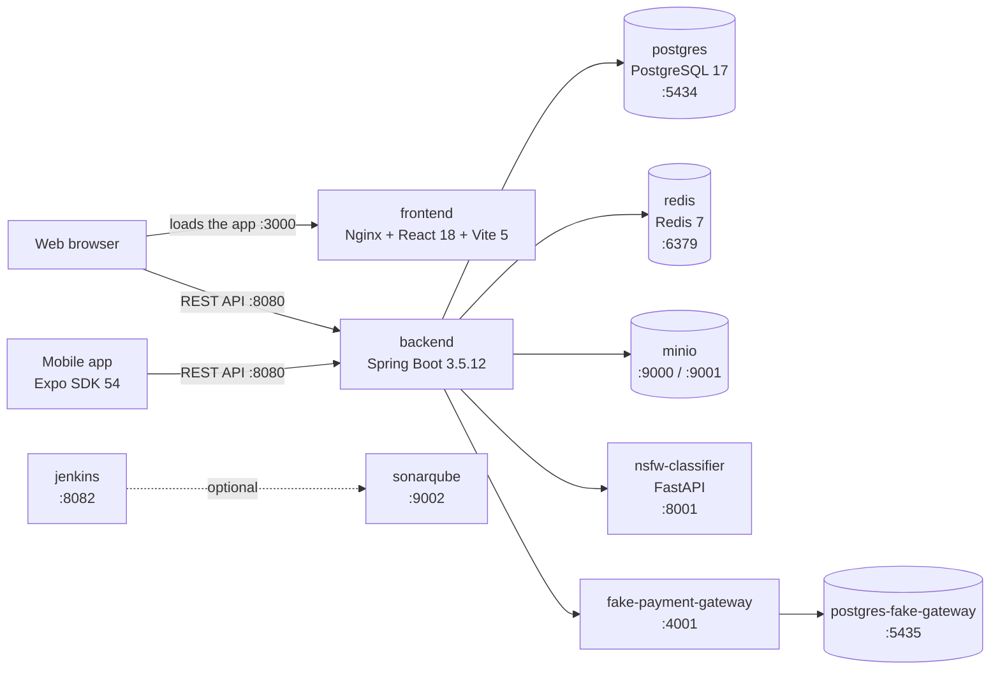
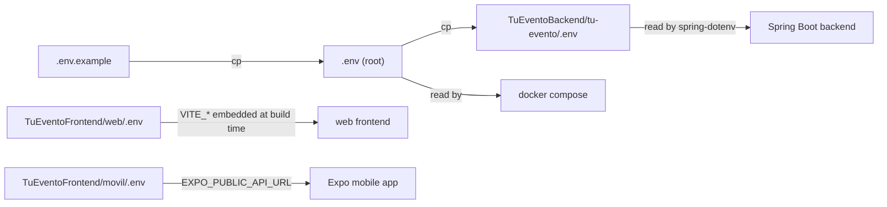
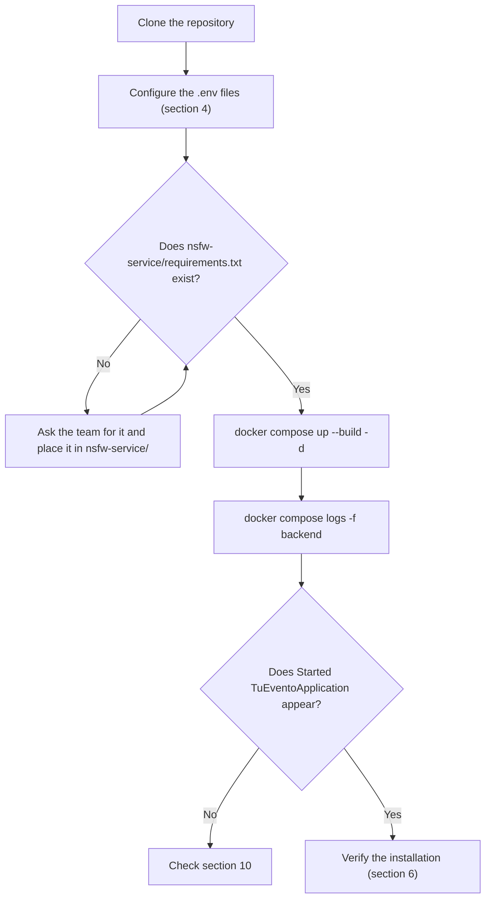
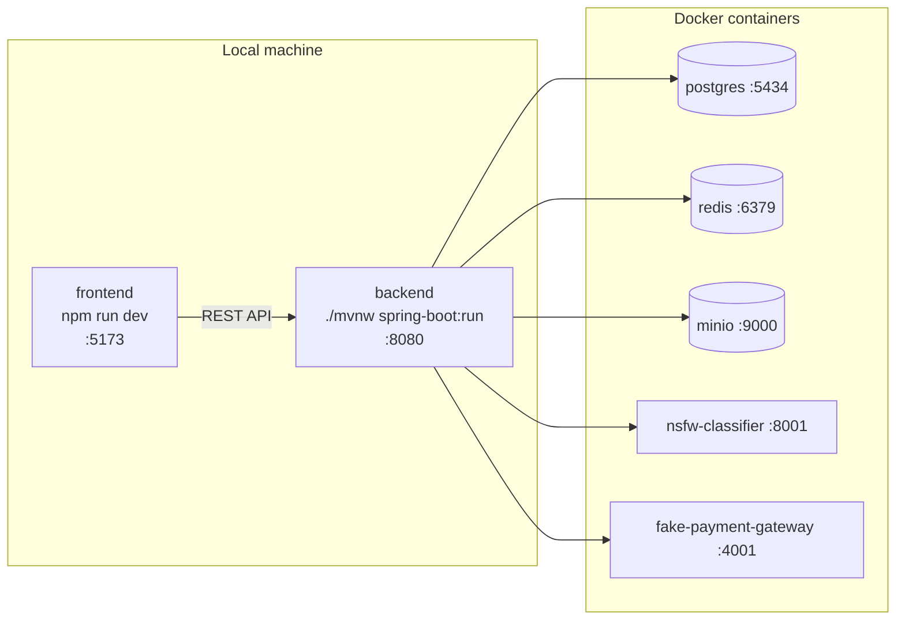
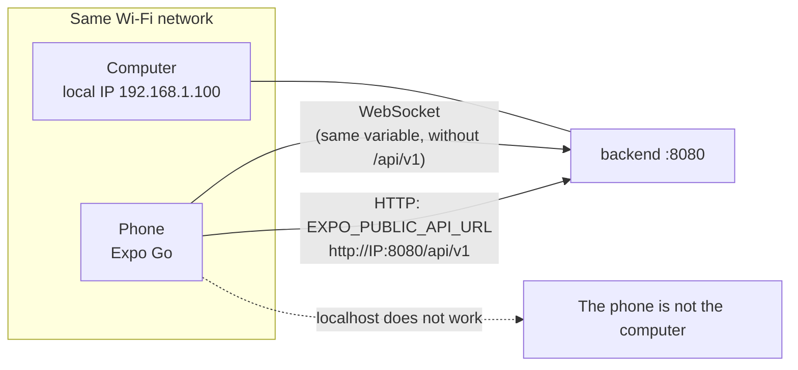
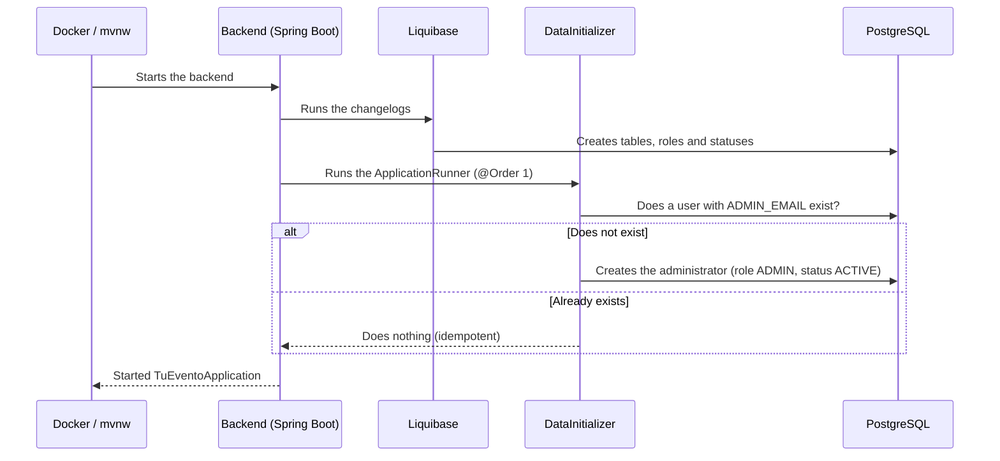

<div align="center">

<br><br><br>

**TuEvento: Installation Manual**

Technical guide to deployment, architecture and system start-up

<br><br>

Jhampier Santos Ortiz and Cristofer David Lozano Contreras

Team CapySoft

Servicio Nacional de Aprendizaje (SENA)

Training program: Software Analysis and Development (ADSO)

Ficha 3145556

Instructor: Carlos Julio Cadena

October 2026

Version 1.0

</div>

<div style="page-break-after: always;"></div>

## Contents

1. [Architecture and technology stack](#1-architecture-and-technology-stack)
2. [Prerequisites](#2-prerequisites)
3. [Getting the code](#3-getting-the-code)
4. [Environment variables](#4-environment-variables)
5. [Installation with Docker (recommended)](#5-installation-with-docker-recommended)
6. [Verifying the installation](#6-verifying-the-installation)
7. [Local development (optional, mixed mode)](#7-local-development-optional-mixed-mode)
8. [Daily operation](#8-daily-operation)
9. [Mobile app (Expo)](#9-mobile-app-expo)
10. [Troubleshooting](#10-troubleshooting)
11. [Security notes](#11-security-notes)
12. [System access](#12-system-access)
13. [References](#references)

### List of figures

- Figure 1. TuEvento architecture and ports
- Figure 2. Location and use of the `.env` files
- Figure 3. Docker installation flow
- Figure 4. Local development mode (mixed)
- Figure 5. Mobile app connection to the backend
- Figure 6. Backend start-up sequence and creation of the initial administrator

> **Scope.** This manual covers the installation of the backend, the web frontend and the supporting infrastructure. The mobile app (Expo) is covered in section 9. The values (ports, service names, paths and versions) were verified against the repository code. Citations and references follow APA style, 7th edition (American Psychological Association, 2020).

---

## 1. Architecture and technology stack

TuEvento consists of three decoupled layers plus a supporting infrastructure layer. All services are defined in a single `docker-compose.yml` at the repository root (Docker, Inc., n.d.-a).

| Layer | Technology | Port (host) |
|---|---|---|
| Web frontend | React 18 + Vite 5 (served by Nginx in the container) | 3000 |
| Mobile frontend | React Native 0.81 / Expo SDK 54 | — |
| Backend REST API | Spring Boot 3.5.12, Java 17 (source code); the Docker image runs a JRE 21 | 8080 |
| Database | PostgreSQL 17 | 5434 (host) to 5432 (container) |
| Cache | Redis 7 (no password by default) | 6379 |
| S3 storage | MinIO | 9000 (API) / 9001 (console) |
| NSFW image moderation | NSFW Classifier (Python / FastAPI + opennsfw2) | 8001 to 8000 (container) |
| Simulated payment gateway | Fake Payment Gateway (development only) | 4001 |
| Gateway database | Dedicated PostgreSQL (`postgres-fake-gateway`) | 5435 |
| Continuous integration | Jenkins | 8082 (UI) / 50000 (agents) |
| Code quality | SonarQube | 9002 |

> **Note.** Jenkins and SonarQube are part of `docker-compose.yml` but are not required to run the application. Section 5.3 shows how to start only the essential services.

Each technology has official documentation: React (Meta Platforms, n.d.), Vite (Vite, n.d.), Expo (Expo, n.d.), Spring Boot (Spring, n.d.), PostgreSQL (PostgreSQL Global Development Group, n.d.), Redis (Redis, n.d.), MinIO (MinIO, n.d.), Jenkins (Jenkins, n.d.) and SonarQube (SonarSource, n.d.).

Figure 1 summarizes how the components communicate and which host port each one publishes.

**Figure 1**

*TuEvento Architecture and Ports*



*Note.* Original work based on `docker-compose.yml`. Jenkins and SonarQube (dotted line) are optional.

---

## 2. Prerequisites

### 2.1 Running with containers (recommended)

| Tool | Minimum version | Check with |
|---|---|---|
| Docker Engine | 24.x | `docker --version` |
| Docker Compose | 2.20.x | `docker compose version` |
| Git | Recent | `git --version` |

- **Windows:** Docker Desktop with the WSL2 backend enabled.
- **macOS:** Docker Desktop.
- **Linux:** Docker Engine + the Compose plugin (Docker, Inc., n.d.-b).

### 2.2 Hardware requirements

| Scenario | Recommended RAM | Free disk |
|---|---|---|
| Essential services (without Jenkins or SonarQube) | 8 GB | Approx. 8 GB |
| Full `docker-compose.yml` stack | 12 to 16 GB | Approx. 12 GB |

| Service | Estimated RAM | Image on disk |
|---|---|---|
| nsfw-classifier (TensorFlow) | 1 to 2 GB | Approx. 3 to 4 GB |
| backend (Spring Boot) | 512 MB to 1 GB | Approx. 300 MB |
| minio | 256 to 512 MB | Approx. 250 MB + files |
| fake-payment-gateway | 256 to 512 MB | Approx. 700 MB |
| postgres (x2 instances) | 128 to 256 MB each | Approx. 250 MB + data |
| redis / frontend (Nginx) | Less than 100 MB | Approx. 90 MB |
| jenkins | 1 to 2 GB | Approx. 800 MB |
| sonarqube | 2 to 4 GB | Approx. 700 MB |

These are estimates; actual consumption varies with the machine and the load.

### 2.3 Local development without containers (optional)

| Tool | Version |
|---|---|
| Java JDK | OpenJDK / Eclipse Temurin 17 (the Docker image uses JRE 21; both work) |
| Node.js | 20.x LTS with npm 10.x |

Even in this mode, PostgreSQL, Redis and MinIO must be running; they are started with Docker (see section 7). It is therefore a **mixed mode**: infrastructure in containers and backend/frontend on your machine.

### 2.4 Ports that must be free

`3000`, `4001`, `5434`, `5435`, `6379`, `8001`, `8080`, `9000`, `9001` (Web, Payments, PostgreSQL, payments PostgreSQL, Redis, NSFW, Backend, MinIO API and console). If you start the full stack, also `8082`, `9002` and `50000` (Jenkins and SonarQube).

---

## 3. Getting the code

The source code is hosted in the CapySoft team repository (CapySoft, 2026):

```bash
git clone https://github.com/lozano2303/TuEvento.git tuevento
cd tuevento
```

---

## 4. Environment variables

### 4.1 Creating the .env files

```bash
cp .env.example .env
cp .env TuEventoBackend/tu-evento/.env
```

> **Why two copies?** Docker Compose reads the `.env` in the root, but the backend (which uses `spring-dotenv`) reads the `.env` located in `TuEventoBackend/tu-evento/`. If you change a variable, update it in both files.

For the web frontend, the Google Client ID is defined in `TuEventoFrontend/web/.env`:

```env
VITE_GOOGLE_CLIENT_ID=<your_google_client_id>
VITE_API_URL=http://localhost:8080/api/v1
```

Figure 2 shows which `.env` file each component reads.

**Figure 2**

*Location and Use of the `.env` Files*



*Note.* Original work. `VITE_*` variables are embedded when the image is built, so any change requires rebuilding it.

### 4.2 Required variables

| Variable | Description | Example / how to obtain it |
|---|---|---|
| `POSTGRES_DB` | Database name | `tuevento` |
| `POSTGRES_USER` | PostgreSQL user | `tuevento_user` |
| `POSTGRES_PASSWORD` | PostgreSQL password | A strong password of your own |
| `JWT_SECRET` | HMAC-SHA256 key used to sign JWTs (min. 32 characters) | `openssl rand -base64 48` |
| `MAIL_USERNAME` | Gmail account that sends notifications | `myaccount@gmail.com` |
| `MAIL_PASSWORD` | 16-character App Password (not the personal password) | See 4.4 |
| `GOOGLE_CLIENT_ID` | OAuth 2.0 Client ID | See 4.5 |
| `GOOGLE_CLIENT_SECRET` | OAuth 2.0 Client Secret | See 4.5 |
| `MINIO_ROOT_USER` | MinIO administrator user | Your own (avoid the MinIO default value) |
| `MINIO_ROOT_PASSWORD` | MinIO administrator password (min. 8 characters) | A strong password of your own |
| `APP_CORS_ALLOWED_ORIGINS` | Origins allowed by CORS | `http://localhost:3000` |
| `ADMIN_EMAIL` | Initial administrator email | `admin@yourdomain.com` |
| `ADMIN_PASSWORD` | Initial administrator password | A strong password of your own |
| `ADMIN_ALIAS` | Initial administrator alias | `admin` |

### 4.3 Additional variables (not included in .env.example)

The `.env.example` file does not document every variable the backend reads. The following have default values, but it is useful to know them:

| Variable | Default value | When to define it |
|---|---|---|
| `SPRING_DATASOURCE_URL` | `jdbc:postgresql://localhost:5432/${POSTGRES_DB}` | Required in local development: it must point to port 5434 |
| `APP_STORAGE_ENDPOINT` | `http://localhost:9000` | Backend running locally, to reach MinIO |
| `MINIO_PUBLIC_URL` | `http://localhost:9000` | Public URL used to serve files |
| `WEBHOOK_SECRET` | `default-secret-change-in-production` | Always outside local; shared with the gateway |
| `PAYMENT_GATEWAY` | `fake` | When using a real gateway |
| `FAKE_GATEWAY_URL` | `http://localhost:4001` | If the simulated gateway runs on another host |
| `APP_OAUTH_GOOGLE_REDIRECT_URI` / `APP_OAUTH_FACEBOOK_REDIRECT_URI` | `http://localhost:8080` | In production |
| `APP_PROFILE_DEFAULT_AVATAR_ID` | `1` | Optional |
| `NOTIFICATION_EMAIL_ENABLED` | `true` | To disable email sending in tests |
| `SERVER_PORT` | `8080` | Optional |

### 4.4 Getting the Gmail App Password

1. Turn on 2-Step Verification on your Google account.
2. Go to Google Account, Security, App passwords (Google, n.d.-a).
3. Generate a password for "Mail" and copy it (16 characters, no spaces) into `MAIL_PASSWORD`.

### 4.5 Configuring Google OAuth 2.0

1. In Google Cloud Console, create or select a project (Google, n.d.-b).
2. Go to APIs & Services, Credentials, Create credentials, OAuth client ID.
3. Application type: Web application.
4. Under Authorized JavaScript origins add `http://localhost:3000` (and `http://localhost:5173` if you run the frontend with `npm run dev`, plus the production domain if applicable).
5. Copy the Client ID and Client Secret into the corresponding variables. The same Client ID must go in `VITE_GOOGLE_CLIENT_ID` of the frontend.

> **Tip.** If you see the error `origin not allowed` or `origin_mismatch`, the origin is not authorized in that Client ID.

### 4.6 Security of the .env file

- Never commit the `.env` files to the repository. Both are in `.gitignore`; verify it with:

  ```bash
  git check-ignore -v .env TuEventoBackend/tu-evento/.env
  ```

- Rotate the credentials (JWT, passwords, API keys) if they were exposed.

---

## 5. Installation with Docker (recommended)

Figure 3 presents the complete flow of this section.

**Figure 3**

*Docker Installation Flow*



*Note.* Original work. To save memory you can start only the essential services (section 5.3).

### 5.1 Prior check of the NSFW classifier

> **Important.** The file `nsfw-service/requirements.txt` is listed in the root `.gitignore`, so it is not versioned. In a clean clone it will not exist and the build of the `nsfw-classifier` image will fail. Before building, confirm the file exists; if not, ask the team for it. Recommendation for the team: remove it from `.gitignore` and commit it to the repository.

```bash
ls nsfw-service/requirements.txt
```

### 5.2 Starting all services

1. Verify that the `.env` is configured (section 4).
2. Build the images and start all services in the background:

   ```bash
   docker compose up --build -d
   ```

3. Monitor the backend until you see the message `Started TuEventoApplication`:

   ```bash
   docker compose logs -f backend
   ```

   Press `Ctrl + C` to leave the logs (the services keep running).

> **Note.** The first run can take several minutes because of image downloads and the backend compilation. The NSFW classifier also downloads its model (approx. 23 MB) and the TensorFlow dependencies (several hundred MB) during the build and the first start.

### 5.3 Starting only the essential services

To save memory, skip Jenkins and SonarQube:

```bash
docker compose up --build -d postgres postgres-fake-gateway redis \
  minio minio-init nsfw-classifier fake-payment-gateway backend frontend
```

---

## 6. Verifying the installation

| Check | Command / action | Expected result |
|---|---|---|
| Containers | `docker compose ps` | All running (or healthy) |
| Backend | `curl -s http://localhost:8080/actuator/health` | `{"status":"UP"}` |
| Redis | `docker exec -it tuevento-redis redis-cli ping` | `PONG` |
| Web frontend | Open `http://localhost:3000` | The home page loads |
| API (Swagger) | Open `http://localhost:8080/swagger-ui/index.html` | Interactive documentation |
| MinIO | Open `http://localhost:9001` | MinIO console is reachable |
| NSFW Classifier | `curl -s http://localhost:8001/health` | `{"status": "ok"}` |
| Fake Payment Gateway | `docker compose logs fake-payment-gateway` | Starts without errors (no healthcheck) |

> **Tip.** The canonical Swagger URL (SpringDoc 2.x) is `/swagger-ui/index.html`; `/swagger-ui` redirects to it.

### Container names

| Service | Container | Host:container port |
|---|---|---|
| postgres | tuevento-postgres | 5434:5432 |
| postgres-fake-gateway | fake-gateway-postgres | 5435:5432 |
| redis | tuevento-redis | 6379:6379 |
| minio / minio-init | tuevento-minio / tuevento-minio-init | 9000:9000, 9001:9001 / none |
| nsfw-classifier | nsfw-classifier | 8001:8000 |
| fake-payment-gateway | fake-payment-gateway | 4001:4001 |
| backend | tuevento-backend-dev | 8080:8080 |
| frontend | tuevento-frontend | 3000:80 |
| jenkins | tuevento-jenkins | 8082:8080, 50000:50000 |
| sonarqube | tuevento-sonarqube | 9002:9000 |

---

## 7. Local development (optional, mixed mode)

Start only the infrastructure with Docker and run the backend and frontend on your machine (see Figure 4).

**Figure 4**

*Local Development Mode (Mixed)*



*Note.* Original work. The local backend must point to the published PostgreSQL port (5434) through `SPRING_DATASOURCE_URL`.

1. **Infrastructure** (actual service names in `docker-compose.yml`):

   ```bash
   docker compose up -d postgres redis minio minio-init \
     nsfw-classifier fake-payment-gateway
   ```

2. Configure the backend to connect to the published PostgreSQL port (5434). Add to `TuEventoBackend/tu-evento/.env`:

   ```env
   SPRING_DATASOURCE_URL=jdbc:postgresql://localhost:5434/<POSTGRES_DB>
   REDIS_HOST=localhost
   REDIS_PORT=6379
   APP_STORAGE_ENDPOINT=http://localhost:9000
   ```

   > **Important.** If you omit `SPRING_DATASOURCE_URL`, the backend will use `localhost:5432` (the default value in `application-dev.yml`), where there is no PostgreSQL, and it will fail to start.

3. **Backend:**

   ```bash
   cd TuEventoBackend/tu-evento
   ./mvnw spring-boot:run
   ```

4. **Web frontend** (Vite serves on port 5173; it is already included in the default CORS origins):

   ```bash
   cd TuEventoFrontend/web
   npm install
   npm run dev
   ```

---

## 8. Daily operation

| Action | Command |
|---|---|
| View the logs of a service | `docker compose logs -f <service>` |
| Stop without deleting data | `docker compose down` |
| Restart a service | `docker compose restart <service>` |
| Update to the latest version | `git pull && docker compose up --build -d` |

> **Warning.** `docker compose down -v` deletes all volumes. Use it only to restart the system from scratch; deleting volumes partially can leave orphan records between the database and MinIO.

### 8.1 Persistent volumes

| Volume | Service | Contents |
|---|---|---|
| `postgres_data` | postgres | Main database |
| `postgres_fake_gateway_data` | postgres-fake-gateway | Simulated gateway database |
| `redis_data` | redis | Cache data |
| `minio_data` | minio | Uploaded files and images |
| `jenkins_data` | jenkins | Jenkins configuration and jobs |
| `sonarqube_data` / `_logs` / `_extensions` | sonarqube | SonarQube data, logs and plugins |

### 8.2 Data backup

Before any destructive operation, back up PostgreSQL and MinIO. The database backup uses `pg_dump` (PostgreSQL Global Development Group, n.d.):

```bash
# PostgreSQL: backup and restore
docker exec tuevento-postgres pg_dump -U <POSTGRES_USER> <POSTGRES_DB> \
  > backup_tuevento.sql
docker exec -i tuevento-postgres psql -U <POSTGRES_USER> -d <POSTGRES_DB> \
  < backup_tuevento.sql

# MinIO: volume copy (Linux/macOS/Git Bash)
docker volume ls   # find the real name (ends in minio_data)
docker run --rm -v <minio_volume>:/data -v "$(pwd)":/backup alpine \
  tar czf /backup/minio_backup.tgz -C /data .
```

---

## 9. Mobile app (Expo)

The mobile app uses Expo SDK 54 (React Native 0.81) and is not part of the Docker deployment (Expo, n.d.).

```bash
cd TuEventoFrontend/movil
npm install
npx expo start
```

The backend URL is defined in `TuEventoFrontend/movil/.env` through the `EXPO_PUBLIC_API_URL` variable (template in `.env.example`):

```env
EXPO_PUBLIC_API_URL=http://<LOCAL_IP_OF_THE_MACHINE>:8080/api/v1
```

- To test on a physical device, install Expo Go and make sure the phone and the computer are on the same network.
- The app must point to the machine's local IP (for example `192.168.1.100`), never to `localhost`.
- The WebSocket service (`websocketService.js`) derives its URL from the same variable (it strips `/api/v1`), so a wrong value also affects the real-time features.
- After changing the `.env`, restart Expo with `npx expo start -c`.

**Figure 5**

*Mobile App Connection to the Backend*



*Note.* Original work. The example IP must be replaced with the real local IP of the computer running the backend.

---

## 10. Troubleshooting

| Problem | Probable cause | Solution |
|---|---|---|
| Port in use (8080, 5434, etc.) | Another process is using it | Linux/macOS: `lsof -i :8080`. Windows: `netstat -ano \| findstr :8080`. Close the process or remap the port in `docker-compose.yml`. |
| Liquibase: PostgreSQL connection error | The backend started before PostgreSQL (only MinIO has a `service_healthy` condition; Postgres, Redis and NSFW use `service_started`) | `docker compose restart backend`. Permanent fix: add a healthcheck to Postgres (see below). |
| Local backend does not connect to PostgreSQL | `SPRING_DATASOURCE_URL` is missing; the default value uses port 5432 | Define `jdbc:postgresql://localhost:5434/<POSTGRES_DB>` in the backend `.env`. |
| The nsfw-classifier build fails | `nsfw-service/requirements.txt` does not exist (it is in `.gitignore`) | Ask the team for the file and place it in `nsfw-service/`. |
| The frontend gets 404 on API calls | `VITE_API_URL` inconsistency: `docker-compose.yml` passes it as a build arg without `/v1` (`.../api`) and the frontend `.env` uses `.../api/v1` | Align both values to `http://localhost:8080/api/v1` and rebuild: `docker compose up --build -d frontend`. |
| Google login does not work in the Docker frontend | `VITE_*` variables are embedded at build time; the compose file only passes `VITE_API_URL` | Make sure `VITE_GOOGLE_CLIENT_ID` reaches the build (frontend `.env` file or build arg) and rebuild the image. |
| CORS error | Origin not allowed | Verify that `APP_CORS_ALLOWED_ORIGINS` includes `http://localhost:3000` and restart the backend. |
| Gmail authentication error | Wrong password | Use a 16-character App Password, not the personal password (requires 2-Step Verification). |
| Google: `origin_mismatch` / `origin not allowed` | Origin not authorized or wrong Client ID | Check Authorized JavaScript origins in Google Cloud Console and that `VITE_GOOGLE_CLIENT_ID` matches. |
| The backend does not pick up the `.env` changes | Only the root `.env` was edited | Also update `TuEventoBackend/tu-evento/.env` and restart. |
| The mobile app does not connect (nor WebSocket) | `EXPO_PUBLIC_API_URL` points to localhost or a wrong IP | Use the machine's local IP, same Wi-Fi network, and restart with `npx expo start -c`. |
| NSFW Classifier is slow to respond at start | Model download/loading on the first start | Wait for `/health` to respond; check with `docker compose logs -f nsfw-classifier`. |

### Recommended healthcheck for PostgreSQL

```yaml
services:
  postgres:
    healthcheck:
      test: ["CMD-SHELL", "pg_isready -U ${POSTGRES_USER} -d ${POSTGRES_DB}"]
      interval: 5s
      timeout: 5s
      retries: 10
  backend:
    depends_on:
      postgres:
        condition: service_healthy
```

---

## 11. Security notes

The included configuration is intended for development. Before exposing the system, review:

| Item | Current state (dev profile) | Action for production |
|---|---|---|
| Fake Payment Gateway | Development and testing only | Do not use it in production; set `PAYMENT_GATEWAY` to a real gateway. |
| Redis | No password | Add `--requirepass` to the Redis command and `spring.data.redis.password` in the backend. |
| Actuator | `/actuator/**` public and unrestricted (includes env, beans, metrics) | Expose only health/info and protect or limit it by network. |
| Swagger / OpenAPI | `/swagger-ui/**` and `/v3/api-docs/**` public | Disable or restrict access. |
| `WEBHOOK_SECRET` | Known default value | Define your own secret. |
| MinIO and PostgreSQL credentials | Defined by the `.env` | Use strong values, different from the examples. |
| Jenkins and SonarQube | Ports 8082 and 9002 published | Do not expose them to the Internet; start them only if used. |
| Initial administrator | Created with `ADMIN_PASSWORD` (BCrypt hash, cost 12) | Change the password after the first login. |

- Use HTTPS in any environment other than local. The usual approach is to place a reverse proxy (Nginx or Caddy) in front, terminating TLS and being the only service with ports 80/443 open to the outside.
- Keep the `.env` files out of the repository and rotate the credentials if any were exposed.

---

## 12. System access

| Resource | URL |
|---|---|
| Web application | `http://localhost:3000` |
| API documentation (Swagger) | `http://localhost:8080/swagger-ui/index.html` |
| Backend status | `http://localhost:8080/actuator/health` |
| MinIO console | `http://localhost:9001` |
| Jenkins (if started) | `http://localhost:8082` |
| SonarQube (if started) | `http://localhost:9002` |

### 12.1 First access and administrator user

Liquibase (changelog 017; Liquibase, n.d.) only inserts the roles (`ADMIN`, `ORGANIZER`, `USER`) and the user statuses (`PENDING`, `ACTIVE`, `BLOCKED`, `INACTIVE`, `DELETED`); it does not create any user. The administrator is created at backend start-up by the `DataInitializer` class (an `ApplicationRunner` with `@Order(1)`), as illustrated in Figure 6.

**Figure 6**

*Backend Start-Up Sequence and Creation of the Initial Administrator*



*Note.* Original work based on the behavior described in the backend code.

| Field | Value |
|---|---|
| Email | Value of `ADMIN_EMAIL` |
| Password | Value of `ADMIN_PASSWORD` (stored with BCrypt) |
| Alias | Value of `ADMIN_ALIAS` |
| Full name | Tu Evento Admin (fixed in the code) |
| Role / status | ADMIN / ACTIVE |
| Idempotence | If a user with that email already exists, it is not created again |

> **Done.** Define `ADMIN_EMAIL`, `ADMIN_PASSWORD` and `ADMIN_ALIAS` in the `.env` before the first start and log in with those credentials. Any other user can be created from the application's registration form.

<div style="page-break-after: always;"></div>

## References

American Psychological Association. (2020). *Publication manual of the American Psychological Association* (7th ed.). https://doi.org/10.1037/0000165-000

CapySoft. (2026). *TuEvento* [Source code]. GitHub. https://github.com/lozano2303/TuEvento

Docker, Inc. (n.d.-a). *Docker Compose overview*. Retrieved October 15, 2026, from https://docs.docker.com/compose/

Docker, Inc. (n.d.-b). *Install Docker Engine*. Retrieved October 15, 2026, from https://docs.docker.com/engine/install/

Expo. (n.d.). *Expo documentation*. Retrieved October 15, 2026, from https://docs.expo.dev

Google. (n.d.-a). *Sign in with app passwords* [Google Account Help]. Retrieved October 15, 2026, from https://support.google.com/accounts/answer/185833

Google. (n.d.-b). *Using OAuth 2.0 to access Google APIs*. Google for Developers. Retrieved October 15, 2026, from https://developers.google.com/identity/protocols/oauth2

Jenkins. (n.d.). *Jenkins user documentation*. Retrieved October 15, 2026, from https://www.jenkins.io/doc/

Liquibase. (n.d.). *Liquibase documentation*. Retrieved October 15, 2026, from https://docs.liquibase.com

Meta Platforms. (n.d.). *React*. Retrieved October 15, 2026, from https://react.dev

MinIO. (n.d.). *MinIO documentation*. Retrieved October 15, 2026, from https://min.io/docs/minio/linux/index.html

PostgreSQL Global Development Group. (n.d.). *PostgreSQL 17 documentation*. Retrieved October 15, 2026, from https://www.postgresql.org/docs/17/

Redis. (n.d.). *Redis documentation*. Retrieved October 15, 2026, from https://redis.io/docs/

SonarSource. (n.d.). *SonarQube*. Retrieved October 15, 2026, from https://www.sonarsource.com/products/sonarqube/

Spring. (n.d.). *Spring Boot*. Retrieved October 15, 2026, from https://spring.io/projects/spring-boot

Vite. (n.d.). *Vite: Next generation frontend tooling*. Retrieved October 15, 2026, from https://vite.dev
