# User manual — Tu Evento

> Consolidated Tu Evento document. It gathers the web user manual (version 3.3) and the mobile app user manual (version 1.0), both dated November 5, 2026. Their editable sources are the Word files delivered with the project; the metadata of each document is in an HTML comment at the start of its section.
>
> The screenshots show the interface in Spanish, so button and screen names are quoted in Spanish as they appear in them, with an English gloss where it helps. The app itself can also be used in English from the language settings.

**Contents**

1. [User manual — web](#doc-te-0158)
2. [User manual — mobile app](#doc-te-0159)

---

<!--
id: TE-0158
title: "User manual — web"
lang: en
source: Manual_Usuario_Web_v3.3.docx (version 3.3; editable source delivered in ADSO-3145556, 04-final-delivery/10-your-event/08-manuals)
source_sha256: 0046dfcfdd0d43e49878645d7af9c570e2675450f98debbd41aa003f222c9e06
conversion: "own converter from the DOCX XML (Python 3.13); English translation of es/ following GLOSARIO_ES_EN.md"
converted_on: 2026-11-05
fidelity: completa
losses:
  - "Word presentation adapted to Markdown: the automatic table of contents, page breaks and the page number header are not reproduced."
  - "Interface labels are kept in Spanish, in quotes, as they appear in the screenshots; the text inside the images is not translated."
status: borrador
reviewed_by: ""
-->

# User manual — web

**Tu Evento – Capysoft**

**User Manual, WEB version**

**Version 3.3**

Capysoft developers:

Cristofer David Lozano Contreras

Jhampier Santos Ortiz

Análisis y Desarrollo de Software (ADSO; Software Analysis and Development)

Ficha (training group): 3145556

Instructor: Karol Daniela Correa

Servicio Nacional de Aprendizaje (National Learning Service) – SENA

CIES – Regional Huila

November 5, 2026

## Version control

The following table presents the history of changes made to this document.

**Table 1**

*Revision history of the manual*

| Version | Date | Description of the change | Owner |
|---|---|---|---|
| 1.0 | 01/10/2025 | Initial creation of the "Tu Evento" web user manual. | Development team (Cristofer Lozano, Jhampier Ortiz) |
| 2.0 | 23/07/2026 | Update of the document structure (cover, version control, scope and glossary) according to the current institutional format. Adjustment of the development team. Main content pending update. | Cristofer David Lozano Contreras |
| 2.1 | 23/07/2026 | Main content added: home, about us, account creation flow and recovery sections. | Cristofer David Lozano Contreras |
| 3.0 | 07/10/2026 | Restructuring according to the SENA guidelines and APA 7 style. Update to the new design and to the new modules of the platform. | Cristofer David Lozano Contreras |
| 3.1 | 08/10/2026 | Screenshots of the new design added (access, attendee, organizer and administrator), figures organized and procedures written. | Cristofer David Lozano Contreras |
| 3.2 | 14/10/2026 | Adjustments from the instructor's review: cover with CIES – Regional Huila, clarification of the scope regarding the mobile app, pending modules written, error messages, glossary, references and a note on the continuous update of the manual. | Cristofer David Lozano Contreras |
| 3.3 | 05/11/2026 | Update to the delivered version of the platform: screenshots of the event detail, the wallet, the notifications, the profile, event editing, the organizer's earnings and the administrator Dashboard; new sections on the profile, the wallet and refunds for cancellation, the organizer's earnings and the administrator modules; reference to the mobile app manual. | Cristofer David Lozano Contreras |

## Introduction

The purpose of this user manual is to describe clearly and in detail the main features of the "Tu Evento" web application, developed by Capysoft. This version is designed as a comprehensive platform that allows the different types of users (attendees, organizers and administrator) to interact with events simply and efficiently from up-to-date web browsers.

Unlike the mobile app, the web version includes a wider set of features that allow not only attendees to take part in events, but also organizers and administrators to manage and supervise them.

The technical terms used in the document are explained in the Glossary at the end of the manual.

## Objective

To explain step by step how the end user should access, navigate and use the main features of the "Tu Evento" web system according to their role (attendee, organizer or administrator), so that anyone can use the platform independently, without knowledge of programming, databases or technical configuration, and without direct assistance from the development team.

## Scope

This manual covers:

- Registration, login and password recovery on the web platform.
- The navigation and main interface available to the attendee user.
- Viewing, filtering, ticket purchase and comments on events by the attendee.
- The request to become an organizer and the features to create, design the layout of and publish events.
- The review of organizer requests, the publication of events and the other modules of the administrator panel.
- Profile management (personal data, language and theme), the wallet, notifications and the organizer's earnings.
- The most common validation and error messages the user may find while using the system.

This manual does not cover:

- The installation, server configuration or deployment of the system (see the Installation Manual; Santos Ortiz and Lozano Contreras, 2026a).
- Technical aspects of programming, architecture or database (see the Technical Manual; Santos Ortiz and Lozano Contreras, 2026b).
- The "Tu Evento" mobile app, which complements the web platform (for example, with the QR code scanner for entry with tickets); it is described in the Mobile App User Manual (Santos Ortiz and Lozano Contreras, 2026c).
- Internal administrative processes of Capysoft unrelated to the operation of the platform.

This manual is updated continuously as the project evolves. Screenshots, modules and other content will be added and adjusted over time, so some sections may change between versions. The current version is identified in the Version control section.

## General description of the system

### Presentation of the system

Tu Evento is a web application developed by Capysoft, designed for creating, organizing and customizing events. It allows organizers to easily manage spaces and seating arrangements according to the structure and needs of their auditorium, hall, hotel or other venue, ensuring flexible and efficient event management.

At the same time, regular users (attendees) can browse the platform, filter and search for the events they like, buy tickets, leave comments and reviews of events and interact with other users.

Note on payments: in this version, tickets are not paid directly through the Wompi payment gateway (Wompi, n.d.) but through a simulated payment provided by a microservice developed by the Capysoft team. The flow the user sees is the same as with Wompi, since both follow the same payment logic.

This version includes new modules that are described in the section of each role: My Events, the wallet, notifications (bell icon in the top bar) and the profile for all users; My earnings for the organizer; and, in the administrator panel, the Dashboard, Financial Control, Reports, Refunds, Users, Categories, Section Types and Translations.

### Usage requirements

- An up-to-date web browser.
- A stable internet connection.
- A Gmail email account you can access.

### User roles

The platform defines three roles. Each role determines the features available to the user, as summarized in Table 2.

**Table 2**

*User roles in Tu Evento*

| Role | Description | Main features |
|---|---|---|
| Attendee | User who registers and takes part in the events published on the platform. | Explore and search for events, buy tickets choosing their seats, comment on events and request the organizer role. |
| Organizer | User enabled to create, design the layout of and publish events. | Create events and sites, design the venue layout and submit the event for review. |
| Administrator | User in charge of supervising the platform, reviewing organizer requests and approving or rejecting the publication of events. | Review organizer requests and publish or reject events submitted for review. |

*Note.* The attendee role is obtained when creating an account. The organizer role requires the administrator's approval.

## Access to the system

When opening the web application without an active session, the user finds the sections described below.

### Initial interface (no active session)

#### Home

This is the main section and the first one shown when the website opens.

**Figure 1**

*Tu Evento home screen*

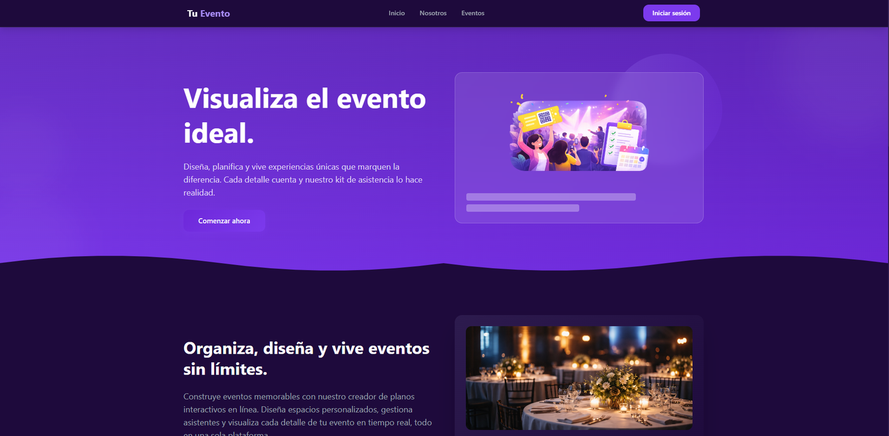

*Note.* View of the home page without an active session.

#### About us

Presents general information about Tu Evento: mission, vision, history, values and the members of the development team.

**Figure 2**

*About us section*

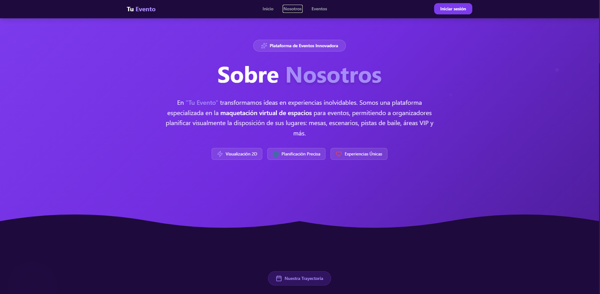

*Note.* Institutional information about the project and the team.

#### Events

Shows the published events that are still current.

**Figure 3**

*Public list of events*

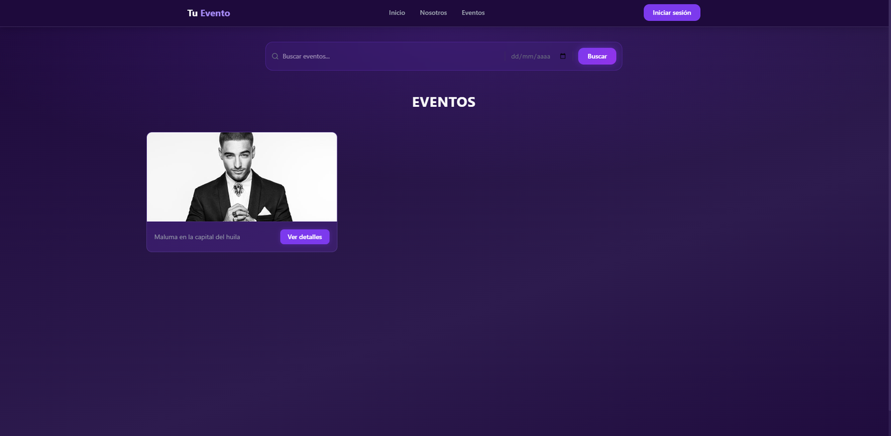

*Note.* Current events visible before logging in.

### Login

To access, press the "Iniciar Sesión" (log in) button at the top right. There you can choose the login method: an email already registered on the platform or a social network (Google or Facebook).

1. Open Tu Evento in an up-to-date browser.
2. Press the "Iniciar Sesión" button (top right).
3. Choose the login method: registered email, Google or Facebook.
4. Enter your data or authorize the access and confirm.

**Figure 4**

*Login screen*

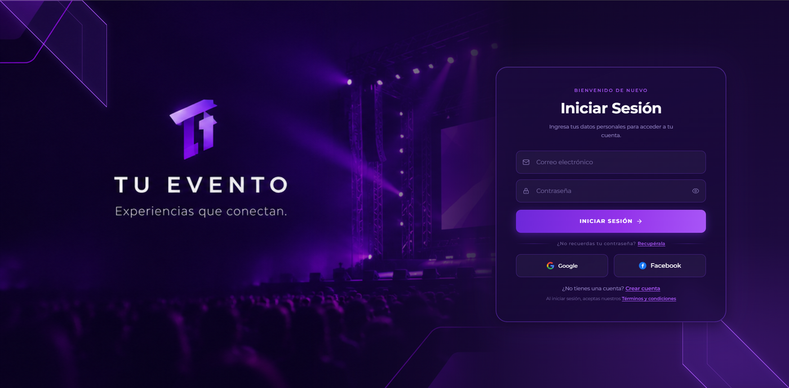

*Note.* Available methods: registered email, Google and Facebook.

### Terms and conditions

By registering and logging in, the user accepts the terms and conditions of Tu Evento, so it is recommended to read them carefully. They can be found at the bottom of the login screen, in the text "Al iniciar sesión, aceptas nuestros Términos y condiciones".

**Figure 5**

*Terms and conditions of use*

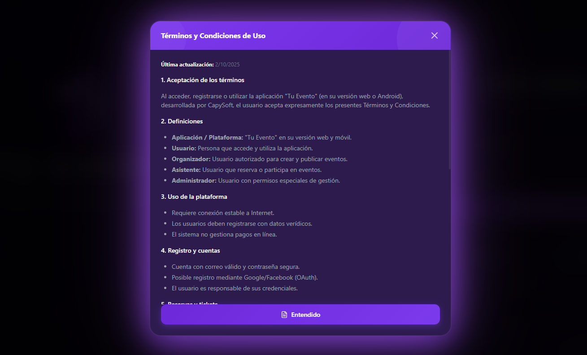

*Note.* Window with the terms and conditions; it closes with the "Entendido" button.

The Legal section of the site footer also links to the Terms of use and the Privacy policy, which explains how personal data is handled and how to request its deletion.

### Account registration

If it is your first time, you must register a Gmail email address. Registration is available from "Iniciar Sesión", below the Google and Facebook icons, in the text "¿No tienes una cuenta aún? Haz clic aquí".

1. On the login screen, click "¿No tienes una cuenta aún? Haz clic aquí".
2. Fill in the form with the requested information (Figure 6).
3. Create your password following the platform standards and confirm it.
4. Press "Registrarse". The message "¡Registro exitoso!" appears (Figure 7); continue with the "Continuar a Verificación" button.
5. Check your email: you will receive a message with the verification code (Figure 8).

**Figure 6**

*Registration form*

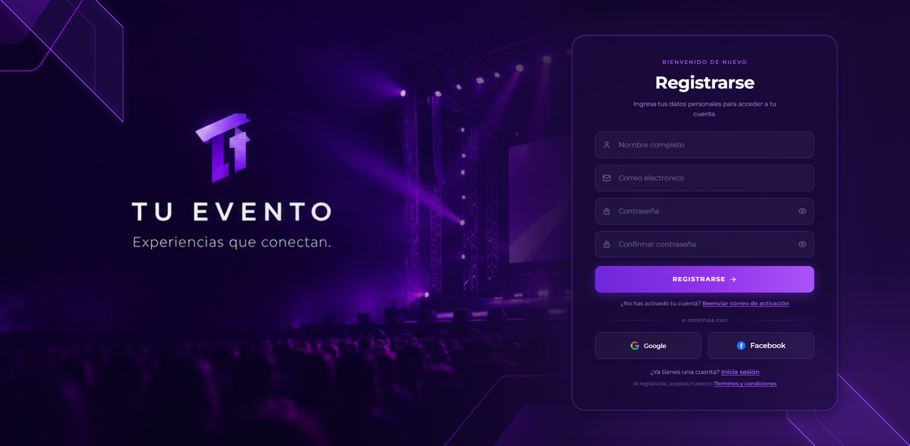

*Note.* Form with the data requested to create the account.

**Figure 7**

*Successful registration*

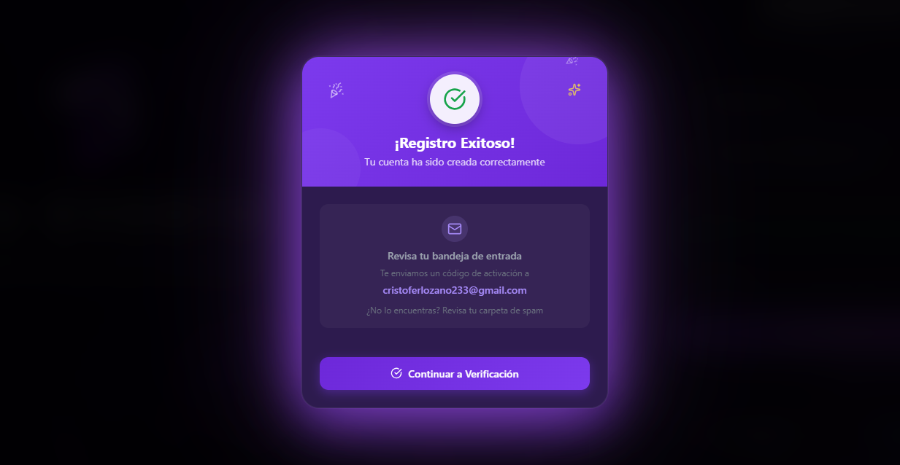

*Note.* Message that confirms the account was created and shows the email address the code was sent to.

**Figure 8**

*Account activation email*

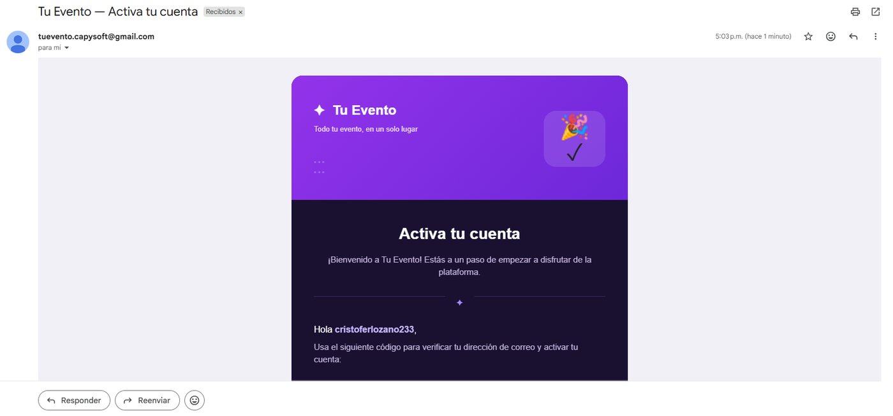

*Note.* Email that reaches the registered user's inbox, with the verification code.

During registration, the form asks for the account data and a password, which must be typed twice (password and confirmation). If the password does not meet the security requirements or does not match its confirmation, the form shows a notice indicating what must be corrected before continuing.

### Verification code

1. Open the email you received and copy the code.
2. Type the code in the "Código de activación" field of the Verificar Cuenta screen.
3. Press "Verificar". If you did not receive the email, use "Reenviar código".
4. Once confirmed, the message "¡Cuenta Activada!" appears; press "Continuar al Login".

**Figure 9**

*Account verification screen*

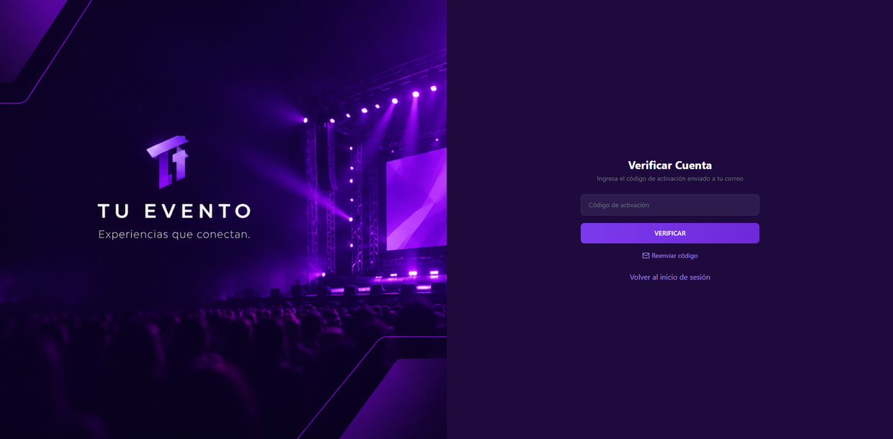

*Note.* Field where the code sent by email is entered, with the "Reenviar código" and "Volver al inicio de sesión" options.

**Figure 10**

*Account activated*

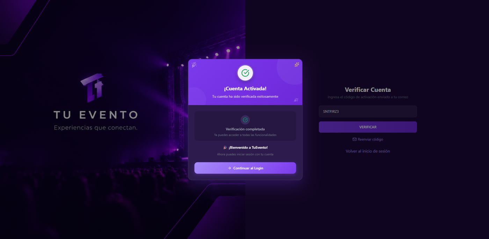

*Note.* Message confirming that verification was completed.

After this step, the account is created as an attendee user and the user can access more features of the platform.

### Password recovery

If you already have an account but forgot your password, you can recover it from "Iniciar Sesión", right below the password text box, in the text "¿No recuerdas tu contraseña? Recupérala."

1. On the login screen, click "¿No recuerdas tu contraseña? Recupérala."
2. Enter your email and press "Enviar" (Figure 11).
3. Check your email: you will receive a code needed to continue.
4. On the "Restablecer contraseña" (reset password) screen, enter the code, type the new password and confirm it (Figure 12).

**Figure 11**

*Forgot my password*

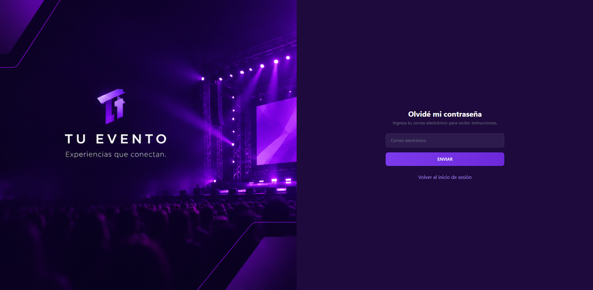

*Note.* Screen where the email is entered to receive the recovery code.

**Figure 12**

*Reset password*

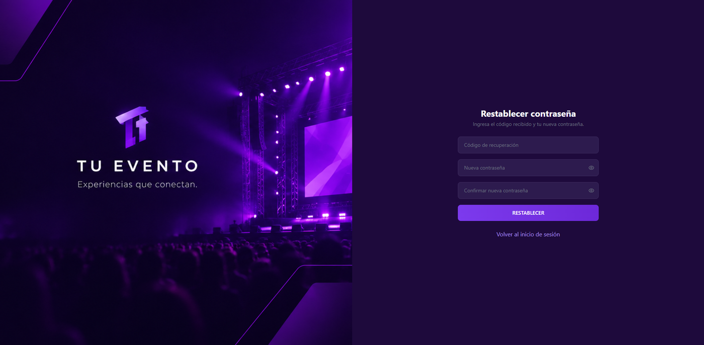

*Note.* Screen to enter the code, the new password and its confirmation.

Once completed, the user can access their account again. The password can be changed several times, although it is recommended to remember it.

## Web user (Attendee)

### General flow of the role

The attendee creates an account or logs in and explores the published events. After choosing one, they check its details, indicate how many seats they need and select them on the venue map. Then they confirm the purchase and pay with the available method (QR code, through the simulated payment gateway). When the payment is approved, they receive their tickets. They can also leave comments on events and request the organizer role if they want to create their own events.

### Interface description

After logging in, the top bar shows the Inicio, Nosotros, Eventos and Mis Eventos sections, plus the notifications icon and the user menu.

Each element of the top bar has a function: Inicio, Nosotros and Eventos move between the public sections; Mis Eventos gathers the user's events and tickets; the bell shows the account notifications; and the user menu gives access to the account options, including logging out.

### Modules and features

#### Exploring, searching and filtering events

The Eventos section lists the published and current events. From there you can search for an event and open its details.

1. Go to "Eventos" from the top bar.
2. Type the name of the event in the search bar, apply the available filters and press "Buscar".
3. On the card of the chosen event, press "Ver detalles".

**Figure 13**

*Search and list of events with an active session*

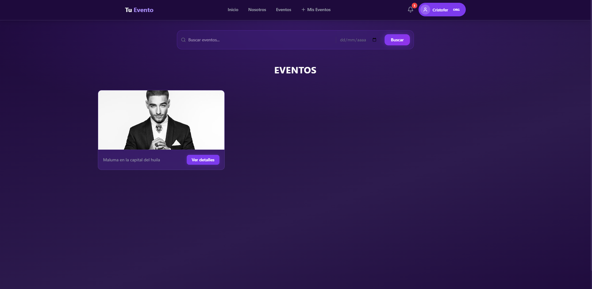

*Note.* Search bar and cards of the published events.

To search for an event, use the search bar above the list; published events are shown as cards with their main data and the "Ver detalles" button.

#### Event details and ticket purchase

To buy, the attendee chooses the number of seats, selects them by section on the venue map and pays. The seats remain reserved while the payment is processed.

1. From "Ver detalles", go to seat selection ("Selecciona tus sillas").
2. Indicate how many seats you want with the plus and minus buttons.
3. Choose the section (General, VIP, Box or Stand; each one has its own price) and select the seats on the map. They are added to "Tu Carrito" (your cart) with the total.
4. Press "Continuar al Pago".
5. In "Confirmar compra", check the seats and the total, choose the payment method (Código QR) and press "Pagar".
6. When the payment is approved, "¡Pago aprobado!" appears with your tickets. Press "Ver más eventos" to keep exploring.

**Figure 14**

*Event details*

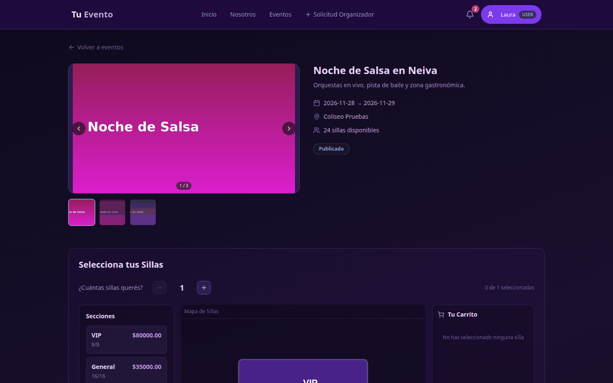

*Note.* Event information shown before seat selection.

**Figure 15**

*Seat selection*

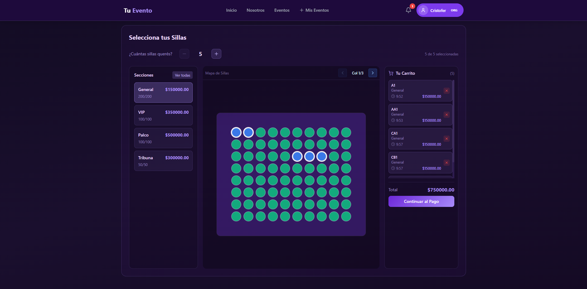

*Note.* Venue map with the sections, the chosen seats and the shopping cart.

**Figure 16**

*Purchase confirmation*

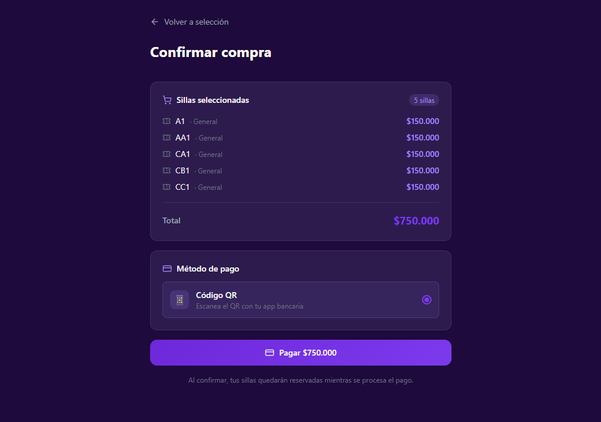

*Note.* Summary of seats, total and payment method (QR code) in the simulated payment gateway.

**Figure 17**

*Payment approved and tickets*

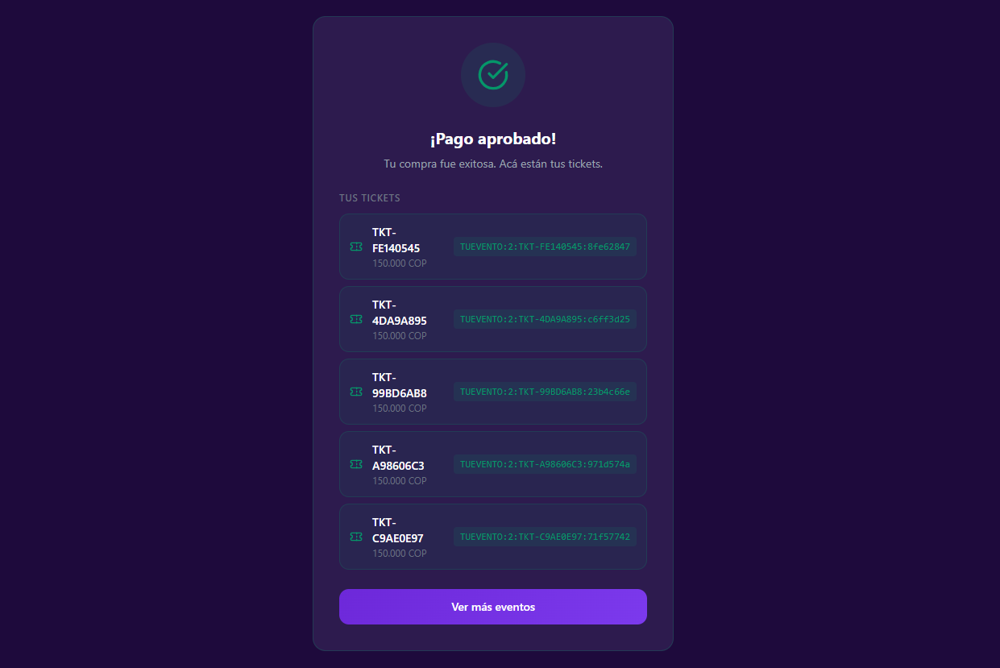

*Note.* Confirmation screen with the tickets generated for the purchase.

While the payment is processed, the seats remain reserved for the user and a timer with the remaining time is shown next to each one (the reservation lasts up to 10 minutes). If the time runs out, or if the payment is rejected or cancelled, the seats may become available to other users again and must be selected again on the venue map.

If you have balance in your wallet, in "Confirmar compra" you can choose "Usar cartera" (use wallet) to deduct it from the total; the remaining amount is paid through the payment gateway (see the Wallet section).

#### Comments and reviews

Each event has a comments section where users write their opinion, rate with stars and reply to other comments. Comments by the organizer are identified with the "Organizador" label.

1. Go to the "Comentarios" section of the event.
2. Write your comment in the text box and press the send button.
3. To reply to another comment, press "Responder".

**Figure 18**

*Event comments*

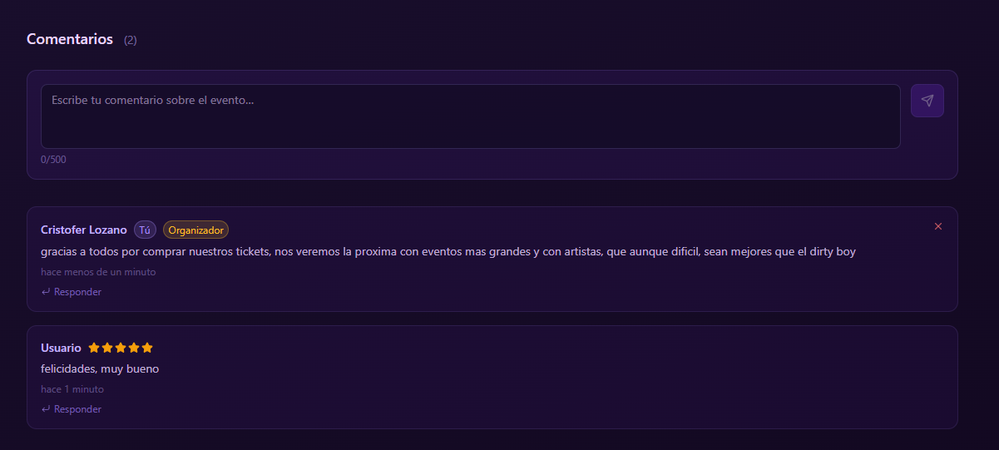

*Note.* Comments with star rating, replies and organizer label.

The rating goes from 1 to 5 stars and is given when the comment is sent. Commenting or replying requires being logged in, and each user can edit or delete their own comments.

#### Request to become an organizer

An attendee can request the organizer role by submitting an identity document. The request is reviewed by the administrator.

1. Press "Solicitud Organizador" in the top bar.
2. Check the required documents. Mandatory: citizenship card or ID, valid passport (foreigners) or official identity document. Optional: background certificate, course certificates and work references.
3. Drag the file to the box or press "Seleccionar archivo".
4. Press "Enviar solicitud".
5. The screen changes to "Tu solicitud está en revisión" (your request is under review). The team processes the information within 24 to 48 business hours.

**Figure 19**

*Organizer request*

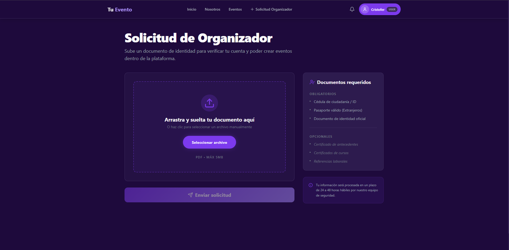

*Note.* Screen to upload the identity document and list of required documents.

**Figure 20**

*Request under review*

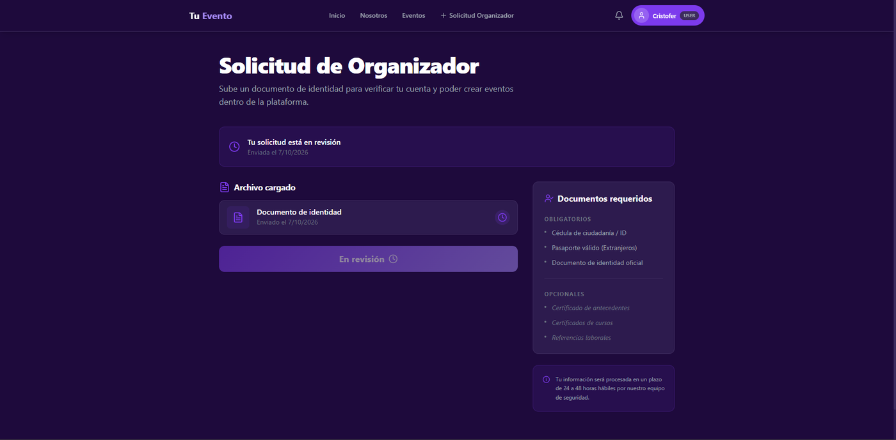

*Note.* Status of the request after it is sent, with the uploaded file.

When the administrator reviews the request, its status is updated on the request screen (for example, approved or rejected). If it was approved, the user gets the organizer role and the "+ Crear Evento" option appears in their top bar.

#### New attendee modules

#### My Events

This module gathers the tickets of the purchases made by the attendee.

- Press "Mis Eventos" in the top bar.
- Check the tickets of your purchases.

The web version shows the purchases and their tickets. The QR code presented at the event entry is generated from the mobile app (see the Mobile App User Manual).

#### Wallet

The wallet shows the user's available balance and the history of their transactions.

1. Open the user menu (top right) and choose "Cartera" (wallet).
2. Check the available balance and the transaction history, with date, status and amount.
3. To use the balance, press "Usar saldo en una compra" or choose "Usar cartera" when confirming a purchase.

**Figure 21**

*User wallet*

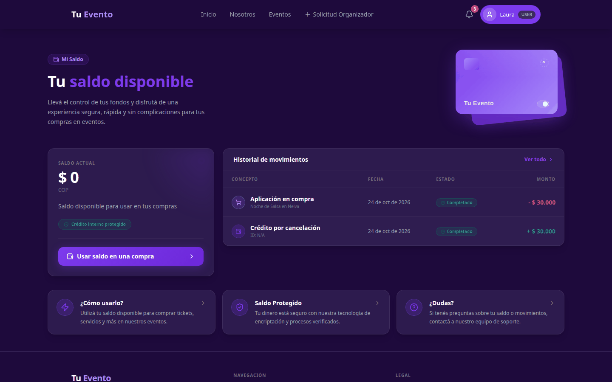

*Note.* Available balance and transaction history (purchases paid with the wallet and credits received).

If an event is cancelled, the amount paid for each ticket is refunded as a credit to the buyer's wallet, including the part paid through the payment gateway. The tickets of that event are marked as cancelled and can no longer be used; the credited balance can be used for future purchases.

#### Notifications

The system informs the user about events related to their account through notifications.

- Press the bell icon in the top bar.
- Read the notifications received.

**Figure 22**

*Notifications*

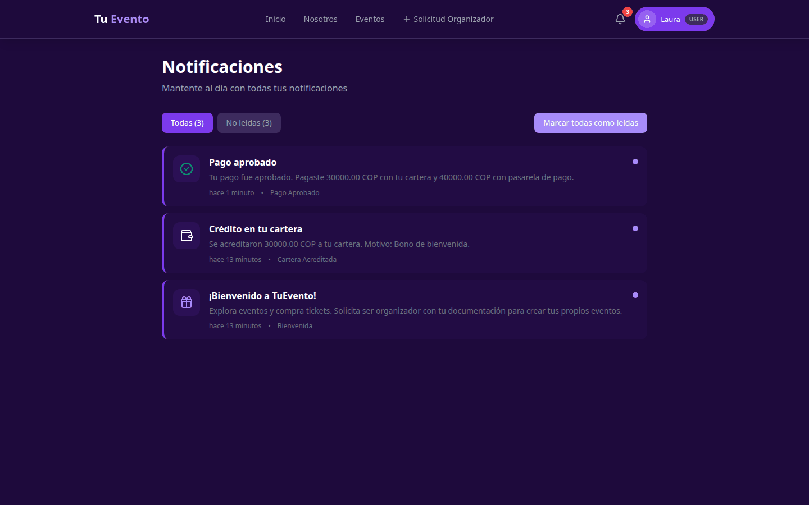

*Note.* Account notifications, with the "Todas" (all) and "No leídas" (unread) tabs and the "Marcar todas como leídas" (mark all as read) option.

Notifications report, for example, approved payments, wallet credits and changes to requests. They can also be opened from the "Notificaciones" option of the user menu.

#### Profile, language and theme

The profile gathers the user's personal data and platform preferences.

1. Open the user menu and choose "Perfil".
2. In "Información Personal", edit your full name and your biography (up to 255 characters) and press "Guardar cambios".
3. In "Idioma Preferido", choose the interface language: Spanish, English, French or Portuguese.
4. In "Tema Visual", browse the themes with the arrows and press "Aplicar tema".

**Figure 23**

*User profile*

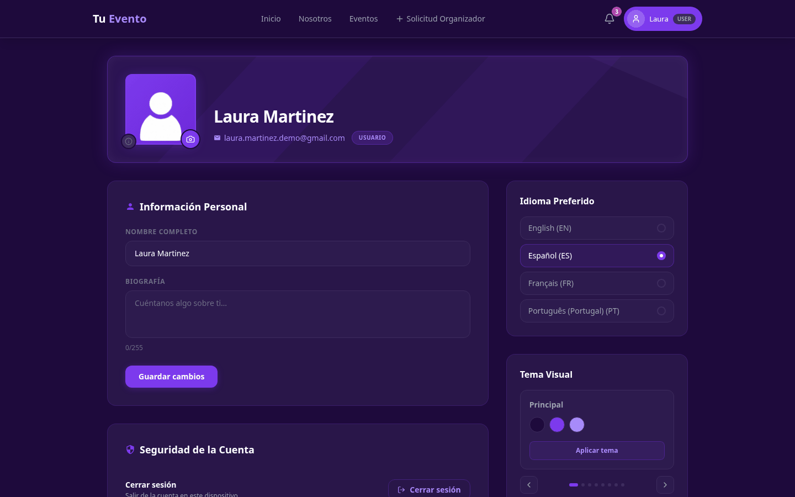

*Note.* Personal information, preferred language, visual theme and account security.

In "Seguridad de la Cuenta" (account security) you can log out and deactivate the account; the system asks to confirm this action before applying it. If the user logged in for the first time with Google or Facebook, the platform asks them to complete their profile data before continuing.

## Organizer user

### General flow of the role

When the administrator approves their request, the user sees the "+ Crear Evento" option in the navigation bar. The organizer creates the event in three steps (general information, site and images), designs the venue layout in the layout editor and, from My Events, submits the event for review. The administrator reviews it and decides whether to publish or reject it.

### Interface description

**Figure 24**

*Main interface of the organizer*

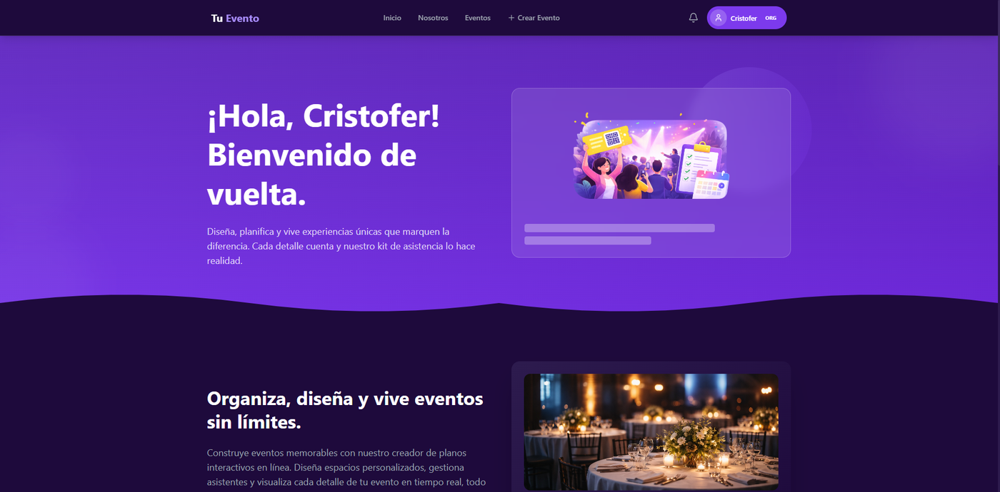

*Note.* When logged in as an organizer, the "+ Crear Evento" option appears in the navigation bar and leads to the event creation section.

### Modules and features

#### Creating events

Creation is divided into three guided steps: Información general (general information), Sede (site) and Imágenes (images). A progress bar shows which step the organizer is on.

1. Press "+ Crear Evento" in the navigation bar.
2. Step 1, general information: type the name and description, set the start and end dates, indicate whether the event is public and select the category, department and city. Press "Siguiente".
3. Step 2, site: select a site from the drop-down list. If the city has no sites, press "Crear nueva sede", fill in the name, address, maximum capacity and location on the map, and press "Registrar sede".
4. With the site selected, press "Crear evento".
5. Step 3, images: press "Seleccionar imágenes" and then "Subir y continuar". This step is optional: you can press "Omitir por ahora" and add the images later from "Mis Eventos".

**Figure 25**

*Event creation, step 1: general information*

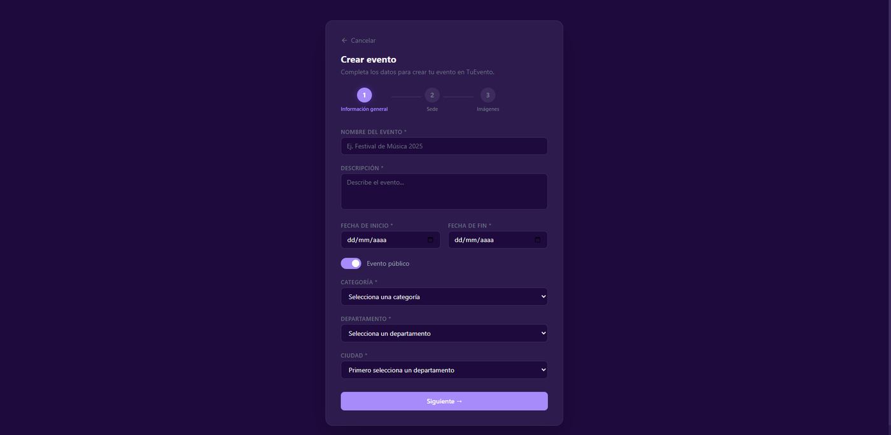

*Note.* Form with the basic data of the event.

**Figure 26**

*Event creation, step 2: city without sites*

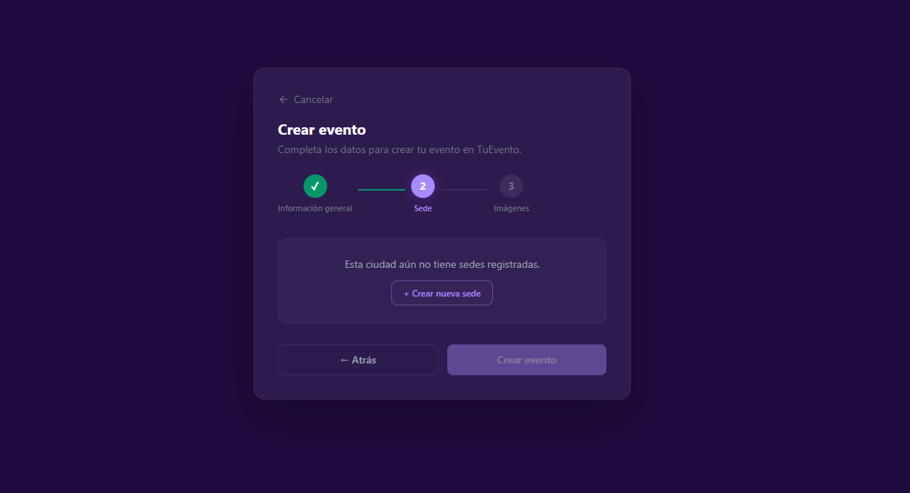

*Note.* When the city has no registered sites, a button to create a new one is offered.

**Figure 27**

*Registration of a new site*

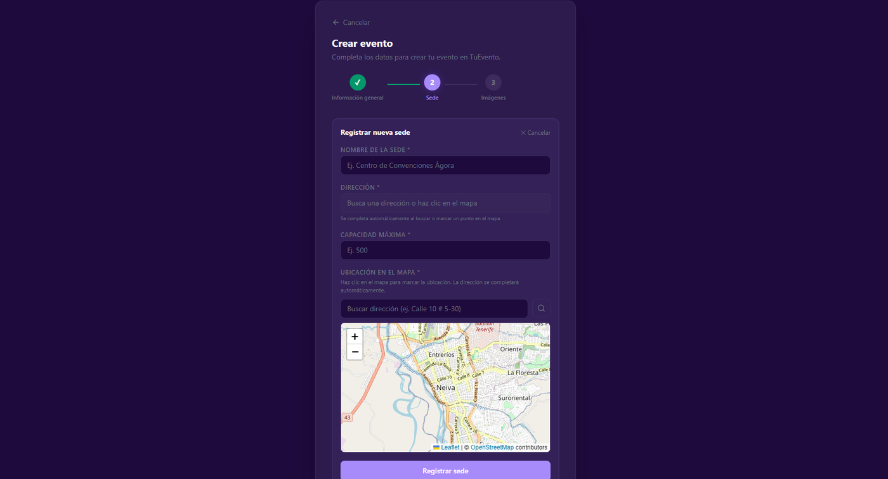

*Note.* Site form with its location on the map.

**Figure 28**

*Selection of an existing site*

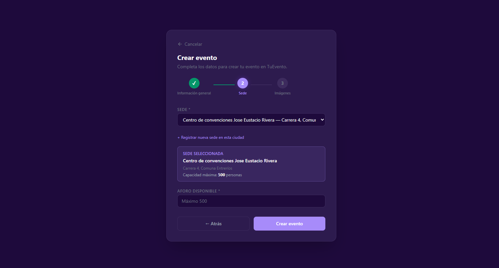

*Note.* When sites exist, they are listed in a drop-down and the capacity of the chosen site is shown.

**Figure 29**

*Event creation, step 3: images*

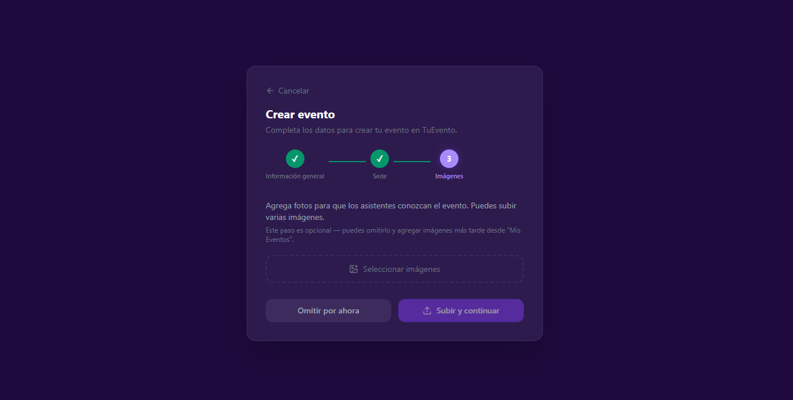

*Note.* Optional upload of the event images.

#### Editing events

To modify an event, go to My Events and press the pencil icon in the event actions. In the "Editar evento" window you can change the name, the description, the start and end dates, the available seats and the category; then press "Guardar cambios". An event cannot be edited while it is under review: you must first withdraw it from review.

**Figure 30**

*Editing an event*

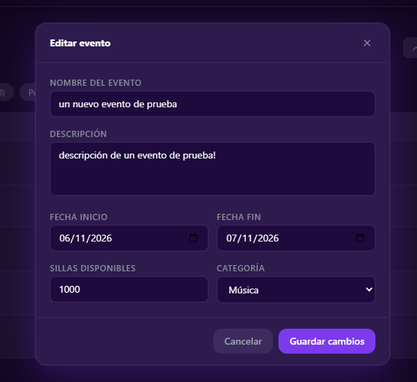

*Note.* "Editar evento" window with the name, description, dates, available seats and category.

#### Venue layout design and sections

The layout editor is used to draw the venue layout. On the left are the available elements: the sections (General, VIP, Box and Stand) and the infrastructure (stage, screen, dance floor, entrance, exit, bar and restrooms). The canvas is in the center and, on the right, the "Secciones del mapa" list shows the properties of the selected element. At the top there are tools for zoom, undo, redo, clear and save.

1. Open the layout editor of your event.
2. Drag the sections to the canvas and place them according to the venue.
3. Add the infrastructure elements you need, such as the stage or the entrances.
4. Select each section to see its properties in the right panel.
5. Press "Guardar" to keep the layout design.

**Figure 31**

*Layout editor with an empty canvas*

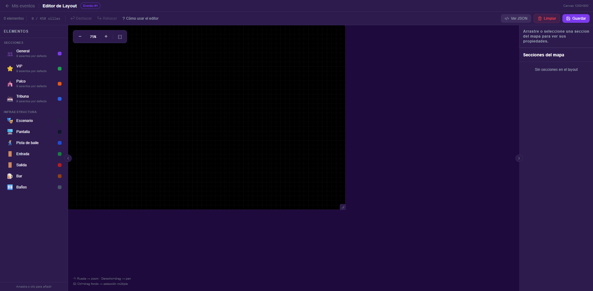

*Note.* Starting point: element panels, canvas and map sections.

**Figure 32**

*Finished venue layout design*

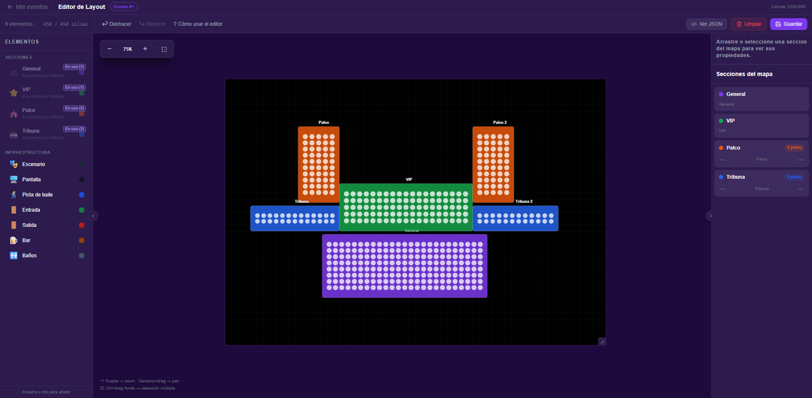

*Note.* Example of a venue with General, VIP, Box and Stand sections placed on the canvas.

The "Cómo usar el editor" button shows the guide for the venue editor, and the "Ver JSON" button shows the structure of the designed floor plan in JSON format.

#### Publishing events

Publication is not immediate: the organizer submits the event for review and the administrator decides whether to publish it.

1. Go to "Mis Eventos". It lists the events you are working on, with their status (for example, Borrador, draft) and filters by status.
2. In the "Estado" column of the event, open the list and choose the publish option.
3. Confirm in the "¿Enviar este evento a revisión?" window by pressing "Sí, enviar a revisión".

**Figure 33**

*Organizer's My Events*

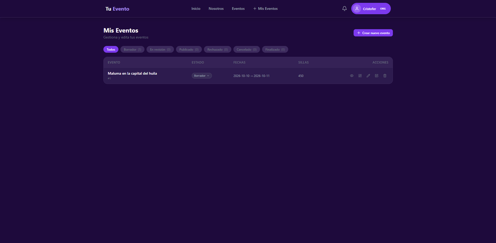

*Note.* This section shows the events the organizer is working on; publication can be requested from the "Estado" column, with the publish option of the drop-down.

**Figure 34**

*Submitting an event for review*

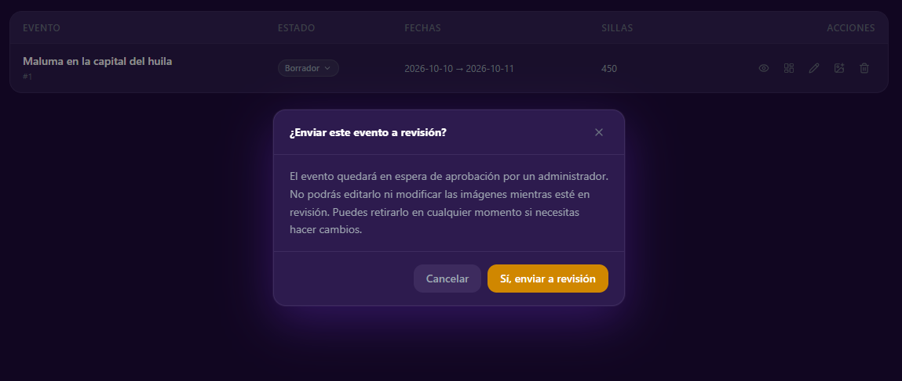

*Note.* While the event is under review it cannot be edited and its images cannot be changed; the organizer can withdraw it at any time to make changes.

When the administrator publishes the event, it becomes visible to attendees. If it is rejected, the event is not published and the organizer can review it, adjust it and submit it for review again. While the event is under review, the organizer can withdraw it at any time.

#### Organizer earnings

The "Tus ganancias" (your earnings) panel summarizes the revenue the organizer collected from their events. It is read-only: the actual collection is handled directly by the platform.

1. Go to "Mis Eventos".
2. Press the "Mis ganancias" (my earnings) button at the top.
3. Check the indicators and the breakdown by event.

**Figure 35**

*Organizer earnings panel*

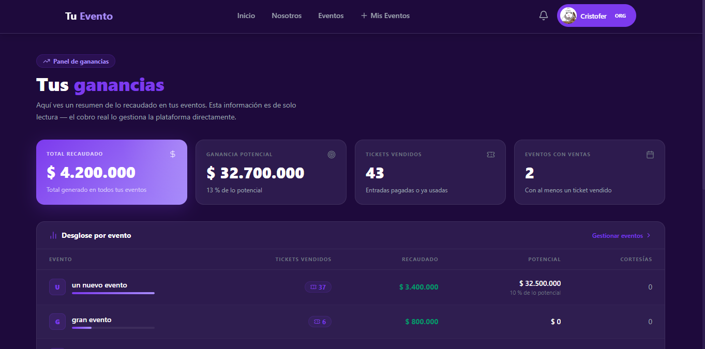

*Note.* Indicators of total collected, potential earnings, tickets sold and events with sales, and breakdown by event.

The indicators show the **total collected** across all events, the **potential earnings** if all seats were sold, the **tickets sold** and the **events with sales**. The breakdown by event details the tickets sold, the amount collected, the potential and the courtesy tickets of each event; from there, "Gestionar eventos" leads back to My Events.

#### New organizer modules

The organizer also has My Events, the wallet, notifications and the profile, which work the same as for the attendee (see the New attendee modules section), plus the earnings panel described in the previous section.

## Administrator user

### General flow of the role

The administrator accesses a panel with a side menu (Dashboard, Financial Control, Events, Reports, Refunds, Requests, Users, Categories, Section Types and Translations). They review the requests of users who want to become organizers, checking their documents, review the events submitted for review to publish or reject them, and manage the platform catalogs.

### Interface description

**Figure 36**

*Main interface of the administrator*

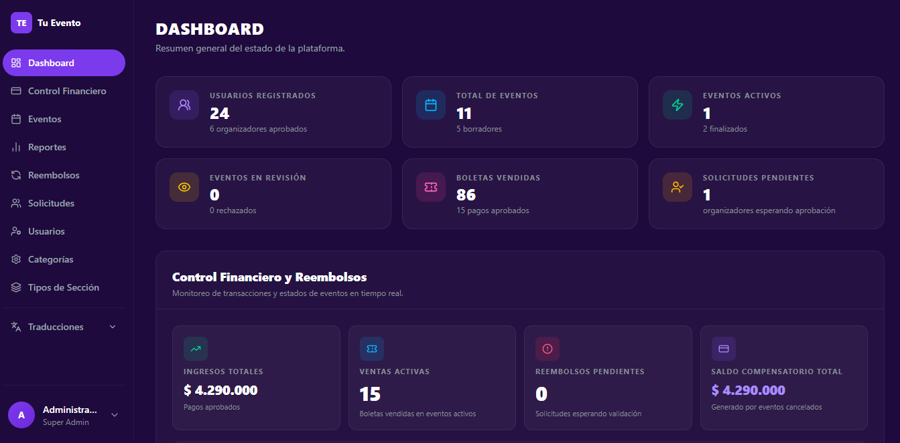

*Note.* Administration panel with the side menu of modules.

The Dashboard is the initial screen of the administration panel and summarizes the activity of the platform: registered users, total events, active events, events under review, tickets sold and pending requests. Below, the "Control Financiero y Reembolsos" block shows the total revenue, active sales, pending refunds and total compensatory balance, and the recent activity appears at the end. The side menu gives access to the following modules:

- Dashboard: general summary of the panel.
- Financial Control: economic follow-up of the platform.
- Events: review and publication of events.
- Reports: platform reports.
- Refunds: management of payment refunds.
- Requests: review of the requests to become an organizer.
- Users: registered users, their roles and the organizers.
- Categories and Section Types: catalogs used by organizers to create events and design their layout.
- Translations: texts of events, categories, section types, comments and profiles in other languages.

### Modules and features

#### Organizer requests

This module lists the requests sent by users who want to create events. They can be filtered by status: Todas (all), Pendientes (pending), Aprobadas (approved) and Rechazadas (rejected). The table shows the user, email, document, date, status and actions.

1. Press "Solicitudes" in the side menu.
2. Filter by status, for example "Pendientes".
3. Open the request with the icon in the "Acciones" column and review the submitted document.
4. Approve or reject the request.

**Figure 37**

*Organizer requests*

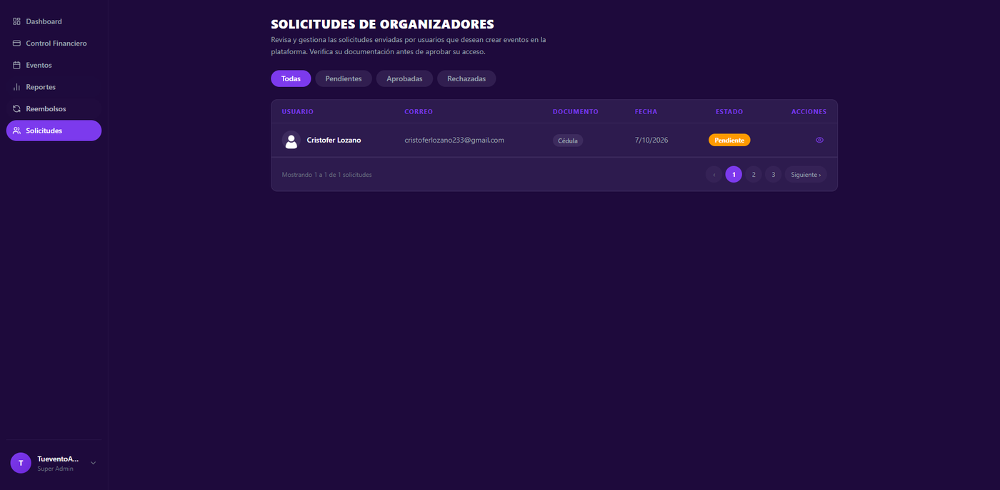

*Note.* List of requests with their status and filters.

When opening a request, the administrator reviews the attached document and decides with the buttons whether to approve or reject it. After the decision, the status of the request is updated in the list.

#### Publishing events

The events that organizers submit for review appear in "Eventos" with the "En revisión" (under review) status. The administrator reviews their information and decides whether to publish them.

1. Press "Eventos" in the side menu and filter by "En revisión".
2. Open the event details: modality, status, section structure with capacity and prices, organizer and available tickets.
3. Press "Publicar" to approve it or "Rechazar" to send it back.

**Figure 38**

*Event management*

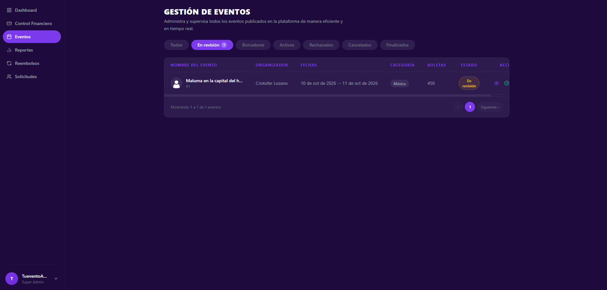

*Note.* List of the platform events, with filters by status such as "En revisión".

**Figure 39**

*Approving the publication of an event*

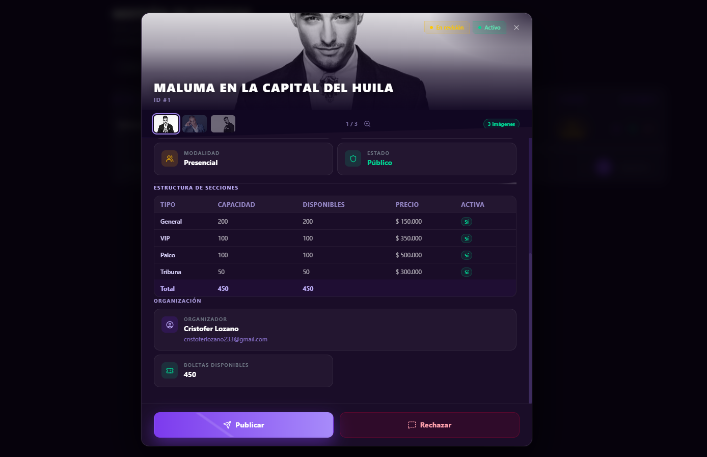

*Note.* Details of the event under review with the "Publicar" and "Rechazar" buttons.

#### New administrator modules

In addition to reviewing requests and events, the side menu includes the following management modules:

- Financial Control: tracks the economic activity of the platform.
- Reports: gathers the platform reports.
- Refunds: manages the refunds of payments made.
- Users: shows the users, their roles and the approved organizers.
- Categories: creates and edits the categories used to classify events.
- Section Types: manages the section types (for example, General, VIP, Box or Stand) of the layout editor.
- Translations: reviews and adjusts the translations of events, categories, section types, comments and profiles.

## Validation messages and frequent errors

The following table lists the messages the system may show and how to solve them.

**Table 3**

*Validation messages and frequent errors*

| Situation | Message shown | Cause | Solution |
|---|---|---|---|
| Wrong or expired verification code | The system indicates that the code is not valid or has expired. | The code was typed incorrectly or its validity period ended. | Check the code in the email received; if it expired, request a new one. |
| Password that does not meet the standards | The form indicates that the password does not meet the security requirements. | The password does not meet all the requirements. | Adjust the password as the form indicates and try again. |
| Password and confirmation do not match | The form indicates that the password and its confirmation do not match. | The two fields were typed differently. | Type the password and its confirmation again, exactly the same. |
| Payment rejected or cancelled | The payment gateway reports that the payment was rejected or cancelled. | The payment was not approved by the gateway or the user cancelled it. | Repeat the purchase process from seat selection. |
| Seats no longer available | The system reports that some of the seats are no longer available. | Another user reserved or bought the seat before the purchase was completed. | Go back to the venue map and choose other seats. |
| Invalid file in the organizer request | The system indicates that the file is not valid. | The file has an unsupported format or cannot be read. | Upload the identity document again in a readable file with a supported format. |
| Cancelled event | The ticket appears as cancelled and cannot be used. | The organizer or the administrator cancelled the event. | Check your wallet: the amount paid is refunded as a credit. |

## Usage recommendations

- Use an up-to-date browser and a stable internet connection.
- Use a Gmail email account you can access, since you will receive the verification codes there.
- Read the terms and conditions before registering.
- Create a password you can remember; if you forget it, you can recover it from the login screen.
- Log out when you finish if you use a shared computer.
- Attendee: complete the payment without delay, since the seats are only reserved while it is processed.
- Organizer: check the data, the site and the images before submitting the event for review, since you will not be able to edit it while it is under review.
- Administrator: verify the applicant's documents and the event information before approving.

## Glossary

**Table 4**

*Glossary of terms*

| Term | Definition |
|---|---|
| Administrator | User in charge of supervising the platform, reviewing organizer requests and approving or rejecting the publication of events. |
| Attendee | User who registers and takes part in the events published on the platform. |
| Verification code | Number the system sends by email to confirm that the account or the password change belongs to the user. |
| QR code | Image that is scanned with the bank app to make a payment. |
| Event | Activity created by an organizer for which attendees can register. |
| Layout | Floor plan of the venue that the organizer draws in the editor, with its sections and elements. |
| Layout design | Process of visually designing the distribution of a space or event (sections, capacity and attendee location). |
| Validation message | Text the system shows to indicate errors or to confirm actions performed by the user. |
| Microservice | Small, independent program that performs a specific function within the system, such as processing simulated payments. |
| Browser | Program to open websites, such as Chrome, Edge or Firefox. |
| Organizer | User enabled to create, design the layout of and publish events. |
| Simulated payment | Payment process that reproduces how a real payment gateway works without connecting to it. |
| Payment gateway | Service that processes online payments. In this version, Tu Evento uses its own simulated payment gateway; Wompi (n.d.) is the planned real gateway. |
| Role | Profile that determines the features available to a user within the system (attendee, organizer or administrator). |
| Section | Area defined within the layout design of an event (for example, VIP, General, Box, Stand). |
| Site | Physical place where an event takes place, with its address, location on the map and maximum capacity. |
| Session | Period of time during which a user remains authenticated on the platform. |
| Organizer request | Request made by a user to obtain the organizer role, subject to the administrator's approval. |
| Ticket | Digital proof of the purchase of a seat for an event. |
| Wallet | Module that shows the user's available balance and the history of their transactions. |
| Refund | Return of the money of a payment already made, managed from the administrator panel. |
| Dashboard | Initial screen of the administration panel, which summarizes the activity of the platform. |
| Notification | Notice the system shows the user, through the bell icon, about events related to their account. |
| Earnings | Organizer panel that summarizes the amount collected and sold in their events. |
| Visual theme | Combination of interface colors that each user can choose from their profile. |
| Translation | Version in another language of the texts created on the platform, such as events or categories. |

## References

Santos Ortiz, J., and Lozano Contreras, C. D. (2026a). *TuEvento: Manual de instalación* [TuEvento: Installation manual] (Version 1.0). CapySoft.

Santos Ortiz, J., and Lozano Contreras, C. D. (2026b). *TuEvento: Manual técnico* [TuEvento: Technical manual]. CapySoft.

Santos Ortiz, J., and Lozano Contreras, C. D. (2026c). *TuEvento: Manual de usuario de la aplicación móvil* [TuEvento: Mobile app user manual] (Version 1.0). CapySoft.

Wompi. (n.d.). *Documentación de Wompi* [Wompi documentation]. https://docs.wompi.co/

---

<!--
id: TE-0159
title: "User manual — mobile app"
lang: en
source: Manual_Usuario_Movil_v1.0.docx (version 1.0; editable source delivered in ADSO-3145556, 04-final-delivery/10-your-event/08-manuals)
source_sha256: bcfcb9c50877398c257f797c8d4f2e7c6c4b1bc37029a3a124b2d3b87fbacc2d
conversion: "own converter from the DOCX XML (Python 3.13); English translation of es/ following GLOSARIO_ES_EN.md"
converted_on: 2026-11-05
fidelity: completa
losses:
  - "Word presentation adapted to Markdown: the automatic table of contents, page breaks and the page number header are not reproduced."
  - "Interface labels are kept in Spanish, in quotes, as they appear in the screenshots; the text inside the images is not translated."
status: borrador
reviewed_by: ""
-->

# User manual — mobile app

**Tu Evento – Capysoft**

**User Manual, mobile app**

**Version 1.0**

Capysoft developers:

Cristofer David Lozano Contreras

Jhampier Santos Ortiz

Análisis y Desarrollo de Software (ADSO; Software Analysis and Development)

Ficha (training group): 3145556

Instructor: Karol Daniela Correa

Servicio Nacional de Aprendizaje (National Learning Service) – SENA

CIES – Regional Huila

November 5, 2026

## Version control

The following table presents the history of changes made to this document.

**Table 1**

*Revision history of the manual*

| Version | Date | Description of the change | Owner |
|---|---|---|---|
| 1.0 | 05/11/2026 | Creation of the user manual of the "Tu Evento" mobile app: installation, access, features by role, frequent messages and evidence of operation on iOS. | Cristofer David Lozano Contreras |

## Introduction

This user manual describes clearly and in detail how to use the "Tu Evento" mobile app, developed by Capysoft. The app complements the web platform: it lets attendees explore events, buy tickets and show them at the event entrance with a QR code, and it lets organizers validate those tickets with the phone camera.

Creating, designing the layout of and publishing events are done from the web platform and are described in the Web User Manual (Santos Ortiz and Lozano Contreras, 2026c). The technical terms used in this document are explained in the Glossary at the end of the manual.

## Objective

To explain step by step how to install the "Tu Evento" mobile app and how to use its features according to the user's role (attendee, organizer or administrator), so that anyone can use it independently, without technical knowledge and without direct assistance from the development team.

## Scope

This manual covers:

- Downloading and installing the app on Android devices.
- Registration, login and password recovery from the app.
- Exploring events, selecting seats and buying tickets.
- Viewing the purchased tickets and generating their QR code.
- The wallet, notifications and the user profile (language and theme).
- Ticket validation by the organizer.
- The administration panel available in the app.
- The evidence of the app running on iOS.

This manual does not cover:

- Creating, editing, designing the layout of and publishing events, which are done from the web platform (see the Web User Manual; Santos Ortiz and Lozano Contreras, 2026c).
- Server installation or system deployment (see the Installation Manual; Santos Ortiz and Lozano Contreras, 2026a).
- Technical aspects of programming, architecture or database (see the Technical Manual; Santos Ortiz and Lozano Contreras, 2026b).
- Publishing the app in the app stores (Google Play or App Store).

## General description of the app

### Presentation of the app

The "Tu Evento" mobile app uses the same account and the same information as the web platform: events, purchases, the wallet and notifications are synchronized between both. Its bottom bar has three entries: Inicio (home), Eventos (center button) and Perfil (profile). From Inicio, the quick-access buttons lead to Buscar eventos, Mis tickets, Mi billetera and Notificaciones.

Note on payments: as in the web version, tickets are paid through a simulated payment provided by a microservice developed by the Capysoft team, which reproduces the flow of the Wompi payment gateway (Wompi, n.d.).

### Usage requirements

- An Android phone with a stable internet connection.
- Free space to install the app (the installer takes about 165 MB).
- Permission to install apps from unknown sources, since the app is distributed as an APK file.
- Camera permission, only for the organizer who validates tickets.
- A Gmail email account you can access, to receive the verification codes.

### User roles

The app keeps the same roles as the web platform, as summarized in Table 2.

**Table 2**

*User roles in the mobile app*

| Role | Description | Features in the app |
|---|---|---|
| Attendee | User who registers and takes part in the published events. | Explore events, choose seats, buy tickets, show the QR code of their tickets, use the wallet and manage their profile. |
| Organizer | User enabled to create events (from the web). | Everything the attendee can do, plus validating the tickets of their events with the camera. |
| Administrator | User who supervises the platform. | Administration panel with the same modules as the web version. |

*Note.* The organizer role requires the administrator's approval, which is requested from the web platform.

## Installing the app

The app is distributed as an APK installation file downloaded from the "Tu Evento" website.

1. From the phone browser, go to tuevento-capysoft.tech.
2. Open the app download option and press "Descargar APK" (Figure 1).
3. When the download finishes, open the file from the phone's Downloads folder.
4. If the phone asks for it, allow the browser to install apps from unknown sources.
5. Press "Instalar" in the "¿Deseas instalar esta app?" window (Figure 2).
6. When it finishes, open the app from the TuEvento icon.

**Figure 1**

*Downloading the app*

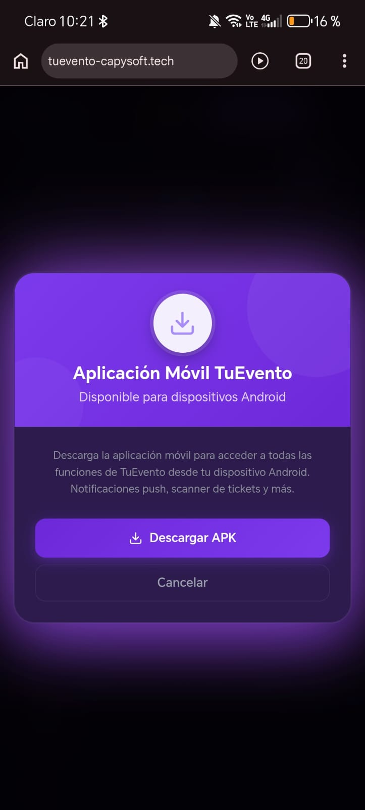

*Note.* "Aplicación Móvil TuEvento" window of the website, with the "Descargar APK" button.

**Figure 2**

*Installing the APK file*

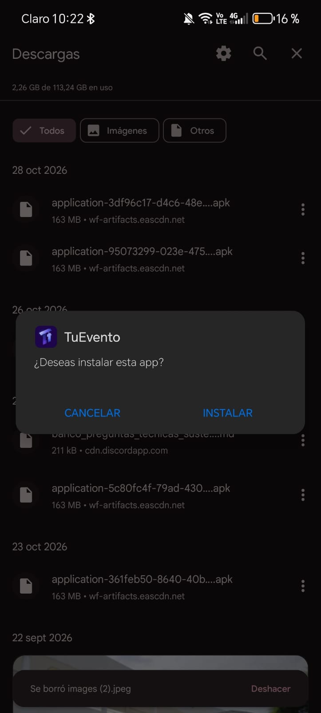

*Note.* Android confirmation to install the downloaded app.

Android may show a warning because the app does not come from Google Play. This is normal for apps installed from an APK file.

## Access to the app

### Login

When the app opens without an active session, the "Iniciar Sesión" (log in) screen is shown. The flag button at the top right changes the app language.

1. Type your email and your password.
2. Press "Iniciar Sesión". You can also log in with "Iniciar sesión con Google".
3. If you forgot your password, press "¿No recuerdas tu contraseña?" and follow the steps: enter your email, type the code you will receive and set the new password.

**Figure 3**

*Login*

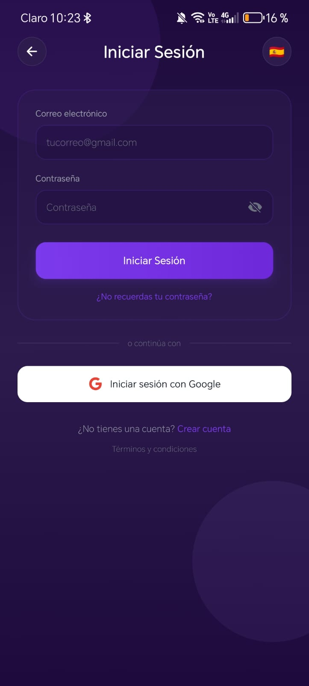

*Note.* Login with email and password or with Google, and links to recover the password and create an account.

By logging in or creating an account, the user accepts the Terms and conditions of "Tu Evento", which can be read from the link at the bottom of the screen.

### Account registration

1. On the login screen, press "Crear cuenta".
2. Type your full name, your email and a password of at least 8 characters that includes uppercase letters and numbers.
3. Press "Crear cuenta".
4. Check your email, copy the activation code and type it on the verification screen to activate the account. If you did not receive it, use "Reenviar correo de activación".

**Figure 4**

*Account registration*

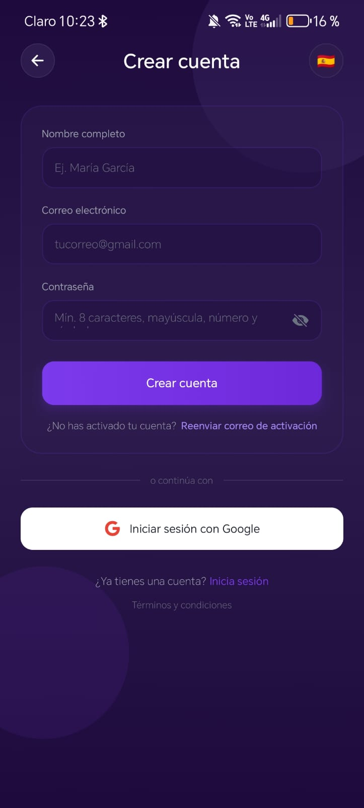

*Note.* "Crear cuenta" form with the full name, the email and the password.

## Attendee user

### General flow of the role

The attendee explores the published events, opens the details of an event, chooses their seats on the venue map and pays. Their tickets are kept in "Mis entradas" (my tickets), where they generate the QR code shown at the event entrance.

### Exploring events

1. Press the center button of the bottom bar or the "Buscar eventos" quick-access button.
2. Type the name of the event in "Buscar eventos..." or filter by category (for example, Populares, Todas or Deportes).
3. On the event card, press "Ver detalles".

**Figure 5**

*List of events*

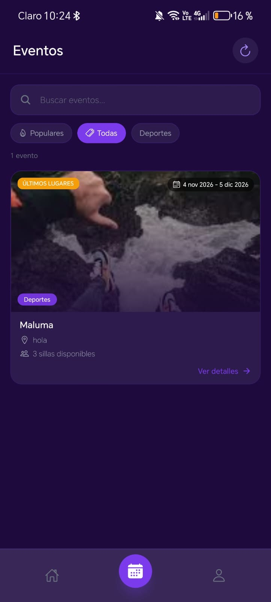

*Note.* Search, category filters and event card with its dates, location and available seats.

### Seat selection and purchase

1. In the event details, check the gallery and the event information.
2. In "Mapa de Sillas" (seat map), indicate how many seats you need with the plus and minus buttons.
3. Choose the section (each one shows its price and available seats) and tap the seats on the map. Available seats are shown in green.
4. Check "Tu Carrito" (your cart) and press "Ir al pago".
5. In "Confirmar compra", check the seats and the total, choose "Pago normal" (regular payment) or "Usar cartera" (use wallet) and the "Código QR" payment method.
6. Press "Pagar" and complete the payment.

**Figure 6**

*Event details and seat map*

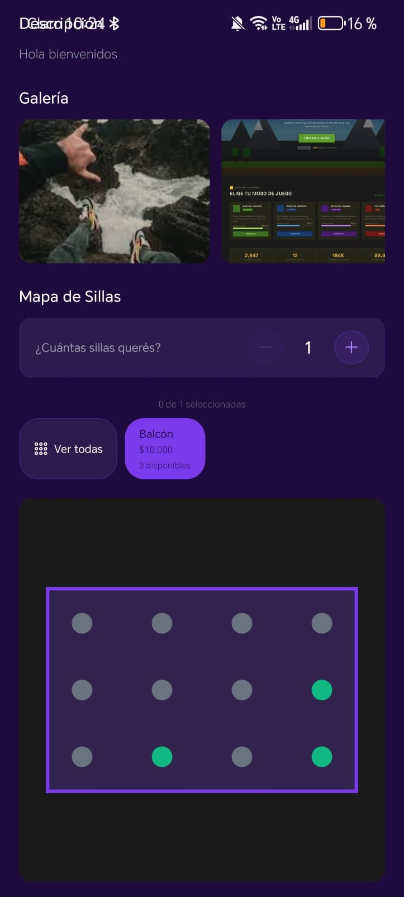

*Note.* Event gallery, number of seats, sections with their price and venue map.

**Figure 7**

*Purchase confirmation*

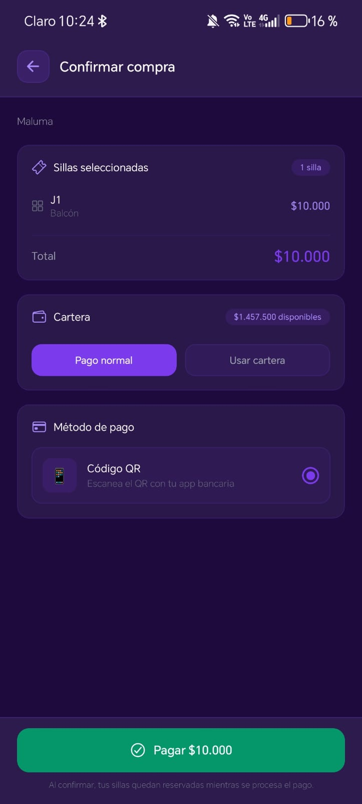

*Note.* Summary of the seats, total, use of the wallet and payment method.

The chosen seats remain reserved for a limited time (up to 10 minutes) while the payment is completed. If the time runs out or the payment is rejected, the seats become available again and must be chosen again.

### My tickets and QR code

Each purchase generates an order with one or more tickets. The QR code of the order is the one shown to the organizer at the event entrance.

1. From Inicio, press "Mis tickets".
2. Find the order of the event. Each ticket shows its code and its status (for example, "Válido", valid).
3. Press "QR orden" to show the code of the whole order, or "QR" for a single ticket.
4. Show the code to the organizer at the event entrance.

**Figure 8**

*My tickets*

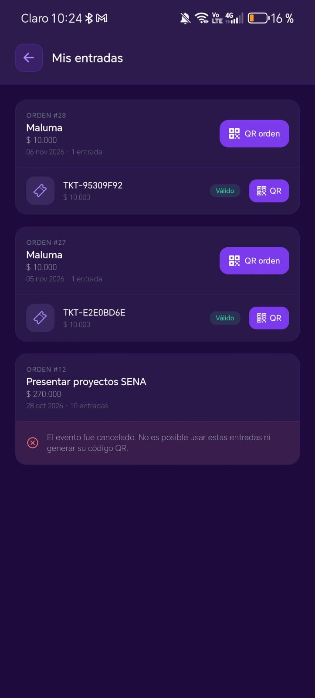

*Note.* Orders with their tickets and statuses; the tickets of a cancelled event cannot be used.

**Figure 9**

*QR code of the order*

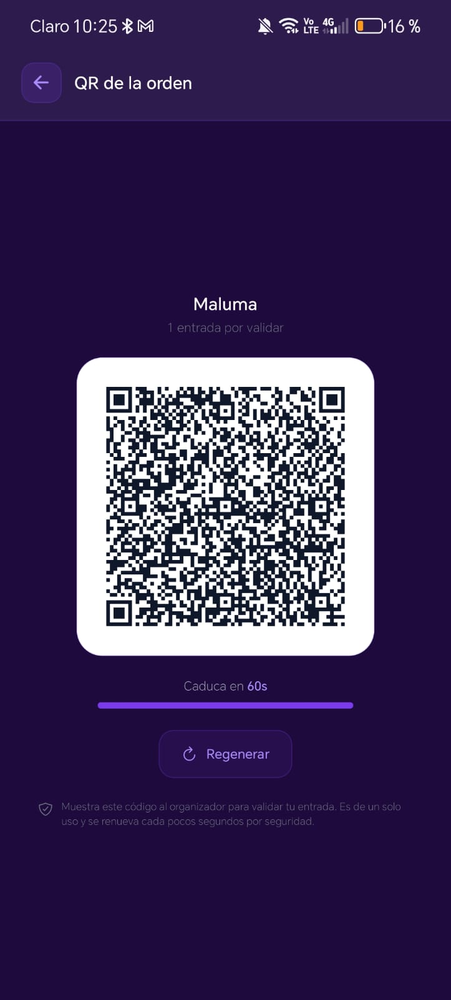

*Note.* Single-use QR code, with its validity time and the "Regenerar" button.

For security, the QR code expires after a few seconds and is renewed automatically; a new one can also be generated with "Regenerar". If the event was cancelled, the order shows it and its code cannot be generated.

### Wallet

The wallet shows the user's available balance and the history of their transactions.

1. From Inicio, press "Mi billetera" (my wallet).
2. Check the available balance and the history of credits and purchases.
3. To use the balance, press "Usar saldo en una compra" or choose "Usar cartera" when confirming a purchase.

**Figure 10**

*User wallet*

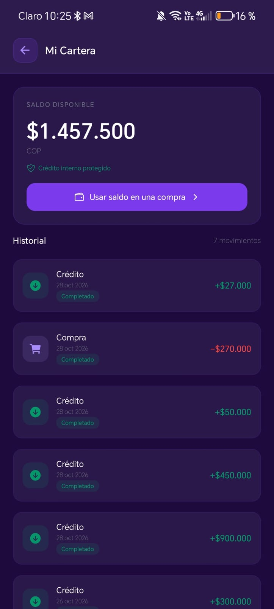

*Note.* Available balance and transaction history.

If an event is cancelled, the amount paid for each ticket is refunded as a credit to the buyer's wallet.

### Notifications

The bell icon on the Inicio screen, or the "Notificaciones" quick-access button, shows the account notices, such as approved payments, wallet credits or the validation of a ticket at the event entrance.

### Profile, language and theme

1. Press "Perfil" in the bottom bar.
2. In "Información Personal", edit your full name and your biography and press "Guardar cambios".
3. In "Idioma Preferido", choose Spanish, English, French or Portuguese.
4. In "Personalizar tema", choose and customize the app colors.

**Figure 11**

*User profile*

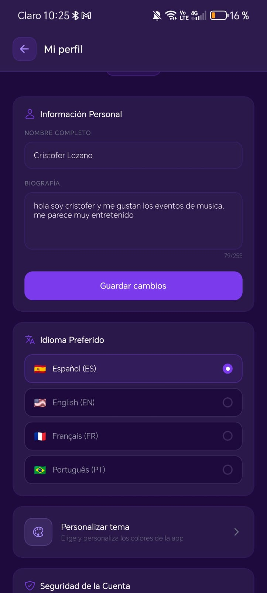

*Note.* Personal information, preferred language and theme customization.

"Seguridad de la Cuenta" (account security) has the options to log out and deactivate the account.

## Organizer user

### General flow of the role

The organizer creates and publishes their events from the web platform. In the mobile app, in addition to the attendee features, they have "Validar entradas" (validate tickets) to control entry to the event with the phone camera.

### Ticket validation

1. Press "Perfil" in the bottom bar and, in the Organizador section, choose "Validar entradas".
2. The first time, press "Permitir cámara" to give access to the camera.
3. Point the camera at the QR code the attendee shows.
4. Wait for the result: "¡Entrada válida! Puedes ingresar" (valid ticket, you may enter) means the ticket was validated.
5. Press "Escanear otra" to continue with the next attendee.

**Figure 12**

*Scanning the QR code*

*Note.* The camera reads the QR code of the order shown by the attendee.

**Figure 13**

*Validated ticket*

*Note.* Result of a successful validation, with the number of validated tickets and the order.

Each QR code can only be used once. If it is scanned again, the app shows "Entrada ya escaneada" (ticket already scanned); if the code does not belong to a valid ticket, it shows "QR no válido" (invalid QR). When the ticket is validated, the attendee receives the confirmation in their app.

## Administrator user

When logging in as an administrator, the app shows the "Panel de administración" (administration panel), with the same modules as the web platform adapted to the phone.

**Figure 14**

*Administration panel*

*Note.* Modules available to the administrator in the app.

- Dashboard: overview of the platform.
- Financial Control: payments and refunds.
- Events: management and review of events.
- Reports: platform statistics.
- Refunds: management of refunds.
- Requests: requests to become an organizer; the number shows the pending ones.
- Users: roles and organizers.
- Categories and Section Types: catalogs used by organizers.
- Translations: texts of events, categories, comments and profiles in other languages.

How each module works is described in the Web User Manual (Santos Ortiz and Lozano Contreras, 2026c).

## Evidence of operation on iOS

The app was developed with React Native and Expo, technologies that allow it to run on both Android and iOS. To verify that it works on iOS, the team ran it on the Xcode iOS simulator, on a Mac computer provided by instructor Carlos Julio Cadena Sarasty. The test conditions are summarized in Table 3.

**Table 3**

*iOS test conditions*

| Aspect | Detail |
|---|---|
| Simulated device | iPhone SE (3rd generation) |
| Operating system | iOS 18.3 |
| Tool | iOS Simulator (Xcode) on macOS |
| Verified flows | Home, event details with comments, shopping cart and My tickets |
| Result | The app worked correctly in the verified flows |
| Distribution | Not distributed for iOS; the official distribution is the APK file for Android |

The app is not published for iOS because installing it on an iPhone outside the simulator requires a paid Apple Developer Program membership. Figure 15 to Figure 18 show the app running; the device name and the iOS version appear in the top left corner of each screenshot.

**Figure 15**

*Home screen on iOS*

*Note.* Greeting to the user, quick-access buttons and indicators of the Inicio screen.

**Figure 16**

*Event details on iOS*

*Note.* Comments section of the event with its rating.

**Figure 17**

*Shopping cart on iOS*

*Note.* Seat selected on the venue map and cart with the total and the "Ir al pago" button.

**Figure 18**

*My tickets on iOS*

*Note.* Orders and tickets of the user. This screenshot was taken with the app set to English, one of the languages the app offers.

## Validation messages and frequent errors

Table 4 lists the messages the app may show and how to solve them.

**Table 4**

*Validation messages and frequent errors*

| Situation | Message shown | Cause | Solution |
|---|---|---|---|
| Installation blocked | Android prevents installing the downloaded file. | The phone does not allow installing apps from unknown sources. | Allow installation from unknown sources for the browser or the file manager and open the APK again. |
| Expired QR code | The organizer cannot validate the code. | The QR code expired before it was scanned. | Press "Regenerar" and show the new code. |
| Ticket already used | "Entrada ya escaneada". | The code of that ticket was already validated. | Check with the organizer; each ticket allows only one entry. |
| Code not recognized | "QR no válido". | The code does not belong to a "Tu Evento" ticket. | Ask the attendee to open the code from "Mis tickets". |
| Camera without permission | "Necesitamos la cámara" (we need the camera). | Camera permission has not been granted to the app. | Press "Permitir cámara" or enable it in the phone settings. |
| Cancelled event | The order shows that the event was cancelled. | The organizer or the administrator cancelled the event. | Check your wallet: the amount paid is refunded as a credit. |
| Seats not available | The chosen seats no longer appear as available. | Another user reserved them or the reservation time ran out. | Go back to the venue map and choose other seats. |

## Usage recommendations

- Download the app only from the official "Tu Evento" website.
- Keep a stable internet connection during the purchase and the ticket validation.
- Complete the payment without delay, since the seats are only reserved for a limited time.
- Open the QR code when entering the event and raise the screen brightness to make it easier to read.
- Organizer: validate tickets in a well-lit place.
- Log out if you share the phone with other people.

## Glossary

**Table 5**

*Glossary of terms*

| Term | Definition |
|---|---|
| APK | Installation file for Android apps. |
| Attendee | User who registers and takes part in the published events. |
| Wallet | Module that shows the user's available balance and the history of their transactions. |
| QR code | Code that identifies an order or a ticket and that the organizer scans at the event entry. |
| Ticket | Digital proof of the purchase of a seat for an event. |
| Order | Purchase made by the user, which groups one or more tickets. |
| Organizer | User enabled to create events and validate their tickets. |
| Unknown source | App installed from a file and not from an official store. |
| iOS Simulator | Xcode tool that runs iPhone apps on a Mac computer. |
| Validation | Reading of the QR code that confirms a ticket is valid and records the entry. |

## References

Santos Ortiz, J., and Lozano Contreras, C. D. (2026a). *TuEvento: Manual de instalación* [TuEvento: Installation manual] (Version 1.0). CapySoft.

Santos Ortiz, J., and Lozano Contreras, C. D. (2026b). *TuEvento: Manual técnico* [TuEvento: Technical manual]. CapySoft.

Santos Ortiz, J., and Lozano Contreras, C. D. (2026c). *TuEvento: Manual de usuario web* [TuEvento: Web user manual] (Version 3.3). CapySoft.

Wompi. (n.d.). *Documentación de Wompi* [Wompi documentation]. https://docs.wompi.co/
