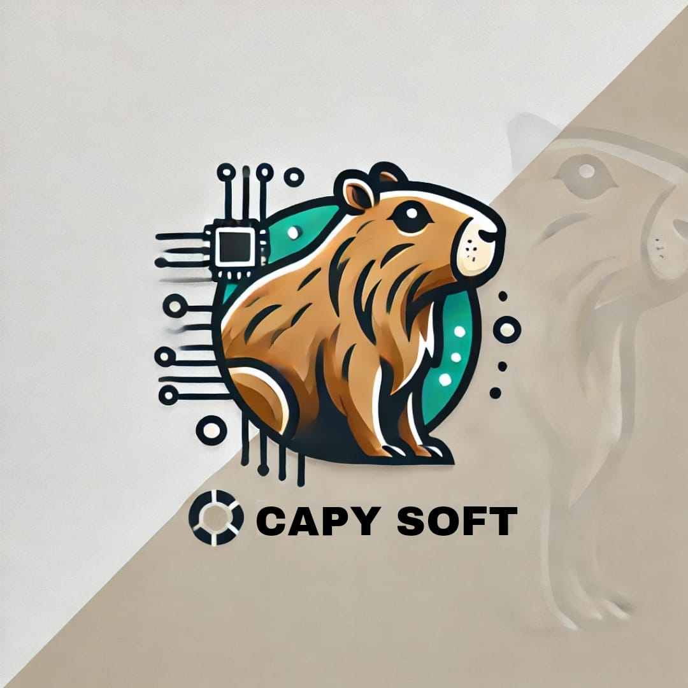
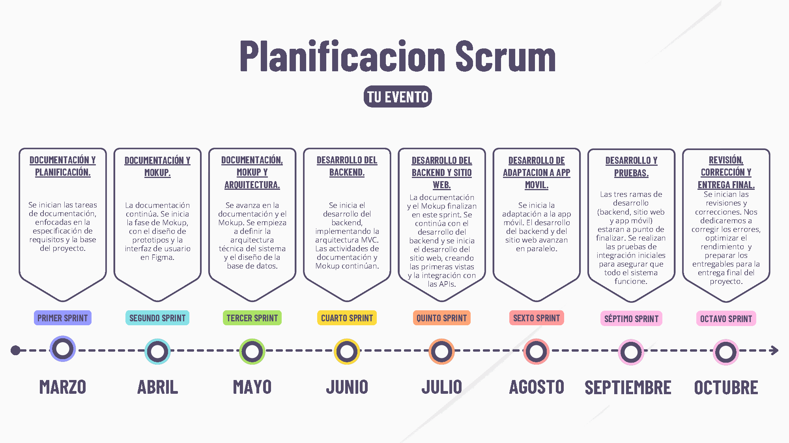
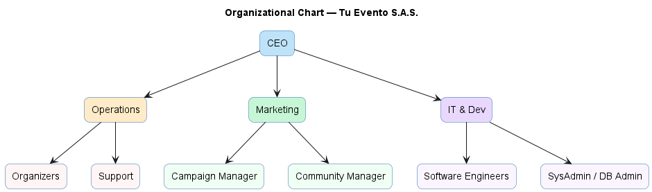
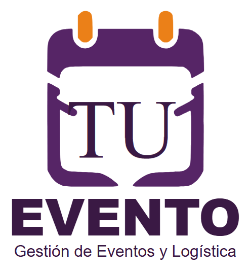

# Documento general del proyecto — Tu Evento

> Documento consolidado de Tu Evento. Reúne los documentos siguientes, cuyo contenido se conserva sin cambios; los metadatos de conversión de cada uno van en un comentario HTML al inicio de su sección.

**Contenido**

1. [Alcance del proyecto](#doc-te-0004)
2. [Metodología seleccionada](#doc-te-0009)
3. [Planificación Scrum (línea de tiempo)](#doc-te-0010)
4. [Tu Evento S.A.S. — documento empresarial](#doc-te-0017)
5. [Análisis de costos](#doc-te-0001)

---

<!--
ruta_anterior: es/01_Especificacion_Requisitos/Alcance_Proyecto_TuEvento.md
id: TE-0004
title: "Alcance_Proyecto_TuEvento"
lang: es
source: 01_Especificacion_Requisitos/Alcance_Proyecto_TuEvento.docx
source_sha256: aa16d4f223c9d48a7fdeec5b3124c376fe6a690b174523fa2fa53b81824429af
conversion: "pandoc 3.9 (-t gfm --wrap=none --extract-media) + extracción de encabezados/pies; sin revisión manual"
converted_on: 2026-10-23
fidelity: pendiente_revision
losses:
  - "Encabezados y pies de página extraídos aparte (pandoc no los convierte); en el original se repiten en cada página. Los campos se muestran como {PAGE}, {NUMPAGES}."
status: borrador
reviewed_by: ""
-->

# Alcance del proyecto

**CapySoft**

*Equipo de Desarrollo — Tecnólogo en Análisis y Desarrollo de Software*

**DOCUMENTO DE ALCANCE DEL PROYECTO**

**Proyecto: TuEvento**

Versión 1.0

|  |  |
|:--:|:--:|
| **Campo** | **Detalle** |
| **Equipo de Desarrollo** | CapySoft |
| **Proyecto** | TuEvento |
| **Documento** | Alcance del Proyecto |
| **Versión** | 1.0 |
| **Ficha** | 3145556 |
| **Integrantes** | Jhampier Santos Ortiz Cristofer David Lozano Contreras |

# **2. Control de Versiones**

|  |  |  |  |
|:--:|:--:|:--:|:--:|
| **Versión** | **Fecha** | **Descripción del cambio** | **Autor(es)** |
| 1.0 | Julio de 2026 | Elaboración inicial del Documento de Alcance del Proyecto TuEvento, con base en el SRS versión 1.0. | Jhampier Santos Ortiz, Cristofer David Lozano Contreras |

# **3. Tabla de Contenido**

[**2. Control de Versiones** [2](#control-de-versiones)](#control-de-versiones)

[**3. Tabla de Contenido** [3](#tabla-de-contenido)](#tabla-de-contenido)

[**4. Introducción** [4](#introducción)](#introducción)

[**5. Objetivo General** [4](#objetivo-general)](#objetivo-general)

[**6. Objetivos Específicos** [4](#objetivos-específicos)](#objetivos-específicos)

[**7. Alcance del Proyecto** [4](#alcance-del-proyecto)](#alcance-del-proyecto)

[**7.1 Descripción general del sistema** [4](#descripción-general-del-sistema)](#descripción-general-del-sistema)

[**7.2 Qué incluye el proyecto** [5](#qué-incluye-el-proyecto)](#qué-incluye-el-proyecto)

[**7.3 Módulos que serán desarrollados** [5](#módulos-que-serán-desarrollados)](#módulos-que-serán-desarrollados)

[**7.4 Actores que participan** [5](#actores-que-participan)](#actores-que-participan)

[**7.5 Procesos que cubre el sistema** [5](#procesos-que-cubre-el-sistema)](#procesos-que-cubre-el-sistema)

[**8. Funcionalidades Incluidas** [6](#funcionalidades-incluidas)](#funcionalidades-incluidas)

[**9. Funcionalidades Fuera del Alcance** [7](#funcionalidades-fuera-del-alcance)](#funcionalidades-fuera-del-alcance)

[**10. Entregables del Proyecto** [8](#entregables-del-proyecto)](#entregables-del-proyecto)

[**11. Restricciones del Proyecto** [8](#restricciones-del-proyecto)](#restricciones-del-proyecto)

[**12. Supuestos del Proyecto** [9](#supuestos-del-proyecto)](#supuestos-del-proyecto)

[**13. Criterios de Aceptación del Alcance** [9](#criterios-de-aceptación-del-alcance)](#criterios-de-aceptación-del-alcance)

[**14. Conclusiones** [9](#conclusiones)](#conclusiones)

# **4. Introducción**

El presente documento tiene como propósito establecer de manera formal el Alcance del Proyecto "TuEvento", desarrollado por la empresa CapySoft, tomando como base exclusiva la información contenida en el Documento de Especificación de Requerimientos de Software (SRS) versión 1.0 del proyecto.

El Alcance del Proyecto delimita de forma clara y precisa qué funcionalidades, módulos, actores y procesos serán abordados durante el desarrollo del sistema, así como aquellos aspectos que quedan explícitamente excluidos. Este documento constituye una herramienta fundamental para la gestión del proyecto, ya que permite alinear las expectativas de los interesados, evitar la ampliación no controlada de requisitos (scope creep) y establecer criterios objetivos para determinar cuándo el proyecto se considera completado.

El proyecto "TuEvento" corresponde a una plataforma integral, en versión web y móvil, orientada a la creación, administración y operación de eventos, permitiendo a los organizadores gestionar planos, asientos y reservas, y a los asistentes visualizar, reservar y adquirir boletas de forma segura.

# **5. Objetivo General**

Definir y delimitar el alcance del proyecto "TuEvento", especificando las funcionalidades, módulos, actores y procesos que serán desarrollados con base en el Documento de Especificación de Requerimientos de Software (SRS), con el fin de garantizar una gestión de proyecto eficiente y una comunicación clara entre todos los interesados.

# **6. Objetivos Específicos**

- Delimitar las funcionalidades incluidas y excluidas del proyecto "TuEvento", conforme a los requerimientos funcionales y no funcionales establecidos en el SRS.

- Identificar los módulos, actores y procesos que serán cubiertos por el sistema en sus versiones web y móvil.

- Establecer los entregables formales del proyecto, incluyendo el software y la documentación asociada.

- Determinar las restricciones técnicas, tecnológicas y de plataforma que condicionan el desarrollo del sistema.

- Definir los criterios de aceptación que permitirán validar el cumplimiento del alcance acordado.

# **7. Alcance del Proyecto**

## **7.1 Descripción general del sistema**

"TuEvento" es una aplicación web y móvil desarrollada por CapySoft, cuyo objetivo es proporcionar a organizadores y asistentes una herramienta integral para la planificación, gestión y participación en eventos. El producto se desarrollará bajo una arquitectura modular orientada a microservicios, con un backend basado en una API RESTful desarrollada en Java (versión 21) con Spring Boot, y una base de datos relacional PostgreSQL (versión 17) gestionada mediante Spring Data JPA. La seguridad del sistema se sustenta en autenticación mediante JWT y Refresh Token.

La versión web permite a los organizadores maquetar planos, configurar asientos, publicar eventos, gestionar ventas y controlar la asistencia mediante validación de códigos QR. La versión móvil (Android e iOS) permite a los asistentes visualizar eventos, seleccionar y comprar boletas mediante la pasarela de pagos sandbox, destinada a pruebas del flujo de pago, recibir notificaciones push, acceder a sus tickets digitales y escanear códigos QR para validar su ingreso.

## **7.2 Qué incluye el proyecto**

- Gestión de usuarios: registro, inicio y cierre de sesión, autenticación con JWT y Refresh Token, recuperación y cambio de contraseña, creación y eliminación de cuentas, personalización de perfil, y vinculación opcional con redes sociales en la versión web.

- Gestión de eventos: creación, edición, eliminación y publicación de eventos por parte de organizadores, incluyendo la maquetación del plano del lugar desde la versión web, con definición de precios, zonas, asientos y disponibilidad.

- Reservas, compras y asistencia: compra de boletas desde la aplicación móvil y web, selección de asientos desde el plano disponible, generación de tickets con códigos QR únicos, validación de asistencia mediante lectura QR e integración con una pasarela de pagos sandbox conectada al backend.

- Interacción del usuario: valoraciones y comentarios de eventos, notificaciones push, recordatorios automáticos, sistema de compartir eventos, filtros de búsqueda avanzados y configuración de preferencias de notificaciones.

- Compatibilidad multiplataforma: disponibilidad en versión web (Google Chrome y Microsoft Edge) y en aplicaciones móviles para Android e iOS, garantizando visualización de eventos, compra de boletas, escaneo de QR y manejo de perfil en ambas plataformas.

- Seguridad: autenticación basada en JWT, sistema de Refresh Token, validación de credenciales, auditoría de renovaciones y registros, enrutamiento seguro, protección mediante API Gateway y control de roles.

## **7.3 Módulos que serán desarrollados**

Con base en los requerimientos funcionales especificados en el SRS, el proyecto desarrollará los siguientes módulos: Gestión de Usuarios, Gestión de Administración, Gestión de Eventos, Reservas y Control de Asistencia, Compatibilidad Móvil, Idiomas, Dashboard por Rol, Seguridad de Sesión, Notificaciones, Pagos, Arquitectura y Preferencias/Personalización (temas de interfaz), Exploración de Eventos y Cartera Digital. El detalle de cada módulo y su respectivo requerimiento funcional se presenta en la sección 8 de este documento.

## **7.4 Actores que participan**

|  |  |
|:--:|:--:|
| **Tipo de actor** | **Actividades principales** |
| **Usuario (asistente)** | Reservar asientos, comentar y calificar eventos, crear cuenta, desactivar cuenta, restablecer contraseña y elegir eventos. |
| **Usuario (anónimo, solo web)** | Crear cuenta, iniciar sesión y realizar búsqueda de eventos. |
| **Administrador** | Observar los usuarios que desean volverse organizadores, y aceptar o rechazar dichas solicitudes. |
| **Usuario (organizador)** | Crear modelos (planos), guardar avances del diseño del modelo, ver historial de eventos creados y eliminar eventos ya creados. |

## **7.5 Procesos que cubre el sistema**

- Registro, verificación, autenticación e inicio/cierre de sesión de usuarios.

- Gestión y personalización del perfil de usuario, incluyendo la recuperación de contraseña y la eliminación permanente de cuenta.

- Validación y aceptación o rechazo de solicitudes de usuarios que desean convertirse en organizadores.

- Creación, maquetación, edición y publicación de la estructura (plano) de los eventos por parte de los organizadores.

- Reservación y bloqueo temporal de asientos, confirmación de pago y generación de códigos QR asociados a la reserva.

- Validación de asistencia mediante lectura de código QR en el ingreso al evento.

- Procesamiento de pagos mediante la pasarela de pagos sandbox y gestión de saldo mediante el sistema de cartera digital.

- Envío de notificaciones push y recordatorios automáticos a los usuarios.

- Visualización, búsqueda y filtrado de eventos, así como valoración y comentarios sobre los mismos.

- Presentación de dashboards diferenciados según el rol del usuario (asistente, organizador o administrador).

# **8. Funcionalidades Incluidas**

A continuación, se resumen los módulos y requerimientos funcionales (RF) definidos en el SRS que serán desarrollados dentro del alcance del proyecto "TuEvento".

|  |  |  |
|:--:|:--:|:--:|
| **Módulo** | **Código** | **Funcionalidad** |
| Gestión de Usuarios | **RF1** | Registro de usuario |
| Gestión de Usuarios | **RF2** | Autenticación con redes sociales (OAuth) |
| Gestión de Usuarios | **RF3** | Inicio de sesión de usuario |
| Gestión de Usuarios | **RF4** | Gestión y personalización del perfil |
| Gestión de Usuarios | **RF5** | Recuperar contraseña |
| Gestión de Usuarios | **RF6** | Cerrar sesión |
| Gestión de Usuarios | **RF7** | Eliminación permanente de cuenta |
| Gestión de Administración | **RF8** | Módulo de administración del sistema (validación de solicitudes de organizador) |
| Gestión de Eventos | **RF9** | Edición y maquetación de la estructura del evento |
| Reservas y Control de Asistencia | **RF10** | Reservación de asientos |
| Reservas y Control de Asistencia | **RF11** | Generación y validación de código QR por reserva |
| Compatibilidad Móvil | **RF12** | Funcionalidad en dispositivos iOS |
| Idiomas | **RF13** | Soporte multilenguaje (ES/EN/PT/JA) |
| Dashboard | **RF14** | Dashboard por rol (asistente, organizador y administrador) |
| Seguridad de Sesión | **RF15** | Sistema de Refresh Token |
| Notificaciones | **RF16** | Sistema de notificaciones push |
| Pagos | **RF17** | Pasarela de pagos sandbox con patrón Strategy |
| Funcionalidad Móvil | **RF18** | Compra de boletas desde la aplicación móvil |
| Arquitectura | **RF19** | Maquetación y gestión de eventos desde la versión web |
| Preferencias y Personalización | **RF20** | Arquitectura orientada a microservicios |
| Preferencias y Personalización | **RF21** | Migración del backend a arquitectura N-Capas con DDD |
| Personalización de Temas | **RF22** | Sistema de temas de interfaz (claro, oscuro, morado, azul) |
| Exploración de Eventos | **RF23** | Filtros de eventos |
| Control de Asistencia | **RF24** | Lector de código QR para validación de asistencia |
| Cartera | **RF25** | Sistema de cartera digital (saldo compensatorio) |

Adicionalmente, el sistema deberá cumplir los siguientes requerimientos no funcionales (RNF) definidos en el SRS:

|  |  |  |
|:--:|:--:|:--:|
| **Código** | **Nombre** | **Descripción** |
| **RNF1** | Mensajes de error | El sistema debe mostrar mensajes de error uniformes cuando el usuario ingrese o realice incorrectamente un procedimiento. |
| **RNF2** | Diseño responsive | El diseño del sistema debe visualizarse correctamente desde cualquier dispositivo, ya sea computador o teléfono. |
| **RNF3** | Seguridad | Los usuarios deben identificarse mediante mecanismos de autenticación seguros (correo y contraseña, y autenticación de dos pasos cuando aplique). |
| **RNF4** | Usabilidad | El sistema debe ofrecer una interfaz amigable e intuitiva que permita realizar tareas básicas sin una curva de aprendizaje pronunciada. |
| **RNF5** | Compatibilidad | El sistema debe ser compatible con los principales navegadores web (Google Chrome) y con dispositivos Android. |

# **9. Funcionalidades Fuera del Alcance**

De acuerdo con lo establecido explícitamente en el SRS, las siguientes funcionalidades no serán desarrolladas dentro del presente proyecto:

- El sistema no implementará transmisión en vivo de eventos ni funcionalidades relacionadas con realidad aumentada o realidad virtual.

- No se desarrollará un entorno de creación o edición de planos desde la aplicación móvil; la maquetación de asientos continuará siendo exclusiva de la versión web.

- No se ofrecerá un panel avanzado para organización detallada de eventos desde móvil; todas las funciones administrativas avanzadas estarán disponibles únicamente en la plataforma web.

- El sistema no integrará pasarelas de pago reales; el pago es simulado. Stripe, PayPal y MercadoPago quedan fuera del alcance en esta versión.

- No se implementarán servicios de mensajería interna entre usuarios ni chat en tiempo real.

- La personalización avanzada del flujo de compra por parte del organizador (reglas dinámicas, filtros especiales, plantillas personalizadas) no se contempla en esta versión.

- No se incluirá soporte para múltiples monedas, pagos internacionales ni conversión automática de divisas.

- El sistema no ofrecerá herramientas de marketing avanzadas, como automatización de correos, segmentación publicitaria o campañas promocionales integradas.

- La integración con redes sociales estará limitada únicamente a inicio de sesión y autenticación; no se contempla publicación automática de eventos ni compartir contenido directamente desde la aplicación.

- La plataforma no gestionará preventas exclusivas, membresías VIP ni accesos especiales avanzados más allá de lo definido en los requerimientos funcionales.

# **10. Entregables del Proyecto**

Los entregables del proyecto "TuEvento", respaldados por lo descrito en el SRS, son los siguientes:

- Aplicación web funcional, compatible con los navegadores Google Chrome y Microsoft Edge.

- Aplicaciones móviles funcionales para los sistemas operativos Android (versión 11 o superior) e iOS.

- Backend desarrollado como API RESTful en Java (versión 21) con Spring Boot, orientado a microservicios.

- Base de datos relacional en PostgreSQL (versión 17), diseñada bajo el esquema de Tercera Forma Normal (3FN).

- Documento de Especificación de Requerimientos de Software (SRS) versión 1.0.

- Documento de Alcance del Proyecto (el presente documento).

# **11. Restricciones del Proyecto**

- Conectividad: el sistema requiere conexión a internet para el funcionamiento de todas sus operaciones.

- Disponibilidad por plataforma: en la versión web, el sistema debe ser compatible con navegadores modernos basados en Chromium (Google Chrome y Microsoft Edge) y con sistemas operativos Windows; en la versión móvil, debe estar disponible para Android (versión 11 o superior) e iOS, con funcionalidades equivalentes según lo definido en los requerimientos funcionales.

- Limitaciones en la versión móvil: la aplicación móvil no permitirá maquetar eventos; únicamente permitirá visualizar eventos, seleccionar asientos disponibles, comprar boletas y escanear códigos QR (en caso de ser organizador).

- Seguridad: toda comunicación entre cliente y servidor deberá realizarse asegurando la protección de los datos mediante mecanismos de autenticación y autorización basados en JWT.

- Acceso sin autenticación: la versión web permitirá la visualización de eventos sin necesidad de iniciar sesión.

- Pasarela de pago: el sistema únicamente integrará una pasarela de pagos sandbox, sin soporte para plataformas de pago reales en la presente versión.

- Tecnología de backend y base de datos: el desarrollo del backend se realizará en Java 21 con Spring Boot, y la base de datos utilizará PostgreSQL 17 mediante Spring Data JPA.

# **12. Supuestos del Proyecto**

- Se asume que los usuarios contarán con acceso a una conexión a Internet estable para utilizar todas las funciones del sistema.

- Se espera que los usuarios posean habilidades básicas en el uso de computadores y dispositivos móviles, incluyendo la navegación en Internet.

- Se asume la disponibilidad y correcto funcionamiento del servicio externo de correo electrónico (SMTP) para el envío de notificaciones y códigos de verificación.

- Se asume la disponibilidad operativa de la pasarela de pagos sandbox para el procesamiento de las transacciones del sistema.

# **13. Criterios de Aceptación del Alcance**

El alcance del proyecto "TuEvento" se considerará cumplido cuando se verifiquen las siguientes condiciones:

- La totalidad de los requerimientos funcionales (RF1 a RF25) definidos en el SRS hayan sido implementados y validados conforme a su prioridad de desarrollo.

- Los requerimientos no funcionales (RNF1 a RNF5) relacionados con mensajes de error, diseño responsive, seguridad, usabilidad y compatibilidad hayan sido cumplidos.

- La versión web se encuentre operativa en los navegadores Google Chrome y Microsoft Edge, incluyendo la maquetación y gestión de eventos por parte de los organizadores.

- Las versiones móviles para Android e iOS se encuentren operativas, permitiendo la visualización de eventos, compra de boletas, selección de asientos y escaneo de códigos QR.

- El proceso de reservas, pagos mediante la pasarela sandbox y generación/validación de códigos QR funcione de manera correcta y consistente en ambas plataformas.

- Las funcionalidades excluidas, listadas en la sección 9 de este documento, no formen parte de la versión entregada del sistema.

# **14. Conclusiones**

El presente Documento de Alcance del Proyecto establece de manera precisa los límites funcionales y técnicos del proyecto "TuEvento", con base exclusiva en la información contenida en el SRS versión 1.0. La correcta delimitación del alcance constituye un factor determinante para el éxito del proyecto, ya que permite orientar los esfuerzos del equipo de desarrollo, gestionar adecuadamente las expectativas de los interesados y establecer una base objetiva para la evaluación del cumplimiento de los objetivos planteados.

La adopción de este documento como referencia formal a lo largo del ciclo de vida del proyecto contribuirá a minimizar riesgos asociados a la ampliación no controlada del alcance (scope creep), facilitando así una entrega eficiente, coherente y alineada con los requerimientos definidos.

---

## Encabezados y pies de página del original

- **Pie de página** (`word/footer1.xml`): texto «Página {PAGE} de {NUMPAGES}»
- **Encabezado** (`word/header1.xml`): texto «CapySoft — TuEvento — Alcance del Proyecto v1.0»

---

<!--
ruta_anterior: es/01_Especificacion_Requisitos/Metodologia_Seleccionada.md
id: TE-0009
title: "Metodología Seleccionada"
lang: es
source: 01_Especificacion_Requisitos/Metodología Seleccionada.docx
source_sha256: f56cc4bf712c00fc18019401a27abd1a8529c7705f820644c574733997bf0fdb
conversion: "pandoc 3.9 (-t gfm --wrap=none --extract-media) + extracción de encabezados/pies; sin revisión manual"
converted_on: 2026-10-23
fidelity: parcial
losses:
  - "El original no usa estilos de título (todo es 'NormalWeb'); los títulos visuales quedan como texto en negrita, sin jerarquía #. Pendiente de marcar a mano."
  - "Encabezados y pies de página extraídos aparte (pandoc no los convierte); en el original se repiten en cada página."
status: borrador
reviewed_by: ""
-->

# Metodología seleccionada

Planificar Actividades de Análisis

de Acuerdo con la Metodología Seleccionada

(SCRUM)

CapySoft – Equipo de Desarrollo

Cristofer David Lozano Contreras

Jhampier Santos Ortiz

Centro de la industria, la empresa y los servicios

Servicio Nacional De Aprendizaje

SENA

10/09/2025

**Planificar Actividades de Análisis de Acuerdo con la Metodología Seleccionada**

**Introducción**

La planificación de actividades de análisis es una etapa esencial para el desarrollo de proyectos lógicos, ya que permite definir un plan de trabajo claro, organizar los recursos y garantizar la atención de los objetivos. En el caso de Tu Evento, pretendemos ofrecer una plataforma innovadora para la organización y personalización de eventos gracias a los planos interactivos, la elección de un método ágil es fundamental para responder a los desarrollos tecnológicos y las demandas de los usuarios.

El análisis del problema a medida que las diferentes plataformas presentan límites en la materia de personalización del espacio, que impacta a los organizadores y participantes. Ante esta situación, es necesario un enfoque privilegiado de la interacción, la retroalimentación continua y la mejora progresiva.

En este contexto, la metodología SCRUM es la más adecuada, donde el proyecto se divide en sprints que permiten la liberación progresiva de valor, la validación constante del progreso y una comunicación activa entre el equipo y las partes presentes. Este documento explica por que SCRUM se utiliza en la planificación de actividades de análisis de Tu Evento, estableciendo también una base metodológica sólida para obtener una solución flexible e interactiva adaptada a los asistentes de los usuarios.

**Por qué usar SCRUM**

La selección de la metodología SCRUM como marco de trabajo para el proyecto Tu Evento responde a la necesidad de adoptar un enfoque ágil que permita enfrentar los desafíos propios del desarrollo de software orientado a la gestión de eventos. SCRUM ofrece ventajas significativas frente a metodologías tradicionales, ya que está diseñado para trabajar en entornos cambiantes, donde los requisitos pueden evolucionar a medida que el producto se construye.

En primer lugar, SCRUM garantiza una adaptabilidad frente a cambios, lo cual es esencial en un proyecto como Tu Evento, donde la retroalimentación de los usuarios y organizadores puede modificar o ampliar las funcionalidades inicialmente previstas.

En segundo lugar, promueve la entrega incremental de valor, pues el desarrollo se organiza en ciclos cortos denominados sprints. En cada sprint se generan resultados tangibles que permiten a los interesados visualizar el avance y realizar ajustes oportunos.

Además, fomenta la colaboración efectiva del equipo, asegurando una comunicación constante entre desarrolladores, diseñadores y stakeholders. Este enfoque colaborativo reduce malentendidos y fortalece la alineación de todo el equipo con los objetivos del proyecto.

**Por qué usamos SCRUM en Tu Evento**

El proyecto *Tu Evento* se desarrolla en un contexto de alta complejidad, en el que el principal desafío consiste en superar las limitaciones de las plataformas de gestión de eventos actuales. La necesidad de ofrecer personalización completa de espacios y selección de asientos interactiva exige una metodología que proporcione orden, flexibilidad y capacidad de adaptación.

SCRUM responde a estas exigencias al ofrecer un marco de trabajo ágil que permite enfrentar la incertidumbre del proyecto y mantener una entrega constante de valor. Gracias a su estructura iterativa, cada ciclo de desarrollo asegura que los resultados puedan validarse y ajustarse de acuerdo con las expectativas tanto de organizadores como de asistentes.

En este sentido, SCRUM no solo facilita la construcción de una solución tecnológica innovadora, sino que también garantiza que el producto evolucione de manera coherente con los retos y necesidades reales del mercado de eventos.

**Para qué usamos SCRUM**

La aplicación de la metodología SCRUM en *Tu Evento* tiene como propósito central garantizar que el desarrollo se ejecute de forma organizada, ágil y centrada en el usuario final.

Se emplea, en primer lugar, para estructurar la planificación de las actividades de análisis, asegurando que los requisitos se definan claramente y que el equipo trabaje sobre metas alcanzables y priorizadas. En segundo lugar, se aplica para fomentar una ejecución iterativa y progresiva, en la que cada entrega parcial pueda revisarse, recibir retroalimentación y mejorar antes de avanzar a la siguiente fase.

De igual forma, SCRUM permite una gestión eficiente del proyecto, al promover la comunicación transparente, la identificación temprana de riesgos y la mejora continua mediante retrospectivas. Con ello, el equipo mantiene un ritmo sostenible, minimiza errores y asegura la calidad del producto final.

En conclusión, usamos SCRUM para lograr que *Tu Evento* se construya bajo un proceso ágil que combine flexibilidad con control, garantizando una plataforma confiable, innovadora y orientada a brindar valor real tanto a organizadores como a asistentes.

**Conclusión**

La metodología SCRUM se consolida como un pilar estratégico para el desarrollo del sistema *Tu Evento*, al proporcionar una estructura clara para la planificación de actividades de análisis, promover la adaptabilidad frente a los cambios y asegurar la entrega progresiva de valor en cada etapa del proyecto. Su aplicación no solo organiza el trabajo, sino que también fortalece la colaboración del equipo y la participación activa de los *stakeholders*, factores esenciales para construir una solución ajustada a necesidades reales.

Gracias a este enfoque ágil, *Tu Evento* puede evolucionar de manera dinámica, incorporando mejoras continuas que garanticen una plataforma innovadora, flexible y personalizable. De esta forma, se alcanza el objetivo de ofrecer a los organizadores una herramienta eficiente para diseñar espacios adaptados a sus requerimientos, y a los asistentes, una experiencia interactiva, intuitiva y de alto valor agregado.

---

## Encabezados y pies de página del original

- **Encabezado** (`word/header1.xml`): sin texto 

---

<!--
ruta_anterior: es/01_Especificacion_Requisitos/Planificaion_Scrum_TimeLine.md
id: TE-0010
title: "Planificaion Scrum (TimeLine)"
lang: es
source: 01_Especificacion_Requisitos/Planificaion Scrum (TimeLine).pdf
source_sha256: 058111931bd50d452fe2e6c91b0e355d24965ca91c0db6ca37177c9cbdd239a9
conversion: "pdfplumber 0.11.10 (cuadros de texto) + imagen de página a 100 ppp; sin revisión manual"
converted_on: 2026-10-23
fidelity: parcial
losses:
  - "PDF de diseño (Canva): el texto se agrupa por cuadros de texto (líneas cercanas que se solapan) y se ordena de arriba abajo y de izquierda a derecha; el orden de lectura de la composición puede diferir y la imagen de cada página es la referencia fiel."
  - "Cada salto de línea visual dentro de un cuadro se conserva con  ."
  - "Disposición, colores, tipografías, formas, flechas e imágenes decorativas solo están en la imagen de cada página (100 ppp)."
  - "Los caracteres de Canva no están enlazados al árbol de etiquetas del PDF, por lo que no se usa el método de PDF etiquetado."
status: borrador
reviewed_by: ""
-->

# Planificaion Scrum (TimeLine)

## Página 1

Planificacion Scrum

TU EVENTO

DOCUMENTACIÓN Y 
PLANIFICACIÓN.

DOCUMENTACIÓN Y 
MOKUP.

DOCUMENTACIÓN, 
MOKUP Y 
ARQUITECTURA.

DESARROLLO DEL 
BACKEND.

DESARROLLO DEL 
BACKEND Y SITIO 
WEB.

DESARROLLO DE 
ADAPTACION A APP 
MOVIL.

DESARROLLO Y 
PRUEBAS.

REVISIÓN, 
CORRECCIÓN Y 
ENTREGA FINAL.

La documentación 
y el Mokup finalizan 
en este sprint. Se 
continúa con el 
desarrollo del 
backend y se inicia 
el desarrollo del 
sitio web, creando 
las primeras vistas 
y la integración con 
las APIs.

Las tres ramas de 
desarrollo 
(backend, sitio web 
y app móvil) 
estaran a punto de 
finalizar. Se realizan 
las pruebas de 
integración iniciales 
para asegurar que 
todo el sistema 
funcione.

Se inician las 
revisiones y 
correcciones. Nos 
dedicaremos a 
corregir los errores, 
optimizar el 
rendimiento y 
preparar los 
entregables para la 
entrega final del 
proyecto.

Se inician las tareas 
de documentación, 
enfocadas en la 
especificación de 
requisitos y la base 
del proyecto.

La documentación 
continúa. Se inicia 
la fase de Mokup, 
con el diseño de 
prototipos y la 
interfaz de usuario 
en Figma.

Se avanza en la 
documentación y el 
Mokup. Se empieza 
a definir la 
arquitectura 
técnica del sistema 
y el diseño de la 
base de datos.

Se inicia el 
desarrollo del 
backend, 
implementando la 
arquitectura MVC. 
Las actividades de 
documentación y 
Mokup continúan.

Se inicia la 
adaptación a la app 
móvil. El desarrollo 
del backend y del 
sitio web avanzan 
en paralelo.

PRIMER SPRINT

SEGUNDO SPRINT

TERCER SPRINT

CUARTO SPRINT

QUINTO SPRINT

SEXTO SPRINT

SÉPTIMO SPRINT

OCTAVO SPRINT

MARZO

ABRIL

MAYO

JUNIO

JULIO

AGOSTO SEPTIEMBRE OCTUBRE

---

<!--
ruta_anterior: es/01_Especificacion_Requisitos/Tu_evento_SAS.md
id: TE-0017
title: "Tu evento SAS"
lang: es
source: 01_Especificacion_Requisitos/Tu evento SAS.docx
source_sha256: 39d0d12b6c82f51eab3f842e0d2581252ba4b96694691332cb7c80ba5dba027f
conversion: "pandoc 3.9 (-t gfm --wrap=none --extract-media) + extracción de encabezados/pies; sin revisión manual"
converted_on: 2026-10-23
fidelity: parcial
losses:
  - "El original no usa estilos de título; los títulos visuales quedan como texto en negrita, sin jerarquía #. Pendiente de marcar a mano."
  - "Encabezados y pies de página extraídos aparte (pandoc no los convierte); en el original se repiten en cada página. Los campos se muestran como {PAGE}, {NUMPAGES}."
status: borrador
reviewed_by: ""
-->

# Tu Evento S.A.S. — documento empresarial

**TU EVENTO S.A.S**

Gestión de Eventos y Ticketing Digital

Documento Empresarial Integral Estructura Organizacional y

Dependencias Tecnológicas

Fecha: Septiembre 2025\
Versión: 1.0\
Preparado por: Dirección General

CONTENIDO

1.  [Información Corporativa](#informaci%C3%B3n-corporativa)

2.  [Estructura Organizacional](#estructura-organizacional)

3.  [Descripción de Áreas Funcionales](#descripci%C3%B3n-de-%C3%A1reas-funciona)

4.  [Módulos de Software Críticos](#m%C3%B3dulos-de-software-cr%C3%ADticos)

5.  [Conclusiones y Recomendaciones](#conclusiones-y-recomendaciones)

**INFORMACIÓN CORPORATIVA**

**Razón Social:**

Tu Evento S.A.S.

**Tipo de Empresa:**

Sociedad por Acciones Simplificada dedicada a la gestión integral de eventos y ticketing digital.

**Misión**

Facilitar la organización y asistencia a eventos mediante una plataforma tecnológica moderna, proporcionando herramientas innovadoras que simplifiquen la experiencia tanto para organizadores como para asistentes.

**Visión**

Ser la plataforma líder en Latinoamérica para la gestión integral de eventos y asistentes, reconocida por nuestra excelencia tecnológica, servicio al cliente y contribución al crecimiento de la industria de eventos.

Valores Corporativos

Innovación: Desarrollo continuo de soluciones tecnológicas vanguardistas

Confiabilidad: Garantía de funcionamiento óptimo en eventos críticos

Accesibilidad: Facilidad de uso para todos los usuarios

Transparencia: Comunicación clara y honesta con clientes y stakeholders

**ESTRUCTURA ORGANIZACIONAL**

La empresa cuenta con una estructura organizacional funcional diseñada para optimizar la eficiencia operativa y la especialización por áreas de competencia.

- **CEO**

El nivel más alto. Responsable de toda la estrategia de la empresa.

Está destacado en celeste para marcar su jerarquía.

- **Operations (Operaciones) – en naranja suave**

Encargados de gestionar eventos, tickets, validación de pagos y soporte.

Se dividen en:

**Organizers:** crean y administran eventos.

**Support:** atienden problemas y consultas.

**·Marketing** – en verde suave

- **Área enfocada en promoción, comunicación y engagement de usuarios.**

Se compone de:

**Campaign Manager:** diseña y ejecuta campañas.

**Community Manager:** gestiona redes y comunidades.

**IT & Development** (Tecnología y Desarrollo) – en violeta suave

- **El área que sostiene toda la plataforma tecnológica.**

Formado por:

**Software Engineers:** desarrollan la plataforma.

**SysAdmin / DB Admin:** gestionan servidores y bases de datos.

**DESCRIPCIÓN DE ÁREAS FUNCIONALES**

**1. OPERATIONS (OPERACIONES)**

Responsabilidades Principales:

Gestión integral del ciclo de vida de eventos

Administración de entradas y sistema de ticketing

Validación de pagos y transacciones

Control de acceso y verificación de asistentes

Monitoreo en tiempo real de eventos activos

Personal:

Organizers (Organizadores): Especialistas en la creación, configuración y administración de eventos desde su concepción hasta su finalización

Support (Soporte): Equipo dedicado a la resolución de incidencias, asistencia técnica a usuarios y organizadores

Indicadores Clave de Rendimiento (KPIs):

Tiempo promedio de configuración de eventos

Tasa de resolución de incidencias en primer contacto

Satisfacción del cliente organizador

**2. MARKETING**

Responsabilidades Principales:

Desarrollo e implementación de estrategias promocionales

Gestión de comunicaciones automatizadas

Administración de presencia en redes sociales

Análisis de tendencias y comportamiento de usuarios

Optimización de campañas digitales

Personal:

Campaign Manager (Gerente de Campañas): Responsable del diseño, ejecución y análisis de campañas promocionales multicanal

Community Manager: Especialista en gestión de comunidades digitales, engagement y comunicación directa con usuarios

Indicadores Clave de Rendimiento (KPIs):

Tasa de apertura y conversión de campañas

Crecimiento de base de usuarios

Engagement en redes sociales

ROI de campañas publicitarias

**3. IT & DEVELOPMENT (TECNOLOGÍA Y DESARROLLO)**

Responsabilidades Principales:

Desarrollo y mantenimiento de la plataforma tecnológica

Garantía de seguridad informática y protección de datos

Optimización de rendimiento y escalabilidad

Implementación de nuevas funcionalidades

Gestión de infraestructura tecnológica

Personal:

Software Engineers (Ingenieros de Software): Equipo de desarrollo responsable de la programación, testing y deployment de soluciones tecnológicas

SysAdmin / DB Admin (Administradores de Sistemas y Base de Datos): Especialistas en infraestructura, mantenimiento de servidores y gestión de bases de datos

Indicadores Clave de Rendimiento (KPIs):

Tiempo de disponibilidad del sistema (uptime)

Tiempo de respuesta de la plataforma

Número de bugs reportados vs resueltos

Tiempo de implementación de nuevas características

**MÓDULOS DE SOFTWARE CRÍTICOS**

**1. CORE PLATFORM (Plataforma Central)**

Función: Base tecnológica que integra todos los módulos

Criticidad: ALTA - Sin este módulo, la operación se detiene completamente

Dependientes: Todas las áreas

**2. TICKETING & QR MODULE**

Función: Gestión integral de entradas y códigos de acceso

Criticidad: ALTA - Esencial para la operación de eventos

Dependientes: Operations principalmente, Support secundariamente

**3. NOTIFICATION SYSTEM**

Función: Comunicaciones automatizadas multicanal

Criticidad: MEDIA-ALTA - Crítico para retención y engagement

Dependientes: Marketing principalmente, Operations secundariamente

**4. PAYMENT GATEWAY**

Función: Procesamiento seguro de transacciones financieras

Criticidad: ALTA - Sin pagos no hay ingresos

Dependientes: Operations, indirectamente todas las áreas

**5. USER MANAGEMENT & SECURITY**

Función: Autenticación, autorización y seguridad general

Criticidad: ALTA - Protege toda la plataforma

Dependientes: IT & Development, todas las áreas indirectamente

**6. ANALYTICS & REPORTING**

Función: Inteligencia de negocio y métricas operacionales

Criticidad: MEDIA - Importante para toma de decisiones

Dependientes: Marketing y CEO principalmente

**ANÁLISIS DE IMPACTO OPERACIONAL**

Escenarios de Falla Crítica

**1. Falla del Módulo de Ticketing:**

Impacto: Imposibilidad de generar o validar entradas

Áreas afectadas: Operations (100%), Support (80%), Marketing (30%)

Tiempo de recuperación objetivo: \< 15 minutos

Plan de contingencia: Sistema de backup manual y códigos de emergencia

**2. Falla del Sistema de Pagos:**

Impacto: Interrupción total de ventas

Áreas afectadas: Operations (100%), Marketing (70%), IT (100%)

Tiempo de recuperación objetivo: \< 5 minutos

Plan de contingencia: Procesador de pagos alternativo automático

**3. Falla del Sistema de Notificaciones:**

Impacto: Pérdida de comunicación con usuarios

Áreas afectadas: Marketing (90%), Operations (40%)

Tiempo de recuperación objetivo: \< 30 minutos

Plan de contingencia: Canales de comunicación manuales

Recomendaciones de Continuidad

Implementación de redundancia en módulos críticos

Monitoreo proactivo con alertas automáticas

Pruebas regulares de sistemas de backup

Documentación actualizada de procedimientos de emergencia

Capacitación continua del personal en protocolos de contingencia

**CONCLUSIONES Y RECOMENDACIONES**

Fortalezas Identificadas

Estructura organizacional clara y especializada

Definición precisa de dependencias tecnológicas

Identificación correcta de módulos críticos

Balance adecuado entre áreas operativas y de soporte

Oportunidades de Mejora

Implementar sistemas de monitoreo avanzado para prevenir fallas

Desarrollar métricas de interdependencia entre áreas

Crear protocolos de escalación automática de incidentes

Establecer SLAs internos entre departamentos

Próximos Pasos Sugeridos

Fase 1: Implementación de dashboard unificado de monitoreo

Fase 2: Desarrollo de APIs de integración entre módulos

Fase 3: Automatización de procesos críticos de backup

Fase 4: Implementación de sistema de alertas predictivas

Este documento constituye la base para la comprensión integral de la estructura operativa y tecnológica de Tu Evento S.A.S., proporcionando el framework necesario para la toma de decisiones estratégicas y la optimización continua de procesos.

Documento confidencial - Uso interno exclusivo de Tu Evento S.A.S.

---

## Encabezados y pies de página del original

- **Encabezado** (`word/header1.xml`): texto «0» 

---

<!--
ruta_anterior: es/00_Informes/Analisis_de_Costos_TuEvento.md
id: TE-0001
title: "Analisis_de_Costos_TuEvento"
lang: es
source: 00_Informes/Analisis_de_Costos_TuEvento.pdf
source_sha256: 4006d0fd25d0ba572908fc683e35d2905f5a1210a11efa035598c82589027892
conversion: "pdfplumber 0.11.10 + conversor de PDF sin etiquetar (método C, piloto 3); sin revisión manual"
converted_on: 2026-10-23
fidelity: pendiente_revision
losses:
  - "Cabecera o pie de página omitido en las páginas 1–3: «{n}»."
  - "PDF generado sin LaTeX: los guiones al final de línea son guiones reales y se conservan al unir las líneas (no son guiones de corte silábico)."
  - "Portada: líneas destacadas que no son el título se escriben como párrafos: «Proyecto Formativo Tecnólogo en Análisis y Desarrollo de Software “Tu Evento”»."
  - "Se conservan negritas, cursivas y fuente monoespaciada; no se conservan tamaños, colores, alineación ni sangrías."
  - "Verificación automática frente a pdftotext: cobertura 100.00%, precisión 100.00%, orden 100.00%; faltan {} (explicado arriba)."
status: borrador
reviewed_by: ""
-->

# Análisis de Costos y Posible Remuneración del Software de Tu Evento

**Proyecto Formativo Tecnólogo en Análisis y Desarrollo de Software “Tu Evento”**

Integrantes:

Jhampier Santos Ortiz

Cristofer David Lozano Contreras

Sede de la Industria y los Servicios – Neiva, Huila

Ficha: 3145556

Octubre de 2026

## Análisis de Costos y Posible Remuneración del Software de Tu Evento

## Introducción

Este documento presenta el análisis de costos y explora, solo como posibilidad y sin que exista un acuerdo al respecto, una eventual remuneración por el software desarrollado por un equipo de dos aprendices, que incluye una aplicación móvil y una web para la gestión de eventos, usuarios y reservas de tickets, con servicios de almacenamiento en la nube.

## 1. Costo de desarrollo

El equipo está conformado por dos aprendices (Jhampier Santos Ortiz y Cristofer David 
Lozano Contreras). La duración del proyecto es de 12 meses (octubre y noviembre de 2025, 
y de enero a octubre de 2026; diciembre de 2025 no se trabajó por vacaciones). El salario 
acordado es de 1.750.905 COP por mes. La Tabla 1 detalla el costo. 
**Tabla 1** 
*Costo de desarrollo del software*

| **Rol / Persona** | **Tiempo trabajado** | **Pago mensual (COP)** | **Total (COP)** |
|---|---|---|---|
| Aprendiz 1 (Jhampier Santos Ortiz) | 12 meses | 1.750.905 | 21.010.860 |
| Aprendiz 2 (Cristofer David Lozano Contreras) | 12 meses | 1.750.905 | 21.010.860 |
| Costos de luz e internet | 12 meses | 200.000 | 2.400.000 |
| TOTAL | — | — | 44.421.720 |

El costo total estimado del desarrollo, incluyendo luz e internet, es de 44.421.720 COP. Este cálculo no incluye costos de hosting ni de almacenamiento en la nube.

## 2. Posible remuneración por el software

Este apartado no corresponde a un acuerdo o plan definido con el cliente; es solo una posibilidad de remuneración calculada a partir del costo de desarrollo y del valor de mercado de soluciones similares. Sobre esa base, una cifra de referencia podría rondar los 70 millones de COP, lo que equivaldría a un margen de aproximadamente 58 % sobre el costo. El rango típico estimado de precios para software de este tipo (aplicación móvil, web, backend y almacenamiento en la nube) en el mercado colombiano va de 50 a 120 millones de COP.

El rango de referencia, que no ha sido acordado, está entre 50 y 70 millones de COP, según el nivel de soporte y personalización que eventualmente se defina.

## 3. Posibles vías de remuneración recurrente

Además de una eventual remuneración única por el software, existen modelos de negocio que podrían explorarse a futuro, sin que hasta ahora se hayan acordado, basados en membresías, comisiones por tickets y servicios adicionales.

### *A. Membresías mensuales*

La Tabla 2 muestra los rangos de referencia para las membresías de los organizadores. 
**Tabla 2** 
*Rangos de referencia de las membresías mensuales*

| **Plan** | **Rango mensual (COP)** |
|---|---|
| Organizador básico | 150.000 – 250.000 |
| Organizador pro | 400.000 – 600.000 |

### *B. Comisiones por venta de tickets*

Se cobraría una comisión del 5 % por ticket vendido. Por ejemplo, si un evento vende 1.000 entradas de 50.000 COP, la ganancia sería de 2.500.000 COP en comisiones.

## 4. Conclusión

El costo de desarrollo del software asciende a 44.421.720 COP. Como posibilidad de remuneración, y no como un acuerdo definido, una cifra de referencia cercana a 70 millones de COP resultaría competitiva frente al mercado y reflejaría el valor del trabajo realizado y la funcionalidad del sistema. Si en el futuro se llegaran a implementar modelos de membresía o comisiones, el proyecto podría generar ingresos recurrentes adicionales, aunque esto todavía no ha sido acordado.
