# Especificación de requisitos — Tu Evento

> Documento consolidado de Tu Evento. Reúne los documentos siguientes, cuyo contenido se conserva sin cambios; los metadatos de conversión de cada uno van en un comentario HTML al inicio de su sección.

**Contenido**

1. [Especificación de requisitos de software (SRS)](#doc-te-0016)
2. [Historias de usuario](#doc-te-0007)
3. [Confirmación de requisitos funcionales](#doc-te-0005)
4. [Acta de aceptación de requisitos](#doc-te-0006)
5. [Presentación de requisitos](#doc-te-0011)
6. [Informe de evaluación del SRS](#doc-te-0008)
7. [Recolección de datos — encuesta](#doc-te-0015)
8. [Análisis de la encuesta](#doc-te-0012)
9. [Recolección de datos — entrevista](#doc-te-0014)
10. [Análisis de la entrevista](#doc-te-0013)
11. [Vigilancia tecnológica](#doc-te-0019)
12. [Cuadro comparativo](#doc-te-0018)

---

<!--
ruta_anterior: es/01_Especificacion_Requisitos/SRS_Tu_Evento.md
id: TE-0016
title: "SRS_Tu_Evento"
lang: es
source: 01_Especificacion_Requisitos/SRS_Tu_Evento.pdf
source_sha256: 2bf89892d4c98fc91d67c97c45da27db6747045c9d9d83d9bf6da64c80605145
conversion: "pdfplumber 0.11.10 + conversor de PDF sin etiquetar (método C, piloto 3); sin revisión manual"
converted_on: 2026-10-23
fidelity: parcial
losses:
  - "Cabecera o pie de página omitido en las páginas 2–45: «Documento: Tu evento SRS | CapySoft, {n} Página {n} de {n}»."
  - "Cabecera o pie de página omitido en las páginas 2–45: «C o n f i d e n c i a l»."
  - "Cabecera o pie de página omitido en las páginas 1: «Tu evento»."
  - "Cuadro de cabecera repetido (plantilla con versión, clave y fecha) omitido en las páginas 2–45."
  - "Logo repetido de la plantilla omitido en las páginas 2–45."
  - "Página 7: figura incluida como imagen (pagina-07-figura-1.png); su texto (35 palabras) va en un comentario HTML no visible, agrupado por caja ([...]) de arriba abajo y de izquierda a derecha; flechas y relaciones solo están en la imagen."
  - "Página 10: figura incluida como imagen (pagina-10-figura-1.png); su texto (27 palabras) va en un comentario HTML no visible, agrupado por caja ([...]) de arriba abajo y de izquierda a derecha; flechas y relaciones solo están en la imagen."
  - "Tablas partidas entre páginas unidas en una sola: 5→6; 12→13; 13→14; 14→15; 15→16; 16→17; 17→18; 18→19; 19→20; 20→21; 21→22; 22→23; 23→24; 24→25; 25→26; 26→27; 27→29; 29→30; 32→33; 33→34; 34→35; 35→36; 36→37; 37→38; 42→43; 44→45."
  - "Fila de encabezado repetida por salto de página omitida en las páginas 6, 43, 45."
  - "Índice manual (páginas 3): se conservan los números de página del original y se quitan las líneas guía."
  - "Portada: líneas destacadas que no son el título se escriben como párrafos: «CapySoft»; «Versión 2.0»."
  - "Tablas con celdas combinadas en HTML (colspan/rowspan calculados por la geometría de los bordes); no se conservan anchos de columna, fondos ni grosor de bordes."
  - "Se conservan negritas, cursivas y fuente monoespaciada; no se conservan tamaños, colores, alineación ni sangrías."
  - "Verificación automática frente a pdftotext: cobertura 99.94%, precisión 99.87%, orden 99.75%; faltan {'Descripción': 2, 'Término': 1, 'RF': 1, 'Sección': 1, 'Cambio': 1, 'Entidad': 1} (explicado arriba)."
  - "Viñetas: 447 cuadrados de 3×3 pt dibujados (viñetas) + 29 caracteres «•» = 476, iguales al Markdown; no son viñetas 26 puntas de flecha (págs. 7 y 10) ni 1 punto de 3×3 dentro del diagrama de la página 10."
  - "Fichas RF1-RF29: 29 de 29 con sus 14 secciones y las mismas palabras que el original; las que continúan entre páginas se unen (incluida la Postcondición de RF17, que es un cuadro de una sola celda en la página 29)."
  - "Página 7: en una ejecución intermedia la caja «Clientes · Web · Android · iOS» quedaba fuera del recorte y su texto salía como título suelto; la versión final la incluye (comprobado visualmente)."
status: borrador
reviewed_by: ""
-->

# Especificación de Requerimientos

**CapySoft**

**Versión 2.0**

# Historial de Revisión

| **Fecha** | **Versión** | **Descripción** | **Autor** |
|---|---|---|---|
| — | 1.0 | Versión inicial del SRS de «Tu evento». | CapySoft |
| 09/10/2026 | 2.0 | Pasarela de pagos sandbox con patrón Strategy; corrección de inconsistencias internas; nuevos RF26 a RF29; alineación con el Manual de Usuario Web v3.1 (ver Anexo A). | CapySoft |

# Tabla de Contenido

**1. Introducción 4**

1.1 Propósito 4

1.2 Alcance 4

1.3 Definiciones, acrónimos y abreviaturas 5

1.4 Personal involucrado 6

**2. Descripción general 7**

2.1 Perspectiva del producto 7

2.2 Funciones del producto 7

2.3 Características de usuario 8

2.4 Restricciones 8

2.5 Suposiciones y dependencias 9

**3. Requerimientos específicos 10**

3.1 Requisitos comunes de las interfaces 10

3.1.1 Interfaces de usuario (UI) 10

3.1.2 Interfaces del hardware 10

3.1.3 Interfaces del software 10

3.2 Requerimientos funcionales 11

3.3 Requerimientos no funcionales 40

3.4 Modelo de datos y normalización 42

**Anexo A. Cambios de la versión 2.0 44**

**Anexo B. Supuestos y puntos por validar 45**

# Especificación de Requerimientos

## 1. Introducción

Este documento detalla los requisitos del aplicativo «Tu Evento», describiendo los requisitos funcionales y no funcionales del sistema. Facilita la comunicación entre las partes interesadas y reduce los riesgos asociados al desarrollo.

### 1.1 Propósito

«Tu Evento» es una aplicación web y móvil desarrollada por CapySoft que ofrece una plataforma integral para la creación, administración y operación de eventos: los organizadores gestionan planos, maquetan espacios, configuran asientos y publican eventos; los asistentes visualizan eventos, seleccionan y compran boletas, reciben notificaciones, obtienen tickets con código QR y validan su ingreso.

El sistema busca una experiencia fluida, accesible y multiplataforma, con altos estándares de seguridad, escalabilidad y usabilidad. En esta versión, el pago de las boletas se realiza mediante una pasarela de pagos sandbox, desacoplada del resto del sistema con el patrón Strategy, de modo que la integración con una pasarela real (por ejemplo, Wompi) pueda incorporarse sin cambiar la lógica de negocio.

### 1.2 Alcance

El alcance del sistema incluye:

- Gestión de usuarios: registro con verificación por código, inicio y cierre de sesión, autenticación
con JWT y Refresh Token, recuperación de contraseña, eliminación de cuenta, personalización del perfil (idioma y tema) y autenticación opcional con redes sociales (Google/Facebook).

- Gestión de eventos: creación en tres pasos, maquetación del plano del recinto (solo web) con
secciones, capacidad y precios, y publicación sujeta a la revisión del administrador. La versión móvil visualiza los eventos.

- Reservas, compras y asistencia: selección de sillas, retención temporal, pago mediante la pasarela
de pagos sandbox, tickets con QR únicos y validación de asistencia por lectura de QR.

- Pagos: pasarela de pagos sandbox (microservicio de CapySoft) desacoplada mediante el patrón
Strategy; reembolsos y cartera interna de saldo compensatorio.

- Interacción del usuario: valoraciones y comentarios, notificaciones push y recordatorios
automáticos, filtros de búsqueda y preferencias de notificación.

- Administración: revisión de solicitudes de organizador, revisión y publicación de eventos, control
financiero, reportes y reembolsos.

- Compatibilidad multiplataforma: web (Google Chrome y Microsoft Edge) y móvil (Android e iOS).
La maquetación de eventos es exclusiva de la versión web.

- Seguridad: JWT, Refresh Token con auditoría de renovaciones, API Gateway, HTTPS y control de
roles.

Exclusiones del alcance:

- Transmisión en vivo de eventos y funcionalidades de realidad aumentada o virtual.
- Creación o edición de planos desde la aplicación móvil; las funciones administrativas avanzadas
son exclusivas de la web.

- Integración con pasarelas de pago reales en esta versión (Wompi, Stripe, PayPal, MercadoPago): el
pago es simulado. La arquitectura (patrón Strategy) permite incorporarlas en el futuro.

- Mensajería interna entre usuarios o chat en tiempo real.
- Personalización avanzada del flujo de compra por parte del organizador (reglas dinámicas,
plantillas).

- Múltiples monedas, pagos internacionales o conversión de divisas (se opera en pesos
colombianos, COP).

- Herramientas de marketing avanzadas: automatización de correos, segmentación o campañas.
- Integración con redes sociales distinta de inicio de sesión: no se publica ni se comparte contenido
en ellas.

- Preventas exclusivas, membresías VIP o accesos especiales más allá de los definidos en los
requerimientos.

### 1.3 Definiciones, acrónimos y abreviaturas

| **Término** | **Descripción** |
|---|---|
| Usuario | Persona que usa el sistema; puede ser anónimo, asistente, organizador o administrador. |
| SRS / ERS | Especificación de Requisitos de Software. |
| ADSO | Análisis y Desarrollo de Software. |
| RF / RNF | Requerimiento funcional / no funcional. |
| Interfaz | Diseño principal de la página o aplicación. |
| Mockup | Representación visual estática de un producto. |
| JWT | JSON Web Token; credencial firmada para autenticar solicitudes. |
| Refresh Token | Token de larga duración usado para renovar el Access Token sin pedir credenciales. |
| QR | Código de respuesta rápida usado como ticket de acceso al evento. |
| DDD | Domain-Driven Design; enfoque de diseño centrado en el dominio del negocio. |
| Microservicio | Servicio pequeño e independiente que cumple una función específica. |
| Patrón Strategy | Patrón de diseño que encapsula algoritmos intercambiables detrás de una interfaz común. |
| Pasarela de pagos | Servicio que procesa pagos en línea. En esta versión, una pasarela sandbox propia para pruebas del flujo de pago; Wompi es la pasarela real prevista. |
| Pago simulado | Proceso de pago que reproduce el funcionamiento de una pasarela real sin conectarse a ella. |
| Webhook | Notificación que envía la pasarela al backend para informar el resultado de un pago. |
| Idempotencia | Propiedad por la cual procesar varias veces la misma notificación produce un único efecto. |
| Cartera interna | Saldo compensatorio generado por cancelaciones de eventos, utilizable solo dentro de la plataforma. |
| Sección | Zona del recinto (General, VIP, Palco, Tribuna) con capacidad y precio propios. |

### 1.4 Personal involucrado

| **Nombre** | Cristofer David Lozano Contreras |
|---|---|
| **Rol principal** | Administrador de base de datos |
| **Categoría profesional** | Aprendiz del tecnólogo en análisis y desarrollo de software. |
| **Responsabilidad** **principal** | Vigilar el seguimiento del equipo; desarrollador del backend, diseñador de la base de datos, apoyo en la visualización móvil y documentación. |
| **Contacto** | Cristofer_Lozano@soy.sena.edu.co |

| **Nombre** | Jhampier Santos Ortiz |
|---|---|
| **Rol principal** | Apoyo en desarrollo de software |
| **Categoría profesional** | Aprendiz del tecnólogo en análisis y desarrollo de software. |
| **Responsabilidad** **principal** | Elaboración y organización de la documentación; aporte en el diseño y construcción del frontend para lograr interfaces claras e intuitivas. |
| **Contacto** | Jham_santos@soy.sena.edu.co |

## 2. Descripción general

### 2.1 Perspectiva del producto

El sistema se ofrece en formato web y móvil. La versión web permite a los organizadores maquetar planos, configurar asientos, enviar eventos a revisión y gestionar la asistencia; permite a los administradores revisar solicitudes y eventos y supervisar las finanzas. La versión móvil (Android e iOS) permite a los asistentes visualizar eventos, seleccionar y comprar boletas, recibir notificaciones, acceder a sus tickets y, a los organizadores, escanear códigos QR.

La arquitectura es híbrida: un backend principal modular en N-capas con DDD (Java 21, Spring Boot, PostgreSQL 17) y un microservicio independiente de pagos (Payment Service) que implementa la pasarela sandbox. El backend consume los pagos a través de la interfaz PaymentGatewayStrategy, por lo que el comportamiento del sistema no depende del proveedor.

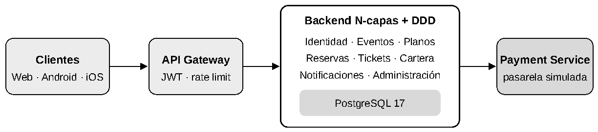

<!-- Texto dentro de la figura (página 7): [Backend N-capas + DDD Identidad · Eventos · Planos Reservas · Tickets · Cartera Notificaciones · Administración] [Clientes Web · Android · iOS] [API Gateway JWT · rate limit] [Payment Service pasarela simulada] [PostgreSQL 17] -->

Figura 1. Arquitectura general: backend modular y microservicio de pagos.

### 2.2 Funciones del producto

- Registro, autenticación y gestión de cuentas y perfiles, con idioma (ES/EN/PT/JA) y tema (claro,
oscuro, morado, azul).

- Creación, maquetación y publicación de eventos con aprobación del administrador.
- Exploración y filtrado de eventos, con acceso sin sesión en la web.
- Selección de sillas, retención temporal y compra de boletas con pago simulado.
- Tickets con QR únicos y validación de asistencia.
- Cartera interna de saldo compensatorio y reembolsos aprobados por el administrador.
- Valoraciones y comentarios de eventos.
- Notificaciones push, notificaciones internas y recordatorios automáticos.
- Dashboard por rol y módulo de administración (solicitudes, eventos, control financiero, reportes y
reembolsos).

### 2.3 Características de usuario

<table>
<tr>
<td><strong>Tipo de usuario</strong></td>
<td>Usuario (anónimo, solo web)</td>
</tr>
<tr>
<td><strong>Actividades</strong></td>
<td>• Crear cuenta. • Iniciar sesión. • Explorar y buscar eventos.</td>
</tr>
</table>

<table>
<tr>
<td><strong>Tipo de usuario</strong></td>
<td>Usuario (asistente)</td>
</tr>
<tr>
<td><strong>Actividades</strong></td>
<td>• Crear cuenta, restablecer contraseña y eliminar cuenta. • Explorar y filtrar eventos; seleccionar sillas y comprar boletas. • Consultar Mis Eventos y tickets con QR; usar la cartera. • Comentar y calificar eventos. • Solicitar el rol de organizador.</td>
</tr>
</table>

<table>
<tr>
<td><strong>Tipo de usuario</strong></td>
<td>Usuario (organizador)</td>
</tr>
<tr>
<td><strong>Actividades</strong></td>
<td>• Crear eventos y maquetar el plano del recinto; guardar avances. • Enviar eventos a revisión y consultar el historial y estado de sus eventos. • Eliminar eventos propios que cumplan las condiciones. • Escanear códigos QR para validar la asistencia.</td>
</tr>
</table>

<table>
<tr>
<td><strong>Tipo de usuario</strong></td>
<td>Administrador</td>
</tr>
<tr>
<td><strong>Actividades</strong></td>
<td>• Revisar, aprobar o rechazar solicitudes de organizador. • Revisar, publicar o rechazar eventos. • Consultar control financiero y reportes; gestionar reembolsos.</td>
</tr>
</table>

### 2.4 Restricciones

- Conectividad: el sistema requiere conexión a internet para todas sus operaciones.
- Plataformas: web en Chrome y Edge; móvil en Android 11 o superior e iOS con funcionalidades
equivalentes.

- Acceso sin autenticación: la versión web permite visualizar eventos sin iniciar sesión.
- Limitaciones en móvil: no se puede maquetar eventos; solo visualizar eventos, seleccionar
asientos, comprar boletas y, para organizadores, escanear QR.

- Pagos: solo se admite el método de pago simulado por código QR; moneda única (COP).
- Seguridad: autenticación segura, Refresh Token, recuperación de contraseña y comunicación por
HTTPS.

### 2.5 Suposiciones y dependencias

- Los usuarios tienen conexión estable a internet y habilidades básicas en el uso de computadores y
dispositivos móviles.

- El Payment Service (pasarela sandbox) y los servicios externos (SMTP, Firebase Cloud Messaging
y OAuth) están operativos.

## 3. Requerimientos específicos

### 3.1 Requisitos comunes de las interfaces

#### 3.1.1 Interfaces de usuario (UI)

La interfaz es intuitiva e interactiva, con navegación por rol, soporte de cuatro idiomas y cuatro temas visuales, y diseño responsive.

#### 3.1.2 Interfaces del hardware

- Web: sistema operativo Windows; navegadores basados en Chromium (Google Chrome y
Microsoft Edge).

- Móvil: Android 11 o superior (compatibilidad total); iOS con las funcionalidades definidas en
RF12, sujeto a las restricciones propias del sistema operativo.

- Cámara del dispositivo móvil para la lectura de QR.
#### 3.1.3 Interfaces del software

- Backend (API RESTful) en Java 21 con Spring Boot; intercambio de datos en JSON sobre HTTPS
(HTTP únicamente en desarrollo local). La API cubre autenticación, usuarios, eventos, reservas, pagos, tickets, notificaciones y administración.

- Base de datos PostgreSQL 17 mediante Spring Data JPA.
- Payment Service (pasarela sandbox): microservicio independiente accedido por API REST a
través de la interfaz PaymentGatewayStrategy; devuelve el resultado mediante notificaciones (webhook) firmadas hacia el backend.

- Servicios externos: correo electrónico por SMTP, Firebase Cloud Messaging para notificaciones
push y proveedores OAuth 2.0 (Google/Facebook).

- Seguridad: autenticación y autorización con JWT y Refresh Token, API Gateway y control de roles.
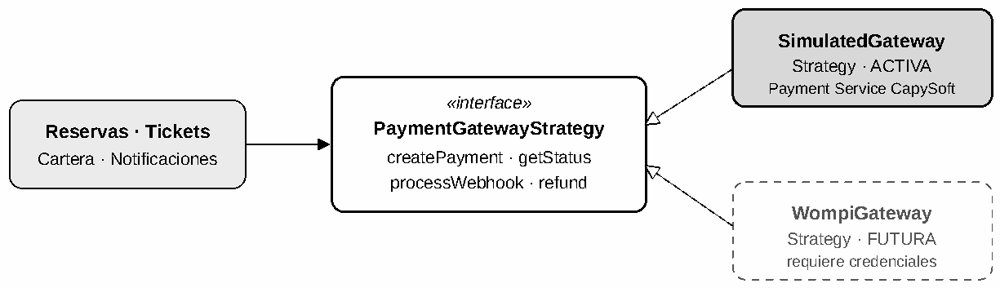

<!-- Texto dentro de la figura (página 10): [SimulatedGateway Strategy · ACTIVA Payment Service CapySoft] [Reservas · Tickets Cartera · Notificaciones] [«interface» PaymentGatewayStrategy createPayment · getStatus processWebhook · refund] [WompiGateway Strategy · FUTURA requiere credenciales] -->

Figura 2. Patrón Strategy: cada estrategia normaliza la respuesta o el webhook del proveedor al modelo interno PaymentResult.

### 3.2 Requerimientos funcionales

#### Listado de requerimientos funcionales

#### Gestión de usuarios

- **RF1:** Registro de usuario
- **RF2:** Autenticación con redes sociales (OAuth)
- **RF3:** Inicio de sesión de usuario
- **RF4:** Gestión y personalización del perfil
- **RF5:** Recuperar contraseña
- **RF6:** Cerrar sesión
- **RF7:** Eliminación de cuenta de usuario
#### Administración

- **RF8:** Módulo de administración del sistema
- **RF27:** Solicitud del rol de organizador
- **RF29:** Control financiero, reportes y reembolsos (administrador)
#### Eventos

- **RF9:** Edición y maquetación de la estructura del evento
- **RF19:** Maquetación y gestión de eventos desde la versión web
- **RF23:** Filtros de eventos
- **RF28:** Mis eventos y tickets
#### Reservas, pagos y asistencia

- **RF10:** Reservación de asientos
- **RF11:** Generación y validación de código QR por reserva
- **RF17:** Pasarela de pagos sandbox con patrón Strategy
- **RF18:** Comprar boletas desde la aplicación móvil
- **RF24:** Lector de QR para validación de asistencia
- **RF25:** Gestión de saldo compensatorio (Cartera interna)
#### Interacción y personalización

- **RF13:** Soporte multilenguaje (ES/EN/PT/JA)
- **RF14:** Dashboard por rol
- **RF16:** Sistema de notificaciones push y recordatorios automáticos
- **RF22:** Sistema de temas de interfaz
- **RF26:** Valoraciones y comentarios de eventos
#### Seguridad, compatibilidad y arquitectura

- **RF12:** iOS funcional
- **RF15:** Sistema de Refresh Token
- **RF20:** Arquitectura orientada a microservicios
- **RF21:** Backend en arquitectura N-capas con DDD
<table>
<tr>
<td colspan="3"><strong>Identificador:</strong> RF1</td>
<td colspan="2"><strong>Nombre:</strong> Registro de usuario</td>
</tr>
<tr>
<td><strong>Tipo:</strong> Necesario</td>
<td colspan="3"><strong>Requerimiento que lo utiliza o</strong> <strong>especializa:</strong> Interfaz de usuario</td>
<td><strong>¿Crítico?</strong> Sí</td>
</tr>
<tr>
<td><strong>Prioridad de desarrollo:</strong> Alta</td>
<td colspan="4"><strong>Documentos de visualización asociados:</strong> Página de inicio, interfaz de usuario.</td>
</tr>
<tr>
<td colspan="2"><strong>Entrada:</strong>Credenciales del usuario (nombre, correo electrónico y contraseña).</td>
<td colspan="3"><strong>Salida:</strong>El sistema informa que la cuenta fue creada con éxito y redirige a la página de inicio de sesión.</td>
</tr>
<tr>
<td colspan="5"><strong>Descripción:</strong> • El usuario ingresa sus credenciales (nombre, correo y contraseña). • El sistema genera un código de verificación de 6 dígitos y lo envía al correo electrónico proporcionado. • El usuario ingresa el código en el sistema para validar su cuenta. • Si la verificación es exitosa, el sistema registra la cuenta y redirige al usuario a la página de inicio de sesión. • Si la verificación falla, el sistema notifica que el correo ya existe o que el código es incorrecto o expirado. • La contraseña debe cumplir los requisitos de seguridad definidos en RF5.</td>
</tr>
<tr>
<td colspan="5"><strong>Precondición:</strong> • El sistema debe estar en ejecución y accesible para el usuario. • El usuario no debe tener una cuenta registrada con el mismo correo electrónico. • El servicio de envío de correos electrónicos debe estar disponible.</td>
</tr>
<tr>
<td colspan="5"><strong>Manejo de situaciones anormales:</strong> • Si el correo ya está registrado, el sistema muestra un mensaje de error. • Si el usuario ingresa un código incorrecto o expirado, el sistema muestra un mensaje de invalidación y permite solicitar un nuevo código.</td>
</tr>
<tr>
<td colspan="5"><strong>Criterios:</strong> • Si los datos son correctos, el sistema crea la cuenta y redirige al usuario a la pantalla de inicio de sesión. • Todo usuario registrado recibe por defecto el rol de asistente.</td>
</tr>
<tr>
<td colspan="5"><strong>Postcondición:</strong> • Si la verificación es exitosa: el usuario queda registrado en la base de datos con rol de asistente. • Si la verificación falla: no se registra la cuenta y se notifica el error (correo existente o código inválido/expirado).</td>
</tr>
</table>

<table>
<tr>
<td colspan="3"><strong>Identificador:</strong> RF2</td>
<td colspan="2"><strong>Nombre:</strong> Autenticación con redes sociales (OAuth)</td>
</tr>
<tr>
<td><strong>Tipo:</strong> Opcional</td>
<td colspan="3"><strong>Requerimiento que lo utiliza o</strong> <strong>especializa:</strong> Interfaz de usuario</td>
<td><strong>¿Crítico?</strong> No</td>
</tr>
<tr>
<td><strong>Prioridad de desarrollo:</strong> Media</td>
<td colspan="4"><strong>Documentos de visualización asociados:</strong> Página de inicio, interfaz de usuario.</td>
</tr>
<tr>
<td colspan="2"><strong>Entrada:</strong>El usuario selecciona la opción de iniciar sesión o vincular su cuenta con una red social (Google/Facebook) y autoriza el acceso en la plataforma elegida.</td>
<td colspan="3"><strong>Salida:</strong>El sistema asocia la cuenta del usuario con la red social seleccionada y permite el acceso.</td>
</tr>
<tr>
<td colspan="5"><strong>Descripción:</strong> • El usuario puede vincular su cuenta con un perfil externo (Google o Facebook) mediante el protocolo OAuth 2.0. • Una vez autorizada la vinculación, el sistema almacena la relación para permitir inicios de sesión futuros sin credenciales adicionales. • La integración con redes sociales se limita a autenticación; no incluye publicar ni compartir contenido.</td>
</tr>
<tr>
<td colspan="5"><strong>Precondición:</strong> • El sistema debe estar en funcionamiento y accesible. • El usuario debe tener una cuenta activa en la red social seleccionada. • La red social debe estar disponible para responder a la solicitud de autenticación. • El usuario debe estar conectado a internet.</td>
</tr>
<tr>
<td colspan="5"><strong>Manejo de situaciones anormales:</strong> • Si el usuario cancela la autorización en la red social, la vinculación no se completa y se muestra un mensaje de notificación. • Si la red social no responde o hay un error de autenticación, se muestra un mensaje de error con la opción de reintentar.</td>
</tr>
<tr>
<td colspan="5"><strong>Criterios:</strong>En caso de éxito, la cuenta queda asociada y disponible para futuros inicios de sesión.</td>
</tr>
<tr>
<td colspan="5"><strong>Postcondición:</strong> • Si la autenticación es exitosa: la cuenta queda asociada a la red social y el usuario puede iniciar sesión con ella. • Si falla o es cancelada: no se realiza la vinculación, se muestra un mensaje y la cuenta permanece sin cambios.</td>
</tr>
</table>

<table>
<tr>
<td colspan="3"><strong>Identificador:</strong> RF3</td>
<td colspan="2"><strong>Nombre:</strong> Inicio de sesión de usuario</td>
</tr>
<tr>
<td><strong>Tipo:</strong> Necesario</td>
<td colspan="3"><strong>Requerimiento que lo utiliza o</strong> <strong>especializa:</strong> Interfaz de usuario</td>
<td><strong>¿Crítico?</strong> Sí</td>
</tr>
<tr>
<td><strong>Prioridad de desarrollo:</strong> Alta</td>
<td colspan="4"><strong>Documentos de visualización asociados:</strong> Página de inicio, interfaz de usuario.</td>
</tr>
<tr>
<td colspan="2"><strong>Entrada:</strong>Correo electrónico y contraseña de un usuario previamente registrado.</td>
<td colspan="3"><strong>Salida:</strong>El sistema entrega los tokens de sesión (Access Token y Refresh Token, ver RF15) y redirige a la página principal según el rol del usuario.</td>
</tr>
<tr>
<td colspan="5"><strong>Descripción:</strong> • El usuario accede a la página de inicio de sesión, donde se muestran los campos de correo electrónico y contraseña. • El sistema valida que los campos no estén vacíos y consulta la base de datos para verificar que el correo esté registrado y la contraseña coincida. • Si las credenciales son válidas, el sistema emite un JWT de acceso y un Refresh Token y redirige al usuario.</td>
</tr>
<tr>
<td colspan="5"><strong>Precondición:</strong> • El usuario debe estar registrado en el sistema. • El sistema debe estar disponible y en línea. • El usuario debe tener acceso a internet.</td>
</tr>
<tr>
<td colspan="5"><strong>Manejo de situaciones anormales:</strong> • Si el correo o la contraseña son incorrectos, el sistema muestra un mensaje (p. ej. «Usuario o contraseña incorrectos») y permite reintentar. • El endpoint de inicio de sesión aplica limitación de intentos (rate limiting) para mitigar ataques de fuerza bruta.</td>
</tr>
<tr>
<td colspan="5"><strong>Criterios:</strong> • Con credenciales válidas, el sistema establece una sesión activa. • La sesión persiste mientras dure la interacción y se renueva según RF15.</td>
</tr>
<tr>
<td colspan="5"><strong>Postcondición:</strong> • La sesión queda activa hasta que el usuario cierre sesión o el Refresh Token expire. • El usuario accede a las funcionalidades y permisos asociados a su rol.</td>
</tr>
</table>

<table>
<tr>
<td colspan="3"><strong>Identificador:</strong> RF4</td>
<td colspan="2"><strong>Nombre:</strong> Gestión y personalización del perfil</td>
</tr>
<tr>
<td><strong>Tipo:</strong> Necesario</td>
<td colspan="3"><strong>Requerimiento que lo utiliza o</strong> <strong>especializa:</strong> Interfaz de usuario, gestión de usuario</td>
<td><strong>¿Crítico?</strong> Sí</td>
</tr>
<tr>
<td><strong>Prioridad de desarrollo:</strong> Alta</td>
<td colspan="4"><strong>Documentos de visualización asociados:</strong> Interfaz de registro y perfil de usuario.</td>
</tr>
<tr>
<td colspan="2"><strong>Entrada:</strong>Obligatorios: nombre, apellido, correo (ya verificado) y contraseña. Editables: nombre, apellido, dirección, idioma, tema y preferencias de notificación.</td>
<td colspan="3"><strong>Salida:</strong>El sistema confirma la creación o actualización del perfil con un mensaje de éxito; la información queda guardada y disponible en la sección de perfil.</td>
</tr>
<tr>
<td colspan="5"><strong>Descripción:</strong> • Permite al usuario configurar y gestionar su información personal: creación inicial del perfil tras el registro y edición posterior de sus datos. • El sistema almacena las preferencias del usuario (idioma, tema de interfaz y notificaciones) para aplicarlas en cada sesión.</td>
</tr>
<tr>
<td colspan="5"><strong>Precondición:</strong> • El usuario completó el registro (por correo o red social). • Si el registro fue por correo, este debe estar verificado. • El sistema está disponible y el usuario tiene acceso a internet.</td>
</tr>
<tr>
<td colspan="5"><strong>Manejo de situaciones anormales:</strong> • Si el usuario cerró sesión, no puede acceder a su información hasta iniciar sesión nuevamente. • Si no hay conexión, no es posible gestionar el perfil. • Si el procesamiento tarda demasiado, se solicita reintentar con un mensaje genérico.</td>
</tr>
<tr>
<td colspan="5"><strong>Criterios:</strong> • El usuario puede editar su información en cualquier momento. • La información se guarda de forma persistente en la base de datos.</td>
</tr>
<tr>
<td colspan="5"><strong>Postcondición:</strong> • El perfil queda creado o actualizado y disponible en futuras sesiones. • Si se vinculó una red social, la asociación queda guardada. • En caso de fallo no se altera la información previa y se notifica al usuario.</td>
</tr>
</table>

<table>
<tr>
<td colspan="3"><strong>Identificador:</strong> RF5</td>
<td colspan="2"><strong>Nombre:</strong> Recuperar contraseña</td>
</tr>
<tr>
<td><strong>Tipo:</strong> Necesario</td>
<td colspan="3"><strong>Requerimiento que lo utiliza o</strong> <strong>especializa:</strong> Interfaz de usuario</td>
<td><strong>¿Crítico?</strong> Sí</td>
</tr>
<tr>
<td><strong>Prioridad de desarrollo:</strong> Alta</td>
<td colspan="4"><strong>Documentos de visualización asociados:</strong> Página de recuperar contraseña, interfaz de usuario.</td>
</tr>
<tr>
<td colspan="2"><strong>Entrada:</strong>Correo electrónico del usuario.</td>
<td colspan="3"><strong>Salida:</strong>Si el correo existe, se envía un código de verificación para renovar la contraseña.</td>
</tr>
<tr>
<td colspan="5"><strong>Descripción:</strong> • El usuario selecciona «¿Olvidaste tu contraseña?» en la página de inicio de sesión e ingresa su correo. • El sistema valida que el campo no esté vacío y tenga formato válido, y busca el correo en la base de datos. • Si está registrado, genera un código de verificación único y lo envía al correo; si no, muestra un mensaje de error. • Con el código válido, el usuario define una nueva contraseña.</td>
</tr>
<tr>
<td colspan="5"><strong>Precondición:</strong> • El usuario tiene una cuenta registrada con correo verificado. • El sistema está en línea y tiene acceso al servicio de envío de correos.</td>
</tr>
<tr>
<td colspan="5"><strong>Manejo de situaciones anormales:</strong> • Si el correo no está registrado, se muestra un mensaje de error. • Si el código expira o es incorrecto, el sistema solicita generar un nuevo código.</td>
</tr>
<tr>
<td colspan="5"><strong>Criterios:</strong> • El correo debe tener formato válido. • La nueva contraseña debe tener mínimo 8 caracteres, una mayúscula, un número y un carácter especial. • El usuario recibe confirmación de que su contraseña fue actualizada.</td>
</tr>
<tr>
<td colspan="5"><strong>Postcondición:</strong> • El usuario cuenta con una nueva contraseña. • El código utilizado queda invalidado para evitar su reutilización. • La cuenta puede iniciar sesión con la nueva contraseña.</td>
</tr>
</table>

<table>
<tr>
<td colspan="3"><strong>Identificador:</strong> RF6</td>
<td colspan="2"><strong>Nombre:</strong> Cerrar sesión</td>
</tr>
<tr>
<td><strong>Tipo:</strong> Necesario</td>
<td colspan="3"><strong>Requerimiento que lo utiliza o</strong> <strong>especializa:</strong> Interfaz de usuario</td>
<td><strong>¿Crítico?</strong> Sí</td>
</tr>
<tr>
<td><strong>Prioridad de desarrollo:</strong> Alta</td>
<td colspan="4"><strong>Documentos de visualización asociados:</strong> Interfaz de usuario.</td>
</tr>
<tr>
<td colspan="2"><strong>Entrada:</strong>El usuario selecciona la opción «Cerrar sesión».</td>
<td colspan="3"><strong>Salida:</strong>El sistema invalida la sesión activa e impide el acceso a funciones protegidas hasta un nuevo inicio de sesión.</td>
</tr>
<tr>
<td colspan="5"><strong>Descripción:</strong> • Al seleccionar «Cerrar sesión», el sistema invalida el Access Token y revoca el Refresh Token asociado (ver RF15). • El usuario pierde acceso inmediato a las áreas protegidas y es redirigido a la página de inicio o de inicio de sesión. • Garantiza la seguridad y privacidad en dispositivos compartidos o públicos.</td>
</tr>
<tr>
<td colspan="5"><strong>Precondición:</strong> • El usuario tiene una sesión activa. • El servicio de autenticación está disponible.</td>
</tr>
<tr>
<td colspan="5"><strong>Manejo de situaciones anormales:</strong> • Si se pierde la conexión durante el cierre, se muestra: «No se pudo cerrar la sesión por problemas de conexión, inténtelo nuevamente». • Si la sesión ya había expirado, el sistema redirige automáticamente a inicio de sesión.</td>
</tr>
<tr>
<td colspan="5"><strong>Criterios:</strong>Tras cerrar sesión, el usuario es redirigido a la pantalla de inicio de sesión.</td>
</tr>
<tr>
<td colspan="5"><strong>Postcondición:</strong> • La sesión y el Refresh Token quedan invalidados. • No se puede acceder a datos ni funciones privadas hasta iniciar sesión de nuevo.</td>
</tr>
</table>

<table>
<tr>
<td colspan="3"><strong>Identificador:</strong> RF7</td>
<td colspan="2"><strong>Nombre:</strong> Eliminación de cuenta de usuario</td>
</tr>
<tr>
<td><strong>Tipo:</strong> Opcional</td>
<td colspan="3"><strong>Requerimiento que lo utiliza o</strong> <strong>especializa:</strong> Interfaz de usuario</td>
<td><strong>¿Crítico?</strong> Sí</td>
</tr>
<tr>
<td><strong>Prioridad de desarrollo:</strong> Alta</td>
<td colspan="4"><strong>Documentos de visualización asociados:</strong> Página de configuración de la cuenta, interfaz de usuario.</td>
</tr>
<tr>
<td colspan="2"><strong>Entrada:</strong>El usuario selecciona la opción «Eliminar cuenta» en la configuración y confirma la acción en la ventana emergente.</td>
<td colspan="3"><strong>Salida:</strong>El sistema elimina de forma permanente e irreversible los datos personales del usuario y lo redirige a la pantalla de inicio con un mensaje de confirmación.</td>
</tr>
<tr>
<td colspan="5"><strong>Descripción:</strong> • Permite al usuario borrar su perfil y su información personal. La opción se denomina «Eliminar cuenta» (no «Desactivar»), pues la acción es irreversible. • El sistema solicita confirmación explícita (p. ej. «¿Está seguro de que desea eliminar su cuenta? Esta acción no se puede deshacer») y reautenticación (contraseña o código). • Los datos personales se eliminan; los registros transaccionales (pagos, reservas, movimientos de cartera) se conservan de forma anonimizada para trazabilidad financiera. • Un organizador con eventos publicados o un usuario con reservas activas debe resolverlos antes de eliminar la cuenta.</td>
</tr>
<tr>
<td colspan="5"><strong>Precondición:</strong> • Sesión activa y reautenticación del usuario. • El usuario no tiene reservas activas ni eventos publicados con ventas vigentes. • El sistema está en línea y con acceso a la base de datos.</td>
</tr>
<tr>
<td colspan="5"><strong>Manejo de situaciones anormales:</strong> • Si la conexión se interrumpe antes de completar la eliminación, se muestra: «La operación no pudo completarse, inténtelo nuevamente». • Si se intenta acceder con las credenciales eliminadas, el sistema indica que no existen.</td>
</tr>
<tr>
<td colspan="5"><strong>Criterios:</strong> • Se solicita confirmación previa. • Los datos personales se eliminan de forma definitiva. • Tras la eliminación el usuario es redirigido a la pantalla de inicio.</td>
</tr>
<tr>
<td colspan="5"><strong>Postcondición:</strong> • La cuenta y sus datos personales ya no existen en el sistema. • Los registros financieros permanecen anonimizados. • El usuario queda sin acceso al sistema.</td>
</tr>
</table>

<table>
<tr>
<td colspan="3"><strong>Identificador:</strong> RF8</td>
<td colspan="2"><strong>Nombre:</strong> Módulo de administración del sistema</td>
</tr>
<tr>
<td><strong>Tipo:</strong> Necesario</td>
<td colspan="3"><strong>Requerimiento que lo utiliza o</strong> <strong>especializa:</strong> Interfaz de administrador; validación de solicitudes de organizador; revisión de eventos</td>
<td><strong>¿Crítico?</strong> Sí</td>
</tr>
<tr>
<td><strong>Prioridad de desarrollo:</strong> Alta</td>
<td colspan="4"><strong>Documentos de visualización asociados:</strong> Interfaz de administración (menú lateral: Dashboard, Control Financiero, Eventos, Reportes, Reembolsos y Solicitudes).</td>
</tr>
<tr>
<td colspan="2"><strong>Entrada:</strong>El administrador inicia sesión con credenciales válidas.</td>
<td colspan="3"><strong>Salida:</strong>El administrador accede a un panel exclusivo de su rol donde gestiona solicitudes de organizador, revisión de eventos, control financiero, reportes y reembolsos.</td>
</tr>
<tr>
<td colspan="5"><strong>Descripción:</strong> • Tras autenticarse, el sistema identifica el rol y redirige al panel de administración. • Solicitudes: lista las solicitudes de usuarios que desean ser organizadores, filtrables por estado (Todas, Pendientes, Aprobadas, Rechazadas), con usuario, correo, documento, fecha, estado y acciones. El administrador revisa el documento adjunto y aprueba o rechaza. Al aprobar, el usuario adquiere el rol de organizador. • Eventos: lista los eventos enviados a revisión (estado «En revisión»). El administrador consulta modalidad, estructura de secciones con capacidad y precios, organizador y boletas disponibles, y decide «Publicar» o «Rechazar» (ver RF9 y RF19). • Control Financiero, Reportes y Reembolsos: ver RF29. • El administrador también puede ejecutar las funciones comunes de cualquier cuenta (inicio/cierre de sesión, recuperación de contraseña).</td>
</tr>
<tr>
<td colspan="5"><strong>Precondición:</strong> • Existe un usuario con rol de administrador. • El sistema está en línea y con acceso a la base de datos. • Para aprobar un organizador, el solicitante envió previamente sus documentos.</td>
</tr>
<tr>
<td colspan="5"><strong>Manejo de situaciones anormales:</strong> • Con credenciales incorrectas se muestra «Usuario o contraseña incorrectos». • Con conexión inestable se muestra «Problemas de conexión, inténtelo de nuevo». • Si se pierde la conexión al aprobar/rechazar, la acción no se completa y se muestra «La operación no se procesó correctamente».</td>
</tr>
<tr>
<td colspan="5"><strong>Criterios:</strong> • El administrador es redirigido automáticamente al panel tras iniciar sesión. • El sistema registra el resultado (aceptada/rechazada) de cada solicitud y de cada revisión de evento, con fecha y administrador responsable. • Tras la aprobación, el organizador puede acceder al módulo de creación de eventos. • Al rechazar una solicitud o un evento, el sistema permite registrar el motivo y notifica al interesado.</td>
</tr>
<tr>
<td colspan="5"><strong>Postcondición:</strong> • El administrador queda autenticado en su módulo de gestión. • Los organizadores aprobados pueden crear eventos. • Los eventos aprobados quedan publicados y visibles para los asistentes.</td>
</tr>
</table>

<table>
<tr>
<td colspan="3"><strong>Identificador:</strong> RF9</td>
<td colspan="2"><strong>Nombre:</strong> Edición y maquetación de la estructura del evento</td>
</tr>
<tr>
<td><strong>Tipo:</strong> Necesario</td>
<td colspan="3"><strong>Requerimiento que lo utiliza o</strong> <strong>especializa:</strong> Interfaz de desarrollo de evento</td>
<td><strong>¿Crítico?</strong> Sí</td>
</tr>
<tr>
<td><strong>Prioridad de desarrollo:</strong> Alta</td>
<td colspan="4"><strong>Documentos de visualización asociados:</strong> Página de creación de evento y editor de layout (web).</td>
</tr>
<tr>
<td colspan="2"><strong>Entrada:</strong>El organizador selecciona la opción de maquetar el plano del recinto del evento dentro del editor.</td>
<td colspan="3"><strong>Salida:</strong>El sistema permite crear y guardar un plano digital del recinto asociado al evento.</td>
</tr>
<tr>
<td colspan="5"><strong>Descripción:</strong> • El editor ofrece una interfaz gráfica con elementos predeterminados para diseñar un plano similar al recinto, partiendo de un plano ya generado o desde cero. • El plano se compone de secciones (General, VIP, Palco, Tribuna u otras), cada una con su capacidad y precio. • El organizador puede guardar avances (borrador) sin publicarlos y eliminar un plano mientras no tenga reservas activas. • Cuando el organizador finaliza el diseño, envía el evento a revisión; el plano solo queda disponible para reservas cuando el administrador publica el evento (RF8).</td>
</tr>
<tr>
<td colspan="5"><strong>Precondición:</strong> • Sesión iniciada con rol de organizador. • Existe un evento previamente creado al cual se asociará el plano.</td>
</tr>
<tr>
<td colspan="5"><strong>Manejo de situaciones anormales:</strong>Si la conexión se interrumpe durante la creación, el sistema notifica que el plano no se guardó correctamente.</td>
</tr>
<tr>
<td colspan="5"><strong>Criterios:</strong> • Solo el rol organizador puede crear y modificar estructuras de eventos. • El sistema permite guardar borradores de maquetación. • Se puede eliminar un plano solo si no tiene reservas activas. • Mientras el evento esté «En revisión» no se puede editar; el organizador puede retirarlo de revisión para hacer cambios. • El plano publicado se muestra correctamente en la selección de asientos.</td>
</tr>
<tr>
<td colspan="5"><strong>Postcondición:</strong> • El plano queda almacenado y vinculado al evento. • Una vez publicado el evento, los asistentes pueden visualizar el plano y seleccionar sus asientos.</td>
</tr>
</table>

<table>
<tr>
<td colspan="3"><strong>Identificador:</strong> RF10</td>
<td colspan="2"><strong>Nombre:</strong> Reservación de asientos</td>
</tr>
<tr>
<td><strong>Tipo:</strong> Necesario</td>
<td colspan="3"><strong>Requerimiento que lo utiliza o</strong> <strong>especializa:</strong> Interfaz de agendamiento y compra</td>
<td><strong>¿Crítico?</strong> Sí</td>
</tr>
<tr>
<td><strong>Prioridad de desarrollo:</strong> Alta</td>
<td colspan="4"><strong>Documentos de visualización asociados:</strong> Página de selección de sillas, carrito y confirmación de compra.</td>
</tr>
<tr>
<td colspan="2"><strong>Entrada:</strong>El asistente selecciona un evento, indica cuántas sillas necesita y elige sillas disponibles por sección en el plano.</td>
<td colspan="3"><strong>Salida:</strong>El sistema bloquea temporalmente las sillas elegidas, las agrega al carrito con su total y continúa al pago.</td>
</tr>
<tr>
<td colspan="5"><strong>Descripción:</strong> • El asistente visualiza los eventos publicados, elige uno y selecciona sillas disponibles en el mapa del recinto; las seleccionadas pasan al carrito («Tu Carrito») con el total. • Al continuar al pago, la reserva se crea en estado PENDIENTE_PAGO y las sillas quedan BLOQUEADAS temporalmente (retención de stock) para que otro usuario no pueda seleccionarlas. El carrito muestra un cronómetro con el tiempo restante. • La confirmación de la reserva es automática: cuando la pasarela de pagos (ver RF17) reporta el pago como APROBADO, la reserva pasa a CONFIRMADA y las sillas a OCUPADAS. No interviene validación manual o «física» del organizador. • Si el pago es rechazado, cancelado o vence el tiempo de retención, la reserva pasa a CANCELADA/EXPIRADA y las sillas se liberan automáticamente.</td>
</tr>
<tr>
<td colspan="5"><strong>Precondición:</strong> • El usuario inició sesión. • Existe un evento publicado y habilitado para reservas. • Existe un plano de asientos publicado para el evento.</td>
</tr>
<tr>
<td colspan="5"><strong>Manejo de situaciones anormales:</strong> • Si la silla ya fue tomada por otro usuario (bloqueada u ocupada), el sistema lo notifica y solicita elegir otra. • Si la conexión se interrumpe durante la reserva, el sistema indica que la operación no se completó. • Si dos usuarios seleccionan la misma silla simultáneamente, solo uno obtiene el bloqueo (control de concurrencia).</td>
</tr>
<tr>
<td colspan="5"><strong>Criterios:</strong> • La silla queda bloqueada desde el momento en que el usuario continúa al pago. • Estados de silla: DISPONIBLE, BLOQUEADA, OCUPADA. Estados de reserva: PENDIENTE_PAGO, CONFIRMADA, EXPIRADA, CANCELADA. • El tiempo de retención es configurable por el sistema (valor sugerido por defecto: 10 minutos). • La silla confirmada queda marcada como ocupada en el plano.</td>
</tr>
<tr>
<td colspan="5"><strong>Postcondición:</strong> • La reserva queda almacenada y vinculada al evento. • Si se confirma, las sillas quedan ocupadas de forma permanente. • Si no se confirma en el tiempo definido, las sillas se liberan automáticamente.</td>
</tr>
</table>

<table>
<tr>
<td colspan="3"><strong>Identificador:</strong> RF11</td>
<td colspan="2"><strong>Nombre:</strong> Generación y validación de código QR por reserva</td>
</tr>
<tr>
<td><strong>Tipo:</strong> Necesario</td>
<td colspan="3"><strong>Requerimiento que lo utiliza o</strong> <strong>especializa:</strong> Reservas (RF10), pagos (RF17), control de asistencia (RF24)</td>
<td><strong>¿Crítico?</strong> Sí</td>
</tr>
<tr>
<td><strong>Prioridad de desarrollo:</strong> Alta</td>
<td colspan="4"><strong>Documentos de visualización asociados:</strong> Pantalla «Pago aprobado» con tickets, Mis Eventos, gestión de eventos.</td>
</tr>
<tr>
<td colspan="2"><strong>Entrada:</strong>La pasarela de pagos notifica que el pago de una reserva fue APROBADO.</td>
<td colspan="3"><strong>Salida:</strong>El sistema genera un código QR único por reserva (ticket), lo muestra al asistente en pantalla y lo envía a su correo.</td>
</tr>
<tr>
<td colspan="5"><strong>Descripción:</strong> • El QR se genera únicamente cuando el pago es APROBADO; no existe QR para reservas pendientes, rechazadas o expiradas. • El QR contiene la información esencial para su validación: identificador único de ticket, evento, fecha, número y ubicación de las sillas. • El QR sirve como comprobante de compra y control de acceso. El organizador lo valida mediante el lector de RF24. • Estados del QR: VÁLIDO (activo), USADO (ya validado en el ingreso), ANULADO (reserva cancelada o evento cancelado) y CADUCADO (evento finalizado).</td>
</tr>
<tr>
<td colspan="5"><strong>Precondición:</strong> • La reserva existe y su pago fue aprobado. • La reserva tiene sillas asignadas.</td>
</tr>
<tr>
<td colspan="5"><strong>Manejo de situaciones anormales:</strong> • Si el pago no está aprobado, no se genera QR. • Si falla el envío del correo, el ticket sigue disponible en «Mis Eventos» y el sistema reintenta el envío.</td>
</tr>
<tr>
<td colspan="5"><strong>Criterios:</strong> • El QR es único por reserva, sin importar la cantidad de sillas. • El QR incluye la información necesaria para su validación y no puede reutilizarse tras su validación. • El organizador puede escanear el QR desde la aplicación para validar la asistencia.</td>
</tr>
<tr>
<td colspan="5"><strong>Postcondición:</strong>La reserva queda confirmada con un QR funcional que permite el acceso al evento.</td>
</tr>
</table>

<table>
<tr>
<td colspan="3"><strong>Identificador:</strong> RF12</td>
<td colspan="2"><strong>Nombre:</strong> iOS funcional</td>
</tr>
<tr>
<td><strong>Tipo:</strong> Necesario</td>
<td colspan="3"><strong>Requerimiento que lo utiliza o</strong> <strong>especializa:</strong> Compatibilidad móvil</td>
<td><strong>¿Crítico?</strong> Sí</td>
</tr>
<tr>
<td><strong>Prioridad de desarrollo:</strong> Alta</td>
<td colspan="4"><strong>Documentos de visualización asociados:</strong> Versión móvil del aplicativo.</td>
</tr>
<tr>
<td colspan="2"><strong>Entrada:</strong>El usuario accede a la aplicación desde un dispositivo iOS.</td>
<td colspan="3"><strong>Salida:</strong>El sistema muestra las funcionalidades definidas para la plataforma móvil.</td>
</tr>
<tr>
<td colspan="5"><strong>Descripción:</strong> • Garantiza que el sistema se ejecute de forma funcional en dispositivos iOS: visualización de eventos, selección de asientos, compra de boletas, tickets con QR, lectura de QR (organizador), perfil y notificaciones. • Las limitaciones propias del sistema operativo se documentan y no afectan las funciones esenciales. Debe realizarse una prueba de compatibilidad que confirme el funcionamiento.</td>
</tr>
<tr>
<td colspan="5"><strong>Precondición:</strong> • Dispositivo con iOS actualizado. • Acceso a internet y sistema en línea.</td>
</tr>
<tr>
<td colspan="5"><strong>Manejo de situaciones anormales:</strong> • Si alguna funcionalidad no puede ejecutarse, se muestra un mensaje de incompatibilidad parcial. • Si falla la conexión con el servidor, se solicita verificar la conexión a internet.</td>
</tr>
<tr>
<td colspan="5"><strong>Criterios:</strong> • La aplicación abre, carga datos y ejecuta las funciones esenciales en iOS. • Se ejecuta al menos una prueba de compatibilidad documentada.</td>
</tr>
<tr>
<td colspan="5"><strong>Postcondición:</strong>Se confirma el funcionamiento de las funciones esenciales en iOS.</td>
</tr>
</table>

<table>
<tr>
<td colspan="3"><strong>Identificador:</strong> RF13</td>
<td colspan="2"><strong>Nombre:</strong> Soporte multilenguaje (ES/EN/PT/JA)</td>
</tr>
<tr>
<td><strong>Tipo:</strong> Necesario</td>
<td colspan="3"><strong>Requerimiento que lo utiliza o</strong> <strong>especializa:</strong> Interfaz de usuario</td>
<td><strong>¿Crítico?</strong> Sí</td>
</tr>
<tr>
<td><strong>Prioridad de desarrollo:</strong> Alta</td>
<td colspan="4"><strong>Documentos de visualización asociados:</strong> Diseño de la interfaz multilenguaje.</td>
</tr>
<tr>
<td colspan="2"><strong>Entrada:</strong>El usuario selecciona un idioma: español, inglés, portugués o japonés.</td>
<td colspan="3"><strong>Salida:</strong>La interfaz completa se muestra en el idioma seleccionado.</td>
</tr>
<tr>
<td colspan="5"><strong>Descripción:</strong> • El sistema permite cambiar y mostrar la interfaz en cuatro idiomas: español (ES), inglés (EN), portugués (PT) y japonés (JA). • El contenido traducido se carga dinámicamente sin recargar la aplicación; el usuario puede cambiar el idioma en cualquier momento desde la configuración y la selección se guarda en sus preferencias.</td>
</tr>
<tr>
<td colspan="5"><strong>Precondición:</strong> • Existen recursos de traducción para los 4 idiomas. • Acceso a internet si las traducciones se cargan desde el servidor.</td>
</tr>
<tr>
<td colspan="5"><strong>Manejo de situaciones anormales:</strong> • Si falta una traducción, se muestra el texto en el idioma por defecto (español). • Si falla la carga del paquete de idioma, se notifica que no fue posible cambiarlo.</td>
</tr>
<tr>
<td colspan="5"><strong>Criterios:</strong> • Se puede cambiar entre los 4 idiomas sin afectar el funcionamiento. • Todos los textos visibles se muestran en el idioma elegido. • Existen pruebas que validan la completitud de las traducciones por idioma.</td>
</tr>
<tr>
<td colspan="5"><strong>Postcondición:</strong>La aplicación queda en el idioma elegido, con coherencia en todos sus textos.</td>
</tr>
</table>

<table>
<tr>
<td colspan="3"><strong>Identificador:</strong> RF14</td>
<td colspan="2"><strong>Nombre:</strong> Dashboard por rol</td>
</tr>
<tr>
<td><strong>Tipo:</strong> Necesario</td>
<td colspan="3"><strong>Requerimiento que lo utiliza o</strong> <strong>especializa:</strong> Interfaz de usuario, módulo de administración, gestión de eventos</td>
<td><strong>¿Crítico?</strong> Sí</td>
</tr>
<tr>
<td><strong>Prioridad de desarrollo:</strong> Alta</td>
<td colspan="4"><strong>Documentos de visualización asociados:</strong> Interfaz del Dashboard (asistente, organizador y administrador).</td>
</tr>
<tr>
<td colspan="2"><strong>Entrada:</strong>El usuario inicia sesión con un rol válido (asistente, organizador o administrador).</td>
<td colspan="3"><strong>Salida:</strong>El sistema muestra un panel con la información y accesos propios del rol.</td>
</tr>
<tr>
<td colspan="5"><strong>Descripción:</strong> • El Dashboard se despliega tras el inicio de sesión y es dinámico según el rol: • Asistente: eventos disponibles, eventos reservados, estado de sus reservas (pendiente, confirmada), saldo de cartera y notificaciones importantes. • Organizador: eventos creados y su estado (Borrador, En revisión, Publicado, Rechazado), número de reservas por evento, estado de validación de QR y acceso directo a la creación y maquetación de eventos. • Administrador: solicitudes pendientes de organizadores, eventos en revisión, usuarios activos, indicadores financieros y acceso a los módulos de validación, reportes y reembolsos. • La información se solicita al backend y se renderiza actualizada.</td>
</tr>
<tr>
<td colspan="5"><strong>Precondición:</strong> • El usuario inició sesión y su rol está identificado. • El servidor está disponible.</td>
</tr>
<tr>
<td colspan="5"><strong>Manejo de situaciones anormales:</strong> • Si falla la carga, se muestra: «No se pudo cargar la información del panel, intente más tarde». • Si el rol no está definido, se muestra un error y se redirige a inicio de sesión. • Si falla la conexión, se muestra una vista básica sin datos con opción de reintentar.</td>
</tr>
<tr>
<td colspan="5"><strong>Criterios:</strong> • El Dashboard se muestra inmediatamente después del inicio de sesión. • La información es precisa y coherente con el rol. • Carga en menos de 3 segundos con red normal. • Permite navegar directamente a las funciones principales.</td>
</tr>
<tr>
<td colspan="5"><strong>Postcondición:</strong>El usuario permanece en su Dashboard con acceso directo a las funciones de su rol.</td>
</tr>
</table>

<table>
<tr>
<td colspan="3"><strong>Identificador:</strong> RF15</td>
<td colspan="2"><strong>Nombre:</strong> Sistema de Refresh Token</td>
</tr>
<tr>
<td><strong>Tipo:</strong> Necesario</td>
<td colspan="3"><strong>Requerimiento que lo utiliza o</strong> <strong>especializa:</strong> Autenticación persistente, seguridad de sesión</td>
<td><strong>¿Crítico?</strong> Sí</td>
</tr>
<tr>
<td><strong>Prioridad de desarrollo:</strong> Alta</td>
<td colspan="4"><strong>Documentos de visualización asociados:</strong> Flujo de renovación del token, diagrama de autenticación JWT, endpoints de refresh.</td>
</tr>
<tr>
<td colspan="2"><strong>Entrada:</strong>El cliente posee un Access Token expirado y un Refresh Token válido.</td>
<td colspan="3"><strong>Salida:</strong>El sistema genera un nuevo Access Token (y un nuevo Refresh Token con rotación), permitiendo continuar sin nuevo inicio de sesión.</td>
</tr>
<tr>
<td colspan="5"><strong>Descripción:</strong> • Cuando un Access Token expira, el cliente envía automáticamente el Refresh Token al endpoint /auth/refresh. • El Refresh Token tiene vida útil mayor (7 a 30 días) y permite renovar Access Tokens sin pedir credenciales. • El sistema valida la integridad del token, verifica que no esté revocado y emite nuevos tokens con claims actualizados.</td>
</tr>
<tr>
<td colspan="5"><strong>Precondición:</strong> • Usuario autenticado con tokens JWT válidos inicialmente. • Tabla de Refresh Tokens (emitidos y revocados) en base de datos. • Endpoint /auth/refresh implementado y lógica de renovación automática en cliente web y móvil.</td>
</tr>
<tr>
<td colspan="5"><strong>Manejo de situaciones anormales:</strong> • Token inválido o manipulado: se rechaza con mensaje de autenticación fallida. • Token expirado: se redirige al inicio de sesión. • Token revocado o no registrado: se cierra la sesión y se solicita autenticarse. • Falla de conexión o servidor: se informa que no fue posible renovar.</td>
</tr>
<tr>
<td colspan="5"><strong>Criterios:</strong> • La renovación es automática y segura, y tarda menos de 2 segundos. • La sesión no se interrumpe mientras el Refresh Token sea válido. • Los tokens pueden revocarse individual o masivamente. • Rate limiting en el endpoint de refresh. • Auditoría completa de renovaciones.</td>
</tr>
<tr>
<td colspan="5"><strong>Postcondición:</strong> • El usuario mantiene la sesión sin reingresar credenciales. • Se registra la renovación para auditoría de seguridad.</td>
</tr>
</table>

<table>
<tr>
<td colspan="3"><strong>Identificador:</strong> RF16</td>
<td colspan="2"><strong>Nombre:</strong> Sistema de notificaciones push y recordatorios automáticos</td>
</tr>
<tr>
<td><strong>Tipo:</strong> Necesario</td>
<td colspan="3"><strong>Requerimiento que lo utiliza o</strong> <strong>especializa:</strong> Compromiso de usuarios, recordatorios, confirmaciones transaccionales</td>
<td><strong>¿Crítico?</strong> No</td>
</tr>
<tr>
<td><strong>Prioridad de desarrollo:</strong> Media</td>
<td colspan="4"><strong>Documentos de visualización asociados:</strong> Arquitectura de Firebase Cloud Messaging, flujo de notificaciones, reglas de recordatorios, ícono de notificaciones (campana) en la web.</td>
</tr>
<tr>
<td colspan="2"><strong>Entrada:</strong>Un evento del sistema requiere notificar al usuario (pago aprobado, evento próximo, cambio en reserva, aprobación de solicitud o evento, recordatorio).</td>
<td colspan="3"><strong>Salida:</strong>El usuario recibe una notificación push y/o interna (campana) con información relevante.</td>
</tr>
<tr>
<td colspan="5"><strong>Descripción:</strong> • Notificaciones push mediante Firebase Cloud Messaging (FCM) para dispositivos móviles y navegadores web; el backend registra los tokens de dispositivo (modelo DeviceToken). • Cada notificación incluye título, mensaje, ícono, sonido y datos para deep linking. • El usuario puede activar o desactivar tipos de notificación desde sus preferencias. • Recordatorios automáticos 48 horas y 2 horas antes de eventos con reserva confirmada. • Notificaciones de cambio de estado: solicitud de organizador aprobada/rechazada, evento publicado/rechazado, pago aprobado, reembolso.</td>
</tr>
<tr>
<td colspan="5"><strong>Precondición:</strong> • Proyecto Firebase con FCM habilitado. • Aplicación móvil con soporte de notificaciones (expo-notifications si se usa Expo) y aplicación web con Firebase SDK. • Permisos de notificación concedidos por el usuario. • Eventos con fechas y horas programadas.</td>
</tr>
<tr>
<td colspan="5"><strong>Manejo de situaciones anormales:</strong> • Token inválido o expirado: se elimina y se solicita uno nuevo. • FCM no disponible: se encola y reenvía con exponential backoff. • Usuario sin permisos de notificación: se envía correo como respaldo. • Dispositivo offline: FCM entrega al reconectarse. • Falla de programación de un recordatorio: se registra y reintenta en el siguiente ciclo. • Reserva cancelada: se cancelan los recordatorios pendientes.</td>
</tr>
<tr>
<td colspan="5"><strong>Criterios:</strong> • Registro automático del token al iniciar sesión. • Notificación de pago procesada en menos de 5 segundos. • Recordatorios a 48 h y 2 h antes del evento. • Alertas inmediatas de cambios en reservas. • Deep linking funcional. • Preferencias de notificación por usuario. • Tasa de entrega superior al 95 % en notificaciones push activas. • Métricas de entrega y auditoría de notificaciones enviadas.</td>
</tr>
<tr>
<td colspan="5"><strong>Postcondición:</strong> • Los usuarios reciben notificaciones oportunas y recordatorios. • Las métricas de notificaciones quedan disponibles para análisis.</td>
</tr>
</table>

<table>
<tr>
<td colspan="3"><strong>Identificador:</strong> RF17</td>
<td colspan="2"><strong>Nombre:</strong> Pasarela de pagos sandbox con patrón Strategy</td>
</tr>
<tr>
<td><strong>Tipo:</strong> Necesario</td>
<td colspan="3"><strong>Requerimiento que lo utiliza o</strong> <strong>especializa:</strong> Reservas, tickets/QR, cartera, notificaciones</td>
<td><strong>¿Crítico?</strong> Sí</td>
</tr>
<tr>
<td><strong>Prioridad de desarrollo:</strong> Alta</td>
<td colspan="4"><strong>Documentos de visualización asociados:</strong> Flujo de pago, contrato PaymentGatewayStrategy, diagrama de estados del pago, notificación (webhook) interna, pantallas «Confirmar compra» y «Pago aprobado».</td>
</tr>
<tr>
<td colspan="2"><strong>Entrada:</strong>El asistente, en «Confirmar compra», revisa sillas y total, elige el método de pago (Código QR) y presiona «Pagar».</td>
<td colspan="3"><strong>Salida:</strong>Pago procesado, reserva confirmada y tickets con QR disponibles («¡Pago aprobado!»), o mensaje de pago rechazado/cancelado/pendiente.</td>
</tr>
<tr>
<td colspan="5"><strong>Descripción:</strong> • En esta versión no se integra una pasarela real (no se dispone de credenciales). El pago se procesa mediante una pasarela sandbox, implementada como un microservicio independiente (Payment Service) desarrollado por CapySoft, que reproduce el flujo de una pasarela real. • El comportamiento del proyecto es independiente del proveedor gracias al patrón Strategy: el núcleo define la interfaz PaymentGatewayStrategy con las operaciones crear pago, consultar estado, procesar notificación (webhook) y reembolsar. Sus implementaciones son SimulatedGatewayStrategy (activa) y WompiGatewayStrategy (futura, fuera del alcance de esta versión). • La estrategia activa se selecciona por configuración. Cada estrategia traduce la respuesta o el webhook de su proveedor a un modelo interno normalizado (PaymentResult: identificador de transacción, referencia, monto, moneda COP, fecha y estado PENDING, APPROVED, REJECTED, CANCELLED o EXPIRED). • Los módulos de Reservas, Tickets, Cartera y Notificaciones solo conocen el modelo normalizado; por ello, sin importar el origen de la respuesta, el flujo posterior es idéntico y cambiar de proveedor no exige modificarlos. • Flujo simulado: (1) el backend crea la transacción con una referencia ligada a la reserva; (2) el simulador presenta el método de pago por código QR; (3) al completarse (o rechazarse) el pago simulado, el simulador envía una notificación al endpoint interno de webhook, firmada con un secreto compartido; (4) el backend valida la firma, aplica idempotencia y actualiza reserva, tickets y notificaciones. • El simulador debe permitir forzar resultados (aprobado, rechazado, pendiente, expirado) para pruebas y demostraciones.</td>
</tr>
<tr>
<td colspan="5"><strong>Precondición:</strong> • Usuario autenticado. • Reserva en estado PENDIENTE_PAGO con sillas bloqueadas y retención vigente. • Estrategia de pasarela configurada y Payment Service disponible.</td>
</tr>
<tr>
<td colspan="5"><strong>Manejo de situaciones anormales:</strong> • Pago rechazado o cancelado: no se confirma la reserva; se informa al usuario, las sillas se liberan al vencer la retención o si el usuario cancela, y puede reintentar mientras la retención esté vigente. • Pago pendiente: la transacción queda en «Pendiente» hasta recibir el resultado. • Webhook duplicado: se ignora por idempotencia (identificador de transacción). • Webhook fallido o no recibido: reintento con backoff y consulta activa del estado. • Pago aprobado después de vencer la retención y con sillas ya tomadas: la transacción se marca para reembolso (RF25) y se notifica al usuario. • Firma de webhook inválida: se rechaza y se audita.</td>
</tr>
<tr>
<td colspan="5"><strong>Criterios:</strong> • La confirmación del pago solo se produce al recibir una notificación válida normalizada. • El QR solo se genera si el estado es APPROVED. • Se registra cada pago con identificador, referencia, estado, monto y estrategia utilizada. • Cambiar la estrategia activa no requiere modificar los módulos de Reservas, Tickets ni Cartera. • Existen pruebas automáticas del flujo completo con la estrategia simulada.</td>
</tr>
<tr>
<td colspan="5"><strong>Postcondición:</strong> • Reserva confirmada y QR disponible para el ingreso. • La transacción queda registrada con trazabilidad.</td>
</tr>
</table>

<table>
<tr>
<td colspan="3"><strong>Identificador:</strong> RF18</td>
<td colspan="2"><strong>Nombre:</strong> Comprar boletas desde la aplicación móvil</td>
</tr>
<tr>
<td><strong>Tipo:</strong> Necesario</td>
<td colspan="3"><strong>Requerimiento que lo utiliza o</strong> <strong>especializa:</strong> Módulo móvil, compra de boletas, vista del plano del evento</td>
<td><strong>¿Crítico?</strong> Sí</td>
</tr>
<tr>
<td><strong>Prioridad de desarrollo:</strong> Alta</td>
<td colspan="4"><strong>Documentos de visualización asociados:</strong> Vista móvil del plano, selección de sillas y pantalla de compra.</td>
</tr>
<tr>
<td colspan="2"><strong>Entrada:</strong>El usuario abre un evento desde la aplicación móvil.</td>
<td colspan="3"><strong>Salida:</strong>Se muestra el plano del evento, las sillas disponibles y la opción de comprar boletas, sin herramientas de maquetación.</td>
</tr>
<tr>
<td colspan="5"><strong>Descripción:</strong> • En la versión móvil el usuario solo visualiza la maquetación del evento: puede ver el plano, identificar sillas disponibles, seleccionarlas y pagar mediante la pasarela de pagos configurada (RF17). • El ticket con código QR queda disponible tras el pago aprobado. • La creación, edición o maquetación de eventos es exclusiva de la versión web.</td>
</tr>
<tr>
<td colspan="5"><strong>Precondición:</strong> • Evento creado, maquetado y publicado desde la versión web. • Usuario autenticado.</td>
</tr>
<tr>
<td colspan="5"><strong>Manejo de situaciones anormales:</strong> • Si el plano no carga, se muestra un mensaje de error. • Si una silla ya está ocupada, se actualiza la disponibilidad antes de continuar.</td>
</tr>
<tr>
<td colspan="5"><strong>Criterios:</strong> • El plano se visualiza correctamente en móvil. • El usuario puede seleccionar sillas disponibles y completar la compra sin opciones de edición.</td>
</tr>
<tr>
<td colspan="5"><strong>Postcondición:</strong>La boleta queda comprada y el ticket/QR disponible para el usuario.</td>
</tr>
</table>

<table>
<tr>
<td colspan="3"><strong>Identificador:</strong> RF19</td>
<td colspan="2"><strong>Nombre:</strong> Maquetación y gestión de eventos desde la versión web</td>
</tr>
<tr>
<td><strong>Tipo:</strong> Necesario</td>
<td colspan="3"><strong>Requerimiento que lo utiliza o</strong> <strong>especializa:</strong> Panel del organizador, editor de plano, creación de eventos</td>
<td><strong>¿Crítico?</strong> Sí</td>
</tr>
<tr>
<td><strong>Prioridad de desarrollo:</strong> Alta</td>
<td colspan="4"><strong>Documentos de visualización asociados:</strong> Pantalla «Crear evento» (3 pasos), editor de layout y «Mis Eventos» (web).</td>
</tr>
<tr>
<td colspan="2"><strong>Entrada:</strong>El organizador accede a la plataforma desde la versión web.</td>
<td colspan="3"><strong>Salida:</strong>El sistema muestra las herramientas de creación, maquetación y gestión de eventos.</td>
</tr>
<tr>
<td colspan="5"><strong>Descripción:</strong> • La creación, maquetación y edición completa del evento están disponibles únicamente en la versión web. • Creación en tres pasos con barra de progreso: (1) Información general: nombre, descripción, fechas de inicio y fin, visibilidad pública, categoría, departamento y ciudad; (2) Sede: selección de una sede existente o creación de una nueva (nombre, dirección, capacidad máxima y ubicación en el mapa); (3) Imágenes del evento. • Luego el organizador diseña el plano en el editor de layout (secciones, sillas, áreas, capacidad y precio por sección). • Ciclo de vida del evento: BORRADOR → EN_REVISIÓN → PUBLICADO o RECHAZADO. Desde «Mis Eventos» el organizador envía el evento a revisión; el administrador decide publicarlo o rechazarlo (RF8). Mientras está en revisión no se puede editar, y el organizador puede retirarlo de revisión en cualquier momento.</td>
</tr>
<tr>
<td colspan="5"><strong>Precondición:</strong> • Organizador autenticado en la versión web. • Permisos activos de creación y edición de eventos (rol aprobado por el administrador).</td>
</tr>
<tr>
<td colspan="5"><strong>Manejo de situaciones anormales:</strong> • Si falla una herramienta de maquetación, se muestra un mensaje de error. • Si el evento no puede guardarse, se notifica para reintentar. • Si no cargan los elementos del editor, se recarga la vista o se indica el fallo.</td>
</tr>
<tr>
<td colspan="5"><strong>Criterios:</strong> • El organizador crea, edita y guarda eventos completamente desde la web. • El editor permite añadir, mover o eliminar elementos sin restricciones. • La versión móvil no permite acceder a herramientas de creación o edición. • Los cambios publicados se reflejan en la aplicación móvil. • La publicación requiere la aprobación del administrador.</td>
</tr>
<tr>
<td colspan="5"><strong>Postcondición:</strong> • El evento queda creado o actualizado. • Una vez publicado, el plano está disponible en web y móvil.</td>
</tr>
</table>

<table>
<tr>
<td colspan="3"><strong>Identificador:</strong> RF20</td>
<td colspan="2"><strong>Nombre:</strong> Arquitectura orientada a microservicios</td>
</tr>
<tr>
<td><strong>Tipo:</strong> Necesario</td>
<td colspan="3"><strong>Requerimiento que lo utiliza o</strong> <strong>especializa:</strong> Pagos, notificaciones y futura separación de dominios</td>
<td><strong>¿Crítico?</strong> Sí</td>
</tr>
<tr>
<td><strong>Prioridad de desarrollo:</strong> Alta</td>
<td colspan="4"><strong>Documentos de visualización asociados:</strong> Diagrama de arquitectura, contratos de API, flujos de comunicación entre servicios.</td>
</tr>
<tr>
<td colspan="2"><strong>Entrada:</strong>El sistema recibe una operación que requiere coordinación entre dominios (usuario + evento + pago).</td>
<td colspan="3"><strong>Salida:</strong>Los componentes procesan la solicitud de forma coordinada mediante APIs REST y eventos.</td>
</tr>
<tr>
<td colspan="5"><strong>Descripción:</strong> • La arquitectura de esta versión es híbrida: un backend principal modular en N-capas con DDD (RF21) y servicios independientes donde ya se justifica. El Payment Service (pasarela sandbox, RF17) se ejecuta como microservicio independiente, con su propio despliegue y comunicación por API REST y notificaciones (webhook). • La separación completa de los demás dominios (Usuarios, Eventos, Notificaciones, Administración) en microservicios es un objetivo evolutivo; el diseño modular de RF21 la habilita sin reescribir la lógica de negocio. • El API Gateway gestiona autenticación, rate limiting y enrutamiento. Los servicios usan APIs contratadas, circuit breakers y reintentos.</td>
</tr>
<tr>
<td colspan="5"><strong>Precondición:</strong> • Backend modular N-capas implementado (RF21). • Infraestructura contenerizada (Docker) disponible.</td>
</tr>
<tr>
<td colspan="5"><strong>Manejo de situaciones anormales:</strong> • Si el Payment Service falla, el sistema activa un circuit breaker y muestra un mensaje al usuario; las reservas bloqueadas se liberan al vencer la retención. • Si la comunicación se interrumpe, se usan reintentos con backoff. • Ante inconsistencias entre servicios se aplican acciones de compensación.</td>
</tr>
<tr>
<td colspan="5"><strong>Criterios:</strong> • Los servicios independientes se despliegan y escalan por separado. • La comunicación se realiza mediante APIs contratadas y eventos. • El Payment Service tiene su propia persistencia. • Un cambio en un servicio no afecta la operación de los demás.</td>
</tr>
<tr>
<td colspan="5"><strong>Postcondición:</strong> • Los servicios operan de forma desacoplada. • El sistema queda preparado para escalar por dominio funcional.</td>
</tr>
</table>

<table>
<tr>
<td colspan="3"><strong>Identificador:</strong> RF21</td>
<td colspan="2"><strong>Nombre:</strong> Backend en arquitectura N-capas con DDD</td>
</tr>
<tr>
<td><strong>Tipo:</strong> Necesario</td>
<td colspan="3"><strong>Requerimiento que lo utiliza o</strong> <strong>especializa:</strong> Backend Java, modularización del dominio, preparación para microservicios</td>
<td><strong>¿Crítico?</strong> Sí</td>
</tr>
<tr>
<td><strong>Prioridad de desarrollo:</strong> Alta</td>
<td colspan="4"><strong>Documentos de visualización asociados:</strong> Estructura de paquetes por módulo, diagramas de dominio, diseño de capas.</td>
</tr>
<tr>
<td colspan="2"><strong>Entrada:</strong>Backend Spring Boot que debe organizarse por dominios y capas.</td>
<td colspan="3"><strong>Salida:</strong>Backend modular organizado por dominios y capas siguiendo principios DDD.</td>
</tr>
<tr>
<td colspan="5"><strong>Descripción:</strong> • El backend se organiza en módulos por dominio (Identidad, Eventos, Sedes/Planos, Reservas, Pagos, Tickets, Notificaciones, Cartera y Administración). • Cada módulo mantiene capas: Domain (entidades y lógica central), Application (casos de uso), Infrastructure (repositorios, adaptadores externos como correo, FCM y estrategias de pago) y Presentation (controladores con DTOs). • El patrón Strategy para pasarelas de pago (RF17) se ubica como puerto en Application/Domain y sus implementaciones como adaptadores en Infrastructure.</td>
</tr>
<tr>
<td colspan="5"><strong>Precondición:</strong> • Entorno Spring Boot (Java 21) y base de datos PostgreSQL 17 configurados. • Docker disponible para empaquetar. • Diseño modular aprobado.</td>
</tr>
<tr>
<td colspan="5"><strong>Manejo de situaciones anormales:</strong> • Un error en un módulo se aísla sin afectar los demás. • Los fallos de infraestructura se manejan con excepciones controladas. • La pérdida de acceso a datos genera respuestas de error claras y seguras.</td>
</tr>
<tr>
<td colspan="5"><strong>Criterios:</strong> • Módulos organizados por dominio y capas sin dependencias incorrectas. • La lógica de negocio se concentra en Domain; Application contiene los casos de uso sin duplicación. • Infrastructure implementa repositorios y adaptadores; Presentation expone controladores con DTOs.</td>
</tr>
<tr>
<td colspan="5"><strong>Postcondición:</strong> • El backend queda modularizado y mantenible. • El proyecto queda preparado para separar módulos en microservicios.</td>
</tr>
</table>

<table>
<tr>
<td colspan="3"><strong>Identificador:</strong> RF22</td>
<td colspan="2"><strong>Nombre:</strong> Sistema de temas de interfaz</td>
</tr>
<tr>
<td><strong>Tipo:</strong> Mejora</td>
<td colspan="3"><strong>Requerimiento que lo utiliza o</strong> <strong>especializa:</strong> Personalización de UI, accesibilidad</td>
<td><strong>¿Crítico?</strong> No</td>
</tr>
<tr>
<td><strong>Prioridad de desarrollo:</strong> Alta</td>
<td colspan="4"><strong>Documentos de visualización asociados:</strong> Paleta de colores por tema, mockups de cada tema, guía de implementación.</td>
</tr>
<tr>
<td colspan="2"><strong>Entrada:</strong>El usuario selecciona un tema desde la configuración.</td>
<td colspan="3"><strong>Salida:</strong>La interfaz completa cambia al tema seleccionado manteniendo consistencia visual.</td>
</tr>
<tr>
<td colspan="5"><strong>Descripción:</strong> • Se proveen 4 temas: Claro, Oscuro, Morado y Azul, con colores definidos para fondos, textos, botones, íconos y componentes, con contraste adecuado. • El tema se guarda en las preferencias del usuario y se aplica al iniciar; es consistente entre web y móvil y detecta la preferencia del sistema operativo (claro/oscuro).</td>
</tr>
<tr>
<td colspan="5"><strong>Precondición:</strong> • Sistema de diseño con variables de tema. • Configuración de usuario persistente. • Paletas verificadas para accesibilidad.</td>
</tr>
<tr>
<td colspan="5"><strong>Manejo de situaciones anormales:</strong> • Tema no soportado: se aplica el tema claro con notificación. • Configuración corrupta: se restablece al tema claro. • Si falla el cambio, se mantiene el tema anterior y se muestra un mensaje temporal.</td>
</tr>
<tr>
<td colspan="5"><strong>Criterios:</strong> • 4 temas implementados. • Cambio instantáneo sin recargar. • Persistencia entre sesiones. • Detección de preferencia del sistema. • Aplicado a botones, modales, formularios y navegación.</td>
</tr>
<tr>
<td colspan="5"><strong>Postcondición:</strong>El usuario personaliza la apariencia según su preferencia.</td>
</tr>
</table>

<table>
<tr>
<td colspan="3"><strong>Identificador:</strong> RF23</td>
<td colspan="2"><strong>Nombre:</strong> Filtros de eventos</td>
</tr>
<tr>
<td><strong>Tipo:</strong> Necesario</td>
<td colspan="3"><strong>Requerimiento que lo utiliza o</strong> <strong>especializa:</strong> Interfaz de exploración de eventos</td>
<td><strong>¿Crítico?</strong> Sí</td>
</tr>
<tr>
<td><strong>Prioridad de desarrollo:</strong> Media</td>
<td colspan="4"><strong>Documentos de visualización asociados:</strong> Página de eventos con barra de búsqueda y filtros.</td>
</tr>
<tr>
<td colspan="2"><strong>Entrada:</strong>El usuario escribe el nombre del evento y/o aplica filtros: ciudad, categoría, fecha, disponibilidad, presupuesto y tipo de evento.</td>
<td colspan="3"><strong>Salida:</strong>Se muestran los eventos que cumplen los criterios indicados.</td>
</tr>
<tr>
<td colspan="5"><strong>Descripción:</strong>Permite buscar y filtrar eventos publicados, dando mayor visibilidad a los organizadores y mejor análisis de disponibilidad a los asistentes. Está disponible también para usuarios anónimos en la versión web.</td>
</tr>
<tr>
<td colspan="5"><strong>Precondición:</strong> • Conexión estable. • Se ingresa al menos un criterio de búsqueda.</td>
</tr>
<tr>
<td colspan="5"><strong>Manejo de situaciones anormales:</strong>Si hay problemas de conexión, se muestra un mensaje de error y se permite reintentar.</td>
</tr>
<tr>
<td colspan="5"><strong>Criterios:</strong> • El usuario puede combinar varios criterios. • Solo se listan eventos publicados.</td>
</tr>
<tr>
<td colspan="5"><strong>Postcondición:</strong>El sistema muestra los eventos filtrados según los términos ingresados.</td>
</tr>
</table>

<table>
<tr>
<td colspan="3"><strong>Identificador:</strong> RF24</td>
<td colspan="2"><strong>Nombre:</strong> Lector de QR para validación de asistencia</td>
</tr>
<tr>
<td><strong>Tipo:</strong> Necesario</td>
<td colspan="3"><strong>Requerimiento que lo utiliza o</strong> <strong>especializa:</strong> Página de validación de QR (aplicación móvil)</td>
<td><strong>¿Crítico?</strong> Sí</td>
</tr>
<tr>
<td><strong>Prioridad de desarrollo:</strong> Alta</td>
<td colspan="4"><strong>Documentos de visualización asociados:</strong> Interfaz de detalles del evento del organizador, pantalla de escaneo.</td>
</tr>
<tr>
<td colspan="2"><strong>Entrada:</strong>El asistente presenta su código QR (generado en RF11) y el organizador del evento lo escanea con la cámara desde la aplicación móvil.</td>
<td colspan="3"><strong>Salida:</strong>El sistema valida el QR en tiempo real y, si es correcto, registra la asistencia y autoriza el acceso.</td>
</tr>
<tr>
<td colspan="5"><strong>Descripción:</strong> • El lector verifica la autenticidad de los QR de reservas confirmadas: que sea válido, no haya sido usado y pertenezca al evento escaneado. • La validación es realizada por el organizador del evento; en esta versión no existe un rol separado de «personal de control».</td>
</tr>
<tr>
<td colspan="5"><strong>Precondición:</strong> • Existe un QR generado (RF11) asociado a una reserva confirmada. • El dispositivo tiene acceso a la cámara y conexión estable. • El evento está activo y en periodo de validación de entradas.</td>
</tr>
<tr>
<td colspan="5"><strong>Manejo de situaciones anormales:</strong>Si el QR es inválido, caducado, anulado o ya utilizado, el sistema lo notifica al validador y deniega el acceso.</td>
</tr>
<tr>
<td colspan="5"><strong>Criterios:</strong> • Funciona en tiempo real desde dispositivos móviles. • Garantiza unicidad y evita duplicaciones. • Muestra mensajes diferenciados: acceso autorizado, QR inválido, QR caducado, QR ya utilizado.</td>
</tr>
<tr>
<td colspan="5"><strong>Postcondición:</strong>La asistencia queda registrada y vinculada al evento; el QR pasa a estado USADO.</td>
</tr>
</table>

<table>
<tr>
<td colspan="3"><strong>Identificador:</strong> RF25</td>
<td colspan="2"><strong>Nombre:</strong> Gestión de saldo compensatorio (Cartera interna)</td>
</tr>
<tr>
<td><strong>Tipo:</strong> Necesario</td>
<td colspan="3"><strong>Requerimiento que lo utiliza o</strong> <strong>especializa:</strong> Pagos (RF17), reservas (RF10), compra (RF18), Dashboard (RF14), reembolsos (RF29)</td>
<td><strong>¿Crítico?</strong> Sí</td>
</tr>
<tr>
<td><strong>Prioridad de desarrollo:</strong> Alta</td>
<td colspan="4"><strong>Documentos de visualización asociados:</strong> Dashboard de usuario, historial de transacciones, confirmación de compra.</td>
</tr>
<tr>
<td colspan="2"><strong>Entrada:</strong> • Usuario autenticado. • Compra realizada mediante la pasarela de pagos (RF17). • Evento cancelado por el organizador. • Solicitud de uso de saldo en una nueva compra. • Solicitud de reembolso externo (opcional).</td>
<td colspan="3"><strong>Salida:</strong> • Saldo compensatorio acreditado y visible en el Dashboard. • Registro del movimiento en el historial. • Notificación del resultado al usuario. • En reembolso externo: gestión mediante la operación de reembolso de la pasarela de pagos activa.</td>
</tr>
<tr>
<td colspan="5"><strong>Descripción:</strong> • La cartera almacena exclusivamente los valores generados por cancelaciones de eventos pagados. No es una billetera recargable ni un sistema financiero independiente. • Cuando un evento es cancelado oficialmente y el reembolso es aprobado, el sistema acredita el monto como saldo compensatorio, que puede usarse en la compra de boletas de otros eventos. • El usuario consulta su saldo e historial, pero no puede recargar, transferir a otros usuarios ni retirar directamente a cuentas bancarias. • Un reembolso externo debe ser aprobado por un administrador (módulo Reembolsos, RF29) y se ejecuta mediante la operación refund de la estrategia de pago activa (RF17); en la pasarela sandbox el resultado es simulado, y con una pasarela real queda sujeto a sus políticas. • El saldo solo se genera por cancelación oficial del evento, no por errores, cambios de opinión ni inasistencia.</td>
</tr>
<tr>
<td colspan="5"><strong>Precondición:</strong> • Usuario autenticado. • La compra original se realizó mediante la pasarela de pagos. • El evento está oficialmente cancelado y el reembolso aprobado por el sistema o el administrador. • El sistema y el Payment Service están operativos.</td>
</tr>
<tr>
<td colspan="5"><strong>Manejo de situaciones anormales:</strong> • Si la pasarela rechaza o no autoriza el reembolso externo, el saldo permanece en la cartera. • Si el saldo es insuficiente para una compra, el sistema la bloquea o solicita completar el pago por la diferencia. • Si falla la conexión durante la acreditación, se valida el estado antes de reflejar el saldo. • Si la cancelación no cumple las políticas de reembolso, se notifica al usuario.</td>
</tr>
<tr>
<td colspan="5"><strong>Criterios:</strong> • El saldo se acredita correctamente tras la cancelación aprobada. • El uso del saldo se descuenta en tiempo real. • Cada movimiento queda en el historial. • El saldo solo se usa dentro de la plataforma. • No existe recarga manual ni retiro directo. • El saldo se muestra actualizado en el Dashboard.</td>
</tr>
<tr>
<td colspan="5"><strong>Postcondición:</strong> • El usuario cuenta con saldo compensatorio disponible. • Las transacciones quedan registradas con trazabilidad. • El sistema mantiene coherencia financiera sin operar como billetera electrónica.</td>
</tr>
</table>

<table>
<tr>
<td colspan="3"><strong>Identificador:</strong> RF26</td>
<td colspan="2"><strong>Nombre:</strong> Valoraciones y comentarios de eventos</td>
</tr>
<tr>
<td><strong>Tipo:</strong> Necesario</td>
<td colspan="3"><strong>Requerimiento que lo utiliza o</strong> <strong>especializa:</strong> Detalle del evento, interacción del usuario</td>
<td><strong>¿Crítico?</strong> No</td>
</tr>
<tr>
<td><strong>Prioridad de desarrollo:</strong> Media</td>
<td colspan="4"><strong>Documentos de visualización asociados:</strong> Sección «Comentarios» del detalle del evento.</td>
</tr>
<tr>
<td colspan="2"><strong>Entrada:</strong>El usuario escribe un comentario, asigna una calificación en estrellas o responde a otro comentario.</td>
<td colspan="3"><strong>Salida:</strong>El comentario o respuesta se publica en el evento y se actualiza la calificación promedio.</td>
</tr>
<tr>
<td colspan="5"><strong>Descripción:</strong> • Cada evento tiene una sección de comentarios donde los usuarios escriben su opinión, califican con estrellas y responden a otros comentarios. • Los comentarios del organizador del evento se identifican con la etiqueta «Organizador». • Pueden comentar los usuarios autenticados; la restricción a compradores del evento se define como regla configurable.</td>
</tr>
<tr>
<td colspan="5"><strong>Precondición:</strong> • Usuario autenticado. • El evento está publicado.</td>
</tr>
<tr>
<td colspan="5"><strong>Manejo de situaciones anormales:</strong> • Si falla la conexión al enviar, el comentario no se publica y se permite reintentar. • Los comentarios vacíos o con contenido inadecuado son rechazados.</td>
</tr>
<tr>
<td colspan="5"><strong>Criterios:</strong> • Calificación de 1 a 5 estrellas. • Las respuestas se anidan bajo el comentario original. • El organizador aparece identificado.</td>
</tr>
<tr>
<td colspan="5"><strong>Postcondición:</strong>El comentario queda almacenado y visible para los demás usuarios.</td>
</tr>
</table>

<table>
<tr>
<td colspan="3"><strong>Identificador:</strong> RF27</td>
<td colspan="2"><strong>Nombre:</strong> Solicitud del rol de organizador</td>
</tr>
<tr>
<td><strong>Tipo:</strong> Necesario</td>
<td colspan="3"><strong>Requerimiento que lo utiliza o</strong> <strong>especializa:</strong> Interfaz de usuario, módulo de administración (RF8)</td>
<td><strong>¿Crítico?</strong> Sí</td>
</tr>
<tr>
<td><strong>Prioridad de desarrollo:</strong> Alta</td>
<td colspan="4"><strong>Documentos de visualización asociados:</strong> Pantalla «Solicitud Organizador», «Solicitud en revisión».</td>
</tr>
<tr>
<td colspan="2"><strong>Entrada:</strong>El asistente selecciona «Solicitud Organizador» y carga su documento de identidad.</td>
<td colspan="3"><strong>Salida:</strong>La solicitud queda registrada en estado «En revisión».</td>
</tr>
<tr>
<td colspan="5"><strong>Descripción:</strong> • Un asistente puede solicitar el rol de organizador enviando documentación. Obligatorios: cédula de ciudadanía o ID, pasaporte válido (extranjeros) o documento de identidad oficial. Opcionales: certificado de antecedentes, certificados de cursos y referencias laborales. • El usuario arrastra o selecciona el archivo y presiona «Enviar solicitud». El administrador la procesa en un plazo de 24 a 48 horas hábiles (RF8). • El resultado (aprobada o rechazada) se notifica al usuario (RF16); al aprobarse aparece la opción «+ Crear Evento».</td>
</tr>
<tr>
<td colspan="5"><strong>Precondición:</strong> • Usuario autenticado con rol de asistente. • No tiene una solicitud pendiente.</td>
</tr>
<tr>
<td colspan="5"><strong>Manejo de situaciones anormales:</strong> • Si el archivo no cumple formato o tamaño permitido, se muestra un mensaje de error. • Si falla la carga, se permite reintentar.</td>
</tr>
<tr>
<td colspan="5"><strong>Criterios:</strong> • Se adjunta al menos un documento obligatorio. • El usuario ve el estado de su solicitud.</td>
</tr>
<tr>
<td colspan="5"><strong>Postcondición:</strong>La solicitud queda disponible para revisión del administrador.</td>
</tr>
</table>

<table>
<tr>
<td colspan="3"><strong>Identificador:</strong> RF28</td>
<td colspan="2"><strong>Nombre:</strong> Mis eventos y tickets</td>
</tr>
<tr>
<td><strong>Tipo:</strong> Necesario</td>
<td colspan="3"><strong>Requerimiento que lo utiliza o</strong> <strong>especializa:</strong> Dashboard, reservas, QR, gestión de eventos</td>
<td><strong>¿Crítico?</strong> Sí</td>
</tr>
<tr>
<td><strong>Prioridad de desarrollo:</strong> Alta</td>
<td colspan="4"><strong>Documentos de visualización asociados:</strong> Pantalla «Mis Eventos» (asistente y organizador).</td>
</tr>
<tr>
<td colspan="2"><strong>Entrada:</strong>El usuario abre «Mis Eventos».</td>
<td colspan="3"><strong>Salida:</strong>Asistente: tickets comprados con su QR. Organizador: eventos en los que trabaja, con su estado y filtros por estado.</td>
</tr>
<tr>
<td colspan="5"><strong>Descripción:</strong> • Para el asistente, «Mis Eventos» lista sus compras, el estado de cada reserva y los tickets con código QR. • Para el organizador, lista sus eventos (Borrador, En revisión, Publicado, Rechazado), permite enviar a revisión, retirar de revisión y acceder al editor y a las funciones de validación de QR.</td>
</tr>
<tr>
<td colspan="5"><strong>Precondición:</strong>Usuario autenticado.</td>
</tr>
<tr>
<td colspan="5"><strong>Manejo de situaciones anormales:</strong>Si falla la carga, se muestra un mensaje y la opción de reintentar.</td>
</tr>
<tr>
<td colspan="5"><strong>Criterios:</strong> • La información corresponde al rol del usuario. • Los filtros por estado funcionan correctamente.</td>
</tr>
<tr>
<td colspan="5"><strong>Postcondición:</strong>El usuario accede a sus tickets o eventos desde un único lugar.</td>
</tr>
</table>

<table>
<tr>
<td colspan="3"><strong>Identificador:</strong> RF29</td>
<td colspan="2"><strong>Nombre:</strong> Control financiero, reportes y reembolsos (administrador)</td>
</tr>
<tr>
<td><strong>Tipo:</strong> Necesario</td>
<td colspan="3"><strong>Requerimiento que lo utiliza o</strong> <strong>especializa:</strong> Módulo de administración (RF8), pagos (RF17), cartera (RF25)</td>
<td><strong>¿Crítico?</strong> No</td>
</tr>
<tr>
<td><strong>Prioridad de desarrollo:</strong> Media</td>
<td colspan="4"><strong>Documentos de visualización asociados:</strong> Módulos «Control Financiero», «Reportes» y «Reembolsos» del panel de administración.</td>
</tr>
<tr>
<td colspan="2"><strong>Entrada:</strong>El administrador abre alguno de los módulos financieros desde el menú lateral.</td>
<td colspan="3"><strong>Salida:</strong>Consulta de transacciones, reportes y gestión de solicitudes de reembolso.</td>
</tr>
<tr>
<td colspan="5"><strong>Descripción:</strong> • Control Financiero: consulta de transacciones (aprobadas, rechazadas, pendientes y reembolsadas) con su referencia y la estrategia de pago utilizada. • Reportes: reportes de ventas y asistencia por evento y por periodo. • Reembolsos: el administrador revisa y aprueba o rechaza las solicitudes de reembolso; al aprobarse, se acredita en la cartera (RF25) o se gestiona el reembolso externo mediante la pasarela de pagos activa (RF17).</td>
</tr>
<tr>
<td colspan="5"><strong>Precondición:</strong> • Sesión iniciada como administrador. • Existen transacciones registradas.</td>
</tr>
<tr>
<td colspan="5"><strong>Manejo de situaciones anormales:</strong> • Si la pasarela no autoriza el reembolso, la solicitud queda registrada con el motivo y el saldo se conserva. • Si falla la carga de un reporte, se muestra un mensaje y se permite reintentar.</td>
</tr>
<tr>
<td colspan="5"><strong>Criterios:</strong> • Toda decisión de reembolso queda auditada con fecha y responsable. • Los montos coinciden con los registros de pago.</td>
</tr>
<tr>
<td colspan="5"><strong>Postcondición:</strong>El administrador cuenta con trazabilidad financiera de la plataforma.</td>
</tr>
</table>

### 3.3 Requerimientos no funcionales

| **Identificación del** **requerimiento:** | RNF1 |
|---|---|
| **Nombre del requerimiento:** | Mensajes de error |
| **Categoría:** | Experiencia de usuario |
| **Descripción del** **requerimiento:** | Los mensajes de error deben seguir un formato uniforme en todo el sistema (web y móvil), indicar claramente la causa y la acción sugerida, y estar disponibles en los cuatro idiomas (RF13). |
| **Prioridad del** **requerimiento:** | Medio |

| **Identificación del** **requerimiento:** | RNF2 |
|---|---|
| **Nombre del requerimiento:** | Diseño responsive |
| **Categoría:** | Diseño y adaptabilidad |
| **Descripción del** **requerimiento:** | El diseño debe visualizarse correctamente desde un computador o cualquier dispositivo móvil, adaptándose al tamaño de pantalla. |
| **Prioridad del** **requerimiento:** | Alto |

| **Identificación del** **requerimiento:** | RNF3 |
|---|---|
| **Nombre del requerimiento:** | Seguridad |
| **Categoría:** | Seguridad del sistema |
| **Descripción del** **requerimiento:** | Los usuarios se identifican mediante correo y contraseña (almacenada con hash seguro), con verificación del correo mediante código de 6 dígitos en el registro y la recuperación de contraseña. La sesión se gestiona con JWT y Refresh Token (RF15). Con inicio de sesión mediante redes sociales no se aplica verificación adicional. Toda comunicación cliente-servidor debe realizarse por HTTPS en producción (HTTP solo en desarrollo local). El acceso se controla por roles (asistente, organizador, administrador) y los endpoints se protegen mediante API Gateway. |
| **Prioridad del** **requerimiento:** | Alto |

| **Identificación del** **requerimiento:** | RNF4 |
|---|---|
| **Nombre del requerimiento:** | Usabilidad |
| **Categoría:** | Experiencia de usuario |
| **Descripción del** **requerimiento:** | La interfaz debe ser intuitiva, de modo que un usuario realice tareas básicas (buscar un evento, comprar boletas, crear un evento) sin asistencia técnica ni curva de aprendizaje pronunciada. |
| **Prioridad del** **requerimiento:** | Alto |

| **Identificación del** **requerimiento:** | RNF5 |
|---|---|
| **Nombre del requerimiento:** | Compatibilidad |
| **Categoría:** | Compatibilidad |
| **Descripción del** **requerimiento:** | Web: navegadores basados en Chromium (Google Chrome y Microsoft Edge) sobre Windows. Móvil: Android 11 o superior e iOS (RF12). La experiencia debe ser consistente entre plataformas. |
| **Prioridad del** **requerimiento:** | Alto |

| **Identificación del** **requerimiento:** | RNF6 |
|---|---|
| **Nombre del requerimiento:** | Rendimiento |
| **Categoría:** | Rendimiento |
| **Descripción del** **requerimiento:** | El Dashboard carga en menos de 3 segundos (RF14); la renovación de token tarda menos de 2 segundos (RF15); la notificación de pago se procesa en menos de 5 segundos (RF16); todas con condiciones de red normales. |
| **Prioridad del** **requerimiento:** | Medio |

| **Identificación del** **requerimiento:** | RNF7 |
|---|---|
| **Nombre del requerimiento:** | Extensibilidad de la pasarela de pagos |
| **Categoría:** | Mantenibilidad |
| **Descripción del** **requerimiento:** | El proveedor de pagos debe poder cambiarse (simulado o real) mediante el patrón Strategy sin modificar los módulos de Reservas, Tickets, Cartera ni Notificaciones (RF17 y RF21). |
| **Prioridad del** **requerimiento:** | Alto |

| **Identificación del** **requerimiento:** | RNF8 |
|---|---|
| **Nombre del requerimiento:** | Integridad y concurrencia |
| **Categoría:** | Fiabilidad |
| **Descripción del** **requerimiento:** | El sistema no debe vender dos veces la misma silla: el bloqueo de sillas es atómico y las notificaciones de pago son idempotentes. Las retenciones vencidas se liberan automáticamente (RF10, RF17). |
| **Prioridad del** **requerimiento:** | Alto |

### 3.4 Modelo de datos y normalización

La base de datos se diseña bajo un esquema relacional en Tercera Forma Normal (3FN), lo que garantiza integridad referencial, evita redundancia y mejora la consistencia. Las transacciones de pago se registran de forma independiente del proveedor, con el estado normalizado y la estrategia utilizada, de modo que el modelo no cambia al pasar de la pasarela sandbox a una real. Entidades principales:

| **Entidad** | **Descripción** | **RF** |
|---|---|---|
| Usuario / Rol | Cuenta, perfil, rol (asistente, organizador, administrador) y preferencias (idioma, tema, notificaciones). | RF1–RF7 |
| RefreshToken | Tokens emitidos, rotados y revocados, con auditoría de renovaciones. | RF15 |
| SolicitudOrganizador | Documento enviado, estado (pendiente, aprobada, rechazada), revisor y motivo. | RF8, RF27 |
| Sede | Recinto con dirección, capacidad máxima y ubicación. | RF19 |
| Evento | Información general, fechas, categoría, ciudad, organizador y estado (borrador, en revisión, publicado, rechazado). | RF19 |
| Plano / Sección / Silla | Estructura del recinto: secciones con capacidad y precio, y sillas con su estado (disponible, bloqueada, ocupada). | RF9 |
| Reserva / DetalleReserva | Compra del asistente con sus sillas, estado y vencimiento de la retención. | RF10 |
| Ticket (QR) | Código único por reserva, estado (válido, usado, anulado, caducado) y registro de asistencia. | RF11, RF24 |
| TransaccionPago | Referencia, monto, estado normalizado, estrategia utilizada e identificador del proveedor. | RF17 |
| NotificacionWebhook | Registro idempotente de notificaciones recibidas de la pasarela (auditoría). | RF17 |
| Cartera / MovimientoCartera | Saldo compensatorio e historial de movimientos. | RF25 |
| Reembolso | Solicitud, aprobación del administrador y resultado. | RF25, RF29 |
| Comentario | Texto, calificación, respuesta a otro comentario y autor. | RF26 |
| Notificacion / DeviceToken / PreferenciaNotificacion | Mensajes enviados, tokens de dispositivo y preferencias. | RF16 |

## Anexo A. Cambios de la versión 2.0

| **Sección** | **Cambio** |
|---|---|
| **Portada** | Versión 2.0 e historial de revisión completado. |
| **1.2 / RF17 / RF25 /** **RF29** | La pasarela Wompi se reemplaza por una pasarela de pagos sandbox (microservicio de CapySoft) desacoplada mediante el patrón Strategy; Wompi queda como estrategia futura. Los flujos de reembolso y cartera se redefinen sobre la operación genérica de pago. |
| **1.2 Exclusiones** | Se elimina «solo Wompi»; se excluye la integración con pasarelas reales en esta versión. Se retira «sistema de compartir eventos» del alcance (contradecía las exclusiones). |
| **2.1 / RF20 / RF21** | Se resuelve la contradicción microservicios vs. N-capas: arquitectura híbrida (monolito modular DDD + Payment Service independiente); la separación total es objetivo evolutivo. |
| **2.2** | Se completa la sección «Funciones del producto» (estaba vacía). |
| **2.3 / RF24** | Se unifican los roles con el manual de usuario; la validación de QR la realiza el organizador (se elimina «personal de control»). Se corrige la referencia errónea a RF12 en RF24 (correcta: RF11). |
| **3.1.3 / RNF3** | HTTP se corrige a HTTPS en producción; se aclara el alcance de la «autenticación de dos pasos» (verificación por código de correo). |
| **RF7** | Se aclara «Eliminar cuenta» (antes mezclaba «Desactivar» y «Eliminar»): eliminación permanente de datos personales con anonimización de registros financieros. |
| **RF10 / RF11** | Se elimina la validación «física» del pago por el organizador; la confirmación es automática por resultado de pago. Se unifican los estados de silla, reserva y QR. |
| **RF13** | El título decía ES/EN/PT/FR; se corrige a ES/EN/PT/JA. |
| **RF16** | Se unifican los recordatorios (48 h y 2 h antes) que la descripción y los criterios tenían distintos. |
| **RF8 / RF9 / RF19** | Se incorporan el flujo de publicación con aprobación del administrador, los estados del evento, la creación en tres pasos y los módulos del panel de administración descritos en el manual de usuario. |
| **RF26–RF29 (nuevos)** | Se agregan los requerimientos que estaban en el alcance o en el manual pero sin RF: valoraciones y comentarios, solicitud del rol de organizador, Mis Eventos y tickets, y control financiero/reportes/reembolsos. |
| **RNF1–RNF8** | Se ordenan y se corrige RNF5 (solo mencionaba Chrome y Android); se agregan RNF6 a RNF8 con métricas ya presentes en los RF. |
| **3.4** | El modelo de datos se actualiza (transacciones de pago genéricas, entidades nuevas). |

## Anexo B. Supuestos y puntos por validar

Decisiones tomadas al consolidar esta versión que el equipo debe confirmar:

- Tiempo de retención de sillas: el manual muestra un cronómetro pero no su duración; se sugiere
10 minutos, configurable.

- Validación de QR: se asume que solo la realiza el organizador del evento; si se requiere personal
delegado, debe agregarse un rol.

- Comentarios: se permite a cualquier usuario autenticado; falta decidir si se limita a quienes
compraron.

- Control Financiero y Reportes: el manual solo menciona los módulos; su alcance en RF29 es una
propuesta a validar.

- Motivo de rechazo (solicitudes y eventos): se propone registrarlo y notificarlo; el manual deja el
punto pendiente.

- El marco de desarrollo del frontend web y móvil no está definido en el SRS; solo se menciona
expo-notifications en RF16 como dependencia condicional.

---

<!--
ruta_anterior: es/01_Especificacion_Requisitos/Historias_Usuario_TuEvento.md
id: TE-0007
title: "Historias_Usuario_TuEvento"
lang: es
source: 01_Especificacion_Requisitos/Historias_Usuario_TuEvento.docx
source_sha256: 1ce8926a6162ef66f4d62e25a06e8fe2e167b863727db1eef5ab0982cabc6e07
conversion: "pandoc 3.9 (-t gfm --wrap=none --extract-media) + extracción de encabezados/pies; sin revisión manual"
converted_on: 2026-10-23
fidelity: pendiente_revision
losses:
  - "«Tabla de Contenido» es un índice manual: conserva los números de página del original, que no aplican en Markdown; la sangría de las subentradas se pierde (pandoc la convertía en cita)."
  - "Encabezados y pies de página extraídos aparte (pandoc no los convierte); en el original se repiten en cada página. Los campos se muestran como {PAGE}, {NUMPAGES}."
  - "Las tablas con celdas combinadas o con listas/varios párrafos en las celdas se escriben en HTML (pandoc), porque GFM no las admite."
status: borrador
reviewed_by: ""
-->

# Historias de usuario

**CapySoft**

**Especificación de Historias de Usuario**

**Proyecto TuEvento**

Proyecto: TuEvento

Documento: Historias de Usuario

Versión: 1.0

**Integrantes**

Jhampier Santos Ortiz

Cristofer David Lozano Contreras

Ficha: 3145556

# Control de Versiones

| **Versión** | **Fecha** | **Descripción** | **Autores** |
|----|----|----|----|
| 1.0 | Julio 2026 | Versión inicial de las Historias de Usuario, revisada y validada en coherencia con el Documento de Especificación de Requerimientos (SRS) del sistema TuEvento. | Jhampier Santos Ortiz, Cristofer David Lozano Contreras |

# Tabla de Contenido

**1. Introducción 4**

**2. Objetivo 4**

**3. Alcance 4**

**4. Glosario 4**

**5. Historias de Usuario 6**

5.1. Épica: Gestión de Cuentas y Autenticación 6

5.2. Épica: Gestión de Perfil de Usuario 9

5.3. Épica: Gestión de Administración 10

5.4. Épica: Gestión de Eventos y Maquetación 11

5.5. Épica: Reservas y Boletería 12

5.6. Épica: Pagos y Cartera de Saldo 14

5.7. Épica: Validación de Asistencia 16

5.8. Épica: Notificaciones 17

5.9. Épica: Dashboard y Panel de Control 18

5.10. Épica: Personalización y Accesibilidad 19

5.11. Épica: Búsqueda y Filtros 20

5.12. Épica: Arquitectura y Plataforma 21

# 1. Introducción

El presente documento contiene las Historias de Usuario (HU) del sistema “TuEvento”, desarrollado por CapySoft. Cada historia describe una necesidad funcional desde la perspectiva de un actor del sistema (usuario, asistente, organizador, administrador o equipo de desarrollo) y se encuentra directamente vinculada a uno o más Requerimientos Funcionales (RF) definidos en el Documento de Especificación de Requerimientos de Software (SRS) del proyecto.

Este documento ha sido elaborado y revisado siguiendo las buenas prácticas de Ingeniería de Requisitos, los lineamientos de la norma IEEE 830/29148 y el marco de trabajo Scrum, garantizando trazabilidad total entre cada Historia de Usuario y su Requerimiento Funcional correspondiente.

# 2. Objetivo

Definir y documentar de manera clara, verificable y trazable las Historias de Usuario del sistema TuEvento, de forma que sirvan como insumo directo para la planificación, estimación y desarrollo de los sprints del proyecto, asegurando su completa coherencia con el SRS.

# 3. Alcance

Este documento cubre la totalidad de los Requerimientos Funcionales (RF1 a RF25) establecidos en el SRS del sistema TuEvento, agrupados en las siguientes épicas:

- Gestión de Cuentas y Autenticación

- Gestión de Perfil de Usuario

- Gestión de Administración

- Gestión de Eventos y Maquetación

- Reservas y Boletería

- Pagos y Cartera de Saldo

- Validación de Asistencia

- Notificaciones

- Dashboard y Panel de Control

- Personalización y Accesibilidad

- Búsqueda y Filtros

- Arquitectura y Plataforma

Quedan fuera del alcance de este documento los Requerimientos No Funcionales (RNF) del sistema, los cuales se encuentran definidos en el SRS, así como cualquier funcionalidad no contemplada en dicho documento.

# 4. Glosario

**HU:** Historia de Usuario: descripción breve de una funcionalidad desde la perspectiva de un actor del sistema.

**RF:** Requerimiento Funcional definido en el SRS del proyecto.

**SRS:** Software Requirements Specification (Especificación de Requerimientos de Software).

**JWT:** JSON Web Token, mecanismo utilizado para la autenticación y autorización segura de los usuarios.

**Refresh Token:** Token de larga duración utilizado para renovar el Access Token sin requerir nuevas credenciales.

**QR:** Código de respuesta rápida (Quick Response) utilizado como comprobante digital de reserva y control de acceso.

**OAuth 2.0:** Protocolo estándar de autorización utilizado para la autenticación mediante redes sociales.

**Pasarela de pagos sandbox:** Pasarela de pagos para pruebas del flujo de pago, conectada al backend, que procesa las transacciones sin cobros reales.

**DDD:** Domain-Driven Design, enfoque de diseño de software orientado al dominio del negocio.

**API Gateway:** Componente que centraliza el enrutamiento, la autenticación y el control de tráfico de las peticiones al backend.

# 5. Historias de Usuario

## 5.1. Épica: Gestión de Cuentas y Autenticación

<table style="width:99%;">
<colgroup>
<col style="width: 25%" />
<col style="width: 73%" />
</colgroup>
<thead>
<tr>
<th colspan="2"><strong>HU-001 — Registro de usuario con verificación por correo</strong></th>
</tr>
</thead>
<tbody>
<tr>
<td><strong>Épica</strong></td>
<td>Gestión de Cuentas y Autenticación</td>
</tr>
<tr>
<td><strong>RF asociado</strong></td>
<td>RF1</td>
</tr>
<tr>
<td><strong>Actor</strong></td>
<td>Usuario</td>
</tr>
<tr>
<td><strong>Prioridad</strong></td>
<td><strong>Alta</strong></td>
</tr>
<tr>
<td><strong>Historia de usuario</strong></td>
<td><em>Como usuario, quiero registrarme en el sistema ingresando mi nombre, correo electrónico y contraseña, y verificar mi cuenta mediante un código enviado a mi correo, para crear una cuenta válida y acceder a las funcionalidades de la plataforma.</em></td>
</tr>
<tr>
<td><strong>Criterios de aceptación</strong></td>
<td><ul>
<li>
El sistema debe solicitar nombre, correo electrónico y contraseña para completar el registro.
</li>
<li>
El sistema debe generar y enviar un código de verificación de 6 dígitos al correo electrónico proporcionado.
</li>
<li>
Si el código ingresado es correcto, el sistema debe registrar la cuenta y redirigir al usuario a la pantalla de inicio de sesión.
</li>
<li>
Si el correo ya existe o el código es incorrecto o ha expirado, el sistema debe notificar el error correspondiente.
</li>
<li>
El sistema no debe permitir el registro con un correo electrónico previamente registrado.
</li>
</ul></td>
</tr>
</tbody>
</table>

<table style="width:99%;">
<colgroup>
<col style="width: 25%" />
<col style="width: 73%" />
</colgroup>
<thead>
<tr>
<th colspan="2"><strong>HU-002 — Autenticación mediante redes sociales</strong></th>
</tr>
</thead>
<tbody>
<tr>
<td><strong>Épica</strong></td>
<td>Gestión de Cuentas y Autenticación</td>
</tr>
<tr>
<td><strong>RF asociado</strong></td>
<td>RF2</td>
</tr>
<tr>
<td><strong>Actor</strong></td>
<td>Usuario</td>
</tr>
<tr>
<td><strong>Prioridad</strong></td>
<td><strong>Media</strong></td>
</tr>
<tr>
<td><strong>Historia de usuario</strong></td>
<td><em>Como usuario, quiero vincular mi cuenta con Facebook o Gmail mediante OAuth 2.0, para iniciar sesión en el sistema sin necesidad de ingresar credenciales adicionales.</em></td>
</tr>
<tr>
<td><strong>Criterios de aceptación</strong></td>
<td><ul>
<li>
El sistema debe permitir seleccionar Facebook o Gmail como proveedor de autenticación.
</li>
<li>
El sistema debe solicitar los permisos correspondientes al proveedor seleccionado.
</li>
<li>
Si la vinculación es exitosa, la cuenta debe quedar asociada para futuros inicios de sesión.
</li>
<li>
Si el usuario cancela la autorización o el proveedor no responde, el sistema debe mostrar un mensaje de error o notificación sin alterar la cuenta.
</li>
</ul></td>
</tr>
</tbody>
</table>

<table style="width:99%;">
<colgroup>
<col style="width: 25%" />
<col style="width: 73%" />
</colgroup>
<thead>
<tr>
<th colspan="2"><strong>HU-003 — Inicio de sesión de usuario</strong></th>
</tr>
</thead>
<tbody>
<tr>
<td><strong>Épica</strong></td>
<td>Gestión de Cuentas y Autenticación</td>
</tr>
<tr>
<td><strong>RF asociado</strong></td>
<td>RF3</td>
</tr>
<tr>
<td><strong>Actor</strong></td>
<td>Usuario</td>
</tr>
<tr>
<td><strong>Prioridad</strong></td>
<td><strong>Alta</strong></td>
</tr>
<tr>
<td><strong>Historia de usuario</strong></td>
<td><em>Como usuario registrado, quiero iniciar sesión ingresando mi correo electrónico y contraseña, para acceder a las funcionalidades protegidas del sistema según mi rol.</em></td>
</tr>
<tr>
<td><strong>Criterios de aceptación</strong></td>
<td><ul>
<li>
El sistema debe validar que los campos de correo y contraseña no estén vacíos.
</li>
<li>
El sistema debe verificar que el correo esté registrado y que la contraseña coincida con la almacenada.
</li>
<li>
Si las credenciales son correctas, el sistema debe establecer una sesión activa y redirigir a la página principal.
</li>
<li>
Si las credenciales son incorrectas, el sistema debe mostrar un mensaje de error y permitir reintentar el inicio de sesión.
</li>
</ul></td>
</tr>
</tbody>
</table>

<table style="width:99%;">
<colgroup>
<col style="width: 25%" />
<col style="width: 73%" />
</colgroup>
<thead>
<tr>
<th colspan="2"><strong>HU-004 — Recuperación de contraseña</strong></th>
</tr>
</thead>
<tbody>
<tr>
<td><strong>Épica</strong></td>
<td>Gestión de Cuentas y Autenticación</td>
</tr>
<tr>
<td><strong>RF asociado</strong></td>
<td>RF5</td>
</tr>
<tr>
<td><strong>Actor</strong></td>
<td>Usuario</td>
</tr>
<tr>
<td><strong>Prioridad</strong></td>
<td><strong>Alta</strong></td>
</tr>
<tr>
<td><strong>Historia de usuario</strong></td>
<td><em>Como usuario registrado, quiero solicitar la recuperación de mi contraseña mediante mi correo electrónico, para restablecer mi acceso al sistema en caso de olvidarla.</em></td>
</tr>
<tr>
<td><strong>Criterios de aceptación</strong></td>
<td><ul>
<li>
El sistema debe validar el formato del correo ingresado antes de procesar la solicitud.
</li>
<li>
Si el correo está registrado, el sistema debe enviar un código de verificación único.
</li>
<li>
Si el correo no está registrado, el sistema debe mostrar un mensaje de error.
</li>
<li>
La nueva contraseña debe cumplir con los requisitos de seguridad: mínimo 8 caracteres, una mayúscula, un número y un carácter especial.
</li>
<li>
El código de verificación utilizado debe invalidarse tras su uso para evitar reutilización.
</li>
</ul></td>
</tr>
</tbody>
</table>

<table style="width:99%;">
<colgroup>
<col style="width: 25%" />
<col style="width: 73%" />
</colgroup>
<thead>
<tr>
<th colspan="2"><strong>HU-005 — Cierre de sesión</strong></th>
</tr>
</thead>
<tbody>
<tr>
<td><strong>Épica</strong></td>
<td>Gestión de Cuentas y Autenticación</td>
</tr>
<tr>
<td><strong>RF asociado</strong></td>
<td>RF6</td>
</tr>
<tr>
<td><strong>Actor</strong></td>
<td>Usuario</td>
</tr>
<tr>
<td><strong>Prioridad</strong></td>
<td><strong>Alta</strong></td>
</tr>
<tr>
<td><strong>Historia de usuario</strong></td>
<td><em>Como usuario autenticado, quiero cerrar mi sesión activa desde el sistema, para proteger mi información y evitar accesos no autorizados en dispositivos compartidos.</em></td>
</tr>
<tr>
<td><strong>Criterios de aceptación</strong></td>
<td><ul>
<li>
Al seleccionar “Cerrar sesión”, el sistema debe invalidar el token o sesión activa del usuario.
</li>
<li>
El sistema debe redirigir al usuario a la pantalla de inicio de sesión.
</li>
<li>
El sistema no debe permitir el acceso a funcionalidades protegidas tras el cierre de sesión.
</li>
<li>
Si ocurre un error de conexión durante el cierre, el sistema debe notificarlo y permitir reintentar la acción.
</li>
</ul></td>
</tr>
</tbody>
</table>

<table style="width:99%;">
<colgroup>
<col style="width: 25%" />
<col style="width: 73%" />
</colgroup>
<thead>
<tr>
<th colspan="2"><strong>HU-006 — Eliminación permanente de cuenta</strong></th>
</tr>
</thead>
<tbody>
<tr>
<td><strong>Épica</strong></td>
<td>Gestión de Cuentas y Autenticación</td>
</tr>
<tr>
<td><strong>RF asociado</strong></td>
<td>RF7</td>
</tr>
<tr>
<td><strong>Actor</strong></td>
<td>Usuario</td>
</tr>
<tr>
<td><strong>Prioridad</strong></td>
<td><strong>Alta</strong></td>
</tr>
<tr>
<td><strong>Historia de usuario</strong></td>
<td><em>Como usuario autenticado, quiero eliminar de forma permanente mi cuenta y toda la información asociada, para dejar de utilizar la plataforma y garantizar que mis datos no permanezcan almacenados.</em></td>
</tr>
<tr>
<td><strong>Criterios de aceptación</strong></td>
<td><ul>
<li>
El sistema debe solicitar confirmación explícita antes de eliminar la cuenta.
</li>
<li>
El sistema debe validar la identidad del usuario antes de proceder con la eliminación.
</li>
<li>
Tras la eliminación, el sistema debe borrar de forma irreversible la cuenta y sus datos asociados.
</li>
<li>
El sistema debe redirigir al usuario a la pantalla de inicio con un mensaje de confirmación.
</li>
<li>
El sistema debe impedir el acceso posterior con las credenciales eliminadas.
</li>
</ul></td>
</tr>
</tbody>
</table>

<table style="width:99%;">
<colgroup>
<col style="width: 25%" />
<col style="width: 73%" />
</colgroup>
<thead>
<tr>
<th colspan="2"><strong>HU-007 — Renovación de sesión mediante Refresh Token</strong></th>
</tr>
</thead>
<tbody>
<tr>
<td><strong>Épica</strong></td>
<td>Gestión de Cuentas y Autenticación</td>
</tr>
<tr>
<td><strong>RF asociado</strong></td>
<td>RF15</td>
</tr>
<tr>
<td><strong>Actor</strong></td>
<td>Usuario</td>
</tr>
<tr>
<td><strong>Prioridad</strong></td>
<td><strong>Alta</strong></td>
</tr>
<tr>
<td><strong>Historia de usuario</strong></td>
<td><em>Como usuario autenticado, quiero que el sistema renueve automáticamente mi token de acceso expirado utilizando un Refresh Token válido, para continuar usando la plataforma sin necesidad de volver a iniciar sesión.</em></td>
</tr>
<tr>
<td><strong>Criterios de aceptación</strong></td>
<td><ul>
<li>
El sistema debe generar un nuevo Access Token cuando el actual haya expirado y el Refresh Token sea válido.
</li>
<li>
La renovación del token debe completarse en menos de 2 segundos.
</li>
<li>
Si el Refresh Token es inválido, expirado o revocado, el sistema debe cerrar la sesión y solicitar autenticación nuevamente.
</li>
<li>
El sistema debe registrar el uso de Refresh Tokens para fines de auditoría y permitir su revocación.
</li>
</ul></td>
</tr>
</tbody>
</table>

## 5.2. Épica: Gestión de Perfil de Usuario

<table style="width:99%;">
<colgroup>
<col style="width: 25%" />
<col style="width: 73%" />
</colgroup>
<thead>
<tr>
<th colspan="2"><strong>HU-008 — Creación de perfil de usuario</strong></th>
</tr>
</thead>
<tbody>
<tr>
<td><strong>Épica</strong></td>
<td>Gestión de Perfil de Usuario</td>
</tr>
<tr>
<td><strong>RF asociado</strong></td>
<td>RF4</td>
</tr>
<tr>
<td><strong>Actor</strong></td>
<td>Usuario</td>
</tr>
<tr>
<td><strong>Prioridad</strong></td>
<td><strong>Alta</strong></td>
</tr>
<tr>
<td><strong>Historia de usuario</strong></td>
<td><em>Como usuario registrado, quiero completar mi información personal (nombre, apellido, correo verificado y contraseña), para configurar mi perfil inicial dentro del sistema.</em></td>
</tr>
<tr>
<td><strong>Criterios de aceptación</strong></td>
<td><ul>
<li>
El sistema debe solicitar los campos obligatorios: nombre, apellido, correo verificado y contraseña.
</li>
<li>
El sistema debe confirmar la creación del perfil mediante un mensaje de éxito.
</li>
<li>
La información debe quedar almacenada de forma persistente en la base de datos.
</li>
<li>
Si se vinculó una red social, la asociación debe quedar registrada para futuros inicios de sesión.
</li>
</ul></td>
</tr>
</tbody>
</table>

<table style="width:99%;">
<colgroup>
<col style="width: 25%" />
<col style="width: 73%" />
</colgroup>
<thead>
<tr>
<th colspan="2"><strong>HU-009 — Edición de perfil de usuario</strong></th>
</tr>
</thead>
<tbody>
<tr>
<td><strong>Épica</strong></td>
<td>Gestión de Perfil de Usuario</td>
</tr>
<tr>
<td><strong>RF asociado</strong></td>
<td>RF4</td>
</tr>
<tr>
<td><strong>Actor</strong></td>
<td>Usuario</td>
</tr>
<tr>
<td><strong>Prioridad</strong></td>
<td><strong>Alta</strong></td>
</tr>
<tr>
<td><strong>Historia de usuario</strong></td>
<td><em>Como usuario registrado, quiero editar mis datos personales (nombre, apellido, fecha de nacimiento y dirección) en cualquier momento, para mantener actualizada mi información dentro del sistema.</em></td>
</tr>
<tr>
<td><strong>Criterios de aceptación</strong></td>
<td><ul>
<li>
El sistema debe permitir editar la información del perfil después de la creación inicial.
</li>
<li>
Los cambios deben guardarse de forma persistente en la base de datos.
</li>
<li>
Si ocurre un fallo durante la actualización, el sistema no debe alterar la información previa y debe notificar el error.
</li>
<li>
El usuario debe contar con una sesión activa para acceder a la edición de su perfil.
</li>
</ul></td>
</tr>
</tbody>
</table>

## 5.3. Épica: Gestión de Administración

<table style="width:99%;">
<colgroup>
<col style="width: 25%" />
<col style="width: 73%" />
</colgroup>
<thead>
<tr>
<th colspan="2"><strong>HU-010 — Revisión y aprobación de solicitudes de organizador</strong></th>
</tr>
</thead>
<tbody>
<tr>
<td><strong>Épica</strong></td>
<td>Gestión de Administración</td>
</tr>
<tr>
<td><strong>RF asociado</strong></td>
<td>RF8</td>
</tr>
<tr>
<td><strong>Actor</strong></td>
<td>Administrador</td>
</tr>
<tr>
<td><strong>Prioridad</strong></td>
<td><strong>Alta</strong></td>
</tr>
<tr>
<td><strong>Historia de usuario</strong></td>
<td><em>Como administrador, quiero revisar los documentos enviados por los usuarios que solicitan convertirse en organizadores y aceptar o rechazar dichas solicitudes, para habilitar de forma controlada la creación de eventos en la plataforma.</em></td>
</tr>
<tr>
<td><strong>Criterios de aceptación</strong></td>
<td><ul>
<li>
El sistema debe mostrar la lista de solicitudes de organizador con sus documentos asociados.
</li>
<li>
El administrador debe poder aceptar o rechazar cada solicitud.
</li>
<li>
El sistema debe registrar el resultado de la revisión (aceptada o rechazada).
</li>
<li>
Una vez aceptada la solicitud, el usuario debe adquirir permisos para crear eventos.
</li>
<li>
Si ocurre un error de conexión durante la operación, el sistema debe notificarlo sin completar la acción.
</li>
</ul></td>
</tr>
</tbody>
</table>

## 5.4. Épica: Gestión de Eventos y Maquetación

<table style="width:99%;">
<colgroup>
<col style="width: 25%" />
<col style="width: 73%" />
</colgroup>
<thead>
<tr>
<th colspan="2"><strong>HU-011 — Diseño y publicación del plano del evento</strong></th>
</tr>
</thead>
<tbody>
<tr>
<td><strong>Épica</strong></td>
<td>Gestión de Eventos y Maquetación</td>
</tr>
<tr>
<td><strong>RF asociado</strong></td>
<td>RF9</td>
</tr>
<tr>
<td><strong>Actor</strong></td>
<td>Organizador</td>
</tr>
<tr>
<td><strong>Prioridad</strong></td>
<td><strong>Alta</strong></td>
</tr>
<tr>
<td><strong>Historia de usuario</strong></td>
<td><em>Como organizador, quiero diseñar y publicar el plano digital del sitio donde se realizará mi evento, pudiendo guardar avances sin publicarlos, para habilitar la selección de asientos por parte de los asistentes.</em></td>
</tr>
<tr>
<td><strong>Criterios de aceptación</strong></td>
<td><ul>
<li>
El sistema debe permitir crear un plano desde cero o a partir de uno existente.
</li>
<li>
El sistema debe permitir guardar borradores del diseño sin publicarlos.
</li>
<li>
El sistema debe solicitar confirmación antes de publicar el plano.
</li>
<li>
Solo los usuarios con rol de organizador deben poder crear y publicar planos.
</li>
<li>
Una vez publicado, el plano debe mostrarse correctamente en la interfaz de selección de asientos.
</li>
</ul></td>
</tr>
</tbody>
</table>

<table style="width:99%;">
<colgroup>
<col style="width: 25%" />
<col style="width: 73%" />
</colgroup>
<thead>
<tr>
<th colspan="2"><strong>HU-012 — Eliminación del plano del evento</strong></th>
</tr>
</thead>
<tbody>
<tr>
<td><strong>Épica</strong></td>
<td>Gestión de Eventos y Maquetación</td>
</tr>
<tr>
<td><strong>RF asociado</strong></td>
<td>RF9</td>
</tr>
<tr>
<td><strong>Actor</strong></td>
<td>Organizador</td>
</tr>
<tr>
<td><strong>Prioridad</strong></td>
<td><strong>Media</strong></td>
</tr>
<tr>
<td><strong>Historia de usuario</strong></td>
<td><em>Como organizador, quiero eliminar un plano de evento previamente creado, para corregir o descartar diseños que ya no sean necesarios.</em></td>
</tr>
<tr>
<td><strong>Criterios de aceptación</strong></td>
<td><ul>
<li>
El sistema debe permitir eliminar planos que no tengan reservas activas asociadas.
</li>
<li>
El sistema debe solicitar confirmación antes de eliminar el plano.
</li>
<li>
Si la conexión se interrumpe durante el proceso, el sistema debe notificar que la eliminación no se completó.
</li>
</ul></td>
</tr>
</tbody>
</table>

<table style="width:99%;">
<colgroup>
<col style="width: 25%" />
<col style="width: 73%" />
</colgroup>
<thead>
<tr>
<th colspan="2"><strong>HU-013 — Gestión completa de eventos desde la versión web</strong></th>
</tr>
</thead>
<tbody>
<tr>
<td><strong>Épica</strong></td>
<td>Gestión de Eventos y Maquetación</td>
</tr>
<tr>
<td><strong>RF asociado</strong></td>
<td>RF19</td>
</tr>
<tr>
<td><strong>Actor</strong></td>
<td>Organizador</td>
</tr>
<tr>
<td><strong>Prioridad</strong></td>
<td><strong>Alta</strong></td>
</tr>
<tr>
<td><strong>Historia de usuario</strong></td>
<td><em>Como organizador, quiero crear eventos, diseñar el plano del escenario, agregar secciones y distribuir asientos exclusivamente desde la versión web, para gestionar de manera completa la estructura de mis eventos.</em></td>
</tr>
<tr>
<td><strong>Criterios de aceptación</strong></td>
<td><ul>
<li>
El organizador debe poder crear, editar y guardar eventos completamente desde la versión web.
</li>
<li>
El editor de plano debe permitir añadir, mover o eliminar elementos sin restricciones.
</li>
<li>
La versión móvil no debe permitir el acceso a herramientas de creación o edición de eventos.
</li>
<li>
Los cambios guardados deben reflejarse correctamente al visualizarse desde la aplicación móvil.
</li>
</ul></td>
</tr>
</tbody>
</table>

## 5.5. Épica: Reservas y Boletería

<table style="width:99%;">
<colgroup>
<col style="width: 25%" />
<col style="width: 73%" />
</colgroup>
<thead>
<tr>
<th colspan="2"><strong>HU-014 — Reserva de asientos</strong></th>
</tr>
</thead>
<tbody>
<tr>
<td><strong>Épica</strong></td>
<td>Reservas y Boletería</td>
</tr>
<tr>
<td><strong>RF asociado</strong></td>
<td>RF10</td>
</tr>
<tr>
<td><strong>Actor</strong></td>
<td>Asistente</td>
</tr>
<tr>
<td><strong>Prioridad</strong></td>
<td><strong>Alta</strong></td>
</tr>
<tr>
<td><strong>Historia de usuario</strong></td>
<td><em>Como asistente, quiero seleccionar y reservar un asiento disponible para un evento de mi interés, para asegurar mi cupo antes de que sea ocupado por otro usuario.</em></td>
</tr>
<tr>
<td><strong>Criterios de aceptación</strong></td>
<td><ul>
<li>
El sistema debe bloquear el asiento seleccionado desde el momento en que el usuario lo elige.
</li>
<li>
La reserva debe registrarse en estado “pendiente de confirmación” hasta que se valide el pago.
</li>
<li>
Si el asiento ya fue reservado por otro usuario, el sistema debe notificarlo y solicitar la selección de otro asiento.
</li>
<li>
Si la reserva no es confirmada dentro del tiempo definido, el asiento debe liberarse automáticamente.
</li>
</ul></td>
</tr>
</tbody>
</table>

<table style="width:99%;">
<colgroup>
<col style="width: 25%" />
<col style="width: 73%" />
</colgroup>
<thead>
<tr>
<th colspan="2"><strong>HU-015 — Generación de código QR por reserva</strong></th>
</tr>
</thead>
<tbody>
<tr>
<td><strong>Épica</strong></td>
<td>Reservas y Boletería</td>
</tr>
<tr>
<td><strong>RF asociado</strong></td>
<td>RF11</td>
</tr>
<tr>
<td><strong>Actor</strong></td>
<td>Asistente</td>
</tr>
<tr>
<td><strong>Prioridad</strong></td>
<td><strong>Alta</strong></td>
</tr>
<tr>
<td><strong>Historia de usuario</strong></td>
<td><em>Como asistente, quiero recibir un código QR único asociado a mi reserva confirmada, para utilizarlo como comprobante de acceso al evento.</em></td>
</tr>
<tr>
<td><strong>Criterios de aceptación</strong></td>
<td><ul>
<li>
El sistema debe generar un código QR único por reserva, sin importar la cantidad de asientos.
</li>
<li>
El QR debe contener la información esencial del evento (nombre, fecha, número y ubicación de asientos).
</li>
<li>
El QR debe enviarse al correo electrónico del usuario.
</li>
<li>
El QR debe actualizar su estado a “válido” únicamente cuando el pago sea confirmado.
</li>
</ul></td>
</tr>
</tbody>
</table>

<table style="width:99%;">
<colgroup>
<col style="width: 25%" />
<col style="width: 73%" />
</colgroup>
<thead>
<tr>
<th colspan="2"><strong>HU-016 — Compra de boletas desde la aplicación móvil</strong></th>
</tr>
</thead>
<tbody>
<tr>
<td><strong>Épica</strong></td>
<td>Reservas y Boletería</td>
</tr>
<tr>
<td><strong>RF asociado</strong></td>
<td>RF18</td>
</tr>
<tr>
<td><strong>Actor</strong></td>
<td>Asistente</td>
</tr>
<tr>
<td><strong>Prioridad</strong></td>
<td><strong>Alta</strong></td>
</tr>
<tr>
<td><strong>Historia de usuario</strong></td>
<td><em>Como asistente, quiero visualizar el plano del evento, seleccionar asientos disponibles y completar la compra de boletas desde la aplicación móvil, para adquirir mi entrada sin necesidad de herramientas de maquetación.</em></td>
</tr>
<tr>
<td><strong>Criterios de aceptación</strong></td>
<td><ul>
<li>
El sistema debe mostrar correctamente el plano del evento en la aplicación móvil.
</li>
<li>
El usuario debe poder seleccionar únicamente asientos disponibles.
</li>
<li>
El usuario debe poder completar la compra sin acceso a opciones de edición o maquetación.
</li>
<li>
Si un asiento ya está ocupado, el sistema debe actualizar la disponibilidad antes de continuar con la compra.
</li>
<li>
Tras la compra, el ticket o código QR debe quedar disponible para el usuario.
</li>
</ul></td>
</tr>
</tbody>
</table>

## 5.6. Épica: Pagos y Cartera de Saldo

<table style="width:99%;">
<colgroup>
<col style="width: 25%" />
<col style="width: 73%" />
</colgroup>
<thead>
<tr>
<th colspan="2"><strong>HU-017 — Pago de evento mediante pasarela de pagos sandbox</strong></th>
</tr>
</thead>
<tbody>
<tr>
<td><strong>Épica</strong></td>
<td>Pagos y Cartera de Saldo</td>
</tr>
<tr>
<td><strong>RF asociado</strong></td>
<td>RF17</td>
</tr>
<tr>
<td><strong>Actor</strong></td>
<td>Asistente</td>
</tr>
<tr>
<td><strong>Prioridad</strong></td>
<td><strong>Alta</strong></td>
</tr>
<tr>
<td><strong>Historia de usuario</strong></td>
<td><em>Como asistente, quiero pagar mi reserva utilizando la pasarela de pagos sandbox, para confirmar mi asistencia al evento y obtener mi código QR de ingreso.</em></td>
</tr>
<tr>
<td><strong>Criterios de aceptación</strong></td>
<td><ul>
<li>
El sistema debe crear la transacción y esperar la confirmación mediante el webhook de la pasarela.
</li>
<li>
Si el pago es aprobado, la reserva debe activarse y generarse el QR correspondiente.
</li>
<li>
Si el pago es rechazado, no debe crearse la reserva.
</li>
<li>
Si el pago queda pendiente, el sistema debe registrar el estado “Pendiente”.
</li>
<li>
El sistema debe reintentar el procesamiento si el webhook falla.
</li>
</ul></td>
</tr>
</tbody>
</table>

<table style="width:99%;">
<colgroup>
<col style="width: 25%" />
<col style="width: 73%" />
</colgroup>
<thead>
<tr>
<th colspan="2"><strong>HU-018 — Consulta de saldo compensatorio y su historial</strong></th>
</tr>
</thead>
<tbody>
<tr>
<td><strong>Épica</strong></td>
<td>Pagos y Cartera de Saldo</td>
</tr>
<tr>
<td><strong>RF asociado</strong></td>
<td>RF25</td>
</tr>
<tr>
<td><strong>Actor</strong></td>
<td>Usuario</td>
</tr>
<tr>
<td><strong>Prioridad</strong></td>
<td><strong>Alta</strong></td>
</tr>
<tr>
<td><strong>Historia de usuario</strong></td>
<td><em>Como usuario, quiero consultar mi saldo compensatorio y el historial de movimientos generados por cancelaciones de eventos, para conocer los montos disponibles a mi favor dentro de la plataforma.</em></td>
</tr>
<tr>
<td><strong>Criterios de aceptación</strong></td>
<td><ul>
<li>
El sistema debe acreditar automáticamente el saldo cuando un evento pagado sea cancelado oficialmente por el organizador.
</li>
<li>
El saldo actualizado debe mostrarse en el Dashboard del usuario.
</li>
<li>
Cada movimiento de saldo debe quedar registrado en el historial de transacciones.
</li>
<li>
El saldo no debe generarse por cambios de opinión o inasistencia del usuario.
</li>
</ul></td>
</tr>
</tbody>
</table>

<table style="width:99%;">
<colgroup>
<col style="width: 25%" />
<col style="width: 73%" />
</colgroup>
<thead>
<tr>
<th colspan="2"><strong>HU-019 — Uso del saldo compensatorio en nuevas compras</strong></th>
</tr>
</thead>
<tbody>
<tr>
<td><strong>Épica</strong></td>
<td>Pagos y Cartera de Saldo</td>
</tr>
<tr>
<td><strong>RF asociado</strong></td>
<td>RF25</td>
</tr>
<tr>
<td><strong>Actor</strong></td>
<td>Usuario</td>
</tr>
<tr>
<td><strong>Prioridad</strong></td>
<td><strong>Alta</strong></td>
</tr>
<tr>
<td><strong>Historia de usuario</strong></td>
<td><em>Como usuario, quiero utilizar mi saldo compensatorio disponible para pagar la compra de boletas de otros eventos, para aprovechar el valor generado por una cancelación previa.</em></td>
</tr>
<tr>
<td><strong>Criterios de aceptación</strong></td>
<td><ul>
<li>
El sistema debe permitir usar el saldo únicamente dentro de la plataforma.
</li>
<li>
El saldo utilizado debe descontarse en tiempo real al momento de la compra.
</li>
<li>
Si el saldo es insuficiente, el sistema debe bloquear la compra.
</li>
<li>
El sistema no debe permitir recarga manual ni retiro directo del saldo.
</li>
</ul></td>
</tr>
</tbody>
</table>

<table style="width:99%;">
<colgroup>
<col style="width: 25%" />
<col style="width: 73%" />
</colgroup>
<thead>
<tr>
<th colspan="2"><strong>HU-020 — Solicitud de reembolso externo del saldo compensatorio</strong></th>
</tr>
</thead>
<tbody>
<tr>
<td><strong>Épica</strong></td>
<td>Pagos y Cartera de Saldo</td>
</tr>
<tr>
<td><strong>RF asociado</strong></td>
<td>RF25</td>
</tr>
<tr>
<td><strong>Actor</strong></td>
<td>Usuario</td>
</tr>
<tr>
<td><strong>Prioridad</strong></td>
<td><strong>Media</strong></td>
</tr>
<tr>
<td><strong>Historia de usuario</strong></td>
<td><em>Como usuario, quiero solicitar el reembolso externo de mi saldo compensatorio, para recuperar el valor correspondiente a través de la pasarela de pagos sandbox.</em></td>
</tr>
<tr>
<td><strong>Criterios de aceptación</strong></td>
<td><ul>
<li>
La solicitud de reembolso externo debe gestionarse exclusivamente mediante la pasarela de pagos sandbox.
</li>
<li>
La solicitud debe requerir aprobación previa de un administrador antes de procesarse.
</li>
<li>
Si la pasarela rechaza el reembolso, el saldo debe permanecer en la cartera del usuario.
</li>
<li>
El usuario debe recibir una notificación con el resultado de la solicitud.
</li>
</ul></td>
</tr>
</tbody>
</table>

<table style="width:99%;">
<colgroup>
<col style="width: 25%" />
<col style="width: 73%" />
</colgroup>
<thead>
<tr>
<th colspan="2"><strong>HU-021 — Aprobación de solicitudes de reembolso externo</strong></th>
</tr>
</thead>
<tbody>
<tr>
<td><strong>Épica</strong></td>
<td>Pagos y Cartera de Saldo</td>
</tr>
<tr>
<td><strong>RF asociado</strong></td>
<td>RF25</td>
</tr>
<tr>
<td><strong>Actor</strong></td>
<td>Administrador</td>
</tr>
<tr>
<td><strong>Prioridad</strong></td>
<td><strong>Media</strong></td>
</tr>
<tr>
<td><strong>Historia de usuario</strong></td>
<td><em>Como administrador, quiero revisar y aprobar las solicitudes de reembolso externo del saldo compensatorio, para autorizar su procesamiento mediante la pasarela de pagos sandbox.</em></td>
</tr>
<tr>
<td><strong>Criterios de aceptación</strong></td>
<td><ul>
<li>
El sistema debe mostrar al administrador las solicitudes de reembolso pendientes.
</li>
<li>
El administrador debe poder aprobar o rechazar cada solicitud.
</li>
<li>
Solo las solicitudes aprobadas deben enviarse a la pasarela de pagos sandbox para su procesamiento.
</li>
<li>
El sistema debe registrar la decisión del administrador con trazabilidad.
</li>
</ul></td>
</tr>
</tbody>
</table>

## 5.7. Épica: Validación de Asistencia

<table style="width:99%;">
<colgroup>
<col style="width: 25%" />
<col style="width: 73%" />
</colgroup>
<thead>
<tr>
<th colspan="2"><strong>HU-022 — Validación de asistencia mediante lector de código QR</strong></th>
</tr>
</thead>
<tbody>
<tr>
<td><strong>Épica</strong></td>
<td>Validación de Asistencia</td>
</tr>
<tr>
<td><strong>RF asociado</strong></td>
<td>RF24</td>
</tr>
<tr>
<td><strong>Actor</strong></td>
<td>Organizador</td>
</tr>
<tr>
<td><strong>Prioridad</strong></td>
<td><strong>Alta</strong></td>
</tr>
<tr>
<td><strong>Historia de usuario</strong></td>
<td><em>Como organizador, quiero escanear el código QR presentado por el asistente al momento de ingresar al evento, para validar su reserva y autorizar su acceso.</em></td>
</tr>
<tr>
<td><strong>Criterios de aceptación</strong></td>
<td><ul>
<li>
El sistema debe validar el QR en tiempo real desde dispositivos móviles.
</li>
<li>
Si el QR es válido, no está duplicado y pertenece al evento correspondiente, el sistema debe registrar la asistencia y autorizar el acceso.
</li>
<li>
Si el QR es inválido, caducado o ya utilizado, el sistema debe denegar el acceso y notificarlo al validador.
</li>
<li>
El sistema debe mostrar mensajes diferenciados según el resultado de la validación (autorizado, inválido, caducado, ya utilizado).
</li>
</ul></td>
</tr>
</tbody>
</table>

## 5.8. Épica: Notificaciones

<table style="width:99%;">
<colgroup>
<col style="width: 25%" />
<col style="width: 73%" />
</colgroup>
<thead>
<tr>
<th colspan="2"><strong>HU-023 — Recepción de notificaciones push en tiempo real</strong></th>
</tr>
</thead>
<tbody>
<tr>
<td><strong>Épica</strong></td>
<td>Notificaciones</td>
</tr>
<tr>
<td><strong>RF asociado</strong></td>
<td>RF16</td>
</tr>
<tr>
<td><strong>Actor</strong></td>
<td>Usuario</td>
</tr>
<tr>
<td><strong>Prioridad</strong></td>
<td><strong>Media</strong></td>
</tr>
<tr>
<td><strong>Historia de usuario</strong></td>
<td><em>Como usuario, quiero recibir notificaciones push sobre eventos relevantes (pago confirmado, cambios en reservas, comunicaciones administrativas), para mantenerme informado en tiempo real sobre la actividad de mi cuenta.</em></td>
</tr>
<tr>
<td><strong>Criterios de aceptación</strong></td>
<td><ul>
<li>
El sistema debe registrar automáticamente el token del dispositivo al iniciar sesión.
</li>
<li>
Las notificaciones de confirmación de pago deben procesarse en menos de 5 segundos.
</li>
<li>
El usuario debe poder configurar sus preferencias de notificación (activar/desactivar tipos específicos).
</li>
<li>
Si el usuario no tiene permisos de notificación push habilitados, el sistema debe enviar la notificación por correo electrónico como alternativa.
</li>
</ul></td>
</tr>
</tbody>
</table>

<table style="width:99%;">
<colgroup>
<col style="width: 25%" />
<col style="width: 73%" />
</colgroup>
<thead>
<tr>
<th colspan="2"><strong>HU-024 — Recordatorios automáticos de eventos reservados</strong></th>
</tr>
</thead>
<tbody>
<tr>
<td><strong>Épica</strong></td>
<td>Notificaciones</td>
</tr>
<tr>
<td><strong>RF asociado</strong></td>
<td>RF16</td>
</tr>
<tr>
<td><strong>Actor</strong></td>
<td>Asistente</td>
</tr>
<tr>
<td><strong>Prioridad</strong></td>
<td><strong>Media</strong></td>
</tr>
<tr>
<td><strong>Historia de usuario</strong></td>
<td><em>Como asistente, quiero recibir recordatorios automáticos antes de la fecha de un evento que he reservado, para no olvidar mi asistencia.</em></td>
</tr>
<tr>
<td><strong>Criterios de aceptación</strong></td>
<td><ul>
<li>
El sistema debe enviar recordatorios automáticos 48 horas y 2 horas antes del evento reservado.
</li>
<li>
Si el usuario cancela su reserva, el sistema debe cancelar automáticamente los recordatorios pendientes.
</li>
<li>
Si un recordatorio falla por error de programación, el sistema debe registrarlo y reintentar en el siguiente ciclo.
</li>
</ul></td>
</tr>
</tbody>
</table>

## 5.9. Épica: Dashboard y Panel de Control

<table style="width:99%;">
<colgroup>
<col style="width: 25%" />
<col style="width: 73%" />
</colgroup>
<thead>
<tr>
<th colspan="2"><strong>HU-025 — Panel de control para asistentes</strong></th>
</tr>
</thead>
<tbody>
<tr>
<td><strong>Épica</strong></td>
<td>Dashboard y Panel de Control</td>
</tr>
<tr>
<td><strong>RF asociado</strong></td>
<td>RF14</td>
</tr>
<tr>
<td><strong>Actor</strong></td>
<td>Asistente</td>
</tr>
<tr>
<td><strong>Prioridad</strong></td>
<td><strong>Alta</strong></td>
</tr>
<tr>
<td><strong>Historia de usuario</strong></td>
<td><em>Como asistente, quiero visualizar en un panel de control los eventos disponibles, mis eventos reservados, el estado de mis reservas y mis notificaciones, para tener una vista clara y centralizada de mi actividad en la plataforma.</em></td>
</tr>
<tr>
<td><strong>Criterios de aceptación</strong></td>
<td><ul>
<li>
El Dashboard debe mostrarse inmediatamente después del inicio de sesión.
</li>
<li>
El Dashboard debe cargarse en menos de 3 segundos bajo condiciones de red normales.
</li>
<li>
La información mostrada debe ser precisa y coherente con el rol de asistente.
</li>
<li>
Si ocurre un error al cargar los datos, el sistema debe mostrar un mensaje indicando la falla.
</li>
</ul></td>
</tr>
</tbody>
</table>

<table style="width:99%;">
<colgroup>
<col style="width: 25%" />
<col style="width: 73%" />
</colgroup>
<thead>
<tr>
<th colspan="2"><strong>HU-026 — Panel de control para organizadores</strong></th>
</tr>
</thead>
<tbody>
<tr>
<td><strong>Épica</strong></td>
<td>Dashboard y Panel de Control</td>
</tr>
<tr>
<td><strong>RF asociado</strong></td>
<td>RF14</td>
</tr>
<tr>
<td><strong>Actor</strong></td>
<td>Organizador</td>
</tr>
<tr>
<td><strong>Prioridad</strong></td>
<td><strong>Alta</strong></td>
</tr>
<tr>
<td><strong>Historia de usuario</strong></td>
<td><em>Como organizador, quiero visualizar en un panel de control los eventos que he creado, el número de reservas por evento y el estado de validación de QR, para gestionar de forma eficiente mis eventos.</em></td>
</tr>
<tr>
<td><strong>Criterios de aceptación</strong></td>
<td><ul>
<li>
El Dashboard debe mostrar los eventos creados por el organizador y sus reservas asociadas.
</li>
<li>
El Dashboard debe permitir acceso directo al módulo de maquetación y creación de eventos.
</li>
<li>
La información debe actualizarse en tiempo real conforme a los datos del backend.
</li>
<li>
El Dashboard debe cargarse en menos de 3 segundos bajo condiciones de red normales.
</li>
</ul></td>
</tr>
</tbody>
</table>

<table style="width:99%;">
<colgroup>
<col style="width: 25%" />
<col style="width: 73%" />
</colgroup>
<thead>
<tr>
<th colspan="2"><strong>HU-027 — Panel de control para administradores</strong></th>
</tr>
</thead>
<tbody>
<tr>
<td><strong>Épica</strong></td>
<td>Dashboard y Panel de Control</td>
</tr>
<tr>
<td><strong>RF asociado</strong></td>
<td>RF14</td>
</tr>
<tr>
<td><strong>Actor</strong></td>
<td>Administrador</td>
</tr>
<tr>
<td><strong>Prioridad</strong></td>
<td><strong>Alta</strong></td>
</tr>
<tr>
<td><strong>Historia de usuario</strong></td>
<td><em>Como administrador, quiero visualizar en un panel de control las solicitudes pendientes de organizadores, los eventos generales del sistema y los usuarios activos, para supervisar y gestionar la operación general de la plataforma.</em></td>
</tr>
<tr>
<td><strong>Criterios de aceptación</strong></td>
<td><ul>
<li>
El Dashboard debe mostrar las solicitudes pendientes de organizadores.
</li>
<li>
El Dashboard debe permitir acceso directo al módulo de validación y aprobación de solicitudes.
</li>
<li>
La información debe reflejar el estado actual de eventos y usuarios del sistema.
</li>
<li>
Si el rol del usuario no está correctamente identificado, el sistema debe redirigir a la pantalla de inicio de sesión.
</li>
</ul></td>
</tr>
</tbody>
</table>

## 5.10. Épica: Personalización y Accesibilidad

<table style="width:99%;">
<colgroup>
<col style="width: 25%" />
<col style="width: 73%" />
</colgroup>
<thead>
<tr>
<th colspan="2"><strong>HU-028 — Cambio de idioma de la interfaz</strong></th>
</tr>
</thead>
<tbody>
<tr>
<td><strong>Épica</strong></td>
<td>Personalización y Accesibilidad</td>
</tr>
<tr>
<td><strong>RF asociado</strong></td>
<td>RF13</td>
</tr>
<tr>
<td><strong>Actor</strong></td>
<td>Usuario</td>
</tr>
<tr>
<td><strong>Prioridad</strong></td>
<td><strong>Alta</strong></td>
</tr>
<tr>
<td><strong>Historia de usuario</strong></td>
<td><em>Como usuario, quiero cambiar el idioma de la interfaz entre español, inglés, portugués y japonés, para utilizar la plataforma en el idioma de mi preferencia.</em></td>
</tr>
<tr>
<td><strong>Criterios de aceptación</strong></td>
<td><ul>
<li>
El sistema debe permitir cambiar de idioma en cualquier momento desde el menú de configuración.
</li>
<li>
Todos los textos visibles deben actualizarse inmediatamente sin recargar completamente la aplicación.
</li>
<li>
Si no existe una traducción disponible para un elemento, el sistema debe mostrarlo en el idioma por defecto (español).
</li>
<li>
Si ocurre un error al cargar el paquete de idiomas, el sistema debe notificar al usuario.
</li>
</ul></td>
</tr>
</tbody>
</table>

<table style="width:99%;">
<colgroup>
<col style="width: 25%" />
<col style="width: 73%" />
</colgroup>
<thead>
<tr>
<th colspan="2"><strong>HU-029 — Personalización de tema visual de la interfaz</strong></th>
</tr>
</thead>
<tbody>
<tr>
<td><strong>Épica</strong></td>
<td>Personalización y Accesibilidad</td>
</tr>
<tr>
<td><strong>RF asociado</strong></td>
<td>RF22</td>
</tr>
<tr>
<td><strong>Actor</strong></td>
<td>Usuario</td>
</tr>
<tr>
<td><strong>Prioridad</strong></td>
<td><strong>Alta</strong></td>
</tr>
<tr>
<td><strong>Historia de usuario</strong></td>
<td><em>Como usuario, quiero seleccionar entre distintos temas visuales predefinidos (claro, oscuro, morado y azul), para personalizar la apariencia de la aplicación según mi preferencia.</em></td>
</tr>
<tr>
<td><strong>Criterios de aceptación</strong></td>
<td><ul>
<li>
El sistema debe ofrecer 4 temas predefinidos: claro, oscuro, morado y azul.
</li>
<li>
El cambio de tema debe aplicarse de forma instantánea sin recargar la aplicación.
</li>
<li>
El tema seleccionado debe persistir entre sesiones y ser consistente entre las versiones web y móvil.
</li>
<li>
Si la configuración de tema está corrupta, el sistema debe restablecer el tema claro por defecto.
</li>
</ul></td>
</tr>
</tbody>
</table>

## 5.11. Épica: Búsqueda y Filtros

<table style="width:99%;">
<colgroup>
<col style="width: 25%" />
<col style="width: 73%" />
</colgroup>
<thead>
<tr>
<th colspan="2"><strong>HU-030 — Filtrado de eventos</strong></th>
</tr>
</thead>
<tbody>
<tr>
<td><strong>Épica</strong></td>
<td>Búsqueda y Filtros</td>
</tr>
<tr>
<td><strong>RF asociado</strong></td>
<td>RF23</td>
</tr>
<tr>
<td><strong>Actor</strong></td>
<td>Usuario</td>
</tr>
<tr>
<td><strong>Prioridad</strong></td>
<td><strong>Media</strong></td>
</tr>
<tr>
<td><strong>Historia de usuario</strong></td>
<td><em>Como usuario, quiero filtrar eventos por ubicación, nombre, ciudad, disponibilidad, presupuesto y tipo de evento, para encontrar de forma más eficiente los eventos que se ajusten a mis intereses.</em></td>
</tr>
<tr>
<td><strong>Criterios de aceptación</strong></td>
<td><ul>
<li>
El sistema debe permitir ingresar al menos un criterio de búsqueda (nombre, fecha o ciudad) para ejecutar el filtro.
</li>
<li>
El sistema debe mostrar los eventos que cumplan con las condiciones especificadas por el usuario.
</li>
<li>
Si existen problemas de conexión durante la búsqueda, el sistema debe mostrar un mensaje de error y permitir reintentar.
</li>
</ul></td>
</tr>
</tbody>
</table>

## 5.12. Épica: Arquitectura y Plataforma

<table style="width:99%;">
<colgroup>
<col style="width: 25%" />
<col style="width: 73%" />
</colgroup>
<thead>
<tr>
<th colspan="2"><strong>HU-031 — Funcionamiento básico de la aplicación en dispositivos iOS</strong></th>
</tr>
</thead>
<tbody>
<tr>
<td><strong>Épica</strong></td>
<td>Arquitectura y Plataforma</td>
</tr>
<tr>
<td><strong>RF asociado</strong></td>
<td>RF12</td>
</tr>
<tr>
<td><strong>Actor</strong></td>
<td>Usuario</td>
</tr>
<tr>
<td><strong>Prioridad</strong></td>
<td><strong>Alta</strong></td>
</tr>
<tr>
<td><strong>Historia de usuario</strong></td>
<td><em>Como usuario de un dispositivo iOS, quiero acceder a las funcionalidades esenciales del sistema (visualización de eventos, perfil y lectura de códigos QR), para utilizar la plataforma desde mi dispositivo aunque no cuente con la totalidad de funciones disponibles en otras plataformas.</em></td>
</tr>
<tr>
<td><strong>Criterios de aceptación</strong></td>
<td><ul>
<li>
La aplicación debe permitir abrir, cargar datos y ejecutar las funciones básicas en iOS.
</li>
<li>
Debe realizarse al menos una prueba de compatibilidad que confirme el funcionamiento general del sistema.
</li>
<li>
Si falla la conexión con el servidor, el sistema debe notificar al usuario que verifique su conexión a internet.
</li>
<li>
Si alguna funcionalidad no puede ejecutarse correctamente, el sistema debe mostrar un mensaje de incompatibilidad parcial.
</li>
</ul></td>
</tr>
</tbody>
</table>

<table style="width:99%;">
<colgroup>
<col style="width: 25%" />
<col style="width: 73%" />
</colgroup>
<thead>
<tr>
<th colspan="2"><strong>HU-032 — Migración del backend a arquitectura orientada a microservicios</strong></th>
</tr>
</thead>
<tbody>
<tr>
<td><strong>Épica</strong></td>
<td>Arquitectura y Plataforma</td>
</tr>
<tr>
<td><strong>RF asociado</strong></td>
<td>RF20</td>
</tr>
<tr>
<td><strong>Actor</strong></td>
<td>Equipo de Desarrollo</td>
</tr>
<tr>
<td><strong>Prioridad</strong></td>
<td><strong>Alta</strong></td>
</tr>
<tr>
<td><strong>Historia de usuario</strong></td>
<td><em>Como equipo de desarrollo, quiero separar las funcionalidades del sistema en servicios independientes (usuarios, eventos, pagos, notificaciones y administración) comunicados mediante APIs y colas de mensajes, para garantizar la escalabilidad, mantenibilidad y tolerancia a fallos de la plataforma.</em></td>
</tr>
<tr>
<td><strong>Criterios de aceptación</strong></td>
<td><ul>
<li>
Los servicios deben poder desplegarse y escalarse de forma independiente.
</li>
<li>
La comunicación entre servicios debe realizarse mediante APIs contratadas y eventos asíncronos.
</li>
<li>
Cada servicio debe contar con su propia base de datos manteniendo consistencia eventual.
</li>
<li>
Si un servicio falla, el sistema debe activar un circuit breaker con respuesta de contingencia.
</li>
<li>
El API Gateway debe gestionar autenticación, rate limiting y enrutamiento de las peticiones.
</li>
</ul></td>
</tr>
</tbody>
</table>

<table style="width:99%;">
<colgroup>
<col style="width: 25%" />
<col style="width: 73%" />
</colgroup>
<thead>
<tr>
<th colspan="2"><strong>HU-033 — Reorganización del backend en arquitectura N-Capas con DDD</strong></th>
</tr>
</thead>
<tbody>
<tr>
<td><strong>Épica</strong></td>
<td>Arquitectura y Plataforma</td>
</tr>
<tr>
<td><strong>RF asociado</strong></td>
<td>RF21</td>
</tr>
<tr>
<td><strong>Actor</strong></td>
<td>Equipo de Desarrollo</td>
</tr>
<tr>
<td><strong>Prioridad</strong></td>
<td><strong>Alta</strong></td>
</tr>
<tr>
<td><strong>Historia de usuario</strong></td>
<td><em>Como equipo de desarrollo, quiero reorganizar el backend en módulos por dominio con capas de Domain, Application, Infrastructure y Presentation, para lograr un código mantenible y preparado para una futura migración a microservicios.</em></td>
</tr>
<tr>
<td><strong>Criterios de aceptación</strong></td>
<td><ul>
<li>
Los módulos deben organizarse por dominio (Usuarios, Eventos, Pagos, Notificaciones, Administración).
</li>
<li>
La lógica de negocio debe concentrarse en la capa Domain, sin dependencias incorrectas entre capas.
</li>
<li>
La capa Application debe contener los casos de uso sin lógica duplicada.
</li>
<li>
La capa Presentation debe exponer los controladores utilizando DTOs.
</li>
<li>
Si ocurre un error en un módulo, este debe aislarse sin afectar el funcionamiento de los demás.
</li>
</ul></td>
</tr>
</tbody>
</table>

---

## Encabezados y pies de página del original

- **Pie de página** (`word/footer1.xml`): texto «CapySoft · TuEvento — Página {PAGE} de {NUMPAGES}»
- **Encabezado** (`word/header1.xml`): texto «TuEvento — Historias de Usuario»

---

<!--
ruta_anterior: es/01_Especificacion_Requisitos/Confirmacion_de_RF_Tu_Evento.md
id: TE-0005
title: "Confirmacion de RF - Tu Evento"
lang: es
source: 01_Especificacion_Requisitos/Confirmacion de RF - Tu Evento.docx
source_sha256: b5c6a09d7071c4bd5ed5915c57fc9d35f5877087520c41c37a34cae3392b32a8
conversion: "pandoc 3.9 (-t gfm --wrap=none --extract-media) + extracción de encabezados/pies; sin revisión manual"
converted_on: 2026-10-23
fidelity: pendiente_revision
losses:
  []
status: borrador
reviewed_by: ""
-->

# Confirmación de requisitos funcionales

**Confirmacion de Requerimientos Funcionales\**

**Aprendices:\
Cristofer David Lozano Contreras**

**Jhampier Santos Ortiz**

**Capysoft-2025**

**Instructor:\
Carlos Julio Cadena Sarasty**

**Centro de la empresa y los servicios- SENA sede industria**

**Neiva – Huila**

**RF1 – Registro de usuario**

Permite que el usuario cree una cuenta ingresando su nombre, correo y contraseña.\
El sistema envía un código de verificación al correo electrónico y, al validarlo correctamente, registra la cuenta y redirige al usuario a la página de inicio de sesión.

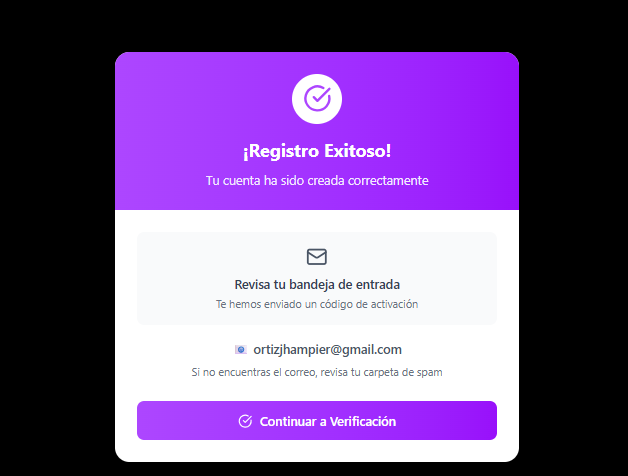

### 

### 

### 

### 

### 

### 

### **RF2 – Autenticación con redes sociales (OAuth)**

Permite que el usuario inicie sesión o vincule su cuenta usando redes sociales como **Facebook o Gmail** mediante el protocolo **OAuth 2.0**.\
Al autorizar el acceso, el sistema asocia la cuenta y permite futuros inicios de sesión sin ingresar credenciales manualmente.

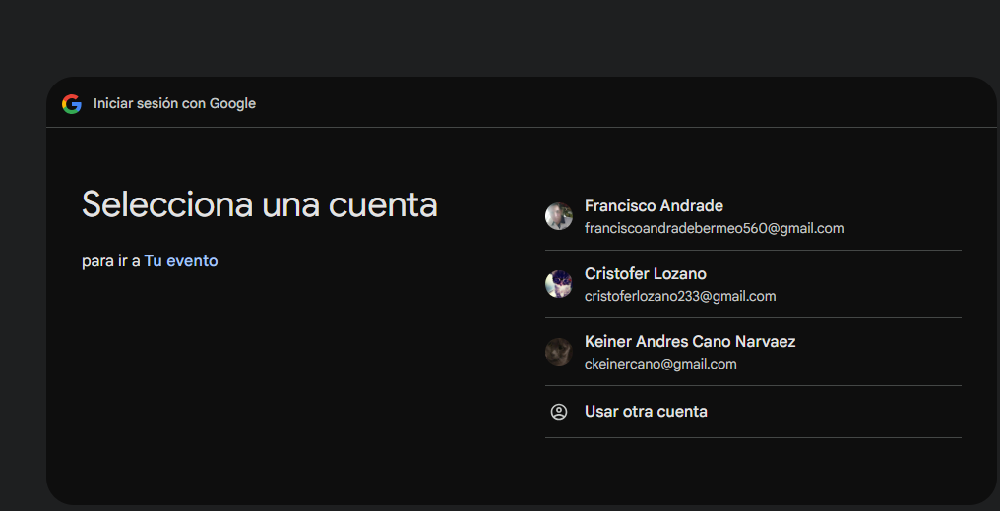

### **RF3 – Inicio de sesión de usuario**

Permite que el usuario acceda al sistema ingresando su **correo electrónico y contraseña** previamente registrados.\
El sistema valida las credenciales y, si son correctas, **inicia la sesión** y redirige al usuario a la página principal.

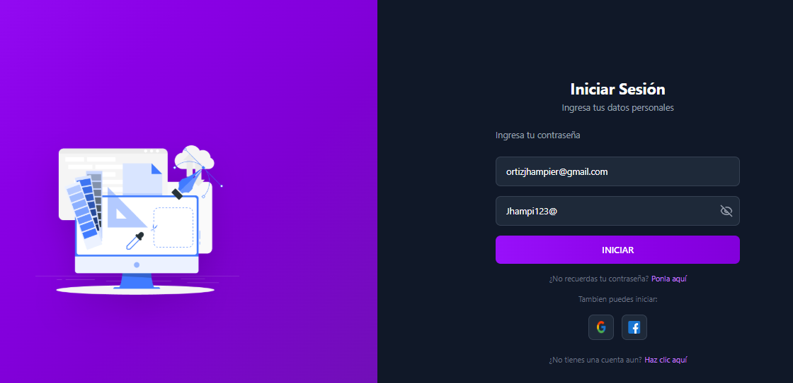

### **RF4 – Gestión de perfil de usuario**

Permite que el usuario **cree, edite y actualice su información personal**, como su numero, fecha de nacimiento y dirección.\
El sistema guarda los cambios en la base de datos y muestra un mensaje de confirmación al completar la acción (Cabe aclarar que esto se encuentra funcional solo en la versión movil, se agregara a la versión web en versiones posteriores)

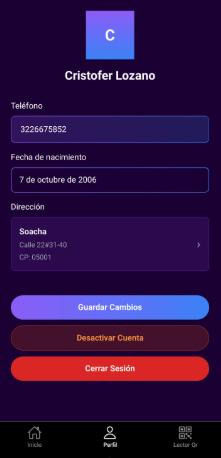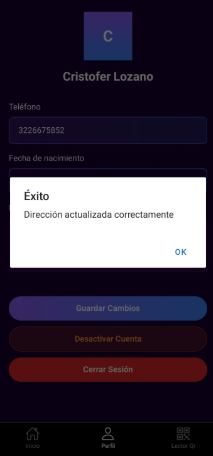

### **RF5 – Recuperar contraseña**

Permite que el usuario **recupere el acceso a su cuenta** ingresando su correo electrónico registrado.\
El sistema envía un **código de verificación** al correo para permitirle **restablecer su contraseña** y crear una nueva de forma segura.

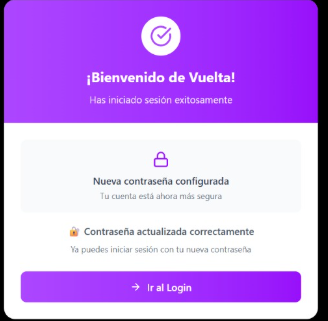

### **RF6 – Cerrar sesión**

Permite que el usuario **finalice su sesión activa** haciendo clic en el botón de salir.\
El sistema **invalida la sesión** y redirige al usuario a la pantalla de inicio de sesión, garantizando la **seguridad y privacidad** de su cuenta. (Disponible también en versión web)

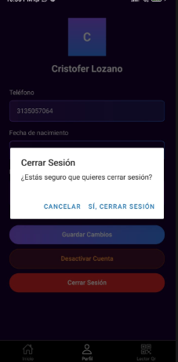

### **RF7 – Eliminación permanente de cuenta de usuario**

Permite que el usuario **borre de forma definitiva su cuenta y todos sus datos** desde la configuración del sistema.\
El sistema solicita **confirmación antes de eliminar** y, una vez completado el proceso, **redirige al usuario a la pantalla de inicio** con un mensaje de confirmación.

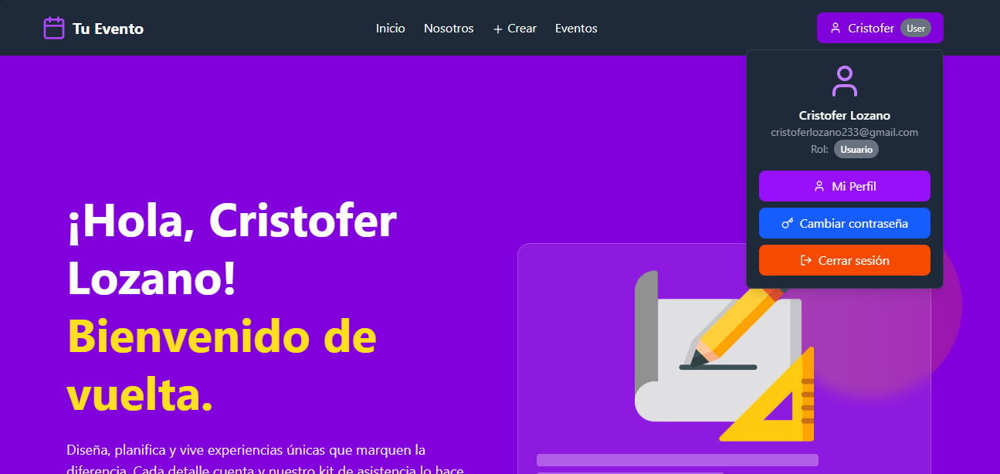

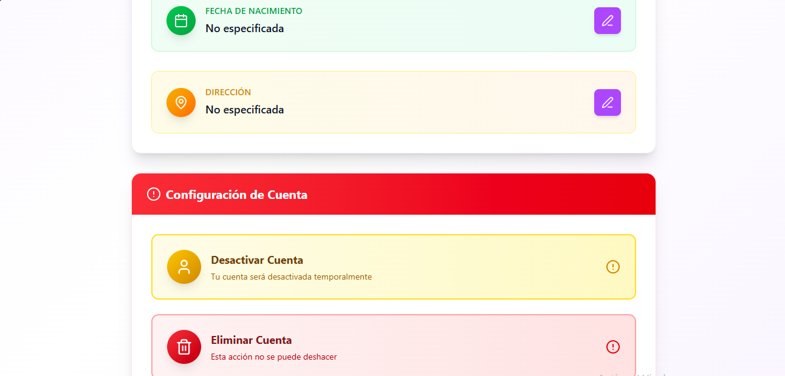

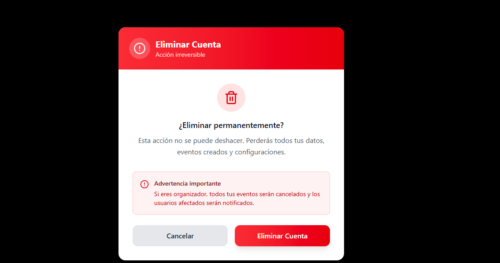

###  **RF8 – Módulo de administración del sistema**

Permite que el **administrador acceda a un panel exclusivo** donde puede **revisar, aceptar o rechazar solicitudes de organizadores**.\
El sistema identifica el rol de administrador al iniciar sesión y muestra las opciones de gestión correspondientes.

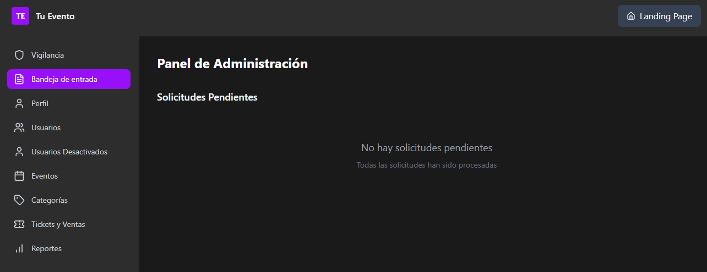

### **RF9 – Edición de la estructura**

Permite que el **organizador cree, edite o elimine el plano del sitio del evento** mediante una interfaz gráfica.\
El sistema asocia el diseño al evento y lo muestra a los usuarios para la **selección de asientos** una vez publicado.

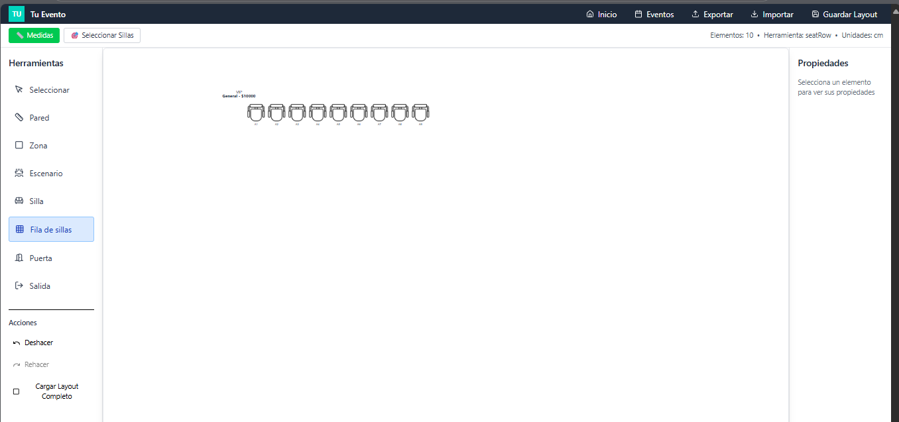

### **RF10 – Reservación de asientos**

Permite que el **usuario seleccione y reserve un asiento** para un evento desde la interfaz de agendamiento.\
El sistema **bloquea temporalmente el asiento** hasta que el organizador valide el pago, garantizando que no pueda ser reservado por otro usuario.

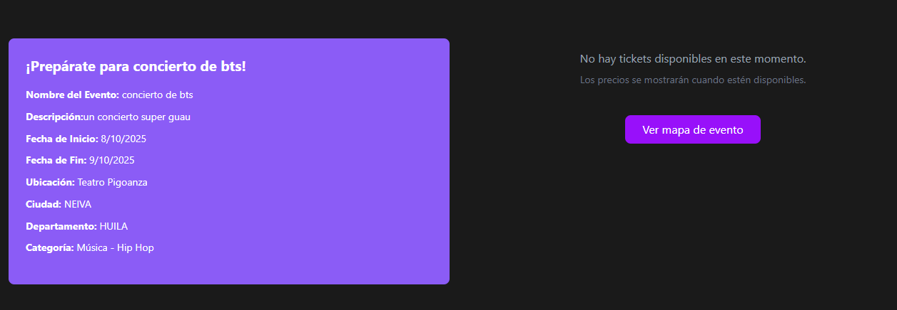

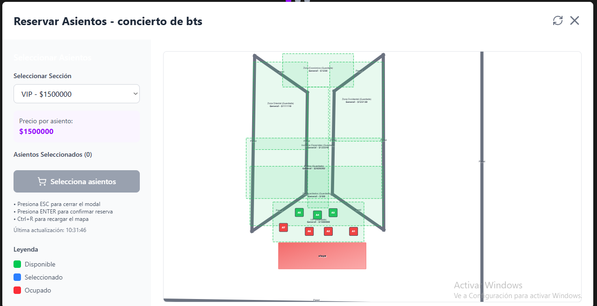

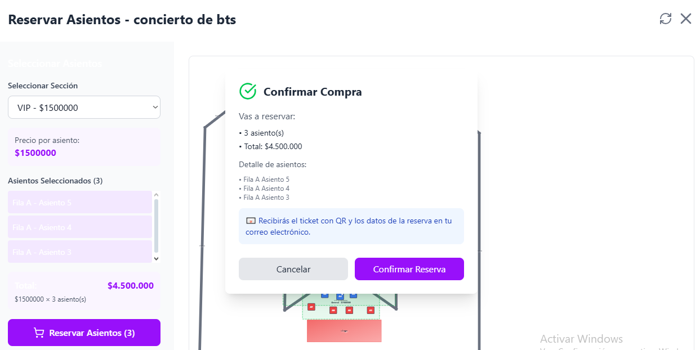

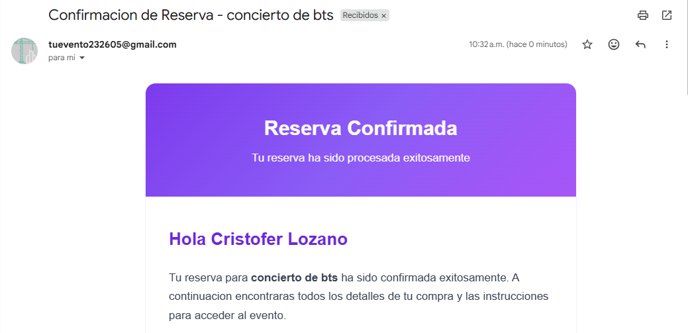

### **RF11 – Generación y validación de código QR por reserva**

Permite que el **sistema genere un código QR único** por cada reserva realizada.\
El código contendrá la información del evento (nombre, fecha y asientos) y se enviará al correo del usuario.\
El **organizador validará el QR** al confirmar el pago, cambiando su estado de *pendiente* a *válido* para permitir el acceso al evento, esto desde la app móvil.

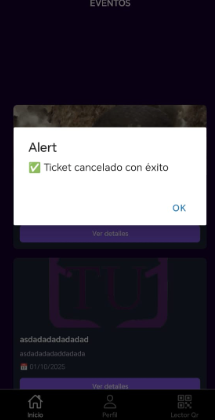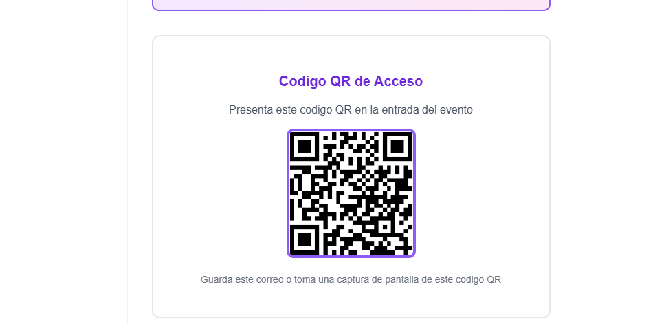

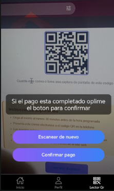

---

<!--
ruta_anterior: es/01_Especificacion_Requisitos/Documento_de_aceptacion_de_Requisitos.md
id: TE-0006
title: "Documento de aceptacion de Requisitos"
lang: es
source: 01_Especificacion_Requisitos/Documento de aceptacion de Requisitos.pdf
source_sha256: fea1c865dc9d3404db9fb02f0daa63d9f9e597e18f2df58d4b860c682e552cc1
conversion: "pdfplumber 0.11.10 siguiendo el árbol de estructura del PDF etiquetado; sin revisión manual"
converted_on: 2026-10-23
fidelity: pendiente_revision
losses:
  - "El método por árbol de estructura no extrae imágenes: la imagen de la reunión y las dos firmas de la página 5 se recortan del original a 200 ppp y se enlazan en su posición; el logo repetido del encabezado (páginas 1-5) va en la sección final."
  - "Las viñetas «•» del original están dentro del cuerpo del elemento de lista (no en su etiqueta); se escriben como viñeta Markdown «- » sin repetir el carácter."
  - "Texto sin etiquetar (artefacto de paginación) omitido en 5 de 5 páginas: «{n}»."
  - "Negritas, cursivas y fuente monoespaciada (Courier) del original no se conservan."
  - "Tablas en GFM con la primera fila como encabezado; los párrafos dentro de una celda se separan con  ."
status: borrador
reviewed_by: ""
-->

# Acta de aceptación de requisitos

Acta de aceptación de requisitos

Andrade Bermeo Carlos Francisco

Cano Narváez Keiner Andrés

Lozano Contreras Cristofer David

Rivera Suarez Ángel Farid

Santos Ortiz Jhampier

Análisis y Desarrollo de Software

(2899747)

Servicio Nacional de Aprendizaje

Septiembre 10, 2025

Proyecto: Tu evento

Acta N°: 1

Fecha: 10/09/2025

Lugar: Neiva-Huila

Participantes:

Cano Narváez Keiner Andrés (Stakeholder)

Lozano Contreras Cristofer David (Scrum Master)

Andrade Bermeo Carlos Francisco (Desarrollador Frontend)

Rivera Suarez Angel Farid (Desarrollador Frontend)

Santos Ortiz Jhampier (Desarrollador Frontend)

Objetivo del Acta: El objetivo de la presente acta es formalizar el inicio del proyecto “Tu Evento”, dejando constancia de la reunión sostenida con el grupo de trabajo, en la cual se validaron y aceptaron los requisitos previamente establecidos. Con ello, se busca garantizar una comprensión mutua del alcance, los lineamientos iniciales y las responsabilidades de las partes involucradas.

- Observaciones del Cliente:
- 1. Se sugiere que los eventos puedan clasificarse por categoría (ejemplo: cultural, deportivo, académico).
- 2. El cliente solicita que las notificaciones incluyan tanto alertas dentro de la aplicación como vía correo electrónico.
- Retroalimentación
- 1. Los requisitos cumplen con las expectativas iniciales del cliente.
- 2. Se identificaron ajustes menores que no afectan el alcance principal, pero mejoran la experiencia del usuario.
- 3. El cliente valida el acta con la condición de que se consideren las observaciones en fases posteriores de desarrollo.

Compromiso:

Los participantes del proyecto se comprometen a:

- Cumplir con los requisitos establecidos.
- Mantener comunicación constante y efectiva para asegurar que el desarrollo cumpla con las expectativas.
- Respetar los roles asignados dentro del equipo de trabajo.

Frontera:

El presente proyecto no incluye dentro de su desarrollo:

- La integración con pasarelas de pago en línea
- El desarrollo se enfocará únicamente en funcionalidades acordadas en los requisitos iniciales, sin contemplar cambios o adiciones posteriores que no estén formalmente aprobadas.

Alcance:

El proyecto “Tu Evento” tendrá como alcance:

- El diseño, desarrollo e implementación de un aplicativo web y móvil que permita a los usuarios visualizar, gestionar y participar en eventos.
- Integración de funcionalidades como: creación y visualización de eventos, registro de usuarios, autenticación, gestión de roles y comunicación con los organizadores.

Imagen de la reunión:

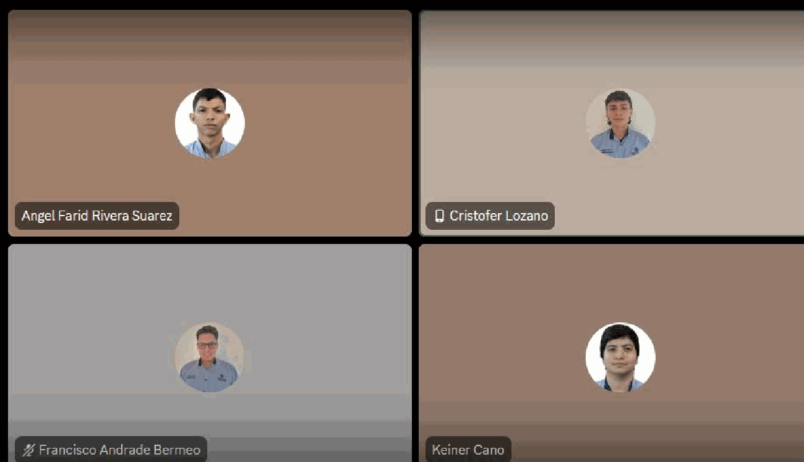

 

_________________________ _________________________

Firma del Stakeholder Firma del Scrum Master

---

## Encabezados y pies de página del original

- **Encabezado** (páginas 1-5): logo «TU EVENTO» en la esquina superior izquierda 

---

<!--
ruta_anterior: es/01_Especificacion_Requisitos/Presentacion_de_requisitos.md
id: TE-0011
title: "Presentación de requisitos"
lang: es
source: 01_Especificacion_Requisitos/Presentación de requisitos.pdf
source_sha256: 8a992fe953674e77a209a848bd580c0948f54d4684a1b92227abdfa6390bcb36
conversion: "pdfplumber 0.11.10 (cuadros de texto) + imagen de página a 100 ppp; sin revisión manual"
converted_on: 2026-10-23
fidelity: parcial
losses:
  - "PDF de diseño (Canva): el texto se agrupa por cuadros de texto (líneas cercanas que se solapan) y se ordena de arriba abajo y de izquierda a derecha; el orden de lectura de la composición puede diferir y la imagen de cada página es la referencia fiel."
  - "Cada salto de línea visual dentro de un cuadro se conserva con  ."
  - "Disposición, colores, tipografías, formas, flechas e imágenes decorativas solo están en la imagen de cada página (100 ppp)."
  - "Los caracteres de Canva no están enlazados al árbol de etiquetas del PDF, por lo que no se usa el método de PDF etiquetado."
status: borrador
reviewed_by: ""
-->

# Presentación de requisitos

## Página 1

PRESENTACIÓN DE

INFORME DE REQUISITOS 
“TU EVENTO”

## Página 2

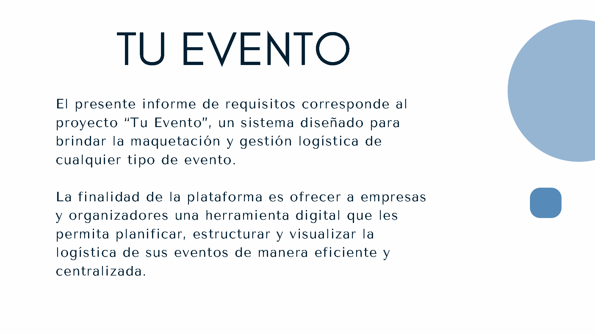

TU EVENTO

El presente informe de requisitos corresponde al 
proyecto “Tu Evento”, un sistema diseñado para 
brindar la maquetación y gestión logística de 
cualquier tipo de evento.

La finalidad de la plataforma es ofrecer a empresas 
y organizadores una herramienta digital que les 
permita planificar, estructurar y visualizar la 
logística de sus eventos de manera eficiente y 
centralizada.

## Página 3

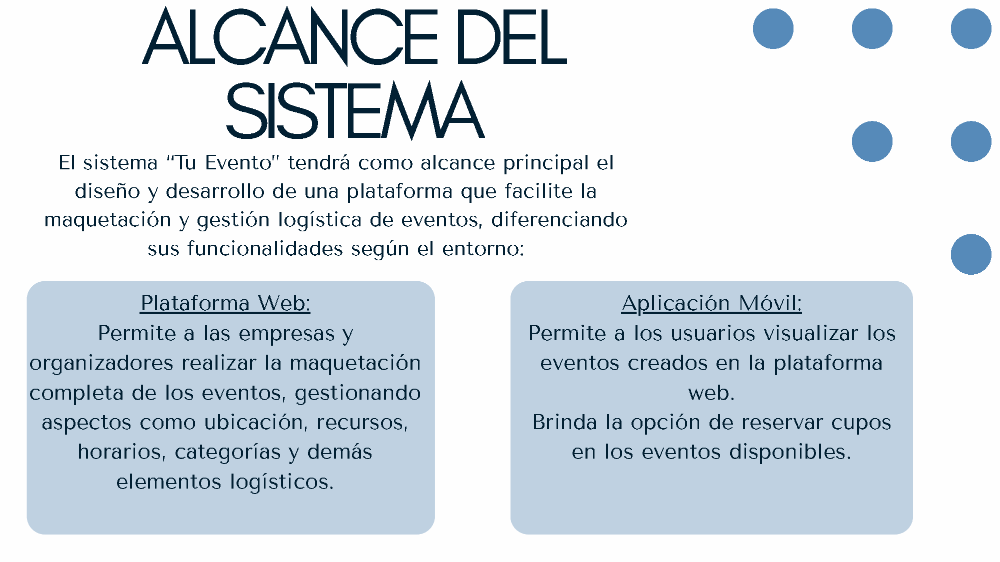

ALCANCE DEL

SISTEMA

El sistema “Tu Evento” tendrá como alcance principal el 
diseño y desarrollo de una plataforma que facilite la 
maquetación y gestión logística de eventos, diferenciando 
sus funcionalidades según el entorno:

Plataforma Web: 
Permite a las empresas y 
organizadores realizar la maquetación 
completa de los eventos, gestionando 
aspectos como ubicación, recursos, 
horarios, categorías y demás 
elementos logísticos.

Aplicación Móvil: 
Permite a los usuarios visualizar los 
eventos creados en la plataforma 
web. 
Brinda la opción de reservar cupos 
en los eventos disponibles.

## Página 4

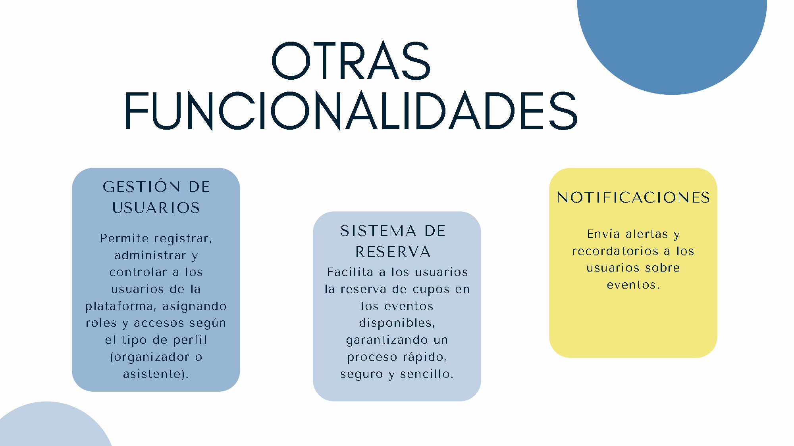

OTRAS

FUNCIONALIDADES

GESTIÓN DE 
USUARIOS

NOTIFICACIONES

SISTEMA DE 
RESERVA

Envía alertas y 
recordatorios a los 
usuarios sobre 
eventos.

Permite registrar, 
administrar y 
controlar a los 
usuarios de la 
plataforma, asignando 
roles y accesos según 
el tipo de perfil 
(organizador o 
asistente).

Facilita a los usuarios 
la reserva de cupos en 
los eventos 
disponibles, 
garantizando un 
proceso rápido, 
seguro y sencillo.

## Página 5

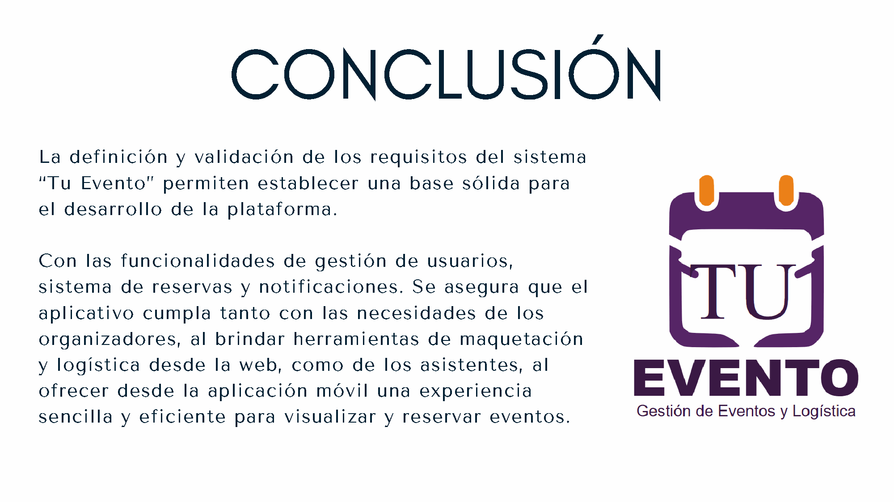

CONCLUSIÓN

La definición y validación de los requisitos del sistema 
“Tu Evento” permiten establecer una base sólida para 
el desarrollo de la plataforma.

Con las funcionalidades de gestión de usuarios, 
sistema de reservas y notificaciones. Se asegura que el 
aplicativo cumpla tanto con las necesidades de los 
organizadores, al brindar herramientas de maquetación 
y logística desde la web, como de los asistentes, al 
ofrecer desde la aplicación móvil una experiencia 
sencilla y eficiente para visualizar y reservar eventos.

## Página 6

¡

MUCHAS

GRACIAS!

---

<!--
ruta_anterior: es/01_Especificacion_Requisitos/Informe_evaluativo_Tu_Evento.md
id: TE-0008
title: "Informe evaluativo Tu Evento"
lang: es
source: 01_Especificacion_Requisitos/Informe evaluativo Tu Evento.docx
source_sha256: ea815304ddc673108ab044d29bbbe38f8b234047ccd7019a9434fc8049a6ffa0
conversion: "pandoc 3.9 (-t gfm --wrap=none --extract-media) + extracción de encabezados/pies; sin revisión manual"
converted_on: 2026-10-23
fidelity: pendiente_revision
losses:
  - "Los guiones «- » escritos como texto al inicio de 4 líneas se escapan como «\\- » para que GFM no los convierta en viñetas."
  - "El primer párrafo tiene el estilo Título (Title); pandoc lo pasa a metadatos y no lo escribe en GFM. Se restituyó a mano como título de nivel 1, con el texto exacto del original."
status: borrador
reviewed_by: ""
-->

# Informe de Evaluación del Documento SRS – Proyecto “Tu Evento”

**Proyecto:** Tu Evento

**Documento Evaluado:** Especificación de Requerimientos de Software (SRS) – Versión 1.0

**Evaluador:** Keiner Andres Cano Narvaez

**Fecha:** 24/09/2025

# 1. Objetivo de la Evaluación

El propósito de este informe es analizar el documento SRS entregado para el sistema “Tu Evento” y determinar si cumple con los aspectos de claridad y calidad requeridos en un documento de análisis. Asimismo, se proporcionan recomendaciones de mejora.

# 2. Alcance del Documento Analizado

El SRS contiene:\
\- Introducción (propósito, alcance, definiciones, personal involucrado).\
\- Descripción general (perspectiva del producto, funciones, usuarios, restricciones).\
\- Requerimientos específicos (funcionales y no funcionales).

# 

# 

# 

# 

# 

# 3. Evaluación por Criterios

| **Aspecto Evaluado** | **Observaciones** | **Cumplimiento** |
|----|----|----|
| **Claridad** | Los requisitos funcionales están bien estructurados con entradas, salidas, pre/post condiciones. | Si |
| **Consistencia** | No se detectan contradicciones. | Si |
| **Requisitos No Funcionales** | Incluyen seguridad, usabilidad, compatibilidad y diseño responsive. | Si |
| **Modelos de Apoyo** | Se mencionan interfaces, pero no hay diagramas complementarios como secuencia o actividades. | Parcial |

# 

# 

# 4. Conclusiones

El documento SRS para el sistema “Tu Evento” es bastante completo en cuanto a requisitos funcionales, bien estructurados y documentados con precondiciones, postcondiciones y manejo de errores. No obstante, presenta una carencia en:\
\- Falta de diagramas adicionales que ayuden a comprender la dinámica del sistema (ej. diagramas de actividades, clases o secuencia).\
\
En general, el documento cumple con los estándares básicos de un SRS, pero requiere ajustes para alinearse mejor con las buenas prácticas de ingeniería de software.

# 5. Recomendaciones de Mejora

1\. Incorporar criterios de aceptación medibles para cada requisito (ej. tiempos de carga, porcentaje de disponibilidad, métricas de seguridad).

2\. Detallar requisitos de rendimiento (ej. concurrencia, capacidad máxima de usuarios).

3\. Incluir diagramas adicionales (actividades, secuencia, clases) para apoyar la comprensión.

---

<!--
ruta_anterior: es/01_Especificacion_Requisitos/Recoleccion_de_datos/survey_Your_even.md
id: TE-0015
title: "survey-Your even"
lang: es
source: 01_Especificacion_Requisitos/Recoleccion de datos/survey-Your even.docx
source_sha256: d38372c19731ba48ffb929a7f75f2af24a52d01e59256cc643f1e45e3338bcde
conversion: "pandoc 3.9 (-t gfm --wrap=none --extract-media) + extracción de encabezados/pies; sin revisión manual"
converted_on: 2026-10-23
fidelity: parcial
losses:
  - "El original no usa estilos de título; los títulos visuales quedan como texto en negrita, sin jerarquía #. Pendiente de marcar a mano."
status: borrador
reviewed_by: ""
-->

# Recolección de datos — encuesta

Este es el link para poder realizar la encuesta hecha para la recolección de información:

https://docs.google.com/forms/d/e/1FAIpQLSdMdYqbBKMqqFJozL-J-no73syPJHUWpwO8kc5EwLKCrk9RIg/viewform

---

<!--
ruta_anterior: es/01_Especificacion_Requisitos/Recoleccion_de_datos/Analisis_Encuesta_TuEvento.md
id: TE-0012
title: "Análisis Encuesta TuEvento"
lang: es
source: 01_Especificacion_Requisitos/Recoleccion de datos/Análisis Encuesta TuEvento.docx
source_sha256: d95c4567150f67f35b820ee459d9189f46f8c4ca834efcd82a756f8d3feb69a1
conversion: "pandoc 3.9 (-t gfm --wrap=none --extract-media) + extracción de encabezados/pies; sin revisión manual"
converted_on: 2026-10-23
fidelity: pendiente_revision
losses:
  - "Encabezados y pies de página extraídos aparte (pandoc no los convierte); en el original se repiten en cada página. Los campos se muestran como {PAGE}, {NUMPAGES}."
status: borrador
reviewed_by: ""
-->

# Análisis de la encuesta

**Procesamiento y Análisis de Datos de la Encuesta**

**Proyecto Formativo**

**Tecnólogo en Análisis y Desarrollo de Software**

**“Tu Evento”**

Integrantes:

**Cristofer David Lozano Contreras**

**Jhampier Santos Ortiz**

**Centro de la Industria la empresa y los Servicios**

**Neiva, Huila**

**Año 2025**

**Resumen de Datos Recolectados**

1.  **¿Cuál es tu edad?**

- Menos de 18

- 18-24 años

- 25-34 años

- 35-44 años

- 45 o mas años

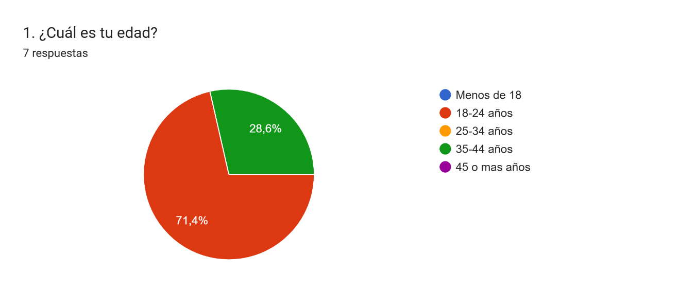

Análisis:

**Resultados principales:**

- La categoría 18-24 años (rojo) tiene la mayoría de las respuestas, con un 71.4% del total.

- La categoría 35-44 años (verde) representa el 28.6%.

- No hay respuestas en las demás categorías (Menos de 18, 25-34, y 45 o más años).

**Interpretación:**

- La mayoría de los encuestados son jóvenes adultos (18-24 años), lo que podría indicar que la encuesta fue aplicada en un entorno con predominancia de este grupo, como una universidad o un grupo juvenil.

- El segundo grupo más representado (35-44 años) sugiere la presencia de un número menor de personas de mediana edad, posiblemente profesores, profesionales o familiares.

- La ausencia de respuestas en otras categorías sugiere que el grupo de encuestados no es muy diverso en términos de edad.

** 2. ¿Con qué frecuencia asistes a eventos (conciertos, conferencias, festivales, etc.)?**

- Nunca

- Rara Vez

- A veces

- Frecuentemente

- Siempre

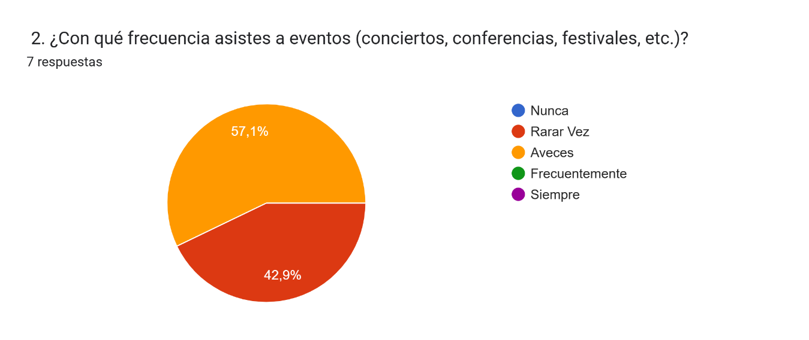

Análisis:

**Resultados principales:**

- "A veces" (naranja): 57.1% de los encuestados asisten a eventos de manera ocasional.

- "Rara vez" (rojo): 42.9% asisten con poca frecuencia.

- No hay respuestas en las categorías "Nunca", "Frecuentemente" o "Siempre", lo que indica que ninguna persona evita completamente los eventos, pero tampoco hay asistentes muy frecuentes.

**Interpretación:**

- La mayoría de los encuestados tienen algún interés en los eventos, pero no asisten con regularidad.

- Esto podría deberse a factores como disponibilidad de tiempo, costos, interés en eventos específicos o acceso a estos eventos.

- No hay asistentes regulares o apasionados por los eventos, lo que podría indicar que estos no forman una parte esencial de su estilo de vida.

**3. ¿Cómo te enteras de los eventos a los que asistes?   **

- Redes sociales

- Amigos

- Publicidad

- Otro: \_\_\_\_\_\_\_\_\_\_\_\_\_\_\_\_

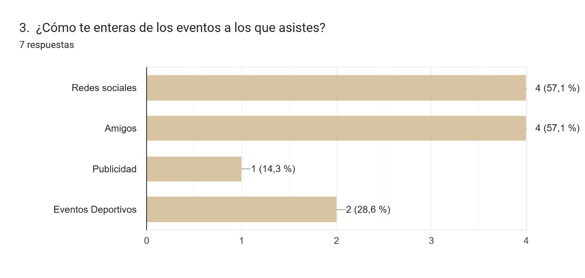

Análisis:

#### Resultados clave:

- **Redes sociales (57.1%) y Amigos (57.1%)** son las fuentes más comunes para descubrir eventos.

- **Eventos deportivos (28.6%)** también juegan un papel en la difusión de información.

- **Publicidad (14.3%)** es la fuente menos utilizada para enterarse de eventos.

#### Interpretación:

- El boca a boca y lo digital dominan: **Las redes sociales y las recomendaciones de amigos son las principales formas de descubrir eventos, lo que sugiere que las estrategias de marketing en redes y la difusión orgánica (recomendaciones personales) son efectivas.**

- Baja influencia de la publicidad tradicional: **Solo una persona mencionó la publicidad como fuente, lo que indica que los anuncios convencionales pueden no ser tan efectivos para este grupo.**

- El impacto de los eventos deportivos: Aunque no es la fuente principal, algunas personas se enteran de **otros eventos a través de estos.**

**4. ¿Cómo sueles comprar entradas para eventos?**

- A través de una página web

- A través de una app móvil

- En la taquilla o punto de venta

- Otro: \_\_\_\_\_\_\_\_\_\_\_\_\_\_\_\_\_\_\_\_\_\_\_\_\_\_\_\_\_\_\_\_\_\_\_\_\_\_\_\_\_\_\_\_\_\_\_\_\_\_\_\_\_\_\_\_\_\_\_\_\_\_

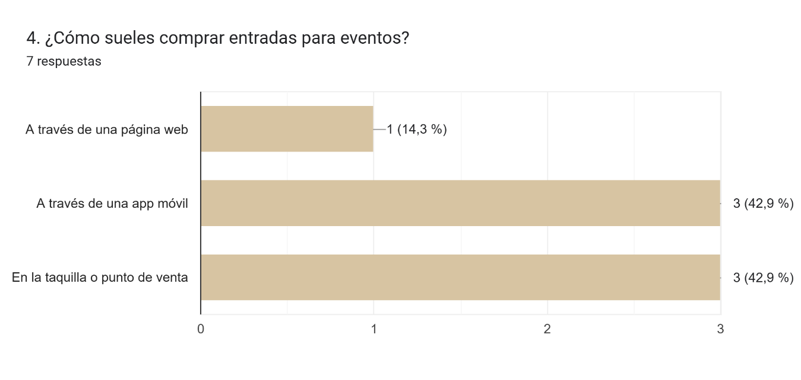

Análisis:

#### Resultados clave:

- **El 42.9% compra entradas a través de una app móvil.**

- **El 42.9% prefiere comprar en la taquilla o punto de venta.**

- **Solo el 14.3% usa una página web para adquirir sus boletos.**

#### Interpretación:

- **La compra digital y presencial están equilibradas:** Casi la mitad de los encuestados usa apps móviles, mientras que la otra mitad prefiere comprar físicamente en la taquilla.

- **Las páginas web no son una opción popular:** Solo una persona usa este método, lo que sugiere que las apps móviles han desplazado a las páginas web tradicionales en la compra de boletos.

- **Preferencia por lo práctico:** El uso de apps móviles puede deberse a la comodidad y rapidez, mientras que la compra en la taquilla podría reflejar una preferencia por la seguridad en la compra o la costumbre.

### Recomendaciones basadas en los datos:

- **Optimizar las apps móviles** para la venta de boletos puede mejorar la experiencia del usuario y captar más compradores.

- **Mejorar la experiencia de compra en páginas web** podría aumentar su uso, con interfaces más intuitivas y promociones atractivas.

**5. ¿Te gustaría recibir notificaciones de la plataforma sobre el evento (cambios de horario, recordatorios, etc.)?**

- Sí, me gustaría recibir notificaciones

- Solo para cambios importantes

- No, prefiero no recibir notificaciones

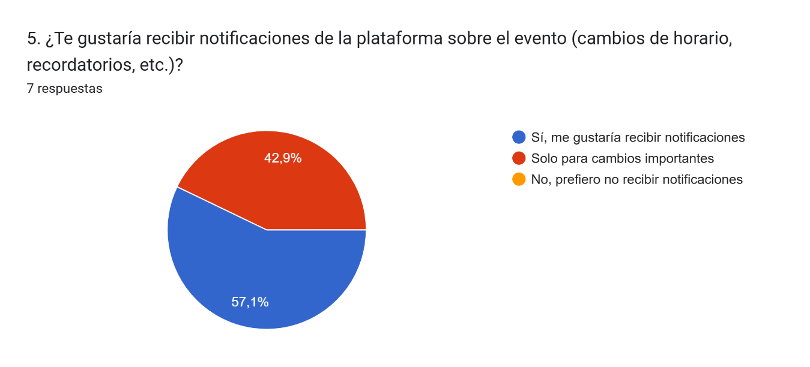

Análisis:

#### Resultados clave:

- **El 57.1% (azul) desea recibir notificaciones sobre los eventos.**

- **El 42.9% (rojo) solo quiere recibir notificaciones en caso de cambios importantes.**

- **No hay respuestas para la opción "No, prefiero no recibir notificaciones" (naranja), lo que indica que todos los encuestados aceptan recibir algún tipo de notificación.**

#### Interpretación:

- **Las notificaciones son bien recibidas:** Todos los participantes están abiertos a recibir información sobre eventos, aunque algunos prefieren que sea solo en casos importantes.

- **Equilibrio entre información y relevancia:** Mientras que más de la mitad quiere recibir notificaciones regulares, casi la mitad prefiere limitarse a cambios clave.

### Recomendaciones basadas en los datos:

- **Implementar notificaciones personalizables**, permitiendo a los usuarios elegir la frecuencia y el tipo de información que desean recibir.

- **Diferenciar entre notificaciones estándar y urgentes**, asegurando que aquellos que solo quieren avisos importantes no sean saturados con información innecesaria.

- **Aprovechar el interés en notificaciones** para mejorar la comunicación y la asistencia a los eventos.

**6. ¿Qué tan satisfecho estás con la forma en que actualmente compras entradas para eventos?**

- Muy satisfecho

- Algo satisfecho

- Neutral

- Algo insatisfecho

- Muy insatisfecho

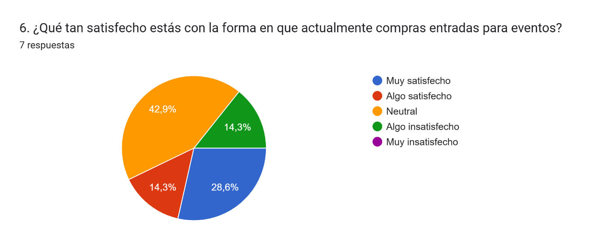

Análisis:

#### Resultados clave:

1.  **Oportunidad de mejora**:

    - El 42.9% de los encuestados tiene una opinión neutral, lo que indica que el sistema actual de compra de boletos no les ofrece una experiencia destacable.

    - Un 14.3% está algo insatisfecho, lo que señala que hay aspectos que podrían optimizarse en una plataforma nueva.

2.  **Demanda de una mejor experiencia de compra**:

    - Aunque un 42.9% está satisfecho, no hay una mayoría absoluta que esté completamente contenta con el sistema actual, lo que abre una oportunidad para una web que ofrezca un proceso más eficiente y cómodo.

### Recomendaciones basadas en los datos:

**Facilidad de uso y rapidez:** La web debe tener una interfaz intuitiva, con navegación sencilla y un proceso de compra ágil.

**Diferenciación de las apps móviles:** Como en gráficos anteriores vimos que muchos prefieren comprar por apps, la web debe ofrecer funciones que las aplicaciones móviles no tienen, como promociones exclusivas o filtros avanzados de búsqueda.

**Múltiples métodos de pago:** Agregar opciones como tarjetas, transferencias que puede hacer la compra más accesible.

**Optimización para móviles:** Aunque es una web, debe funcionar perfectamente en dispositivos móviles para atraer a usuarios que prefieren apps.

** 7. ¿Qué información te gustaría recibir antes de asistir a un evento?  \***

- Horarios

- Ubicación

- Recomendaciones

- Otro: \_\_\_\_\_\_\_\_\_\_\_\_\_\_\_\_\_\_\_\_\_\_\_\_\_\_\_\_\_\_\_\_\_\_

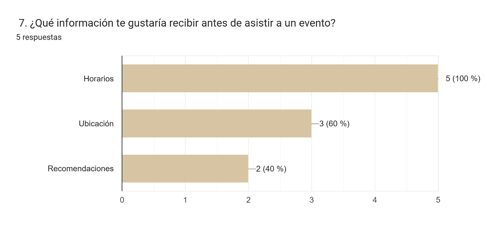

### Análisis: 

#### Resultados clave:

- 57.1% (azul) desea recibir notificaciones sobre los eventos.

- 42.9% (rojo) solo quiere recibir notificaciones en caso de cambios importantes.

- No hay respuestas para la opción "No, prefiero no recibir notificaciones" (naranja), lo que indica que todos los encuestados aceptan recibir algún tipo de notificación.

###  Interpretación:

- **Las notificaciones son bien recibidas**: Todos los participantes están abiertos a recibir información sobre eventos, aunque algunos prefieren que sea solo en casos importantes.

- **Equilibrio entre información y relevancia**: Mientras que más de la mitad quiere recibir notificaciones regulares, casi la mitad prefiere limitarse a cambios clave.

- **Personalización en la plataforma**: Incluir opciones para que los usuarios elijan el tipo y la frecuencia de notificaciones mejorará la experiencia.

**8. ¿Alguna vez has organizado un evento?**

- Si

- No

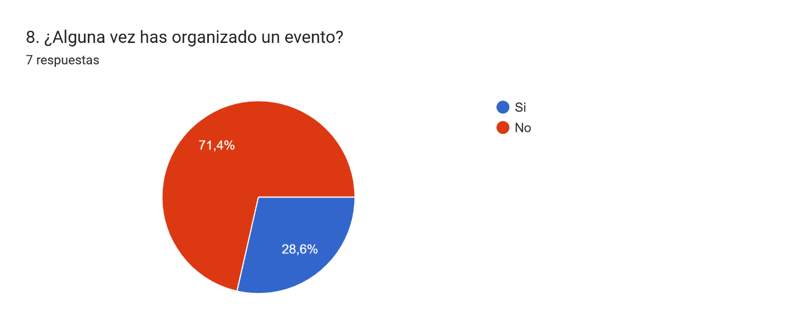Análisis:

**Resultados Clave:**

- 28.6% (azul) ha organizado un evento.

- 71.4% (rojo) no ha organizado un evento.

**Interpretación:**

- **Predominio de asistentes sobre organizadores**: La mayoría de los encuestados no ha organizado eventos, lo que indica que la plataforma debe centrarse principalmente en facilitar la experiencia de los asistentes.

- **Potencial mercado para organizadores**: Aunque es una minoría, existe un segmento de usuarios que ha organizado eventos, lo que representa una oportunidad para incluir herramientas específicas para ellos.

**Recomendaciones:**

- **Sección para organizadores:** Implementar una opción dentro de la web donde los usuarios puedan crear, gestionar y promocionar eventos.

- **Recursos y guías:** Ofrecer tutoriales o artículos con consejos sobre planificación y logística de eventos.

- **Interacción entre asistentes y organizadores:** Crear un espacio donde los asistentes puedan valorar y recomendar eventos, incentivando la confianza y mejorando la experiencia.

**9. ¿Cuál es el desafío más grande que enfrentas al planificar un evento?**

- Diseño y distribución del espacio

- Gestión de entradas

- Coordinación con proveedores

- Control de asistencia

- Otro: \_\_\_\_\_\_\_\_\_\_\_\_\_\_\_\_\_\_\_\_\_\_\_\_\_\_\_\_\_\_\_

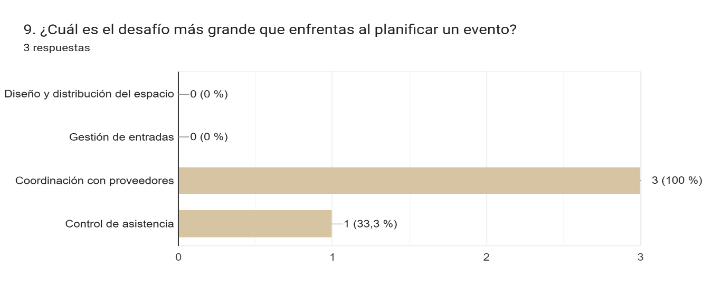

Análisis:

**Resultados Clave:**

- **100% (3 respuestas)** identifican la **coordinación con proveedores** como el principal desafío.

- **33.3% (1 respuesta)** mencionó el **control de asistencia** como una dificultad.

- **0%** de respuestas para **diseño del espacio** y **gestión de entradas**, lo que sugiere que estos aspectos no son problemáticos para los organizadores.

###  Interpretación:

- **La logística con proveedores es el mayor reto:** Esto indica que los organizadores necesitan mejores herramientas para la comunicación, contratación y gestión de proveedores.

- **El control de asistencia es un desafío secundario:** Esto sugiere que podrían requerirse herramientas más eficientes para monitorear la participación en los eventos.

- **Gestión de entradas y diseño del espacio no representan grandes dificultades:** Significa que los organizadores ya cuentan con soluciones adecuadas o no las consideran prioritarias.

###  Recomendaciones:

1.  **Automatización del control de asistencia:** Integrar códigos QR o registros digitales para facilitar la supervisión de asistentes.

2.  **Foro o comunidad de organizadores:** Crear un espacio donde los organizadores puedan compartir experiencias, recomendaciones y contactos de proveedores confiables.

**10. ¿Te gustaría tener una herramienta en línea para diseñar la maqueta de tu evento (con lugares, asientos, escenario, etc.)?**

- Sí, definitivamente

- Tal vez, si fuera fácil de usar

- No, no lo necesito

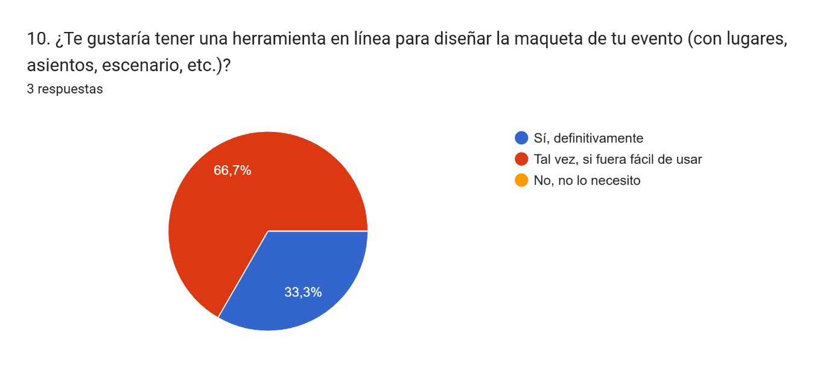

Análisis:

**Resultados Clave:**

- **33.3% (1 respuesta)** quiere **definitivamente** una herramienta en línea para diseñar eventos.

- **66.7% (2 respuestas)** considerarían usarla **si fuera fácil de utilizar**.

- **0%** indicó que **no la necesita**, lo que muestra interés en la funcionalidad.

### Interpretación:

- **Interés moderado con condiciones:** Aunque no todos consideran esencial esta herramienta, la mayoría la usaría si es intuitiva y fácil de manejar.

- **No hay rechazo total:** Nadie descartó completamente la idea, lo que sugiere que una función bien implementada podría ser útil.

### Recomendaciones:

1.  **Interfaz intuitiva:** Diseñar una herramienta visual y fácil de usar, con opciones prediseñadas y arrastrar-soltar.

2.  **Funcionalidades esenciales:** Permitir ubicación de escenarios, asientos y espacios con personalización sencilla.

**11. ¿Qué características consideras más importantes en una herramienta para crear un evento?**

- Facilidad para arrastrar y soltar elementos

- Plantillas prediseñadas según tipo de evento

- Opciones para personalizar el diseño

- Visualización en 2D del evento

- Otro: \_\_\_\_\_\_\_\_\_\_\_\_\_\_\_\_\_\_\_\_\_\_\_\_\_\_\_\_\_\_

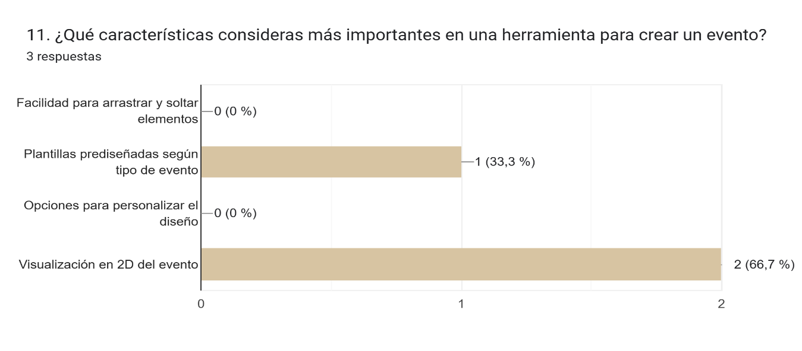

Análisis:

**Resultados Clave:**

- **66.7% (2 respuestas)** priorizan la **visualización en 2D del evento**.

- **33.3% (1 respuesta)** considera relevante contar con **plantillas prediseñadas según el tipo de evento**.

- **0%** mencionó la necesidad de **arrastrar y soltar elementos** o **personalizar el diseño**, lo que sugiere que estas funciones no son una prioridad para los encuestados.

###  Interpretación:

- **Enfoque en la representación visual:** La mayoría considera fundamental la vista en 2D, lo que indica que visualizar el evento de manera clara y organizada es una prioridad.

- **Estructura sobre personalización:** En lugar de opciones avanzadas para personalizar, los encuestados prefieren contar con **plantillas prediseñadas** para facilitar la planificación.

###  Recomendaciones:

1.  **Implementar un visor en 2D:** Integrar una vista interactiva en 2D para que los organizadores puedan visualizar la distribución del evento.

2.  **Ofrecer plantillas prácticas:** Incorporar modelos predefinidos según el tipo de evento (conferencias, conciertos, ferias, etc.), agilizando el proceso de diseño.

3.  **Simplicidad sobre funciones avanzadas:** No es prioritario incluir herramientas de personalización o edición detallada, sino facilitar una experiencia visual clara y estructurada.

**12. ¿Qué aspecto te gustaría que mejorar en la experiencia de asistir a eventos?**

- Organización del evento

- Facilidad para comprar entradas

- Acceso al lugar del evento

- Disponibilidad de información antes del evento

- Otro: \_\_\_\_\_\_\_\_\_\_\_\_\_\_\_\_\_\_\_\_\_\_\_\_\_\_\_\_\_\_\_\_\_\_\_\_

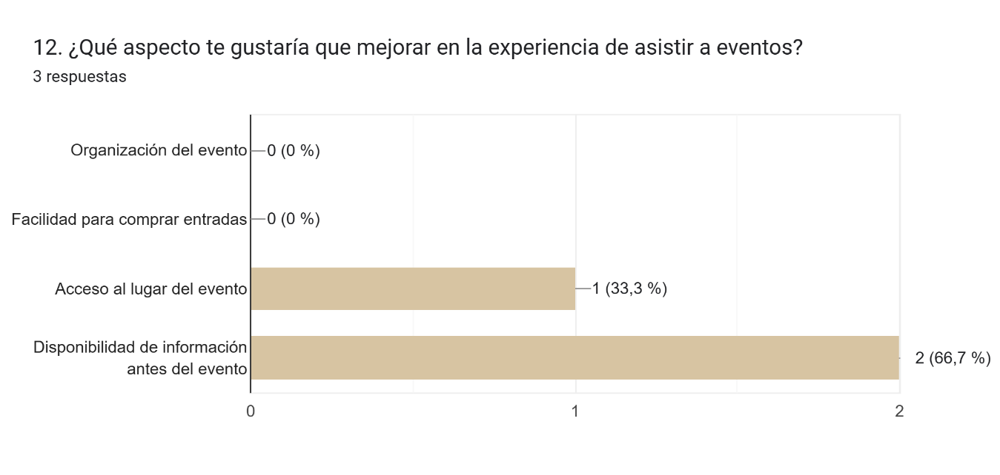

Análisis:

### Resultados Clave:

### 66.7% (2 respuestas) mencionaron la disponibilidad de información antes del evento como el aspecto más importante a mejorar.

### 33.3% (1 respuesta) destacó la importancia de mejorar el acceso al lugar del evento.

### 0% indicó problemas con la organización del evento o la facilidad para comprar entradas, lo que sugiere que estos aspectos no son una preocupación principal.

###  Interpretación:

### Información clave antes del evento: La mayoría de los encuestados sienten que les falta información clara antes de asistir, lo que podría generar incertidumbre o dificultades en la planificación.

### Accesibilidad al evento: Aunque en menor medida, también se identificó el acceso al evento como un área a mejorar, lo que puede implicar problemas con rutas, transporte o señalización.

###  Recomendaciones:

### Mejorar la comunicación previa al evento: Implementar una sección clara y accesible en la web con detalles clave como horarios, ubicaciones y recomendaciones.

### Integrar recordatorios y notificaciones: Enviar correos o notificaciones con información relevante días antes del evento.

**13. ¿Qué métodos de pago prefieres para comprar entradas para eventos? (Puedes seleccionar varias opciones)**

- Tarjeta de crédito/débito

- Transferencia bancaria

- Pago en efectivo (en la taquilla)

- Otro: \_\_\_\_\_\_\_\_\_\_\_\_\_\_\_\_\_\_\_\_\_\_\_\_\_\_\_\_

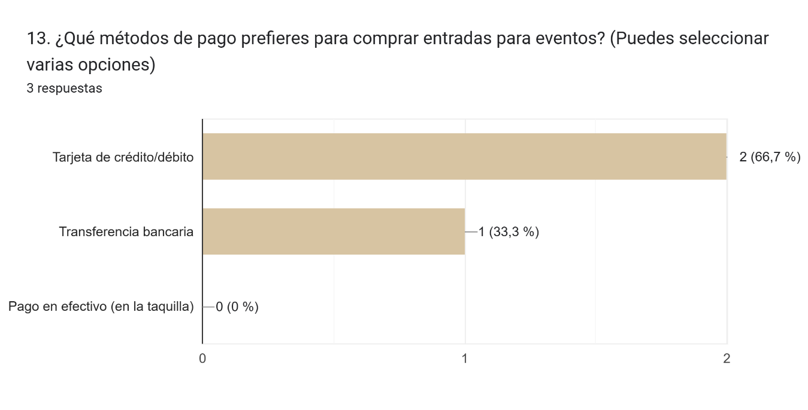

Análisis:

**Resultados Clave:**

- **66.7% (2 respuestas)** prefieren pagar con **tarjeta de crédito/débito**.

- **33.3% (1 respuesta)** elige la **transferencia bancaria** como método de pago.

- **0%** de los encuestados opta por el **pago en efectivo en taquilla**, lo que sugiere una tendencia hacia pagos digitales.

### Interpretación:

- **Preferencia por pagos electrónicos:** La mayoría de los participantes prefieren métodos digitales de pago, lo que indica la necesidad de una plataforma con integración segura de tarjetas y transferencias.

- **Baja demanda de pagos en efectivo:** La ausencia de respuestas a favor del pago en efectivo sugiere que los usuarios prefieren evitar la compra presencial y buscan soluciones 100% online.

###  Recomendaciones:

1.  **Implementar múltiples opciones de pago digital:** Asegurar que la plataforma acepte tarjetas de crédito/débito y transferencias bancarias de forma sencilla y segura.

2.  **Optimizar el proceso de compra:** Reducir pasos innecesarios y asegurar que la interfaz de pago sea rápida y fácil de usar.

**14. ¿Te gustaría usar un sistema de verificación de asistencia mediante códigos QR o Identificación numérica en una aplicación?**

- Sí, sería muy útil

- Tal vez, si es fácil de usar

- No, no me gustaría

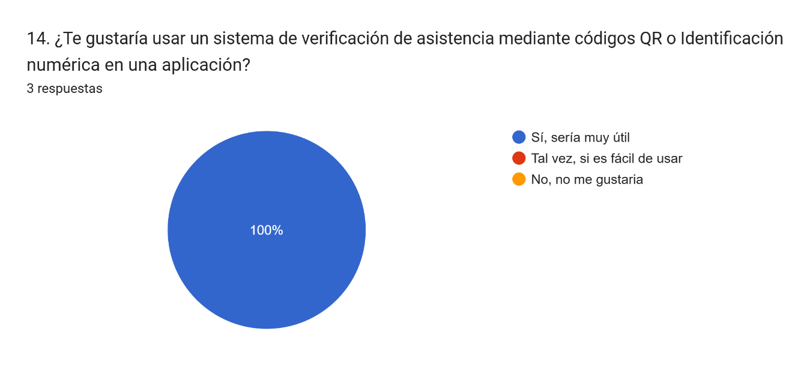

Análisis:

**Resultados Clave:**

- 100% de los encuestados **consideran que este sistema** sería muy útil**.**

- **No hubo respuestas negativas ni dudas sobre su facilidad de uso.**

###  Interpretación:

- Alto interés en digitalización: **La totalidad de los encuestados ven con buenos ojos la implementación de un sistema basado en** códigos QR o identificación numérica**, lo que indica una preferencia clara por soluciones tecnológicas.**

- Potencial para optimizar la gestión de eventos: **La automatización del control de asistencia podría reducir tiempos de espera, eliminar procesos manuales y mejorar la experiencia del usuario.**

###  Recomendaciones:

1.  Implementar un sistema de verificación con QR: **Desarrollar una función que genere códigos QR únicos para cada usuario, permitiendo un escaneo rápido en la entrada del evento.**

2.  Ofrecer una alternativa con identificación numérica: **Para quienes no puedan usar códigos QR, sería útil contar con una opción de validación por número de identificación o código único.**

3.  Garantizar facilidad de uso: **La interfaz de la aplicación debe ser intuitiva, con un proceso de verificación ágil y sin complicaciones.**

**15. ¿Qué tan importante es para ti que la plataforma sea fácil de usar en dispositivos móviles?**

- Muy importante

- Algo importante

- No es importante

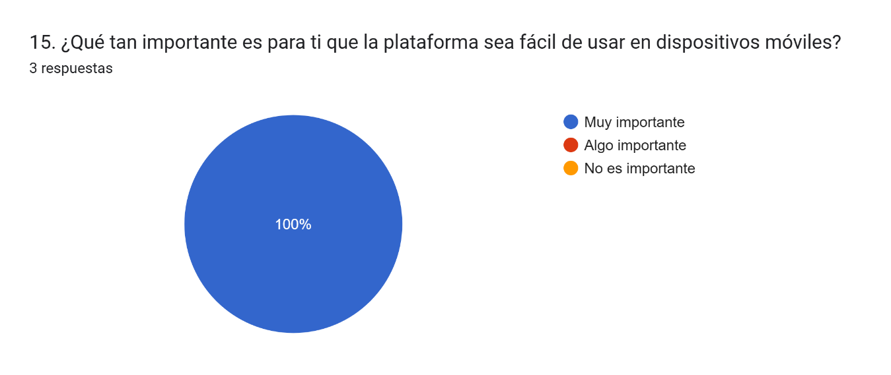

Análisis:

**Resultados Clave:**

- **100% de los encuestados** consideran que la facilidad de uso en dispositivos móviles es **muy importante**.

- No hubo respuestas que indicaran menor importancia.

###  Interpretación:

- **Prioridad en la accesibilidad móvil:** La totalidad de los encuestados resalta la necesidad de una plataforma optimizada para dispositivos móviles.

- **Experiencia de usuario clave:** Una interfaz adaptable y sencilla garantizará una mejor interacción con la plataforma, evitando problemas de navegación y funcionalidad.

###  Recomendaciones:

1.  **Diseño responsivo:** Asegurar que la plataforma se adapte perfectamente a diferentes tamaños de pantalla y resoluciones.

2.  **Interfaz intuitiva:** Priorizar una navegación fluida con menús simples, botones accesibles y un diseño visual atractivo.

3.  **Optimización del rendimiento:** Reducir tiempos de carga y evitar elementos pesados que puedan ralentizar la experiencia en dispositivos móviles.

4.  **Pruebas en múltiples dispositivos:** Verificar el funcionamiento de la plataforma en distintos sistemas operativos y tamaños de pantalla.

**16. ¿Tienes alguna sugerencia adicional para mejorar nuestra plataforma o la experiencia en eventos?**

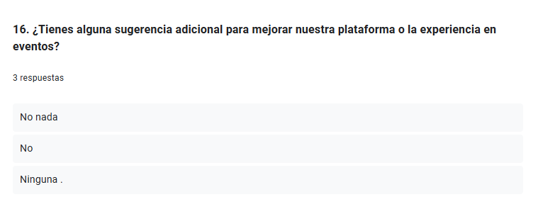

Análisis:

**Resultados Clave:**

- Todas las respuestas indican **"No", "Nada" o "Ninguna"**, lo que sugiere que los encuestados no tienen recomendaciones adicionales en este momento.

**Interpretación:**

- **Satisfacción general:** La falta de sugerencias podría indicar que los participantes están conformes con la propuesta actúal

- 

---

## Encabezados y pies de página del original

- **Encabezado** (`word/header1.xml`): sin texto 

---

<!--
ruta_anterior: es/01_Especificacion_Requisitos/Recoleccion_de_datos/interview_Your_event.md
id: TE-0014
title: "interview-Your event"
lang: es
source: 01_Especificacion_Requisitos/Recoleccion de datos/interview-Your event.docx
source_sha256: efe72d294bc8bd8d2ae371c4f120a7f81113d67d8811583c3deed0a69415a3a5
conversion: "pandoc 3.9 (-t gfm --wrap=none --extract-media) + extracción de encabezados/pies; sin revisión manual"
converted_on: 2026-10-23
fidelity: pendiente_revision
losses:
  []
status: borrador
reviewed_by: ""
-->

# Recolección de datos — entrevista

**Título de la Entrevista:** *Encuesta sobre la plataforma de Gestión de Eventos.*

**Fecha:** 24/02/2025\
**Entrevistador(a):** Cristofer David Lozano\
**Entrevistado(a):** Edwin Mauricio\
**Cargo o perfil del entrevistado:** Organizador de eventos

**Tipo de entrevista:** Semiestructurada

### Buenos días/tardes \[nombre\], es un placer tenerte aquí hoy. Espero que te encuentres bien. Antes de comenzar, quiero agradecerte por tu tiempo y por compartir tu experiencia con nosotros. El objetivo de esta entrevista es conocer tu opinión sobre la plataforma de gestión de eventos, evaluando su usabilidad, funcionalidades y eficiencia en la planificación y organización. Queremos identificar posibles áreas de mejora para optimizar tu experiencia. Tu perspectiva es muy valiosa para nosotros. ¿Cómo te sientes hoy?"

### **Objetivo de la entrevista:**

Recopilar y analizar la opinión de los organizadores de eventos sobre la plataforma de gestión de eventos, con el fin de evaluar su usabilidad, funcionalidades y eficiencia en la planificación y organización. Además, identificar áreas de mejora que permitan optimizar la experiencia del usuario y fortalecer el desempeño de la plataforma.

Cabe mencionar que la entrevista será grabada con el propósito de analizar mejor las respuestas y asegurar la precisión en la recopilación de información.

### **Preguntas de las entrevistas**

**1. ¿Qué tipo de eventos organiza con más frecuencia?**\
Respuesta: \_\_\_\_\_\_\_\_\_\_\_\_\_\_\_\_\_\_\_\_\_\_\_\_\_\_\_\_\_\_\_\_\_\_\_\_\_\_\_\_\_\_\_\_\_\_\_\_\_\_\_\_\_\_\_

**2. ¿Utilizas actualmente alguna plataforma para gestionar eventos?**\
Respuesta: \_\_\_\_\_\_\_\_\_\_\_\_\_\_\_\_\_\_\_\_\_\_\_\_\_\_\_\_\_\_\_\_\_\_\_\_\_\_\_\_\_\_\_\_\_\_\_\_\_\_\_\_\_\_\_

**3. ¿Cuáles son los principales desafíos que enfrentas al organizar un evento?**\
Respuesta: \_\_\_\_\_\_\_\_\_\_\_\_\_\_\_\_\_\_\_\_\_\_\_\_\_\_\_\_\_\_\_\_\_\_\_\_\_\_\_\_\_\_\_\_\_\_\_\_\_\_\_\_\_\_\_

**4. ¿Ha utilizado otras plataformas de gestión de eventos? Si sí, ¿qué te gustó y qué no de ellas?**\
Respuesta: \_\_\_\_\_\_\_\_\_\_\_\_\_\_\_\_\_\_\_\_\_\_\_\_\_\_\_\_\_\_\_\_\_\_\_\_\_\_\_\_\_\_\_\_\_\_\_\_\_\_\_\_\_\_

**5. ¿Cuál es el tamaño promedio de los eventos que organizan? (Ejemplo: menos de 50 asistentes, entre 50-200, más de 500, etc.)**\
Respuesta: \_\_\_\_\_\_\_\_\_\_\_\_\_\_\_\_\_\_\_\_\_\_\_\_\_\_\_\_\_\_\_\_\_\_\_\_\_\_\_\_\_\_\_\_\_\_\_\_\_\_\_\_\_\_\_

**6. ¿Qué funciones consideras esenciales en una plataforma de gestión de eventos?**\
Respuesta: \_\_\_\_\_\_\_\_\_\_\_\_\_\_\_\_\_\_\_\_\_\_\_\_\_\_\_\_\_\_\_\_\_\_\_\_\_\_\_\_\_\_\_\_\_\_\_\_\_\_\_\_\_\_\_

**7. ¿Cuán útil sería contar con una funcionalidad de envío automatizado de recordatorios y notificaciones?**\
Respuesta: \_\_\_\_\_\_\_\_\_\_\_\_\_\_\_\_\_\_\_\_\_\_\_\_\_\_\_\_\_\_\_\_\_\_\_\_\_\_\_\_\_\_\_\_\_\_\_\_\_\_\_\_\_\_\_

**8. ¿Te gustaría poder personalizar la apariencia e imagen de los eventos dentro de la plataforma?**\
Respuesta: \_\_\_\_\_\_\_\_\_\_\_\_\_\_\_\_\_\_\_\_\_\_\_\_\_\_\_\_\_\_\_\_\_\_\_\_\_\_\_\_\_\_\_\_\_\_\_\_\_\_\_\_\_\_\_

**9. ¿Cómo manejas actualmente el registro de asistentes y qué funcionalidades mejorarían este proceso?**\
Respuesta: \_\_\_\_\_\_\_\_\_\_\_\_\_\_\_\_\_\_\_\_\_\_\_\_\_\_\_\_\_\_\_\_\_\_\_\_\_\_\_\_\_\_\_\_\_\_\_\_\_\_\_\_\_\_\_

**10.** **¿Requieres que la plataforma genere códigos QR o entradas digitales para el acceso a los eventos?**\
Respuesta: \_\_\_\_\_\_\_\_\_\_\_\_\_\_\_\_\_\_\_\_\_\_\_\_\_\_\_\_\_\_\_\_\_\_\_\_\_\_\_\_\_\_\_\_\_\_\_\_\_\_\_\_\_\_\_

**11. ¿Prefieres usar la plataforma en una computadora, un dispositivo móvil o ambos?**\
Respuesta: \_\_\_\_\_\_\_\_\_\_\_\_\_\_\_\_\_\_\_\_\_\_\_\_\_\_\_\_\_\_\_\_\_\_\_\_\_\_\_\_\_\_\_\_\_\_\_\_\_\_\_\_\_\_\_

Muchas gracias por tu tiempo y por compartir tu experiencia con nosotros, \[nombre\]. Tu opinión es muy valiosa y nos ayudará a mejorar la plataforma para ofrecer una mejor experiencia a los organizadores de eventos. Si en el futuro tienes algún comentario adicional, no dudes en hacérnoslo saber. ¡Que tengas un excelente día!"

### **Observaciones adicionales:**

*(Espacio para anotar comentarios adicionales, gestos, tono del entrevistado o información relevante no incluida en las respuestas.)*

### **Conclusión:**

*(Resumen de los puntos clave de la entrevista y posibles reflexiones del entrevistador.)*

---

<!--
ruta_anterior: es/01_Especificacion_Requisitos/Recoleccion_de_datos/Analisis_Entrevista_TuEvento.md
id: TE-0013
title: "Análisis Entrevista TuEvento"
lang: es
source: 01_Especificacion_Requisitos/Recoleccion de datos/Análisis Entrevista TuEvento.docx
source_sha256: 15b322658407100df2452cf2d25659054af05f74f78d23e70ac1d55296f72cc2
conversion: "pandoc 3.9 (-t gfm --wrap=none --extract-media) + extracción de encabezados/pies; sin revisión manual"
converted_on: 2026-10-23
fidelity: parcial
losses:
  - "El original no usa estilos de título; los títulos visuales quedan como texto en negrita, sin jerarquía #. Pendiente de marcar a mano."
  - "Encabezados y pies de página extraídos aparte (pandoc no los convierte); en el original se repiten en cada página. Los campos se muestran como {PAGE}, {NUMPAGES}."
status: borrador
reviewed_by: ""
-->

# Análisis de la entrevista

**Procesamiento y Análisis de Datos de la Entrevista**

**Proyecto Formativo**

**Tecnólogo en Análisis y Desarrollo de Software**

**“Tu Evento”**

Integrantes:

**Cristofer David Lozano**

**Jhampier Santos Ortiz**

**Centro de la Industria la empresa y los Servicios**

**Neiva, Huila**

**Año 2025**

**Procesamiento y Análisis de Datos de la Entrevista**

**Título de la Entrevista: Plataforma de Gestión de Eventos\
Fecha: 24/02/2025\
Entrevistador: Cristofer David Lozano\
Entrevistado: Edwin Mauricio\
Cargo del entrevistado: Organizador de eventos\
Tipo de entrevista: Semiestructurada**

**Preguntas, Respuestas y Análisis**

**1. ¿Qué tipo de eventos organiza con más frecuencia?**

- **Respuesta: Especializado en senderismo, turismo natural y cultural.**

- **Análisis: Su enfoque principal está en actividades al aire libre, lo que indica la necesidad de que la plataforma se adapte a eventos de carácter turístico y recreativo.**

**2. ¿Utiliza actualmente alguna plataforma para gestionar eventos?**

- **Respuesta: Usa redes sociales como Facebook e Instagram para convocatorias y WhatsApp para coordinación.**

- **Análisis: Actualmente emplea herramientas comunes y de fácil acceso, pero carece de una plataforma centralizada que facilite la inscripción y la gestión completa de los eventos.**

**3. ¿Cuáles son los principales desafíos que enfrenta al organizar un evento?**

- **Respuesta: El cumplimiento de horarios y la asistencia de los participantes.**

- **Análisis: La falta de puntualidad afecta la logística. Una plataforma con recordatorios y notificaciones podría ayudar a reducir este problema.**

**4. ¿Ha utilizado otras plataformas de gestión de eventos? ¿Qué aspectos positivos o negativos encontró en ellas?**

- **Respuesta: Solo redes sociales, porque son virales y accesibles.**

- **Análisis: No ha tenido experiencia con plataformas especializadas, posiblemente por su costo o desconocimiento. Esto resalta la necesidad de una solución económica y fácil de usar.**

**5. ¿Cuál es el tamaño promedio de los eventos que organiza?**

- **Respuesta: Entre 5 y 63 personas.**

- **Análisis: La plataforma debe ser flexible, de modo que pueda adaptarse tanto a grupos pequeños como medianos.**

**6. ¿Qué funciones considera esenciales en una plataforma de gestión de eventos?**

- **Respuesta: Conocer los intereses y nivel físico de los participantes.**

- **Análisis: Es importante que la plataforma permita recopilar información personalizada para planificar mejor la experiencia de los asistentes.**

**7. ¿Qué tan útil sería contar con recordatorios y notificaciones automáticas?**

- **Respuesta: Muy útil, ayudaría a reducir la desorganización.**

- **Análisis: Los recordatorios automáticos mejorarían la puntualidad y la asistencia confirmada en los eventos.**

**8. ¿Le gustaría personalizar la apariencia e imagen de los eventos en la plataforma?**

- **Respuesta: Sí, especialmente para reflejar el aspecto natural del turismo.**

- **Análisis: La opción de personalizar con colores, iconos y estilos visuales permitiría destacar la identidad de cada evento y hacerlo más atractivo.**

**9. ¿Cómo maneja actualmente el registro de asistentes y qué mejoras considera necesarias?**

- **Respuesta: A mano o por WhatsApp.**

- **Análisis: Un sistema digital facilitaría la inscripción y confirmación de los participantes, evitando errores y mejorando la organización.**

**10. ¿Necesita que la plataforma genere códigos QR o entradas digitales para el acceso a los eventos?**

- **Respuesta: No es necesario para senderismo, pero sí útil para eventos en recintos cerrados.**

- **Análisis: La plataforma debería ofrecer esta función como una opción adicional, dependiendo del tipo de evento.**

**11. ¿Prefiere usar la plataforma en computadora, dispositivo móvil o ambos?**

- **Respuesta: Web para organizadores, móvil para usuarios.**

- **Análisis: Se requiere compatibilidad con ambos dispositivos, diferenciando las funciones de los organizadores y de los asistentes para mayor comodidad.**

**Conclusión de la Entrevista**

**El entrevistado refleja la necesidad de una plataforma flexible, económica y fácil de usar, que permita gestionar tanto eventos pequeños como medianos. Las funciones más valoradas son:**

- **Notificaciones y recordatorios automáticos,**

- **Opciones de personalización,**

- **Gestión digital de asistentes,**

- **Compatibilidad en dispositivos móviles y web.**

**Estas características contribuirían a mejorar la organización, aumentar la puntualidad y ofrecer una mejor experiencia tanto para organizadores como para participantes.**

---

## Encabezados y pies de página del original

- **Encabezado** (`word/header1.xml`): sin texto 

---

<!--
ruta_anterior: es/01_Especificacion_Requisitos/Vigilancia_tecnologica/vigilancia_tecnologica.md
id: TE-0019
title: "vigilancia tecnologica"
lang: es
source: 01_Especificacion_Requisitos/Vigilancia tecnologica/vigilancia tecnologica.docx
source_sha256: 02659eab0cb56be24e5daa1f2bfa17881ed563745c38045020a51fedc2f9ca3a
conversion: "pandoc 3.9 (-t gfm --wrap=none --extract-media) + extracción de encabezados/pies; sin revisión manual"
converted_on: 2026-10-23
fidelity: pendiente_revision
losses:
  - "Encabezados y pies de página extraídos aparte (pandoc no los convierte); en el original se repiten en cada página. Los campos se muestran como {PAGE}, {NUMPAGES}."
status: borrador
reviewed_by: ""
-->

# Vigilancia tecnológica

**Vigilancia Tecnológica**

Lozano Contreras Cristofer David

Jhampier Santos Santos Ortiz

Análisis y Desarrollo de Softwares

\(3145556\)

Servicio Nacional de Aprendizaje

Instructor:

Jhon Corredor

Karol correa

Carlos Julio Cadena

Febrero 26, 2025

# ¿Qué es la Vigilancia Tecnológica?

**Definición**

La vigilancia tecnológica es el proceso sistemático de recopilación y análisis de información sobre los avances tecnológicos que hay actualmente, para sí mismo saber que estrategia podría en tener aquellas oportunidades de innovación, sirviendo a sí mismo en anticiparse a cambios que puede generar el entorno.

Este instrumento de recolección de datos es vital para nuestro desarrollo del aplicativo, debido a que podremos analizar aquellos movimientos o estrategias de lo que haya hoy en día en los navegadores web, permitiéndonos identificar las fortalezas y debilidades en el mercadeo.

**Importancia de la Vigilancia Tecnológica**

Este tipo herramienta radica en que la mayoría de aquellos aplicativos más reconocidos como Facebook, Instagram, WhatsApp, etc. Viven constantemente adaptándose a los cambios que podrían surgir en el futuro o mejor aún, que lo anticipan; esto les permite mantenerse a que innovan continuamente y consolidan su posición dominante en sus respectivos sectores.

# Objetivos Del Aplicativo

En el aplicativo “Tu evento” debe ser innovador, ya que se encargaría en la simplificación, optimización y personalización de eventos, a la vez, ofrecer una experiencia satisfactoria tanto para los asistentes como para los organizadores.

Mediante esta herramienta de recolección de información, permitiría en que el aplicativo pueda ser diferente ante las que existen actualmente en el mercadeo actual, para sí mismo desarrollar, analizar y detectar aquellas oportunidades que puedan surgir y a la vez impactar significativamente mediante el uso del artefacto.

Como resultado esperado, el aplicativo no solo será una aplicación más en el mercado, sino que pueda ser una herramienta útil que transformaría la manera en la que se organizan los eventos, permitiendo la reducción de costos y tiempo por parte de los organizadores; permitiéndose así mismo se pueda incorporar a nuevas tecnologías y funcionalidades.

**Importancia**

En la era digital, la gestión eficiente de eventos se ha vuelto en un pilar fundamental para empresas y organizadores, ellos mismos buscan destacar en el mercado competitivo, donde se implementan aplicativos de reservación de eventos, que no solamente optimiza los procesos internos, sino que también potencia la experiencia del usuario.

La adopción de tecnologías en este tipo de temática garantiza que hubo un cierto crecimiento notable, según un estudio reciente, explica que el 72% de las organizaciones consideran que las tecnologías para eventos desempeñan un papel crucial en la planificación y gestión actuales.

También hay que recalcar que el 52% de los asistentes utilizan a menudo los dispositivos móviles, según una encuesta reciente de Eventbrite, se espera que esta tendencia de eventos continúe a medida que más personas se acostumbren a usar dispositivos móviles. Estas aplicaciones permiten a los usuarios buscar eventos, ver horarios de eventos y hacer reservas, esto permite el crecimiento y a la vez convirtiéndose en una tendencia en la industria de eventos. Si en una determinada empresa u organizador no aplicara esté tipo de tecnologías, puede significar que pueden estar perdiendo tiempo y dinero. Una investigación reciente de Bizzabo muestra que el 72% de las organizaciones de eventos creen que las aplicativos de este tipo desempeñan un papel crucial en la planificación y gestión de eventos hoy en día. 

**Fuente de información:**

[**https://time.ly/es/blog/nuevas-tendencias-en-la-industria-de-eventos-que-debes-seguir/**](https://time.ly/es/blog/nuevas-tendencias-en-la-industria-de-eventos-que-debes-seguir/)

**Resultado de la Vigilancia Tecnológica**

Como se mencionó anteriormente, la vigilancia tecnológica es una herramienta estratégica que se implementará en el desarrollo del aplicativo, con el objetivo de innovar y mantener la competitividad en un mercado dinámico y en constante evolución. Para lograrlo, se basará en un proceso sistemático de recopilación y análisis de información, utilizando diversas fuentes confiables que nos permitan identificar tendencias, oportunidades y desafíos en el sector de la organización de eventos.

A continuación, se detallará cómo se llevará a cabo este proceso, analizando cada aspecto relevante que se encontrará, mediante una tabla entre aquellas plataformas ya analizadas comparándola con la de “tu evento”.

**Fuente de los aplicativos analizadas:**

**Ticketmaster**:

*https://[www](https://www.ticketmaster.com/).ticketmaster.com/*

**SeatGeek**:

*<https://seatgeek.com/>*

**Conclusión**

Tras analizar las plataformas Ticketmaster y SeatGeek, se identificaron fortalezas y áreas de oportunidad en sus funcionalidades, pero presentan limitaciones en aspectos clave como integración con redes sociales, personalización de eventos y la posibilidad de recibir feedback de los asistentes después del evento.

En contraste, nuestro aplicativo se diferenciará al brindar una experiencia más completa y adaptable para los usuarios y organizadores de eventos. La compatibilidad con Smart TV permitirá una mayor accesibilidad y visualización de eventos en pantallas grandes. Además, la personalización de eventos al 100% garantizará que los organizadores puedan modificar cada aspecto de su evento según sus necesidades. La integración con redes sociales facilitará la difusión y promoción, permitiendo a los usuarios compartir eventos y experiencias de manera rápida. Finalmente, la incorporación de un sistema de feedback post-evento fomentará la interacción entre los asistentes y organizadores, mejorando la calidad de futuros eventos.

Con estas ventajas competitivas, nuestro aplicativo ofrecerá una solución más completa y orientada a las tendencias actuales del mercado, posicionándose como una alternativa innovadora frente a las opciones existentes

---

## Encabezados y pies de página del original

- **Encabezado** (`word/header1.xml`): texto «0»

---

<!--
ruta_anterior: es/01_Especificacion_Requisitos/Vigilancia_tecnologica/cuadro_comparativo_Tu_evento.md
id: TE-0018
title: "cuadro comparativo-Tu evento"
lang: es
source: 01_Especificacion_Requisitos/Vigilancia tecnologica/cuadro comparativo-Tu evento.xlsx
source_sha256: 491b5045ce15d9e8e8c4e4005a8b48526a68f0645b8b6aa2a63cb73b0c214b93
conversion: "openpyxl 3.1.5 (data_only + fórmulas); sin revisión manual"
converted_on: 2026-10-23
fidelity: parcial
losses:
  - "Las 2 imágenes incrustadas en la fila 3 (H3:J3 y L3:N3) se extraen a _assets y se enlazan debajo de la tabla; en el original se superponen a las celdas."
  - "Formato visual (colores, bordes, anchos, fuentes y estilos del formato condicional) no se conserva."
  - "Celdas combinadas listadas pero no reproducidas como celda única."
  - "Los valores de las fórmulas son los guardados en caché por Excel; no se recalcularon."
status: borrador
reviewed_by: ""
-->

# cuadro comparativo-Tu evento

> Conversión de `01_Especificacion_Requisitos/Vigilancia tecnologica/cuadro comparativo-Tu evento.xlsx`: 1 hojas (Hoja1), 0 fórmulas. Las columnas se nombran con la letra de Excel y cada fila con su número original.

## Hoja: Hoja1

Rango usado: `A3:N19` · 19 filas × 14 columnas · celdas combinadas: 36

| Fila | A | B | C | D | E | F | G | H | I | J | K | L | M | N |
|---|---|---|---|---|---|---|---|---|---|---|---|---|---|---|
| 3 | Funcionalidades |  | Tu evento |  |  |  |    ticketmaster |  |  |  |    SEATGEEK |  |  |  |
| 4 | Compatibilidad móvil |  | Cumple para ambos dispositivos móviles (iOS y  Android)  |  |  |  | Cumple para ambos dispositivos móviles (iOS y  Android)  |  |  |  | Cumple para ambos dispositivos móviles (iOS y  Android)  |  |  |  |
| 6 | Compatibilidad TV |  | Cumple  |  |  |  | No disponible |  |  |  | No disponible |  |  |  |
| 8 | Facilidad de uso |  | Cumple  |  |  |  | Cumple  |  |  |  | Cumple  |  |  |  |
| 10 | Personalización de eventos al 100% |  | Cumple  |  |  |  | No disponible |  |  |  | No disponible |  |  |  |
| 12 | Integración de redes sociales |  | Cumple  |  |  |  | No disponible |  |  |  | No disponible |  |  |  |
| 14 | Registro y gestión de asistentes |  | Cumple  |  |  |  | Cumple  |  |  |  | Cumple  |  |  |  |
| 16 | Automatización de recordatorios |  | Cumple  |  |  |  | Cumple  |  |  |  | Cumple  |  |  |  |
| 18 |  Feedback de usuarios post-evento |  | Cumple  |  |  |  | No disponible |  |  |  | No disponible |  |  |  |

**Celdas combinadas** (el valor aparece solo en la celda superior izquierda): `A10:B11`, `A12:B13`, `A14:B15`, `A16:B17`, `A18:B19`, `A3:B3`, `A4:B5`, `A6:B7`, `A8:B9`, `C10:F11`, `C12:F13`, `C14:F15`, `C16:F17`, `C18:F19`, `C3:F3`, `C4:F5`, `C6:F7`, `C8:F9`, `G10:J11`, `G12:J13`, `G14:J15`, `G16:J17`, `G18:J19`, `G3:J3`, `G4:J5`, `G6:J7`, `G8:J9`, `K10:N11`, `K12:N13`, `K14:N15`, `K16:N17`, `K18:N19`, `K3:N3`, `K4:N5`, `K6:N7`, `K8:N9`

**Imágenes incrustadas en la hoja** (extraídas de `xl/media/`; posición según `xl/drawings/drawing1.xml`):

- «Imagen 3», anclada de `H3` a `J3`: 
- «Imagen 5», anclada de `L3` a `N3`: 
