# Implementación — Tu Evento

> Documento consolidado de Tu Evento. Reúne los documentos siguientes, cuyo contenido se conserva sin cambios; los metadatos de conversión de cada uno van en un comentario HTML al inicio de su sección.

**Contenido**

1. [Manual de implementación](#doc-te-0155)
2. [Procedimiento de despliegue](#doc-te-0175)

---

<a id="doc-te-0155"></a>

<!--
ruta_anterior: es/07_Implementacion/Manual_de_Implementacion_TuEvento.md
id: TE-0155
title: "Manual_de_Implementacion_TuEvento"
lang: es
source: 07_Implementacion/Manual_de_Implementacion_TuEvento.pdf
source_sha256: 09483490d39a2e4b8e0d40b4e5cde562be9d5e3c01d0e7bf07d3a7cc3c512f62
conversion: "pdfplumber 0.11.10 + conversor de PDF sin etiquetar (método C, piloto 3); sin revisión manual"
converted_on: 2026-10-23
fidelity: parcial
losses:
  - "Cabecera o pie de página omitido en las páginas 1–20: «{n}»."
  - "Página 4: figura incluida como imagen (pagina-04-figura-1.png); su texto (42 palabras) va en un comentario HTML no visible, agrupado por caja ([...]) de arriba abajo y de izquierda a derecha; flechas y relaciones solo están en la imagen."
  - "Página 11: figura incluida como imagen (pagina-11-figura-1.png); su texto (7 palabras) va en un comentario HTML no visible, agrupado por caja ([...]) de arriba abajo y de izquierda a derecha; flechas y relaciones solo están en la imagen."
  - "Páginas 11: cajas de diagrama con texto (que pdfplumber detecta como tablas de una fila) incluidas en el recorte de la figura."
  - "PDF generado sin LaTeX: los guiones al final de línea son guiones reales y se conservan al unir las líneas (no son guiones de corte silábico)."
  - "11 viñetas de ReportLab sin correspondencia Unicode (código 127 de Helvetica, «(cid:127)» en la extracción) escritas como «•», que es como se ven en el original."
  - "Índice manual (páginas 2): se conservan los números de página del original y se quitan las líneas guía."
  - "Tablas con celdas combinadas en HTML (colspan/rowspan calculados por la geometría de los bordes); no se conservan anchos de columna, fondos ni grosor de bordes."
  - "Se conservan negritas, cursivas y fuente monoespaciada; no se conservan tamaños, colores, alineación ni sangrías."
  - "Verificación automática frente a pdftotext: cobertura 99.92%, precisión 99.25%, orden 99.04%; faltan {'URL': 1, 'DEL': 1, 'REPOSITORIO': 1} (explicado arriba)."
  - "Diferencias de la verificación explicadas: «URL DEL REPOSITORIO» está en el Markdown como `<URL_DEL_REPOSITORIO>` dentro de código, que el verificador elimina como etiqueta HTML; los «sobrantes» son el texto de las figuras, que va en comentarios HTML. Texto con interlineado doble (APA): los párrafos se reconstruyen por la sangría de primera línea."
  - "Las 11 viñetas «•» del original están en el Markdown como elementos de lista; el verificador cuenta además una forma pequeña del diagrama de la página 4 como viñeta (12)."
status: borrador
reviewed_by: ""
-->

# Manual de implementación del sistema Tu Evento

Jhampier Santos Ortiz y Cristofer David Lozano Contreras

Servicio Nacional de Aprendizaje (SENA)

Sede de la Industria y los Servicios, Neiva, Huila

Tecnólogo en Análisis y Desarrollo de Software

Instructor: Carlos Julio Cadena

9 de octubre de 2026

# Contenido

Introducción 3

Arquitectura del sistema 3

Visión general 3

Requisitos 5

Hardware 5

Software 6

Puertos 6

Obtención del código y variables de entorno 7

Despliegue con Docker Compose 9

Servicios y orden de arranque 9

Migraciones y administrador inicial 11

Detención y reinicio 11

Despliegue en Kubernetes 12

Integración continua con GitHub Actions y SonarQube Cloud 13

Desarrollo local 15

Backend 15

Frontend web 15

Aplicación móvil 15

Compilación de la aplicación móvil 16

Verificación del sistema 16

Seguridad 17

Solución de problemas 18

Limitaciones conocidas 18

Referencias 20

# Manual de implementación del sistema Tu Evento

# Introducción

El presente manual describe el procedimiento para instalar, configurar, desplegar y verificar el sistema Tu Evento, una plataforma de gestión de eventos dirigida a usuarios finales, organizadores y administradores. Está orientado a quienes deban poner el sistema en funcionamiento, ya sea en un equipo de desarrollo mediante Docker Compose o en un clúster de Kubernetes.

La información fue contrastada con los archivos de configuración del repositorio del proyecto (Santos Ortiz y Lozano Contreras, 2026), en particular el archivo `docker-compose.yml,` los manifiestos de la carpeta `k8s/,` el flujo de trabajo `.github/workflows/ci.yml` y los archivos de configuración de Spring Boot. Por motivos de seguridad, el documento no contiene valores secretos: cada credencial se identifica únicamente por el nombre de su variable de entorno.

# Arquitectura del sistema

## Visión general

Tu Evento sigue una arquitectura cliente-servidor. El backend, desarrollado con Spring Boot (Spring, s. f.), es una aplicación monolítica que expone una API REST y se apoya en servicios auxiliares: PostgreSQL para la persistencia de datos (PostgreSQL Global Development Group, s. f.), Redis como caché (Redis Ltd., s. f.) y MinIO para el almacenamiento de objetos (MinIO, Inc., s. f.). La Figura 1 presenta la relación entre los componentes y los puertos publicados en el entorno de desarrollo, y la Tabla 1 resume la función de cada uno.

**Figura 1**<br>
*Arquitectura general del sistema Tu Evento*

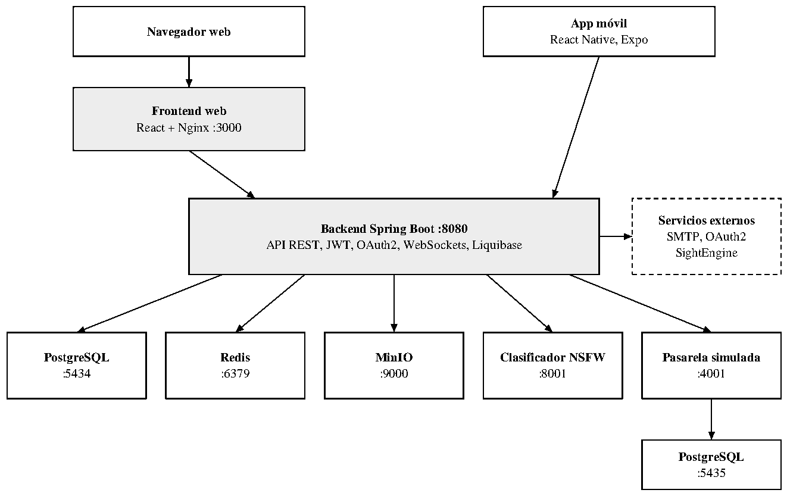

<!-- Texto dentro de la figura (página 4): [Navegador web] [App móvil React Native, Expo] [Frontend web React + Nginx :3000] [Backend Spring Boot :8080 API REST, JWT, OAuth2, WebSockets, Liquibase] [Servicios externos SMTP, OAuth2 SightEngine] [PostgreSQL :5434] [Redis :6379] [MinIO :9000] [Pasarela simulada :4001] [PostgreSQL :5435] [fuera de cajas] Clasificador NSFW :8001 -->

<table>
<tr>
<td></td>
</tr>
<tr>
<td colspan="2"><strong>Clasificador NSFW</strong> :8001</td>
</tr>
</table>

*Nota.* Diagrama de elaboración propia a partir del archivo docker-compose.yml del proyecto. Las flechas indican el sentido de las solicitudes; los números precedidos de dos puntos corresponden a los puertos publicados en el equipo anfitrión. Los servicios externos (correo SMTP, proveedores OAuth2 y SightEngine) se representan con borde discontinuo.

**Tabla 1**<br>
*Componentes del sistema*

| **Componente** | **Tecnología** | **Función** |
|---|---|---|
| Backend | Spring Boot 3.5, Java 21 | API REST, lógica de negocio, seguridad (JWT y OAuth2), WebSockets y migraciones con Liquibase. |
| Frontend web | React 18, Vite 5 | Interfaz web; en contenedor se sirve con Nginx. |
| Frontend móvil | React Native 0.81, Expo SDK 54 | Aplicación para Android e iOS. |
| Base de datos | PostgreSQL 17 | Persistencia de datos del backend. |
| Caché | Redis 7 | Caché y datos de sesión. |
| Almacenamiento de objetos | MinIO | Imágenes de perfil, medios de eventos y documentos de organizadores. |
| Moderación de imágenes | Servicio NSFW (Python 3.11) y SightEngine | Clasificación del contenido antes de almacenarlo. |
| Pasarela de pagos | fake-payment-gateway (Java 21) | Pasarela sandbox para pruebas del flujo de pago, con su propia base de datos PostgreSQL. |
| Integración continua | GitHub Actions y SonarQube Cloud | Pruebas, compilación y análisis de calidad del código. |

*Nota.* Elaboración propia a partir de los archivos pom.xml, package.json y docker-compose.yml del proyecto.

# Requisitos

## Hardware

El stack completo ejecuta nueve contenedores, entre ellos un modelo de clasificación de<br>
imágenes. La Tabla 2 indica los recursos recomendados para el equipo<br>
anfitrión.<br>
**Tabla 2**<br>
*Recursos recomendados del equipo anfitrión*

| **Recurso** | **Mínimo** | **Recomendado** |
|---|---|---|
| Memoria RAM | 8 GB | 16 GB (stack completo) |
| Procesador | 4 núcleos | 6 núcleos o más |
| Almacenamiento libre | 20 GB | 40 GB |
| Sistema operativo | Windows 10/11 con WSL2, Ubuntu 20.04 o superior, macOS | Ubuntu 22.04 LTS |
| Red | Acceso a Internet para descargar imágenes y dependencias | Igual |

*Nota.* Los valores son recomendaciones de operación del equipo de desarrollo y deben ajustarse a la carga real.

## Software

Las herramientas necesarias dependen del escenario de trabajo, como se detalla en la<br>
Tabla 3.<br>
**Tabla 3**<br>
*Herramientas de software según el escenario*

| **Escenario** | **Herramientas necesarias** |
|---|---|
| Despliegue con Docker Compose | Docker Engine, Docker Compose v2 y Git. |
| Desarrollo del backend | JDK 21 y Maven (el proyecto incluye Maven Wrapper, `mvnw).` |
| Desarrollo del frontend web | Node.js 20 y npm. |
| Desarrollo del frontend móvil | Node.js 20, npm y EAS CLI 22.2.0 o superior; Android Studio o Xcode para emuladores (opcional). |
| Despliegue en Kubernetes | kubectl y un clúster con controlador Ingress NGINX, cert-manager y metrics-server. |

## Puertos

Los puertos publicados en el equipo anfitrión por cada servicio se listan en la Tabla 4.<br>
Deben estar libres antes de iniciar el sistema.<br>
**Tabla 4**<br>
*Puertos publicados por los servicios*

| **Puerto** | **Servicio** |
|---|---|
| 3000 | Frontend web (Nginx en Docker) |
| 5173 | Frontend web en modo desarrollo (Vite) |
| 8080 | Backend (API) |
| 5434 | PostgreSQL del backend (puerto 5432 dentro del contenedor) |
| 5435 | PostgreSQL de la pasarela sandbox (puerto 5432 dentro del contenedor) |
| 6379 | Redis |
| 9000 y 9001 | MinIO (API y consola web) |
| 8001 | Servicio de clasificación NSFW |
| 4001 | Pasarela de pagos sandbox |

*Nota.* Fuente: docker-compose.yml del proyecto.

# Obtención del código y variables de entorno

Todos los servicios se orquestan desde el archivo `docker-compose.yml,` ubicado en la raíz del repositorio, y las variables se leen desde un archivo `.env` en esa misma carpeta, como indica la documentación de Docker Compose (Docker Inc., s. f.). El Código 1 muestra cómo obtener el código y crear el archivo de variables.

## Código 1

*Obtención del código y creación del archivo de variables*

| `git clone <URL_DEL_REPOSITORIO> TuEvento` `cd TuEvento` `cp .env.example .env` |
|---|

Después de crear el archivo, se deben completar las variables de la Tabla 5 con valores propios; no se deben reutilizar credenciales de ejemplos ni de documentos anteriores.

**Tabla 5**<br>
*Variables de entorno definidas en el archivo .env.example*

| **Variable** | **Descripción** |
|---|---|
| POSTGRES_DB, POSTGRES_USER, POSTGRES_PASSWORD | Base de datos, usuario y contraseña de PostgreSQL (compartidos con la pasarela sandbox). |
| MAIL_USERNAME, MAIL_PASSWORD | Cuenta SMTP de Gmail y su contraseña de aplicación. |
| JWT_SECRET | Clave para firmar tokens JWT (al menos 256 bits). |
| GOOGLE_CLIENT_ID, GOOGLE_CLIENT_SECRET | Credenciales OAuth2 de Google. |
| VITE_GOOGLE_CLIENT_ID | Client ID de Google usado por el frontend web. |
| FACEBOOK_CLIENT_ID, FACEBOOK_CLIENT_SECRET | Credenciales OAuth2 de Facebook. |
| ADMIN_EMAIL, ADMIN_PASSWORD, ADMIN_ALIAS | Datos del administrador inicial creado en el primer arranque. |
| MINIO_ROOT_USER, MINIO_ROOT_PASSWORD | Usuario y contraseña raíz de MinIO (también actúan como clave de acceso). |
| REDIS_HOST, REDIS_PORT | Ubicación de Redis. |
| SPRING_PROFILES_ACTIVE | Perfil de Spring: dev, k8s o prod. |
| NSFW_SERVICE_URL, NSFW_THRESHOLD | URL interna y umbral del clasificador NSFW. |
| SIGHTENGINE_API_USER, SIGHTENGINE_API_SECRET, SIGHTENGINE_MODELS, SIGHTENGINE_THRESHOLD | Moderación adicional con SightEngine. |
| NOTIFICATION_EMAIL_ENABLED, NOTIFICATION_MAIL_HOST, NOTIFICATION_MAIL_PORT, NOTIFICATION_MAIL_USERNAME, NOTIFICATION_MAIL_PASSWORD | Notificaciones por correo electrónico. |

*Nota.* Fuente: archivo .env.example del proyecto. No se incluyen valores.

Además, el archivo `docker-compose.yml` y los perfiles de Spring utilizan las variables de la Tabla 6, que no figuran en `.env.example` y deben agregarse al archivo `.env` cuando corresponda. La ausencia de `WEBHOOK_SECRET` impide el arranque correcto de la pasarela sandbox.

**Tabla 6**<br>
*Variables utilizadas que no están en .env.example*

| **Variable** | **Descripción** |
|---|---|
| WEBHOOK_SECRET | Secreto para validar webhooks de la pasarela sandbox; obligatorio para el servicio fake-payment-gateway. |
| MINIO_PUBLIC_URL | URL de MinIO accesible desde el navegador, usada en URL prefirmadas. |
| PAYMENT_GATEWAY | Selector de pasarela; el valor `fake` activa la pasarela sandbox. |
| FAKE_GATEWAY_URL | URL de la pasarela sandbox vista desde el backend. |
| SIGHTENGINE_NUDITY_THRESH OLD | Umbral específico de detección de desnudez. |
| APP_CORS_ALLOWED_ORIGINS | Orígenes permitidos por CORS (incluir http://localhost:3000 y http://localhost:5173). |
| APP_STORAGE_ENDPOINT | Endpoint interno de MinIO para cargar y eliminar archivos. |

*Nota.* Fuente: docker-compose.yml y application-dev.yml del proyecto.

# Despliegue con Docker Compose

Este es el método recomendado para entornos de desarrollo y pruebas. Todos los comandos del Código 2 se ejecutan desde la raíz del repositorio, que es donde se encuentra el archivo `docker-compose.yml;` no desde la carpeta del backend.

## Código 2

*Inicio del sistema completo con Docker Compose*

| `docker compose up --build -d` `docker compose ps` `docker compose logs -f backend` |
|---|

## Servicios y orden de arranque

Docker Compose permite declarar dependencias entre servicios para controlar el orden de inicio (Docker Inc., s. f.). La Tabla 7 describe los nueve servicios del proyecto y la Figura 2 resume las dependencias que condicionan el arranque del backend y del frontend.

**Tabla 7**<br>
*Servicios definidos en docker-compose.yml*

| **Servicio** | **Imagen o construcción** | **Puertos** | **Depende de** |
|---|---|---|---|
| postgres | postgres:17-alpine | 5434:5432 | - |
| postgres-fake-gateway | postgres:17-alpine | 5435:5432 | - |
| redis | redis:7-alpine | 6379 | - |
| minio | quay.io/minio/minio | 9000, 9001 | - |
| minio-init | quay.io/minio/minio | - | minio (saludable) |
| nsfw-classifier | Construcción local (Python 3.11) | 8001:8000 | - |
| fake-payment-gateway | Construcción local (Java 21) | 4001 | postgres-fake-gateway |
| backend | Construcción local (Java 21) | 8080 | postgres, minio, redis, nsfw-classifier |
| frontend | Construcción local (Node 20 y Nginx) | 3000:80 | backend |

*Nota.* Fuente: docker-compose.yml del proyecto.

**Figura 2**<br>
*Dependencias de arranque entre servicios*

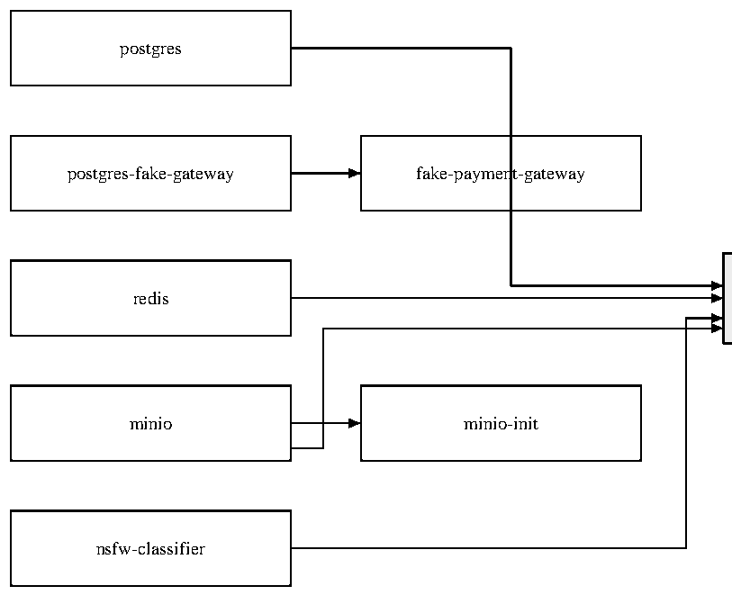

<!-- Texto dentro de la figura (página 11): [postgres] [postgres-fake-gateway] [fake-payment-gateway] [redis] [minio] [minio-init] [nsfw-classifier] -->

<table>
<tr>
<td rowspan="2"><strong>backend</strong></td>
</tr>
<tr>
<td></td>
<td></td>
</tr>
</table>

### frontend

*Nota.* Diagrama de elaboración propia a partir de las cláusulas depends_on del archivo docker-compose.yml. Cada flecha va del servicio que debe iniciar primero al que depende de él.

El contenedor `minio-init` crea el bucket `tuevento.` Los prefijos `profile_picture/` y `event_media/` son públicos, mientras que `organizer_document/` es privado.

## Migraciones y administrador inicial

No se requiere ningún paso manual sobre la base de datos. Al iniciar, el backend ejecuta automáticamente las migraciones de Liquibase (Liquibase, s. f.), más de noventa archivos ubicados en `db/changelog/changes/,` que incluyen los datos de departamentos y ciudades. Después, el componente `DataInitializer` crea el usuario administrador a partir de `ADMIN_EMAIL, ADMIN_PASSWORD` y `ADMIN_ALIAS,` solo si no existe previamente.

## Detención y reinicio

El Código 3 muestra los comandos para detener, reiniciar o eliminar por completo el entorno. La opción `-v` borra los volúmenes y, por lo tanto, los datos almacenados.

## Código 3

*Detención y reinicio del entorno*

| `docker compose down # detiene y elimina contenedores` `docker compose down -v # ademas elimina volumenes (borra datos)` `docker compose up -d # inicia nuevamente sin reconstruir` |
|---|

# Despliegue en Kubernetes

Los manifiestos se encuentran en la carpeta `k8s/.` Se requiere un clúster activo con<br>
kubectl configurado, un controlador Ingress NGINX con cert-manager (emisor<br>
`letsencrypt-prod)` y metrics-server para el autoescalado. El Ingress expone los servicios<br>
mediante dominios y TLS (The Kubernetes Authors, s. f.-b) y el HorizontalPodAutoscaler ajusta<br>
el número de réplicas según el consumo de recursos (The Kubernetes Authors, s. f.-a). La Tabla 8<br>
resume los recursos definidos.<br>
**Tabla 8**<br>
*Manifiestos de Kubernetes del proyecto*

| **Manifiesto** | **Recurso** | **Detalle** |
|---|---|---|
| secrets.yaml | Secret tu-evento-secrets | Credenciales de base de datos, MinIO, JWT, OAuth, administrador y correo. |
| configmap.yaml | ConfigMap tu-evento-config | Perfil prod, redis-service:6379 y postgres-service:5432. |
| deployment.yaml y service.yaml | Backend | Puerto 8080; servicio 80 a 8080, NodePort 30080. |
| frontend-deployment.yaml y frontend-service.yaml | Frontend | Puerto 80; NodePort 30081. |
| ingress.yaml | Ingress | api.tuevento.com y app.tuevento.com con TLS. |
| hpa.yaml | Autoescalado | Entre 2 y 10 réplicas del backend; CPU 70 % y memoria 80 %. |

*Nota.* Fuente: carpeta k8s/ del proyecto.

Los manifiestos deben aplicarse en el orden del Código 4.

## Código 4

*Aplicación ordenada de los manifiestos*

| `kubectl apply -f k8s/secrets.yaml` `kubectl apply -f k8s/configmap.yaml` `kubectl apply -f k8s/deployment.yaml` `kubectl apply -f k8s/service.yaml` `kubectl apply -f k8s/frontend-deployment.yaml` `kubectl apply -f k8s/frontend-service.yaml` `kubectl apply -f k8s/ingress.yaml` `kubectl apply -f k8s/hpa.yaml` `kubectl get pods` |
|---|

Deben tenerse en cuenta tres consideraciones. Primero, los manifiestos no incluyen PostgreSQL, Redis ni MinIO, por lo que estos servicios deben existir en el clúster con los nombres postgres-service, redis-service y minio-service. Segundo, el perfil k8s tiene el almacenamiento deshabilitado (`app.storage.enabled=false),` de modo que la carga de archivos no estará disponible hasta configurarlo. Tercero, antes de aplicar `secrets.yaml` deben reemplazarse los valores de ejemplo por valores propios codificados en base64, y ese archivo no debe versionarse con datos reales.

# Integración continua con GitHub Actions y SonarQube Cloud

La integración continua se ejecuta en GitHub Actions, por lo que no consume recursos del equipo local. El flujo de trabajo `.github/workflows/ci.yml` define el proceso como código (GitHub, Inc., s. f.) y se ejecuta con cada push o pull request a las ramas `main` y `develop`, o de forma manual. Sus tres trabajos se describen en la Tabla 9.

**Tabla 9**<br>
*Trabajos del flujo de integración continua*

| **Trabajo** | **Acción** |
|---|---|
| Backend (tests + SonarQube) | Con Java 17, ejecuta ./mvnw -B verify en TuEventoBackend/tu-evento, que corre las pruebas y genera el reporte de cobertura con JaCoCo; después envía el análisis a SonarQube Cloud. |
| Web (build) | Con Node.js 22, ejecuta npm ci y npm run build en TuEventoFrontend/web. |
| Móvil (bundle Expo) | Con Node.js 22, ejecuta npm ci y npx expo export --platform android en TuEventoFrontend/movil. |

*Nota.* Fuente: .github/workflows/ci.yml del proyecto.

SonarQube Cloud analiza el código del backend, la web y la aplicación móvil para detectar errores, vulnerabilidades y código duplicado, y mide la cobertura de pruebas del backend (SonarSource, s. f.). La configuración está en el archivo `sonar-project.properties` de la raíz y el token de acceso se guarda en el secreto `SONAR_TOKEN` del repositorio; si el token no está disponible, el análisis se omite. Los resultados se consultan en https://sonarcloud.io/project/overview?id=lozano2303_TuEvento.

El flujo no construye ni publica imágenes Docker y no despliega en Kubernetes; por tanto, el despliegue debe realizarse manualmente según se indicó en la sección Despliegue en Kubernetes.

# Desarrollo local

## Backend

Primero se inicia la infraestructura con Docker Compose y luego se ejecuta el backend con el perfil `dev` y las variables de entorno exportadas, como se muestra en el Código 5. El archivo generado por el empaquetado es `tu-evento-0.0.1-SNAPSHOT.jar.`

## Código 5

*Ejecución del backend en modo desarrollo*

| `docker compose up -d postgres redis minio minio-init nsfw-classifier` `cd TuEventoBackend/tu-evento` `./mvnw clean package -DskipTests` `./mvnw spring-boot:run` `# o bien:` `java -jar target/tu-evento-0.0.1-SNAPSHOT.jar` |
|---|

## Frontend web

El frontend usa Vite (Vite, s. f.). En modo desarrollo se atiende normalmente en el puerto 5173, mientras que el puerto 3000 corresponde al contenedor con Nginx. La variable `VITE_API_URL` define la dirección de la API y, en desarrollo, vale `http://localhost:8080/api.` El Código 6 resume los comandos.

## Código 6

*Ejecución y compilación del frontend web*

| `cd TuEventoFrontend/web` `npm install` `npm run dev # Vite, normalmente en http://localhost:5173` `npm run build # genera la carpeta dist` |
|---|

## Aplicación móvil

La variable que apunta al backend es `EXPO_PUBLIC_API_URL.` Expo solo incluye en el paquete de la aplicación las variables cuyo nombre empieza por `EXPO_PUBLIC_` (Expo, s. f.-a). En un dispositivo físico o emulador no debe usarse `localhost,` sino la dirección IP del equipo que ejecuta el backend (en el emulador de Android, 10.0.2.2). Los comandos se muestran en el Código 7.

## Código 7

*Ejecución de la aplicación móvil en desarrollo*

| `cd TuEventoFrontend/movil` `npm install` `npx expo start` `npx expo run:android` `npx expo run:ios # solo en macOS` |
|---|

## Compilación de la aplicación móvil

La compilación se realiza con EAS Build (Expo, s. f.-b), configurado en `eas.json;` requiere EAS CLI 22.2.0 o superior y una cuenta de Expo. El perfil `preview` genera un APK de distribución interna y el perfil `production` genera un paquete AAB para tienda. Los comandos `expo build:android` y `expo build:ios` están obsoletos y no funcionan con Expo SDK 54.

## Código 8

*Compilación de la aplicación móvil con EAS*

| `npm install -g eas-cli` `eas login` `eas build --platform android --profile preview # APK interno` `eas build --platform android --profile production # AAB para tienda` |
|---|

# Verificación del sistema

Una vez iniciados los servicios, su estado se confirma con las direcciones de la Tabla 10. El backend expone los puntos de salud y métricas mediante Spring Boot Actuator (Spring, s. f.), que también utilizan las sondas de Kubernetes.

**Tabla 10**<br>
*Direcciones de verificación*

| **Dirección** | **Descripción** |
|---|---|
| http://localhost:8080/actuator/health | Estado del backend. |
| http://localhost:8080/actuator/metrics | Métricas de la aplicación. |
| http://localhost:8080/swagger-ui | Documentación interactiva de la API. |
| http://localhost:8080/api-docs | Especificación OpenAPI en JSON. |
| http://localhost:3000 | Frontend web. |
| http://localhost:9000/minio/health/live | Estado de MinIO. |
| http://localhost:9001 | Consola web de MinIO. |
| http://localhost:8001/health | Estado del clasificador NSFW. |
| http://localhost:4001 | Pasarela de pagos sandbox. |

*Nota.* Fuente: docker-compose.yml y application-dev.yml del proyecto.

Como prueba funcional final, se debe abrir el frontend web e iniciar sesión con las credenciales definidas en `ADMIN_EMAIL` y `ADMIN_PASSWORD.`

# Seguridad

- Las credenciales, claves y tokens no deben registrarse en este manual, en el repositorio ni en capturas de pantalla; solo se usa el archivo `.env,` que no debe versionarse, o los Secrets de Kubernetes.
- El `JWT_SECRET` debe ser aleatorio, de al menos 256 bits, y cada servicio debe tener contraseñas distintas.
- Toda credencial que haya aparecido en versiones anteriores de la documentación (contraseña SMTP, secretos OAuth, contraseña de base de datos) debe considerarse comprometida y rotarse.
- La variable `APP_CORS_ALLOWED_ORIGINS` debe contener únicamente los orígenes necesarios.
- En producción no deben exponerse a Internet los puertos de PostgreSQL, Redis ni MinIO; solo el frontend y la API, mediante el Ingress con TLS.
- Deben fijarse versiones concretas de las imágenes, por ejemplo la de MinIO, que usa la etiqueta `latest,` para lograr despliegues reproducibles.
# Solución de problemas

La Tabla 11 reúne los síntomas más frecuentes y la acción recomendada.

**Tabla 11**<br>
*Problemas frecuentes y acciones recomendadas*

| **Síntoma** | **Causa probable y acción** |
|---|---|
| El backend no inicia | Verificar que PostgreSQL, Redis, MinIO y el clasificador NSFW estén saludables (docker compose ps), revisar docker compose logs backend y confirmar que el puerto 8080 esté libre. |
| Error de conexión a la base de datos | Revisar POSTGRES_DB, POSTGRES_USER y POSTGRES_PASSWORD en .env. Desde el equipo anfitrión, PostgreSQL se expone en el puerto 5434, no en el 5432. |
| Falla la pasarela de pagos | Verificar que WEBHOOK_SECRET esté definido en .env. |
| Las imágenes no cargan | Revisar MINIO_PUBLIC_URL y que minio-init haya creado el bucket tuevento. |
| Error de CORS en el navegador | Incluir el origen del frontend en APP_CORS_ALLOWED_ORIGINS (3000 en Docker, 5173 con Vite). |
| Falla el inicio de sesión con Google o Facebook | Comprobar las credenciales OAuth2 y que las URI de redirección coincidan con las registradas en cada proveedor. |
| La app móvil no se conecta al backend | Verificar que EXPO_PUBLIC_API_URL use la IP del equipo y no localhost; reiniciar con npx expo start -c. |
| El frontend web no compila | Usar Node.js 20; eliminar node_modules y ejecutar npm install. |

# Limitaciones conocidas

- La pasarela de pagos es un sandbox para pruebas del flujo de pago: el servicio fake-payment-gateway simula los cobros y notifica el resultado al backend mediante un webhook firmado, sin procesar pagos reales.
- El almacenamiento usa MinIO; la columna `s3_key` de la tabla de archivos conserva ese nombre por herencia y no existe dependencia de AWS S3.
- En Kubernetes el almacenamiento está deshabilitado y los servicios de datos no se incluyen en los manifiestos.
- La integración continua no construye imágenes Docker ni despliega; el despliegue es manual.
- Los recursos de hardware indicados son recomendaciones y deben ajustarse a la carga real.
# Referencias

Docker Inc. (s. f.). *Docker Compose overview.* Recuperado el 9 de octubre de 2026, de

https://docs.docker.com/compose/

Expo. (s. f.-a). *Environment variables in Expo.* Recuperado el 9 de octubre de 2026, de

https://docs.expo.dev/guides/environment-variables/

Expo. (s. f.-b). *Introduction to EAS Build.* Recuperado el 9 de octubre de 2026, de

https://docs.expo.dev/build/introduction/

GitHub, Inc. (s. f.). *Understanding GitHub Actions.* Recuperado el 23 de octubre de 2026, de

https://docs.github.com/en/actions/about-github-actions/understanding-github-actions

Liquibase. (s. f.). *Liquibase documentation.* Recuperado el 9 de octubre de 2026, de

https://docs.liquibase.com/

MinIO, Inc. (s. f.). *MinIO object storage documentation.* Recuperado el 9 de octubre de 2026, de

https://min.io/docs/minio/linux/index.html

PostgreSQL Global Development Group. (s. f.). *PostgreSQL 17 documentation.* Recuperado el 9

de octubre de 2026, de https://www.postgresql.org/docs/17/

Redis Ltd. (s. f.). *Redis documentation.* Recuperado el 9 de octubre de 2026, de

https://redis.io/docs/

Santos Ortiz, J. y Lozano Contreras, C. D. (2026). *Tu Evento: Plataforma de gestión de eventos*

[Software]. Repositorio del proyecto formativo.

SonarSource. (s. f.). *SonarQube Cloud documentation.* Recuperado el 23 de octubre de 2026, de

https://docs.sonarsource.com/sonarqube-cloud/

Spring. (s. f.). *Spring Boot reference documentation.* Recuperado el 9 de octubre de 2026, de

https://docs.spring.io/spring-boot/index.html

The Kubernetes Authors. (s. f.-a). *Horizontal Pod Autoscaling.* Recuperado el 9 de octubre de

2026, de https://kubernetes.io/docs/tasks/run-application/horizontal-pod-autoscale/ The Kubernetes Authors. (s. f.-b). *Ingress.* Recuperado el 9 de octubre de 2026, de

https://kubernetes.io/docs/concepts/services-networking/ingress/

Vite. (s. f.). *Getting started.* Recuperado el 9 de octubre de 2026, de https://vite.dev/guide/

---

<a id="doc-te-0175"></a>

<!--
id: TE-0175
title: "Procedimiento_Despliegue_ES"
lang: es
source: Procedimiento_Despliegue_ES.md
source_sha256: a871fda302cfc7218e2ed9e936f936e727419e71cbfade30be5d62551257df76
conversion: "no_aplica (Markdown original del equipo; integrado sin cambios de contenido salvo las rutas de las imágenes)"
converted_on: 2026-10-27
fidelity: no_aplica
status: borrador
reviewed_by: ""
-->

# Procedimiento de Despliegue — TuEvento v1.0.2

**Servicio Nacional de Aprendizaje — SENA**

Tecnología en Análisis y Desarrollo de Software · Ficha 3145556

**Procedimiento de Implementación: Despliegue de TuEvento en producción**

Equipo CapySoft

Jhampier Santos Ortiz · Cristofer David Lozano Contreras

Instructor: Carlos Julio Cadena

Octubre de 2026

---

Este documento describe cómo se desplegó TuEvento en un VPS de Hostinger con Docker, Portainer CE y Nginx Proxy Manager, y deja el procedimiento listo para repetirlo en cada versión. La versión en producción al cierre del documento es **v1.0.2**, publicada en `https://tuevento-capysoft.tech`.

## 1. Información General y Control de Versiones

TuEvento v1.0.2 corre en producción desde el 25 de octubre de 2026 en un VPS de Hostinger; las tres versiones que cubre se publicaron entre el 24 y el 25 de octubre.

### 1.1 Ficha Técnica del Despliegue

#### 1.1.1 Identificación del sistema y versión (Release Tag)

| Campo | Valor |
| --- | --- |
| Sistema | TuEvento — plataforma de gestión de eventos (web, API y app móvil) |
| Repositorio | `github.com/lozano2303/TuEvento` |
| Release tag (git) | `v1.0.2`, anotado sobre el merge de `develop` en `main` |
| Imágenes Docker | `jhampier23/tu-evento:v1.0.2` (backend), `frontend-v1.0.2`, `gateway-v1.0.2`, `nsfw-v1.0.2` |
| Versionado | SemVer, según `docs/versioning.md`: se publica desde `main` y cada cambio desplegado lleva versión nueva |

#### 1.1.2 Fecha, hora y ventana operativa programada

Todas las horas están en hora de Colombia (UTC−5). Cada ventana se usó en fin de semana, con bajo tráfico.

| Versión | Fecha | Ventana | Tipo |
| --- | --- | --- | --- |
| v1.0.2 | 25 oct 2026 | 14:10 – 14:30 | Actualización de imágenes (sin cambios de compose) |
| v1.0.1 | 25 oct 2026 | 10:20 – 10:45 | Actualización de imágenes, compose y variables; migración 102 |
| v1.0.0 | 24 oct 2026 | 19:50 – 22:40 | Despliegue inicial: VPS, DNS, stack y certificados |

#### 1.1.3 Entorno de destino (VPS / Staging / Producción)

**Producción** en un VPS de Hostinger. No existe un entorno de staging separado; las pruebas previas se hicieron en local con contenedores desechables.

| Campo | Valor |
| --- | --- |
| Proveedor y plan | Hostinger KVM 2 |
| Nombre de host | `srv2093197.hstgr.cloud` |
| IP pública | `179.197.80.148` |
| Ubicación | Estados Unidos, Boston |
| Sistema operativo | Ubuntu 26.04.1 LTS (kernel 7.0.0-38) |
| Dominio | `tuevento-capysoft.tech`, con los subdominios `s3.` (imágenes) y `pay.` (pasarela sandbox) |

#### 1.1.4 Matriz de roles y responsables (DevOps, Tech Lead, QA, DBA)

Los dos integrantes son desarrolladores full stack, como lo definieron los instructores; la matriz indica quién ejecutó cada rol en este despliegue.

| Rol | Responsable | Tareas en el despliegue |
| --- | --- | --- |
| DevOps | Jhampier Santos Ortiz | Preparación del VPS, firewall, Docker, Portainer, NPM, construcción y publicación de imágenes |
| Tech Lead | Jhampier Santos Ortiz y Cristofer David Lozano Contreras | Revisión y merge de PR, release de `develop` a `main`, tags de versión |
| QA | Jhampier Santos Ortiz y Cristofer David Lozano Contreras | Pruebas de humo y funcionales en producción |
| DBA | Jhampier Santos Ortiz | Respaldo previo, verificación de migraciones Liquibase y restricciones |

### 1.2 Historial de Versiones del Documento

| Versión | Fecha | Autor | Cambio |
| --- | --- | --- | --- |
| 1.0 | 26 oct 2026 | Jhampier Santos Ortiz | Versión inicial: despliegue de v1.0.0 a v1.0.2 |

### 1.3 Resumen de Cambios (Release Notes)

El detalle completo está en `CHANGELOG.md` del repositorio.

#### 1.3.1 Nuevas funcionalidades

| Versión | PR | Cambio |
| --- | --- | --- |
| v1.0.2 | #117 | Regeneración de asientos en bloque |
| v1.0.2 | #116 | Mejor rendimiento del mapa de asientos en la app móvil |
| v1.0.1 | #105 | Cancelación de eventos y reembolsos (solo tickets no usados) |
| v1.0.1 | #100 | Pasarela de pagos sandbox con API key en sus endpoints de administración |
| v1.0.1 | #109 | Límite de peticiones por IP en login, registro, activación y recuperación (10 por minuto) |
| v1.0.1 | #112 | ESLint, Prettier y Vitest en web y móvil, con paso de CI |
| v1.0.0 | — | Stack de producción: compose, plantilla de variables y runbook |

#### 1.3.2 Correcciones de errores (Bug fixes)

| Versión | PR | Corrección |
| --- | --- | --- |
| v1.0.2 | #121 | Las imágenes de la landing no cargaban en producción (rutas `/src/assets` que solo existen en desarrollo) |
| v1.0.2 | #119 | El botón de Google dejaba de responder al cerrar sesión sin recargar la página |
| v1.0.1 | #107 | Sesiones duplicadas tras el login social, que expulsaban al usuario a `/login` |
| v1.0.1 | #107 | Los errores de OAuth (usuario cancela, cuenta bloqueada) vuelven a `/login` con mensaje en vez de un error 500 |
| v1.0.1 | #108 | Primer inicio de sesión tras un bloqueo vencido; el bloqueo vuelve a durar 30 minutos |

#### 1.3.3 Cambios de infraestructura y dependencias

| Versión | Cambio |
| --- | --- |
| v1.0.2 | Nginx del frontend devuelve 404 para archivos estáticos inexistentes; se retira `@react-oauth/google` |
| v1.0.1 | Variables nuevas `ADMIN_API_KEY` y `FAKE_GATEWAY_API_KEY`; `AUTH_COOKIE_SAME_SITE` y `AUTH_COOKIE_SECURE` expuestas en el compose; `RATE_LIMIT_TRUSTED_PROXIES` fijado en 2 |
| v1.0.1 | Migración Liquibase 102: restricción única en `auth_session.access_token` y `refresh_token.token` |
| v1.0.0 | RustFS 1.0.3 reemplaza a MinIO (su imagen pública dejó de estar disponible); Nginx Proxy Manager 2.16.0 como único punto de entrada |

#### 1.3.4 Cambios incompatibles (Breaking changes)

- **Sesión en cookie (v1.0.1, #111):** el refresh token de la web pasa a una cookie `httpOnly` y el access token a memoria; los usuarios con sesión abierta deben iniciar sesión de nuevo.
- **Storage con sesión obligatoria (v1.0.0, #104):** todo `/api/v1/storage/**` exige autenticación; por REST solo se suben fotos de perfil.
- **Callbacks OAuth (v1.0.1, #107):** `APP_OAUTH_GOOGLE_REDIRECT_URI` y `APP_OAUTH_FACEBOOK_REDIRECT_URI` son la URL completa del callback, no solo el dominio.
- **Pasarela (v1.0.1, #100):** sin `ADMIN_API_KEY` la pasarela no arranca, y sin `FAKE_GATEWAY_API_KEY` el backend no arranca.
- **Swagger (v1.0.0):** desactivado en el perfil `prod` salvo `SWAGGER_ENABLED=true`.

## 2. Alcance, Topología y Arquitectura

El stack son 9 contenedores en un solo VPS; solo Nginx Proxy Manager recibe tráfico de internet y el resto vive en redes internas de Docker.

### 2.1 Componentes y Artefactos en Alcance

| Componente | Imagen | Función | Límite de memoria |
| --- | --- | --- | --- |
| Portainer CE | `portainer/portainer-ce:2.45.3` | Administración del stack (fuera del compose) | — |
| Nginx Proxy Manager | `jc21/nginx-proxy-manager:2.16.0` | Reverse proxy y certificados TLS | 256 MB |
| Frontend | `tu-evento:frontend-v1.0.2` | SPA React (Vite) servida por Nginx 1.29.3; proxy de `/api` y `/ws` al backend | 64 MB |
| Backend | `tu-evento:v1.0.2` | API Spring Boot 3.5 en Java 21, perfil `prod` | 1280 MB |
| PostgreSQL | `postgres:17.11-alpine` | Base de datos principal | 768 MB |
| Redis | `redis:7.4.11-alpine` | Nonces de QR, sesiones y límite de peticiones (sin persistencia) | 192 MB |
| RustFS | `rustfs/rustfs:1.0.3` | Almacenamiento de objetos compatible con S3 (imágenes y documentos) | 512 MB |
| Clasificador NSFW | `tu-evento:nsfw-v1.0.2` | Moderación de imágenes (FastAPI + OpenNSFW2) | 1536 MB |
| Pasarela sandbox | `tu-evento:gateway-v1.0.2` | Pagos simulados para pruebas y demostración | 512 MB |
| PostgreSQL de la pasarela | `postgres:17.11-alpine` | Base de datos de la pasarela | 256 MB |
| LibreTranslate (opcional) | `libretranslate/libretranslate:v1.9.6` | Traducción automática; apagado por RAM (perfil `translate`) | 2048 MB |

#### 2.1.1 Panel de administración (Portainer CE)

Portainer se instaló aparte del stack y escucha solo en `127.0.0.1:9443`. Se accede por un túnel SSH desde el equipo del administrador; desde internet no responde.

#### 2.1.2 Capa Frontend Web (React SPA / Servidor Web Nginx)

La SPA se compila con Vite y la sirve Nginx dentro de su contenedor. Ese Nginx también hace de proxy: `/api` y `/ws` (WebSocket) van al backend por la red interna, así la web y la API comparten dominio y no hay CORS entre ellas. Las variables `VITE_*` (`VITE_API_URL=/api/v1`, Client ID de Google y URL de la pasarela) se fijan al construir la imagen.

#### 2.1.3 Capa Backend API (Java Spring Boot)

API REST con arquitectura hexagonal, Spring Boot 3.5 sobre Java 21, perfil `prod`. En producción expone solo `/actuator/health` (sin detalles) y no devuelve trazas de error al cliente. Swagger está apagado. Al arrancar, Liquibase aplica las migraciones pendientes.

#### 2.1.4 Capa de Persistencia (PostgreSQL)

PostgreSQL 17.11 con su volumen nombrado `postgres_data`. Las imágenes y documentos van a RustFS (volumen `rustfs_data`), y la base guarda solo sus metadatos.

### 2.2 Diagrama de Arquitectura de Red e Infraestructura

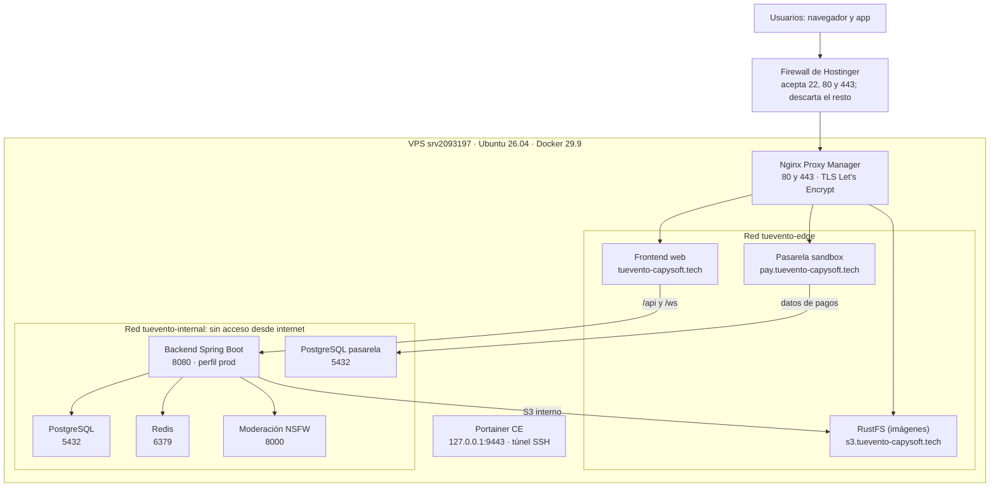

*Figura de arquitectura.* El tráfico entra solo por los puertos 80 y 443 de NPM; frontend, RustFS y la pasarela están en las dos redes, y el backend y las bases de datos solo en la interna. La pasarela también llama al backend por la red interna para confirmar los pagos (webhook).

#### 2.2.1 Topología del servidor VPS

Un único VPS ejecuta todo con Docker Engine 29.9 y Docker Compose v5.6. El firewall de Hostinger, que está antes del servidor, solo deja pasar los puertos 22, 80 y 443.

#### 2.2.2 Red interna de contenedores (Docker Bridge Network)

| Red | Contenedores | Propósito |
| --- | --- | --- |
| `tuevento-edge` | NPM, frontend, RustFS, pasarela | Lo que NPM puede alcanzar para publicarlo |
| `tuevento-internal` | Backend, PostgreSQL, Redis, NSFW, PostgreSQL de la pasarela, frontend, RustFS, pasarela | Tráfico entre servicios; no se publica |

NPM no resuelve `backend`, `postgres`, `redis` ni `nsfw-classifier`, así que un error de configuración en un proxy host no puede exponer la base de datos ni la API directamente.

#### 2.2.3 Enrutamiento y Reverse Proxy con certificados TLS/HTTPS

| Dominio | Destino interno | Certificado | Opciones |
| --- | --- | --- | --- |
| `tuevento-capysoft.tech` | `http://frontend:80` | Let's Encrypt | Force SSL, HTTP/2, HSTS, Websockets, Block Common Exploits |
| `s3.tuevento-capysoft.tech` | `http://rustfs:9000` | Let's Encrypt | Force SSL, HTTP/2, HSTS; sin Block Common Exploits por las URLs firmadas |
| `pay.tuevento-capysoft.tech` | `http://fake-payment-gateway:4001` | Let's Encrypt | Force SSL, HTTP/2, HSTS, Block Common Exploits |

En `s3.` no se reescribe la cabecera `Host`, porque la firma S3 V4 de las URLs de imágenes la incluye.

### 2.3 Matriz de Ambientes, Direccionamiento IP y Puertos

| Servicio | Puerto | Expuesto en | Acceso |
| --- | --- | --- | --- |
| SSH | 22 | `179.197.80.148` | Llave ed25519 del administrador |
| HTTP / HTTPS (NPM) | 80 / 443 | `0.0.0.0` | Público; HTTP redirige a HTTPS |
| Panel de NPM | 81 | `127.0.0.1` | Túnel SSH |
| Portainer | 9443 | `127.0.0.1` | Túnel SSH |
| Frontend | 80 | Red interna | NPM |
| Backend | 8080 | Red interna | Frontend (`/api`, `/ws`) y pasarela (webhook) |
| PostgreSQL | 5432 | Red interna | Backend |
| Redis | 6379 | Red interna | Backend |
| RustFS | 9000 | Red interna | Backend y NPM (`s3.`) |
| Clasificador NSFW | 8000 | Red interna | Backend |
| Pasarela sandbox | 4001 | Red interna | Backend y NPM (`pay.`) |

Las IP `172.16.x.x` que muestra Portainer son internas de Docker y cambian al recrear un contenedor; ningún cliente debe usarlas.

## 3. Requisitos Previos y Preparación (Pre-deployment)

Antes de cada despliegue se verifica el VPS, se respalda la base de datos y se confirma que las variables del stack están completas; sin respaldo no se actualiza.

### 3.1 Checklist de Prerrequisitos del Sistema Operativo y VPS

- [ ] Acceso SSH con llave ed25519 (`ssh root@179.197.80.148` entra sin pedir contraseña)
- [ ] Ubuntu actualizado (`apt update && apt upgrade -y`) y reiniciado si lo pide el kernel
- [ ] Firewall de Hostinger activo con 4 reglas: aceptar TCP 22, 80 y 443; descartar todo lo demás
- [ ] Swap de 4 GB activo (`free -h` muestra `Swap: 4.0Gi`)
- [ ] DNS: registros A de `@`, `s3` y `pay` apuntando a `179.197.80.148` (`dig +short` responde la IP)
- [ ] Portainer publicado solo en `127.0.0.1:9443`

#### 3.1.1 Recursos de hardware disponibles (CPU, RAM, disco NVMe)

| Recurso | Disponible | Uso del stack |
| --- | --- | --- |
| CPU | 2 vCPU | — |
| RAM | 8 GB + 4 GB de swap | Límites suman cerca de 5,4 GB sin LibreTranslate y 7,4 GB con él |
| Disco | 100 GB | Cerca de 2 GB del sistema al inicio; imágenes y volúmenes crecen con el uso |
| Ancho de banda | 8 TB al mes | — |

#### 3.1.2 Estado del motor Docker y socket local

El VPS trae Docker Engine 29.9.2 y Docker Compose v5.6.1 instalados. Se verifica con:

```bash
docker --version && docker compose version
docker ps --format "table {{.Names}}\t{{.Image}}\t{{.Status}}"
```

Portainer usa el socket local `/var/run/docker.sock`, montado en su contenedor.

> UFW no filtra los puertos que publica Docker, porque Docker escribe sus propias reglas de iptables. Por eso los paneles se publican en `127.0.0.1` y el filtrado real lo hace el firewall de Hostinger.

### 3.2 Estrategia y Ejecución de Respaldos (Backups)

El respaldo se hace justo antes de actualizar el stack y se guarda una copia fuera del VPS.

#### 3.2.1 Respaldo lógico de base de datos (Dump / Snapshot)

En el VPS:

```bash
docker exec tuevento-postgres sh -c 'pg_dump -U "$POSTGRES_USER" "$POSTGRES_DB"' > ~/backup-antes-v1.0.1.sql
ls -lh ~/backup-antes-v1.0.1.sql
```

Desde el equipo del administrador, para tener la copia fuera del servidor:

```bash
scp root@179.197.80.148:~/backup-antes-v1.0.1.sql ~/
```

El respaldo previo a la v1.0.1 pesó 289 KB. El archivo contiene datos de usuarios: no se sube a git ni se comparte.

#### 3.2.2 Respaldo de volúmenes persistentes de Docker

Los volúmenes `postgres_data`, `postgres_gateway_data`, `rustfs_data`, `npm_data` y `npm_letsencrypt` sobreviven a la recreación de contenedores. Para respaldar uno completo, por ejemplo las imágenes de RustFS (en el VPS):

```bash
docker run --rm -v tuevento_rustfs_data:/data -v ~/backups:/backup alpine tar czf /backup/rustfs_data.tgz -C /data .
```

Nunca se usa `docker compose down -v`, porque borra los volúmenes.

#### 3.2.3 Respaldo de configuraciones de Stacks y variables anteriores

- El `docker-compose.prod.yml` está versionado en git; cada versión se recupera con su tag (`git show v1.0.1:docker-compose.prod.yml`).
- Las variables reales viven en `.env.prod`, en el equipo del administrador, con permisos 600 e ignorado por git. Es la copia de respaldo de lo cargado en Portainer.
- Antes de cambiar `TUEVENTO_VERSION` se anota el valor anterior, que es el que permite volver atrás.

### 3.3 Gestión de Variables de Entorno y Secretos

Las variables se cargan en Portainer (Stacks → tuevento → Environment variables). Los secretos internos se generaron nuevos para producción con `openssl rand`; ninguno se reutiliza de desarrollo. La plantilla documentada, sin valores reales, es `.env.prod.example`.

| Grupo | Variables | Nota |
| --- | --- | --- |
| Versión | `TUEVENTO_VERSION` | Tag de las 4 imágenes, hoy `v1.0.2` |
| Base de datos | `POSTGRES_DB`, `POSTGRES_USER`, `POSTGRES_PASSWORD` | Obligatorias |
| Pasarela | `GATEWAY_POSTGRES_USER`, `GATEWAY_POSTGRES_PASSWORD`, `WEBHOOK_SECRET`, `ADMIN_API_KEY`, `FAKE_GATEWAY_API_KEY` | Las dos API keys deben ser iguales y de al menos 16 caracteres |
| Caché | `REDIS_PASSWORD` | Obligatoria |
| Almacenamiento | `RUSTFS_ACCESS_KEY`, `RUSTFS_SECRET_KEY`, `RUSTFS_PUBLIC_URL` | `RUSTFS_PUBLIC_URL=https://s3.tuevento-capysoft.tech` |
| Dominio y OAuth | `APP_CORS_ALLOWED_ORIGINS`, `APP_OAUTH_ALLOWED_FRONTEND_REDIRECT_URIS`, `APP_OAUTH_GOOGLE_REDIRECT_URI`, `GOOGLE_CLIENT_ID`, `GOOGLE_CLIENT_SECRET` | Los redirect URI son la URL completa del callback |
| Cuenta inicial | `ADMIN_EMAIL`, `ADMIN_PASSWORD` | El correo debe ser `@gmail.com` |
| Correo | `MAIL_USERNAME`, `MAIL_PASSWORD` | Cuenta de Gmail con contraseña de aplicación |
| Opcionales | `SIGHTENGINE_API_USER`, `SIGHTENGINE_API_SECRET`, `SWAGGER_ENABLED`, `AUTH_COOKIE_SAME_SITE`, `AUTH_COOKIE_SECURE`, `COMPOSE_PROFILES` | Valores por defecto seguros |

#### 3.3.1 Parámetros de conexión a base de datos

El backend se conecta por la red interna a `jdbc:postgresql://postgres:5432/${POSTGRES_DB}`, con un pool Hikari de 10 conexiones. La base no publica su puerto fuera de Docker.

#### 3.3.2 Claves de firmado de tokens (JWT Secret Keys)

`JWT_SECRET` y `QR_SECRET` son cadenas hexadecimales de 64 caracteres generadas con `openssl rand`. Cada token lleva un identificador único (`jti`). En la web, el refresh token viaja en una cookie `httpOnly`, `Secure` y `SameSite=Strict` con ruta `/api/v1/auth` y validez de 7 días.

#### 3.3.3 Límites de memoria y runtime (JVM)

| Servicio | Variable | Valor |
| --- | --- | --- |
| Backend | `BACKEND_JAVA_OPTS` | `-Xms256m -Xmx768m -XX:MaxMetaspaceSize=256m` |
| Pasarela | `GATEWAY_JAVA_OPTS` | `-Xms64m -Xmx256m -XX:MaxMetaspaceSize=128m` |
| Backend | `SPRING_PROFILES_ACTIVE` | `prod` |

La imagen del backend aplica `JAVA_OPTS` en su `ENTRYPOINT` con `sh -c "exec java …"`, para que Java siga siendo el proceso 1 y reciba la señal de apagado.

### 3.4 Protocolo de Comunicación y Ventana de Mantenimiento

1. Avisar al equipo y **congelar `develop`**: no se mergea nada hasta terminar el release.
2. Hacer el release: PR de `develop` a `main` con *merge commit* y tag anotado de la versión.
3. Ejecutar la ventana en fin de semana; la web queda fuera de servicio de 1 a 3 minutos mientras se recrean los contenedores.
4. Al terminar las pruebas de humo, avisar al equipo que `develop` vuelve a estar abierto.

## 4. Procedimiento de Despliegue Paso a Paso (Runbook)

Una actualización normal toma unos 15 minutos: publicar las imágenes con el tag nuevo, cambiar `TUEVENTO_VERSION` en Portainer y recrear el stack. Los comandos con `root@srv2093197` van en el VPS; los demás, en el equipo del administrador.

### 4.1 Verificación y Acceso a la Plataforma Base (Portainer CE)

Portainer se instaló una sola vez, fuera del stack (en el VPS):

```bash
docker volume create portainer_data
docker run -d --name portainer --restart=always \
  -p 127.0.0.1:9443:9443 \
  -v /var/run/docker.sock:/var/run/docker.sock \
  -v portainer_data:/data \
  portainer/portainer-ce:2.45.3
```

Para entrar, desde el equipo del administrador se abre un túnel SSH y se deja la terminal abierta:

```bash
ssh -o ServerAliveInterval=30 -L 19443:127.0.0.1:9443 root@179.197.80.148
```

Luego, en el navegador, `https://localhost:19443` → entorno **local** → **Stacks → tuevento**. Para confirmar que es el Portainer del VPS, los contenedores deben mostrar la versión que está en producción.

### 4.2 Despliegue y Migración de Base de Datos

#### 4.2.1 Ejecución de scripts DDL/DML o herramientas de migración (Liquibase)

Las migraciones no se ejecutan a mano: Liquibase las aplica cuando arranca el backend, en orden y una sola vez cada una. Cada migración nueva se prueba antes contra un PostgreSQL desechable con datos reales de prueba, incluido el caso de volver a ejecutarla (idempotencia). La v1.0.1 aplicó la migración 102, que limpia sesiones duplicadas y crea restricciones únicas.

#### 4.2.2 Verificación de integridad de esquemas, índices y usuarios

```bash
echo "SELECT id, exectype, dateexecuted FROM databasechangelog WHERE id LIKE '102%';" | \
  docker exec -i tuevento-postgres sh -c 'psql -U "$POSTGRES_USER" -d "$POSTGRES_DB"'
```

Resultado esperado: dos filas (`102-unique-auth-session-access-token` y `102-unique-refresh-token-token`) en estado `EXECUTED`. Al primer arranque, el backend crea además el bucket `tuevento` en RustFS, la cuenta de administrador y el avatar por defecto.

### 4.3 Despliegue y Orquestación del Stack de Aplicación

#### 4.3.1 Carga del archivo docker-compose.yml en Portainer

1. Comprobar si el compose cambió entre versiones:

   ```bash
   git -C ~/TuEvento diff --stat v1.0.1 v1.0.2 -- docker-compose.prod.yml .env.prod.example
   ```

2. Si no cambió, se omite este paso. Si cambió, se copia el de `main` sin pasar por la terminal:

   ```bash
   git -C ~/TuEvento show origin/main:docker-compose.prod.yml | xclip -selection clipboard
   ```

3. En Portainer: **Editor** → seleccionar todo → pegar → confirmar con Ctrl+F que aparecen las variables nuevas.

#### 4.3.2 Inyección de variables de entorno del Stack

1. **Environment variables**: cambiar `TUEVENTO_VERSION` al tag nuevo.
2. Agregar las variables que pida la versión, según su CHANGELOG.
3. Para cargar muchas a la vez: **Advanced mode** y pegar el contenido de `.env.prod` sin comentarios (`grep -Ev '^\s*(#|$)' .env.prod`).

#### 4.3.3 Despliegue de servicios y actualización de imágenes de contenedor

Las imágenes se construyen desde el tag, una por una, y solo las que cambiaron. Los comandos se ejecutan **dentro de la carpeta del repositorio** (`cd ~/TuEvento`):

```bash
cd ~/TuEvento
git status --short          # debe estar vacío: Docker construye con lo que haya en la carpeta
git checkout v1.0.2
export $(grep -E '^VITE_' .env.prod | xargs)
docker build -t jhampier23/tu-evento:frontend-v1.0.2 \
  --build-arg VITE_API_URL="$VITE_API_URL" \
  --build-arg VITE_GOOGLE_CLIENT_ID="$VITE_GOOGLE_CLIENT_ID" \
  --build-arg VITE_GATEWAY_URL="$VITE_GATEWAY_URL" \
  TuEventoFrontend/web
docker run --rm --entrypoint sh jhampier23/tu-evento:frontend-v1.0.2 \
  -c "grep -rl 'localhost:8080' /usr/share/nginx/html || echo LIMPIO"
docker push jhampier23/tu-evento:frontend-v1.0.2
git checkout develop
```

Las imágenes cuyo código no cambió se reetiquetan sin reconstruir:

```bash
docker buildx imagetools create -t jhampier23/tu-evento:nsfw-v1.0.1 jhampier23/tu-evento:nsfw-v1.0.0
```

Con los 4 tags publicados, en Portainer: activar **Re-pull image** → **Update the stack**. Después, en el VPS, se espera a que todo esté `healthy`:

```bash
docker ps --format "table {{.Names}}\t{{.Image}}\t{{.Status}}"
```

El orden de arranque lo fija el compose: bases de datos, Redis y RustFS; luego backend y pasarela; al final el frontend, que espera al backend `healthy`.

**Vuelta atrás (rollback):** se restaura el valor anterior de `TUEVENTO_VERSION` y se actualiza el stack. Las migraciones Liquibase no se revierten solas; si una versión trae migración, el rollback de la base se hace con el respaldo del punto 3.2.1.

### 4.4 Configuración de Enrutamiento, Dominio y Certificados SSL/TLS

Se hace solo en el despliegue inicial.

1. **Dominio:** `tuevento-capysoft.tech`, obtenido gratis por un año con el plan de Hostinger.
2. **DNS** (Hostinger → Administrador de DNS): borrar los registros por defecto de `@` y `www`, y crear tres registros A, `@`, `s3` y `pay`, hacia `179.197.80.148`.
3. **Panel de NPM** por túnel SSH:

   ```bash
   ssh -o ServerAliveInterval=30 -L 8181:127.0.0.1:81 root@179.197.80.148
   ```

   En `http://localhost:8181`, crear el usuario administrador.
4. **Proxy hosts:** Hosts → Proxy Hosts → Add Proxy Host, uno por dominio, con los destinos y opciones de la tabla 2.2.3.
5. **Certificados:** en la pestaña SSL de cada proxy host, *Request a new Certificate* con Force SSL, HTTP/2 y HSTS. NPM los renueva automáticamente.
6. **Proveedores de login:** en Google Cloud Console, agregar `https://tuevento-capysoft.tech` a los orígenes autorizados y `https://tuevento-capysoft.tech/api/v1/auth/oauth/google/callback` a los redireccionamientos, sin borrar los de `localhost`.

## 5. Plan de Verificación, Pruebas y Evidencias (Smoke Tests)

Las pruebas de la v1.0.2 pasaron: los 9 contenedores quedaron `healthy`, la API respondió y el login con correo y Google funcionó en producción.

### 5.1 Matriz de Enlaces y Endpoints de Verificación de Servicios

| Verificación | Comando o URL | Resultado esperado |
| --- | --- | --- |
| 5.1.1 Panel administrativo | `https://localhost:19443` por túnel SSH | Login de Portainer; desde internet `IP:9443` no responde |
| 5.1.2 Interfaz web pública | `curl -sI https://tuevento-capysoft.tech` | `200`, certificado de Let's Encrypt |
| 5.1.3 Salud del backend | `docker exec tuevento-backend wget -qO- http://localhost:8080/actuator/health` | `{"status":"UP"}` |
| API pública | `curl -s https://tuevento-capysoft.tech/api/v1/events/public` | JSON con `"success":true` |
| WebSocket | `curl -s https://tuevento-capysoft.tech/ws/info` | `"websocket":true` |
| Pasarela sandbox | `curl -sI https://pay.tuevento-capysoft.tech/pay.html` | `200` |
| Panel de NPM cerrado | `curl -m 5 http://179.197.80.148:81` | Timeout |
| 5.1.4 Swagger UI | Temporal, por túnel (ver nota) | Apagado por defecto; `/api-docs` da 404 |
| 5.1.5 Base de datos | `docker exec tuevento-postgres pg_isready` | `accepting connections`; el 5432 no se publica fuera de Docker |

`/actuator` y Swagger no tienen proxy host, a propósito. Para una captura de Swagger se pone `SWAGGER_ENABLED=true`, se abre un reenvío temporal a `127.0.0.1:8088` con `alpine/socat` y un túnel SSH, y al terminar se vuelve a `false` (procedimiento completo en `docs/deployment-vps.md`).

### 5.2 Pruebas de Humo Funcionales (Smoke Tests)

#### 5.2.1 Flujo de autenticación y emisión de tokens

| Prueba | Resultado |
| --- | --- |
| Login con correo y contraseña del administrador | Entra; al recargar con F5 la sesión sigue abierta (cookie `tuevento_refresh`) |
| `POST /api/v1/auth/refresh` después del login | `200` con nuevo access token |
| Login con Google en una ventana de incógnito | Entra y vincula la cuenta por correo |
| Cancelar en el proveedor | Vuelve a `/login` con mensaje, sin error 500 |
| 11 intentos de login en un minuto desde la misma IP | El 11.º es rechazado por el límite de peticiones |

#### 5.2.2 Pruebas de lectura y consulta de datos

- Landing con sus imágenes cargadas desde `/assets/` (v1.0.2).
- Listado público de eventos y temas de la interfaz.
- Avatar por defecto servido desde `https://s3.tuevento-capysoft.tech` con URL firmada.

#### 5.2.3 Pruebas de escritura y persistencia transaccional

- Crear un evento en borrador y subir imágenes: se guardan en RustFS y pasan por el clasificador NSFW.
- Compra de un ticket con la pasarela sandbox (popup de `pay.`) y su webhook de confirmación.
- Cerrar sesión: `POST /auth/logout` responde `200` y una sola sesión por login en `auth_session`.

### 5.3 Inspección de Logs y Monitoreo de Recursos

#### 5.3.1 Revisión de trazas de inicio sin excepciones críticas

```bash
docker logs tuevento-backend 2>&1 | grep -E "Started TuEventoApplication|profile is active"
```

Resultado de la v1.0.2: perfil `prod` activo y `Started TuEventoApplication in 17.943 seconds`. Los errores `Failed to translate … libretranslate` son esperados mientras LibreTranslate esté apagado y no afectan el resto de la aplicación.

#### 5.3.2 Monitoreo de consumo de CPU y memoria RAM en contenedores

```bash
docker stats --no-stream --format "table {{.Name}}\t{{.CPUPerc}}\t{{.MemUsage}}"
free -h
```

Cada contenedor tiene su tope de memoria (tabla 2.1). En la medición del 27 de octubre, el stack usaba 2,2 GB de 7,7 GB de RAM, sin uso de swap; el backend 582 MB de 1,25 GB y el clasificador NSFW 402 MB de 1,5 GB.

### 5.4 Registro de Evidencias Visuales (Screenshots)

#### 5.4.1 Captura del panel de Portainer con contenedores en estado Running

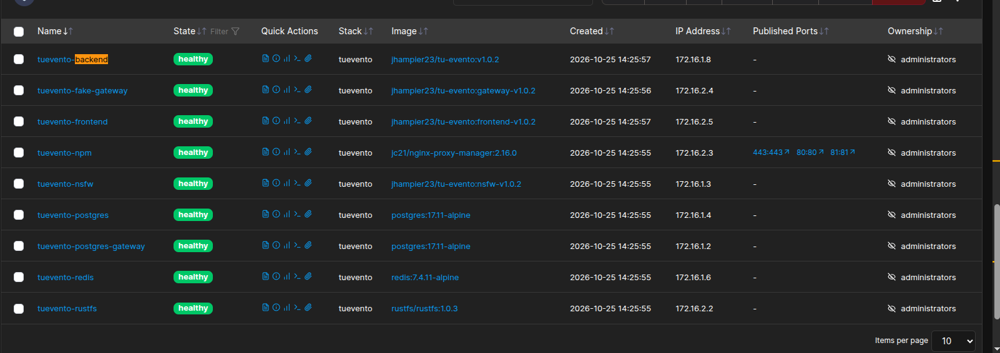

*Figura 1.* Stack `tuevento` en el Portainer del VPS: los 9 contenedores en `healthy`, todos con imágenes v1.0.2, y solo NPM con puertos publicados.

#### 5.4.2 Captura de visor de logs de los servicios Backend

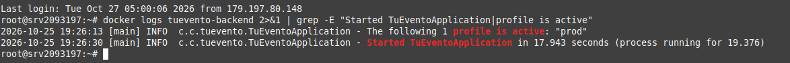

*Figura 2.* Logs de inicio del backend en el VPS: perfil `prod` activo y `Started TuEventoApplication in 17.943 seconds`.

#### 5.4.3 Captura de respuesta HTTP 200 de los Health Checks

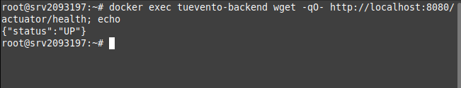

*Figura 3.* `/actuator/health` responde `{"status":"UP"}` desde dentro del contenedor; el endpoint no se publica a internet.

#### 5.4.4 Captura de interfaz web React con consola DevTools limpia

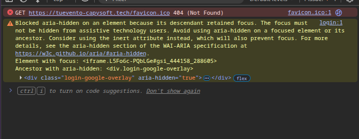

*Figura 4.* Consola de DevTools en `https://tuevento-capysoft.tech/login` (v1.0.2): sin errores de API ni de recursos. Quedan dos avisos menores para la v1.0.3: falta el `favicon.ico` (404) y un aviso de accesibilidad (`aria-hidden`) del botón de Google.

#### 5.4.5 Captura de registro de migración exitosa en base de datos

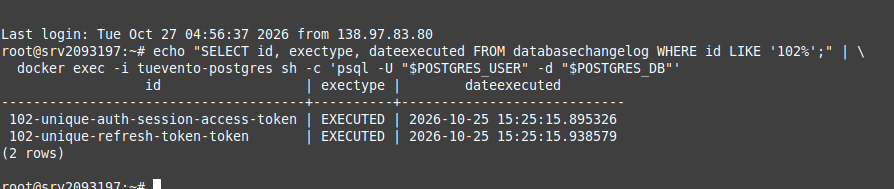

*Figura 5.* Tabla `databasechangelog` de producción: los dos changeSets de la migración 102 en estado `EXECUTED` el 25 de octubre de 2026.

#### Evidencias adicionales

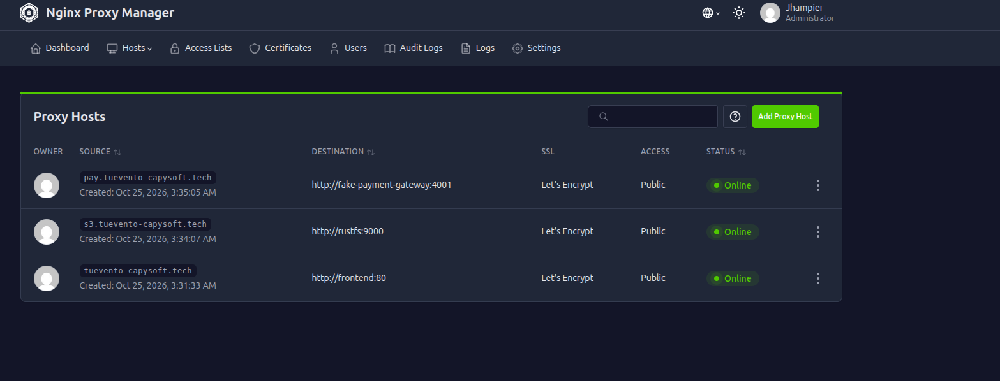

*Figura 6.* Los tres proxy hosts de Nginx Proxy Manager en estado Online, con certificado de Let's Encrypt.

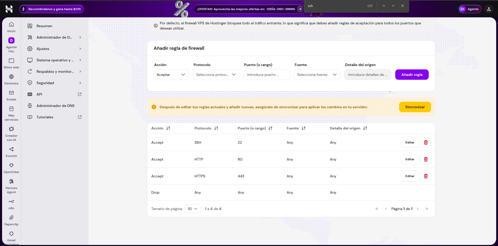

*Figura 7.* Firewall del VPS en Hostinger: acepta SSH (22), HTTP (80) y HTTPS (443) y descarta el resto.

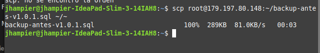

*Figura 8.* Copia del respaldo `backup-antes-v1.0.1.sql` (289 KB) desde el VPS al equipo del administrador con `scp`.

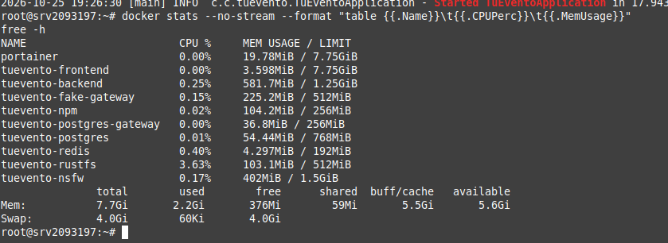

*Figura 9.* `docker stats` y `free -h` en el VPS: el stack usa 2,2 GB de 7,7 GB de RAM, sin uso de swap, y cada contenedor queda bajo su límite.

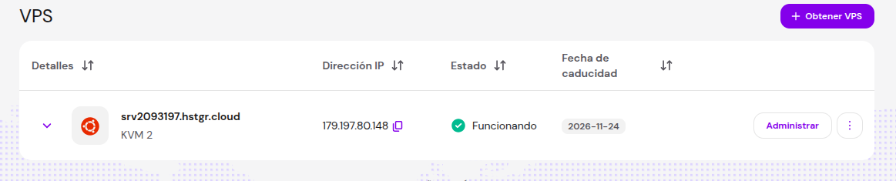

*Figura 10.* VPS `srv2093197.hstgr.cloud` (KVM 2, IP 179.197.80.148) en estado Funcionando, con vencimiento el 24 de noviembre de 2026.

## Anexo A. Incidencias durante el despliegue y su solución

Ninguna incidencia causó pérdida de datos; todas se resolvieron dentro de su ventana y dejaron un control nuevo en el procedimiento.

| Fecha | Incidencia | Causa | Solución y control |
| --- | --- | --- | --- |
| 25 oct | Botón de Google sin respuesta y API caída en v1.0.2 | La imagen del frontend se construyó sin los build args: llamaba a `localhost:8080` | Reconstrucción con `VITE_*` y verificación `grep localhost:8080` antes del push (4.3.3) |
| 25 oct | La imagen reconstruida incluía cambios locales sin commit | Docker construye con lo que hay en la carpeta, no con el tag | `git status --short` vacío antes de construir; `git stash` si hace falta |
| 25 oct | v1.0.2 se desplegó en el equipo del administrador en lugar del VPS | Dos Portainer abiertos (local en 9443, VPS en 19443 por túnel) | Confirmar en Stacks que los contenedores muestran la versión de producción (4.1) |
| 25 oct | Backend y pasarela reiniciándose en bucle al subir a v1.0.1 | El compose pegado en Portainer era el antiguo, sin `FAKE_GATEWAY_API_KEY` ni `ADMIN_API_KEY` | Copiar el compose directo de `origin/main` y comprobar las variables con Ctrl+F (4.3.1) |
| 25 oct | `main` y `develop` divergieron | El PR #100 se mergeó directo a `main` | Rama de sincronización con *merge commit*; todo PR va a `develop` |
| 24 oct | Login con Facebook expulsaba al usuario a `/login` | Tokens sin `jti` duplicados en el mismo segundo y refresh al cargar cada página | Corregido en v1.0.1 (#107) con migración 102 |
| 24 oct | 502 Bad Gateway tras actualizar el stack | NPM conservaba la IP interna anterior del frontend | `docker restart tuevento-npm` |
| 24 oct | Portainer no cargaba las variables del `.env` | Comentarios y líneas vacías en el archivo | Cargar el archivo sin comentarios o pegarlo en Advanced mode (4.3.2) |
| 24 oct | El panel 81 de NPM quedaba público pese a UFW | Docker publica puertos por encima de UFW | Paneles en `127.0.0.1` y firewall de Hostinger |
| 24 oct | La imagen de MinIO no se podía descargar | Retirada de Docker Hub y registro con autenticación | Reemplazo por RustFS 1.0.3, ya soportado por el backend |

## Anexo B. Referencias

- Repositorio TuEvento: `docker-compose.prod.yml`, `.env.prod.example`, `docs/deployment-vps.md`, `docs/versioning.md` y `CHANGELOG.md`.
- Tags de versión en git: `v1.0.1` y `v1.0.2`.
- Imágenes en Docker Hub: repositorio `jhampier23/tu-evento`.
