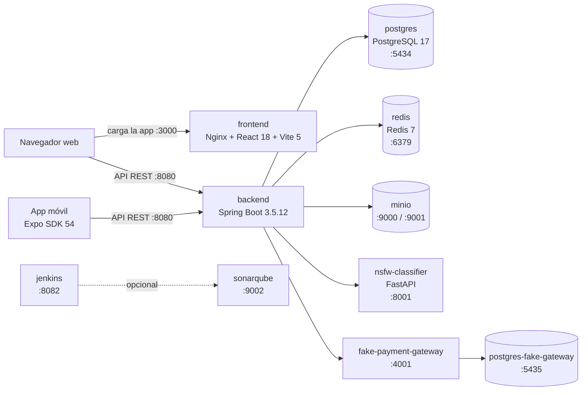
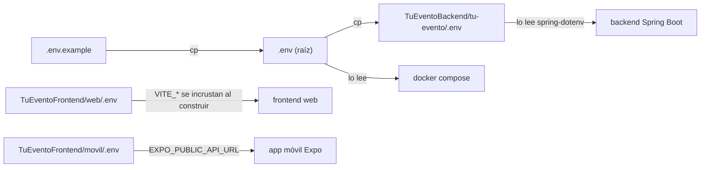
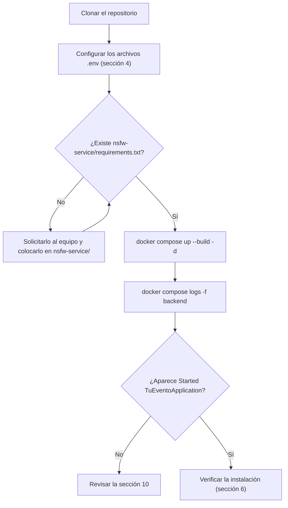
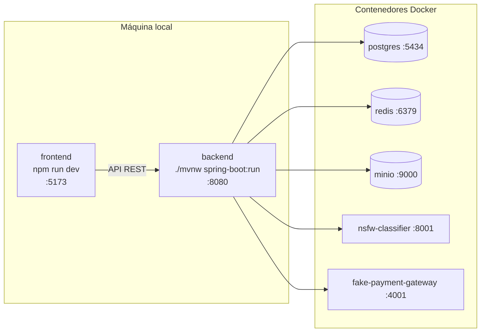
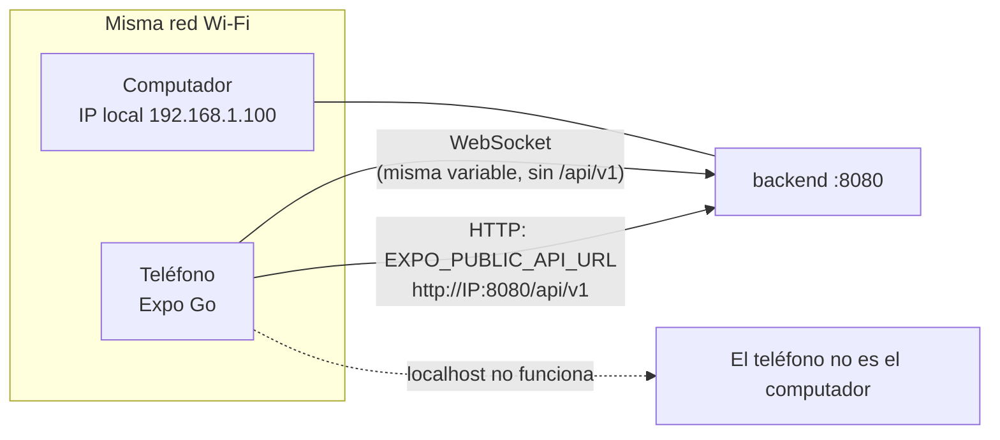
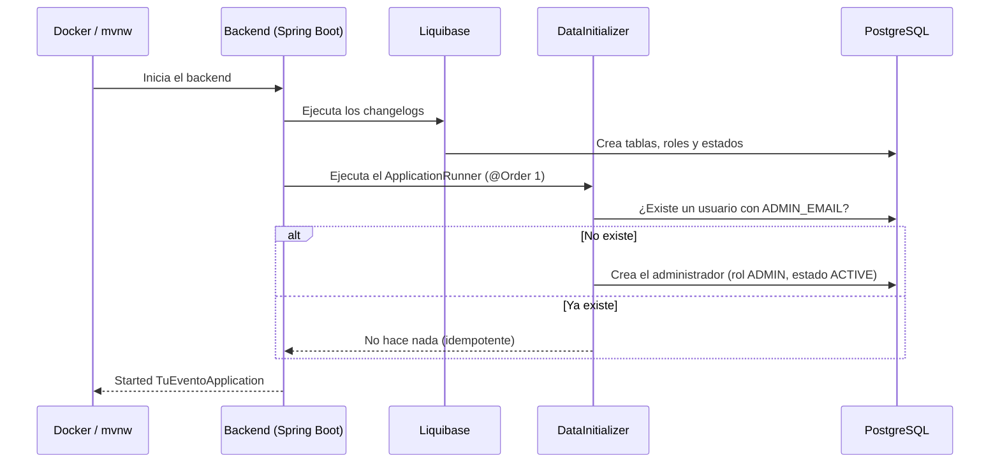

<div align="center">

<br><br><br>

**TuEvento: Manual de instalación**

Guía técnica de despliegue, arquitectura y puesta en marcha del sistema

<br><br>

Jhampier Santos Ortiz y Cristofer David Lozano Contreras

Equipo CapySoft

Servicio Nacional de Aprendizaje (SENA)

Programa de formación: Análisis y Desarrollo de Software (ADSO)

Ficha 3145556

Instructor: Carlos Julio Cadena

Octubre de 2026

Versión 1.0

</div>

<div style="page-break-after: always;"></div>

## Contenido

1. [Arquitectura y stack tecnológico](#1-arquitectura-y-stack-tecnológico)
2. [Requisitos previos](#2-requisitos-previos)
3. [Obtención del código](#3-obtención-del-código)
4. [Variables de entorno](#4-variables-de-entorno)
5. [Instalación con Docker (recomendada)](#5-instalación-con-docker-recomendada)
6. [Verificación de la instalación](#6-verificación-de-la-instalación)
7. [Desarrollo local (opcional, modo mixto)](#7-desarrollo-local-opcional-modo-mixto)
8. [Operación diaria](#8-operación-diaria)
9. [App móvil (Expo)](#9-app-móvil-expo)
10. [Solución de problemas](#10-solución-de-problemas)
11. [Notas de seguridad](#11-notas-de-seguridad)
12. [Acceso al sistema](#12-acceso-al-sistema)
13. [Referencias](#referencias)

### Lista de figuras

- Figura 1. Arquitectura y puertos de TuEvento
- Figura 2. Ubicación y uso de los archivos `.env`
- Figura 3. Flujo de instalación con Docker
- Figura 4. Modo de desarrollo local (mixto)
- Figura 5. Conexión de la app móvil con el backend
- Figura 6. Secuencia de arranque del backend y creación del administrador inicial

> **Alcance.** Este manual cubre la instalación del backend, del frontend web y de la infraestructura de apoyo. La aplicación móvil (Expo) se trata en la sección 9. Los valores (puertos, nombres de servicios, rutas y versiones) fueron verificados contra el código del repositorio. El formato de citas y referencias sigue las normas APA, séptima edición (American Psychological Association, 2020).

---

## 1. Arquitectura y stack tecnológico

TuEvento se compone de tres capas desacopladas más una capa de infraestructura de apoyo. Todos los servicios están definidos en un único archivo `docker-compose.yml` en la raíz del repositorio (Docker, Inc., s. f.-a).

| Capa | Tecnología | Puerto (host) |
|---|---|---|
| Frontend web | React 18 + Vite 5 (servido por Nginx en el contenedor) | 3000 |
| Frontend móvil | React Native 0.81 / Expo SDK 54 | — |
| API REST del backend | Spring Boot 3.5.12, Java 17 (código fuente); la imagen de Docker ejecuta un JRE 21 | 8080 |
| Base de datos | PostgreSQL 17 | 5434 (host) a 5432 (contenedor) |
| Caché | Redis 7 (sin contraseña por defecto) | 6379 |
| Almacenamiento S3 | MinIO | 9000 (API) / 9001 (consola) |
| Moderación de imágenes NSFW | NSFW Classifier (Python / FastAPI + opennsfw2) | 8001 a 8000 (contenedor) |
| Pasarela de pagos simulada | Fake Payment Gateway (solo desarrollo) | 4001 |
| Base de datos de la pasarela | PostgreSQL dedicado (`postgres-fake-gateway`) | 5435 |
| Integración continua | Jenkins | 8082 (UI) / 50000 (agentes) |
| Calidad de código | SonarQube | 9002 |

> **Nota.** Jenkins y SonarQube forman parte de `docker-compose.yml` pero no son necesarios para ejecutar la aplicación. La sección 5.3 muestra cómo iniciar solo los servicios esenciales.

Cada tecnología cuenta con documentación oficial: React (Meta Platforms, s. f.), Vite (Vite, s. f.), Expo (Expo, s. f.), Spring Boot (Spring, s. f.), PostgreSQL (PostgreSQL Global Development Group, s. f.), Redis (Redis, s. f.), MinIO (MinIO, s. f.), Jenkins (Jenkins, s. f.) y SonarQube (SonarSource, s. f.).

La Figura 1 resume cómo se comunican los componentes y en qué puerto del host se publica cada uno.

**Figura 1**

*Arquitectura y puertos de TuEvento*



*Nota.* Elaboración propia a partir de `docker-compose.yml`. Jenkins y SonarQube (línea punteada) son opcionales.

---

## 2. Requisitos previos

### 2.1 Ejecución con contenedores (recomendada)

| Herramienta | Versión mínima | Verificar con |
|---|---|---|
| Docker Engine | 24.x | `docker --version` |
| Docker Compose | 2.20.x | `docker compose version` |
| Git | Reciente | `git --version` |

- **Windows:** Docker Desktop con el backend WSL2 habilitado.
- **macOS:** Docker Desktop.
- **Linux:** Docker Engine + el plugin de Compose (Docker, Inc., s. f.-b).

### 2.2 Requisitos de hardware

| Escenario | RAM recomendada | Disco libre |
|---|---|---|
| Servicios esenciales (sin Jenkins ni SonarQube) | 8 GB | Aprox. 8 GB |
| Stack completo de `docker-compose.yml` | 12 a 16 GB | Aprox. 12 GB |

| Servicio | RAM estimada | Imagen en disco |
|---|---|---|
| nsfw-classifier (TensorFlow) | 1 a 2 GB | Aprox. 3 a 4 GB |
| backend (Spring Boot) | 512 MB a 1 GB | Aprox. 300 MB |
| minio | 256 a 512 MB | Aprox. 250 MB + archivos |
| fake-payment-gateway | 256 a 512 MB | Aprox. 700 MB |
| postgres (x2 instancias) | 128 a 256 MB cada una | Aprox. 250 MB + datos |
| redis / frontend (Nginx) | Menos de 100 MB | Aprox. 90 MB |
| jenkins | 1 a 2 GB | Aprox. 800 MB |
| sonarqube | 2 a 4 GB | Aprox. 700 MB |

Son valores estimados; el consumo real varía según el equipo y la carga.

### 2.3 Desarrollo local sin contenedores (opcional)

| Herramienta | Versión |
|---|---|
| Java JDK | OpenJDK / Eclipse Temurin 17 (la imagen de Docker usa JRE 21; ambos funcionan) |
| Node.js | 20.x LTS con npm 10.x |

Incluso en este modo, PostgreSQL, Redis y MinIO deben estar en ejecución; se inician con Docker (ver sección 7). Por lo tanto es un **modo mixto**: infraestructura en contenedores y backend/frontend en su máquina.

### 2.4 Puertos que deben estar libres

`3000`, `4001`, `5434`, `5435`, `6379`, `8001`, `8080`, `9000`, `9001` (Web, Pagos, PostgreSQL, PostgreSQL de pagos, Redis, NSFW, Backend, API y consola de MinIO). Si inicia el stack completo, también `8082`, `9002` y `50000` (Jenkins y SonarQube).

---

## 3. Obtención del código

El código fuente del proyecto se encuentra en el repositorio del equipo CapySoft (CapySoft, 2026):

```bash
git clone https://github.com/lozano2303/TuEvento.git tuevento
cd tuevento
```

---

## 4. Variables de entorno

### 4.1 Creación de los archivos .env

```bash
cp .env.example .env
cp .env TuEventoBackend/tu-evento/.env
```

> **¿Por qué dos copias?** Docker Compose lee el `.env` de la raíz, pero el backend (que usa `spring-dotenv`) lee el `.env` ubicado en `TuEventoBackend/tu-evento/`. Si cambia una variable, actualícela en ambos archivos.

Para el frontend web, el Client ID de Google se define en `TuEventoFrontend/web/.env`:

```env
VITE_GOOGLE_CLIENT_ID=<su_client_id_de_google>
VITE_API_URL=http://localhost:8080/api/v1
```

La Figura 2 muestra qué archivo `.env` lee cada componente.

**Figura 2**

*Ubicación y uso de los archivos `.env`*



*Nota.* Elaboración propia. Las variables `VITE_*` se incrustan en tiempo de construcción de la imagen, por lo que un cambio exige reconstruirla.

### 4.2 Variables obligatorias

| Variable | Descripción | Ejemplo / cómo obtenerla |
|---|---|---|
| `POSTGRES_DB` | Nombre de la base de datos | `tuevento` |
| `POSTGRES_USER` | Usuario de PostgreSQL | `tuevento_user` |
| `POSTGRES_PASSWORD` | Contraseña de PostgreSQL | Una contraseña fuerte propia |
| `JWT_SECRET` | Clave HMAC-SHA256 para firmar los JWT (mín. 32 caracteres) | `openssl rand -base64 48` |
| `MAIL_USERNAME` | Cuenta de Gmail que envía las notificaciones | `micuenta@gmail.com` |
| `MAIL_PASSWORD` | Contraseña de aplicación de 16 caracteres (no la contraseña personal) | Ver 4.4 |
| `GOOGLE_CLIENT_ID` | Client ID de OAuth 2.0 | Ver 4.5 |
| `GOOGLE_CLIENT_SECRET` | Client Secret de OAuth 2.0 | Ver 4.5 |
| `MINIO_ROOT_USER` | Usuario administrador de MinIO | Uno propio (evite el valor por defecto de MinIO) |
| `MINIO_ROOT_PASSWORD` | Contraseña del administrador de MinIO (mín. 8 caracteres) | Una contraseña fuerte propia |
| `APP_CORS_ALLOWED_ORIGINS` | Orígenes permitidos por CORS | `http://localhost:3000` |
| `ADMIN_EMAIL` | Correo del administrador inicial | `admin@sudominio.com` |
| `ADMIN_PASSWORD` | Contraseña del administrador inicial | Una contraseña fuerte propia |
| `ADMIN_ALIAS` | Alias del administrador inicial | `admin` |

### 4.3 Variables adicionales (no incluidas en .env.example)

El archivo `.env.example` no documenta todas las variables que lee el backend. Las siguientes tienen valores por defecto, pero conviene conocerlas:

| Variable | Valor por defecto | Cuándo definirla |
|---|---|---|
| `SPRING_DATASOURCE_URL` | `jdbc:postgresql://localhost:5432/${POSTGRES_DB}` | Obligatoria en desarrollo local: debe apuntar al puerto 5434 |
| `APP_STORAGE_ENDPOINT` | `http://localhost:9000` | Backend ejecutándose localmente, para llegar a MinIO |
| `MINIO_PUBLIC_URL` | `http://localhost:9000` | URL pública usada para servir archivos |
| `WEBHOOK_SECRET` | `default-secret-change-in-production` | Siempre fuera de local; compartida con la pasarela |
| `PAYMENT_GATEWAY` | `fake` | Al usar una pasarela real |
| `FAKE_GATEWAY_URL` | `http://localhost:4001` | Si la pasarela simulada corre en otro host |
| `APP_OAUTH_GOOGLE_REDIRECT_URI` / `APP_OAUTH_FACEBOOK_REDIRECT_URI` | `http://localhost:8080` | En producción |
| `APP_PROFILE_DEFAULT_AVATAR_ID` | `1` | Opcional |
| `NOTIFICATION_EMAIL_ENABLED` | `true` | Para desactivar el envío de correos en pruebas |
| `SERVER_PORT` | `8080` | Opcional |

### 4.4 Obtención de la contraseña de aplicación de Gmail

1. Active la verificación en dos pasos en su cuenta de Google.
2. Vaya a Cuenta de Google, Seguridad, Contraseñas de aplicaciones (Google, s. f.-a).
3. Genere una contraseña para «Correo» y cópiela (16 caracteres, sin espacios) en `MAIL_PASSWORD`.

### 4.5 Configuración de Google OAuth 2.0

1. En Google Cloud Console, cree o seleccione un proyecto (Google, s. f.-b).
2. Vaya a APIs y servicios, Credenciales, Crear credenciales, ID de cliente de OAuth.
3. Tipo de aplicación: Aplicación web.
4. En Orígenes de JavaScript autorizados agregue `http://localhost:3000` (y `http://localhost:5173` si ejecuta el frontend con `npm run dev`, además del dominio de producción si aplica).
5. Copie el Client ID y el Client Secret en las variables correspondientes. El mismo Client ID debe ir en `VITE_GOOGLE_CLIENT_ID` del frontend.

> **Consejo.** Si aparece el error `origin not allowed` o `origin_mismatch`, el origen no está autorizado en ese Client ID.

### 4.6 Seguridad del archivo .env

- No haga commit de los archivos `.env` al repositorio. Ambos están en `.gitignore`; verifíquelo con:

  ```bash
  git check-ignore -v .env TuEventoBackend/tu-evento/.env
  ```

- Rote las credenciales (JWT, contraseñas, claves de API) si fueron expuestas.

---

## 5. Instalación con Docker (recomendada)

La Figura 3 presenta el flujo completo de esta sección.

**Figura 3**

*Flujo de instalación con Docker*



*Nota.* Elaboración propia. Para ahorrar memoria puede iniciar solo los servicios esenciales (sección 5.3).

### 5.1 Verificación previa del clasificador NSFW

> **Importante.** El archivo `nsfw-service/requirements.txt` está listado en el `.gitignore` de la raíz, por lo que no está versionado. En un clon limpio no existirá y la construcción de la imagen `nsfw-classifier` fallará. Antes de construir, confirme que el archivo existe; si no, solicítelo al equipo. Recomendación para el equipo: quitarlo del `.gitignore` y subirlo al repositorio.

```bash
ls nsfw-service/requirements.txt
```

### 5.2 Inicio de todos los servicios

1. Verifique que el `.env` esté configurado (sección 4).
2. Construya las imágenes e inicie todos los servicios en segundo plano:

   ```bash
   docker compose up --build -d
   ```

3. Monitoree el backend hasta ver el mensaje `Started TuEventoApplication`:

   ```bash
   docker compose logs -f backend
   ```

   Presione `Ctrl + C` para salir de los registros (los servicios siguen en ejecución).

> **Nota.** La primera ejecución puede tardar varios minutos por la descarga de imágenes y la compilación del backend. El clasificador NSFW también descarga su modelo (aprox. 23 MB) y las dependencias de TensorFlow (varios cientos de MB) durante la construcción y el primer inicio.

### 5.3 Inicio solo de los servicios esenciales

Para ahorrar memoria, omita Jenkins y SonarQube:

```bash
docker compose up --build -d postgres postgres-fake-gateway redis \
  minio minio-init nsfw-classifier fake-payment-gateway backend frontend
```

---

## 6. Verificación de la instalación

| Verificación | Comando / acción | Resultado esperado |
|---|---|---|
| Contenedores | `docker compose ps` | Todos en ejecución (o saludables) |
| Backend | `curl -s http://localhost:8080/actuator/health` | `{"status":"UP"}` |
| Redis | `docker exec -it tuevento-redis redis-cli ping` | `PONG` |
| Frontend web | Abrir `http://localhost:3000` | Carga la página de inicio |
| API (Swagger) | Abrir `http://localhost:8080/swagger-ui/index.html` | Documentación interactiva |
| MinIO | Abrir `http://localhost:9001` | La consola de MinIO es accesible |
| Clasificador NSFW | `curl -s http://localhost:8001/health` | `{"status": "ok"}` |
| Fake Payment Gateway | `docker compose logs fake-payment-gateway` | Inicia sin errores (no tiene healthcheck) |

> **Consejo.** La URL canónica de Swagger (SpringDoc 2.x) es `/swagger-ui/index.html`; `/swagger-ui` redirige a ella.

### Nombres de los contenedores

| Servicio | Contenedor | Puerto host:contenedor |
|---|---|---|
| postgres | tuevento-postgres | 5434:5432 |
| postgres-fake-gateway | fake-gateway-postgres | 5435:5432 |
| redis | tuevento-redis | 6379:6379 |
| minio / minio-init | tuevento-minio / tuevento-minio-init | 9000:9000, 9001:9001 / ninguno |
| nsfw-classifier | nsfw-classifier | 8001:8000 |
| fake-payment-gateway | fake-payment-gateway | 4001:4001 |
| backend | tuevento-backend-dev | 8080:8080 |
| frontend | tuevento-frontend | 3000:80 |
| jenkins | tuevento-jenkins | 8082:8080, 50000:50000 |
| sonarqube | tuevento-sonarqube | 9002:9000 |

---

## 7. Desarrollo local (opcional, modo mixto)

Inicie solo la infraestructura con Docker y ejecute el backend y el frontend en su máquina (ver Figura 4).

**Figura 4**

*Modo de desarrollo local (mixto)*



*Nota.* Elaboración propia. El backend local debe apuntar al puerto publicado de PostgreSQL (5434) mediante `SPRING_DATASOURCE_URL`.

1. **Infraestructura** (nombres reales de los servicios en `docker-compose.yml`):

   ```bash
   docker compose up -d postgres redis minio minio-init \
     nsfw-classifier fake-payment-gateway
   ```

2. Configure el backend para conectarse al puerto publicado de PostgreSQL (5434). Agregue a `TuEventoBackend/tu-evento/.env`:

   ```env
   SPRING_DATASOURCE_URL=jdbc:postgresql://localhost:5434/<POSTGRES_DB>
   REDIS_HOST=localhost
   REDIS_PORT=6379
   APP_STORAGE_ENDPOINT=http://localhost:9000
   ```

   > **Importante.** Si omite `SPRING_DATASOURCE_URL`, el backend usará `localhost:5432` (el valor por defecto en `application-dev.yml`), donde no hay PostgreSQL, y no podrá iniciar.

3. **Backend:**

   ```bash
   cd TuEventoBackend/tu-evento
   ./mvnw spring-boot:run
   ```

4. **Frontend web** (Vite sirve en el puerto 5173; ya está incluido en los orígenes CORS por defecto):

   ```bash
   cd TuEventoFrontend/web
   npm install
   npm run dev
   ```

---

## 8. Operación diaria

| Acción | Comando |
|---|---|
| Ver los registros de un servicio | `docker compose logs -f <servicio>` |
| Detener sin borrar datos | `docker compose down` |
| Reiniciar un servicio | `docker compose restart <servicio>` |
| Actualizar a la última versión | `git pull && docker compose up --build -d` |

> **Advertencia.** `docker compose down -v` elimina todos los volúmenes. Úselo solo para reiniciar el sistema desde cero; borrar volúmenes de forma parcial puede dejar registros huérfanos entre la base de datos y MinIO.

### 8.1 Volúmenes persistentes

| Volumen | Servicio | Contenido |
|---|---|---|
| `postgres_data` | postgres | Base de datos principal |
| `postgres_fake_gateway_data` | postgres-fake-gateway | Base de datos de la pasarela simulada |
| `redis_data` | redis | Datos de la caché |
| `minio_data` | minio | Archivos e imágenes subidos |
| `jenkins_data` | jenkins | Configuración y trabajos de Jenkins |
| `sonarqube_data` / `_logs` / `_extensions` | sonarqube | Datos, registros y plugins de SonarQube |

### 8.2 Respaldo de datos

Antes de cualquier operación destructiva, respalde PostgreSQL y MinIO. El respaldo de la base de datos usa `pg_dump` (PostgreSQL Global Development Group, s. f.):

```bash
# PostgreSQL: respaldo y restauración
docker exec tuevento-postgres pg_dump -U <POSTGRES_USER> <POSTGRES_DB> \
  > backup_tuevento.sql
docker exec -i tuevento-postgres psql -U <POSTGRES_USER> -d <POSTGRES_DB> \
  < backup_tuevento.sql

# MinIO: copia del volumen (Linux/macOS/Git Bash)
docker volume ls     # busque el nombre real (termina en minio_data)
docker run --rm -v <volumen_minio>:/data -v "$(pwd)":/backup alpine \
  tar czf /backup/minio_backup.tgz -C /data .
```

---

## 9. App móvil (Expo)

La app móvil usa Expo SDK 54 (React Native 0.81) y no forma parte del despliegue con Docker (Expo, s. f.).

```bash
cd TuEventoFrontend/movil
npm install
npx expo start
```

La URL del backend se define en `TuEventoFrontend/movil/.env` mediante la variable `EXPO_PUBLIC_API_URL` (plantilla en `.env.example`):

```env
EXPO_PUBLIC_API_URL=http://<IP_LOCAL_DE_LA_MAQUINA>:8080/api/v1
```

- Para probar en un dispositivo físico, instale Expo Go y asegúrese de que el teléfono y el computador estén en la misma red.
- La app debe apuntar a la IP local de la máquina (por ejemplo `192.168.1.100`), nunca a `localhost`.
- El servicio de WebSocket (`websocketService.js`) deriva su URL de la misma variable (elimina `/api/v1`), por lo que un valor incorrecto también afecta las funciones en tiempo real.
- Después de cambiar el `.env`, reinicie Expo con `npx expo start -c`.

**Figura 5**

*Conexión de la app móvil con el backend*



*Nota.* Elaboración propia. La IP de ejemplo debe reemplazarse por la IP local real del computador que ejecuta el backend.

---

## 10. Solución de problemas

| Problema | Causa probable | Solución |
|---|---|---|
| Puerto en uso (8080, 5434, etc.) | Otro proceso lo está usando | Linux/macOS: `lsof -i :8080`. Windows: `netstat -ano \| findstr :8080`. Cierre el proceso o reasigne el puerto en `docker-compose.yml`. |
| Liquibase: error de conexión a PostgreSQL | El backend inició antes que PostgreSQL (solo MinIO tiene condición `service_healthy`; Postgres, Redis y NSFW usan `service_started`) | `docker compose restart backend`. Solución permanente: agregar un healthcheck a Postgres (ver abajo). |
| El backend local no se conecta a PostgreSQL | Falta `SPRING_DATASOURCE_URL`; el valor por defecto usa el puerto 5432 | Defina `jdbc:postgresql://localhost:5434/<POSTGRES_DB>` en el `.env` del backend. |
| Falla la construcción de nsfw-classifier | `nsfw-service/requirements.txt` no existe (está en `.gitignore`) | Solicite el archivo al equipo y colóquelo en `nsfw-service/`. |
| El frontend recibe 404 en las llamadas a la API | Inconsistencia de `VITE_API_URL`: `docker-compose.yml` la pasa como build arg sin `/v1` (`.../api`) y el `.env` del frontend usa `.../api/v1` | Unifique ambos valores en `http://localhost:8080/api/v1` y reconstruya: `docker compose up --build -d frontend`. |
| El inicio de sesión con Google no funciona en el frontend de Docker | Las variables `VITE_*` se incrustan en tiempo de construcción; el compose solo pasa `VITE_API_URL` | Asegúrese de que `VITE_GOOGLE_CLIENT_ID` llegue a la construcción (archivo `.env` del frontend o build arg) y reconstruya la imagen. |
| Error de CORS | Origen no permitido | Verifique que `APP_CORS_ALLOWED_ORIGINS` incluya `http://localhost:3000` y reinicie el backend. |
| Error de autenticación de Gmail | Contraseña incorrecta | Use una contraseña de aplicación de 16 caracteres, no la contraseña personal (requiere verificación en dos pasos). |
| Google: `origin_mismatch` / `origin not allowed` | Origen no autorizado o Client ID incorrecto | Revise los Orígenes de JavaScript autorizados en Google Cloud Console y que `VITE_GOOGLE_CLIENT_ID` coincida. |
| El backend no toma los cambios del `.env` | Solo se editó el `.env` de la raíz | Actualice también `TuEventoBackend/tu-evento/.env` y reinicie. |
| La app móvil no se conecta (ni el WebSocket) | `EXPO_PUBLIC_API_URL` apunta a localhost o a una IP incorrecta | Use la IP local de la máquina, la misma red Wi-Fi, y reinicie con `npx expo start -c`. |
| El clasificador NSFW responde lento al inicio | Descarga/carga del modelo en el primer inicio | Espere a que `/health` responda; revise con `docker compose logs -f nsfw-classifier`. |

### Healthcheck recomendado para los servicios de PostgreSQL

```yaml
services:
  postgres:
    healthcheck:
      test: ["CMD-SHELL", "pg_isready -U ${POSTGRES_USER} -d ${POSTGRES_DB}"]
      interval: 5s
      timeout: 5s
      retries: 10
  backend:
    depends_on:
      postgres:
        condition: service_healthy
```

---

## 11. Notas de seguridad

La configuración incluida está pensada para desarrollo. Antes de exponer el sistema, revise:

| Elemento | Estado actual (perfil dev) | Acción para producción |
|---|---|---|
| Fake Payment Gateway | Solo desarrollo y pruebas | No usarla en producción; configure `PAYMENT_GATEWAY` con una pasarela real. |
| Redis | Sin contraseña | Agregue `--requirepass` al comando de Redis y `spring.data.redis.password` en el backend. |
| Actuator | `/actuator/**` público y sin restricciones (incluye env, beans, metrics) | Exponga solo health/info y protéjalo o límitelo por red. |
| Swagger / OpenAPI | `/swagger-ui/**` y `/v3/api-docs/**` públicos | Desactívelo o restrinja el acceso. |
| `WEBHOOK_SECRET` | Valor por defecto conocido | Defina un secreto propio. |
| Credenciales de MinIO y PostgreSQL | Definidas por el `.env` | Use valores fuertes, distintos de los ejemplos. |
| Jenkins y SonarQube | Puertos 8082 y 9002 publicados | No los exponga a Internet; inícielos solo si los usa. |
| Administrador inicial | Creado con `ADMIN_PASSWORD` (hash BCrypt, costo 12) | Cambie la contraseña tras el primer inicio de sesión. |

- Use HTTPS en cualquier entorno distinto del local. Lo habitual es colocar un proxy inverso (Nginx o Caddy) al frente, que termine TLS y sea el único servicio con los puertos 80/443 abiertos al exterior.
- Mantenga los archivos `.env` fuera del repositorio y rote las credenciales si alguna fue expuesta.

---

## 12. Acceso al sistema

| Recurso | URL |
|---|---|
| Aplicación web | `http://localhost:3000` |
| Documentación de la API (Swagger) | `http://localhost:8080/swagger-ui/index.html` |
| Estado del backend | `http://localhost:8080/actuator/health` |
| Consola de MinIO | `http://localhost:9001` |
| Jenkins (si se inició) | `http://localhost:8082` |
| SonarQube (si se inició) | `http://localhost:9002` |

### 12.1 Primer acceso y usuario administrador

Liquibase (changelog 017; Liquibase, s. f.) solo inserta los roles (`ADMIN`, `ORGANIZER`, `USER`) y los estados de usuario (`PENDING`, `ACTIVE`, `BLOCKED`, `INACTIVE`, `DELETED`); no crea ningún usuario. El administrador se crea al iniciar el backend mediante la clase `DataInitializer` (un `ApplicationRunner` con `@Order(1)`), como se ilustra en la Figura 6.

**Figura 6**

*Secuencia de arranque del backend y creación del administrador inicial*



*Nota.* Elaboración propia a partir del comportamiento descrito en el código del backend.

| Campo | Valor |
|---|---|
| Correo | Valor de `ADMIN_EMAIL` |
| Contraseña | Valor de `ADMIN_PASSWORD` (almacenada con BCrypt) |
| Alias | Valor de `ADMIN_ALIAS` |
| Nombre completo | Tu Evento Admin (fijo en el código) |
| Rol / estado | ADMIN / ACTIVE |
| Idempotencia | Si ya existe un usuario con ese correo, no se vuelve a crear |

> **Listo.** Defina `ADMIN_EMAIL`, `ADMIN_PASSWORD` y `ADMIN_ALIAS` en el `.env` antes del primer inicio e ingrese con esas credenciales. Cualquier otro usuario puede crearse desde el formulario de registro de la aplicación.

<div style="page-break-after: always;"></div>

## Referencias

American Psychological Association. (2020). *Publication manual of the American Psychological Association* (7.ª ed.). https://doi.org/10.1037/0000165-000

CapySoft. (2026). *TuEvento* [Código fuente]. GitHub. https://github.com/lozano2303/TuEvento

Docker, Inc. (s. f.-a). *Docker Compose overview*. Recuperado el 15 de octubre de 2026, de https://docs.docker.com/compose/

Docker, Inc. (s. f.-b). *Install Docker Engine*. Recuperado el 15 de octubre de 2026, de https://docs.docker.com/engine/install/

Expo. (s. f.). *Expo documentation*. Recuperado el 15 de octubre de 2026, de https://docs.expo.dev

Google. (s. f.-a). *Sign in with app passwords* [Ayuda de Cuentas de Google]. Recuperado el 15 de octubre de 2026, de https://support.google.com/accounts/answer/185833

Google. (s. f.-b). *Using OAuth 2.0 to access Google APIs*. Google for Developers. Recuperado el 15 de octubre de 2026, de https://developers.google.com/identity/protocols/oauth2

Jenkins. (s. f.). *Jenkins user documentation*. Recuperado el 15 de octubre de 2026, de https://www.jenkins.io/doc/

Liquibase. (s. f.). *Liquibase documentation*. Recuperado el 15 de octubre de 2026, de https://docs.liquibase.com

Meta Platforms. (s. f.). *React*. Recuperado el 15 de octubre de 2026, de https://react.dev

MinIO. (s. f.). *MinIO documentation*. Recuperado el 15 de octubre de 2026, de https://min.io/docs/minio/linux/index.html

PostgreSQL Global Development Group. (s. f.). *PostgreSQL 17 documentation*. Recuperado el 15 de octubre de 2026, de https://www.postgresql.org/docs/17/

Redis. (s. f.). *Redis documentation*. Recuperado el 15 de octubre de 2026, de https://redis.io/docs/

SonarSource. (s. f.). *SonarQube*. Recuperado el 15 de octubre de 2026, de https://www.sonarsource.com/products/sonarqube/

Spring. (s. f.). *Spring Boot*. Recuperado el 15 de octubre de 2026, de https://spring.io/projects/spring-boot

Vite. (s. f.). *Vite: Next generation frontend tooling*. Recuperado el 15 de octubre de 2026, de https://vite.dev
