# Manual de usuario — Tu Evento

> Documento consolidado de Tu Evento. Reúne el manual de usuario web (versión 3.3) y el manual de usuario de la aplicación móvil (versión 1.0), ambos del 5 de noviembre de 2026. Sus fuentes editables son los archivos Word entregados con el proyecto; los metadatos de cada documento van en un comentario HTML al inicio de su sección.

**Contenido**

1. [Manual de usuario — web](#doc-te-0158)
2. [Manual de usuario — aplicación móvil](#doc-te-0159)

---

<!--
id: TE-0158
title: "Manual de usuario — web"
lang: es
source: Manual_Usuario_Web_v3.3.docx (versión 3.3; fuente editable entregada en ADSO-3145556, 04-final-delivery/10-your-event/08-manuals)
source_sha256: d1587376d3fb2310f5399b6047bc5a2610a7b8560571d5816ad71302afd1aedd
conversion: "conversor propio desde el XML del DOCX (Python 3.13); con revisión manual"
converted_on: 2026-11-05
fidelity: completa
losses:
  - "Presentación de Word adaptada a Markdown: la tabla de contenido automática, los saltos de página y el encabezado con el número de página no se reproducen."
status: revisado
reviewed_by: "Cristofer David Lozano Contreras"
-->

# Manual de usuario — web

**Tu Evento – Capysoft**

**Manual de Usuario versión WEB**

**Versión 3.3**

Desarrolladores de Capysoft:

Cristofer David Lozano Contreras

Jhampier Santos Ortiz

Análisis y Desarrollo de Software

Ficha: 3145556

Instructora: Karol Daniela Correa

Servicio Nacional de Aprendizaje – SENA

CIES – Regional Huila

5 de noviembre de 2026

## Control de versiones

A continuación, se presenta el historial de cambios realizados sobre este documento.

**Tabla 1**

*Historial de cambios del manual*

| Versión | Fecha | Descripción del cambio | Responsable |
|---|---|---|---|
| 1.0 | 01/10/2025 | Creación inicial del manual de usuario web de "Tu Evento". | Equipo desarrollador (Cristofer Lozano, Jhampier Ortiz) |
| 2.0 | 23/07/2026 | Actualización de la estructura del documento (portada, control de versiones, alcance y glosario) conforme al formato institucional vigente. Ajuste del equipo desarrollador. Contenido principal pendiente de actualización. | Cristofer David Lozano Contreras |
| 2.1 | 23/07/2026 | Se agrega contenido principal: apartados de inicio, nosotros, flujo de creación de cuenta y recuperación. | Cristofer David Lozano Contreras |
| 3.0 | 07/10/2026 | Reestructuración conforme a los lineamientos del SENA y Normas APA 7. Actualización al nuevo diseño y a los módulos nuevos de la plataforma. | Cristofer David Lozano Contreras |
| 3.1 | 08/10/2026 | Incorporación de capturas del nuevo diseño (acceso, asistente, organizador y administrador), organización de figuras y redacción de procedimientos. | Cristofer David Lozano Contreras |
| 3.2 | 14/10/2026 | Ajustes por la revisión de la instructora: portada con CIES – Regional Huila, aclaración del alcance sobre la aplicación móvil, redacción de módulos pendientes, mensajes de error, glosario, referencias y nota de actualización continua del manual. | Cristofer David Lozano Contreras |
| 3.3 | 05/11/2026 | Actualización a la versión entregada de la plataforma: capturas del detalle del evento, la cartera, las notificaciones, el perfil, la edición de eventos, las ganancias del organizador y el Dashboard del administrador; nuevas secciones de perfil, cartera y reembolsos por cancelación, ganancias del organizador y módulos del administrador; referencia al manual de la aplicación móvil. | Cristofer David Lozano Contreras |

## Introducción

El presente manual de usuario tiene como finalidad describir de forma clara y detallada las funcionalidades principales de la aplicación web "Tu Evento", desarrollada por Capysoft. Esta versión está diseñada como una plataforma integral que permite a los diferentes tipos de usuarios (asistentes, organizadores y administrador) interactuar con los eventos de manera sencilla y eficiente desde navegadores web actualizados.

A diferencia de la aplicación móvil, la versión web incorpora un conjunto más amplio de funcionalidades que permiten no solo la participación de los asistentes en los eventos, sino también la gestión y supervisión de estos por parte de organizadores y administradores.

Los términos técnicos usados en el documento se explican en el Glosario, ubicado al final del manual.

## Objetivo

Explicar paso a paso cómo el usuario final debe ingresar, navegar y utilizar las funcionalidades principales del sistema web "Tu Evento", según su rol (asistente, organizador o administrador), permitiendo que cualquier persona use la plataforma de forma autónoma, sin necesidad de conocimientos de programación, bases de datos o configuración técnica, ni asistencia directa del equipo desarrollador.

## Alcance

Este manual cubre:

- El registro, inicio de sesión y recuperación de contraseña en la plataforma web.
- La navegación e interfaz principal disponible para el usuario asistente.
- La visualización, filtrado, compra de tiquetes y comentarios en eventos por parte del asistente.
- La solicitud para convertirse en organizador y las funcionalidades de creación, maquetación y publicación de eventos.
- La revisión de solicitudes de organizador, la publicación de eventos y los demás módulos del panel del administrador.
- La gestión del perfil (datos personales, idioma y tema), la cartera, las notificaciones y las ganancias del organizador.
- Los mensajes de validación y errores más comunes que el usuario puede encontrar durante el uso del sistema.

Este manual no cubre:

- La instalación, configuración de servidores o despliegue del sistema (véase el Manual de Instalación; Santos Ortiz y Lozano Contreras, 2026a).
- Aspectos técnicos de programación, arquitectura o base de datos (véase el Manual Técnico; Santos Ortiz y Lozano Contreras, 2026b).
- La aplicación móvil de "Tu Evento", que complementa la plataforma web (por ejemplo, con el escáner de códigos QR para el ingreso con tickets); se describe en el Manual de usuario de la aplicación móvil (Santos Ortiz y Lozano Contreras, 2026c).
- Procesos administrativos internos de Capysoft ajenos al funcionamiento de la plataforma.

Este manual se actualiza de forma continua, de acuerdo con el desarrollo del proyecto. Las capturas de pantalla, los módulos y demás contenidos se irán incorporando y ajustando con el tiempo, por lo que algunas secciones pueden cambiar entre versiones. La versión vigente se identifica en el Control de versiones.

## Descripción general del sistema

### Presentación del sistema

Tu Evento es un aplicativo web desarrollado por Capysoft, diseñado para la creación, organización y personalización de eventos. Permite a los organizadores gestionar fácilmente los espacios y la distribución de la silletería según la estructura y las necesidades de su auditorio, salón, hotel u otro recinto, asegurando una gestión flexible y eficiente del evento.

Al mismo tiempo, los usuarios normales (asistentes) pueden navegar por la plataforma, filtrar y buscar eventos de su preferencia, comprar tiquetes, dejar comentarios y reseñas de los eventos e interactuar con otros usuarios.

Nota sobre los pagos: en esta versión, el pago de tiquetes no se realiza directamente con la pasarela Wompi (Wompi, s. f.), sino de forma simulada mediante un microservicio desarrollado por el equipo de Capysoft. El flujo que ve el usuario es el mismo que tendría con Wompi, ya que ambos funcionan bajo la misma lógica de pago.

Esta versión incorpora nuevos módulos que se describen en las secciones de cada rol: Mis Eventos, la cartera, las notificaciones (ícono de campana de la barra superior) y el perfil para todos los usuarios; Mis ganancias para el organizador; y, en el panel del administrador, el Dashboard, el Control Financiero, los Reportes, los Reembolsos, los Usuarios, las Categorías, los Tipos de Sección y las Traducciones.

### Requisitos de uso

- Un navegador web actualizado.
- Una conexión estable a internet.
- Un correo Gmail al que tenga acceso.

### Roles de usuario

La plataforma define tres roles. Cada rol determina las funcionalidades disponibles para el usuario, como se resume en la Tabla 2.

**Tabla 2**

*Roles de usuario de Tu Evento*

| Rol | Descripción | Funcionalidades principales |
|---|---|---|
| Asistente | Usuario que se registra y participa en eventos publicados en la plataforma. | Explorar y buscar eventos, comprar tiquetes eligiendo sus sillas, comentar eventos y solicitar el rol de organizador. |
| Organizador | Usuario habilitado para crear, maquetar y publicar eventos. | Crear eventos y sedes, diseñar la distribución del recinto y enviar el evento a revisión. |
| Administrador | Usuario encargado de supervisar la plataforma, revisar las solicitudes de organizador y aprobar o rechazar la publicación de eventos. | Revisar solicitudes de organizador y publicar o rechazar eventos enviados a revisión. |

*Nota.* El rol de asistente se obtiene al crear una cuenta. El rol de organizador requiere la aprobación del administrador.

## Acceso al sistema

Al ingresar al aplicativo web sin una sesión activa, el usuario encuentra las secciones descritas a continuación.

### Interfaz inicial (sin sesión activa)

#### Inicio

Es el apartado principal y el primero que se muestra al abrir el sitio web.

**Figura 1**

*Pantalla de inicio de Tu Evento*

*Nota.* Vista de la página principal sin sesión activa.

#### Nosotros

Presenta información general sobre Tu Evento: misión, visión, historia, valores y los integrantes del equipo de desarrollo.

**Figura 2**

*Sección Nosotros*

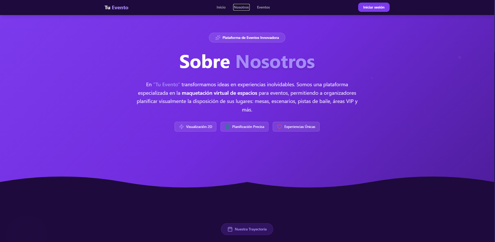

*Nota.* Información institucional del proyecto y del equipo.

#### Eventos

Muestra los eventos publicados y vigentes hasta la fecha.

**Figura 3**

*Listado público de eventos*

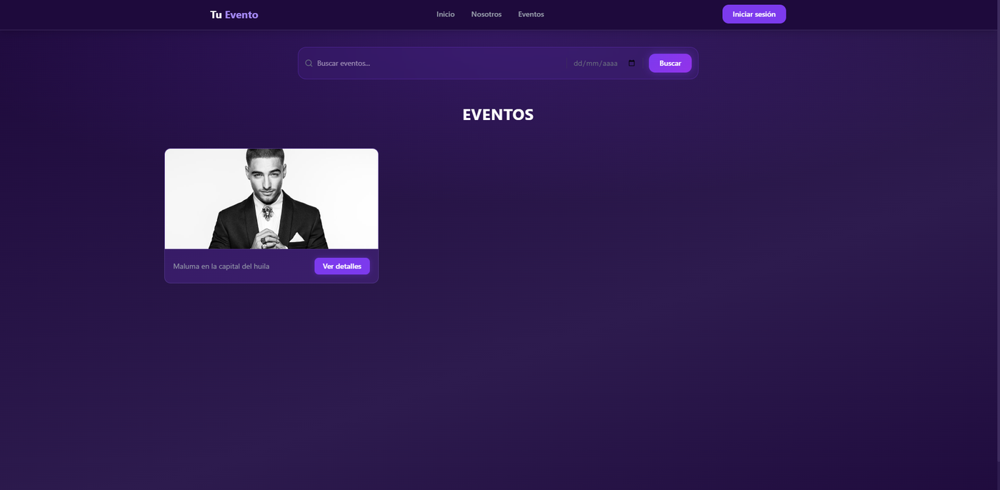

*Nota.* Eventos vigentes visibles antes de iniciar sesión.

### Inicio de sesión

Para acceder, presione el botón "Iniciar Sesión" ubicado arriba a la derecha. Allí puede elegir el método de ingreso: un correo ya registrado en la plataforma o una red social (Google o Facebook).

1. Abra Tu Evento desde un navegador actualizado.
2. Presione el botón "Iniciar Sesión" (parte superior derecha).
3. Elija el método de ingreso: correo registrado, Google o Facebook.
4. Ingrese sus datos o autorice el acceso y confirme.

**Figura 4**

*Pantalla de inicio de sesión*

*Nota.* Métodos disponibles: correo registrado, Google y Facebook.

### Términos y condiciones

Al registrarse e iniciar sesión, el usuario acepta los términos y condiciones de Tu Evento, por lo que se recomienda leerlos detenidamente. Pueden consultarse al final de la pantalla de inicio de sesión, en el texto "Al iniciar sesión, aceptas nuestros Términos y condiciones".

**Figura 5**

*Términos y condiciones de uso*

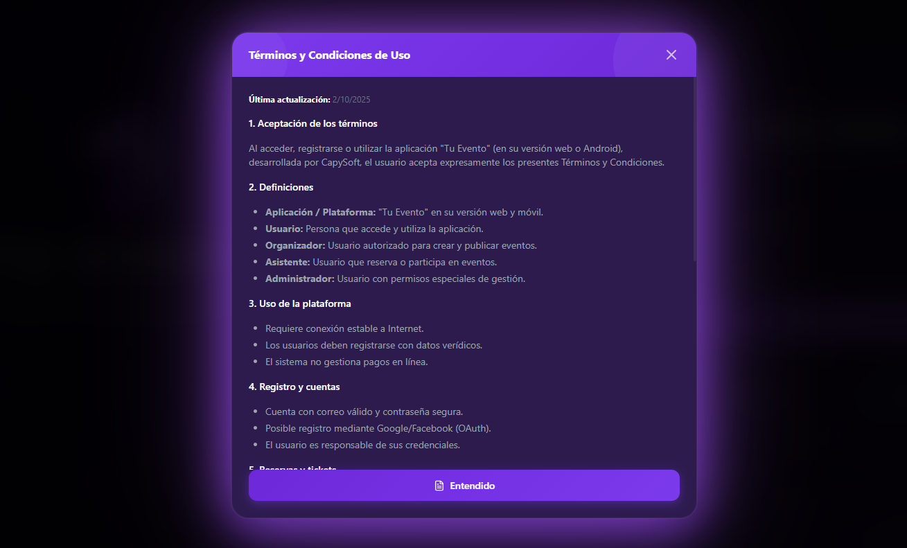

*Nota.* Ventana con los términos y condiciones; se cierra con el botón "Entendido".

En el pie de página del sitio, en la sección Legal, también se pueden consultar los Términos de uso y la Política de privacidad, que explica cómo se tratan los datos personales y cómo solicitar su eliminación.

### Registro de cuenta

Si es la primera vez que ingresa, deberá registrar un correo electrónico Gmail. Puede acceder al registro desde "Iniciar Sesión", debajo de los iconos de Google y Facebook, en el texto "¿No tienes una cuenta aún? Haz clic aquí".

1. En la pantalla de inicio de sesión, haga clic en "¿No tienes una cuenta aún? Haz clic aquí".
2. Complete el formulario con la información solicitada (Figura 6).
3. Cree su contraseña cumpliendo los estándares de la plataforma y confírmela.
4. Presione "Registrarse". Aparecerá el mensaje "¡Registro exitoso!" (Figura 7); continúe con el botón "Continuar a Verificación".
5. Revise su correo: recibirá un mensaje con el código de verificación (Figura 8).

**Figura 6**

*Formulario de registro*

*Nota.* Formulario con los datos solicitados para crear la cuenta.

**Figura 7**

*Registro exitoso*

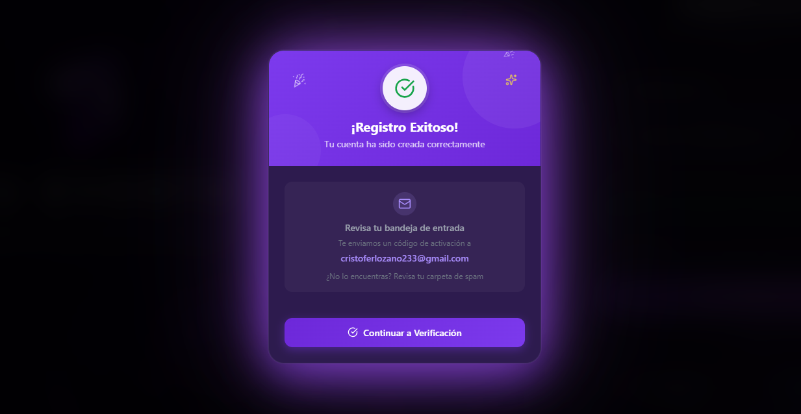

*Nota.* Mensaje que confirma la creación de la cuenta e indica el correo al que se envió el código.

**Figura 8**

*Correo de activación de la cuenta*

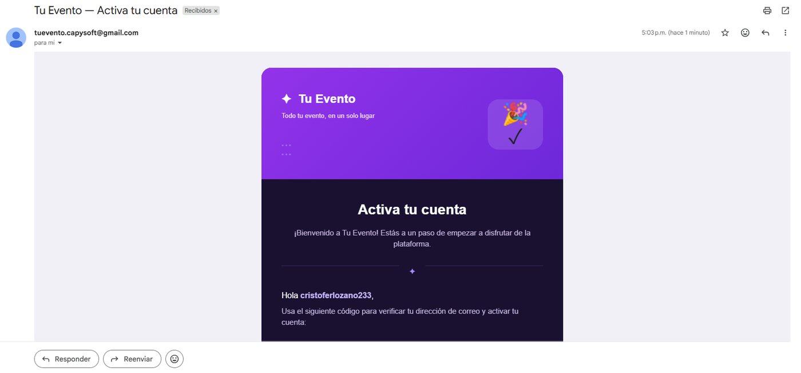

*Nota.* Correo electrónico que llega a la bandeja del usuario registrado, con el código de verificación.

Durante el registro, el formulario solicita los datos de la cuenta y una contraseña, que debe escribirse dos veces (contraseña y confirmación). Si la contraseña no cumple los requisitos de seguridad o no coincide con su confirmación, el formulario muestra un aviso indicando qué debe corregirse antes de continuar.

### Código de verificación

1. Abra el correo recibido y copie el código.
2. Escriba el código en el campo "Código de activación" de la pantalla Verificar Cuenta.
3. Presione "Verificar". Si no recibió el correo, use "Reenviar código".
4. Al confirmarse, aparece el mensaje "¡Cuenta Activada!"; presione "Continuar al Login".

**Figura 9**

*Pantalla de verificación de cuenta*

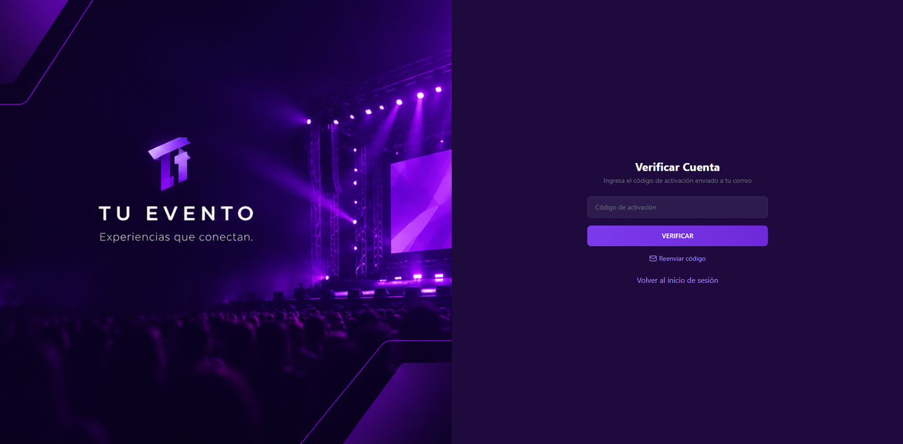

*Nota.* Campo donde se ingresa el código enviado al correo, con las opciones "Reenviar código" y "Volver al inicio de sesión".

**Figura 10**

*Cuenta activada*

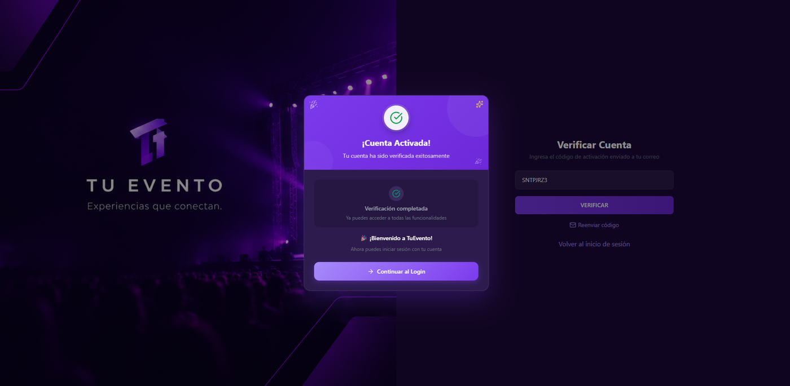

*Nota.* Mensaje que confirma que la verificación fue completada.

Al completar este paso, la cuenta como usuario asistente queda creada y el usuario puede acceder a más funcionalidades de la plataforma.

### Recuperación de contraseña

Si ya tiene una cuenta pero olvidó su contraseña, puede recuperarla desde "Iniciar Sesión", justo debajo del cuadro de texto de la contraseña, en el texto "¿No recuerdas tu contraseña? Recupérala."

1. En la pantalla de inicio de sesión, haga clic en "¿No recuerdas tu contraseña? Recupérala."
2. Ingrese su correo electrónico y presione "Enviar" (Figura 11).
3. Revise su correo: recibirá un código necesario para continuar.
4. En la pantalla "Restablecer contraseña", ingrese el código, escriba la nueva contraseña y confírmela (Figura 12).

**Figura 11**

*Olvidé mi contraseña*

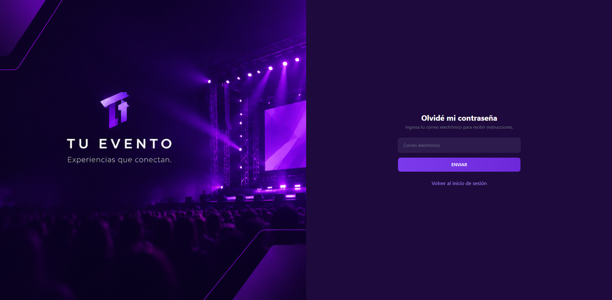

*Nota.* Pantalla donde se ingresa el correo para recibir el código de recuperación.

**Figura 12**

*Restablecer contraseña*

*Nota.* Pantalla para ingresar el código, la nueva contraseña y su confirmación.

Una vez completado, el usuario vuelve a tener acceso a su cuenta. La contraseña puede cambiarse varias veces, aunque se recomienda recordarla.

## Usuario Web (Asistente)

### Flujo general del rol

El asistente crea su cuenta o inicia sesión y explora los eventos publicados. Al elegir uno, consulta su detalle, indica cuántas sillas necesita y las selecciona en el mapa del recinto. Luego confirma la compra y paga mediante el método disponible (código QR, a través de la pasarela simulada). Cuando el pago se aprueba, recibe sus tickets. También puede dejar comentarios en los eventos y solicitar el rol de organizador si desea crear sus propios eventos.

### Descripción de la interfaz

Una vez iniciada la sesión, la barra superior muestra las secciones Inicio, Nosotros, Eventos y Mis Eventos, además del ícono de notificaciones y el menú del usuario.

Cada elemento de la barra superior cumple una función: Inicio, Nosotros y Eventos permiten moverse entre las secciones públicas; Mis Eventos reúne los eventos y los tickets del usuario; la campana muestra las notificaciones de la cuenta; y el menú del usuario da acceso a las opciones de la cuenta, entre ellas cerrar la sesión.

### Módulos y funcionalidades

#### Exploración, búsqueda y filtrado de eventos

La sección Eventos lista los eventos publicados y vigentes. Desde ella puede buscar un evento y abrir su detalle.

1. Ingrese a "Eventos" desde la barra superior.
2. Escriba el nombre del evento en la barra de búsqueda, aplique los filtros disponibles y presione "Buscar".
3. En la tarjeta del evento elegido, presione "Ver detalles".

**Figura 13**

*Búsqueda y listado de eventos con sesión iniciada*

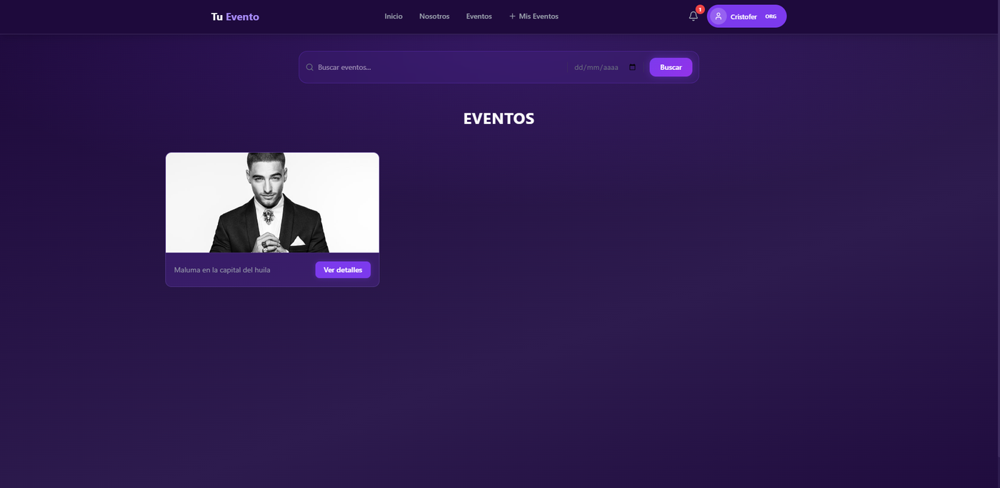

*Nota.* Barra de búsqueda y tarjetas de los eventos publicados.

Para buscar un evento, utilice la barra de búsqueda ubicada sobre el listado; los eventos publicados se muestran en tarjetas con sus datos principales y el botón "Ver detalles".

#### Detalle del evento y compra de tiquetes

Para comprar, el asistente elige el número de sillas, las selecciona por sección en el mapa del recinto y paga. Las sillas quedan reservadas mientras se procesa el pago.

1. Desde "Ver detalles", ingrese a la selección de sillas ("Selecciona tus sillas").
2. Indique cuántas sillas desea con los botones de más y menos.
3. Elija la sección (General, VIP, Palco o Tribuna; cada una tiene su precio) y seleccione las sillas en el mapa. Se agregan a "Tu Carrito" junto con el total.
4. Presione "Continuar al Pago".
5. En "Confirmar compra", revise las sillas y el total, elija el método de pago (Código QR) y presione "Pagar".
6. Cuando el pago se apruebe, aparece "¡Pago aprobado!" con sus tickets. Presione "Ver más eventos" para seguir explorando.

**Figura 14**

*Detalle del evento*

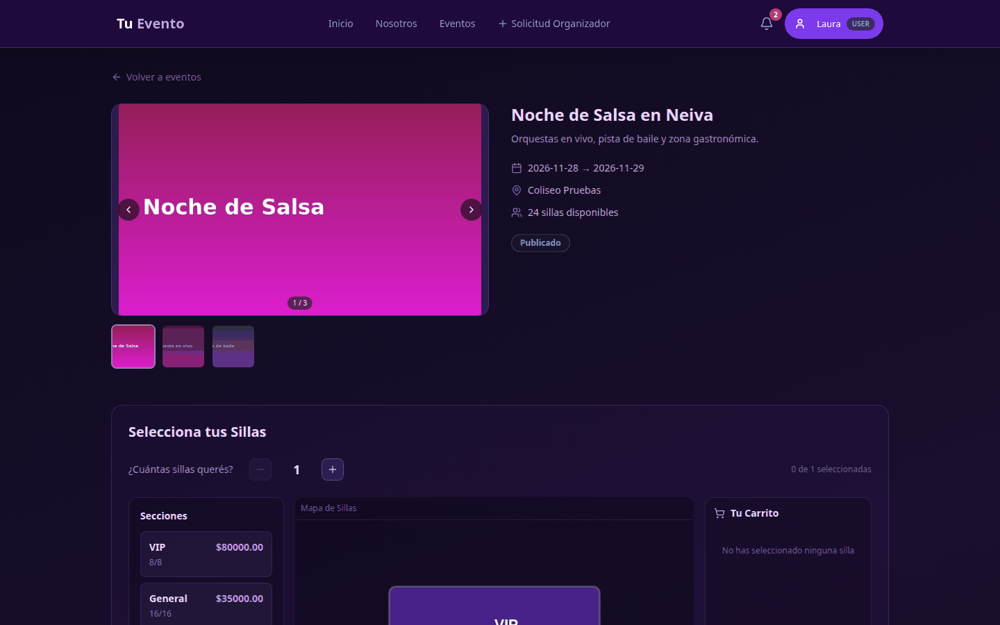

*Nota.* Información del evento previa a la selección de sillas.

**Figura 15**

*Selección de sillas*

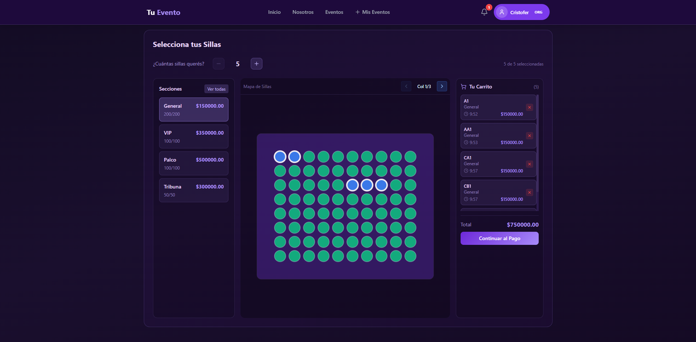

*Nota.* Mapa del recinto con las secciones, las sillas elegidas y el carrito de compra.

**Figura 16**

*Confirmación de compra*

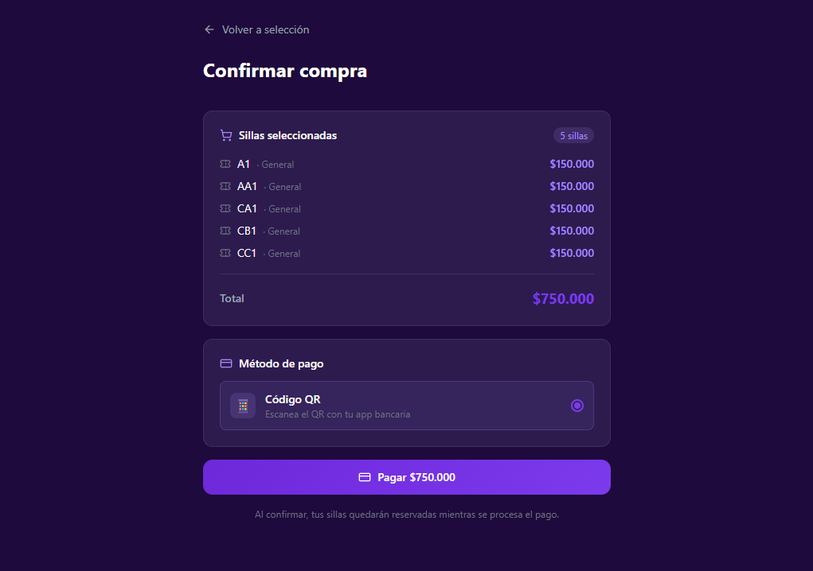

*Nota.* Resumen de sillas, total y método de pago (código QR) en la pasarela simulada.

**Figura 17**

*Pago aprobado y tickets*

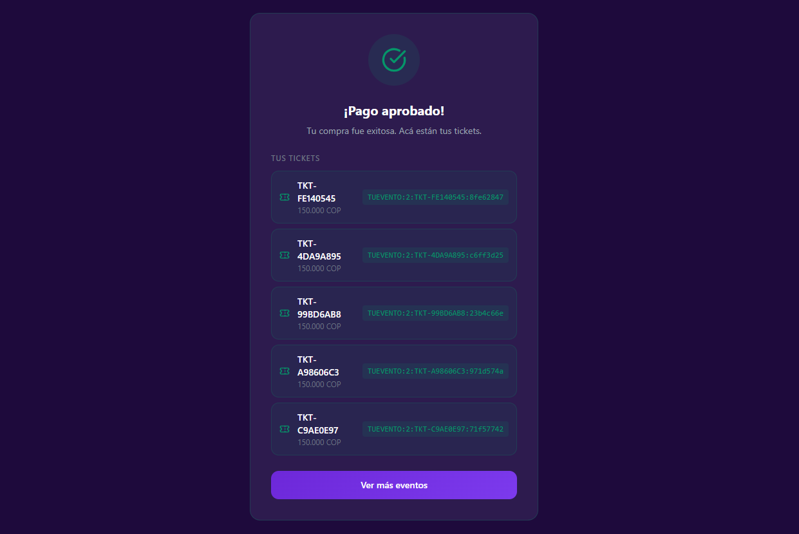

*Nota.* Pantalla de confirmación con los tickets generados para la compra.

Mientras el pago se procesa, las sillas quedan reservadas a nombre del usuario y junto a cada una se muestra un cronómetro con el tiempo restante (la reserva dura hasta 10 minutos). Si el tiempo termina, o si el pago es rechazado o cancelado, las sillas pueden volver a quedar disponibles para otros usuarios y será necesario seleccionarlas de nuevo en el mapa del recinto.

Si tiene saldo en su cartera, en "Confirmar compra" puede elegir "Usar cartera" para descontarlo del total; el valor restante se paga por la pasarela (véase la sección Cartera).

#### Comentarios y reseñas

Cada evento tiene una sección de comentarios donde los usuarios escriben su opinión, califican con estrellas y responden a otros comentarios. Los comentarios del organizador se identifican con la etiqueta "Organizador".

1. Ubíquese en la sección "Comentarios" del evento.
2. Escriba su comentario en el cuadro de texto y presione el botón de enviar.
3. Para contestar a otro comentario, presione "Responder".

**Figura 18**

*Comentarios del evento*

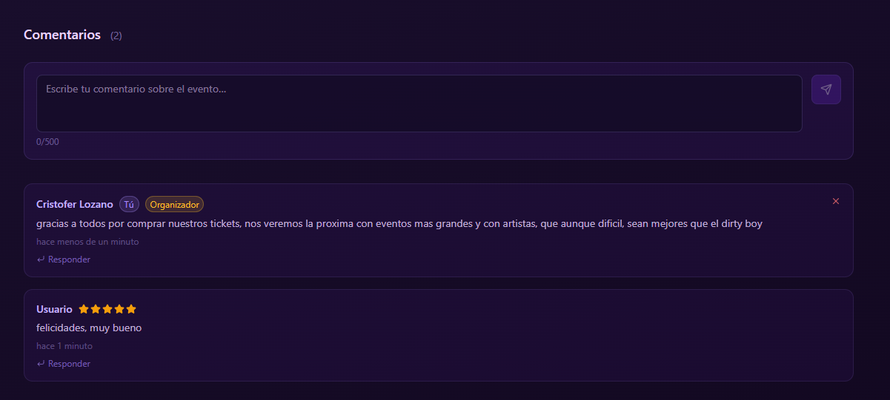

*Nota.* Comentarios con calificación en estrellas, respuestas y etiqueta de organizador.

La calificación va de 1 a 5 estrellas y se asigna al enviar el comentario. Para comentar o responder es necesario haber iniciado sesión, y cada usuario puede editar o eliminar sus propios comentarios.

#### Solicitud para ser organizador

Un asistente puede pedir el rol de organizador enviando un documento de identidad. La solicitud la revisa el administrador.

1. Presione "Solicitud Organizador" en la barra superior.
2. Revise los documentos requeridos. Obligatorios: cédula de ciudadanía o ID, pasaporte válido (extranjeros) o documento de identidad oficial. Opcionales: certificado de antecedentes, certificados de cursos y referencias laborales.
3. Arrastre el archivo al recuadro o presione "Seleccionar archivo".
4. Presione "Enviar solicitud".
5. La pantalla pasa a "Tu solicitud está en revisión". El equipo procesa la información en un plazo de 24 a 48 horas hábiles.

**Figura 19**

*Solicitud de organizador*

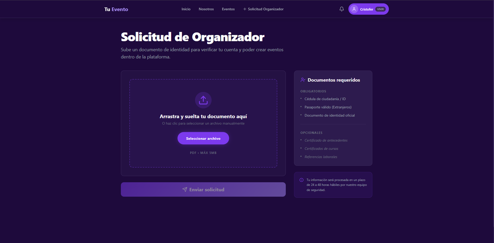

*Nota.* Pantalla para cargar el documento de identidad y lista de documentos requeridos.

**Figura 20**

*Solicitud en revisión*

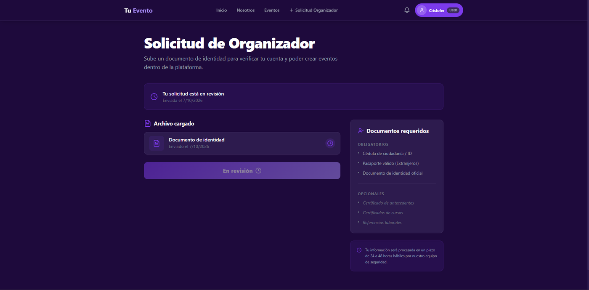

*Nota.* Estado de la solicitud después de enviarla, con el archivo cargado.

Cuando el administrador revisa la solicitud, su estado se actualiza en la pantalla de solicitud (por ejemplo, Aprobada o Rechazada). Si fue aprobada, el usuario pasa a tener el rol de organizador y en su barra superior aparece la opción "+ Crear Evento".

#### Módulos nuevos del asistente

#### Mis Eventos

Este módulo reúne los tickets de las compras realizadas por el asistente.

- Presione "Mis Eventos" en la barra superior.
- Consulte los tickets de sus compras.

En la versión web se consultan las compras y sus tickets. El código QR que se presenta en la entrada del evento se genera desde la aplicación móvil (véase el Manual de usuario de la aplicación móvil).

#### Cartera

La cartera muestra el saldo disponible del usuario y el historial de sus movimientos.

1. Abra el menú del usuario (arriba a la derecha) y elija "Cartera".
2. Consulte el saldo disponible y el historial de movimientos, con su fecha, estado y monto.
3. Para usar el saldo, presione "Usar saldo en una compra" o elija "Usar cartera" al confirmar una compra.

**Figura 21**

*Cartera del usuario*

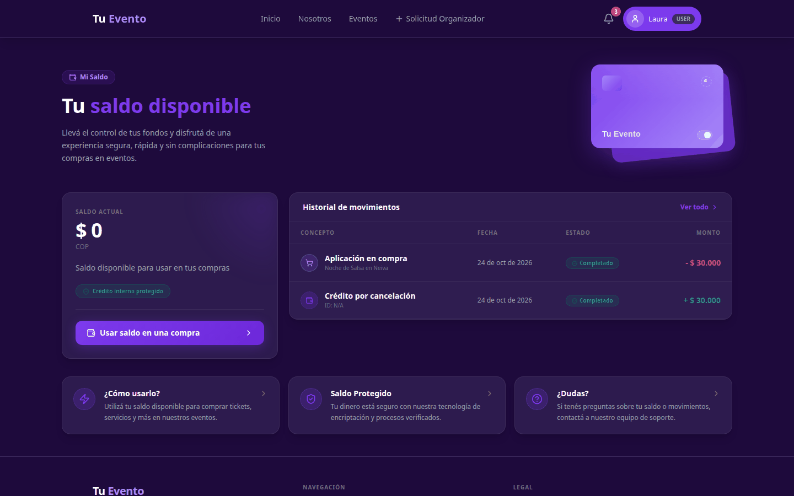

*Nota.* Saldo disponible e historial de movimientos (compras pagadas con la cartera y créditos recibidos).

Si un evento se cancela, el valor pagado por cada ticket se reembolsa como crédito en la cartera del comprador, incluida la parte pagada por la pasarela. Los tickets de ese evento quedan marcados como cancelados y ya no pueden usarse; el saldo acreditado puede usarse en compras futuras.

#### Notificaciones

El sistema avisa al usuario de los eventos relacionados con su cuenta mediante notificaciones.

- Presione el ícono de campana de la barra superior.
- Lea las notificaciones recibidas.

**Figura 22**

*Notificaciones*

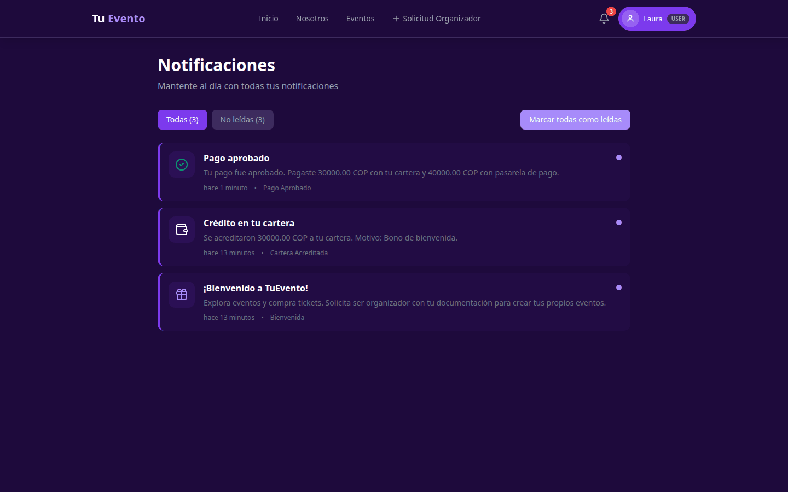

*Nota.* Notificaciones de la cuenta, con las pestañas "Todas" y "No leídas" y la opción "Marcar todas como leídas".

Las notificaciones informan, por ejemplo, sobre pagos aprobados, créditos en la cartera y cambios en las solicitudes. También se puede acceder a ellas desde la opción "Notificaciones" del menú del usuario.

#### Perfil, idioma y tema

El perfil reúne los datos personales del usuario y las preferencias de la plataforma.

1. Abra el menú del usuario y elija "Perfil".
2. En "Información Personal", edite su nombre completo y su biografía (hasta 255 caracteres) y presione "Guardar cambios".
3. En "Idioma Preferido", elija el idioma de la interfaz: español, inglés, francés o portugués.
4. En "Tema Visual", recorra los temas con las flechas y presione "Aplicar tema".

**Figura 23**

*Perfil del usuario*

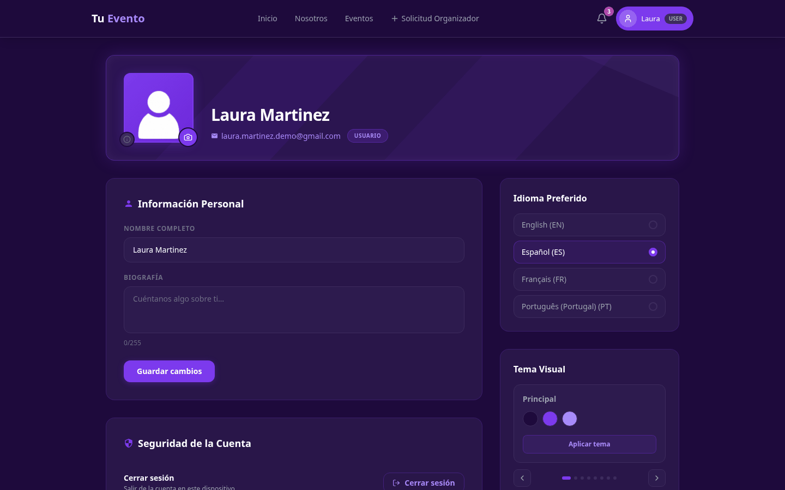

*Nota.* Información personal, idioma preferido, tema visual y seguridad de la cuenta.

En "Seguridad de la Cuenta" se cierra la sesión y se puede desactivar la cuenta; el sistema pide confirmar esta acción antes de aplicarla. Si el usuario ingresó por primera vez con Google o Facebook, la plataforma le pide completar los datos de su perfil antes de continuar.

## Usuario Organizador

### Flujo general del rol

Cuando el administrador aprueba su solicitud, el usuario ve en la barra de navegación la opción "+ Crear Evento". El organizador crea el evento en tres pasos (información general, sede e imágenes), diseña la distribución del recinto en el editor de layout y, desde Mis Eventos, envía el evento a revisión. El administrador lo revisa y decide si lo publica o lo rechaza.

### Descripción de la interfaz

**Figura 24**

*Interfaz principal del organizador*

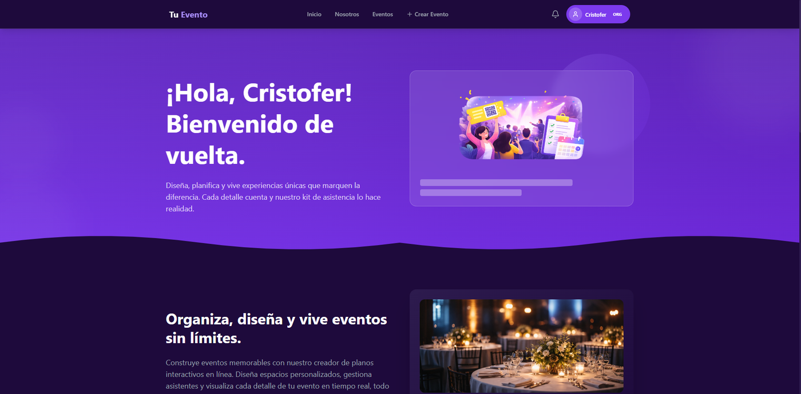

*Nota.* Cuando se ingresa como organizador aparece en la barra de navegación la opción "+ Crear Evento", que redirige al apartado de creación de eventos.

### Módulos y funcionalidades

#### Creación de eventos

La creación se divide en tres pasos guiados: Información general, Sede e Imágenes. Una barra de progreso muestra en qué paso está el organizador.

1. Presione "+ Crear Evento" en la barra de navegación.
2. Paso 1, Información general: escriba el nombre y la descripción, defina las fechas de inicio y fin, indique si el evento es público y seleccione categoría, departamento y ciudad. Presione "Siguiente".
3. Paso 2, Sede: seleccione una sede de la lista desplegable. Si la ciudad no tiene sedes, presione "Crear nueva sede", complete nombre, dirección, capacidad máxima y ubicación en el mapa, y presione "Registrar sede".
4. Con la sede seleccionada, presione "Crear evento".
5. Paso 3, Imágenes: presione "Seleccionar imágenes" y luego "Subir y continuar". Este paso es opcional: puede presionar "Omitir por ahora" y agregar las imágenes más tarde desde "Mis Eventos".

**Figura 25**

*Creación de evento, paso 1: información general*

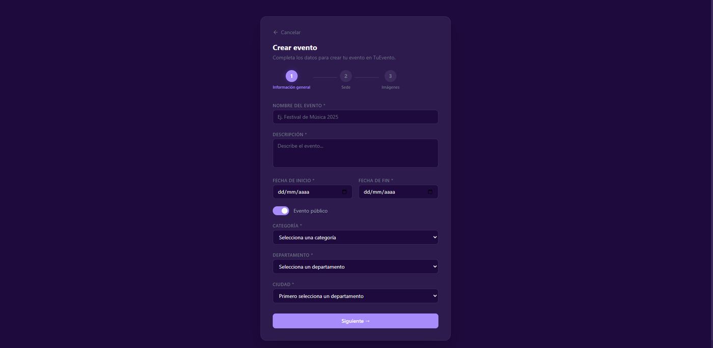

*Nota.* Formulario con los datos básicos del evento.

**Figura 26**

*Creación de evento, paso 2: ciudad sin sedes*

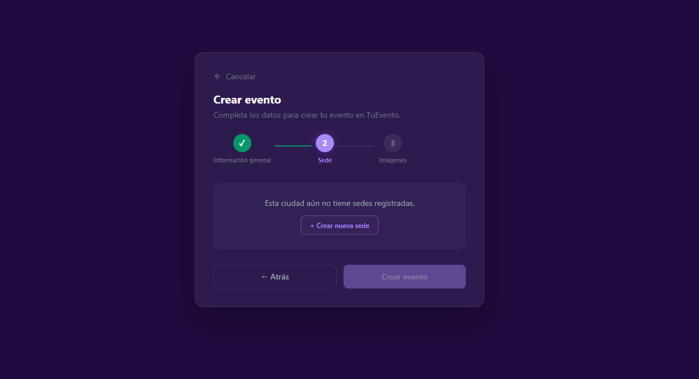

*Nota.* Cuando la ciudad no tiene sedes registradas, se ofrece el botón para crear una nueva.

**Figura 27**

*Registro de una nueva sede*

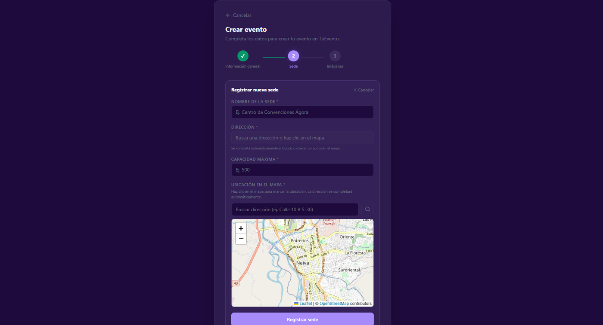

*Nota.* Formulario de la sede con su ubicación en el mapa.

**Figura 28**

*Selección de una sede existente*

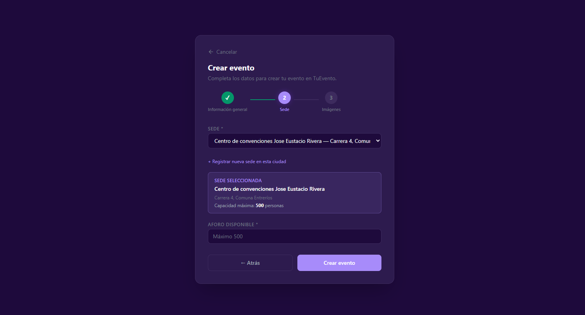

*Nota.* Cuando existen sedes, se listan en una barra desplegable y se muestra la capacidad de la sede elegida.

**Figura 29**

*Creación de evento, paso 3: imágenes*

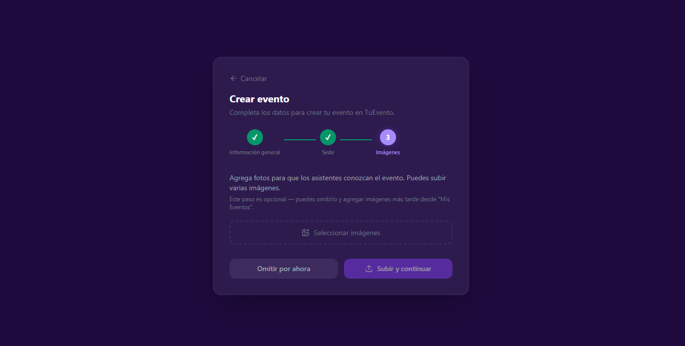

*Nota.* Carga opcional de imágenes del evento.

#### Edición de eventos

Para modificar un evento, ingrese a Mis Eventos y presione el ícono con forma de lápiz en las acciones del evento. En la ventana "Editar evento" puede cambiar el nombre, la descripción, las fechas de inicio y fin, las sillas disponibles y la categoría; luego presione "Guardar cambios". Un evento no puede editarse mientras está en revisión: primero debe retirarlo de revisión.

**Figura 30**

*Edición de un evento*

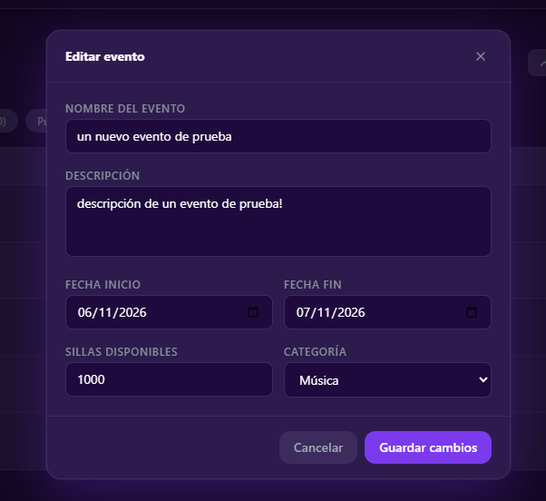

*Nota.* Ventana "Editar evento" con el nombre, la descripción, las fechas, las sillas disponibles y la categoría.

#### Maquetación del recinto y secciones

El editor de layout permite dibujar la distribución del recinto. A la izquierda están los elementos disponibles: las secciones (General, VIP, Palco y Tribuna) y la infraestructura (escenario, pantalla, pista de baile, entrada, salida, bar y baños). En el centro está el lienzo y a la derecha el listado "Secciones del mapa", donde se ven las propiedades de lo seleccionado. En la parte superior hay herramientas de zoom, deshacer, rehacer, limpiar y guardar.

1. Ingrese al editor de layout de su evento.
2. Arrastre las secciones al lienzo y ubíquelas según el recinto.
3. Agregue los elementos de infraestructura que necesite, como el escenario o las entradas.
4. Seleccione cada sección para ver sus propiedades en el panel derecho.
5. Presione "Guardar" para conservar la maquetación.

**Figura 31**

*Editor de layout con el lienzo vacío*

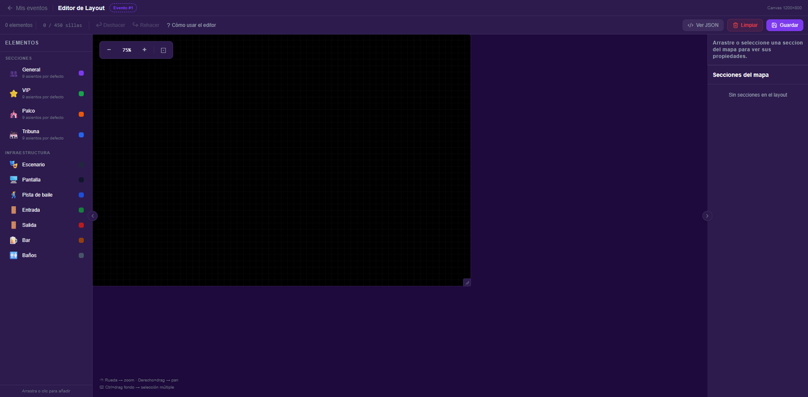

*Nota.* Punto de partida: paneles de elementos, lienzo y secciones del mapa.

**Figura 32**

*Maquetación del recinto terminada*

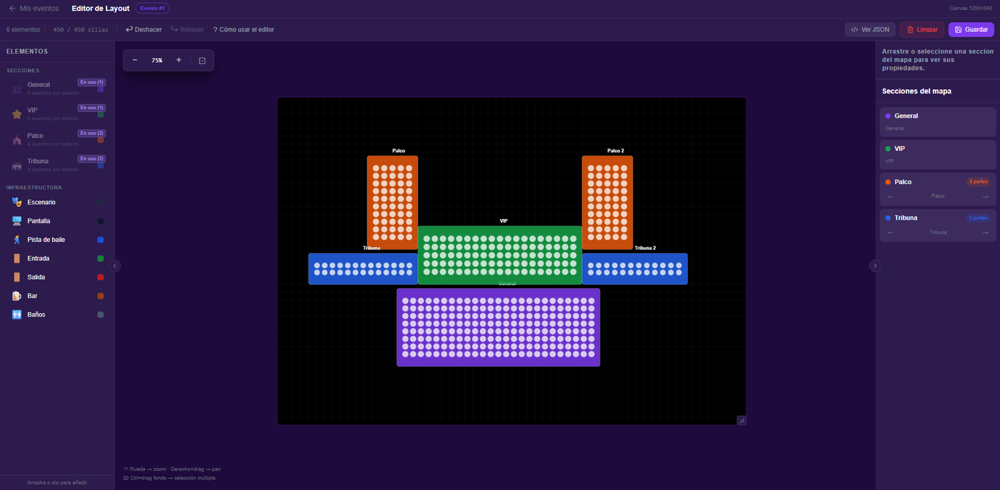

*Nota.* Ejemplo de recinto con secciones General, VIP, Palco y Tribuna distribuidas en el lienzo.

El botón "Cómo usar el editor" muestra la guía de uso del editor de recintos, y el botón "Ver JSON" muestra la estructura del plano diseñado en formato JSON.

#### Publicación de eventos

La publicación no es inmediata: el organizador envía el evento a revisión y el administrador decide si lo publica.

1. Ingrese a "Mis Eventos". Allí aparecen los eventos en los que trabaja, con su estado (por ejemplo, Borrador) y filtros por estado.
2. En la columna "Estado" del evento, despliegue la lista y elija la opción de publicar.
3. Confirme en la ventana "¿Enviar este evento a revisión?" presionando "Sí, enviar a revisión".

**Figura 33**

*Mis Eventos del organizador*

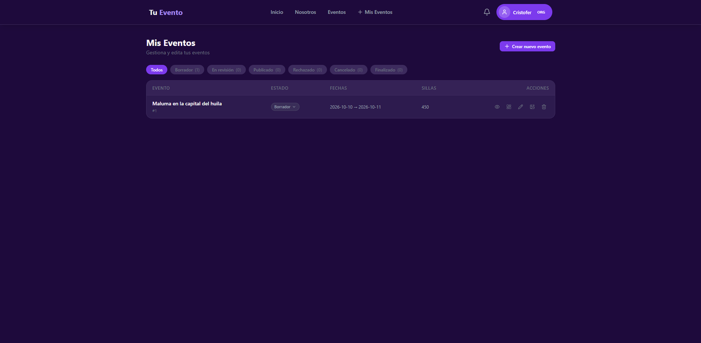

*Nota.* Este apartado muestra los eventos en los que el organizador está trabajando; se puede solicitar la publicación desde la columna "Estado", con la opción desplegable de publicar.

**Figura 34**

*Enviar un evento a revisión*

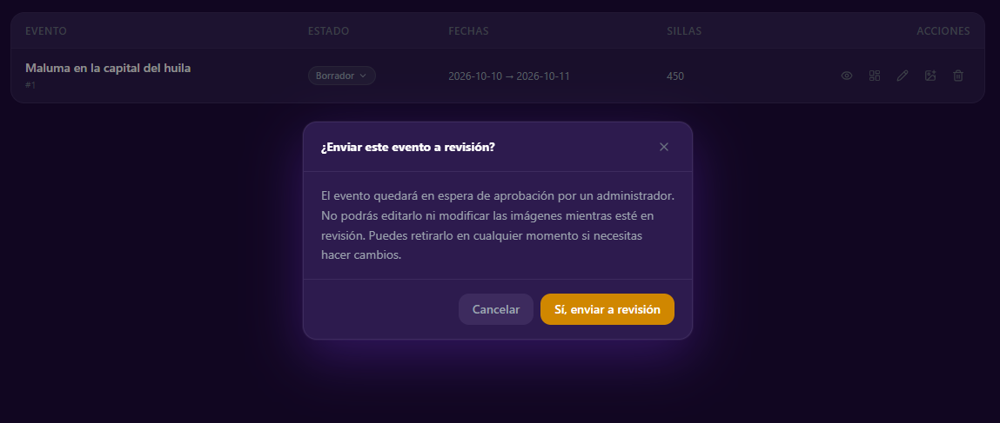

*Nota.* Mientras el evento está en revisión no se puede editar ni modificar sus imágenes; el organizador puede retirarlo en cualquier momento para hacer cambios.

Cuando el administrador publica el evento, este queda visible para los asistentes. Si lo rechaza, el evento no se publica y el organizador puede revisarlo, ajustarlo y volver a enviarlo a revisión. Mientras el evento está en revisión, el organizador puede retirarlo en cualquier momento.

#### Ganancias del organizador

El panel "Tus ganancias" resume lo recaudado por el organizador en sus eventos. Es de solo lectura: el cobro real lo gestiona la plataforma directamente.

1. Ingrese a "Mis Eventos".
2. Presione el botón "Mis ganancias", en la parte superior.
3. Revise los indicadores y el desglose por evento.

**Figura 35**

*Panel de ganancias del organizador*

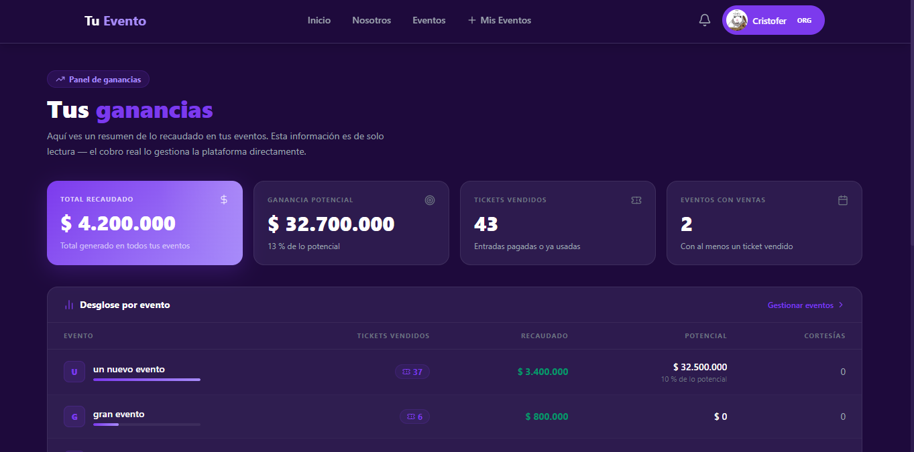

*Nota.* Indicadores de total recaudado, ganancia potencial, tickets vendidos y eventos con ventas, y desglose por evento.

Los indicadores muestran el **total recaudado** en todos los eventos, la **ganancia potencial** si se vendieran todas las sillas, los **tickets vendidos** y los **eventos con ventas**. El desglose por evento detalla los tickets vendidos, lo recaudado, el potencial y las cortesías de cada evento; desde allí, "Gestionar eventos" lleva de vuelta a Mis Eventos.

#### Módulos nuevos del organizador

El organizador dispone también de Mis Eventos, la cartera, las notificaciones y el perfil, que funcionan igual que para el asistente (véase la sección Módulos nuevos del asistente), además del panel de ganancias descrito en la sección anterior.

## Usuario Administrador

### Flujo general del rol

El administrador ingresa a un panel con menú lateral (Dashboard, Control Financiero, Eventos, Reportes, Reembolsos, Solicitudes, Usuarios, Categorías, Tipos de Sección y Traducciones). Revisa las solicitudes de los usuarios que quieren ser organizadores, verificando su documentación, revisa los eventos enviados a revisión para publicarlos o rechazarlos y administra los catálogos de la plataforma.

### Descripción de la interfaz

**Figura 36**

*Interfaz principal del administrador*

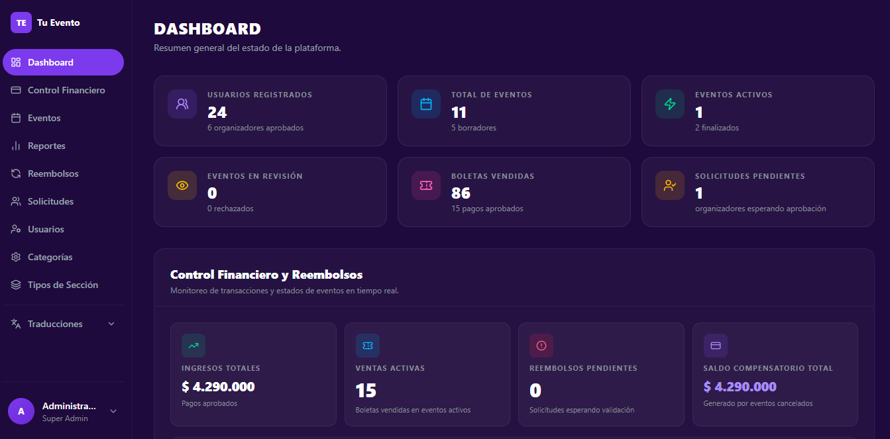

*Nota.* Panel de administración con el menú lateral de módulos.

El Dashboard es la pantalla inicial del panel de administración y resume la actividad de la plataforma: usuarios registrados, total de eventos, eventos activos, eventos en revisión, boletas vendidas y solicitudes pendientes. Debajo, el bloque "Control Financiero y Reembolsos" muestra los ingresos totales, las ventas activas, los reembolsos pendientes y el saldo compensatorio total, y al final aparece la actividad reciente. El menú lateral da acceso a los siguientes módulos:

- Dashboard: resumen general del panel.
- Control Financiero: seguimiento económico de la plataforma.
- Eventos: revisión y publicación de los eventos.
- Reportes: reportes de la plataforma.
- Reembolsos: gestión de los reembolsos de pagos.
- Solicitudes: revisión de las solicitudes para ser organizador.
- Usuarios: consulta de los usuarios registrados, sus roles y los organizadores.
- Categorías y Tipos de Sección: catálogos que usan los organizadores al crear y maquetar eventos.
- Traducciones: textos de eventos, categorías, tipos de sección, comentarios y perfiles en otros idiomas.

### Módulos y funcionalidades

#### Solicitudes de organizador

Este módulo lista las solicitudes enviadas por los usuarios que desean crear eventos. Permite filtrarlas por estado: Todas, Pendientes, Aprobadas y Rechazadas. La tabla muestra usuario, correo, documento, fecha, estado y acciones.

1. Presione "Solicitudes" en el menú lateral.
2. Filtre por estado, por ejemplo "Pendientes".
3. Abra la solicitud con el ícono de la columna "Acciones" y revise el documento enviado.
4. Apruebe o rechace la solicitud.

**Figura 37**

*Solicitudes de organizador*

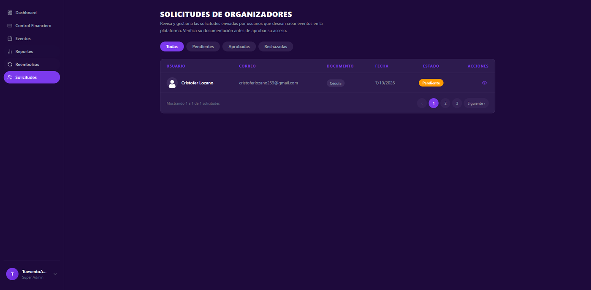

*Nota.* Listado de solicitudes con su estado y filtros.

Al abrir una solicitud, el administrador revisa el documento adjunto y decide con los botones para aprobarla o rechazarla. Después de la decisión, el estado de la solicitud se actualiza en el listado.

#### Publicación de eventos

Los eventos que los organizadores envían a revisión aparecen en "Eventos" con el estado "En revisión". El administrador revisa su información y decide si lo publica.

1. Presione "Eventos" en el menú lateral y filtre por "En revisión".
2. Abra el detalle del evento: modalidad, estado, estructura de secciones con capacidad y precios, organizador y boletas disponibles.
3. Presione "Publicar" para aprobarlo o "Rechazar" para devolverlo.

**Figura 38**

*Gestión de eventos*

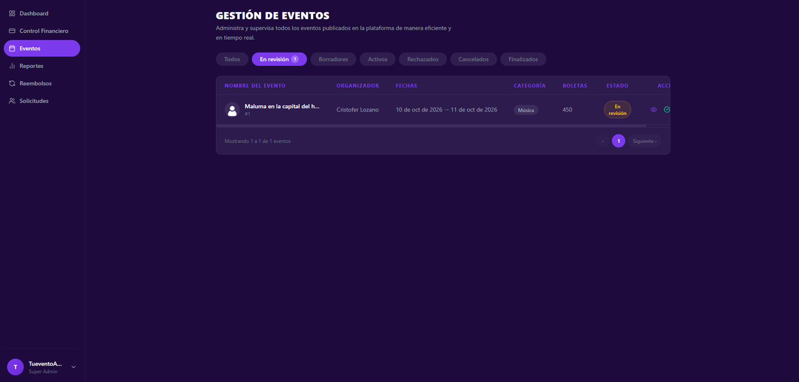

*Nota.* Listado de eventos de la plataforma, con filtros por estado como "En revisión".

**Figura 39**

*Aceptar la publicación de un evento*

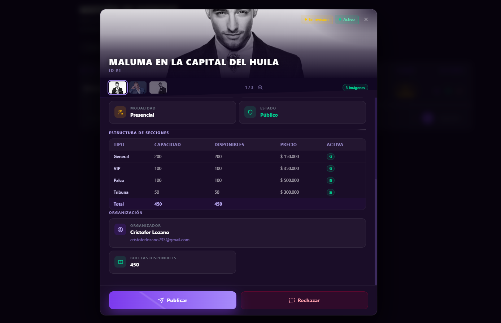

*Nota.* Detalle del evento en revisión con los botones "Publicar" y "Rechazar".

#### Módulos nuevos del administrador

Además de la revisión de solicitudes y eventos, el menú lateral incluye los siguientes módulos de gestión:

- Control Financiero: permite hacer seguimiento al movimiento económico de la plataforma.
- Reportes: reúne los reportes de la plataforma.
- Reembolsos: permite gestionar los reembolsos de los pagos realizados.
- Usuarios: permite consultar los usuarios, sus roles y los organizadores aprobados.
- Categorías: permite crear y editar las categorías con las que se clasifican los eventos.
- Tipos de Sección: permite gestionar los tipos de sección (por ejemplo, General, VIP, Palco o Tribuna) del editor de layout.
- Traducciones: permite revisar y ajustar las traducciones de eventos, categorías, tipos de sección, comentarios y perfiles.

## Mensajes de validación y errores frecuentes

La siguiente tabla reúne los mensajes que el sistema puede mostrar y cómo resolverlos.

**Tabla 3**

*Mensajes de validación y errores frecuentes*

| Situación | Mensaje mostrado | Causa | Solución |
|---|---|---|---|
| Código de verificación incorrecto o vencido | El sistema indica que el código no es válido o ha vencido. | El código se escribió con algún error o superó su tiempo de vigencia. | Revise el código del correo recibido; si venció, solicite uno nuevo. |
| Contraseña que no cumple los estándares | El formulario indica que la contraseña no cumple los requisitos de seguridad. | La contraseña no reúne todos los requisitos solicitados. | Ajuste la contraseña según lo que indica el formulario y vuelva a intentarlo. |
| Contraseña y confirmación no coinciden | El formulario indica que la contraseña y su confirmación no coinciden. | Los dos campos se escribieron de forma diferente. | Escriba la contraseña y su confirmación de nuevo, de forma idéntica. |
| Pago rechazado o cancelado | La pasarela informa que el pago fue rechazado o cancelado. | El pago no fue aprobado en la pasarela o el usuario lo canceló. | Repita el proceso de compra desde la selección de sillas. |
| Sillas ya no disponibles | El sistema informa que alguna de las sillas ya no está disponible. | Otro usuario reservó o compró la silla antes de finalizar la compra. | Vuelva al mapa del recinto y elija otras sillas. |
| Archivo no válido en la solicitud de organizador | El sistema indica que el archivo no es válido. | El archivo no tiene un formato admitido o no puede leerse. | Cargue de nuevo el documento de identidad en un archivo legible y de formato admitido. |
| Evento cancelado | El ticket aparece como cancelado y no puede usarse. | El organizador o el administrador canceló el evento. | Revise su cartera: el valor pagado se reembolsa como crédito. |

## Recomendaciones de uso

- Utilice un navegador actualizado y una conexión estable a internet.
- Use un correo Gmail al que tenga acceso, pues allí recibirá los códigos de verificación.
- Lea los términos y condiciones antes de registrarse.
- Cree una contraseña que pueda recordar; si la olvida, puede recuperarla desde el inicio de sesión.
- Cierre su sesión al terminar si usa un equipo compartido.
- Asistente: complete el pago sin demora, pues las sillas solo quedan reservadas mientras se procesa.
- Organizador: revise los datos, la sede y las imágenes antes de enviar el evento a revisión, ya que no podrá editarlo mientras esté en revisión.
- Administrador: verifique la documentación del solicitante y la información del evento antes de aprobar.

## Glosario

**Tabla 4**

*Glosario de términos*

| Término | Definición |
|---|---|
| Administrador | Usuario encargado de supervisar la plataforma, revisar las solicitudes de organizador y aprobar o rechazar la publicación de eventos. |
| Asistente | Usuario que se registra y participa en eventos publicados en la plataforma. |
| Código de verificación | Número que el sistema envía al correo para confirmar que la cuenta o el cambio de contraseña es del usuario. |
| Código QR | Imagen que se escanea con la aplicación del banco para realizar un pago. |
| Evento | Actividad creada por un organizador a la que los asistentes pueden registrarse. |
| Layout | Plano del recinto que el organizador dibuja en el editor, con sus secciones y elementos. |
| Maquetación | Proceso de diseño visual de la distribución de un espacio o evento (secciones, capacidad y ubicación de asistentes). |
| Mensaje de validación | Texto que muestra el sistema para indicar errores o confirmar acciones realizadas por el usuario. |
| Microservicio | Programa pequeño e independiente que cumple una función específica dentro del sistema, como procesar los pagos simulados. |
| Navegador | Programa para abrir sitios web, como Chrome, Edge o Firefox. |
| Organizador | Usuario habilitado para crear, maquetar y publicar eventos. |
| Pago simulado | Proceso de pago que reproduce el funcionamiento de una pasarela real sin conectarse a ella. |
| Pasarela de pagos | Servicio que procesa los pagos en línea. En esta versión, Tu Evento usa una pasarela simulada propia; Wompi (s. f.) es la pasarela real prevista. |
| Rol | Perfil que determina las funcionalidades disponibles para un usuario dentro del sistema (asistente, organizador o administrador). |
| Sección | Área definida dentro de la maquetación de un evento (por ejemplo, VIP, General, Palco, Tribuna). |
| Sede | Lugar físico donde se realiza un evento, con su dirección, ubicación en el mapa y capacidad máxima. |
| Sesión | Periodo de tiempo en el que un usuario permanece autenticado dentro de la plataforma. |
| Solicitud de organizador | Petición realizada por un usuario para obtener el rol de organizador, sujeta a aprobación del administrador. |
| Ticket | Comprobante digital de la compra de una silla para un evento. |
| Cartera | Módulo que muestra el saldo disponible del usuario y el historial de sus movimientos. |
| Reembolso | Devolución del dinero de un pago ya realizado, gestionada desde el panel del administrador. |
| Dashboard | Pantalla inicial del panel de administración, que resume la actividad de la plataforma. |
| Notificación | Aviso que el sistema muestra al usuario, mediante el ícono de campana, sobre eventos relacionados con su cuenta. |
| Ganancias | Panel del organizador que resume lo recaudado y lo vendido en sus eventos. |
| Tema visual | Combinación de colores de la interfaz que cada usuario puede elegir desde su perfil. |
| Traducción | Versión en otro idioma de los textos creados en la plataforma, como eventos o categorías. |

## Referencias

Santos Ortiz, J., y Lozano Contreras, C. D. (2026a). *TuEvento: Manual de instalación* (Versión 1.0). CapySoft.

Santos Ortiz, J., y Lozano Contreras, C. D. (2026b). *TuEvento: Manual técnico*. CapySoft.

Santos Ortiz, J., y Lozano Contreras, C. D. (2026c). *TuEvento: Manual de usuario de la aplicación móvil* (Versión 1.0). CapySoft.

Wompi. (s. f.). *Documentación de Wompi*. https://docs.wompi.co/

---

<!--
id: TE-0159
title: "Manual de usuario — aplicación móvil"
lang: es
source: Manual_Usuario_Movil_v1.0.docx (versión 1.0; fuente editable entregada en ADSO-3145556, 04-final-delivery/10-your-event/08-manuals)
source_sha256: 1e672afda2270bb2e16a549e93d060608cad07eb89b73de27782f414e36c38d1
conversion: "conversor propio desde el XML del DOCX (Python 3.13); con revisión manual"
converted_on: 2026-11-05
fidelity: completa
losses:
  - "Presentación de Word adaptada a Markdown: la tabla de contenido automática, los saltos de página y el encabezado con el número de página no se reproducen."
status: revisado
reviewed_by: "Cristofer David Lozano Contreras"
-->

# Manual de usuario — aplicación móvil

**Tu Evento – Capysoft**

**Manual de Usuario aplicación móvil**

**Versión 1.0**

Desarrolladores de Capysoft:

Cristofer David Lozano Contreras

Jhampier Santos Ortiz

Análisis y Desarrollo de Software

Ficha: 3145556

Instructora: Karol Daniela Correa

Servicio Nacional de Aprendizaje – SENA

CIES – Regional Huila

5 de noviembre de 2026

## Control de versiones

A continuación, se presenta el historial de cambios realizados sobre este documento.

**Tabla 1**

*Historial de cambios del manual*

| Versión | Fecha | Descripción del cambio | Responsable |
|---|---|---|---|
| 1.0 | 05/11/2026 | Creación del manual de usuario de la aplicación móvil de "Tu Evento": instalación, acceso, funcionalidades por rol, mensajes frecuentes y evidencia de funcionamiento en iOS. | Cristofer David Lozano Contreras |

## Introducción

El presente manual de usuario describe de forma clara y detallada el uso de la aplicación móvil de "Tu Evento", desarrollada por Capysoft. La aplicación complementa la plataforma web: permite a los asistentes explorar eventos, comprar entradas y presentarlas en la puerta del evento mediante un código QR, y permite a los organizadores validar esas entradas con la cámara del teléfono.

La creación, la maquetación y la publicación de eventos se realizan desde la plataforma web y se describen en el Manual de usuario web (Santos Ortiz y Lozano Contreras, 2026c). Los términos técnicos usados en este documento se explican en el Glosario, al final del manual.

## Objetivo

Explicar paso a paso cómo instalar la aplicación móvil de "Tu Evento" y cómo usar sus funcionalidades según el rol del usuario (asistente, organizador o administrador), de modo que cualquier persona pueda utilizarla de forma autónoma, sin conocimientos técnicos ni asistencia directa del equipo desarrollador.

## Alcance

Este manual cubre:

- La descarga e instalación de la aplicación en dispositivos Android.
- El registro, el inicio de sesión y la recuperación de la contraseña desde la aplicación.
- La exploración de eventos, la selección de sillas y la compra de entradas.
- La consulta de las entradas compradas y la generación de su código QR.
- La cartera, las notificaciones y el perfil del usuario (idioma y tema).
- La validación de entradas por parte del organizador.
- El panel de administración disponible en la aplicación.
- La evidencia de funcionamiento de la aplicación en iOS.

Este manual no cubre:

- La creación, edición, maquetación y publicación de eventos, que se realizan desde la plataforma web (véase el Manual de usuario web; Santos Ortiz y Lozano Contreras, 2026c).
- La instalación de servidores o el despliegue del sistema (véase el Manual de instalación; Santos Ortiz y Lozano Contreras, 2026a).
- Aspectos técnicos de programación, arquitectura o base de datos (véase el Manual técnico; Santos Ortiz y Lozano Contreras, 2026b).
- La publicación de la aplicación en las tiendas de aplicaciones (Google Play o App Store).

## Descripción general de la aplicación

### Presentación de la aplicación

La aplicación móvil de "Tu Evento" usa la misma cuenta y la misma información que la plataforma web: los eventos, las compras, la cartera y las notificaciones se sincronizan entre ambas. Su barra inferior tiene tres accesos: Inicio, Eventos (botón central) y Perfil. Desde Inicio, los accesos rápidos llevan a Buscar eventos, Mis tickets, Mi billetera y Notificaciones.

Nota sobre los pagos: al igual que en la versión web, el pago de las entradas se realiza de forma simulada mediante un microservicio desarrollado por el equipo de Capysoft, que reproduce el flujo de la pasarela Wompi (Wompi, s. f.).

### Requisitos de uso

- Un teléfono Android con conexión estable a internet.
- Espacio libre para instalar la aplicación (el instalador ocupa cerca de 165 MB).
- Permiso para instalar aplicaciones de origen desconocido, ya que la aplicación se distribuye como archivo APK.
- Permiso de cámara, solo para el organizador que valida entradas.
- Un correo Gmail al que tenga acceso, para recibir los códigos de verificación.

### Roles de usuario

La aplicación respeta los mismos roles de la plataforma web, como se resume en la Tabla 2.

**Tabla 2**

*Roles de usuario en la aplicación móvil*

| Rol | Descripción | Funcionalidades en la aplicación |
|---|---|---|
| Asistente | Usuario que se registra y participa en los eventos publicados. | Explorar eventos, elegir sillas, comprar entradas, mostrar el QR de sus entradas, usar la cartera y gestionar su perfil. |
| Organizador | Usuario habilitado para crear eventos (desde la web). | Todo lo del asistente, más la validación de las entradas de sus eventos con la cámara. |
| Administrador | Usuario que supervisa la plataforma. | Panel de administración con los mismos módulos de la versión web. |

*Nota.* El rol de organizador requiere la aprobación del administrador, que se solicita desde la plataforma web.

## Instalación de la aplicación

La aplicación se distribuye como un archivo de instalación APK que se descarga desde el sitio web de "Tu Evento".

1. Desde el navegador del teléfono, ingrese a tuevento-capysoft.tech.
2. Abra la opción de descarga de la aplicación y presione "Descargar APK" (Figura 1).
3. Cuando termine la descarga, abra el archivo desde la carpeta Descargas del teléfono.
4. Si el teléfono lo solicita, permita instalar aplicaciones de origen desconocido para el navegador.
5. Presione "Instalar" en la ventana "¿Deseas instalar esta app?" (Figura 2).
6. Al terminar, abra la aplicación desde el ícono de TuEvento.

**Figura 1**

*Descarga de la aplicación*

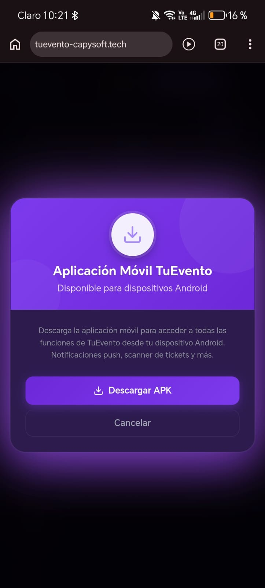

*Nota.* Ventana "Aplicación Móvil TuEvento" del sitio web, con el botón "Descargar APK".

**Figura 2**

*Instalación del archivo APK*

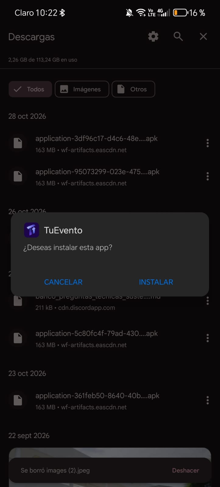

*Nota.* Confirmación de Android para instalar la aplicación descargada.

Android puede mostrar una advertencia porque la aplicación no proviene de Google Play. Es un comportamiento normal para las aplicaciones que se instalan desde un archivo APK.

## Acceso a la aplicación

### Inicio de sesión

Al abrir la aplicación sin una sesión activa se muestra la pantalla "Iniciar Sesión". El botón con la bandera, arriba a la derecha, permite cambiar el idioma de la aplicación.

1. Escriba su correo electrónico y su contraseña.
2. Presione "Iniciar Sesión". También puede ingresar con "Iniciar sesión con Google".
3. Si olvidó su contraseña, presione "¿No recuerdas tu contraseña?" y siga los pasos: ingrese su correo, escriba el código que recibirá y defina la nueva contraseña.

**Figura 3**

*Inicio de sesión*

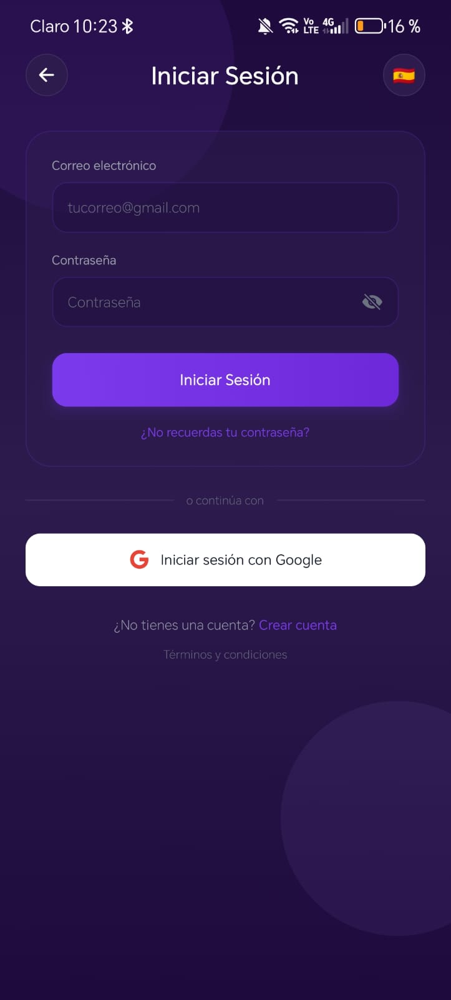

*Nota.* Ingreso con correo y contraseña o con Google, y enlaces para recuperar la contraseña y crear una cuenta.

Al iniciar sesión o crear una cuenta, el usuario acepta los Términos y condiciones de "Tu Evento", que pueden consultarse desde el enlace ubicado al final de la pantalla.

### Registro de cuenta

1. En la pantalla de inicio de sesión, presione "Crear cuenta".
2. Escriba su nombre completo, su correo electrónico y una contraseña de mínimo 8 caracteres que incluya mayúsculas y números.
3. Presione "Crear cuenta".
4. Revise su correo, copie el código de activación y escríbalo en la pantalla de verificación para activar la cuenta. Si no lo recibió, use "Reenviar correo de activación".

**Figura 4**

*Registro de cuenta*

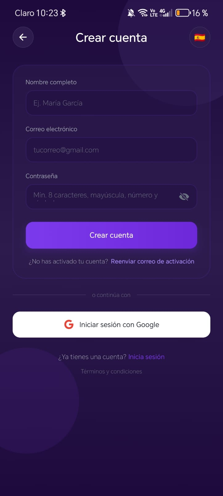

*Nota.* Formulario "Crear cuenta" con el nombre completo, el correo y la contraseña.

## Usuario asistente

### Flujo general del rol

El asistente explora los eventos publicados, abre el detalle de un evento, elige sus sillas en el mapa del recinto y paga. Sus entradas quedan en "Mis entradas", desde donde genera el código QR que presenta en la entrada del evento.

### Exploración de eventos

1. Presione el botón central de la barra inferior o el acceso rápido "Buscar eventos".
2. Escriba el nombre del evento en "Buscar eventos..." o filtre por categoría (por ejemplo, Populares, Todas o Deportes).
3. En la tarjeta del evento, presione "Ver detalles".

**Figura 5**

*Listado de eventos*

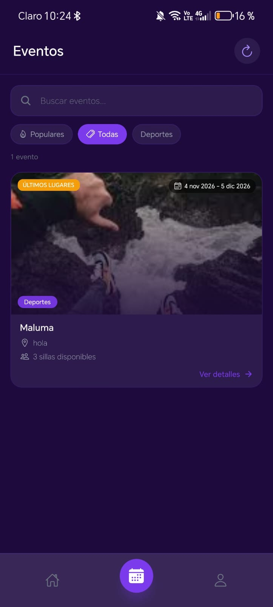

*Nota.* Búsqueda, filtros por categoría y tarjeta del evento con sus fechas, lugar y sillas disponibles.

### Selección de sillas y compra

1. En el detalle del evento, revise la galería y la información del evento.
2. En "Mapa de Sillas", indique cuántas sillas necesita con los botones de más y menos.
3. Elija la sección (cada una muestra su precio y las sillas disponibles) y toque las sillas en el mapa. Las sillas disponibles se muestran en verde.
4. Revise "Tu Carrito" y presione "Ir al pago".
5. En "Confirmar compra", revise las sillas y el total, elija "Pago normal" o "Usar cartera" y el método de pago "Código QR".
6. Presione "Pagar" y complete el pago.

**Figura 6**

*Detalle del evento y mapa de sillas*

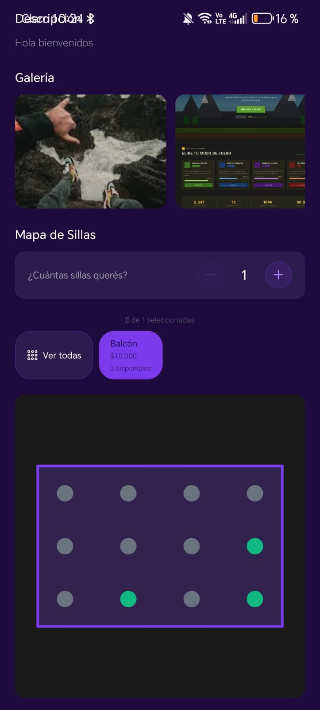

*Nota.* Galería del evento, cantidad de sillas, secciones con su precio y mapa del recinto.

**Figura 7**

*Confirmación de compra*

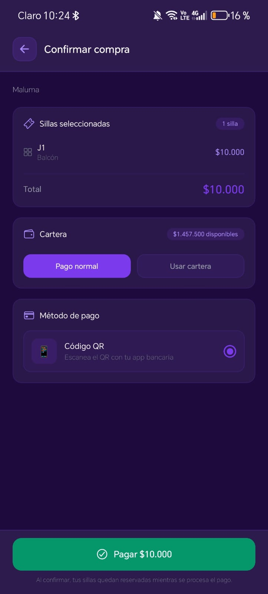

*Nota.* Resumen de las sillas, total, uso de la cartera y método de pago.

Las sillas elegidas quedan reservadas por un tiempo limitado (hasta 10 minutos) mientras se completa el pago. Si el tiempo termina o el pago es rechazado, las sillas vuelven a estar disponibles y deben elegirse de nuevo.

### Mis entradas y código QR

Cada compra genera una orden con una o varias entradas. El código QR de la orden es el que se presenta al organizador en la entrada del evento.

1. Desde Inicio, presione "Mis tickets".
2. Ubique la orden del evento. Cada entrada muestra su código y su estado (por ejemplo, "Válido").
3. Presione "QR orden" para mostrar el código de toda la orden, o "QR" para una entrada individual.
4. Muestre el código al organizador en la entrada del evento.

**Figura 8**

*Mis entradas*

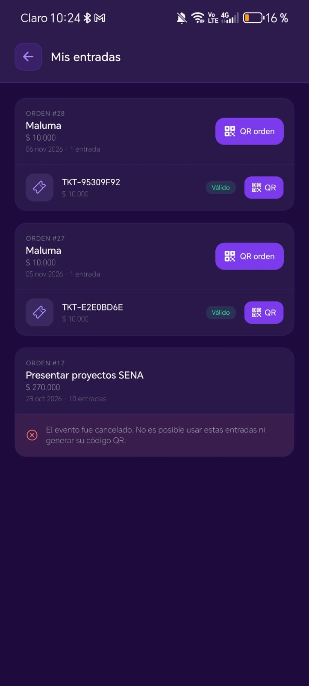

*Nota.* Órdenes con sus entradas y estados; las entradas de un evento cancelado no pueden usarse.

**Figura 9**

*Código QR de la orden*

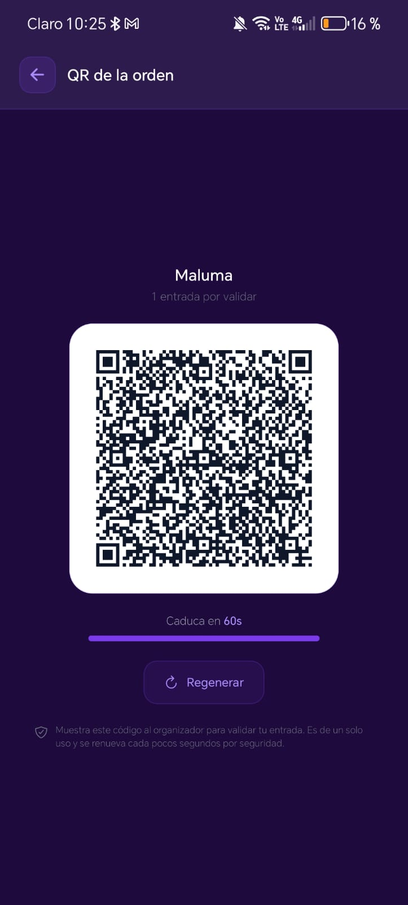

*Nota.* Código QR de un solo uso, con el tiempo de vigencia y el botón "Regenerar".

Por seguridad, el código QR caduca a los pocos segundos y se renueva automáticamente; también puede generarse uno nuevo con "Regenerar". Si el evento fue cancelado, la orden lo indica y no es posible generar su código.

### Cartera

La cartera muestra el saldo disponible del usuario y el historial de sus movimientos.

1. Desde Inicio, presione "Mi billetera".
2. Consulte el saldo disponible y el historial de créditos y compras.
3. Para usar el saldo, presione "Usar saldo en una compra" o elija "Usar cartera" al confirmar una compra.

**Figura 10**

*Cartera del usuario*

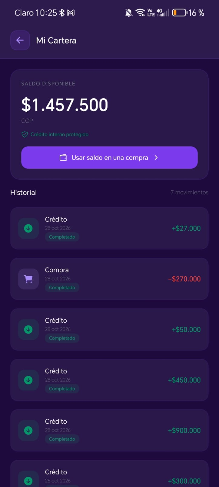

*Nota.* Saldo disponible e historial de movimientos.

Si un evento se cancela, el valor pagado por cada entrada se reembolsa como crédito en la cartera del comprador.

### Notificaciones

El ícono de campana de la pantalla de Inicio, o el acceso rápido "Notificaciones", muestra los avisos de la cuenta, como pagos aprobados, créditos en la cartera o la validación de una entrada en la puerta del evento.

### Perfil, idioma y tema

1. Presione "Perfil" en la barra inferior.
2. En "Información Personal", edite su nombre completo y su biografía y presione "Guardar cambios".
3. En "Idioma Preferido", elija español, inglés, francés o portugués.
4. En "Personalizar tema", elija y personalice los colores de la aplicación.

**Figura 11**

*Perfil del usuario*

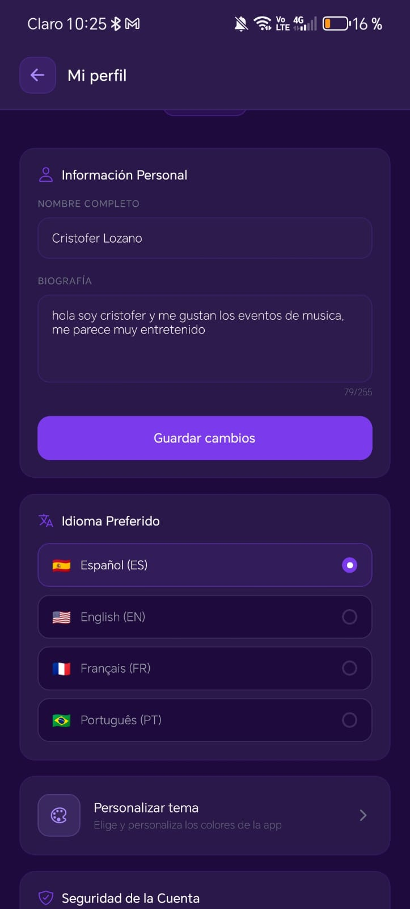

*Nota.* Información personal, idioma preferido y personalización del tema.

En "Seguridad de la Cuenta" se encuentran las opciones para cerrar la sesión y desactivar la cuenta.

## Usuario organizador

### Flujo general del rol

El organizador crea y publica sus eventos desde la plataforma web. En la aplicación móvil, además de las funcionalidades del asistente, dispone de "Validar entradas" para controlar el ingreso al evento con la cámara del teléfono.

### Validación de entradas

1. Presione "Perfil" en la barra inferior y, en la sección Organizador, elija "Validar entradas".
2. La primera vez, presione "Permitir cámara" para dar acceso a la cámara.
3. Apunte la cámara al código QR que muestra el asistente.
4. Espere el resultado: "¡Entrada válida! Puedes ingresar" indica que la entrada se validó.
5. Presione "Escanear otra" para continuar con el siguiente asistente.

**Figura 12**

*Escaneo del código QR*

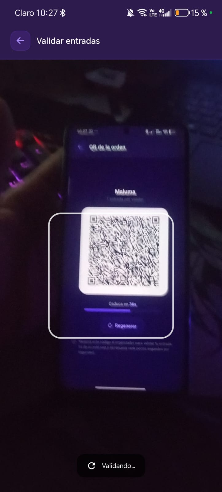

*Nota.* La cámara lee el código QR de la orden que muestra el asistente.

**Figura 13**

*Entrada validada*

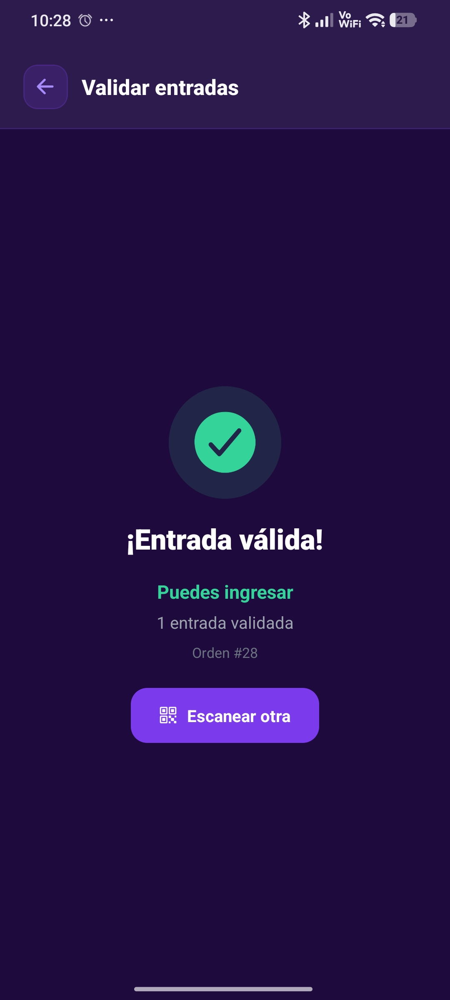

*Nota.* Resultado de una validación correcta, con el número de entradas validadas y la orden.

Cada código QR solo puede usarse una vez. Si se escanea de nuevo, la aplicación muestra "Entrada ya escaneada"; si el código no corresponde a una entrada válida, muestra "QR no válido". Al validar, el asistente recibe la confirmación en su aplicación.

## Usuario administrador

Al iniciar sesión como administrador, la aplicación muestra el "Panel de administración", con los mismos módulos de la plataforma web adaptados al teléfono.

**Figura 14**

*Panel de administración*

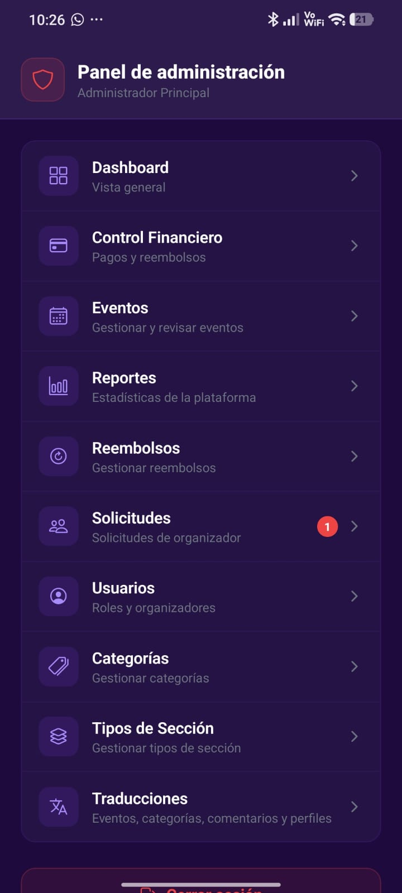

*Nota.* Módulos disponibles para el administrador en la aplicación.

- Dashboard: vista general de la plataforma.
- Control Financiero: pagos y reembolsos.
- Eventos: gestión y revisión de los eventos.
- Reportes: estadísticas de la plataforma.
- Reembolsos: gestión de los reembolsos.
- Solicitudes: solicitudes para ser organizador; el número indica las pendientes.
- Usuarios: roles y organizadores.
- Categorías y Tipos de Sección: catálogos que usan los organizadores.
- Traducciones: textos de eventos, categorías, comentarios y perfiles en otros idiomas.

El funcionamiento de cada módulo se describe en el Manual de usuario web (Santos Ortiz y Lozano Contreras, 2026c).

## Evidencia de funcionamiento en iOS

La aplicación se desarrolló con React Native y Expo, tecnologías que permiten ejecutarla tanto en Android como en iOS. Para verificar su funcionamiento en iOS, el equipo la ejecutó en el simulador de iOS de Xcode, en un equipo Mac facilitado por el instructor Carlos Julio Cadena Sarasty. Las condiciones de la prueba se resumen en la Tabla 3.

**Tabla 3**

*Condiciones de la prueba en iOS*

| Aspecto | Detalle |
|---|---|
| Dispositivo simulado | iPhone SE (3.ª generación) |
| Sistema operativo | iOS 18.3 |
| Herramienta | Simulador de iOS (Xcode) en macOS |
| Flujos verificados | Inicio, detalle del evento con comentarios, carrito de compra y Mis entradas |
| Resultado | La aplicación funcionó correctamente en los flujos verificados |
| Distribución | No se distribuye para iOS; la distribución oficial es el archivo APK para Android |

La aplicación no se publica para iOS porque instalarla en iPhone fuera del simulador exige una membresía paga del programa Apple Developer. Desde la Figura 15 hasta la Figura 18 se muestra la aplicación en ejecución; el nombre del dispositivo y la versión de iOS aparecen en la esquina superior izquierda de cada captura.

**Figura 15**

*Pantalla de inicio en iOS*

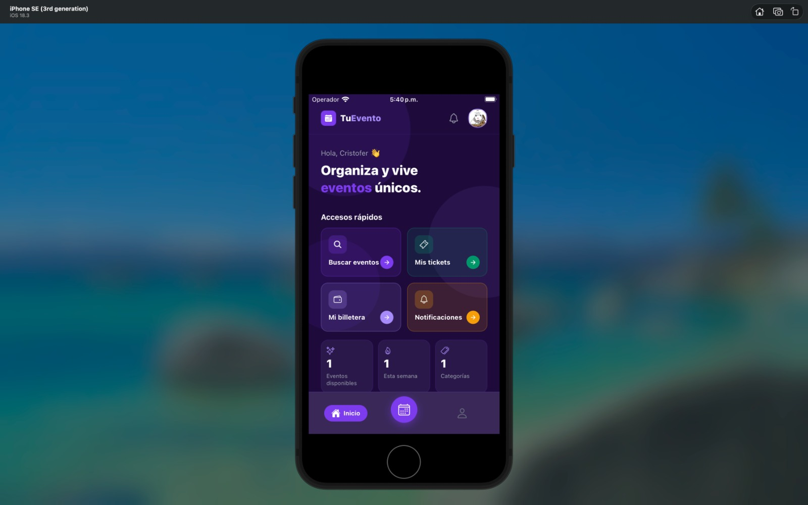

*Nota.* Saludo al usuario, accesos rápidos e indicadores de la pantalla de Inicio.

**Figura 16**

*Detalle del evento en iOS*

*Nota.* Sección de comentarios del evento con su calificación.

**Figura 17**

*Carrito de compra en iOS*

*Nota.* Silla seleccionada en el mapa del recinto y carrito con el total y el botón "Ir al pago".

**Figura 18**

*Mis entradas en iOS*

*Nota.* Órdenes y entradas del usuario. Esta captura se tomó con la aplicación configurada en inglés, uno de los idiomas que ofrece la aplicación.

## Mensajes de validación y errores frecuentes

La Tabla 4 reúne los mensajes que la aplicación puede mostrar y cómo resolverlos.

**Tabla 4**

*Mensajes de validación y errores frecuentes*

| Situación | Mensaje mostrado | Causa | Solución |
|---|---|---|---|
| Instalación bloqueada | Android impide instalar el archivo descargado. | El teléfono no permite instalar aplicaciones de origen desconocido. | Permita la instalación de origen desconocido para el navegador o el gestor de archivos y abra de nuevo el APK. |
| Código QR vencido | El organizador no puede validar el código. | El código QR caducó antes de escanearse. | Presione "Regenerar" y muestre el nuevo código. |
| Entrada ya usada | "Entrada ya escaneada". | El código de esa entrada ya se validó. | Verifique con el organizador; cada entrada solo permite un ingreso. |
| Código no reconocido | "QR no válido". | El código no corresponde a una entrada de "Tu Evento". | Pida al asistente abrir el código desde "Mis tickets". |
| Cámara sin permiso | "Necesitamos la cámara". | No se ha dado permiso de cámara a la aplicación. | Presione "Permitir cámara" o habilítelo en los ajustes del teléfono. |
| Evento cancelado | La orden indica que el evento fue cancelado. | El organizador o el administrador canceló el evento. | Revise su cartera: el valor pagado se reembolsa como crédito. |
| Sillas no disponibles | Las sillas elegidas ya no aparecen disponibles. | Otro usuario las reservó o terminó el tiempo de reserva. | Vuelva al mapa del recinto y elija otras sillas. |

## Recomendaciones de uso

- Descargue la aplicación solo desde el sitio oficial de "Tu Evento".
- Mantenga una conexión estable a internet durante la compra y la validación de entradas.
- Complete el pago sin demora, pues las sillas solo quedan reservadas por un tiempo limitado.
- Abra el código QR en el momento de ingresar al evento y suba el brillo de la pantalla para facilitar la lectura.
- Organizador: valide las entradas en un lugar con buena iluminación.
- Cierre la sesión si comparte el teléfono con otras personas.

## Glosario

**Tabla 5**

*Glosario de términos*

| Término | Definición |
|---|---|
| APK | Archivo de instalación de aplicaciones para Android. |
| Asistente | Usuario que se registra y participa en los eventos publicados. |
| Cartera | Módulo que muestra el saldo disponible del usuario y el historial de sus movimientos. |
| Código QR | Código que identifica una orden o una entrada y que el organizador escanea en el ingreso al evento. |
| Entrada | Comprobante digital de la compra de una silla para un evento; también se denomina ticket. |
| Orden | Compra realizada por el usuario, que agrupa una o varias entradas. |
| Organizador | Usuario habilitado para crear eventos y validar sus entradas. |
| Origen desconocido | Aplicación que se instala desde un archivo y no desde una tienda oficial. |
| Simulador de iOS | Herramienta de Xcode que ejecuta aplicaciones de iPhone en un computador Mac. |
| Validación | Lectura del código QR que confirma que una entrada es válida y registra el ingreso. |

## Referencias

Santos Ortiz, J., y Lozano Contreras, C. D. (2026a). *TuEvento: Manual de instalación* (Versión 1.0). CapySoft.

Santos Ortiz, J., y Lozano Contreras, C. D. (2026b). *TuEvento: Manual técnico*. CapySoft.

Santos Ortiz, J., y Lozano Contreras, C. D. (2026c). *TuEvento: Manual de usuario web* (Versión 3.3). CapySoft.

Wompi. (s. f.). *Documentación de Wompi*. https://docs.wompi.co/
