# Manual de usuario — Tu Evento

> Documento consolidado de Tu Evento. Reúne los documentos siguientes, cuyo contenido se conserva sin cambios; los metadatos de conversión de cada uno van en un comentario HTML al inicio de su sección.

**Contenido**

1. [Manual de usuario — web](#doc-te-0158)
2. [Manual de usuario — aplicación móvil e instalación](#doc-te-0159)

---

<!--
ruta_anterior: es/09_Manuales/Manual_de_usuario/Manual_web.md
id: TE-0158
title: "Manual (web)"
lang: es
source: 09_Manuales/Manual de usuario/Manual (web).docx
source_sha256: 8522404d169774cdf8be50d77857b91e52ab77242a69e4a84706fb94bd793671
conversion: "pandoc 3.9 (-t gfm --wrap=none --extract-media) + extracción de encabezados/pies; sin revisión manual"
converted_on: 2026-10-23
fidelity: parcial
losses:
  - "El original no usa estilos de título; los títulos visuales quedan como texto en negrita, sin jerarquía #. Pendiente de marcar a mano."
  - "Encabezados y pies de página extraídos aparte (pandoc no los convierte); en el original se repiten en cada página. Los campos se muestran como {PAGE}, {NUMPAGES}."
status: borrador
reviewed_by: ""
-->

# Manual de usuario — web

**Manual Web**

Lozano Contreras Cristofer David

Santos Ortiz Jhampier

Análisis y Desarrollo de Software

\(3145556\)

Servicio Nacional de Aprendizaje

Octubre 1, 2025

# **Contenido**

[Usuario Web [5](#usuario-web)](#usuario-web)

[Usuario Organizador [22](#section)](#section)

[Usuario Administrador [23](#usuario-administrador)](#usuario-administrador)

**Introducción**

El presente manual de usuario tiene como finalidad describir de manera clara y detallada las funcionalidades principales de la aplicación web "Tu Evento", desarrollada por CapySoft. Esta versión está diseñada como una plataforma integral que permite a los diferentes tipos de usuarios (asistentes, organizadores y administrador) interactuar con los eventos de manera sencilla y eficiente desde navegadores web como Google Chrome y Microsoft Edge.

A diferencia de la aplicación móvil, la versión web incorpora un conjunto más amplio de funcionalidades que permiten no solo la participación de los asistentes en los eventos, sino también la gestión y supervisión de estos por parte de organizadores y administradores.

En la versión web:

1.  El usuario asistente puede crear una cuenta, iniciar sesión, gestionar su perfil, visualizar y filtrar eventos, registrarse en ellos y participar mediante comentarios.

2.  El organizador dispone de herramientas avanzadas para crear, editar, publicar y eliminar eventos, además de realizar la maquetación de espacios y controlar la distribución de los mismos.

3.  El administrador tiene la capacidad de supervisar la plataforma, gestionar usuarios y, de manera específica, aceptar o denegar solicitudes de registro para convertirse en organizador, asegurando así la transparencia y el correcto uso del sistema.

# Usuario Web

1.  **Interfaz principal**

Al abrir la web "Tu Evento", el usuario será dirigido a una landing page de inicio, la cual presenta de manera clara y atractiva las opciones principales de la plataforma. En esta pantalla inicial, se muestran secciones destacadas como:

- **Nosotros:** Información sobre la plataforma y su propósito.

- **Crear:** Opción dinámica que varía según el estado del usuario:

1.  Si el usuario no ha iniciado sesión, será redirigido a la opción Crear cuenta.

2.  Si el usuario ha iniciado sesión, pero aún no está registrado como organizador, será dirigido al formulario de registro de empresa (RUT u otros datos requeridos).

3.  Si el usuario ya está registrado como organizador, será llevado a la sección de creación y gestión de eventos.

- **Eventos:** Permite visualizar los eventos disponibles en la plataforma.

- **Iniciar Sesión:** Para acceder con credenciales previamente registradas.

> 

- **Interfaz de inicio de sesión:**

La interfaz de inicio de sesión ofrece a los usuarios un acceso seguro y flexible a la plataforma, permitiendo ingresar mediante el método tradicional con correo electrónico y contraseña, crear una nueva cuenta en caso de no estar registrado, recuperar la contraseña en caso de olvido, o bien iniciar sesión de manera más ágil a través de credenciales de redes sociales vinculadas, brindando así varias alternativas de autenticación según la preferencia del usuario.

> 

.

- **Crear cuenta mediante redes sociales**

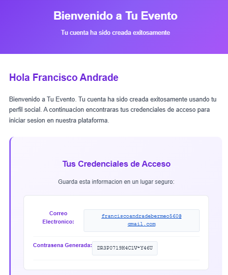La aplicación web “Tu Evento” ofrece la opción de iniciar sesión mediante redes sociales, permitiendo a los usuarios acceder de forma rápida y sencilla utilizando sus credenciales de plataformas externas como Google o Facebook. Esta funcionalidad evita la necesidad de crear una nueva contraseña dentro del sistema, facilitando el ingreso con un solo clic y manteniendo la seguridad gracias a la validación directa realizada por cada red social. De esta manera, los usuarios cuentan con una alternativa práctica al inicio de sesión tradicional con correo y contraseña, agilizando el acceso a la plataforma.

- **Creación de cuenta de manera tradicional:**

La opción de crear cuenta permite a los nuevos usuarios registrarse en la plataforma mediante un formulario sencillo, en el cual deben ingresar datos básicos como nombre completo, correo electrónico y una contraseña segura. Una vez completado el registro, el sistema envía un código de verificación al correo proporcionado, el cual debe ser ingresado para validar y activar la cuenta. De esta manera, se garantiza que solo usuarios con correos válidos puedan acceder al sistema, brindando mayor seguridad y confiabilidad en el proceso de registro.

> 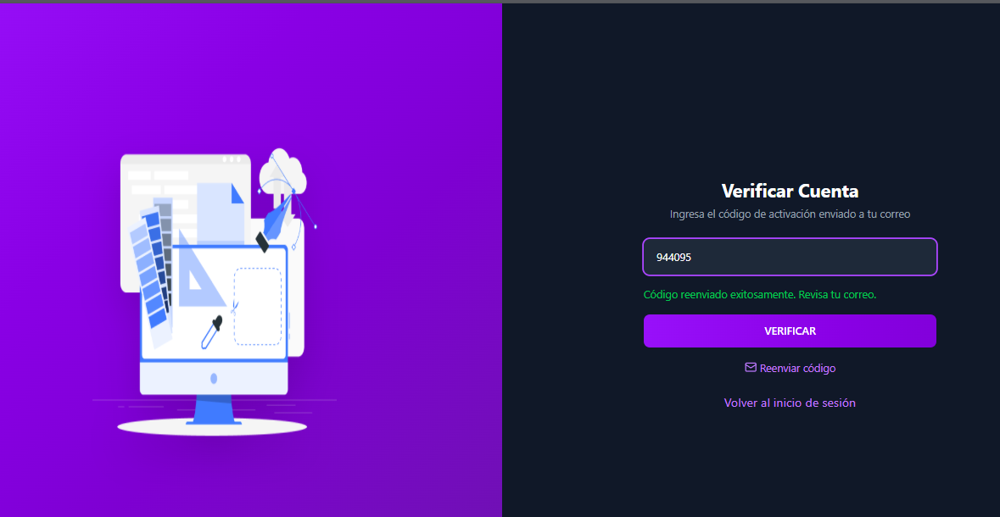
>
> 

# 

# 

# 

# 

# 

# 

- **Recuperar contraseña:**

La opción de recuperar contraseña permite a los usuarios restablecer el acceso a su cuenta en caso de olvido. Para ello, deben ingresar el correo electrónico registrado, tras lo cual el sistema envía un código de verificación al mismo. Una vez validado el código, se habilita el formulario para definir una nueva contraseña, que reemplaza inmediatamente a la anterior y será la única válida para futuros inicios de sesión, garantizando así un acceso seguro y controlado a la plataforma.

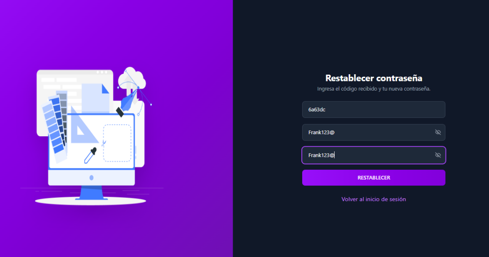

# Inicio de sesión:

El inicio de sesión permite a los usuarios acceder a la plataforma utilizando las credenciales previamente registradas, compuestas por su correo electrónico y contraseña. Una vez validados los datos, el sistema redirige al usuario a la interfaz correspondiente según su rol, ya sea asistente, organizador o administrador, asegurando que cada perfil disponga únicamente de las funcionalidades que le corresponden. En caso de error en las credenciales, el sistema muestra un mensaje de advertencia e invita al usuario a reintentar o utilizar la opción de recuperación de contraseña.

- **Petición para ser organizador:**

La opción de petición para ser organizador permite a un usuario registrado solicitar el rol de organizador dentro de la plataforma. Para ello, debe completar un formulario en el que se le solicita el RUT de la empresa, una vez enviada la solicitud, esta queda pendiente de revisión por parte del administrador, quien tendrá la facultad de aceptar o rechazar la petición. En caso de aprobación, el usuario adquiere el rol de organizador y accede a las funcionalidades exclusivas de creación, edición y gestión de eventos.

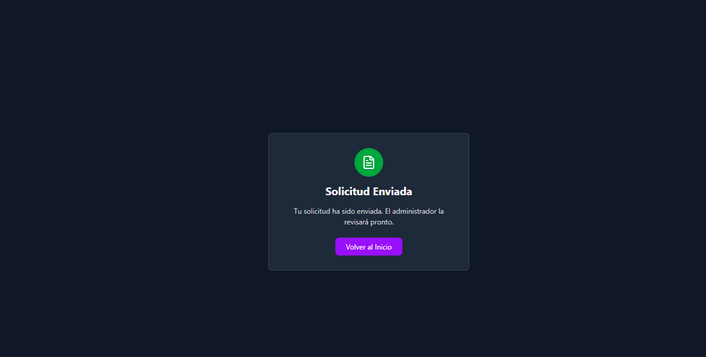

- **Visualización de eventos:**

La funcionalidad de visualización de eventos permite a los usuarios explorar de manera sencilla todos los eventos disponibles en la plataforma. Desde esta sección se muestran detalles básicos como el nombre del evento, fecha, lugar, descripción y cupos disponibles, lo que facilita al asistente identificar aquellos de su interés.

# Usuario Organizador

- **Gestionar eventos:**

La función de gestión de eventos permite al usuario con rol de organizador controlar de manera integral sus eventos dentro de la plataforma. Mediante esta funcionalidad, el organizador puede crear nuevos eventos, maquetar la estructura del lugar, publicar los eventos para que sean visibles a los usuarios.

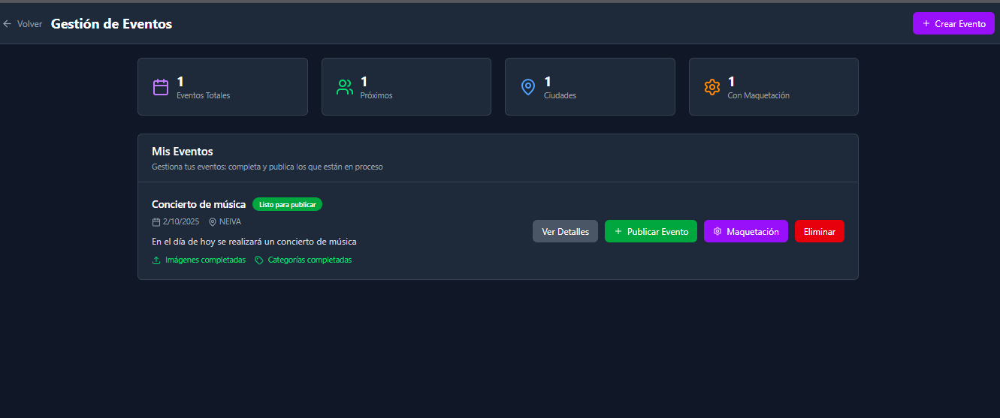

# Usuario Administrador

La sección de administración de usuarios está destinada al administrador de la plataforma y permite supervisar y gestionar a todos los usuarios registrados. Desde esta funcionalidad, el administrador puede visualizar la información básica de cada usuario, su rol dentro del sistema (asistente, organizador o administrador), así como el estado de su cuenta. Además, tiene la capacidad de aprobar o rechazar solicitudes de organizador, asignar o revocar permisos y, en casos necesarios, suspender o eliminar usuarios. De esta manera, se garantiza un control adecuado de la comunidad y el correcto funcionamiento de la plataforma.

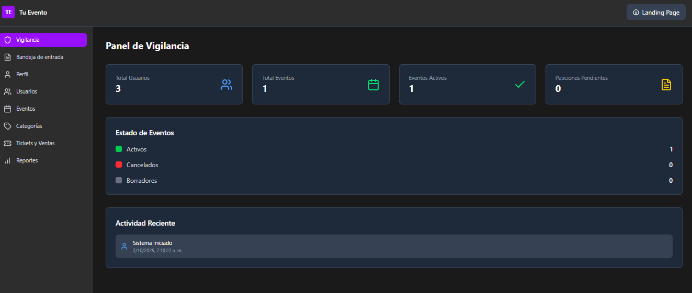

# Errores del sistema

1.  Durante el proceso de inicio de sesión, el sistema puede mostrar mensajes de validación cuando los datos ingresados no cumplen con los requisitos establecidos. Estos errores ayudan a garantizar que la información del usuario sea correcta y segura antes de permitir el acceso a la plataforma.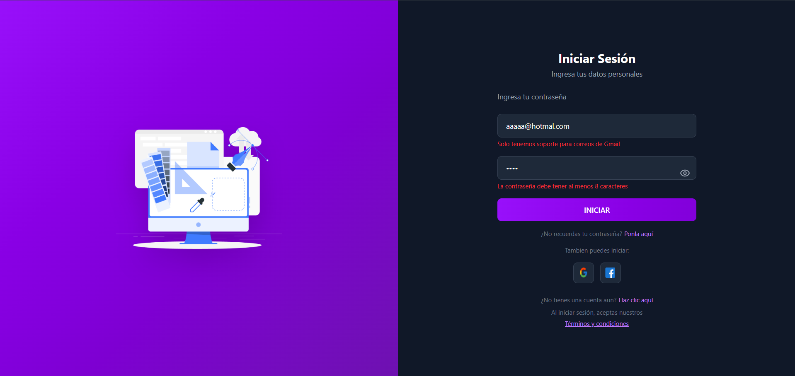

### Descripción del Error – Inicio de Sesión

Pantalla: Inicio de sesión del sistema\
Ubicación: Formulario de autenticación de usuario\
Tipo de error: Validación de datos de entrada

#### Descripción

Al intentar iniciar sesión, se muestra un mensaje de error debajo del campo de correo electrónico que indica:

> “Solo tenemos soporte para correos de Gmail”

Esto ocurre porque el usuario ingresó una dirección de correo que no pertenece al dominio de Gmail, en este caso: aaaaa@hotmal.com.

Además, el sistema muestra un segundo mensaje de validación bajo el campo de contraseña:

> “La contraseña debe tener al menos 8 caracteres”

Esto significa que la contraseña ingresada no cumple con la longitud mínima requerida por la plataforma.

#### Causa del error

> El sistema está configurado para aceptar únicamente direcciones de correo con dominio @gmail.com.
>
> La contraseña ingresada contiene menos de 8 caracteres, lo cual no cumple con las políticas de seguridad establecidas.

####  Solución recomendada

> Verificar que el correo ingresado tenga un formato válido y que pertenezca al dominio permitido (@gmail.com).\
> Ejemplo correcto: usuario@gmail.com
>
> Asegurarse de que la contraseña contenga al menos 8 caracteres, combinando letras, números y símbolos si es posible.

2.  Durante el proceso de recuperación de contraseña, el sistema valida que el correo electrónico ingresado exista en la base de datos. Si la dirección no está registrada o contiene errores de escritura, se mostrará un mensaje de advertencia para evitar el envío de instrucciones a un correo inválido.

### Descripción del Error – Recuperación de Contraseña

Pantalla: Olvidé mi contraseña\
Ubicación: Formulario de recuperación de acceso\
Tipo de error: Validación de usuario

####  Descripción

Al intentar recuperar la contraseña, el sistema muestra el siguiente mensaje debajo del campo de correo electrónico:

> “Usuario no encontrado”

Esto ocurre porque la dirección de correo ingresada no coincide con ningún usuario registrado en la plataforma o presenta un error tipográfico.\
En este caso, el correo introducido es: aaaaaaaaaaaa@hotmaail.com, el cual contiene un error en el dominio (hotmaail.com en lugar de hotmail.com).

####  Causa del error

> El correo electrónico ingresado no existe en la base de datos de usuarios registrados.
>
> El correo tiene errores de escritura o no cumple con el formato correcto.

####  Solución recomendada

> Verificar que el correo electrónico esté correctamente escrito y pertenezca a un usuario registrado.\
> Ejemplo correcto: usuario@hotmail.com o usuario@gmail.com
>
> Si el correo es correcto y aún se muestra el error, contactar con el soporte técnico para verificar el registro de la cuenta.

3.  Durante el proceso de registro, el sistema valida los datos ingresados para garantizar que la información del nuevo usuario cumpla con los requisitos de formato, seguridad y compatibilidad. Si alguno de los campos no cumple con las reglas establecidas, se muestran mensajes de error que indican el tipo de corrección necesaria antes de continuar con el registro.

    

### Descripción del Error – Registro de Usuario

Pantalla: Registro de nuevo usuario\
Ubicación: Formulario de creación de cuenta\
Tipo de error: Validación de datos de entrada

####  Descripción

Al intentar registrarse, el sistema muestra varios mensajes de validación:

> Debajo del campo de nombre, aparece el mensaje:
>
> “Por favor ingresa nombre y apellido”\
> Esto indica que el campo solo contiene un nombre y el sistema requiere nombre y apellido completos.
>
> Debajo del campo de correo electrónico, aparece el mensaje:
>
> “Solo tenemos soporte para correos de Gmail”\
> Esto se debe a que la dirección ingresada (aaaaa@hotmal.com) no pertenece al dominio Gmail y además presenta un error tipográfico (“hotmal” en lugar de “hotmail”).
>
> Debajo del campo de contraseña, el sistema muestra:
>
> “La contraseña debe tener al menos 8 caracteres”\
> Esto significa que la contraseña introducida no cumple con la longitud mínima requerida por las políticas de seguridad.

####  Causa del error

> El campo de nombre está incompleto (falta apellido).
>
> El correo electrónico no pertenece al dominio permitido (@gmail.com) o tiene un error de escritura.
>
> La contraseña contiene menos de 8 caracteres.

#### Solución recomendada

> Ingresar nombre y apellido completos, por ejemplo: Ana López.
>
> Verificar que el correo sea válido y termine en @gmail.com.\
> Ejemplo correcto: usuario@gmail.com
>
> Establecer una contraseña de al menos 8 caracteres, combinando letras, números y símbolos para mayor seguridad.

4.  Durante la gestión y publicación de eventos, el sistema valida que todos los pasos previos al lanzamiento estén correctamente completados. Entre ellos, se encuentra la maquetación del evento, que define la estructura visual y los elementos que se mostrarán al público. Si este paso no se ha realizado, el sistema impide la publicación para evitar errores de visualización o información incompleta.

    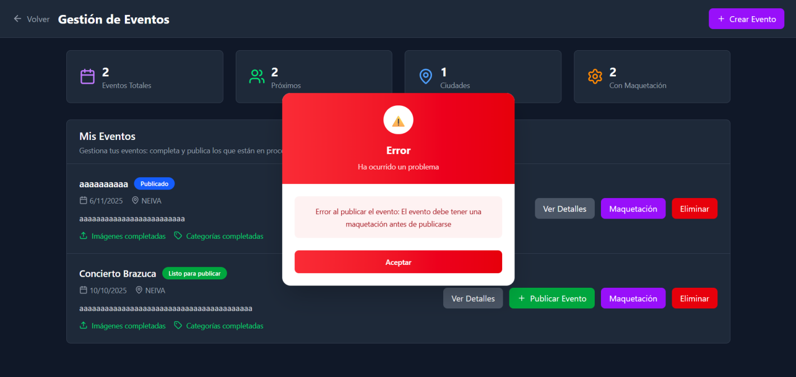

### Descripción del Error – Publicación de Evento

Pantalla: Gestión de Eventos\
Ubicación: Sección “Mis Eventos”\
Tipo de error: Validación previa a la publicación

#### Descripción

Al intentar publicar un evento desde el panel de gestión, aparece una ventana emergente con el siguiente mensaje de error:

> “Error al publicar el evento: El evento debe tener una maquetación antes de publicarse.”

Este mensaje indica que el evento seleccionado no cuenta con una maquetación asignada o completada, por lo que el sistema bloquea su publicación hasta que dicho requisito se cumpla.

#### Causa del error

> El evento no tiene una maquetación creada o guardada.
>
> El proceso de maquetación no se finalizó correctamente o no se vinculó al evento actual.

#### Solución recomendada

> Hacer clic en el botón “Maquetación” correspondiente al evento.
>
> Completar el proceso de diseño o estructura visual del evento.
>
> Guardar los cambios y verificar que el estado del evento indique que está “Listo para publicar”
>
> Una vez completado, volver a intentar la publicación.

5.  Durante el proceso de creación de un evento, el sistema valida que la información básica ingresada cumpla con los requisitos mínimos de longitud y coherencia de fechas. Esto garantiza que los eventos creados sean claros, completos y correctamente configurados antes de pasar a las siguientes etapas del registro.

    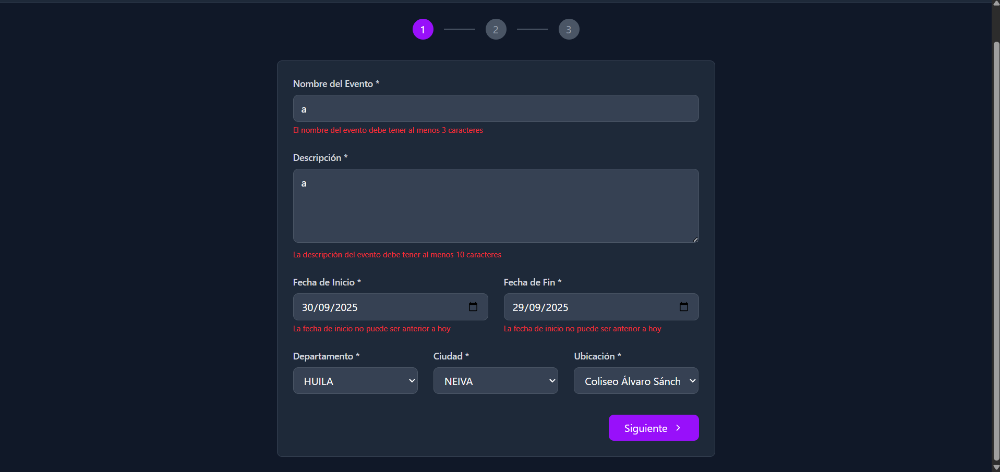

###  Descripción del Error – Creación de Evento

Pantalla: Creación de evento – Paso 1 (Información básica)\
Ubicación: Formulario de registro de evento\
Tipo de error: Validación de campos obligatorios

####  Descripción

Al intentar avanzar al siguiente paso del formulario, el sistema muestra varios mensajes de validación en color rojo.

> Campo “Nombre del Evento”
>
> “El nombre del evento debe tener al menos 3 caracteres”\
> Esto indica que el nombre ingresado (a) no cumple con la longitud mínima requerida para ser válido.
>
> Campo “Descripción”
>
> “La descripción del evento debe tener al menos 10 caracteres”\
> El texto ingresado (a) es demasiado corto y no proporciona información suficiente sobre el evento.
>
> Campo “Fecha de Inicio” y “Fecha de Fin”
>
> “La fecha de inicio no puede ser anterior a hoy”\
> Además, las fechas seleccionadas (30/09/2025 y 29/09/2025) son inválidas, ya que la fecha de fin es anterior a la fecha de inicio, lo cual no es permitido.

#### Causa del error

> El nombre del evento no cumple la longitud mínima de 3 caracteres.La descripción es menor a 10 caracteres.
>
> Las fechas ingresadas son incorrectas o incoherentes (la fecha de fin no puede ser antes de la fecha de inicio).

#### Solución recomendada

> Escribir un nombre de evento claro y descriptivo (mínimo 3 caracteres).\
> Ejemplo: Festival de Música.
>
> Redactar una descripción completa que explique el propósito o detalles del evento (mínimo 10 caracteres).\
> Ejemplo: Concierto de bandas locales en el centro de la ciudad.
>
> Asegurar que la fecha de inicio sea igual o posterior al día actual, y que la fecha de fin sea posterior a la de inicio.

6.  En la etapa final de la creación de un evento, el sistema requiere que el usuario seleccione una categoría principal y una subcategoría que describan correctamente el tipo de evento. Estas categorías permiten clasificar los eventos de forma adecuada y facilitan su búsqueda dentro de la plataforma.

    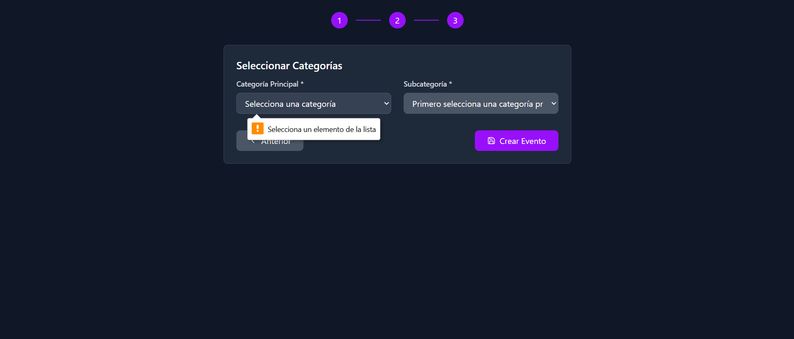

### Descripción del Error – Selección de Categorías

Pantalla: Creación de evento – Paso 2 (Selección de categorías)\
Ubicación: Formulario de selección de categoría y subcategoría\
Tipo de error: Validación de campos obligatorios

#### Descripción

Al intentar hacer clic en el botón “Crear Evento” sin haber seleccionado una categoría, el sistema muestra un mensaje emergente de advertencia:

> “Selecciona un elemento de la lista”

Este mensaje indica que no se ha seleccionado ninguna categoría principal ni subcategoría, por lo que el sistema no puede continuar con la creación del evento.

#### Causa del error

> El usuario no seleccionó una categoría principal del menú desplegable.
>
> En consecuencia, la subcategoría no puede cargarse ni seleccionarse.
>
> El sistema requiere ambos campos completados antes de continuar.

- 

#### Solución recomendada

> Abrir el menú desplegable “Categoría Principal” y seleccionar una opción de la lista.
>
> Esperar a que se carguen las opciones correspondientes en el campo “Subcategoría”.
>
> Seleccionar una subcategoría válida.
>
> Una vez seleccionados ambos campos, hacer clic en “Crear Evento” para completar el registro.

7.  En la sección de Solicitud de Organizador, los usuarios deben cargar un documento que respalde su solicitud para ser aprobados como organizadores de eventos dentro de la plataforma. Este proceso asegura que la información presentada cumpla con los requisitos formales establecidos.

    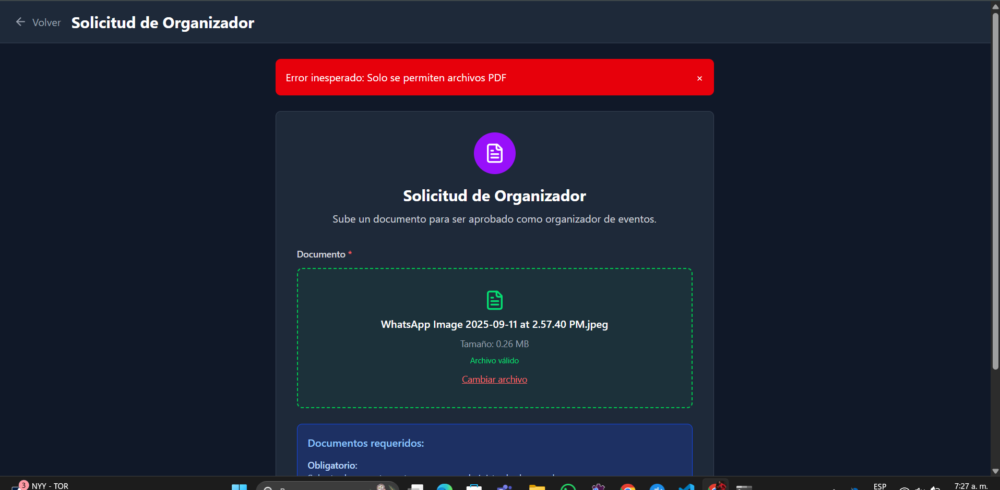

#### Descripción del Error – Tipo de archivo no permitido

**Pantalla:** Solicitud de Organizador\
**Ubicación:** Formulario de carga de documentos\
**Tipo de error:** Validación de formato de archivo

#### Descripción

Al intentar subir un archivo con formato **.jpeg**, el sistema muestra una alerta roja con el mensaje:

> “Error inesperado: Solo se permiten archivos PDF”

Esto indica que el sistema **únicamente acepta documentos en formato PDF**, ya que es el estándar requerido para validar solicitudes oficiales.

#### Causa del error

> El usuario intenta subir un archivo con una extensión **no permitida** (por ejemplo: .jpeg, .png, .jpg, .docx, etc.).
>
> La validación del backend detecta el tipo de archivo y bloquea el proceso de carga.

#### Solución recomendada

> Convertir el documento o imagen al formato **.PDF** antes de cargarlo.
>
> Asegurarse de que el archivo cumpla con los requisitos de tamaño máximo establecidos (si aplica).
>
> Volver a subir el documento usando el botón **“Cambiar archivo”**.
>
> Verificar que en la barra de estado aparezca el mensaje **“Archivo válido”** antes de continuar con el envío de la solicitud.

---

## Encabezados y pies de página del original

- **Encabezado** (`word/header1.xml`): texto «0» 

---

<!--
ruta_anterior: es/09_Manuales/Manual_de_usuario/manual_mobile_e_instalacion.md
id: TE-0159
title: "manual mobile e instalacion"
lang: es
source: 09_Manuales/Manual de usuario/manual mobile e instalacion.docx
source_sha256: a92e3107d13fab5b6fc476da03be20d311f2cd59517b8f333b1a69cdbca59ef4
conversion: "pandoc 3.9 (-t gfm --wrap=none --extract-media) + extracción de encabezados/pies; sin revisión manual"
converted_on: 2026-10-23
fidelity: parcial
losses:
  - "El original no usa estilos de título; los títulos visuales quedan como texto en negrita, sin jerarquía #. Pendiente de marcar a mano."
  - "Encabezados y pies de página extraídos aparte (pandoc no los convierte); en el original se repiten en cada página. Los campos se muestran como {PAGE}, {NUMPAGES}."
status: borrador
reviewed_by: ""
-->

# Manual de usuario — aplicación móvil e instalación

**Manual de aplicación Mobile**

Lozano Contreras Cristofer David

Santos Ortiz Jhampier

Análisis y Desarrollo de Software

\(3145556\)

Servicio Nacional de Aprendizaje

Octubre 1, 2025

**Introducción**

El presente manual de usuario tiene como finalidad describir de manera clara y detallada las funcionalidades principales de la aplicación móvil "Tu Evento", desarrollada por CapySoft. Esta aplicación está diseñada para brindar a los asistentes una herramienta práctica, sencilla y accesible, que facilite la interacción con los eventos de manera rápida y eficiente desde sus dispositivos móviles.

A diferencia de la versión web, la aplicación móvil se centra en ofrecer las funcionalidades esenciales para los usuarios finales, tales como: creación de cuenta, inicio de sesión, visualización de los eventos disponibles, participación mediante comentarios y validación de pago a través del escaneo de códigos QR. Con estas herramientas, se garantiza una experiencia ágil, intuitiva y adaptada a la portabilidad de los dispositivos Android.

**Requisitos del sistema**

- **Sistema operativo:**

> **Mínimo:** Android 11
>
> **Recomendado:** Android 13 o superior

- **Memoria RAM:**

> **Mínimo:** 3 GB
>
> **Recomendado:** 4 GB o más

- **Almacenamiento interno disponible:**

> **Mínimo:** 200 MB libres para la instalación y datos temporales

- **Conectividad:**

> Conexión a Internet estable (Wi-Fi o datos móviles).
>
> Acceso a la cámara trasera para el escaneo de códigos QR.

**Instalación**

Para instalar la aplicación móvil, el usuario debe ingresar desde su dispositivo Android al sitio web oficial del sistema mediante su navegador móvil. Una vez dentro, deberá seleccionar la opción “Descargar APK”, ubicada en la sección de compatibilidad de dispositivos.

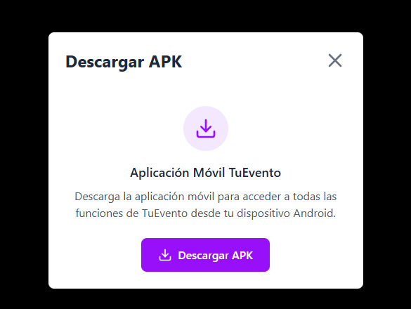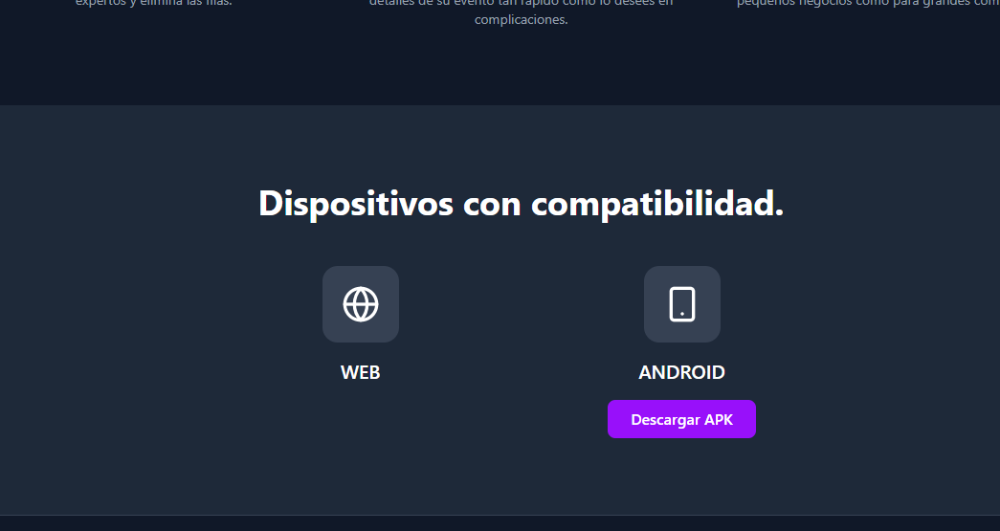

Una vez descargado el archivo APK, el usuario debe proceder a habilitar la opción “Instalar apps desconocidas” en su dispositivo Android. Para ello, debe acceder a la configuración del sistema y permitir la instalación desde la fuente, luego, al abrir el archivo descargado, el sistema solicitará confirmación para instalar la aplicación\
Tras aceptar, se iniciará el proceso de instalación, y una vez finalizado, se mostrará un mensaje indicando que la aplicación se ha instalado correctamente. Finalmente, el usuario podrá seleccionar la opción “Abrir” para ejecutar la aplicación o “Listo” para cerrarla y acceder posteriormente desde el menú principal del dispositivo.

1.  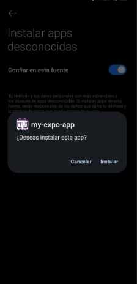

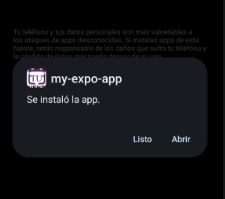

**Acceso y uso de la aplicación**

1.  **Interfaz principal**

Al abrir la aplicación móvil "Tu Evento", el usuario será dirigido a la pantalla de inicio de sesión. En este apartado, el sistema solicitará las credenciales previamente registradas (correo electrónico y contraseña) para permitir el acceso seguro a la plataforma.

Asimismo, desde esta pantalla el usuario tendrá disponibles opciones adicionales como:

1.  Crear una nueva cuenta, en caso de no estar registrado.

2.  Recuperar contraseña, en caso de haberla olvidado.

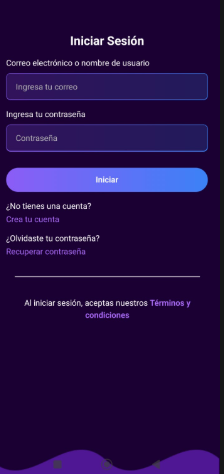De esta manera, se garantiza que cada usuario pueda acceder de forma personalizada a las funcionalidades principales de la aplicación.

1.  **Interfaz de crear cuenta**

La aplicación móvil permite a los nuevos usuarios registrarse de manera rápida y sencilla para acceder a todas las funcionalidades disponibles. Al seleccionar la opción “Crear cuenta” desde la pantalla de inicio de sesión, se abrirá el formulario de registro, en el cual el sistema solicitará los siguientes datos:

1.  Nombre completo: Información personal que identificará al usuario dentro de la plataforma.

2.  Correo electrónico: Dato único utilizado como medio de contacto y nombre de usuario para iniciar sesión.

3.  Contraseña: Clave personal que garantizará la seguridad del acceso a la cuenta.

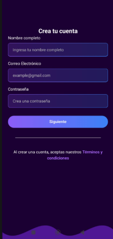Una vez diligenciados los campos, el usuario deberá pulsar el botón “Siguiente” para enviar la información.

1.  **Código de verificación de creación de cuenta**

Una vez completado el proceso de creación de cuenta, el sistema enviará de manera automática un código de verificación al correo electrónico registrado por el usuario. Este paso es obligatorio para validar la autenticidad de la cuenta y habilitar su uso dentro de la aplicación móvil. En la pantalla de verificación, el usuario deberá:

1.  Ingresar el código de verificación recibido en su correo electrónico.

2.  Pulsar el botón “Verificar” para confirmar la validez del código.

**Resultados posibles:**

**Verificación exitosa:**\
Si el código ingresado es correcto y aún está dentro del tiempo de validez, el sistema confirmará la activación de la cuenta y permitirá el acceso inmediato a la aplicación.

> 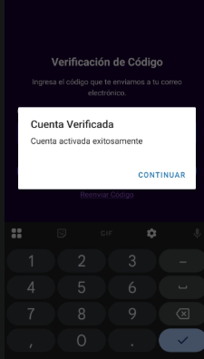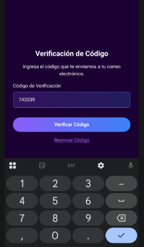

1.  **Recuperación de contraseña**

La aplicación móvil "Tu Evento" ofrece la opción de recuperar el acceso en caso de que el usuario olvide su contraseña. Para ello, desde la pantalla de inicio de sesión se debe seleccionar el enlace “¿Olvidó su contraseña?”, lo cual habilitará el proceso de recuperación.

**Pasos del proceso:**

**Ingreso de correo electrónico:**\
El sistema solicitará al usuario digitar el correo electrónico asociado a su cuenta.

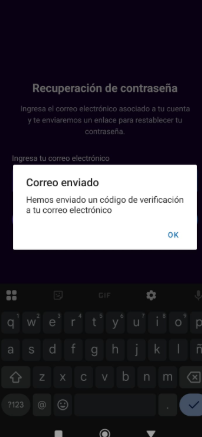

2.  **Código de verificación y renovación**

Cuando se solicita la recuperación de acceso, el sistema envía un código de verificación único al correo electrónico registrado. Este código cumple la función de confirmar la identidad del usuario antes de permitir la modificación de la clave de acceso.

Una vez validado el código, el sistema habilita el formulario para que el usuario registre su nueva contraseña. La contraseña anterior queda invalidada, y a partir de ese momento solo será posible acceder con la nueva clave definida.

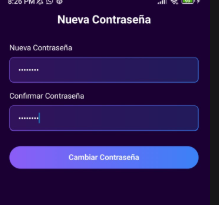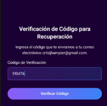

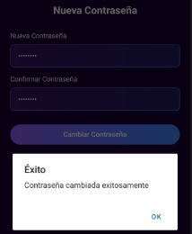

3.  **Inicio de sesión**

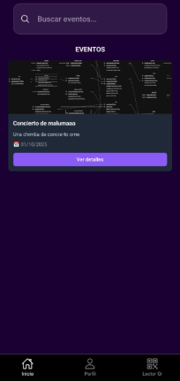Si las credenciales ingresadas son correctas, el sistema validará los datos y redirigirá al usuario a la pantalla principal, donde podrá visualizar los eventos disponibles y acceder a las funcionalidades ofrecidas.

4.  **Filtrar evento por el nombre**

permite al usuario realizar la búsqueda de eventos de manera rápida y precisa mediante un filtro por nombre. Esta funcionalidad facilita la localización de un evento específico sin necesidad de recorrer toda la lista disponible.

**Proceso de uso:**

1.  El usuario accede a la pantalla de eventos disponibles.

2.  En la barra de búsqueda, digita el nombre completo o parcial del evento que desea localizar.

3.  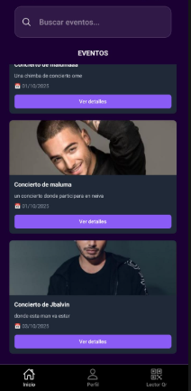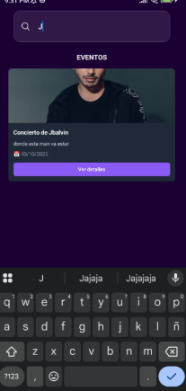El sistema procesa la consulta y muestra en pantalla únicamente los eventos que coincidan con el texto ingresado.

    1.  **Comentar evento**

El sistema permite a los usuarios comentar en los eventos disponibles dentro de la aplicación, fomentando la interacción y el intercambio de opiniones entre los asistentes. Para ello, el usuario debe acceder al evento de su interés, seleccionar la opción Comentar e ingresar el texto en el campo habilitado. Una vez escrito su comentario, debe presionar el botón guardar, con lo cual su aporte quedará registrado y visible para otros usuarios de la plataforma.

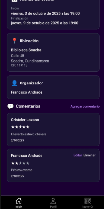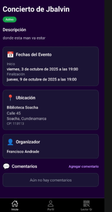

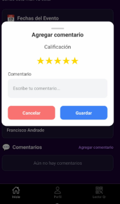

2.  **Renovación de datos personales**

El sistema ofrece a los usuarios la posibilidad de renovar o actualizar sus datos personales de manera sencilla y segura, con el fin de mantener su información siempre vigente dentro de la plataforma. Para ello, el usuario accede al menú de Perfil, donde se habilita un formulario que le permite modificar campos como número de teléfono, fecha de nacimiento y dirección; una vez realizados los cambios, debe presionar el botón Guardar cambios para que la actualización se registre exitosamente

>  

3.  **Cerrar sesión**

El sistema brinda a los usuarios la opción de cerrar sesión, garantizando la protección de la cuenta. Para hacerlo, el usuario debe acceder al menú principal o de Perfil, seleccionar la opción Cerrar sesión y confirmar la acción. Una vez realizada, la aplicación redirigirá automáticamente a la pantalla de inicio de sesión, asegurando que el acceso quede restringido hasta que se ingresen nuevamente las credenciales correctas.

1.  **Desactivación de cuenta**

El sistema ofrece a los usuarios la posibilidad de desactivar su cuenta de manera voluntaria en caso de que ya no deseen utilizar la aplicación. Para ello, el usuario debe ingresar al menú de Perfil y seleccionar la opción Desactivar cuenta. Una vez confirmada la acción, la cuenta quedará inhabilitada, lo que implica que no podrá acceder a las funcionalidades de la aplicación ni aparecer en los eventos activos.

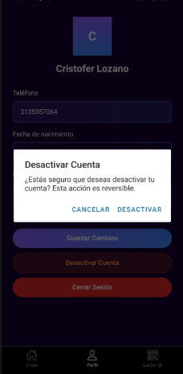

2.  **Escaneo y validación de ticket QR**

La aplicación incorpora una funcionalidad que permite a los usuarios escanear el código QR asociado a su ticket de evento, con el fin de validar su acceso de manera rápida y segura. Al utilizar la opción de escaneo, el sistema comprueba la autenticidad del ticket en tiempo real, verificando que este se encuentre registrado y que el pago haya sido confirmado previamente por el organizador.

2.  **Casos de error**

- **Interfaz de Inicio de sesión**

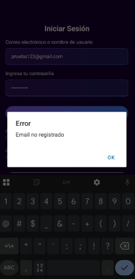En caso de que el usuario introduzca credenciales incorrectas (correo o contraseña), el sistema mostrará un mensaje de error indicando “email no registrado”.

- **Interfaz de recuperar contraseña**

En caso de que el usuario introduzca una cuenta inexistente o no registrada en la plataforma, el sistema mostrará un mensaje de error indicando:\
**“Usuario no encontrado”**.

De esta manera, se garantiza que únicamente los usuarios previamente registrados puedan recuperar su acceso, manteniendo la seguridad e integridad de la aplicación.

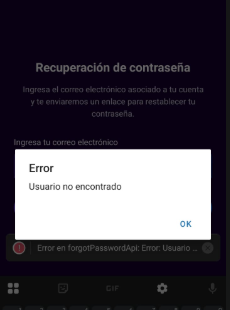

- **Iniciar sesión en una cuenta desactivada**

En caso de que un usuario intente iniciar sesión con una cuenta previamente desactivada, el sistema mostrará un mensaje informando que la cuenta se encuentra inactiva y que no es posible acceder a las funcionalidades de la aplicación.

> 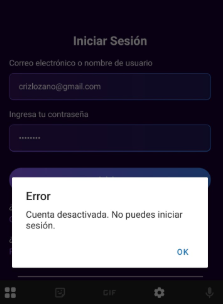

- **Actualizar datos**

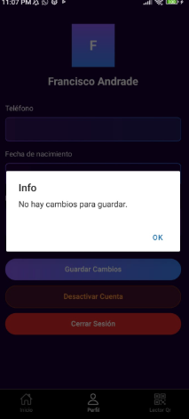En caso de que no se haya modificado ningún dato, el sistema mostrará un mensaje informativo indicando: “No hay cambios para guardar”, garantizando que solo se almacenen datos nuevos o actualizados. De esta manera, se asegura que la información del usuario en la plataforma se mantenga siempre vigente y coherente con la realidad.

---

## Encabezados y pies de página del original

- **Encabezado** (`word/header1.xml`): texto «0» 
